## 习题课

殷亚凤

智能软件与工程学院

苏州校区南雍楼东区225

yafeng@nju.edu.cn， https://yafengnju.github.io/

• 计算机网络和因特网  
・ 应用层  
· 运输层  
• 网络层：数据平面  
• 网络层：控制平面  
• 链路层和局域网  
· 无线网络和移动网络  
• 计算机网络中的安全

R12. 与分组交换网络相比，电路交换网络有哪些优点？在电路交换网络中，TDM比FDM有哪些优点？

## 参考答案：

电路交换：由于电路交换在通信之前要在通信双方之间建立一条被双方独占的物理通路（由通信双方之间的交换设备和链路逐段连接而成）。因而有以下优点：

(1）由于通信线路为通信双方用户专用，数据直达，所以传输数据的时延非常小

(2）通信双方之间的物理通路一旦建立，双方可以随时通信，实时性强。

（3）双方通信时按发送顺序传送数据，不存在失序问题。

（4）电路交换既适用于传输模拟信号，也适用于传输数字信号。

（5）电路交换设备控制均较简单。

R12. 与分组交换网络相比，电路交换网络有哪些优点？在电路交换网络中，TDM比FDM有哪些优点？

## 参考答案：

## TDM比FDM的优点如下：

1. 当发生拥塞等网络问题时，TDM中的数据丢失可能只会是一部分，而FDM中就可能是大部分或全部。 X

2. TDM适合数字信号传输，而FDM适合模拟信号传输，因为现在通信网络多是传输数字信号，所以TDM比FDM好。 7

3. 因为频分复用连接建立后，当中途没有数据传输时，他所占有的频段带宽不能被其他连接使用，故可能存在空置，而在时分复用的统计时分模式下，连接建立后，当某个连接暂时不用传输数据时可以少分时间片或者不分，即其时隙的分配时“按需分配”，这样就让出了相应的传输时间给其他连接。 L

R23.因特网协议栈中的5个层次有哪些？在这些层次中，每层的主要任务是什么？

## 参考答案：

5个层次从低到高分别是：物理层，链路层，网络层，运输层，应用层

## 每一层的主要任务如下：

1. 物理层：定义了网络的电气、机械、功能和过程特性；负责在实际媒体上传输原始比特数据流。

2. 链路层：在相邻节点之间提供可靠的数据传输服务；处理物理层上发生的数据传输错误；进行帧编号、检查和重传等操作。 Y

3. 网络层：负责在网络上传递数据包；进行逻辑寻址(IP地址)、路由选择等操作；实现网络设备之间的互连。 A

4. 运输层：建立端到端的通信链接保证数据传输的可靠性和顺序；实现流量控制、拥塞控制等功能。

5. 应用层：向用户提供各种网络服务和接口；处理应用程序间的通信工作；常见的应用层协议有HTTP、FTP、SMTP等。

每一层都在下面一层的基础上构建,向上层提供服务。通过分层的设计,可以简化复杂系统的构建,提高灵活性和可维护性。各层之间通过定义好的接口进行交互,实现数据在整个网络中的传输。

R24.什么是应用层报文？什么是运输层报文段？什么是网络层数据报？什么是链路层帧?

## 参考答案：

1. 应用层报文是应用层协议用于交换数据的基本单位,例如HTTP请求/响应报文、FTP命令等。应用层报文包含了应用程序需要发送或接收的数据。

2. 运输层报文段是TCP或UDP在传输数据时所使用的数据单位。TCP报文段或UDP数据报中包含了应用层报文以及一些控制信息,如序列号、确认号、检验和等,用于实现可靠传输和流量控制等功能。

3. 网络层数据报是IP协议在进行路由转发时所使用的数据单位。IP数据报由首部和数据区组成,首部包含源IP地址、目标IP地址等路由信息,数据区则是运输层报文段。

4. 链路层帧是链路层协议在实际传输介质上传输数据时所使用的单位。帧由数据链路层首部、数据区(网络层数据报)和尾部组成。首部和尾部包含了MAC地址、校验序列等控制信息,用于实现可靠传输和寻址等功能。

R25.路由器处理因特网协议栈中的哪些层次?链路层交换机处理的是哪些层次?主机处理的是哪些层次?

## 参考答案：

路由器处理网络层、链路层、物理层协议。

链路层交换机处理链路层、物理层协议。

主机处理应用层、运输层、网络层、链路层、物理层协议。

• 计算机网络和因特网  
· 应用层  
· 运输层  
• 网络层：数据平面  
• 网络层：控制平面  
• 链路层和局域网  
· 无线网络和移动网络  
• 计算机网络中的安全

R3.对两进程之间的通信会话而言，哪个进程是客户，哪个进程是服务器？

## 参考答案：

发起通信的进程标识为客户，在会话开始时等待接受的进程是服务器。

R5. 运行在一台主机上的一个进程，使用什么信息来标识运行在另一台主机上的进程？

## 参考答案：

目标主机的IP地址和目标进程中套接字的端口号。

R16. 假定 Alice使用一个基于 Web的电子邮件账户(例如Hotmail或Gmail)向Bob发报文，而 Bob使用IMAP从他的邮件服务器访问自己的邮件。讨论该报文是如何从Alice主机到Bob主机的。要列出在两台主机间移动该报文时所使用的各种应用层协议。

## 参考答案：

Alice主机-（HTTP协议）-Alice服务器-（SMTP协议）-Bob服务器-（POP3协议）-Bob主机

R24. CDN通常采用两种不同的服务器放置方法之一。列举并简单描述它们。

## 参考答案：

深入：通过在遍及全球的接入ISP中部署服务器集群来深入到ISP的接入网中．好处是靠近端用户，减少端用户和CDN集群之间链路和路由器数量，改善了用户感受到的时延和吞吐量. 缺点是由于高度分布式设计，维护和管理集群成本高

邀请做客：通过在少量关键位置建造大集群来邀请到ISP做客．这些CDN集群通常放在因特网交换结点(IXP). 好处是产生较低的维护和管理开销.缺点是以对端用户的较高时延和较低吞吐量为代价.

P9.考虑图2-12，其中有一个机构的网络和因特网相连。假定对象的平均长度为850000比特，从这个机构网的浏览器到初始服务器的平均请求率是每秒16个请求。还假定从接入链路的因特网一侧的路由器转发一个HTTP请求开始，到接收到其响应的平均时间是3秒（参见2.2.5节)。将总的平均响应时间建模为平均接入时延（即从因特网路由器到机构路由器的时延）和平均因特网时延之和。对于平均接入时延，使用Δ/(1-Δβ)，式中Δ是跨越接入链路发送一个对象的平均时间，β是对象对该接入链路的平均到达率。

a. 求出总的平均响应时间。

b. 现在假定在这个机构LAN中安装了一个缓存器。假定命中率为0.4，求出总的响应时间。

## 参考答案：

a) Δ= (850,000比特)/(15,000,000比特/秒) = 0.0567

∆β=(16请求/秒)(0.0567秒/请求) = 0.907。

平均接入时延=(0.0567秒)/(1-0.907)≈0.6秒。

总平均响应时间=0.6秒+3秒=3.6秒。

b) 当强度减小40%，平均接入时延=(0.0567秒)/[1-(0.6)(0.907)] = 0.124秒。

平均响应时间=0.124秒+3秒=3.124秒。

总平均响应时间是(0.4)(0秒)+(0.6)(3.124秒)=1.874秒。

P22. 考虑向N个对等方分发F=20Gb的一个文件。该服务器具有 $u _ { \mathrm { s } } = 3 0 \mathrm { M b p s }$ 的上载速率，每个对等方具有 $d _ { \mathrm { _ \rho } } = 2 \mathrm { M b p s }$ 的下载速率和上载速率 $\scriptstyle u _ { \mathrm { o } }$ 对于N=10、100和1000并且 $u = 3 0 0 \mathrm { k b p s }$ 、700kbps 和2Mbps，对于N和u的每种组合绘制出确定最小分发时间的图表。需要分别针对客户-服务器分发和P2P分发两种情况制作。

## 参考答案：

## (1) 客户-服务器分发情况：

服务器的上载速率是固定的（30Mbps），而每个对等方的下载速率和上载速率（u）是可变的。我们可以使用公式计算最小分发时间： 人 X

$$
T _ { m i n } = \operatorname* { m a x } ( \frac { N F } { u _ { s } } , \frac { F } { d _ { i } } )
$$

## (2) P2P分发情况：

每个对等方既是下载者也是上传者。因此，我们需要考虑每个对等方的下载和上传速率（u）。最小分发时间的计算方式类似于客户-服务器分发，但我们需要考虑每个对等方的最小下载和上传速率：

$$
T _ { m i n } = \operatorname* { m a x } [ \frac { F } { u _ { s } } , \frac { F } { d _ { i } } , \frac { N F } { ( u _ { s } + \sum _ { n = 1 } ^ { N } u _ { i } ) } ]
$$

其中：

$$
\mathsf { F } = 2 0 \mathsf { G } \mathsf { b } = 2 0 ^ { \star } 1 0 2 4 \mathsf { M } \mathsf { b } \bar { \Xi } \bar { \mathcal { Z } } \bar { \Xi } \bar { \Xi } \bar { \Xi } 1 \bar { \mathsf { F } } \bar { \mathsf { F } } = 2 0 \mathsf { G } \mathsf { b } = 2 0 ^ { \star } 1 0 0 0 \mathsf { M } \mathsf { b }
$$

$\yen 123,456$ 最小分发时间(s)
<table><tr><td rowspan=2 colspan=1>N</td><td rowspan=2 colspan=1>C-S</td><td rowspan=1 colspan=3>P2P</td></tr><tr><td rowspan=1 colspan=1>300kbps</td><td rowspan=1 colspan=1>700kbps</td><td rowspan=1 colspan=1>2Mbps</td></tr><tr><td rowspan=1 colspan=1>10</td><td rowspan=1 colspan=1>10240</td><td rowspan=1 colspan=1>10240</td><td rowspan=1 colspan=1>10240</td><td rowspan=1 colspan=1>10240</td></tr><tr><td rowspan=1 colspan=1>100</td><td rowspan=1 colspan=1>68266.7</td><td rowspan=1 colspan=1>34538.1</td><td rowspan=1 colspan=1>20821.6</td><td rowspan=1 colspan=1>10240</td></tr><tr><td rowspan=1 colspan=1>1000</td><td rowspan=1 colspan=1>682666.7</td><td rowspan=1 colspan=1>63411.7</td><td rowspan=1 colspan=1>28699.8</td><td rowspan=1 colspan=1>10240</td></tr></table>

当 $\mathsf { F } { = } 2 0 \mathsf { G b } = 2 0 ^ { \star } ~ 1 0 0 0 ~ \mathsf { M b }$ 最小分发时间(s)

<table><tr><td rowspan=2 colspan=1>N</td><td rowspan=2 colspan=1>C-S 否</td><td rowspan=1 colspan=3>P2P</td></tr><tr><td rowspan=1 colspan=1>300kbps</td><td rowspan=1 colspan=1>700kbps</td><td rowspan=1 colspan=1>2Mbps</td></tr><tr><td rowspan=1 colspan=1>10</td><td rowspan=1 colspan=1>10000</td><td rowspan=1 colspan=1>10000</td><td rowspan=1 colspan=1>10000</td><td rowspan=1 colspan=1>10000</td></tr><tr><td rowspan=1 colspan=1>100</td><td rowspan=1 colspan=1>66666.7</td><td rowspan=1 colspan=1>33333.3</td><td rowspan=1 colspan=1>20000</td><td rowspan=1 colspan=1>10000</td></tr><tr><td rowspan=1 colspan=1>1000</td><td rowspan=1 colspan=1>666666.6</td><td rowspan=1 colspan=1>60606.1</td><td rowspan=1 colspan=1>27397.3</td><td rowspan=1 colspan=1>10000</td></tr></table>

• 计算机网络和因特网  
・应用层  
· 运输层  
• 网络层：数据平面  
• 网络层：控制平面  
• 链路层和局域网  
· 无线网络和移动网络  
• 计算机网络中的安全

R5. 在今天的因特网中，为什么语音和图像流量常常是经过TCP而不是经UDP发送。(提示：我们寻找的答案与TCP的拥塞控制机制没有关系。)

## 参考答案：

## 1. 可靠性(Reliability):

TCP提供可靠的数据传输，能够检测和处理数据包丢失、重复和错误。而语音和图像数据对丢失和错误通常是不可容忍的，需要准确无误地传输。UDP虽然速度更快，但不保证可靠传输。

## 2. 有序性(Ordering):

TCP保证数据包按序到达接收端，而语音和图像数据的顺序很重要，无序的数据包会导致语音或图像出现问题。UDP不保证有序性。

## 3. 流量控制(Flow Control):

TCP提供流量控制机制，可以根据接收端的处理能力调节发送速率，避免接收端被淹没。对于连续的语音和图像流，这种流量控制机制很重要。

4. 由于大多数防火墙都配置为阻止 UDP 流量，因此使用 TCP 传输视频和语音流量可以允许流量通过防火墙。

R8.假定在主机C端口80上运行的一个Web服务器。假定这个Web服务器使用持续连接，并且正在接收来自两台不同主机A和B的请求。被发送的所有请求都通过位于主机C的相同套接字吗？如果它们通过不同的套接字传递，这两个套接字都具有端口80吗？讨论和解释之。

## 参考答案：

被发送的请求通过位于主机C的不同套接字，对于每个持久连接，Web服务器都会创建一个单独的“连接套接字”。每个连接套接字由一个四元组标识：（源IP地址、源端口号、目标IP地址、目标端口号）。当主机C接收到IP数据报时，它会检查数据报中的这四个字段，以确定它应该将TCP报文段的有效负载传递到哪个套接字。

这两个套接字都具有端口80。

## R14. 是非判断题：

a. 主机A经过一条TCP连接向主机B发送一个大文件。假设主机B没有数据发往主机A。因为主机B不能随数据捎带确认，所以主机B将不向主机A发送确认。

b. 在连接的整个过程中，TCP的 rwnd的长度决不会变化。

c. 假设主机A通过一条TCP连接向主机B发送一个大文件。主机A发送但未被确认的字节数不会超过接收缓存的大小。

d. 假设主机A通过一条TCP连接向主机B发送一个大文件。如果对于这条连接的一个报文段的序号为m，则对于后继报文段的序号将必然是m+1

e. TCP报文段在它的首部中有一个 rwnd 字段。

f. 假定在一条TCP连接中最后的SampleRTT等于1秒，那么对于该连接的TimeoutInterval的当前值必定大于等于1秒。

g.假设主机A通过一条TCP连接向主机B发送一个序号为38的4个字节的报文段。在这个相同的报文段中，确认号必定是42。

参考答案：X X √ X √ X X

<table><tr><td></td><td>P1. 假设客户A向服务器S发起一个Telnet会话。与此同时，客户B也向服务器S发起一个Telnet会话。</td><td></td><td></td><td></td></tr><tr><td></td><td>给出下面报文段的源端口号和目的端口号： a. 从 A向S 发送的报文段。</td><td>计算20</td><td></td><td></td></tr><tr><td></td><td>b. 从B向S发送的报文段。</td><td></td><td></td><td></td></tr><tr><td></td><td>c. 从S向A发送的报文段。</td><td></td><td></td><td></td></tr><tr><td></td><td>d. 从S向B 发送的报文段。</td><td></td><td></td><td></td></tr><tr><td></td><td>e. 如果 A和B是不同的主机，那么从 A向S发送的报文段的源端口号是否可能与从B向S发送的报</td><td></td><td></td><td></td></tr><tr><td></td><td></td><td></td><td></td><td></td></tr><tr><td>f.如果它们是同一台主机，情况会怎么样？</td><td>文段的源端口号相同？</td><td></td><td></td><td></td></tr></table>

## 参考答案：

假设 A 的源端口号是 a， B 的源端口号是 b。

a. 从 A 向 S 发送的报文段：(a， 23)

b. 从 B 向 S 发送的报文段：(b， 23)

c. 从 S 向 A 发送的报文段：(23，a)

d. 从 S 向 B 发送的报文段：(23, b)

e. A， B 是不同主机的话，那么 a 有可能等于 b，但是因为 TCP 套接字是根据四元组来标识的 (dst\_ip， dst\_port, src\_ip,src\_port)，而我们知道，主机 A 和主机 B 的 IP 地址不会相同，因此相同端口号的报文段到达主机 S 仍然能被定位到不同的套接字中。

f. 如果它们是同一台主机，那么源端口号不可能相同。

P3. UDP和TCP使用反码来计算它们的检验和。假设你有下面3个8比特字节：01010011，01100110.01110100。这些8比特字节和的反码是多少？(注意到尽管UDP和TCP使用16比特的字来计算检验和，但对于这个问题，你应该考虑8比特和。）写出所有工作过程。UDP为什么要用该和的反码，即为什么不直接使用该和呢？使用该反码方案，接收方如何检测出差错？1比特的差错将可能检测不出来吗？2比特的差错呢？

## 参考答案：

1)   
01010011   
01100110   
01110100   
00101110

这3个8位二进制的和的反码为：11010001

2）UDP为什么要用该和的反码呢？使用反码可以提供简单的奇偶校验。接收方只需将接收到的数据加上检验和，然后检查结果是否全为1。如果结果是全1，说明传输是正确的；如果不是全1，就说明传输过程中发生了错误。

3）1个bit出错一定可以检测出来，反码方案可以检测出来。因为即使只有一个比特错误，和的反码也会变得完全不同。 IX

4）如果两个bit同时出错，则可能检测不出来。反码方案可以检测出来。因为即使只有一个比特错误，和的反码也会变得完全不同。

P5. 假定某UDP接收方对接收到的UDP报文段计算因特网检验和，并发现它与承载在检验和字段中的值相匹配。该接收方能够绝对确信没有出现过比特差错吗？试解释之。

## 参考答案：

不能，接收方不能绝对确定没有发生bit错误。这是因为计算数据包校验和的方式所致。如果数据包中两个16位字的相应位（将相加）为0和1，那么即使它们分别翻转为1 和0，总和仍然保持不变。因此，接收方计算的和将全为1。这意味着即使存在传输错误，校验和也会验证通过。

P19. 考虑一种情况，主机A想同时向主机B和主机C发送分组。A与B和C是经过广播信道连接的，即由A发送的分组通过该信道传送到B和C。假设连接A、B和C的这个广播信道具有独立的报文丢失和损坏特性（例如，从A发出的报文可能被B正确接收但没有被C正确接收)。设计一个类似于停等协议的差错控制协议，用于从A可靠地传输分组到B和C。该协议使得A直到得知B和C已经正确接收到当前报文，才获取上层交付的新数据。给出A和C的FSM描述。（提示：B的FSM大体上应当与C的相同。）同时，给出所使用的报文格式的描述。

## 参考答案：

此问题是简单停止和等待协议(rdt3.0)的变体。

1) 报文格式的描述：由于通道可能会丢失消息，并且发送方可能会重新发送其中一个接收方已收到的消息（由于过早超时或因为其他接收方尚未正确接收数据），因此需要序列号。与 rdt3.0中一样，这里1位序列号就足够了。

2)发送方（主机A）和接收方(主机B)FSM如图所示。在此问题中，发送方（主机A）状态指示发送方是否已从B（仅）、从C（仅）或既未从C也未从B 接收到 ACK。接收方（主机B,或者主机C）状态指示哪个序列接收者正在等待的号码。

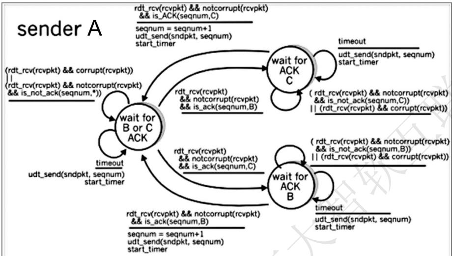

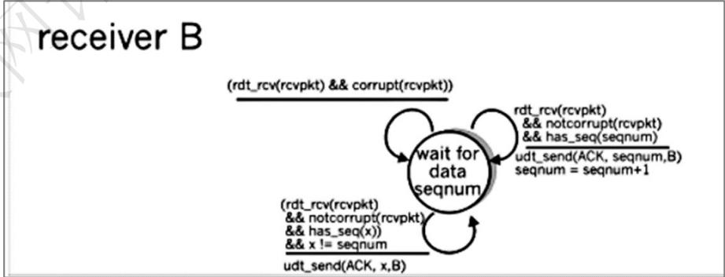

P20. 考虑一种主机 A和主机B要向主机C发送报文的情况。主机 A 和C 通过一条报文能够丢失和损坏(但不重排序）的信道相连接。主机B和C由另一条（与连接A和C的信道独立)具有相同性质的信道连接。在主机C上的运输层，在向上层交付来自主机A和B的报文时应当交替进行（即它应当首先交付来自A的分组中的数据，然后是来自B的分组中的数据，等等)。设计一个类似于停等协议的差错控制协议，以可靠地向C传输来自A和B的分组，同时以前面描述的方式在C处交替地交付。给出A和C的FSM描述。（提示：B的FSM大体上应当与A的相同。）同时，给出所使用的报文格式的描述。

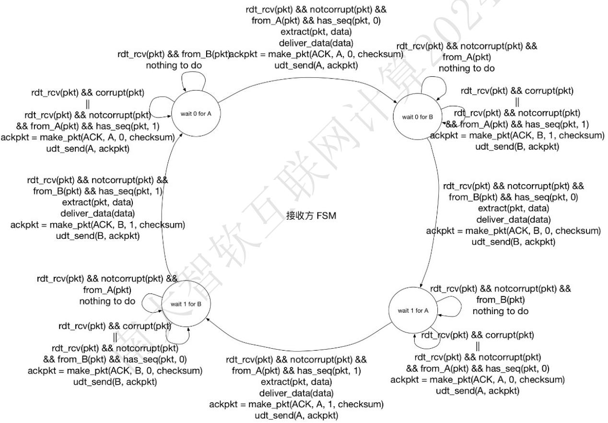

P27.主机A和B经一条TCP连接通信，并且主机B已经收到了来自A的最长为I26字节的所有字节。假定主机A随后向主机B发送两个紧接着的报文段。第一个和第二个报文段分别包含了80字节和40字节的数据。在第一个报文段中，序号是127，源端口号是302，目的地端口号是80。无论何时主机B接收到来自主机A的报文段，它都会发送确认。

a. 在从主机A发往B的第二个报文段中，序号、源端口号和目的端口号各是什么？

b. 如果第一个报文段在第二个报文段之前到达，在第一个到达报文段的确认中，确认号、源端口号和目的端口号各是什么？

c. 如果第二个报文段在第一个报文段之前到达，在第一个到达报文段的确认中，确认号是什么？

d.假定由A发送的两个报文段按序到达B。第一个确认丢失了而第二个确认在第一个超时间隔之后到达。画出时序图，显示这些报文段和发送的所有其他报文段和确认。(假设没有其他分组丢失。）对于图上每个报文段，标出序号和数据的字节数量；对于你增加的每个应答，标出确认号。

或者

## 参考答案：

a. 序号为207，源端口号为302，目的端口号为80；

b. 确认号为207，源端口号为80，目的端口号为302；

c. 确认号为127；

d.  
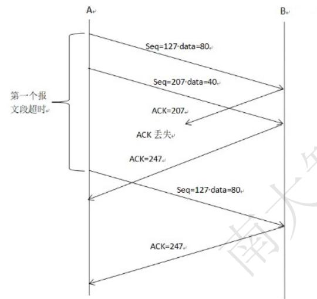

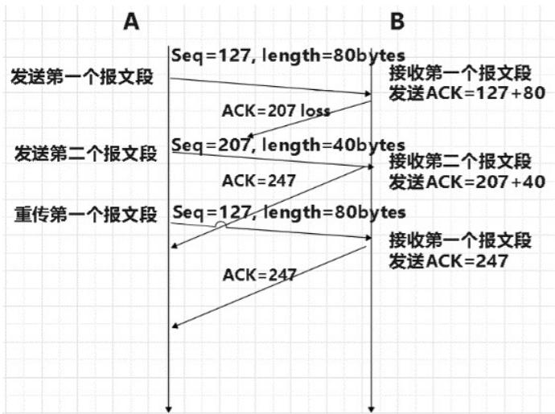

P32. 考虑TCP估计RTT的过程。假设 $\alpha = 0 , 1$ ，令 $\mathrm { S a m p l e R T _ { \mathrm { \uparrow \uparrow } } }$ 设置为最新样本RTT，令 $\mathrm { S a m p l e R T _ { \mathrm { 1 2 } } }$ 设置为下一个最新样本RTT，等等。 0

a. 对于一个给定的TCP连接，假定4个确认报文相继到达，带有4个对应的RTT值： $\mathrm { S a m p l e R T } _ { \mathbb { T } 4 }$ $\mathrm { S a m p l e R T _ { T 3 } }$ $\mathrm { S a m p l e R T } _ { \mathrm { T 2 } }$ 和 $\mathrm { S a m p l e R T } _ { T 1 }$ 。根据这4个样本 RTT 表示 EstimatedRTT。

b. 将你得到的公式一般化到n个RTT样本的情况。

c. 对于在（b)中得到的公式，令n趋于无穷。试说明为什么这个平均过程被称为指数移动平均。

## 参考答案：

a.

$$
E s t i m a t e d R T T ^ { ( 1 ) } = S a m p l e R T T _ { 4 }
$$

$$
E s t i m a t e d R T T ^ { ( 2 ) } = ( 1 - \alpha ) \cdot E s t i m a t e d R T T ^ { ( 1 ) } + \alpha \cdot S a m p l e R T T _ { 3 }
$$

$$
E s t i m a t e d R T T ^ { ( 3 ) } = ( 1 - \alpha ) \cdot E s t i m a t e d R T T ^ { ( 2 ) } + \alpha \cdot S a m p l e R T T _ { 2 }
$$

$$
E s t i m a t e d R T T ^ { ( 4 ) } = ( 1 - \alpha ) \cdot E s t i m a t e d R T T ^ { ( 3 ) } + \alpha \cdot S a m p l e R T T _ { 1 }\tag{b.}
$$

$$
\mathsf { E s t i m a t e d R T T n } = ( 1 - \mathsf { a } ) \cdot ( \mathsf { n } - 1 ) \times \mathsf { S n } + \ldots + \mathsf { a } ( 1 - \mathsf { a } ) \cdot ( \mathsf { n } - 2 ) \mathsf { S n } - 1 + \mathsf { a } \mathsf { S 1 }\tag{C.}
$$

$$
\begin{array} { c } { { E s t i m a t e d R T T ^ { ( \infty ) } = \displaystyle \frac { x } { 1 - x } \sum _ { j = 1 } ^ { \sim } ( 1 - x ) ^ { j } { S a m p l e R T T _ { j } } } } \\ { { = \displaystyle \frac { 1 } { 9 } \sum _ { j = 1 } ^ { \infty } . 9 ^ { j } { S a m p l e R T T _ { j } } } } \end{array}
$$

P40. 考虑图3-61假设 TCP Reno 是一个经历如上所示行为的协议，回答下列问题。在各种情况中，简要地论证你的回答。

a. 指出TCP慢启动运行时的时间间隔。

b. 指出 TCP 拥塞避免运行时的时间间隔。

c. 在第16个传输轮回之后，报文段的丢失是根据3个冗余ACK还是根据超时检测出来的？ F

d. 在第22 个传输轮回之后，报文段的丢失是根据3 个冗余 ACK 还是根据超时检测出来的? K

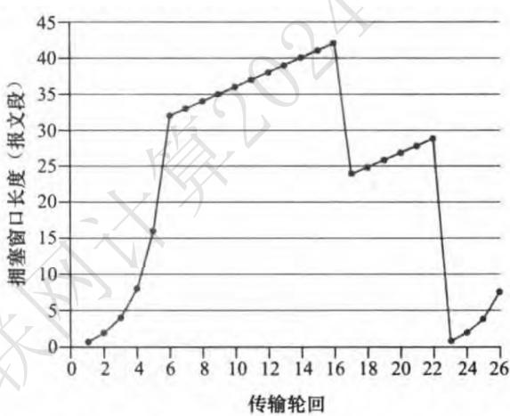  
图3-61TCP窗口长度作为时间的函数

e. 在第1个传输轮回里，ssthresh的初始值设置为多少？

f. 在第18个传输轮回里，ssthresh的值设置为多少?

g. 在第24 个传输轮回里，ssthresh 的值设置为多少?

h. 在哪个传输轮回内发送第70个报文段？

i. 假定在第26个传输轮回后，通过收到3个冗余ACK检测出有分组丢失，拥塞的窗口长度和ssthresh的值应当是多少?

j. 假定使用 TCP Tahoe（而不是 TCP Reno)，并假定在第16 个传输轮回收到3 个冗余 ACK。在第19个传输轮回，ssthresh和拥塞窗口长度是什么？

## 参考答案：

a. [1,6]、[23,26]。

b. [6,16]、[17,22]。

c. 根据3 个冗余 ACK。

d. 根据超时。

e. 32。

f. 21.

g. 14.5（或14)。

h. 第7个传输轮回。

i. 窗口长度为4，ssthresh为7。

j. ssthresh为21，窗口大小为1。

k. 52个分组。

P48考虑仅有一条单一的TCP（Reno）连接使用一条10Mbps链路，且该链路没有缓存任何数据。假设这条链路是发送主机和接收主机之间的唯一拥塞链路。假定某TCP发送方向接收方有一个大文件要发送，而接收方的接收缓存比拥塞窗口要大得多。我们也做下列假设：每个TCP报文段长度为1500字节；该连接的双向传播时延是150ms；并且该TCP连接总是处于拥塞避免阶段，即忽略了慢启动。 X

a. 这条TCP连接能够取得的最大窗口长度（以报文段计）是多少？

b. 这条TCP连接的平均窗口长度（以报文段计）和平均吞吐量（以bps计）是多少?

c. 这条TCP连接在从丢包恢复后，再次到达其最大窗口要经历多长时间？

## 参考答案：

a)这条TCP连接能取得的最大窗口长度（以报文段记）

L\_m/10M=150x10^(-3) so L\_m=150\*10^(4)bit -> 150/8x10^4B->125个报文段

b)平均窗口长度和平均吞吐量

平均窗口长度：拥塞避免阶段所以窗口大小在W/2和W之间变化，所以平均窗口大小为0.75W=125x0.75=94[93.75的上取整 √

平均吞吐量：94x1500x8/150ms=7.52Mbps

或者不取整，按93.75算，最终平均吞吐量是7.5Mbps

c)这条TCP连接在从丢包恢复后，再次达到其最大窗口要经历多少时间？

P52考虑一种简化的TCP的AIMD算法，其中拥塞窗口长度用报文段的数量来度量，而不是用字节度量。在加性增中，每个RTT拥塞窗口长度增加一个报文段。在乘性减中，拥塞窗口长度减小一半(如果结果不是一个整数，向下取整到最近的整数)。假设两条TCP连接C1和C2，它们共享一条速率为每秒30个报文段的单一拥塞链路。假设C1和C2均处于拥塞避免阶段。连接C1的RTT是50ms，连接C2的RTT是100ms。假设当链路中的数据速率超过了链路的速率时，所有TCP连接经受数据报文段丢失。 A

a. 如果在时刻t0，C1和C2具有10个报文段的拥塞窗口，在1000ms后它们的拥塞窗口为多长？

b. 经长时间运行，这两条连接将取得共享该拥塞链路的相同的带宽吗？

## 参考答案：

## a)答案：1000ms后，C1和C2的拥塞窗口分别为一个报文段

原因：C1 和 C2 的主要区别在于，C1 的 RTT 仅为 C2 的一半。因此，C1 在 50 毫秒后调整窗口大小，而 C2 则在 100 毫秒后调整窗口大小。假设每次发生丢失事件时，C1在 50毫秒后收到，C2 在100毫秒后收到。我们还有以下简化的 TCP模型。在每个RTT之后，连接会决定是否增加窗口大小。对于C1，我们计算前50毫秒内链路的平均总发送速率。如果该速率超过了链路容量，那么我们假定C1 检测到丢失并减小窗口大小。但对于C2，我们计算前100毫秒内链路的平均总发送速率。如果该速率超过了链路容量，则我们假定C2检测到丢失并减小其窗口大小。请注意，有可能最后50毫秒内的平均发送速率高于链路容量，但最后100毫秒内的平均发送速率小于或等于链路容量，在这种情况下，我们假设C1会发生丢失事件，但C2不会。

## b)答案：经过长时间运行，C1的带宽大约是C2的两倍

原因：因为C1的RTT更短，只有C2的一半，所以C1调整窗口大小的速度是C2的两倍。如果我们看一下上表，我们可以看到每200ms一个周期，例如从850ms到1000ms。在一个周期内，C1的发送速率为(40+20+40+20)=120，是C2的发送速率(10+10+10+10)=40的三倍。

P54考虑修改TCP的拥塞控制算法。不使用加性增，使用乘性增。无论何时某TCP收到一个合法的ACK，就将其窗口长度增加一个小正数 $a ( 0 < a < 1 )$ 。求出丢包率L和最大拥塞窗口W之间的函数关系。论证：对于这种修正的TCP，无论TCP的平均吞吐量如何，一条TCP连接将其拥塞窗口长度从W/2增加到W，总是需要相同的时间。 XY

## 参考答案：

定义W代表最大窗口大小。

首先，我们可以找到当TCP 将其窗口大小从W/2 更改为包含W的时间间隔内发送出的分段总数。这是由下式给出的：

$$
{ \mathsf { S } } = { \frac { \mathsf { W } } { 2 } } + \ \left( { \frac { \mathsf { W } } { 2 } } \right) * ( 1 + { \mathsf { a } } ) + \ \left( { \frac { \mathsf { W } } { 2 } } \right) * ( 1 + { \mathsf { a } } ) ^ { 2 } \ + \ \left( { \frac { \mathsf { W } } { 2 } } \right) * ( 1 + { \mathsf { a } } ) ^ { 3 } \ + \ . . . + \ \left( { \frac { \mathsf { W } } { 2 } } \right) * ( 1 + { \mathsf { a } } ) ^ { k }
$$

可以得出： $\mathtt { k } = \log _ { ( 1 + \mathtt { a } ) } 2$ ，则 $\mathrm { S } = \mathrm { W } * \frac { 2 \mathrm { a } + 1 } { 2 \mathrm { a } } \mathrm { \Omega } \mathrm { \Omega }$

丢包率L与最大拥塞窗口W之间的关系 $: L = \frac { 1 } { S } = \frac { ( 2 a ) } { \left( W * ( 2 a + 1 ) \right) ^ { \circ } }$

论证：

TCP 将其窗口大 $\therefore M - \frac { W } { 2 }$ 增加到 W 所需的时间由下式给出：

$k * R T T = { \bigl ( } l o g _ { ( 1 + a ) } 2 { \bigr ) } * R T T$ 这显然与TCP的平均吞吐量无关。

TCP的平均吞吐量 $\begin{array} { r } { \mathrm { \langle B = M S S ~ * \frac { S } { ( k + 1 ) * R T T } = \frac { M S S } { ( L * ( k + 1 ) * R T T ) } } } \end{array}$ . 这与具有平均吞吐量的 TCP 不同， $\begin{array} { r } { \mathsf { B } = \frac { 1 . 2 2 \cdot M S S } { R T T \cdot \sqrt { L } } } \end{array}$ ，其中的平方根出现在分母中。

• 计算机网络和因特网  
・应用层  
· 运输层  
• 网络层：数据平面  
网络层：控制平面  
• 链路层和局域网  
· 无线网络和移动网络  
• 计算机网络中的安全

R1.我们回顾在本书中使用的某些术语。前面讲过运输层的分组名字是报文段，数据链路层的分组名字是帧。网络层的分组名字是什么？前面讲过路由器和链路层交换机都被称为分组交换机。路由器与链路层交换机间的根本区别是什么？ XY

## 参考答案：

网络层的分组名字是数据报。

路由器和链路层交换机的根本区别是它们服务于不同的网络层协议

链路层交换机基于链路层帧中的字段值做出转发决定，服务于第二层链路层;

路由器基于网络层数据报中的首部字段值做出转发决定，服务于第三层网络层.

R23.考察使用DHCP的主机，获取它的IP地址、网络掩码、默认路由器及其本地DNS服务器的IP地址。列出这些值。 2

## 参考答案：

当主机使用DHCP（动态主机配置协议）获取网络配置时，它可以获得以下值：

IP地址：DHCP服务器分配给主机的IP地址。

网络掩码：指示主机所在网络的掩码，用于确定哪些IP地址属于同一网络。

默认路由器（网关）：主机用于发送数据到不在本地网络的目标地址时的下一跳路由器的IP地址。

本地DNS服务器的IP地址：用于解析域名到IP地址的DNS服务器的IP地址。

这些值通常在DHCP协议的交互中从DHCP服务器获取。

以下是主机使用DHCP获取到的示例值：

IP地址：192.168.1.100

网络掩码：255.255.255.0

默认路由器（网关）：192.168.1.1

本地DNS服务器的IP地址：192.168.1.1

R25. 假设某应用每20ms生成一个40字节的数据块，每块封装在一个TCP报文段中，TCP报文段再封装在一个IP数据报中。每个数据报的开销有多大？应用数据所占百分比是多少？

## 参考答案：

每个数据报的开销是80个字节：20字节的IP首部(假设首部无选项，且数据包无分片）+20字节的TCP首部+ 应用层报文(40字节)，所以应用数据所占的百分比是50%。

P11考虑互联3个子网（子网1、子网2和子网3)的一台路由器。假定这3个子网的所有接口要求具有前缀223.1.17/24。还假定子网1要求支持多达60个接口，子网2要求支持多达90个接口，子网3要求支持多达12个接口。提供3个满足这些限制的网络地址（形式为a. b.c.d/x)。

## 参考答案：

子网1：223.1.17.64/26

子网2：223.1.17.128/25

子网3：223.1.17.48/28

要求：三个子网地址空间大于题目数量要求，不相互冲突（此题答案不唯一）

P15考虑图4-20中显示的拓扑。（在12:00以顺时针开始）标记具有主机的3个子网为网络A、B和C，标记没有主机的子网为网络D、E和F。

a. 为这6个子网分配网络地址，要满足下列限制：所有地址必须从214.97.254/23起分配；子网A应当具有足够地址以支持250个接口；子网B应当具有足够地址以支持120个接口；子网C应当具有足够地址以支持120个接口。当然，子网D、E和F应当支持两个接口。对于每个子网，分配采用的形式是 a. b. c. d/x 或 a, b. c. d/x \~e. f. g. h/y。

b. 使用你对（a）部分的答案，为这3台路由器提供转发表（使用最长前缀匹配）。

## 参考答案：

子网 A: 214.97.254.0/24 分配了 256 个地址

子网B: 214.97.255.0/25 分配了 128 个地址

子网 C: 214.97.255.128/25- 214.97.255.247/29(后3 位保留)分配了 120 个地址

将 214.97.255.248/31的两个地址(后4 位为 1000-1001)分配给子网D

将 214.97.255.250/31的两个地址(后4 位为 1010-1011)分配给子网E

将 214.97.255.252/31的两个地址(后4位为1100-1101)分配给子网F

<table><tr><td>路由器1</td><td>输出链路接口</td></tr><tr><td>最长匹配 11010110 0110000111111110</td><td>A</td></tr><tr><td>11010110 01100001 11111111 111100</td><td>D</td></tr><tr><td>11010110 01100001 11111111 11110</td><td>F</td></tr><tr><td>路由器2</td><td></td></tr><tr><td>最长匹配</td><td>输出链路接口</td></tr><tr><td>11010110 01100001 11111111</td><td>C</td></tr><tr><td>11010110 01100001 11111111 111100</td><td>E</td></tr><tr><td>11010110 01100001 11111111 11110</td><td>F</td></tr><tr><td>路由器3</td><td></td></tr><tr><td>最长匹配</td><td>输出链路接口</td></tr><tr><td>11010110 01100001 11111111 0</td><td>B</td></tr><tr><td>11010110 01100001 11111111 111100</td><td>E</td></tr><tr><td>11010110 01100001 11111111</td><td>D</td></tr></table>

P19假设你有兴趣检测NAT后面的主机数量。你观察到在每个IP分组上IP层顺序地标出一个标识号。由一台主机生成的第一个IP分组的标识号是一个随机数，后继IP分组的标识号是顺序分配的。假设由NAT后面主机产生的所有IP分组都发往外部。

a. 基于这个观察，假定你能够俘获由NAT向外部发送的所有分组，你能概要给出一种简单的技术来检测NAT后面不同主机的数量吗?评估你的答案。

b. 如果标识号不是顺序分配而是随机分配的，这种技术还能正常工作吗？评估你的答案。

## 参考答案：

(a)由于所有IP 数据包都是向外发送的，因此我们可以使用数据包嗅探器记录NAT 后面的主机产生的所有IP数据包。由于每台主机生成的IP数据包都有一串连续的编号和一个独特的（很有可能是随机选择的）初始标识号(ID)，因此我们可以将具有连续ID的IP 数据包归为一个群集。簇的数量就是NAT 后面的主机数量。

(b)不能，如果这些识别号码不是顺序分配的，而是随机分配的，则(a)部分建议的技术将不起作用，因为嗅探数据中不会出现聚类。

• 计算机网络和因特网  
・ 应用层  
· 运输层  
• 网络层：数据平面  
• 网络层：控制平面  
• 链路层和局域网  
• 无线网络和移动网络  
• 计算机网络中的安全

## R4. 比较和对照链路状态和距离矢量这两种路由选择算法。

## 参考答案：

在距离矢量算法中，每个节点仅与它的直接相邻的邻居交谈，但它为邻居提供了它自己到网络中所有其他节点的最低开销估计.而链路状态算法需要全局信息.

<table><tr><td rowspan=1 colspan=1></td><td rowspan=1 colspan=1>链路状态路由选择算法距</td><td rowspan=1 colspan=1>离矢量路由选择算法</td></tr><tr><td rowspan=1 colspan=1>报文复杂性</td><td rowspan=1 colspan=1>相对较高</td><td rowspan=1 colspan=1>相对较低</td></tr><tr><td rowspan=1 colspan=1>收敛速度</td><td rowspan=1 colspan=1>相对较快</td><td rowspan=1 colspan=1>相对较慢</td></tr><tr><td rowspan=1 colspan=1>健壮性</td><td rowspan=1 colspan=1>相对较强</td><td rowspan=1 colspan=1>较弱</td></tr></table>

R6. 每个自治系统使用相同的AS内部路由选择算法是必要的吗？说明其原因。

参考答案：必要。由于链路开销增加的消息传播得很慢，如果某条链路上的开销突然有一个巨大的增幅，会造成路由选择环路，有时也被称为无穷计数.

P3. 考虑下面的网络。对于标明的链路开销，用Dijkstra的最短路算法计算出从x到所有网络节点的最短路径。通过计算一个类似于表5-1的表，说明该算法是如何工作的。

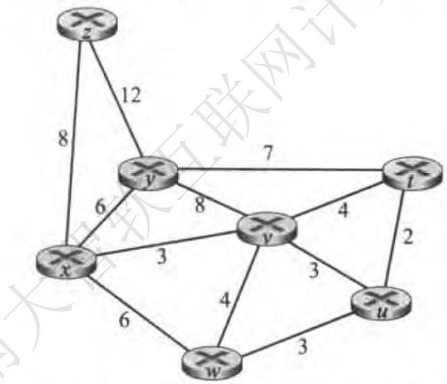

参考答案：高亮位置处可不写，表示搜索结束。

<table><tr><td>Step</td><td>N&#x27;</td><td>D(t),p(t)</td><td>D(u),p(u)</td><td>D(V),p(V) D(w),p(w)</td><td>D(y),p(y)</td><td></td><td>D(z),p(z)</td></tr><tr><td>0</td><td>X</td><td>8</td><td>8</td><td>3,x</td><td>6,x</td><td>6,X</td><td>8,x</td></tr><tr><td>1</td><td>XV</td><td>7,v</td><td>6,v 1</td><td>3,x</td><td>6,x</td><td>6,x</td><td>8,x</td></tr><tr><td>2</td><td>xvu</td><td>7,v</td><td>6,v</td><td>3,x</td><td>6,x</td><td>6,x</td><td>8,x</td></tr><tr><td>3</td><td>xvuw</td><td>7,v</td><td>6,v</td><td>3,x</td><td>6,x</td><td>6,x</td><td>8,x</td></tr><tr><td>4</td><td>xvuwy</td><td>7,v</td><td>6,V</td><td>3,x</td><td>6,x</td><td>6,x</td><td>8,x</td></tr><tr><td>5</td><td>xvuwyt</td><td>7,v</td><td>6,v</td><td>3,x</td><td>6,x</td><td>6,x</td><td>8,x</td></tr><tr><td>6</td><td>xvuwytz</td><td>7,v</td><td>6,V</td><td>3,x</td><td>6,x</td><td>6,x</td><td>8,x</td></tr></table>

P5.考虑下图所示的网络，假设每个节点初始时知道到它的每个邻居的开销。考虑距离向量算法，并显示在节点z中的距离表表项。 6 2

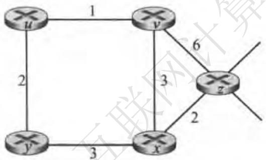

## 参考答案：

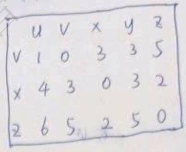

P7. 考虑下图所示的网络段。x只有两个相连邻居w与y。w有一条通向目的地u(没有显示)的最低开销路径，其值为5，y有一条通向目的地u的最低开销路径，其值为6。从w与y到u(以及w与y之间）的完整路径未显示出来。网络中所有链路开销皆为正整数值。

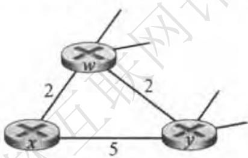

a. 给出 x 对目的地 w、y和 u 的距离向量。

b. 给出对于c(x，w) 或c(x，γ)的链路开销的变化，使得执行了距离向量算法后，x将通知其邻居有一条通向u的新最低开销路径。

c. 给出对c(x，w)或c(xy)的链路开销的变化，使得执行了距离向量算法后，x将不通知其邻居有一条通向x的新最低开销路径。

## 参考答案：

a. ${ \sf D } \sf { x } ( \boldsymbol { \mathsf { w } } ) = 2 , { \sf D } \sf { x } ( \boldsymbol { \mathsf { y } } ) = 4 , { \sf D } \sf { x } ( \boldsymbol { \mathsf { u } } ) = 7$

b. 若c(x, y)变化， $\mathsf { D } [ \mathsf { x } ] [ \mathsf { u } ] = \mathsf { m i n } \{ 7 , \mathsf { c } ( \mathsf { x } , \mathsf { y } ) + 6 \}$ ，且 $\mathsf { c } ( \mathsf { x } , \mathsf { y } ) > = 1$ ，所以c(x, y)变化不会导致x通知其邻居最低开销路径。若c(x, w)变化， $\mathsf { D } [ \mathsf { x } ] [ \mathsf { u } ] = \mathsf { m i n } \{ \mathsf { c } ( \mathsf { x } , \mathsf { w } ) + \mathsf { 5 } , \mathsf { 1 } \mathsf { 1 } \}$ ，所以当c(x，w)变化后<6时，x通知其邻居最低开销路径为c(x，w)+5，当c(x，w)变化后>=6时，x通知其邻居最低开销路径为11。

a. 由b可知，c(x，y)变化不会导致x通知其邻居最低开销路径，c(x，w)变化一定导致x通 知其邻居最低开销路径。

P12. 描述在 BGP中是如何检测路径中的环路的。

## 参考答案：若收到一条AS路径中包含自己AS编号的路由，可判断为环路

P14. 考虑下图所示的网络。假定 AS3 和 AS2正在运行 OSPF作为其 AS 内部路由选择协议。假定AS1 和AS4 正在运行RIP作为其 AS内部路由选择协议。假定 AS间路由选择协议使用的是eBGP和iBGP。假定最初在 AS2和AS4之间不存在物理链路。

a. 路由器3c从下列哪个路由选择协议学习到了前缀 x:OSPF、RIP、eBGP或iBGP?

b. 路由器3a从哪个路由选择协议学习到了前缀x?

c. 路由器1c从哪个路由选择协议学习到了前缀x?

d. 路由器1d从哪个路由选择协议学习到了前缀 x?

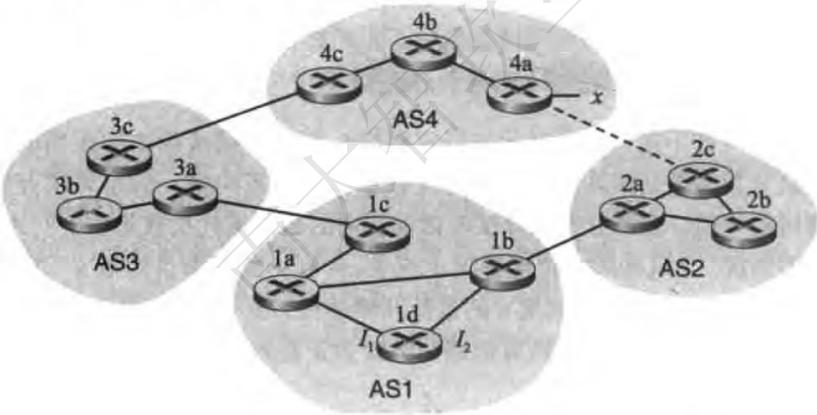

参考答案：

a、eBGP

b、iBGP

C、eBGP

d、iBGP

• 计算机网络和因特网  
· 应用层  
· 运输层  
• 网络层：数据平面  
• 网络层：控制平面  
• 链路层和局域网  
• 无线网络和移动网络  
• 计算机网络中的安全

R4. 假设两个节点同时经一个速率为R的广播信道开始传输一个长度为L的分组。用 $d _ { \mathrm { p r o p } }$ 表示这两个节点之间的传播时延。如果 $d _ { \mathsf { \Omega } _ { \mathsf { p r p } } } \subset L / R$ ，会出现碰撞吗？为什么？

## 参考答案：

由于两个节点间的传播时延小于传输分组所需的时间，这可能会导致在一个节点发送分组时，接收到另一个节点发送的分组，所以这种情况下会出现碰撞。

R6.在CSMA/CD中，在第5次碰撞后，节点选择K≤4的概率有多大？结果K=4在10Mbps以太网上对应于多少秒的时延？

## 参考答案：

在第5次碰撞后，一共有2^5个数可以选择，选择K=4的概率为1/2^5 = 0.03125（1/32）需要等待 4 \* 51.2 us = 204.8 us

R8.如果局域网有很大的周长时，为什么令牌环协议将是低效的？

## 参考答案：

当节点发送帧时，这个节点必须等待帧在整个环中传播，然后节点才能释放令牌。因此，如果L/R与tprop相比很小，则令牌环协议会很低效。 用京大学

P2. 说明（举一个不同于图6-5的例子）二维奇偶校验能够纠正和检测单比特差错。说明（举一个例子）某些双比特差错能够被检测但不能纠正。 2 2

## 参考答案：（合理即可）

假设发送方初始的二维奇偶校验矩阵：

$$
\begin{array} { c c c c } { { 0 } } & { { 0 } } & { { 0 } } & { { 0 } } \\ { { 1 } } & { { 1 } } & { { 1 } } & { { 1 } } \\ { { 0 } } & { { 1 } } & { { 0 } } & { { 1 } } \\ { { 1 } } & { { 0 } } & { { 1 } } & { { 0 } } \end{array}
$$

假设第2行、第3列存在比特错误，则可以根据下面的矩阵中第2 行和第3 列的奇偶校验现在是错误的确定错误出现的位置并纠错：

$$
\begin{array} { c c c c } { { 0 } } & { { 0 } } & { { 0 } } & { { 0 } } \\ { { 1 } } & { { 1 } } & { { 0 } } & { { 1 } } \\ { { 0 } } & { { 1 } } & { { 0 } } & { { 1 } } \\ { { 1 } } & { { 0 } } & { { 1 } } & { { 0 } } \end{array}
$$

假设第2 行、第2列和第3列存在位错误。但是由于第二行的2个位都发送错误，导致第2 行的奇偶校验位仍然是正确的，虽然我们知道了第2列和第3列的奇偶校验错误，但我们无法检测到错误发生在哪一行。

$$
\begin{array} { c c c c } { { 0 } } & { { 0 } } & { { 0 } } & { { 0 } } \\ { { 1 } } & { { 0 } } & { { 0 } } & { { 1 } } \\ { { 0 } } & { { 1 } } & { { 0 } } & { { 1 } } \\ { { 1 } } & { { 0 } } & { { 1 } } & { { 0 } } \end{array}
$$

P3.假设某分组的信息部分（图6-3中的D)包含10字节，它由字符串“Internet”的8比特无符号二进制ASCII表示组成。对该数据计算因特网检验和。

参考答案：

01001100 01101001

+01101110 01101011

1011101011010100   
+ 00100000 01001100

11011011 00100000

+01100001 01111001

00111100 10011010

+01100101 01110010

10100010 00001100

对最终求和结果取反码为： 01011101 11110011

P5. 考虑5比特生成多项式，G=10011，并且假设D的值为1010101010R的值是什么？

参考答案：

G有5位，所以在D后面加4个0:1010101010 0000

用1010101010 0000 / 10011 = 1011011100 mod 0100 R = 0100 1.

P8.在6.3节中，我们提供了时隙ALOHA效率推导的概要。在本习题中，我们将完成这个推导。

a. 前面讲过，当有N个活跃节点时，时隙ALOHA的效率是 $N p ( 1 - p ) ^ { N - 1 }$ 。求出使这个表达式最大化的p值。

b. 使用在（a)中求出的p值，令N接近于无穷，求出时隙ALOHA的效率。（提示；当N接近于无穷时， $( 1 - 1 / N ) ^ { N }$ 接近于 $1 /  \mathrm { e } _ { \circ } )$

参考答案：

a. 效率 $f ( p ) = N p ( 1 - p ) ^ { N - 1 }$ X求导 $f ^ { \prime } ( p ) = N ( 1 - N p ) ( 1 - p ) ^ { N - 2 }$ 当p = 时，效率最大。

b.当N趋近于无穷，效率为 $\begin{array} { r } { l i m \ f \left( \frac { 1 } { N } \right) = \frac { 1 } { e } { \approx } 0 . 3 6 8 } \end{array}$ o

P18.假设节点A和节点B在同一个10Mbps广播信道上，这两个节点的传播时延为325比特时间。假设对这个广播信道使用CSMA/CD和以太网分组。假设节点A开始传输一帧，并且在它传输结束之前节点B开始传输一帧。在A检测到B已经传输之前，A能完成传输吗？为什么？如果回答是可以，则A错误地认为它的帧已成功传输而无碰撞。提示：假设在t=0比特时刻，A开始传输一帧。在最坏的情况下，A传输一个512+64比特时间的最小长度的帧。因此A将在t=512+64比特时刻完成帧的传输。如果B的信号在比特时间t=512+64比特之前到达A，则答案是否定的。在最坏的情况下，B的信号什么时候到达A? X

## 参考答案：

可以。如果B的帧在A传数据之前到达A，A就能检测到；如果不能，就无法检测到，所以B最晚能在324比特时刻（也就是A的第一比特即将到达B）发送第一比特，该比特在324+325=649比特时间到达A，而A的帧长只有576比特时间，所以A已经发送完毕了，无法检测到碰撞。

P19.假设节点A和节点B在相同的10Mbps广播信道上，并且这两个节点的传播时延为245比特时间。假设A和B同时发送以太网帧，帧发生了碰撞，然后A和B在CSMA/CD算法中选择不同的K值。假设没有其他节点处于活跃状态，来自A和B的重传会碰撞吗？为此，完成下面的例子就足以说明问题了。假设A和B在t=0比特时间开始传输。它们在t=245比特时间都检测到了碰撞。假设$K _ { \mathrm { \Delta \Omega } } = 0 \mathrm { \Delta , } K _ { \mathrm { \ B { \ B } } } = 1$ 。B会将它的重传调整到什么时间?A在什么时间开始发送?(注意：这些节点在返回第2步之后，必须等待一个空闲信道，参见协议A的信号在什么时间到达B呢?B在它预定的时刻抑制传输吗？

## 参考答案：

<table><tr><td rowspan=1 colspan=2>TIME</td><td rowspan=1 colspan=1>DO</td></tr><tr><td rowspan=1 colspan=2>0</td><td rowspan=1 colspan=1>A B 开始发送数据</td></tr><tr><td rowspan=1 colspan=2>245</td><td rowspan=1 colspan=1>AB检测到碰撞并停止发送数据</td></tr><tr><td rowspan=1 colspan=2>245+48=293</td><td rowspan=1 colspan=1>AB停止发送48比特的人为干扰信号</td></tr><tr><td rowspan=1 colspan=2>293+245=538</td><td rowspan=1 colspan=1>B的最后一位到达A；A检测到空闲通道</td></tr><tr><td rowspan=1 colspan=2>538+96=634</td><td rowspan=1 colspan=1>A开始传输</td></tr><tr><td rowspan=1 colspan=2>293+512=805</td><td rowspan=1 colspan=1>返回步骤2 在发送之前，B必须检测空闲信道96位</td></tr><tr><td rowspan=1 colspan=1></td><td rowspan=1 colspan=1>634+245=879</td><td rowspan=1 colspan=1>A的传输到达B</td></tr></table>

由于A的重传（879）已在B的预定重传时间（805+96=901）之前到达，因此B在A重传时被禁止发送。因此A和B不会发生碰撞。

P23.考虑图6-15。假定所有链路都是100Mbps。在该网络中的9台主机和两台服务器之间，能够取得的最大总聚合吞吐量是多少?你能够假设任何主机或服务器能够向任何其他主机或服务器发送分组。为什么？

## 参考答案：

设电气工程系为A，其中三台主机标记为A1、A2、A3；计算机科学系为B，包含B1、B2、B3三台主机；计算机工程系为C，包含C1、C2、C3三台主机。流量分配策略为：

(1)A1<->A2:100Mbps全双工

(2)B1<->B2：100Mbps全双工

(3)C1<->C2：100Mbps全双工

(4）web服务器<->A3：100Mbps全双工

(5）mail服务器<->B3：50Mbps全双工

（6）mail服务器<->C3：50Mbps全双工

(7)B3<->C3:50Mbps全双工

总流量:(100 \* 4 + 50 \* 3) \* 2 = 1100Mbps

P24.假定在图6-15中的3台连接各系的交换机用集线器来代替。所有链路是100Mbps。现在回答习题P23 中提出的问题。

## 参考答案：

(1）web服务器<->A：100Mbps全双工

（2）mail服务器<->B：50Mbps全双工

(3）mail服务器<->C：50Mbps全双工

(4)B<->C:50Mbps全双工

总流量： $( 1 0 0 + 5 0 ^ { \star } 3 ) ^ { \star } 2 = 5 0 0 \mathsf { M b p s }$

集线器是冲突域，因此使用集线器的聚合吞吐量只有100Mbps，因此总的聚合吞吐量为 500 Mbps X

P25.假定在图6-15中的所有交换机用集线器来代替。所有链路是100Mbps。现在回答在习题P23中提出的问题。 长

## 参考答案：总聚合吞吐量为100 Mbps。

P26.在某网络中标识为A到F的6个节点以星形与一台交换机连接，考虑在该网络环境中某个正在学习的交换机的运行情况。假定：(i)B向E发送一个帧；(ii)E向B回答一个帧；(iii)A向B发送一个帧；(iv)B向A回答一个帧。该交换机表初始为空。显示在这些事件的前后该交换机表的状态。对于每个事件，指出在其上面转发传输的帧的链路，并简要地评价你的答案。

## 参考答案：

1、B向E发送一个帧：交换机记录B的MAC地址与到达的端口；由于交换机表为空，故向A、C、D、E、F都发送此帧

2、E向B回答一个帧：交换机记录B的MAC地址与到达的端口；由于交换机表有B的MAC地址，故只向B转发

3、A向B发送一个帧：交换机记录A的MAC地址与到达的端口；由于交换机表有B的MAC地址，故只向B转发

4、B向A回答一个帧：交换机保持表的内容不变；由于已知A的MAC地址，故只向A转发

• 计算机网络和因特网  
・ 应用层  
· 运输层  
• 网络层：数据平面  
• 网络层：控制平面  
• 链路层和局域网  
• 无线网络和移动网络  
• 计算机网络中的安全

R7. 为什么802.11中使用了确认，而有线以太网中却未使用？

参考答案：因为无线信道相比有线信道会有更高的误比特率。

P5. 假设有两个ISP在一个特定的咖啡馆内提供WiFi接入，并且每个ISP有其自己的AP和IP地址块。

a. 进一步假设，两个ISP都意外地将其AP配置运行在信道11。在这种情况下，802.11协议是否将完全崩溃？讨论一下当两个各自与不同ISP相关联的站点试图同时传输时，将会发生什么情况。

b. 现在假设一个AP运行在信道1，而另一个运行在信道11。你的答案将会有什么变化？

## 参考答案：

a. 不会崩溃，两者共享信道，导致两者传输速率比独享时慢。当两者试图同时传输时，可能会导致碰撞。 X

b. 不会崩溃，两者不会碰撞。

P6. 在CSMA/CA协议的第4步，一个成功传输一个帧的站点在第2步（而非第1步）开始CSMA/CA协议。通过不让这样一个站点立即传输第2个帧（如果侦听到该信道空闲)，CSMA/CA的设计者是基于怎样的基本原理来考虑的呢？

## 参考答案（合理即可）：

CSMA/CA 协议的设计者考虑了平等性和碰撞避免两个基本原则。

当一个站点成功传输一个帧后，如果允许它立即传输第二个帧（如果侦听到信道空闲），那么这将会导致这个站点独占信道，阻止其他站点传输，从而破坏了信道的公平性。通过强制站点在传输成功后等待一段时间，然后才重新开始CSMA/CA协议，这可以确保其他站点也有机会访问信道，提高了信道的公平性和效率。

此外，如果站点在传输成功后立即传输第二个帧，可能会导致碰撞的发生，因为其他站点可能已经开始传输，导致信道上的帧碰撞。因此，CSMA/CA协议的设计者引入了延迟机制，即随机选取一个回退值进行传输，不同的站点回退值不同，只有当回退值减少到0时才能在信道空闲的条件下传输，减少碰撞的可能性，提高了无线通信系统的

P8. 考虑在图7-31中显示的情形，其中有4个无线节点A、B、C和D。这4个节点的无线电覆盖范围显示为其中的椭圆形阴影；所有节点共享相同的频率。当A传输时，仅有B能听到/接收到；当B传输时，A和C能听到/接收到；当C传输时，B和D能听到/接收到；当D传输时，仅有C能听到/接收到。

假定现在每个节点都有无限多的报文要向每个其他节点发送。如果一个报文的目的地不是近邻，则该报文必须要中继。例如，如果A要向D发送，来自A的报文必须首先发往B，B再将该报文发送给C，C则再将其发向D。时间是分隙的，报文所用的传输时间正好是一个时隙，如在时隙Aloha中的情况一样。在一个时隙中，节点能够做下列工作之一：（i）发送一个报文（如果它有报文向D转发)；(ii)接收一个报文（如果正好一个报文要向它发送)；(iii）保持静默。如同通常情况那样，如果一个节点听到了两个或更多的节点同时发送，出现冲突，并且重传的报文没有一个能成功收到。你这时能够假定没有比特级的差错，因此如果正好只有一个报文在发送，它将被位于发送方传输半径之内的站点正确收到。 V

a. 现在假定一个无所不知的控制器（即一个知道在网络中每个节点状态的控制器）能够命令每个节点去做它（无所不知的控制器）希望做的事情，例如发送报文，接收报文，或保持静默。给定这种无所不知的控制器，数据报文能够从C到A传输的最大速率是什么，假定在任何其他源/目的地对之间没有其他报文？

b. 现在假定A向 B 发送报文，并且D向C发送报文。数据报文能够从A到 B 且从 D到C流动的组合最大速率是多少?

c. 现在假定 A 向 B 发送报文且C向 D发送报文。数据报文能够从 A 到 B 且从C 到D流动的组合最大速率是多少?

d. 现在假定无线链路由有线链路代替。在此情况下，重复问题（a)\~(c)。

e. 现在假定我们又在无线状态下，对于从源到目的地的每个数据报文，目的地将向源回送一个ACK报文（例如，如同在TCP中)。对这种情况重复问题（a）\~(c)。

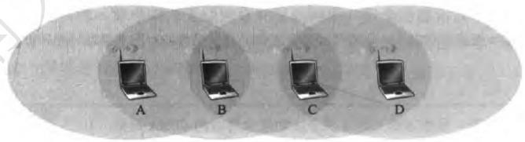

参考答案：解题思路：让我们使用一个全局的控制器调度各个节点的工作，在不同场景下达到最大的传输速率。不同场景需要制定不同的调度策略，制定策略时要参考碰撞、时隙以及每个节点在一个时隙只能做一种工作等因素(但忽略传播时延)，使用时序图能够帮我们进行简单快速的分析。

问题a答案：每个时隙都要求B有动作，而一个时隙中一个节点只能做一件事，则瓶颈在B节点，所以速率为(1 message/2 slots)。

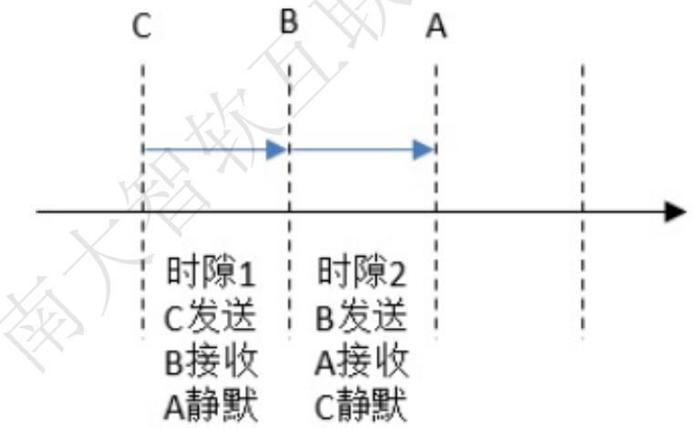

问题b答案：A->B，D->C同时发送报文，则可知（1）根据图中的信号覆盖情况，不会产生碰撞；（2）每对传输都不需要中间节点；（3）不考虑ACK机制。画出时序图，可以看到速率为(2 messages/slot)。 七甲

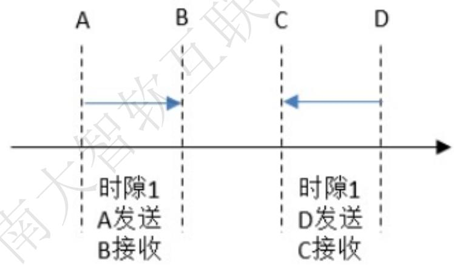

问题c答案：A->B，C->D同时发送报文，则可知（1）根据图中的信号覆盖情况，A与C会检测到冲突；（2）每对传输都不需要中间节点；（3）不考虑ACK机制。为了避免冲突，A与C要采用间隔发送（由中央控制器控制行为），如果它们尝试持续不断地发送，则会陷入“发送--沉默--发送--沉默”的循环。画出时序图，可以看到，每个时隙都只能完成一个发送/接收message的动作，那么速率就是(1 message/slot)。 A

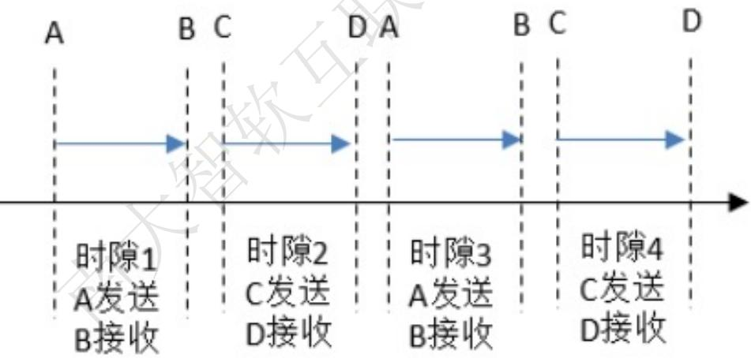

问题d答案：换成有线链路之后，原有的在无线链路上的冲突就有可能消失。我们逐问题来分析，对于问题a，本身就没有冲突，那么速率保持不变，即为(1 message/2slots)，注意，配套答案是(1 message/slot)，我认为并不正确，因为换成有线链路并不代表将题干中“在一个时隙中，节点能够做下列工作之一”这个也抹除，在节点B仍然存在瓶颈。对于问题b，本身也没有冲突，速率也保持不变，即为(2messages/slot)。对于问题c，由于数据传输过程中没有使用公共的有线链路，因此原有的无线链路冲突消失，从而时序图模型变得和问题b一样，即速率为(2messages/slot).

问题e答案：一个消息需要发送ACK回执后，我们要额外考虑这个ACK回执消耗的时隙时间，要避免回执冲突，也要遵循题干给出的节点工作原则（即“在一个时隙中，节点能够做下列工作之一  
路我们来画时序图：

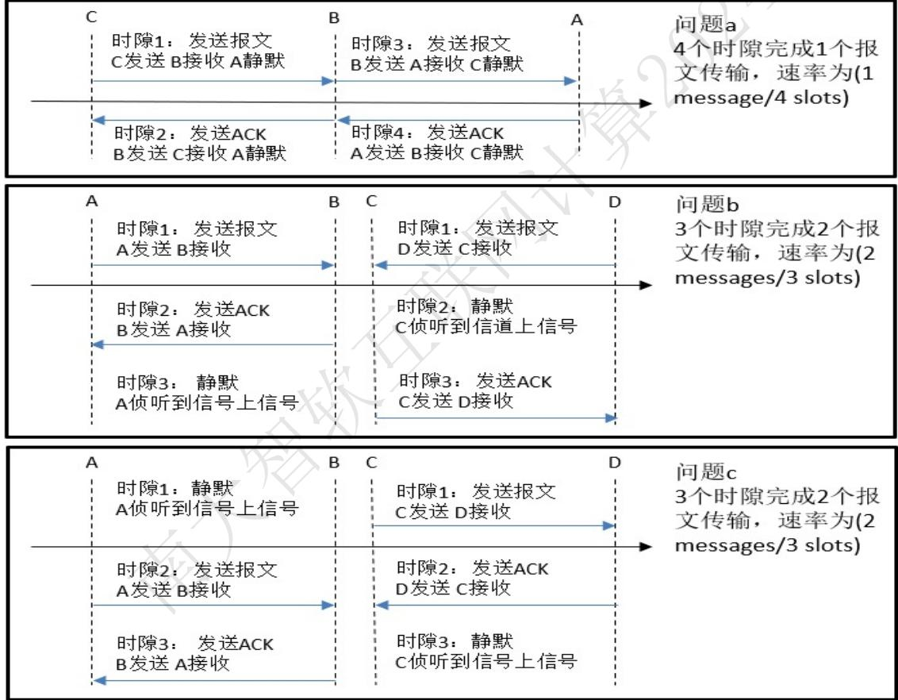

• 计算机网络和因特网  
・ 应用层  
· 运输层  
• 网络层：数据平面  
• 网络层：控制平面  
• 链路层和局域网  
• 无线网络和移动网络  
• 计算机网络中的安全

R5.考虑一个8块密码。这个密码有多少种可能的输入块?有多少种可能的映射?如果我们将每种映射视为一个密钥，则该密码具有多少种可能的密钥?

## 参考答案：

An 8-block cipher has 28 possible input blocks. Each mapping is a permutation of the 28 input blocks; so there are 28! possible mappings; so there are 28! possible keys.

R15.假设Alice有一个准备发送给任何请求者的报文。数以千计的人要获得Alice的报文，但每个人都要确保该报文的完整性。在这种场景下，你认为是基于MAC还是基于数字签名的完整性方案更为适合？为什么？

## 参考答案：

数字签名更合适，对于基于MAC的方案，Alice必须与每个潜在的接收者建立一个共享密钥。对于数字签名,她为每个收件人使用相同的数字签名。通过使用私钥对消息的哈希值签名来创建数字签名。在这里,数字签名显然是一个更好的选择。

R23.假设 Bob 向Trudy 发起一条 TCP 连接，而 Trudy 正在伪装她是 Alice。在握手期间，Trudy 向 Bob发送Alice的证书。在 SSL握手算法的哪一步，Bob将发现他没有与Alice通信？

## 参考答案：

第三步，客户端生成主密码前(PMS)之后。它将使用Alice的公钥对其进行加密,然后将加密的PMS发送给Trudy. Trudy没有Alice的私钥，因此她将无法解密PMS。因此，Trudy将无法确定共享身份验证密钥。相反,她可以通过选择随机密钥来猜测一个。在握手的最后一步中。她使用猜测的身份验证密钥向Bob发送了所有握手消息的MAC。当鲍勃收到MAC时，MAC测试将失败,鲍勃将结束TCP连接

P8. 考虑具有 $p = 5$ 和 $q = 1 1$ 的RSA。

a. n 和z 是什么？

b. 令e为3。为什么这是一个对 e的可接受的选择？

c. 求 d 使得 $d e = 1 { \pmod { z } }$ 和 $d < 1 6 0$

d. 使用密钥（n，e)加密报文m=8。令c表示对应的密文。显示所有工作。提示：为了简化计算使用如下事实。 X

$$
[ ( a { \mathrm { ~ m o d ~ } } n ) \cdot ( b { \mathrm { ~ m o d ~ } } n ) ] { \mathrm { m o d ~ } } n = ( a \cdot b ) { \mathrm { m o d ~ } } n
$$

参考答案：

$$
{ \mathsf { d } } { \mathsf { : } }
$$

加密过程：

$$
8 ^ { 3 } = 5 1 2
$$

a : n = 55 z = 40

$$
\mathsf { c } = 8 ^ { 3 } \ : \mathrm { m o d } \ : 5 5 = 1 7
$$

b: e和z没有非1公因数

g的解密过程：

$$
\mathtt { C } : \mathtt { d } = 2 7
$$

$$
\bar { 1 } 7 2 7 = 1 6 6 7 7 1 1 3 2 2 1 6 8 6 8 8 2 8 7 5 1 3 5 3 5 7 2 7 4 1 5 4 7 3
$$

$$
\mathsf { m } = 1 7 ^ { 2 7 } \mathsf { m o d } 5 5 = 8
$$

P9. 在这个习题中，我们探讨Diffie-Hellman(DH)公钥加密算法，该算法允许两个实体协商一个共享的密钥。该DH算法利用一个大素数p和另一个小于p的大数 $p$ $p$ $B o \mathcal { P }$ 和g都是公开的（因此攻击者将知 $_ { g }$ 道它们)。在DH中，Alice和Bob每人分别独立地选择秘密密钥 $S _ { A }$ 和 $S _ { B } ,$ Alice则通过将 $_ { g }$ 提高到 $S _ { A }$ 并以 $p$ 为模来计算她的公钥 $\boldsymbol { T } _ { \boldsymbol { A } }$ 。类似地，Bob则通过将g提高到 $^ { g }$ $S _ { g }$ 并以 $p$ 为模来计算他的公钥 $T _ { \scriptscriptstyle B }$ 此后Alice和 Bob经过因特网交换他们的公钥。Alice则通过将 $T _ { \scriptscriptstyle B }$ 提高到 $S _ { \mathcal { A } }$ 并以 $p$ 为模来计算出共享密钥 $S _ { \circ }$ 类似地，Bob 则通过将 $T _ { A }$ 提高到 $S _ { B }$ 并以 $p$ 为模来计算出共享密钥 $S ^ { \prime }$

a. 证明在一般情况下，Alice和Bob得到相同的对称密钥，即证明 $S = S ^ { \prime }$ 0

b. 对于 $p = 1 1$ 和 $\scriptstyle { g = 2 }$ ，假定Alice和Bob分别选择私钥 $S _ { A } = 5$ 和 $S _ { B } = 1 2$ ，计算 Alice 和 Bob 的 $\mathit { \Delta } _ { \mathrm { ~ \angle ~ } } ^ { \prime }$ 钥 $T _ { A }$ $T _ { \scriptscriptstyle B }$

c. 接着(b)，现在计算共享对称密钥 $S _ { \circ }$ 显示所有计算过程。

d.提供一个时序图，显示Diffie-Hellman是如何能够受到中间人攻击的。该时序图应当具有3条垂直线，分别对应Alice、Bob和攻击者Trudy。

## 参考答案：

$$
\frac { \mathrm { A l i c e } } { \mathrm { S _ { A } } }
$$

public key: $\mathrm { T _ { A } } = \mathrm { ( g ^ { \wedge } S _ { A } ) m o d ~ p ~ }$

$$
\frac { \mathrm { { B o b } } } { \mathrm { { S _ { B } } } }
$$

$$
\mathrm { T } _ { \mathbb { B } } = ( \mathsf { g } ^ { \wedge } \mathrm { S } _ { \mathbb { B } } )
$$

shared key: $\mathrm { S } = \mathrm { ( T _ { B } \mathrm { \small { \hat { \Sigma } } S _ { A } ) } }$ mod p

$$
\mathrm { S ^ { \prime } = ( T _ { A } \mathrm { \hat { \Omega } ^ { \Lambda } S _ { B } } ) }
$$

a)S = (TB^SA ) mod p = ((g^SB mod p)^SA ) mod p = (g^(SBSA )) mod p = ((g^SA mod p)^SB ) mod p = (TA^SB ) mod p = S'

(b and c) p = 11, g = 2

$$
\frac { \mathrm { A l i c e } } { \mathrm { S } _ { \mathrm { A } } = 5 }
$$

secrect key:

$$
\frac { \mathrm { { B o b } } } { \mathrm { { S } } _ { \mathrm { { B } } } } _ { = 1 2 }
$$

public key: $\mathrm { T _ { A } } = \left( \mathrm { g } \mathrm { \tiny \wedge } \mathrm { \mathrm { { S } } } _ { \mathrm { A } } \right) { \bmod { \mathrm { { p } } } } = 1 0$ TB = (g^SB) mod p = 4

shared key: $\mathrm { S } = ( \mathrm { T } _ { \mathbb { B } } \mathrm { \hat { \Omega } } \mathrm { S } _ { \mathrm { A } } ) { \bmod { \mathrm { p } } } = 1$ S' = (TA^SB ) mod p = 1

d)  
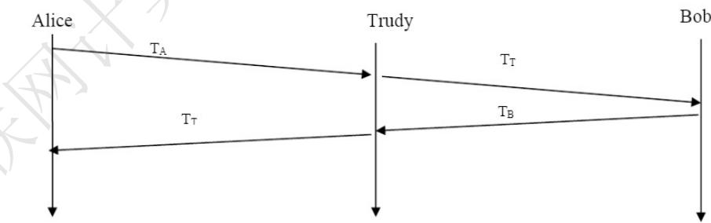

The Diffie-Hellman public key encryption algorithm is possible to be attacked by man-inthe-middle.

1. In this attack, Trudy receives Alice's public value (TA) and sends her own public value (Tτ) to Bob.

2. When Bob transmits his public value (TB), Trudy sends her public key to Alice (Tτ).

3. Trudy and Alice thus agree on one shared key (SAτ) and Trudy and Bob agree on another shared key (SBT).

P18. 假定Alice要向Bob发送电子邮件。Bob具有一个公共-私有密钥对 $( K _ { \scriptscriptstyle B } ^ { + } , K _ { \scriptscriptstyle B } ^ { - } )$ ，并且 Alice 具有Bob的证书。但Alice不具有公钥私钥对。Alice和Bob（以及全世界)共享相同的散列函数H(·)。

a. 在这种情况下，能设计一种方案使得Bob能够验证Alice创建的报文吗？如果能，用方框图显示Alice和Bob是如何做的。

b. 能设计一个对从Alice向 Bob发送的报文提供机密性的方案吗？如果能，用方块图显示Alice和Bob 是如何做的。

## 参考答案：

a: 如果Alice没有公钥私钥对，那么无法对初始的Alice进行验证。b:

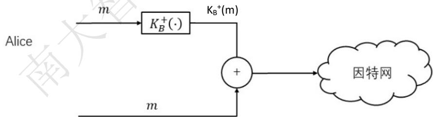

P19. 考虑下面对于某 SSL会话的一部分的 Wireshark 输出。

a. Wireshark分组112是由客户还是由服务器发送的?

b. 服务器的IP地址和端口号是什么？

c. 假定没有丢包和重传，由客户发送的下一个TCP报文段的序号将是什么？

d. Wireshark 分组 112 包含了多少个SSL 记录?

e. 分组112包含了一个主密钥或者一个加密的主密钥吗?或者两者都不是?

f. 假定握手类型字段是1字节并且每个长度字段是3字节，主密钥（或加密的主密钥）的第一个和最后一个字节的值是什么？

g. 客户加密的握手报文考虑了多少SSL记录?

h. 服务器加密的握手报文考虑了多少SSL记录？

<table><tr><td>Ele Edit View Go Capture Analyze Statistics Help Fiter: ssi Expression... Clear Apply</td></tr><tr><td></td></tr><tr><td>No..Time Source Destination rotocol Info 106 21.805705 128.238.38.162 216.75.194.220 5SLv2 Client Hello</td></tr><tr><td>108 21.830201 216.75.194.220 128.238.38.162 SSLV3 Server Hello, 111 21.853520 216.75.194.220 128.238.38.162 SSLV3 Certificate, server Hello Done 21.876168128.238.38.162 216.75.194.220 SSLVS Cllant rey Evchange. Change C1 113 21.945667 216.75.194.220 128.238.38.162 SSLV3 Change Cipher Spec, Encrypted Handshake Message</td></tr><tr><td>114 21.954189 128.238.38.162 216.75.194.220 SSLV3 Application Data 2 2210A32 nae SFERI 42 43535A30 Frame 112 (258 bytes on wire, 258 bytes captured) 国 Ethernet II, Src: Ibm_10:60:99 (00:09:6b:10:60:99), Dst: A71-HSRP-routers_00 (00:00:0c:07:ac:00)</td></tr><tr><td>国 Internet Protoco1, 5rc: 128.238.38.162 (128,238.38.162), Dst: 216.75.194,220 (216.75,194.220) 国 Transmiss1on control Protocol, Src Port: 2271 (2271), 0st Port: https (443), Seq: 79, Ack: 2785, Len: 204 日 Secure Socket Layer SsLv3 Record Layer: Handshake Protocol: client Key Exchange</td></tr><tr><td>Content Type: Handshake (22) version: $SL 3.0 (0x0300) Length: 132 nandshake Protocol: client key Exchange Handshake Type: Client Key Exchange (16) Length: 128 SsLv3 Record Layer: changecipher Spec Protocol: change cipher 5pec</td></tr><tr><td>Version: SSL 3.0 (0x0300) Length: 1 Change Cipher Spec Message ssLv3 Record Layer: Handshake Protocol: Encrypted Handshake Message Content Type: Handshake (22) Vers1on: 5SL 3.0 (0x0300) Length: 56 Handshake Protocol; Encrypted Handshake Message 0030 fd 1f c2 d9 00 00 16 03 00 00 84 10000 0040 6a 51 CU 05 89</td></tr></table>

## 参考答案：

a. 是由客户发送的

b. 服务器的IP 216.75.194.220 端口号 443

c. 283

d. 从图中看有3个

e. 按照书上的步骤，上一步是服务器发送证书。这一步应该是客户发送加密的前主密钥。

f. First byte: bc; Last byte: 29

g.6

## Q&A

殷亚凤智能软件与工程学院苏州校区南雍楼东区225yafeng@nju.edu.cn，https://yafengnju.github.io/