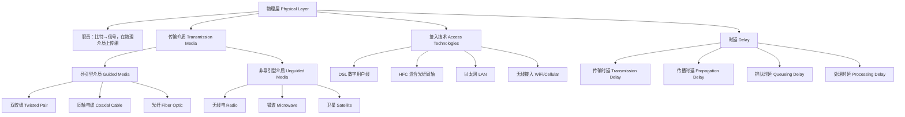

## 一句话总结

物理层（Physical Layer）是 TCP/IP 五层协议栈的最底层，负责将比特（bits）转换为适合在物理介质上传输的信号（电信号、光信号、电磁波），并定义机械/电气/功能/规程特性。它不关心比特的含义，只关心"怎么把比特可靠地从一端送到另一端"。

---

## 知识地图

---

## 场景设定：比特的旅程

在五层协议栈中，数据从应用层一路往下封装。到了链路层，数据报被封进了帧（frame）。但帧还是"数字"形式——一组 0101 的比特串。最终这些比特要变成物理世界中的电信号、光信号或无线电波，穿过双绞线、光纤或空气，到达对端。

这一章解决的正是这个"最后一步"：**比特怎么变成信号？信号走什么样的路？走多久？有哪些路可选？**

---

## 一、物理层是什么——协议栈的基石

### 1.1 在 OSI 和 TCP/IP 中的位置

| 模型 | 层数 | 物理层位置 |
|------|------|-----------|
| **OSI 七层** | 第 1 层 | 最底层，上面是数据链路层 |
| **TCP/IP 五层** | 第 5 层 | 最底层，上面是链路层 |

物理层是唯一真正"接触物理世界"的一层。它以上的所有层都在处理逻辑/数字层面的问题——寻址、路由、可靠传输——只有物理层直接把比特变成电压、光脉冲或电磁波。

### 1.2 物理层做了什么？

课件中 OSI 物理层的定义（原文第 66 页）：

> "Transfers bits across link. Specification of the physical aspects of a communication link — Mechanical: cable, plugs, pins... Electrical/optical: modulation, signal strength, voltage levels, bit times... Functional/procedural: activate, maintain, deactivate physical links..."

物理层的四项规范：

| 规范类别 | 内容 | 例子 |
|---------|------|------|
| **机械 (Mechanical)** | 连接器形状、引脚数量、线缆规格 | RJ-45 水晶头、光纤接口 |
| **电气/光学 (Electrical/Optical)** | 电压电平、调制方式、比特时长 | 以太网曼彻斯特编码、光纤的 LED/激光 |
| **功能 (Functional)** | 每个引脚的功能定义 | 哪根引脚发送、哪根接收 |
| **规程 (Procedural)** | 激活/维持/停用物理链路的流程 | 链路建立和拆除的信号时序 |

**简单的理解方式**：物理层做的事情就是"把比特变成信号，让信号在介质上传播，然后在对端把信号变回比特"。

---

## 二、传输介质——信号走什么路

课件将物理介质分为两大类：**导引型（Guided）**和**非导引型（Unguided）**。

> "guided media: signals propagate in solid media — copper, fiber, coax"
> "unguided media: signals propagate freely, e.g., radio"

### 2.1 四种主要介质的对比

| | 双绞线 (Twisted Pair) | 同轴电缆 (Coaxial) | 光纤 (Fiber Optic) | 无线电/微波 (Radio/Microwave) |
|---|---|---|---|---|
| **类型** | 导引型 | 导引型 | 导引型 | 非导引型 |
| **信号形式** | 电信号 | 电信号 | 光脉冲 | 电磁波 |
| **典型速率** | Cat 5: 100Mbps-1Gbps Cat 6: 10Gbps | 多频道宽带 | 10's-100's Gbps 点对点 | WiFi: 11-54Mbps 4G: ~1-10Mbps 微波: up to 45Mbps |
| **传输距离** | 短（~100m） | 中 | 极长（中继器间距数公里） | 变化大（WiFi ~70m，卫星覆盖洲际） |
| **抗干扰** | 中（双绞抵消部分电磁干扰） | 较好（屏蔽层） | 极好（免疫电磁干扰） | 差（受反射、障碍物、干扰影响） |
| **误码率** | 低 | 低 | 极低（10⁻¹² 以下） | 高 |
| **方向性** | 双向 | 双向 | 单向（每条光纤一个方向） | 双向 |
| **成本** | 便宜 | 中等 | 昂贵 | 频谱牌照费 |
| **典型用途** | 以太网 LAN、电话线 | 有线电视、HFC 接入 | 广域网骨干、海底光缆、FTTH | WiFi、蜂窝网络、卫星通信 |

### 2.2 每种介质的深入理解

#### 双绞线 (Twisted Pair)

> "two insulated copper wires, Category 5: 100 Mbps, 1 Gbps Ethernet; Category 6: 10Gbps"

两根绝缘铜线绞合在一起（为什么绞？→ 减少电磁干扰，两根线的干扰互相抵消）。距短（~100m），非常便宜，是以太网 LAN 的事实标准介质。

**考试要点**：Cat 5 vs Cat 6 的速率差异（100M/1G vs 10G）。绞合的目的是抗干扰。

#### 同轴电缆 (Coaxial Cable)

> "two concentric copper conductors, bidirectional, broadband: multiple channels on cable"

两根同心铜导体（中心铜线 + 外层屏蔽网），支持宽带多频道传输。传统有线电视网的核心介质，后来演进为 HFC（混合光纤同轴）的"最后一公里"。

**考试要点**：同轴 = 双向 + 宽带多频道。与双绞线的区别是屏蔽更好、距离更长。

#### 光纤 (Fiber Optic)

> "glass fiber carrying light pulses, each pulse a bit; high-speed point-to-point transmission (e.g., 10's-100's Gbps); low error rate; repeaters spaced far apart; immune to electromagnetic noise"

玻璃纤维传导光脉冲——有光 = 1，无光 = 0。三个核心优势：(1) 极高速率（100 Gbps+），(2) 极低误码率（比铜缆低几个数量级），(3) 免疫电磁干扰。

**为什么光纤误码率极低？** 电信号沿铜线传输时，信号衰减和电磁干扰会导致比特翻转。光纤传导的是光，不受电磁干扰影响——在强电设备旁、雷雨天气下都能稳定工作。这也是为什么链路层做了 CRC 但在光纤 LAN 中很少触发重传——误码率太低，差错控制几乎不需要"纠正"，只需"检测"。

**考试要点**：光纤工作原理（光脉冲）、三个核心优势（高速、低误码、抗电磁干扰）、单向性（每条光纤只能单向传输，双向通信需要一对光纤）。

#### 无线电/微波 (Radio/Microwave)

> "signal carried in electromagnetic spectrum; no physical 'wire'; bidirectional; propagation environment effects: reflection, obstruction by objects, interference"

信号在电磁频谱中自由传播，不需要物理"线"。受环境影响很大——反射、建筑物遮挡、同频干扰都会影响信号质量。

分类：
- **微波 (Terrestrial Microwave)**：点对点，up to 45Mbps，需要视距传输（微波塔之间不能有障碍物）
- **WiFi (LAN Radio)**：802.11 系列，短距离 (~70m)，11Mbps-14Gbps
- **蜂窝 (Wide-area Cellular)**：3G/4G/5G，覆盖数公里
- **卫星 (Satellite)**：Kbps-45Mbps/channel，但端到端延迟高达 270ms（地球同步轨道卫星 36,000km 高度——光速再快，往返也要 ~270ms）

**考试要点**：无线的三个环境效应（反射、遮挡、干扰）。卫星通信核心问题——延迟高（270ms），不适合实时交互。

---

## 三、接入技术——怎么连上网

接入网络（Access Network）解决"最后一公里"问题：端系统到边缘路由器之间怎么连接。

> "How to connect end systems to edge router?"

### 3.1 住宅接入三大技术

| | **DSL** | **HFC** | **FTTH** |
|---|---|---|---|
| **全称** | Digital Subscriber Line | Hybrid Fiber Coax | Fiber to the Home |
| **介质** | 电话线（双绞线） | 光纤 + 同轴电缆混合 | 全光纤 |
| **部署商** | 电话公司 | 有线电视公司 | 运营商 |
| **速率** | ≤1Mbps上行, ≤8Mbps下行 | ≤30Mbps下行, ≤2Mbps上行 | 100Mbps-1Gbps+ |
| **对称性** | 非对称 | 非对称 | 对称 |
| **共享性** | 专用线路到中心局 | 邻居共享 ISP 路由器 | 通常专用 |
| **优缺点** | 基于已有电话线，但速率有限 | 下行快，但上行慢且共享 | 最快最稳，但部署成本高 |

### 3.2 以太网 LAN 接入

> "Company/University local area network (LAN) connects end systems to edge router. Ethernet: 10 Mbps, 100Mbps, 1Gbps, 10Gbps."

学校/公司等机构的标准接入方式——终端通过交换机接入骨干以太网，再连到边缘路由器。

### 3.3 无线接入

> "Shared wireless media connects end system to router via base station or access point."

- **WiFi (802.11)**：11/54 Mbps ~ 数 Gbps，覆盖 ~70m
- **蜂窝网络 (4G/5G)**：1-10 Mbps ~ 数百 Mbps，覆盖数公里

无线接入的本质是"共享介质"——所有用户共享同一无线频道带宽。

---

## 四、时延——信号走多久

时延在笔记 01 中已详细展开，这里仅从物理层视角回顾核心分类：

| 时延类型 | 公式 | 物理含义 | 谁决定的 |
|---------|------|---------|---------|
| **传输时延 (Transmission)** | L / R | 把所有比特"推入"链路的时间 | 分组长度 L + 链路带宽 R |
| **传播时延 (Propagation)** | d / s | 一个比特在介质中传播的时间 | 链路长度 d + 信号速度 s |
| **排队时延 (Queueing)** | 取决于流量 | 在缓冲区等待处理的时间 | 流量模式、网络负载 |
| **处理时延 (Processing)** | 通常可忽略 | 路由器查表等处理时间 | 硬件速度 |

**关键区分**（常考）：
- **传输时延**跟链路长度无关——只取决于分组大小和带宽。加大带宽可以减传输时延。
- **传播时延**跟分组大小无关——只取决于物理距离和信号传播速度。加大带宽不减传播时延。

**数值直觉**：窄带宽 + 长分组 → 传输时延主导；长距离链路 → 传播时延主导；两者独立互不抵消。

---

## 五、与链路层的"物理接口"

物理层和链路层紧密耦合——它们一起实现在 NIC（网络接口卡）上。

### CSMA/CD 与物理层的关系

CSMA/CD 的碰撞检测依赖物理层的电压监测。在有线介质上，NIC 发送时同时监测线路电压——正常情况是自己发出的信号，碰撞时另一个站的信号叠加过来导致电压异常。

**最小帧长的物理层推导**：

> 帧的传输时间 ≥ 2 × 传播时延（往返时间）

$$\text{最小帧长} = \text{带宽} \times 2 \times t_{prop}$$

- 传统以太网（10Mbps）：最大往返延迟 51.2 μs → 最小帧长 = 10Mbps × 51.2μs = 512 bit = **64 字节**
- 这意味着在 10Mbps 以太网中，传输一个最小帧需要 51.2 μs——正好等于信号在网络两端往返的时间
- 如果帧太短（发完时碰撞信号还没回来），发送方就检测不到碰撞，以为发送成功

这是物理层（传播延迟）约束链路层（帧格式设计）的经典例子。详细推导见 [10-链路层-概述与MAC协议](10-链路层-概述与MAC协议.md) § 3.3。

---

## 术语对照

| English | 中文 | 说明 |
|---------|------|------|
| Physical Layer | 物理层 | TCP/IP 最底层，比特→信号 |
| Guided Media | 导引型介质 | 信号沿固体介质传播（铜线、光纤） |
| Unguided Media | 非导引型介质 | 信号自由传播（无线电、微波） |
| Twisted Pair (TP) | 双绞线 | 两根绞合铜线，LAN 最常用 |
| Coaxial Cable | 同轴电缆 | 同心铜导体，有线电视介质 |
| Fiber Optic | 光纤 | 玻璃纤维导光，极高速度极低误码 |
| Radio | 无线电 | 电磁波承载信号，不需物理线路 |
| Microwave | 微波 | 点对点无线，需视距 |
| DSL | 数字用户线 | 电话线上网，专用线路 |
| HFC | 混合光纤同轴 | 有线电视线上网，邻居共享 |
| FTTH | 光纤到户 | 全光纤接入，速率最高 |
| Access Network | 接入网络 | 端系统到边缘路由器的"最后一公里" |
| Transmission Delay | 传输时延 | = L/R，把所有比特推入链路的时间 |
| Propagation Delay | 传播时延 | = d/s，信号通过链路的时间 |
| Slot Time | 时隙时间 | 512 比特时间，以太网碰撞窗口 |
| Minimum Frame Size | 最小帧长 | 64 字节，由往返传播时间决定 |
| SNR (Signal-to-Noise Ratio) | 信噪比 | 信号功率与噪声功率之比 |
| BER (Bit Error Rate) | 误码率 | 传输的比特出错的概率 |

---

## 关键原句

> "Physical Layer: Transfers bits across link. Specification of the physical aspects of a communication link — Mechanical, Electrical/optical, Functional/procedural."
> **翻译：** 物理层：通过链路传输比特。规范通信链路的物理方面——机械、电气/光学、功能/规程。

> "guided media: signals propagate in solid media — copper, fiber, coax. unguided media: signals propagate freely, e.g., radio."
> **翻译：** 导引型介质：信号沿固体介质传播——铜、光纤、同轴。非导引型介质：信号自由传播，如无线电。

> "fiber optic cable: glass fiber carrying light pulses, each pulse a bit; high-speed operation; low error rate; repeaters spaced far apart; immune to electromagnetic noise"
> **翻译：** 光纤线缆：玻璃纤维携带光脉冲，每个脉冲一个比特；高速运行；极低误码率；中继器间距很大；免疫电磁噪声。

> "Transmission delay: How long does it take to push all the bits of a packet into a link? Packet size / Transmission rate. Propagation delay: How long does it take to move one bit from one end of a link to the other? Link length / Propagation speed."
> **翻译：** 传输时延：将分组的全部比特推入链路需要多久？= 分组大小 / 链路速率。传播时延：将一个比特从链路一端传到另一端需要多久？= 链路长度 / 传播速度。

---

## 记忆卡片

> **Q: 物理层做什么？为什么需要规范四个方面的特性？**
> A: 物理层负责将比特转换为信号在物理介质上传输。需要规范四个方面：(1) 机械——用什么接口、什么线；(2) 电气/光学——信号怎么表示 0 和 1；(3) 功能——每根引脚干什么；(4) 规程——怎么建立和释放链路。换句话说就是"用什么线、怎么编码、怎么接、什么时候传"。

> **Q: 四种传输介质的核心比较？各自最突出的特征？**
> A: (1) 双绞线——便宜、短距、LAN 标配；(2) 同轴电缆——双向宽带、有线电视最后一公里；(3) 光纤——极高速、极低误码、免疫电磁干扰、昂贵；(4) 无线电——不需线缆、但受反射/遮挡/干扰影响大。

> **Q: 光纤为什么优于铜缆？它有什么缺点？**
> A: 光纤三大优势：极高速率（100 Gbps+）、极低误码率（10⁻¹² 以下）、免疫电磁干扰。缺点：(1) 成本高（玻璃纤维、精密连接器）；(2) 单向性（每条光纤只能单向传输，双向需一对）；(3) 安装维护需要专业技能。

> **Q: 传输时延和传播时延的区别？各自由什么决定？**
> A: 传输时延 = 分组长度/带宽（推入链路的时间），传播时延 = 距离/信号速度（穿过链路的时间）。加大带宽只减传输时延不减传播时延——物理距离带来的延迟无法通过升级设备克服。

> **Q: 以太网最小帧长 64 字节是怎么来的？为什么千兆以太网放弃了 CSMA/CD 半双工？**
> A: 最小帧长 = 带宽 × 2 × 传播时延。10Mbps 以太网中，往返延迟 51.2μs → 10Mbps × 51.2μs = 512 bit = 64 字节。帧太短发完时碰撞信号还没回来，检测不到碰撞。千兆以太网速率提高了 100 倍，最小帧长仍需 64 字节（兼容），传输时间只有 51.2ns——往返延迟远大于传输时间，CSMA/CD 无法工作。所以千兆以上必须用全双工交换机。
