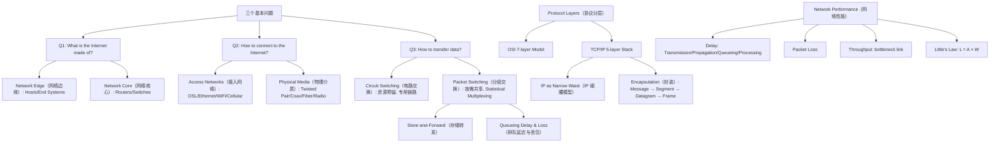

## 一句话总结
因特网 = 边缘设备（End Systems/Hosts）+ 接入网络（Access Networks）+ 分组交换核心（Packet-Switched Core）+ 分层协议栈（TCP/IP Protocol Stack），IP 是连接一切的"细腰"（narrow waist）。

## 知识地图



## 核心概念

### 1. Internet（因特网）— Component View vs Service View
**组件视角**：因特网 = 数以亿计的端系统（Hosts/End Systems）+ 通信链路（Communication Links：光纤、铜缆、无线电）+ 路由器/交换机（Routers/Switches：在物理网络间转发分组）。

**服务视角**：因特网是为分布式应用（Web、VoIP、Email、在线游戏）提供通信基础设施的平台。它向上层应用提供两种服务——可靠数据交付（Reliable Data Delivery，如 TCP）和尽力而为交付（Best-Effort Delivery，如 UDP）。

因特网是一个"网络的网络"（network of networks），由 IETF 制定标准，通过 RFC（Request for Comments）发布协议规范。

### 2. Protocol（协议）
协议定义了网络实体之间消息的**格式**（format）、**顺序**（order）和**动作**（actions）。类比：两人对话有约定（"你好→你好→问时间→回答"），网络协议就是机器之间的对话约定。人类对话和网络协议的对比是本章最生动的类比——TCP 三次握手就是机器版的"Hi → Hi → Got the time? → 2:00"。

### 3. Network Edge vs Network Core（网络边缘 vs 网络核心）
- **网络边缘（Network Edge）**：主机/端系统 + 应用。两种通信模式——Client/Server（客户端请求，服务器常驻响应）和 Peer-to-Peer（对等节点直接通信，如 BitTorrent、Skype）。
- **网络核心（Network Core）**：由互联路由器组成的网状结构。核心问题：数据如何在网络中传输？答案：分组交换。

### 4. Circuit Switching vs Packet Switching（电路交换 vs 分组交换）
| | Circuit Switching（电路交换） | Packet Switching（分组交换） |
|------|------|------|
| 资源 | 每通电话预留专用电路 | 按需共享，统计多路复用 |
| 准入控制 | 每连接（connection） | 每分组（per-packet） |
| 优点 | 性能可预测，建立后转发简单快速 | 资源利用率高，实现简单，鲁棒 |
| 缺点 | 突发流量时效率低，建立/拆除复杂 | 性能不可预测，需要缓冲管理和拥塞控制 |

**关键洞察**：因特网选择分组交换而非电路交换，是因为数据流量天然是突发性的（bursty）——电路交换会在空闲时浪费预留资源。

### 5. Statistical Multiplexing（统计多路复用）
链路带宽按需共享（shared on demand），允许总需求超过链路容量。因为不是所有人同时活跃，实际体验好于极端情况。例子：35 个用户共享 10Mbps 链路，每人活跃概率 10%——同时活跃超过 10 人的概率仅 0.0004。电路交换只能容纳 10 人，分组交换支持 35 人仍几乎不拥塞。

### 6. Store-and-Forward（存储转发）
分组在网络中**一跳一跳**移动。每跳路由器完整接收整个分组（存储到缓冲区），然后再转发到下一跳。这引入了排队延迟——当多个输入同时指向同一条输出链路时，分组需要在缓冲区排队，缓冲区满则丢包（packet loss）。

### 7. Protocol Layering（协议分层）— TCP/IP vs OSI
分层是应对复杂系统的核心思想。**TCP/IP 五层栈**（自顶向下）：应用层（Application）→ 运输层（Transport，如 TCP/UDP）→ 网络层（Network，如 IP）→ 链路层（Link，如 Ethernet/PPP）→ 物理层（Physical）。

OSI 七层模型加了会话层（Session）和表示层（Presentation），但从未真正落地。TCP/IP 是事实标准。

**IP 细腰模型（narrow waist）**：IP 是唯一网络层协议——上面跑所有应用（FTP/HTTP/SMTP），下面跑所有链路技术（Ethernet/WiFi/DSL）。这种设计让因特网可以同时创新上下层，但换 IP 本身极难（IPv4→IPv6 至今未完成）。

### 8. Encapsulation（封装）
每层在用户数据前加头部（header），形成该层的协议数据单元（PDU）：
- 应用层：Message（消息）
- 运输层：Segment（报文段）= Message + Transport Header
- 网络层：Datagram（数据报）= Segment + Network Header
- 链路层：Frame（帧）= Datagram + Link Header

### 9. Network Performance（网络性能）— Delay, Loss, Throughput
四种时延：
- **Transmission Delay（传输时延）** = 分组长度 / 链路带宽 — 把整个分组推入链路的时间
- **Propagation Delay（传播时延）** = 链路长度 / 信号传播速度 — 一个比特从链路一端到另一端的时间
- **Queueing Delay（排队延迟）** — 在缓冲区等待处理的时间，取决于流量模式
- **Processing Delay（处理延迟）** — 交换机查表等处理，通常可忽略

**Little's Law**：L = A × W（平均队列长度 = 到达率 × 平均等待时间）。知道 L 和 A 就能算出 W——方便但深刻的公式。

**吞吐量（Throughput）** = F / T。端到端吞吐量受瓶颈链路（bottleneck link）限制：throughput ≈ min{R₁, R₂, ..., Rₙ}。

## 术语对照

| English | 中文 | 说明 |
|---------|------|------|
| Host / End System | 主机/端系统 | 运行网络应用的终端设备 |
| Communication Link | 通信链路 | 连接设备的物理介质，如光纤、铜缆、无线电 |
| Router | 路由器 | 在网络之间转发分组的设备 |
| Packet | 分组/数据包 | 网络层传输的基本数据单元 |
| Protocol | 协议 | 定义消息格式、顺序和动作的规范 |
| Circuit Switching | 电路交换 | 预先建立专用电路，资源预留 |
| Packet Switching | 分组交换 | 分组独立处理，资源按需共享 |
| Statistical Multiplexing | 统计多路复用 | 链路带宽按需共享，依赖各用户非同时活跃的统计特性 |
| Store-and-Forward | 存储转发 | 分组整包接收后再转发到下一跳 |
| Encapsulation | 封装 | 每层添加头部，形成该层的 PDU |
| Protocol Data Unit (PDU) | 协议数据单元 | 每层的数据格式：Message/Segment/Datagram/Frame |
| Narrow Waist | 细腰模型 | IP 是唯一网络层协议，上面所有应用，下面所有链路 |
| Transmission Delay | 传输时延 | 将分组所有比特推入链路所需时间 |
| Propagation Delay | 传播时延 | 信号从链路一端传到另一端所需时间 |
| Throughput | 吞吐量 | 目的端接收数据的速率，受瓶颈链路限制 |

## 关键原句

以下为本章最核心的英文原句及其中文翻译：

> "The Internet is the global system of interconnected mainframe, personal, and wireless computer networks that use the Internet protocol suite (TCP/IP) to link billions of devices worldwide."
> **翻译：** 因特网是全球互联的计算机网络的系统，使用 TCP/IP 协议族将数十亿设备连接在一起。

> "Protocols define the format, order of messages sent and received among network entities, and actions taken on message transmission and receipt."
> **翻译：** 协议定义了网络实体之间发送/接收消息的格式、顺序，以及消息传输和接收时采取的动作。

> "In packet switching, hosts break application-layer messages into packets. The network forwards packets from one router to the next, across links on a path from source to destination."
> **翻译：** 在分组交换中，主机将应用层消息拆分成分组。网络将分组从一个路由器转发到下一个，沿路径穿过各链路到达目的地。

> "Statistical multiplexing: link bandwidth is shared on demand. Allowing more demands than the network can handle, hoping that not all demands are required at the same time."
> **翻译：** 统计多路复用：链路带宽按需共享，允许总需求超过网络容量，依赖于并非所有人同时需要资源的统计特性。

> "IP is the narrow waist of the layering hourglass — a single network-layer protocol that allows arbitrary networks to interoperate."
> **翻译：** IP 是分层沙漏的细腰——唯一的网络层协议，让任意网络能够互联互通。

> "Each layer implements a service via its own internal-layer actions, relying on services provided by the layer below."
> **翻译：** 每一层通过自己的内部层动作实现一种服务，依赖下层提供的服务。

> "Little's Law: L = A × W. The average number of packets waiting in the queue equals the average arrival rate times the average waiting time."
> **翻译：** 利特尔定律：L = A × W。队列中平均等待的分组数 = 平均到达率 × 平均等待时间。

## 难点突破

### 难点1：传输时延 vs 传播时延 —— 容易搞混
**类比**：把分组想象成一支车队，链路想象成高速公路。
- **传输时延** = 所有车依次通过收费站的时间（取决于车队长度和收费速度——对应分组大小和链路带宽）
- **传播时延** = 第一辆车从收费站开到终点的路程时间（取决于路程长度和车速——对应链路物理长度和信号速度）

窄带宽长分组 → 传输时延主导。长距离链路 → 传播时延主导。两者独立，不互相抵消。

### 难点2：统计多路复用的"魔法"——为什么能过载还不崩？
统计多路复用不保证每条流都能同时满载，它赌的是**并非所有人同一刻都在用**。就像餐厅——200 个座位接待 500 个注册会员，因为不会所有人同时来。但这个赌注的代价是：极端情况下（所有人同时来），就会排队甚至丢包（queueing delay and loss）。这就是因特网"尽力而为"（best effort）的根源。

## 与前章关联
这是课程第 1 章，建立整个课程的概念框架。后续各章严格对应 TCP/IP 五层栈自顶向下拆解：第 2 章（应用层）→ 第 3 章（运输层）→ 第 4-5 章（网络层）→ 后续（链路层/物理层）。本章讲的分组交换和排队延迟直接解释了第 5 章拥塞控制为什么需要。封装概念贯穿所有后续章节，每个 PDU 的定义就是各章的核心内容。

## 记忆卡片

> **Q: What are the three basic questions about the Internet?**
> A: (1) What is the Internet made of? — End systems + links + routers. (2) How to connect? — Access networks (DSL/WiFi/Ethernet/Cellular). (3) How to transfer data? — Packet switching (统计多路复用 + 存储转发).
>
> **Q: Circuit switching vs Packet switching — what's the fundamental difference?**
> A: Circuit switching reserves dedicated resources per connection (predictable but wasteful for bursty traffic). Packet switching shares resources on demand via statistical multiplexing (efficient but unpredictable, requires buffers and congestion control).
>
> **Q: 四种网络时延分别是什么？**
> A: Transmission delay（推入链路的时间，= 分组长度/带宽）、Propagation delay（信号穿过链路的时间，= 距离/光速）、Queueing delay（缓冲区排队时间，取决于流量）、Processing delay（路由器处理时间，可忽略）。
>
> **Q: Why is IP called the "narrow waist"?**
> A: 因为 IP 是 TCP/IP 协议栈中唯一的网络层协议——所有应用跑在 IP 之上（FTP/HTTP/SMTP），所有链路技术跑在 IP 之下（Ethernet/WiFi/DSL）。这实现了应用与底层网络技术的解耦，但换 IP 本身极难。
>
> **Q: 封装（Encapsulation）的完整链路是什么？**
> A: Message（应用层）→ Segment（运输层：加 TCP/UDP 头）→ Datagram（网络层：加 IP 头）→ Frame（链路层：加链路头 + 尾部校验）。每层在数据前面加自己的头部，接收方逐层解封装。

## 💬 学习对话补充

### 2026-05-18：第1章深度问答——从概念辨析到因果链条

**类型：** 深化

本次问答覆盖了第 1 章的 9 个话题，从基础概念区分到跨章因果推导。以下是结构化总结。

---

#### 话题1：网络边缘 vs 接入网络 vs 网络核心

**核心困惑**：三者容易混淆，尤其是"无线路由器"这种多合一设备怎么归类。

**区分标准**：

| 层次 | 职能 | 判断标准 | 例子 |
|------|------|----------|------|
| **网络边缘** | 跑应用，产生/消费数据 | 是数据的最终源或目的地？ | 笔记本、手机、服务器、智能家具 |
| **接入网络** | "最后一公里"，把边缘设备接入核心 | 是连接端系统到路由器的通信链路？ | WiFi AP、双绞线、同轴电缆、DSL |
| **网络核心** | 转发数据，不做数据源/目的地 | 只负责转发，不跑应用？ | 路由器、交换机 |

**关键洞察**：判断标准不是物理位置——服务器在机房但仍是边缘（它是端系统）；家用无线路由器是一个三合一设备（AP + Switch + Router），但它在家里的主要角色是"连接端系统"，所以归为接入网络。

**完整场景串联**：

```
笔记本(边缘) ─WiFi→ WiFi AP(接入) ─双绞线(接入)─→ 边缘路由器 → [核心路由器网] → B站服务器(边缘)
```

---

#### 话题2：电路交换 vs 分组交换 — 因特网的"路线选择"

**核心困惑**：两种交换方式的本质区别是什么？为什么要选分组交换？

**工作原理对比**：

| | Circuit Switching | Packet Switching |
|------|------|------|
| 步骤 | 建立电路 → 传输 → 拆除 | 拆成分组 → 每跳查表转发 |
| 资源 | 预留（reserved），独占 | 按需共享（on-demand） |
| 准入控制 | 每连接（connection） | 每分组（per-packet） |
| 带宽 | 固定分配，闲置也占着 | 动态使用，不传就释放 |
| 路由 | 建立时确定，全程固定 | 逐跳查表，可动态调整 |

**因特网选分组交换的根本原因**：数据流量天然是突发性的（bursty）——浏览网页时点一下传 50KB 然后 30 秒在阅读。电路交换预留的带宽在这 30 秒全部浪费，而分组交换允许别人的流量用这段带宽。

**统计多路复用的数学直觉**：10Mbps 链路，每用户需 1Mbps，活跃概率 10%：
- 电路交换：10Mbps / 1Mbps = 只能接 **10 个用户**（硬上限）
- 分组交换：可接 **35 个用户**，同时活跃 > 10 人的概率仅 0.0004

这就是因特网"尽力而为"的根源——不是保证不排队，而是赌排队概率足够低。

---

#### 话题3：虚电路分组交换 — 中间方案

**核心困惑**：课件提到但没展开，虚电路到底是什么？

虚电路 = 电路交换的路径固定 + 分组交换的资源共享。比数据报多一步"建立虚电路"，之后所有分组沿同一条路走，用短小的 VC 号而非完整 IP 地址查表。

| | 数据报（IP） | 虚电路（VC） |
|------|------|------|
| 路由 | 每跳独立决定 | 建立时确定，所有分组同路 |
| 查表 | 最长前缀匹配（复杂） | VC 号精确匹配（快速） |
| 交换机挂了 | 分组自动绕路 | 整条电路断开，需重建 |
| 资源 | 不预留 | 可预留也可不预留 |

**为什么 IP 没选虚电路？** 鲁棒性——虚电路路径上任一节点故障整条电路就断了，数据报每分组独立选路可以自动绕过故障。

---

#### 话题4：丢包 — 分组交换的代价与 TCP 的兜底

**核心困惑**：丢包会破坏数据完整性吗？为什么不直接做可靠网络层？

**丢包的定义**：路由器缓冲区满了 → 新分组无处存放 → 被丢弃。这不是 bug，是分组交换 + 统计多路复用赌概率的必然代价。

**丢包→可靠传输的因果链**：

```
分组交换 → 统计多路复用（赌概率）→ 排队/丢包 → IP 尽力而为，不管丢包
                                              → 需要 TCP 用 ACK + 定时器 + 重传保证可靠
```

**类比**：IP = 邮政系统（尽力送，中转站爆仓就扔），TCP = 每封信要求回执（收不到回执就重寄）。应用层最终拿到所有信，不知道中间曾丢过。

---

#### 话题5：协议分层 — 航空类比 + 五层栈 + 优缺点

**核心困惑**：为什么分层？每层到底干嘛？

**航空类比映射**：

| 航空流程 | TCP/IP 层 |
|----------|-----------|
| 买票 / 投诉 | 应用层（HTTP、SMTP） |
| 托运 / 取行李 | 运输层（TCP、UDP） |
| 登机口 / 出站 | 网络层（IP） |
| 跑道起飞 / 降落 | 链路层（Ethernet、WiFi） |
| 飞行路由 | 物理层（光纤、无线电） |

**五层职责速查**：

| 层 | 传输单元 | 核心职责 | 关键协议/设备 |
|------|------|------|------|
| 应用层 | Message | 定义应用间消息格式与交互规则 | HTTP, DNS, SMTP, FTP |
| 运输层 | Segment | 进程→进程，可靠(TCP)或尽力(UDP) | TCP, UDP |
| 网络层 | Datagram | 主机→主机，转发+路由，IP 细腰 | IP, OSPF, BGP |
| 链路层 | Frame | 相邻节点间可靠传输帧 | Ethernet, WiFi, PPP |
| 物理层 | Bits | 比特在线路上的实际传输 | 光纤、铜缆、无线电 |

**分层优缺点**：

| 优点 | 缺点 |
|------|------|
| **分解复杂性**：每层独立理解、独立设计 | **开销大**：小数据包头占比可能超 90% |
| **提高灵活性**：换一层不影响其他（WiFi 从 11Mbps 到 1Gbps，TCP 无感） | **跨层信息被隔离**：TCP 不知道丢包是拥塞还是无线信号差 |

---

#### 话题6：四种时延 + 吞吐量 + Little's Law

**核心困惑**：传输时延和传播时延总搞混。

**四种时延对比**：

| 时延类型 | 公式 / 决定因素 | 类比（车队过收费站） | 备注 |
|------|------|------|------|
| **Transmission Delay** | L / R（分组长度/带宽） | 所有车依次通过收费站的时间 | 跟距离无关 |
| **Propagation Delay** | d / s（链路长度/信号速度） | 第一辆车从收费站开到终点 | 跟分组大小无关 |
| **Queueing Delay** | 取决于流量模式（到达率×突发性） | 车队在收费站前排队等 | 不可预测 |
| **Processing Delay** | 通常可忽略 | 拧开阀门的时间 | 微秒级 |

**关键区分**：窄带宽长分组 → 传输时延主导；长距离链路 → 传播时延主导。两者完全独立——加大带宽只减传输时延不减传播时延。

**Little's Law**：`L = A × W`（平均队列长度 = 到达率 × 平均等待时间）。L 容易数，A 容易测，W 就能直接算——不需要流量分布假设。

**吞吐量**：端到端吞吐量由瓶颈链路决定——`Throughput ≈ min{R₁, R₂, ..., Rₙ}`。就像车道，最窄的地方决定了全程速度。
