## 一句话总结
应用层（Application Layer）位于 TCP/IP 协议栈最顶层，通过应用层协议（Application-Layer Protocol）定义分布式进程交换消息的规则来实现网络应用，核心应用包括 DNS 域名解析、HTTP Web 访问、SMTP 电子邮件、FTP 文件传输和 CDN 内容分发网络。

## 知识地图

```mermaid
flowchart TD
    Arch[Application Architectures（应用架构）] --> CS[Client-Server（客户端-服务器）]
    Arch --> P2P[Peer-to-Peer（对等网络）]

    DNS[Domain Name System（域名系统）] --> Hierarchy[Hierarchical Design（层次化设计）]
    Hierarchy --> Root[Root Name Servers（根域名服务器）]
    Hierarchy --> TLD[TLD Servers（顶级域服务器）]
    Hierarchy --> Auth[Authoritative Servers（权威域名服务器）]
    Hierarchy --> Local[Local DNS Servers（本地域名服务器）]
    DNS --> Resolve[Name Resolution（名字解析）]
    Resolve --> Iter[Iterated Query（迭代查询）]
    Resolve --> Rec[Recursive Query（递归查询）]
    DNS --> RR[Resource Records（资源记录）]

    Email[Electronic Mail（电子邮件）] --> SMTP[SMTP（简单邮件传输协议）]
    SMTP --> MIME[MIME（多用途邮件扩展）]
    Email --> POP3[POP3（邮局协议）]
    Email --> IMAP[IMAP（因特网邮件访问协议）]

    FTP[File Transfer Protocol（文件传输协议）] --> Ctrl[Control Connection（控制连接）]
    FTP --> Data[Data Connection（数据连接）]

    HTTP[HyperText Transfer Protocol（超文本传输协议）] --> Stateless[Stateless Design（无状态设计）]
    Stateless --> Cookie[Cookies（Cookie 机制）]
    HTTP --> Perf[Performance Optimization（性能优化）]
    Perf --> NP[Non-Persistent（非持久连接）]
    Perf --> Persist[Persistent（持久连接）]
    Perf --> Pipeline[Pipelining（流水线请求）]
    HTTP --> Cache[Web Caching（Web 缓存）]
    Cache --> Cond[Conditional GET（条件 GET）]

    CDN[Content Distribution Network（内容分发网络）] --> Replicate[Content Replication（内容复制）]
    CDN --> Redirect[DNS Redirection（DNS 重定向）]
```

## 核心概念

### 1. Application Architectures（应用架构）

每款互联网应用都建立在两种基本架构之一上。客户端-服务器（Client-Server, CS）架构中，服务器以守护进程（daemon）方式始终在线（always-on），拥有固定 IP 地址；客户端按需启动，动态 IP，率先向服务器发起请求——即"先说第一句话"（speaks first）。典型例子：Web 浏览器请求 Web 服务器、邮件阅读器发送/接收邮件。

对等网络（Peer-to-Peer, P2P）架构中无始终在线的中心服务器，任意端系统（peer）直接互相通信。每个 peer 既请求服务也提供服务——新 peer 的加入同时带来新的服务能力和新的服务需求，形成自扩展性（self-scalability）。然而 peers 间歇性连接（intermittently connected），IP 地址频繁变化，管理难度大。典型例子：Gnutella、BitTorrent、Skype。

实际应用中常采用混合架构。Skype 的语音通话是 P2P 直连，但用户地址查找依赖中心服务器；即时消息中聊天是 P2P，而在线检测和位置查找依赖中心化服务。

### 2. Domain Name System（域名系统）

DNS 是互联网的"电话簿"，核心功能是将域名（domain names）映射为 IP 地址。它是一个分布式数据库（distributed database），部署在多层级域名服务器的层次结构中，同时也是一个应用层协议，主机和域名服务器通过它通信来解析域名。DNS 还支持负载均衡（load balancing）——为同一个域名返回多个 IP 地址。

**为什么不集中管理？** 四个致命问题：单点故障（single point of failure）、流量拥堵（traffic volume）、远程数据库的高延迟、集中维护的噩梦。总之——不扩展（doesn't scale）。

**三个交织的层次结构：**

1. **层次化命名空间（Hierarchical Namespace）**：域名从右到左看呈树状——根（root）→ 顶级域（.com/.edu/.cn）→ 组织域（umich）→ 子域（eecs）。名字是叶子到根的路径（如 cse.eecs.umich.edu），每个域自主管理子树，命名冲突自然避免。

2. **层次化管理（Hierarchical Administration）**：ICANN/IANA 管理根和顶级域。每个域（zone）由一个管理机构负责，如 UMich 管理 `*.umich.edu`，EECS 系管理 `*.eecs.umich.edu`。各机构自主更新本域记录，无需跟踪全局更新。

3. **层次化服务器（Hierarchy of Servers）**：
   - **根域名服务器（Root Name Servers）**：全球 13 组逻辑根服务器（实际数百台物理服务器遍布全球），本地 DNS 无法解析时首先联系根服务器。
   - **顶级域服务器（TLD Servers）**：负责 .com、.org、.net、.edu 及国家顶级域（.cn、.uk、.fr）。Network Solutions 维护 .com，Educause 维护 .edu。
   - **权威域名服务器（Authoritative DNS Servers）**：组织的自有或托管 DNS 服务器，提供该组织域名的权威 IP 映射。
   - **本地域名服务器（Local DNS Servers）**：每个 ISP/公司/大学维护一个，是主机 DNS 查询的第一站，具有近期缓存。

**名字解析（Name Resolution）：** 客户端向本地 DNS 发起递归查询（recursive query）——"你帮我去查，我等结果"。本地 DNS 依次向根→TLD→权威服务器发起迭代查询（iterated query）——每个被查询者返回下一级地址而非最终答案。

**资源记录（Resource Records, RR）：** 格式为 `(name, value, type, ttl)`。常见类型：A（IPv4 地址）、AAAA（IPv6 地址）、NS（域名服务器）、CNAME（规范名/别名）、MX（邮件交换器）。

**可靠性：** 主/备服务器复制（primary/secondary replication）保证至少一个副本可用；默认使用 UDP 查询（端口 53），超时则换备选服务器；指数退避（exponential backoff）避免重复加重拥塞；所有查询使用相同标识符，不关心哪个服务器响应。

**缓存与 TTL：** DNS 服务器缓存查询结果，每个响应携带 TTL（Time To Live）字段，缓存过期后删除条目。这大幅减少查询延迟——顶级域信息极少变化，热门网站被频繁访问，本地缓存命中率高。但也意味着缓存可能过期：TTL 太短则缓存效果差，TTL 太长则域名换 IP 后用户长时间无法访问。

**DNS 攻击面：** 重定向攻击（man-in-middle 拦截查询）、DNS 投毒（发送伪造响应注入缓存）、DDoS 放大攻击（伪造源地址向 DNS 发送查询，目标 IP 被流量淹没）。2002 年攻击者试图用 ICMP 报文淹没 13 个根服务器，但未成功——大部分 DNS 根服务器执行分组过滤，且很多域名已被本地缓存。

### 3. Electronic Mail（电子邮件）

电子邮件是互联网上最广泛使用的应用之一。系统由三个核心组件构成：用户代理（User Agent, UA，如 Outlook、Foxmail）、邮件服务器（Mail Server）、邮件协议。

**三阶段投递：**

1. 发件人 UA 将邮件发送到本地邮件服务器（SMTP，发件人 UA 作为客户端）
2. 本地服务器将邮件中继到收件人的远程邮件服务器（SMTP，本地服务器此时作为客户端）
3. 收件人通过邮件访问协议从远程服务器获取邮件（POP3、IMAP4 或 HTTP）

**SMTP（Simple Mail Transfer Protocol，简单邮件传输协议）：** 使用 TCP 端口 25，直接传输——将邮件从客户端推送到服务器。采用命令/响应交互（command/response）：HELO → MAIL FROM → RCPT TO → DATA → QUIT，均为 ASCII 文本。传输分为三个阶段：握手（greeting）→ 邮件数据 → 关闭连接。注意：SMTP 只保证邮件到达收件人的邮件服务器，不保证最终送达用户（无端到端确认）。邮件内容必须是 7-bit ASCII。

**POP3（Post Office Protocol，邮局协议）：** 用于从服务器下载邮件。支持"下载并删除"（download-and-delete——换客户端后无法重读旧邮件）和"下载并保留"（download-and-keep——多客户端可保留副本）。POP3 在会话间无状态（stateless across sessions）。

**IMAP（Internet Mail Access Protocol，因特网邮件访问协议）：** 比 POP3 功能更丰富。邮件始终保存在服务器上，支持在服务器端组织文件夹、跟踪邮件状态（已读/回复/已删），且允许多人同时操作同一邮箱。

**MIME（Multipurpose Internet Mail Extension，多用途因特网邮件扩展）：** 扩展 SMTP 使其支持文本以外的数据类型（程序、图片、音频、视频）。所有内容编码为 7-bit ASCII，兼容非 MIME 系统。五个新增头部：MIME-Version、Content-Type、Content-Transfer-Encoding、Content-Id、Content-Description。多部分消息（multipart/mixed）通过 boundary 字符串分隔不同部分。

### 4. File Transfer Protocol（文件传输协议）

FTP 最独特的设计是**双连接架构**：

- **控制连接（Control Connection）**：TCP 端口 21。客户端主动连接，传输 ASCII 命令（USER、PASS、LIST、RETR、STOR）和响应状态码（331 用户名正确需密码、125 数据连接已打开、425 无法打开数据连接）。控制连接在整个会话期间保持打开。
- **数据连接（Data Connection）**：TCP 端口 20。每次文件传输时由服务器主动向客户端新建连接，传完即关闭。每个文件使用独立的数据连接。

这种设计称为控制"带外"（out of band）——控制信息和数据信息在独立的通道传输。HTTP 则将控制信息（请求头）和数据（响应体）放在同一连接中（in-band）。FTP 服务器维护用户状态（stateful），包括当前目录和认证信息。

### 5. HyperText Transfer Protocol（超文本传输协议）

HTTP 是万维网（World Wide Web, WWW）的核心协议。万维网是"通过超文本传输协议（HTTP）链接起来的分布式页面数据库"（a distributed database of pages linked through HTTP）。

**核心特性：**

- **客户端-服务器架构**：服务器始终在线、固定地址；客户端（浏览器）发起连接
- **同步请求/响应协议**：客户端发请求，服务器返回响应
- **运行于 TCP 之上**，默认端口 80
- **无状态（Stateless）**：每个请求-响应对独立处理。好处——服务器可扩展性强、故障处理简单、请求顺序无关紧要、能处理更高请求率。坏处——需要状态的应用（购物车、用户配置、使用追踪）需要额外机制
- **文本/ASCII 格式**（HTTP/2 之前）

**Cookies——无状态协议中的状态机制：** 服务器在响应中设置 `Set-Cookie` 头部，客户端存储 cookie，后续请求通过 `Cookie` 头部回传。服务器据此识别用户。应用场景：授权（记住登录）、购物车、个性化推荐、用户会话（Web Email）。但 cookies 引发隐私问题——服务器可追踪用户行为，搜索引擎可通过 cookies 跨站获取信息，被黑的浏览器可能滥用 cookies。

**HTTP 请求和响应格式：**
- **请求消息**：请求行（方法 + 资源 + 协议版本）+ 头部行（Host、User-agent、Connection、Accept-language）+ 空行
- **响应消息**：状态行（协议版本 + 状态码 + 短语）+ 响应头（Date、Server、Last-Modified、Content-Length、Content-Type）+ 空行 + 数据体

**HTTP 版本演进：**
| 版本 | 年份 | 关键改进 |
|------|------|----------|
| HTTP/0.9 | 1991 | 简单的 GET 命令 |
| HTTP/1.0 | 1992 | 客户端/服务器信息、简单缓存 |
| HTTP/1.1 | 1996 | 持久连接（默认）、性能和安全优化 |
| HTTP/2 | 2015 | 二进制协议替代文本、多路复用（单 TCP 连接并发请求）、服务器推送 |

**HTTP 性能模型（核心考点）：**

获取 n 个小对象，假设 RTT 为往返时间：

| 方式 | 总耗时 | 说明 |
|------|--------|------|
| 逐个非持久（Non-Persistent） | ~2n RTT | HTTP/1.0 默认，每个对象需要 TCP 建立(1 RTT) + HTTP 请求/响应(1 RTT) |
| m 并发（Concurrent） | ~2⌈n/m⌉ RTT | 并行连接提高带宽利用，但加重网络负担（服务器和网络都不喜欢） |
| 持久连接（Persistent） | ~(n+1) RTT | HTTP/1.1 默认，复用 TCP 连接，避免重复建立/拆除开销 |
| 流水线持久（Pipelined） | ~2 RTT（首次），之后 ~RTT | 批量发送请求，不等响应直接发下一个 |

**核心洞察：** 小对象场景，**延迟主导**（RTT 是瓶颈），连接策略优化效果显著；大对象场景，**带宽主导**（吞吐量受瓶颈链路限制），唯一有效的方法是增加带宽。

**缓存（Web Caching）：** 利用访问局部性（locality of reference）——大量用户访问的内容存在显著重叠。条件 GET（Conditional GET）是核心机制：客户端在请求中加入 `If-Modified-Since` 头部携带上次获取的时间戳，服务器比较资源的最后修改时间，未变则返回 `304 Not Modified`（无响应体），已变则返回 `200 OK` 和新版本。响应头中的 `Expires` 指定缓存有效期，`No-cache` 强制向源服务器验证。

### 6. Content Distribution Network（内容分发网络）

**挑战：** 从单一源服务器（origin server）实时流式传输大文件（如视频），同时需要保护源服务器免受 DDoS 攻击。

**核心方案：** 在全球数百个节点复制内容（replicate content），将内容推到离用户最近的地方。

**三大支撑技术：**

1. **DNS 重定向（DNS Redirection）**：一个域名映射到多个 IP。CDN 的权威 DNS 服务器维护一张"地图"（map），记录各叶节点 ISP 到各 CDN 服务器的距离。收到 DNS 查询时，根据查询来源的 ISP 判断用户地理位置，返回最近或负载最轻的节点 IP。

2. **URL 重写（URL Rewriting）**：将原始 URL `http://www.sina.com/sports/tennis.mov` 改写为 `http://www.cdn.com/www.sina.com/sports/tennis.mov`，指向 CDN 节点。

3. **路由（Routing）**：基于内容的路由到最近节点。

**工作流程：**
1. 用户请求内容 → DNS 解析返回最近 CDN 节点 IP
2. 用户与 CDN 节点建立 HTTP 连接获取内容（如果节点未缓存则回源服务器拉取，即 warm up cache）
3. 后续请求直接由 CDN 节点响应

CDN 节点构成应用层覆盖网络（application-layer overlay network），在世界各地协调内容分发。重定向策略综合考虑负载均衡（load balancing）、网络延迟（network delay）、缓存局部性（cache/content locality）。

## 术语对照

| English | 中文 | 说明 |
|---------|------|------|
| Application Architecture | 应用架构 | 应用的结构组织方式：Client-Server 或 P2P |
| User Agent | 用户代理 | 用户与应用交互的界面组件（浏览器、邮件阅读器、媒体播放器） |
| Domain Name System (DNS) | 域名系统 | 将域名映射为 IP 地址的分层分布式数据库 |
| Recursive Query | 递归查询 | 服务器代为完成全部查询并返回最终结果 |
| Iterated Query | 迭代查询 | 服务器返回下一级地址，客户端继续自行查询 |
| Resource Record (RR) | 资源记录 | DNS 数据库条目格式：(Name, Value, Type, TTL) |
| Simple Mail Transfer Protocol (SMTP) | 简单邮件传输协议 | 邮件发送和中继协议，TCP 25，7-bit ASCII |
| Multipurpose Internet Mail Extension (MIME) | 多用途因特网邮件扩展 | 扩展邮件支持非文本附件（图片、音频、视频） |
| Post Office Protocol (POP3) | 邮局协议 | 从服务器下载邮件，无状态 |
| Internet Mail Access Protocol (IMAP) | 因特网邮件访问协议 | 服务器端管理邮件，有状态，支持文件夹 |
| File Transfer Protocol (FTP) | 文件传输协议 | 双连接：控制(TCP 21) + 数据(TCP 20)，带外控制 |
| HyperText Transfer Protocol (HTTP) | 超文本传输协议 | Web 应用层协议，无状态，TCP 80 |
| Stateless Protocol | 无状态协议 | 每个请求独立处理，服务器不保留状态 |
| Cookie | HTTP Cookie | 客户端存储的小块状态数据，维持会话 |
| Content Distribution Network (CDN) | 内容分发网络 | 全球分布式节点，复制内容，就近访问 |

## 关键原句

> "Domain Name System: Distributed database implemented in hierarchy of many name servers; app-layer protocol host and name servers to communicate to resolve 'domain names'."
> **翻译：** 域名系统：部署在多层级域名服务器层次结构中的分布式数据库；一个应用层协议，让主机和域名服务器通信来解析域名。

> "Three intertwined hierarchies: Hierarchical namespace, Hierarchically administered, (Distributed) hierarchy of servers."
> **翻译：** 三个交织的层次结构：层次化命名空间、层次化管理、（分布式的）服务器层次。

> "DNS servers cache responses to queries. Responses include a 'time to live' (TTL) field. Server deletes cached entry after TTL expires."
> **翻译：** DNS 服务器缓存查询响应。响应包含"生存时间"（TTL）字段。TTL 过期后服务器删除缓存条目。

> "SMTP: Simple Mail Transfer Protocol - Delivery of simple text messages. Uses TCP, port 25. Direct transfer: transfer Email message from client to server."
> **翻译：** SMTP：简单邮件传输协议——传输简单文本消息。使用 TCP 端口 25。直接传输：将邮件从客户端传送到服务器。

> "FTP client contacts FTP server at port 21, opens a control connection. When server receives file transfer command, server opens 2nd TCP data connection (for file) to client."
> **翻译：** FTP 客户端联系 FTP 服务器的端口 21，打开控制连接。当服务器收到文件传输命令时，服务器打开第二条 TCP 数据连接（用于文件）到客户端。

> "World Wide Web (WWW): a distributed 'database' of pages linked through Hypertext Transport Protocol (HTTP)."
> **翻译：** 万维网（WWW）：通过超文本传输协议（HTTP）链接起来的分布式页面"数据库"。

> "HTTP: Client-server architecture. Server is 'always on' and 'well known'. Runs over TCP, Port 80. Stateless."
> **翻译：** HTTP：客户端-服务器架构。服务器"始终在线"且"地址已知"。运行于 TCP 之上，端口 80。无状态。

> "CDN solution: Replicate content at hundreds of servers throughout Internet, placing content close to user."
> **翻译：** CDN 的解决方案：在全球数百台服务器上复制内容，将内容放在离用户近的地方。

## 难点突破

### 难点1：DNS 递归查询 vs 迭代查询——我该问谁？

学生常混淆递归和迭代在 DNS 解析中的角色。

**类比——图书馆查资料：**
- **递归查询** = 你问图书管理员："帮我找《计算机网络》这本书在哪里。"管理员自己满图书馆找，找到后告诉你答案。你只问了一次，等待最终结果。这就是 **Host → Local DNS** 的关系——客户端发递归查询，等着最终 IP 地址。
- **迭代查询** = 图书管理员问你："我不确定这本书在哪，但你去问期刊区的王老师，他知道。"你去问王老师，王老师说："我不知道具体位置，但你去问三楼教材区的李老师。"你继续问李老师，终于得到答案。每一步都有人指引你下一步问谁。这就是 **Local DNS → Root → TLD → Authoritative** 的关系——每个被查询者只返回"下一个问谁"，由本地 DNS 自己继续追问。

**记忆窍门：** "递归帮你到底，迭代指路让你走。"

### 难点2：FTP 为什么需要两个连接？——带外控制的直觉

FTP 的双连接架构（控制连接 + 数据连接）与 HTTP 的单连接形成鲜明对比。

**类比——餐馆就餐 vs 外卖配送：**
- **FTP** = 外卖配送。你打电话（控制连接）到餐厅："一份宫保鸡丁，送到 XX 地址"，餐厅记录订单。做好后，外卖员（数据连接）单独配送。你可以继续打电话（同一连接）点别的菜，每个菜可能由不同的外卖员配送。
- **HTTP** = 你直接去食堂窗口。排队时说"一份宫保鸡丁"，窗口直接递给你（请求和响应在同一连接），然后你继续排队点下一个菜。

**为什么 FTP 这样设计？** 控制连接保持长连接管理会话（认证、浏览目录、保持状态），数据连接按需建立、用完即关——适合传输大文件。**代价：** 防火墙配置复杂（服务器需主动连接客户端的随机端口），而 HTTP 的单连接模式防火墙友好。

## 与前章关联

第 1 章建立了 TCP/IP 五层协议栈的概念框架，第 2 章位于栈的最顶层，是分层模型的直接落地。

- **分层模型的具象化**：第 1 章抽象地说"每层为上层提供服务"，第 2 章展示了这对应用开发者意味着什么——调用 socket API（一个简短的库调用）即可通信，无需关心 TCP 如何重传丢包、IP 如何选择路由、帧如何在物理链路上传输。下层透明性在此体现。

- **Client-Server 的深化**：第 1 章在"网络边缘"部分简介了 Client-Server 和 P2P 两种通信模式，第 2 章将其作为应用架构（Application Architecture）的核心概念展开，并在 HTTP、DNS、FTP、Email 等具体协议中反复体现。

- **传输服务的实际选择**：第 1 章对比了 TCP（可靠字节流）和 UDP（不可靠数据报）。第 2 章展示了应用层协议的真实取舍——HTTP 和 SMTP 选择 TCP（需要可靠传输），DNS 选择 UDP（查询-响应模型，简洁低延迟），流媒体则根据场景在 TCP/UDP 之间选择。这种选择背后的权衡为第 3 章（运输层）埋下伏笔。

- **性能概念的工程应用**：第 1 章的时延分析（传输时延、传播时延、排队时延）直接解释了 HTTP 性能模型的根源——2 RTT = TCP 三次握手（1 RTT）+ HTTP 请求/响应（1 RTT），这来自第 1 章定义的 RTT 概念。CDN 拉近用户与内容的距离，本质是减少第 1 章讲的传播时延（propagation delay）。

- **细腰模型的视角补充**：第 1 章说 IP 是"细腰"——所有网络技术汇聚于 IP。第 2 章补充了上半部分：应用层是"漏斗口"——所有用户可见的创新（社交媒体、短视频、即时通讯、云存储）本质上都是新的应用层协议和应用，运行在 TCP/IP 的沙漏之上。

### 核心直觉（复习补充）

- **DNS 四层查询**：本地 DNS（小区门卫）→ 根 DNS（国家档案馆）→ 顶级域 DNS（省档案局）→ 权威 DNS（公司人事部）。本地 DNS 是 ISP/学校维护的服务器，不是你电脑上的 hosts 文件。DNS 查询和回复用同一套消息格式——identifier 字段匹配查询和回复（因为走 UDP，没有连接概念）。
- **HTTP 连接演进本质是 RTT 优化**：非持久 ~2n RTT → m 并发 ~2[n/m] RTT → 持久 ~(n+1) RTT → 流水线+持久 ~2 RTT。小对象场景延迟主导，省 RTT 比加带宽更有效。HTTP/1.0 每对象一连接，TCP 慢启动反复浪费。
- **Cookie 跨站追踪**：浏览器按请求**目标域名**带 Cookie，不按当前浏览的页面。第三方追踪脚本嵌入无数网站，每次都向同一 tracker 域自报相同 ID → 拼接出完整用户画像。

## 记忆卡片

> **Q: What are the two fundamental Application Architectures, and how do they differ in scalability and management?**
> **A:** Client-Server（客户端-服务器）有始终在线（always-on）的服务器和固定 IP，客户端按需发起连接，可扩展性受限于服务器容量；Peer-to-Peer（对等网络）无中心服务器，peers 直接通信，具有自扩展性（self-scalability——新 peer 带来新服务能力），但因 peers 间歇性连接（intermittently connected）且 IP 地址动态变化，管理困难。

> **Q: Why is DNS designed as a hierarchical distributed system instead of a centralized database?**
> **A:** 集中式方案面临四个"不扩展"的问题：单点故障（single point of failure）、流量拥堵（traffic volume）、远距离查询的高延迟（distant centralized database）、集中维护的负担（maintenance）。DNS 的三个层次化设计——层次化命名空间（避免命名冲突）、层次化管理（各域自主更新）、层次化服务器（分散查询负载）——加上缓存（Caching）和服务器复制（Server Replication），共同解决了可扩展性、可用性和查询速度的挑战。

> **Q: How does FTP use separate control and data connections, and what are the trade-offs?**
> **A:** FTP 使用控制连接（Control Connection, TCP 21）持续保持以传输命令和状态码，数据连接（Data Connection, TCP 20）在每次文件传输时由服务器主动建立新连接，传完即关闭。这种"带外"（out-of-band）设计使控制信息与数据在独立通道传输，适合大文件传输。缺点是防火墙配置复杂（服务器需主动连接客户端随机端口），而 HTTP 的单连接（in-band）模式防火墙友好。

> **Q: HTTP is stateless — how do web applications like shopping carts maintain session state?**
> **A:** 通过 Cookies 机制实现客户端状态维护（client-side state maintenance）。服务器在 HTTP 响应中通过 `Set-Cookie` 头部发送一个标识符（如用户 ID），客户端存储并在后续请求的 `Cookie` 头部中回传。服务器据此从后端数据库（backend database）检索用户状态（购物车内容、登录会话等）。Cookies 的应用包括授权（Authorization）、购物车（Shopping Carts）、推荐（Recommendations）和用户会话（User Session State）。但 cookies 也带来隐私风险——服务器可跨站追踪用户行为。

> **Q: How does a CDN determine which server to redirect a user to?**
> **A:** CDN 的权威 DNS 服务器（Authoritative DNS Server）维护一张分布式"地图"（map），记录各叶节点 ISP 到各 CDN 服务器之间的距离/延迟。当收到 DNS 查询时，服务器判断查询来源的 ISP，从 map 中选取最近的 CDN 节点 IP 返回给用户。用户随后直接与该节点建立 HTTP 连接获取内容。如果节点未缓存该内容，则回源服务器（origin server）拉取并缓存。这种机制在负载均衡（load balancing）、网络延迟（network delay）和缓存局部性（cache locality）之间做综合权衡。

---

## 🧮 HTTP 性能模型——需要理解计算的部分

> 本章真正的计算考点。核心是理解 **RTT（Round-Trip Time）如何累加**，以及不同连接策略如何节省 RTT。

### 基础前提

- TCP 三次握手 = **1 RTT**（SYN → SYN-ACK → ACK，最后一个 ACK 可以携带数据）
- HTTP 请求发出到收到响应 = **1 RTT**
- 获取 n 个**小对象**（small objects，如 HTML 文件 + 图片 + CSS + JS）

### 四种连接策略的耗时公式

| 策略 | 总耗时 | 关键逻辑 |
|------|--------|---------|
| **逐个非持久**（Non-Persistent, Serial） | **2n RTT** | 每个对象：TCP 握手(1 RTT) + HTTP 请求/响应(1 RTT) = 2 RTT。n 个对象 = 2n RTT |
| **m 并发非持久**（Concurrent） | **2⌈n/m⌉ RTT** | m 个并行连接同时进行，每组 2 RTT。共 ⌈n/m⌉ 组 |
| **持久连接**（Persistent, HTTP/1.1 默认） | **(n+1) RTT** | 第 1 个：TCP 握手(1) + HTTP(1) = 2 RTT。后续 n-1 个对象：复用 TCP，每个只需 1 RTT。总 = 2 + (n-1)×1 = n+1 |
| **流水线持久**（Pipelined Persistent） | **2 RTT**（首次），之后可做到每个对象约 1 RTT | 不等响应，批量发出所有请求。首次：TCP(1) + 首个响应(1) ≈ 2 RTT |

### 核心洞察

> **小对象场景，延迟（RTT）是瓶颈**——连接策略优化效果显著。
> **大对象场景，带宽是瓶颈**——唯一有效的优化是增加带宽。

---

### 计算题 5 道

**题 1（基础——逐个非持久）**

一个 Web 页面由 1 个 HTML 文件和 5 个图片组成，每个对象都很小。HTTP/1.0 默认使用非持久连接（一次只获取一个对象）。设 RTT = 100ms，忽略传输时间。求：从输入 URL 到页面完整加载的总耗时。

**答案：**
- 1 个 HTML + 5 个图片 = **n = 6 个对象**
- 每个对象 = TCP 握手(1 RTT) + HTTP 请求/响应(1 RTT) = 2 RTT
- 总耗时 = 2 × 6 × 100ms = **1200ms**

---

**题 2（进阶——持久连接）**

同题 1，但使用 HTTP/1.1 持久连接（Persistent Connection，不复用流水线）。n = 6，RTT = 100ms。求总耗时。

**答案：**
- 持久连接公式：**(n+1) RTT**
- 总耗时 = (6+1) × 100ms = **700ms**
- 对比题 1：从 1200ms → 700ms，节省了 500ms（约 42%）

推导过程：
- 第 1 个对象（HTML）：TCP 握手(1) + 请求/响应(1) = 2 RTT
- 第 2~6 个对象（5 个图片）：复用 TCP 连接，每个各 1 RTT = 5 RTT
- 总 = 2 + 5 = 7 RTT = 700ms

---

**题 3（综合——并发 + 持久对比）**

一个页面包含 1 个 HTML 和 9 个图片，RTT = 50ms。分别计算以下三种策略的总耗时：

(a) 逐个非持久连接
(b) 持久连接（无流水线）
(c) 浏览器最多同时打开 4 个并发非持久连接

**答案：**

(a) 逐个非持久：n = 10，总 = 2 × 10 × 50ms = **1000ms**

(b) 持久连接：总 = (10+1) × 50ms = **550ms**

(c) 4 并发非持久：每组 4 个并行，每组 2 RTT，10 个对象分 ⌈10/4⌉ = 3 组
- 总 = 2 × 3 × 50ms = **300ms**

> 注意：(c) 虽然比 (b) 快，但并发连接加重网络和服务器负担（实际中服务器往往限制并发数）。

---

**题 4（应用题——浏览器实际行为）**

现代浏览器通常采用"先建 TCP 获取 HTML → 解析 HTML 发现对象 → 用持久连接 + 最多 6 并发获取剩余对象"的策略。假设：1 个 HTML + 15 个嵌入对象，RTT = 80ms，浏览器最多建 6 条并发 TCP 连接，每条连接使用持久模式。

求：从输入 URL 到完整加载的总耗时。

**答案：**

分两步计算：

第一步：获取 HTML 文件
- 1 条新 TCP 连接 → 1 RTT 握手 + 1 RTT 请求/响应 = 2 RTT = 160ms

第二步：获取 15 个嵌入对象（6 并发持久连接）
- 15 个对象均分到 6 条连接：⌈15/6⌉ = 3 个对象/连接（最慢那条）
- 每条连接的第 1 个对象：TCP 握手(1) + HTTP(1) = 2 RTT
- 后续 2 个对象（复用 TCP）：各 1 RTT
- 每条连接总耗时 = 2 + 2×1 = 4 RTT = 320ms

总耗时 = max(160ms, 320ms) — 实际 HTML 和嵌入对象是流水线重叠的，但保守计 = HTML 2 RTT + 最慢连接 4 RTT = 2 + 4 = **6 RTT = 480ms**

更精确的：HTML 获取和第一条并发连接的 TCP 握手可同时进行（浏览器解析 HTML 后立即启动并发连接），所以总时间 ≈ max(2 RTT 获取 HTML, 每条并发连接的 n+1 式) = 4 RTT = **320ms**（以最长的并发连接为准）。

---

**题 5（思考题——RTT 加倍的影响）**

一个页面由 1 个 HTML 和 3 个图片组成，采用持久连接。计算：
(a) RTT = 50ms 时的总耗时
(b) 如果用户从中国访问美国服务器，RTT 变为 250ms，总耗时变多少？
(c) 在这个场景下，并发还有优化空间吗？

**答案：**

(a) 持久连接，n = 4：总 = (4+1) × 50ms = **250ms**

(b) RTT = 250ms：总 = (4+1) × 250ms = **1250ms**（翻了 5 倍——和 RTT 成正比）

(c) 只有 4 个对象，持久连接已经很高效了（每个对象复用 TCP 只需 1 RTT）。并发能省的主要是 TCP 握手重叠时间，当 n 很小时收益有限。**真正的优化是 CDN**——把内容部署到离用户近的节点，从根本上降低 RTT。

---

## 考点整理与简答题预测

> 生成于 2026-06-01 Phase 1 复习

### 必考考点

| 优先级 | 考点 | 常见题型 |
|--------|------|---------|
| ⭐⭐⭐ | HTTP 性能模型计算（非持久/持久/并发/流水线的时间公式） | 计算题 |
| ⭐⭐⭐ | DNS 解析过程（递归 vs 迭代查询、四层服务器角色） | 简答/画图 |
| ⭐⭐ | FTP 双连接架构（控制 vs 数据、带外 vs 带内） | 简答/对比 |
| ⭐⭐ | HTTP Cookie 机制（无状态协议如何维持状态） | 简答 |
| ⭐⭐ | 应用架构对比（Client-Server vs P2P，自扩展性） | 简答 |
| ⭐⭐ | DNS 为什么不集中管理（四个不扩展问题） | 简答 |
| ⭐⭐ | CDN 工作原理（DNS 重定向 + 内容复制） | 简答 |
| ⭐ | SMTP vs POP3 vs IMAP 区别 | 简答/对比 |
| ⭐ | DNS 资源记录类型（A/AAAA/NS/CNAME/MX） | 填空/选择 |
| ⭐ | Web 缓存 + 条件 GET（If-Modified-Since / 304） | 简答/填空 |

### 简答题预测 + 答案

**Q1: 描述 DNS 的解析过程。说明递归查询和迭代查询分别发生在哪两段，以及四层 DNS 服务器的角色。**（10-12 分）

**答：** DNS 解析过程：客户端向本地 DNS 服务器发起**递归查询**（"帮我查，我等结果"），本地 DNS 依次向根域名服务器 → TLD 服务器 → 权威域名服务器发起**迭代查询**（每步返回下一级地址，本地 DNS 自己继续追问）。

四层服务器角色：
- **根域名服务器**（Root）：全球 13 组逻辑根服务器，无法解析时首先联系，返回 TLD 服务器地址
- **顶级域服务器**（TLD）：负责 .com/.org/.net/.edu 及国家顶级域（.cn/.uk），返回权威服务器地址
- **权威域名服务器**（Authoritative）：组织自有或托管，提供该域名的权威 IP 映射
- **本地域名服务器**（Local）：每个 ISP/公司/大学维护，主机 DNS 查询的第一站，具有近期缓存

此外，DNS 通过**缓存**（响应带 TTL，过期删除）和**服务器复制**（主/备）提高可靠性和速度。默认使用 UDP（端口 53）。

---

**Q2: 比较 FTP 和 HTTP 在连接管理上的核心区别。什么是"带外"（out-of-band）控制？**（8 分）

**答：**

| | FTP | HTTP |
|---|---|---|
| 连接数 | **两条**：控制(TCP 21) + 数据(TCP 20) | **一条**（TCP 80） |
| 控制方式 | **带外**（out-of-band）：控制信息和数据在独立通道传输 | **带内**（in-band）：控制信息（请求头）和数据（响应体）在同一连接 |
| 状态 | **有状态**（stateful）：维护当前目录和认证信息 | **无状态**（stateless） |
| 数据连接 | 按需建立，每次文件传输由服务器主动新建，传完即关 | 同一连接传输所有内容 |

FTP"带外"设计的优势是控制通道保持长连接管理会话，数据通道按需建立适合大文件传输。代价是防火墙配置复杂（服务器需主动连接客户端的随机端口）。

---

**Q3: HTTP 是无状态协议。解释 Cookie 机制如何实现状态维护，并说明 Cookie 的典型应用场景和隐私风险。**（8-10 分）

**答：** HTTP 无状态意味着每个请求-响应对独立处理，服务器不保留任何会话信息。Cookie 通过**客户端状态维护**（client-side state maintenance）解决此问题：服务器在 HTTP 响应中通过 `Set-Cookie` 头部发送标识符，客户端存储并在后续请求的 `Cookie` 头部中回传。服务器据此从后端数据库检索用户状态。

典型应用场景：授权（记住登录状态）、购物车、个性化推荐、用户会话（Web Email）。

隐私风险：服务器可跨站追踪用户行为（搜索引擎通过 cookies 获取用户浏览历史），被黑的浏览器可能滥用 cookies 泄露信息。

---

**Q4: 为什么 DNS 采用层次化分布式设计而不是集中式数据库？列出四个致命问题。**（5-8 分）

**答：** 集中式方案面临四个致命问题，总之——**不扩展（doesn't scale）**：
1. **单点故障**（single point of failure）：集中 DNS 服务器宕机，整个互联网瘫痪
2. **流量拥堵**（traffic volume）：全球数十亿 DNS 查询全部涌向一处
3. **远距离高延迟**（distant centralized database）：中国用户每次查域名都要绕半个地球
4. **集中维护的噩梦**（maintenance）：所有域名更新集中处理，物理上不可行

DNS 通过三个层次化设计（层次化命名空间 + 层次化管理 + 层次化服务器）加上缓存和服务器复制，解决了上述问题。

---

**Q5: CDN 的核心思想是什么？DNS 重定向如何将用户引导到最近的节点？**（5-8 分）

**答：** 核心思想：在全球数百台服务器上**复制内容**（replicate content），将内容推到离用户最近的地方。CDN 节点构成**应用层覆盖网络**（application-layer overlay network）。

DNS 重定向机制：CDN 的权威 DNS 服务器维护一张分布式"地图"（map），记录各叶节点 ISP 到各 CDN 服务器的距离。收到 DNS 查询时，根据查询来源的 ISP 判断用户地理位置，返回最近或负载最轻的 CDN 节点 IP。用户随后直接与该节点建立 HTTP 连接获取内容（节点未缓存则回源服务器拉取）。

综合权衡因素：负载均衡（load balancing）、网络延迟（network delay）、缓存局部性（cache/content locality）。

---

**Q6: 比较 SMTP、POP3 和 IMAP 三种邮件协议的角色和特点。**（5-8 分）

**答：**

| | SMTP | POP3 | IMAP |
|---|---|---|---|
| 角色 | 发送和中继邮件（推 push） | 从服务器下载邮件 | 在服务器端管理邮件 |
| 端口 | TCP 25 | TCP 110 | TCP 143 |
| 方向 | 客户端→服务器（上传） | 服务器→客户端（下载） | 双向 |
| 内容要求 | 7-bit ASCII（MIME 扩展非文本） | — | — |
| 状态 | — | 无状态（会话间） | 有状态（跟踪已读/回复） |
| 邮件存储 | — | 下载后可从服务器删除 | 始终保留在服务器上 |

三阶段投递：发件人 UA →(SMTP)→ 本地邮件服务器 →(SMTP)→ 收件人远程邮件服务器 →(POP3/IMAP)→ 收件人 UA。

---

### 工程注意点

- HTTP 性能优化的前提是判断**瓶颈是延迟还是带宽**——小对象优化连接策略，大对象加带宽或用 CDN
- DNS 使用 UDP 而非 TCP——查询-响应模型，简洁低延迟，丢包则重试
- Cookie 大小限制（通常 4KB），大量状态数据应存服务器端（Cookie 只存 session ID）
- CDN 不是万能的——动态内容（个性化页面、实时数据）无法缓存，仍需回源

### 跨章关联

| 概念 | 来源 | 关联 |
|------|------|------|
| TCP 三次握手 = 1 RTT | 第 1 章/第 3 章 | HTTP 性能公式的基础——每个新连接先付 1 RTT |
| 传播时延（propagation delay） | 第 1 章 | CDN 拉近内容的本质 = 减少传播时延 |
| TCP vs UDP 传输服务选择 | 第 1 章/第 3 章 | HTTP→TCP（可靠），DNS→UDP（低延迟），流媒体→两者皆可 |
| 细腰模型（IP 为腰） | 第 1 章 | 应用层是漏斗口——所有创新在应用层，底层透明 |
