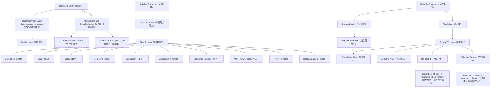

## 一句话总结
运输层（Transport Layer）通过多路复用/分解（multiplexing/demultiplexing）实现进程间逻辑通信（logical communication），并在 IP 的尽力而为（best-effort）服务之上，用校验和（checksum）+ 序号（sequence number）+ 确认（ACK）+ 定时器（timer）+ 重传（retransmission）这五大机制实现可靠传输（reliable data transfer），滑动窗口（sliding window）通过流水线（pipelining）大幅提升效率，Go-Back-N（GBN）和 Selective Repeat（SR）提供了两种不同取舍的重传策略。

## 知识地图



## 核心概念

### 1. Transport Layer Role（运输层的角色）
运输层位于应用层和网络层之间，核心职责是在不同主机的应用进程（application processes）之间提供逻辑通信（logical communication）。发送端将应用层消息切分成报文段（segment）传给网络层，接收端将报文段重组成消息交给应用层。传输控制协议（Transmission Control Protocol, TCP）提供可靠、按序的字节流抽象（reliable, in-order byte stream abstraction），而用户数据报协议（User Datagram Protocol, UDP）是一种极简的运输协议，只提供最基本的多路复用/分解能力。

### 2. Multiplexing and Demultiplexing（多路复用与分解）
- **多路复用（Multiplexing, Mux）**：发送端主机从多个应用进程收集数据块，为每个数据块添加运输层头部（含源端口号和目的端口号），封装成报文段后传递给网络层。
- **多路分解（Demultiplexing, Demux）**：接收端主机根据运输层头部中的端口号等信息，将收到的报文段交付给正确的应用进程套接字（socket）。
- 这是运输层**必须提供**的基本功能——即使是最简的 UDP 也会做 mux/demux。

### 3. Ports and Sockets（端口与套接字）
- **端口（Port）**：16 位数字，用于区分主机上的不同应用进程。知名端口（well-known ports, 0-1023）分配给标准服务，临时端口（ephemeral ports）由客户端动态分配。操作系统维护端口到套接字的映射。

**常见知名端口（教材常考）**：

| 端口 | 协议 | 应用 | 运输层 |
|------|------|------|--------|
| 21 | FTP | 文件传输 | TCP |
| **23** | **Telnet** | **远程终端访问** | **TCP** |
| 25 | SMTP | 电子邮件（发送） | TCP |
| 53 | DNS | 域名解析 | UDP（也支持 TCP） |
| 80 | HTTP | Web | TCP |
| 110 | POP3 | 电子邮件（接收） | TCP |
| 143 | IMAP | 电子邮件（接收） | TCP |
| 443 | HTTPS | Web（加密） | TCP |

> **记忆技巧**：FTP=21（"二一添作五"分文件），Telnet=23（"二三"谐音"爱上"远程），SMTP=25（"二五"发邮件），DNS=53（"五三"查地址），HTTP=80（"八零"看网页），POP3=110（"一一零"收邮件）。
- **套接字（Socket）**：应用进程与操作系统运输层之间的软件抽象接口（software abstraction），应用通过 socket 发送和接收网络消息。
- **UDP socket**：标识为 (local IP, local port)，即二元组。不同源 IP/端口发往同一目的端口的报文段进入同一个 UDP socket。
- **TCP socket**：标识为 (src IP, src port, dst IP, dst port)，即四元组。服务器为每个不同的客户端连接维护独立的 TCP socket。

### 4. Five Threats to Reliable Transport（可靠传输的五种威胁）
IP 层提供尽力而为（best-effort）服务，分组可能遭遇五种问题：
1. **损坏（Corruption）**：比特错误，由校验和（checksum）检测
2. **丢失（Loss）**：分组在中途被丢弃，由定时器（timer）+ 重传（retransmission）处理
3. **延迟（Delay）**：分组迟到，可能触发超时重传
4. **乱序（Reordering）**：分组到达顺序与发送顺序不同，由序号（sequence number）还原
5. **重复（Duplication）**：同一分组到达多次，由序号去重

应对机制总结：**校验和（checksum，检错）+ 序号（sequence number，去重/排序）+ 确认与否定确认（ACK/NACK，反馈状态）+ 定时器（timer，检测丢包）+ 重传（retransmission，修复丢失）**。

### 5. Stop and Wait Protocol（停等协议）
最简单的正确可靠传输协议：发送方发一个分组，等待接收方的确认（ACK），收到确认后再发下一个；如果收到否定确认（NACK）或超时（timeout），则重传当前分组。关键设计：数据分组和 ACK/NACK 都携带序号（sequence numbers），以解决 ACK/NACK 本身损坏时的歧义问题。

**致命问题——效率极低**：在高速链路下，发送方大部分时间在空等 ACK。利用率（utilization, U_sender）的计算公式为：
```
U_sender = (L/R) / (RTT + L/R)
```
其中 L 为分组大小（packet size），R 为链路带宽，RTT 为往返时间。教材经典例子：1 Gbps 链路、15 ms 传播延迟、8000 bit 分组 → U_sender = 0.008 / 30.008 ≈ 0.00027，即有效吞吐量仅 33 KB/s（空有 1 Gbps 的链路！）。

### 6. Sliding Window and Pipelining（滑动窗口与流水线）
**流水线（Pipelining）**：发送方允许在收到 ACK 之前连续发送多个分组——这些分组被称为"在途分组"（in-flight packets, yet-to-be-acknowledged pkts）。

**滑动窗口（Sliding Window）**：实现流水线的具体机制。窗口（window）是一组连续的序号集合，大小 n 决定了一次最多可有多少个未确认分组。
- 发送方窗口 = {A+1, A+2, ..., A+n}，其中 A 是最后一个无间隙确认的分组序号
- 接收方窗口 = {B+1, ..., B+n}，其中 B 是最后一个按序收到的分组序号
- 窗口在成功接收/确认后向右"滑动"（slides），滑动窗口常被称为"在途分组"（packets in flight）

吞吐量（throughput）≈ MIN(n × DATA/RTT, 链路带宽)，窗口足够大时可跑满带宽。

**三个设计决策（Three Design Decisions）**：
1. 发送方可以发哪些分组？→ 滑动窗口
2. 接收方如何确认？→ 累积确认（Cumulative ACK）或选择确认（Selective ACK）
3. 发送方重传哪些分组？→ Go-Back-N 或 Selective Repeat

### 7. Go-Back-N（回退N步）
GBN 的核心策略：
- 接收方只接受按序到达的分组（in-order delivery），乱序分组直接丢弃（discards out-of-order packets）
- 使用累积确认（cumulative ACK）：ACK 中携带期望的下一个按序序号
- 发送方只为窗口中第一个未确认分组设置一个定时器（timer for 1st outstanding ack）
- 超时后重传整个窗口（从 A+1 到 A+n）

**优点**：实现简单，接收方无需缓存。**缺点**：丢包率高时大量带宽浪费于重传无意义的分组。**适用场景**：错误率低时（GBN is better when error rate is low）。

### 8. Selective Repeat（选择重传）
SR 的核心策略：
- 接收方缓存乱序到达的分组（buffers out-of-order packets），而不是丢弃
- 使用选择确认（selective ACK）：逐个确认正确收到的分组
- 发送方为每个未确认分组维护独立的定时器（a timer per packet）
- 超时后只重传丢失的那个特定分组（retransmit only packet k on timeout）

**优点**：重传效率高，只发送真正丢失的分组。**缺点**：实现复杂，需要为每个分组维护独立定时器和缓冲区（complex book-keeping）。**适用场景**：错误率高时（SR is better when error rate is high）。

## 术语对照
| English | 中文 | 说明 |
|---------|------|------|
| Transport layer | 运输层 | TCP/IP 协议栈第三层，提供进程间通信 |
| Segment | 报文段 | 运输层的协议数据单元（PDU） |
| Multiplexing | 多路复用 | 发送端将多个应用数据合并在一个流中传给网络层 |
| Demultiplexing | 多路分解 | 接收端将报文段分发到对应的应用 socket |
| Port | 端口 | 16 位数字，区分主机上的不同应用进程 |
| Socket | 套接字 | 应用进程与 OS 运输层之间的软件接口 |
| Logical communication | 逻辑通信 | 两端应用仿佛直接相连，实际经过多层封装处理 |
| Best-effort | 尽力而为 | IP 层的服务模型，不保证可靠交付 |
| Checksum | 校验和 | 检测传输中是否出现比特错误的冗余信息 |
| Sequence number | 序号 | 标识分组的编号，用于去重、排序和窗口管理 |
| ACK (Acknowledgement) | 确认 | 接收方通知发送方分组已正确收到 |
| NACK (Negative ACK) | 否定确认 | 接收方通知发送方分组有错误 |
| Timer / Timeout | 定时器 / 超时 | 发送方设定的计时机制，超时触发重传 |
| Retransmission | 重传 | 发送方因超时或收到 NACK 而重新发送分组 |
| Pipelining | 流水线 | 不等确认就连续发送多个分组的技术 |
| Sliding window | 滑动窗口 | 限制未确认分组数量的窗口机制，窗口随确认滑动 |
| Cumulative ACK | 累积确认 | ACK 携带期望的下一个序号，隐式确认之前所有分组 |
| Selective ACK | 选择确认 | ACK 逐一确认哪些分组已收到，精度更高 |
| Go-Back-N (GBN) | 回退N步 | 超时后重传窗口内所有未确认分组的协议 |
| Selective Repeat (SR) | 选择重传 | 只重传丢失的特定分组的协议 |
| Utilization | 利用率 | 发送方忙碌时间占总时间的比例，衡量协议效率 |

## 关键原句
> "Provide logical communication between app processes running on different hosts"
> **翻译：** 在不同主机上运行的应用进程之间提供逻辑通信。

> "IP provides a weak service model (best-effort). Packets can be corrupted, delayed, dropped, reordered, duplicated."
> **翻译：** IP 提供一种弱的服务模型（尽力而为）。分组可能被损坏、延迟、丢弃、乱序、重复。

> "UDP is a minimalist transport protocol. Only provides mux/demux capabilities."
> **翻译：** UDP 是一种极简的运输协议，只提供多路复用/分解能力。

> "TCP offers a reliable, in-order, byte stream abstraction."
> **翻译：** TCP 提供一种可靠、按序的字节流抽象。

> "Socket: software abstraction for an application process to exchange network messages with the (transport layer in the) operating system."
> **翻译：** 套接字是应用进程与操作系统（运输层）之间交换网络消息的软件抽象。

> "pipelining: sender allows multiple, in-flight, yet-to-be-acknowledged pkts"
> **翻译：** 流水线：发送方允许多个已发送但尚未确认的分组"在途"。

> "Go-Back-N (GBN): Sender transmits up to n unacknowledged packets. Receiver only accepts packets in order. Discards out-of-order packets."
> **翻译：** Go-Back-N（回退N步）：发送方最多发送 n 个未确认分组。接收方只接受按序到达的分组，丢弃乱序分组。

> "Selective Repeat (SR): Sender retransmit only packet k on timeout. Efficient in retransmissions but complex book-keeping."
> **翻译：** 选择重传（SR）：超时时发送方只重传分组 k。重传高效但记账复杂。

## 难点突破

### 难点 1：Stop and Wait 的利用率为什么如此之低？
**类比**：你在一个城市的邮局工作，负责向隔壁城市运送包裹——
- **Stop and Wait**：你骑摩托车送 1 个包裹到隔壁城市邮局，必须等对方签收盖章的收据寄回来，确认收到了，才敢送第 2 个。一天下来，你绝大部分时间都在路上空跑往返，真正"忙"的时间只有把包裹交到柜台的那几秒钟。
- **滑动窗口（sliding window）**：你开一辆卡车，一次性装上 100 个包裹出发。到了隔壁城市，把 100 个包裹全部卸在邮局，拿着批量签收单回来。繁忙时间的占比大幅提升。

**数值直觉**（教材第 51 页经典案例）：1 Gbps 链路、15 ms 单向传播延迟、8000 bit 分组。实际发送一个分组只需 8μs（L/R = 8000/10⁹），但等 ACK 来回要 30 ms。利用率 = 0.008 / 30.008 ≈ 0.00027。意味着 99.97% 的时间链路空闲。这就是为什么流水线（pipelining）如此关键——3 分组流水线就能把利用率提升 3 倍。

### 难点 2：GBN vs SR 的核心取舍
- **GBN = "一班制点名"**：老师按学号顺序点名，"1 号？到。2 号？到。3 号？……没人应？"于是从 3 号开始把后面所有没应答的名字全部重喊一遍。简单、不费脑，但如果出现一个缺席，后面的全员都得重新点。适用于缺席率低（错误率低）的场景。
- **SR = "每个学生独立签到"**：每个人到教室后在独立的签到表上打钩。老师只检查谁没打钩，单独去找那一个人补签。高效、精确，但要维护 50 份独立的签到表（即每个分组一个定时器）。

**选择规则**：低错误率（如光纤链路）→ GBN 的重传浪费很小，简单的实现就够了；高错误率（如无线网络）→ 重传整个窗口的代价太大，值得为 SR 的复杂性买单。"GBN wastes bandwidth when error rate is high; SR is too complex when error rate is low."

## 与前章关联
- 建立在第 1 章的分层模型（layered architecture）和延迟/吞吐量指标之上——运输层的报文段封装（encapsulation）和利用率/吞吐量计算都依赖第 1 章的基础概念。
- 运输层的多路复用/分解直接服务于第 2 章的应用层协议：HTTP、FTP、SMTP 使用 TCP（需要可靠、按序的字节流），DNS 使用 UDP（查询-响应模式，重传由应用层自行处理）。本章从原理上解释了"为什么应用层协议选择了不同的运输层协议"。
- HTTP 性能优化中的"流水线（pipelining）"概念在第 2 章出现，本章延伸为滑动窗口流水线——两者共享相同的思想：不等响应就发送下一批请求/分组。
- 本章的可靠传输机制（滑动窗口、GBN、SR）是下一节 TCP 具体实现的理论基础。后续笔记将看到 TCP 如何结合 GBN 和 SR 的优势（使用累积 ACK + 选择确认 + 滑动窗口）。

## 记忆卡片
> **Q: 运输层解决了网络层无法处理的什么核心问题？**
> A: 网络层（IP）只提供主机到主机的尽力而为交付（host-to-host best-effort delivery），运输层在此基础上提供进程到进程的逻辑通信（process-to-process logical communication），并通过 TCP 提供可靠字节流抽象（reliable byte stream abstraction）。

> **Q: TCP socket 和 UDP socket 的标识分别是什么？为什么 TCP 需要更复杂的标识？**
> A: UDP socket 用二元组 (dest IP, dest port)；TCP socket 用四元组 (src IP, src port, dest IP, dest port)。TCP 是面向连接的（connection-oriented），服务器需要为每个客户端维护独立的连接状态，所以用四元组唯一标识每个 TCP 连接。

> **Q: 可靠传输的五大机制分别解决什么问题？**
> A: 校验和（Checksum）→ 检测比特错误；序号（Sequence number）→ 去重和排序；ACK/NACK → 接收方向发送方反馈接收状态；定时器（Timer）→ 检测是否发生丢包；重传（Retransmission）→ 修复丢失或损坏的分组。

> **Q: GBN 和 SR 在接收方行为上的根本区别是什么？**
> A: GBN 的接收方只接受按序到达的分组（in-order only），乱序分组直接丢弃（discard）；SR 的接收方缓存乱序分组（buffer out-of-order），等待缺失的分组到达后一并提交。这导致 GBN 超时后必须重传整个窗口，而 SR 只需重传丢失的那个特定分组。

> **Q: 滑动窗口大小 n 如何决定协议的有效吞吐量？当 n 太大会怎样？**
> A: 有效吞吐量 ≈ MIN(n × DATA/RTT, 链路带宽)。n = 1 即 Stop and Wait，吞吐量仅 DATA/RTT；n 足够大使得 n × DATA/RTT ≥ 链路带宽时，链路可以跑满。但 n 过大会导致网络拥塞——教材注明 throughput is roughly MIN(n × DATA/RTT, Link Bandwidth)。

---

## 笔试考题精讲

> 以下题目覆盖计算和简答两大题型。每题配有完整推导过程，目标是**不看原课件也能独立完成**。

### 计算题 1：Stop and Wait 利用率（基础）

**题目**：一条链路带宽 R = 500 Mbps，单向传播延迟 10 ms，分组大小 L = 1000 bytes。求：
1. Stop and Wait 协议的发送方利用率
2. 有效吞吐量（effective throughput）

**解答**：

```
Step 1: 统一单位
  R = 500 × 10^6 = 5 × 10^8 bps
  L = 1000 × 8 = 8000 bits
  单向延迟 = 10 ms → RTT = 2 × 10 = 20 ms = 0.02 s

Step 2: 算 L/R（实际发送一个分组的时间）
  L/R = 8000 / (5 × 10^8) = 1.6 × 10^-5 = 0.016 ms = 16 μs

Step 3: 利用率公式
  U_sender = (L/R) / (RTT + L/R)
          = 0.016 / (20 + 0.016)
          = 0.016 / 20.016
          ≈ 0.000799 ≈ 0.08%

Step 4: 有效吞吐量
  Throughput = U × R = 0.000799 × 500 Mbps ≈ 0.4 Mbps = 400 Kbps
  
  空有 500 Mbps 的链路，实际只跑出 400 Kbps，利用率不到千分之一。
```

**易错点**：RTT 是往返时间 = 2 × 单向延迟；注意 bits vs bytes 的单位转换。

---

### 计算题 2：流水线利用率（进阶）

**题目**：同上条件（R = 500 Mbps, RTT = 20 ms, L = 1000 bytes）。改用滑动窗口，窗口大小 n = 500。求利用率。

**解答**：

```
Step 1: 流水线利用率公式
  U = n × (L/R) / (RTT + L/R)
  
  当 n × (L/R) ≤ RTT 时，分子是 n × L/R
  当 n × (L/R) > RTT 时，利用率被带宽封顶为 100%

Step 2: 计算 n × (L/R)
  n × (L/R) = 500 × 0.016 ms = 8 ms

Step 3: 代入
  U = 8 / 20.016 ≈ 0.3996 ≈ 40%

Step 4: 有效吞吐量
  Throughput = 0.4 × 500 Mbps = 200 Mbps
```

**关键洞察**：窗口从 1 涨到 500，利用率从 0.08% 涨到 40%，提升了 **500 倍**——和窗口倍数一致。

---

### 计算题 3：跑满带宽所需窗口（高频考题）

**题目**：R = 1 Gbps，RTT = 30 ms，L = 1500 bytes。问窗口大小至少为多少才能跑满带宽？（即利用率接近 100%）

**解答**：

```
Step 1: 跑满带宽的条件
  n × (L/R) ≥ RTT   →   n × L/R ≥ RTT
  即 n ≥ RTT × R / L

Step 2: 计算带宽延迟积（Bandwidth-Delay Product, BDP）
  BDP = RTT × R = 0.03 × 10^9 = 30,000,000 bits = 30 Mb

Step 3: 计算每个分组大小
  L = 1500 × 8 = 12,000 bits

Step 4: 最小窗口
  n ≥ BDP / L = 30,000,000 / 12,000 = 2500

Step 5: 验证
  n × L/R = 2500 × (12,000 / 10^9) = 2500 × 0.000012 = 0.03 = 30 ms = RTT ✓
  U = 30 / (30 + 0.012) ≈ 99.96%  ← 基本跑满
```

**核心结论**：`n_min = (RTT × R) / L`，即带宽延迟积除以分组大小。这是选择题和填空题的高频考点。

---

### 计算题 4：GBN 重传效率分析（综合）

**题目**：GBN 协议，窗口大小 n = 4，当前发送方已发送 Seq 1, 2, 3, 4。Seq 1, 2 的 ACK 正常到达。Seq 3 丢失（未到达接收方），但 Seq 4 正确到达。发送方对 Seq 1 的定时器超时。问：
1. 接收方收到 Seq 4 时如何处理？
2. 发送方超时后重传哪些分组？
3. 假设错误率为 p = 0.01，窗口 n = 4，估算一个窗口内平均需重传多少个分组？

**解答**：

```
(1) GBN 接收方行为：
  接收方期待 Seq 3（因为 B = 2，下一个期待 3）。
  收到 Seq 4 → 乱序 → 丢弃（discard）。
  回复 ACK(3)，表示"我还等着 3 呢"。

(2) GBN 发送方超时行为：
  定时器绑定的是窗口内最老的未确认分组（oldest outstanding）。
  收到 ACK(1), ACK(2) 后，A = 2，窗口内最老未确认是 Seq 3。
  Seq 3 的定时器超时 → 重传整个窗口：Seq 3, 4, 5, 6（窗口大小 4）。
  尽管 Seq 4 已被正确接收，仍被重传 → 这就是 GBN 的浪费。

(3) 一个窗口内发生至少一个丢包的概率 = 1 - (1-p)^n = 1 - 0.99^4 ≈ 0.0394
  一旦丢包发生（窗口内至少丢一个），GBN 重传整个窗口 n 个分组。
  平均重传数 ≈ n × [1 - (1-p)^n] = 4 × 0.0394 ≈ 0.1576
  
  而 SR 在相同条件下：
  平均丢包数 = n × p = 4 × 0.01 = 0.04（只重传真正丢的那些）
  
  → GBN 比 SR 多浪费约 4 倍（因为丢一个就要重传全部）。
```

---

### 简答题 1：为什么运输层需要可靠传输？IP 层不够吗？

**标准答案**（3 层递进）：

```
第一层——IP 的局限性：
  IP 层只提供尽力而为（best-effort）服务模型——不保证交付、不保证顺序、
  不保证不重复、不保证完整性。数据报可能被丢弃、损坏、乱序、重复、延迟。

第二层——应用的需求：
  大多数应用（HTTP, FTP, SMTP）要求数据完整、有序地到达。
  你下载一个文件，少一个比特都不行。你不能指望"尽力而为"。

第三层——运输层的角色：
  运输层在网络层之上建立端到端的可靠通信。TCP 提供：
  - 可靠、按序的字节流（reliable, in-order byte stream）
  - 流量控制（flow control）——不让发送方淹没接收方
  - 拥塞控制（congestion control）——不让发送方淹没网络
  
  一句话：IP 只管"主机到主机"的尽力而为，运输层提供"进程到进程"的可靠通信。
```

---

### 简答题 2：UDP socket 和 TCP socket 的标识有何不同？为什么？

**标准答案**：

```
UDP socket：二元组 (dest IP, dest port)
  - UDP 无连接（connectionless），不维护连接状态
  - 来自不同源 IP/端口但发往同一目的端口的报文段，全部进入同一个 UDP socket
  - 类比：一个公共邮箱，任何人往里投信都进同一个箱子

TCP socket：四元组 (src IP, src port, dest IP, dest port)
  - TCP 面向连接（connection-oriented），需要为每个客户端维护独立状态
  - 服务器通过四元组区分不同客户端连接
  - 类比：前台为每个来访者建独立档案，不同访客不会混淆

为什么 TCP 需要更复杂的标识？
  TCP 是有状态连接——需要跟踪每个连接的序列号、确认号、窗口大小、
  拥塞状态等。如果两个不同客户端的数据混在同一个 socket 里，状态
  就会乱套。四元组保证每个 TCP 连接全局唯一。
```

---

### 简答题 3：五种威胁 ↔ 五种机制，完整版

**题目**：列出不可靠信道对可靠传输构成的五种威胁，并说明每种威胁的应对机制及原理。

**标准答案**：

| # | 威胁 | 含义 | 应对机制 | 原理 |
|---|------|------|---------|------|
| 1 | 比特错误（Bit Error / Corruption） | 传输中比特翻转，0→1 或 1→0 | **校验和（Checksum）** | 发送方计算冗余码附在分组后，接收方重新计算并比对。不匹配则检测到错误 |
| 2 | 丢包（Packet Loss） | 分组在路由器缓存溢出后被丢弃 | **定时器（Timer）+ 重传（Retransmission）** | 发送方发完分组启动定时器，超时未收到 ACK 则认为丢失，重传该分组 |
| 3 | 延迟（Delay） | 分组在队列中等待时间过长 | **定时器（Timer）** | 合理设置超时阈值（略大于 RTT），区分"还在路上"和"真的丢了"。超时过早会虚假重传 |
| 4 | 乱序（Reordering） | 后发的分组先到达，分组到达顺序与发送顺序不一致 | **序号（Sequence Number）** | 每个分组携带递增序号，接收方按序号重新排序后交付上层。GBN 乱序丢弃，SR 乱序缓存 |
| 5 | 重复（Duplication） | 同一分组被接收多次（因超时重传或 ACK 丢失导致） | **序号（Sequence Number）** | 接收方记录已接收序号，重复序号的分组直接丢弃 |

**补充——为什么这五种机制必须一起用？**

```
校验和只管检错，不知道丢包；定时器只管丢包，不知道乱序；
序号管乱序和去重，但不知道包坏没坏；ACK/NACK 提供反馈但本身也可能丢。

五种机制互补：缺任何一个，可靠传输就不成立。
例如：有序号没定时器 → 丢了包发送方永远不知道，窗口永远不动（死锁）。
```

---

### 简答题 4：GBN 和 SR 的完整对比表

**题目**：对比 Go-Back-N 和 Selective Repeat 协议的设计差异、优缺点和适用场景。

**标准答案**：

```
┌─────────────────┬──────────────────────┬──────────────────────┐
│ 维度              │ GBN（回退N步）         │ SR（选择重传）          │
├─────────────────┼──────────────────────┼──────────────────────┤
│ 接收方对乱序分组    │ 丢弃（discard）        │ 缓存（buffer）         │
│ 确认方式          │ 累积 ACK              │ 选择 ACK              │
│ ACK 含义          │ "下一个期望的序号"       │ "我已收到这些特定序号"    │
│ 定时器数量         │ 1 个（最老未确认分组）    │ 每分组 1 个（独立定时器）  │
│ 超时重传范围       │ 整个窗口（A+1 到 A+n）  │ 只重传丢失的那个分组      │
│ 接收方缓存需求      │ 无需缓存（简单）        │ 需要窗口大小的缓存        │
│ 实现复杂度         │ 低                    │ 高（book-keeping 复杂） │
│ 高错误率下效率      │ 差（大量无意义重传）     │ 好（精准重传）           │
│ 低错误率下效率      │ 好（额外开销小）        │ 差（维护开销不值当）      │
│ 典型场景          │ 光纤链路（误码率低）      │ 无线链路（误码率高）      │
└─────────────────┴──────────────────────┴──────────────────────┘

一句话记忆：
  GBN = 一个没到全班重考（简单粗暴，但缺席率高时浪费严重）
  SR = 谁没到谁补考（精细高效，但要给每个人单独登记）
```

---

### 简答题 5：Stop and Wait 为什么利用率低？如何改进？

**标准答案**：

```
根本原因：
  Stop and Wait 发送一个分组后必须等待 ACK 回来才能发下一个。
  在等待期间（≈RTT），链路完全空闲。利用率 = (L/R) / (RTT + L/R)，
  当 RTT >> L/R 时（高速长距离链路），利用率趋近于 0。

数值直觉：
  1 Gbps 链路、30 ms RTT、8000 bit 分组 → 利用率 0.027%
  有效吞吐量仅 267 Kbps，而链路能跑 1 Gbps。

改进方案——流水线（Pipelining）：
  不等 ACK 回来就连续发送多个分组。
  如果在第一个 ACK 回来前发出 N 个分组，利用率提升 N 倍。
  
  流水线的实现需要：
  1. 滑动窗口（管理"在途分组"的数量和序号范围）
  2. 更大的序号空间（区分窗口内不同分组，防止新旧混淆）
  3. 接收方缓冲（SR 需要；GBN 不需要）
```

---

### 简答题 6：累积确认如何实现"滑动"？用具体例子说明

**题目**：窗口 n = 3。发送方已发送 Seq 1, 2, 3，收到 ACK(2) 和 ACK(3)。请画出每次收到 ACK 后发送方窗口的位置变化。

**解答**：

```
初始：窗口 = {1, 2, 3}，A = 0

(1) 收到 ACK(2)：
    含义："收到了 1，下一个期望 2"
    A 更新为 1（因为 1 是无间隙确认）
    窗口向右滑 1 格 → {2, 3, 4}

(2) 收到 ACK(3)：
    含义："收到了 1, 2，下一个期望 3"
    A 更新为 2（1 和 2 都无间隙）
    窗口再滑 1 格 → {3, 4, 5}

(3) 注意：如果先收到 ACK(3) 而不是 ACK(2)
    ACK(3) 隐含确认了 1 和 2 也收到了（累积确认的含义）
    窗口直接滑到 {3, 4, 5}，一步到位。

图解：
      A=0  →收到ACK(2)→  A=1  →收到ACK(3)→  A=2
       │                  │                  │
  ─────┼──[1][2][3]───    ──[1]──[2][3][4]─   ──[1][2]──[3][4][5]─
       │  ◄──窗口──►       │   ◄──窗口──►      │       ◄──窗口──►

这就是"滑动"的含义——窗口随累积确认向右平移，持续推进新的分组被发送。
```

---

### 考点速查表

| 题型 | 考点 | 核心公式/关键词 |
|------|------|---------------|
| 计算 | Stop and Wait 利用率 | U = (L/R) / (RTT + L/R) |
| 计算 | 流水线利用率 | U = n×(L/R) / (RTT+L/R) |
| 计算 | 跑满所需窗口 | n ≥ (RTT×R) / L ← BDP/L |
| 计算 | 有效吞吐量 | Throughput = U × R |
| 简答 | 五大威胁 | 损坏/丢失/延迟/乱序/重复 ↔ 校验和/定时器+重传/序号/ACK |
| 简答 | GBN vs SR | 丢弃 vs 缓存；累积 ACK vs 选择 ACK；全重传 vs 单重传 |
| 简答 | UDP vs TCP socket | 二元组 vs 四元组；无连接 vs 面向连接 |
| 简答 | 多路复用/分解 | 端口号区分进程；发送端合流，接收端分流 |
| 简答 | 滑动窗口定义 | 发送窗口 = {A+1,...,A+n}；接收窗口 = {B+1,...,B+n} |
| 简答 | 为什么需要流水线 | Stop and Wait 效率极低，RTT >> L/R 时链路几乎空闲 |
