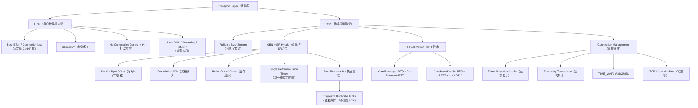

## 一句话总结
UDP 是极简的尽力而为（best-effort）运输协议，不做可靠性、顺序或拥塞控制；TCP 结合 GBN 与 SR 的特点，在不可靠 IP 之上提供可靠字节流（reliable byte stream），通过三次握手（three-way handshake）建立连接、RTT 估计（RTT estimation）动态设定重传超时、快速重传（fast retransmit）减少丢包恢复时间。

## 知识地图



## 核心概念

### 1. UDP（用户数据报协议）
UDP（User Datagram Protocol）是运输层最简协议，仅在 IP 之上提供进程间多路复用/分解（multiplexing/demultiplexing）和最基础的错误检测（checksum）。它不提供可靠性、顺序保证、拥塞控制或连接建立——被称为"尽力而为"（best-effort）服务。UDP 是无连接的（connectionless），发送方与接收方之间无需握手，每个段独立处理。

**关键特性**：
- 无连接建立延迟（no connection establishment）——适合对延迟敏感的应用
- 无连接状态——发送方和接收方不必维护连接状态表
- 头部仅 8 字节（源端口 2B + 目的端口 2B + 长度 2B + 校验和 2B）
- 无拥塞控制（no congestion control）——应用可按需全速发送

**典型应用**：流媒体（容忍丢包、对延迟敏感）、DNS（简单查询-响应）、SNMP（网络管理）。

**校验和（checksum）与伪头部——完整计算与局限**：UDP 校验和可选（填 0 表示不验证），但 TCP 强制校验。

**伪头部**：UDP/TCP 校验和计算时，在报文段前面拼接一个 12 字节的"伪头部"（Pseudo-header），包含从 IP 层提取的：

```
   0           8          16          24          32
  ┌──────────┬──────────┬─────────────────────────┐
  │ 源 IP 地址 (4B)                               │
  ├──────────────────────┬──────────┬─────────────┤
  │ 目的 IP 地址 (4B)                              │
  ├──────────┴──────────┴──────────┴─────────────┤
  │ 零填充 (1B) │ 协议号(1B) │ UDP/TCP 长度 (2B)    │
  └──────────┴──────────┴────────────────────────┘
```

**伪头部的作用**：把 IP 层的信息（源/目的 IP、协议号）拉进来参与校验。如果路由器出错把包送到了错误的 IP，接收方重建的伪头部 IP 与发送方不一致 → 校验失败。本质上是用校验和传递一个"指纹"，验证两边的 IP 信息一致。没有伪头部，UDP 无法检测 IP 层的目的地址错误。

**校验和计算——完整示例**：

假设某 UDP 报文段的数据部分为 `0000111100001111`，伪头部 + UDP 头按 16 位切分后得到以下三个字（为简化演示，仅取三段）：

```
字1: 0110011001100110   (伪头部 / 源IP某段)
字2: 0101010101010101   (UDP头 + 部分伪头部)
字3: 0000111100001111   (数据)
```

**发送方计算校验和**：

```
Step 1: 反码加法——字1 + 字2
   0110011001100110
 + 0101010101010101
 ──────────────────
   1011101110111011    (无进位，直接得)

Step 2: 结果 + 字3
   1011101110111011
 + 0000111100001111
 ──────────────────
   1100101011001010    (无进位)

Step 3: 对最终和取反码（翻转每一位）
   1100101011001010
 → 0011010100110101  ← 这就是校验和，填入 UDP 校验和字段
```

**接收方验证**：

```
将收到的所有字（含校验和字段）做同样的反码加法：

   0110011001100110  (字1，接收方重建)
 + 0101010101010101  (字2)
 ──────────────────
   1011101110111011
 + 0000111100001111  (字3，数据)
 ──────────────────
   1100101011001010
 + 0011010100110101  (收到的校验和)
 ──────────────────
   1111111111111111  ← 全 1 → 通过 ✓
```

> **反码加法（1's complement addition）规则**：普通二进制加法，若有进位溢出（carry out），将进位加到最低位（wraparound）。上例无进位，故直接得和。

**为什么校验和匹配也不能绝对确信无差错？**

校验和只有 16 位，意味着只能区分 2^16 = 65536 种不同结果，而报文段可能长达上千字节——不同数据可以产生**相同的校验和**，这被称为**残余错误（residual error）**。

一个具体例子：

```
原始:  字1 = 0110011001100110,  字2 = 0101010101010101
错误:  字1 最低位 0→1 (值 +1),  字2 最低位 1→0 (值 −1)
       和不变 → 校验和不变 → 接收方认为没问题！
```

校验和能检测**所有 1 比特错误**和大多数多比特错误，但数学上不可能 100% 保证——16 位空间到更大数据空间的映射必然有碰撞。实际网络中残余错误概率很低（约 1/2^16 ≈ 0.0015%），UDP 的设计选择了"够用就好"而非绝对保证。

### 2. TCP as GBN-SR Hybrid（TCP：GBN与SR的混合体）
TCP（Transmission Control Protocol）既不是纯粹的 Go-Back-N 也不是纯粹的 Selective Repeat，而是取两者之长的混合协议：

| TCP 特性 | 行为 | 类似 |
|---------|------|------|
| 确认方式 | 累积 ACK——ACK 携带下一个期望的按序字节序号 | GBN |
| 乱序分组处理 | 缓存乱序到达的分组（buffer out-of-sequence packets），不丢弃 | SR |
| 重传定时器 | 单一重传定时器，仅对窗口中最旧的未确认分组计时 | GBN |
| 快速重传 | 收到 3 个重复 ACK 立即重传，不等超时 | TCP 独创 |

这种混合设计让 TCP 既保留了 GBN 的简单性（单一定时器、累积 ACK），又吸收了 SR 的高效性（不丢弃乱序分组，避免不必要的重传）。

### 2.5. TCP 头部格式一览

```
 0                   16                   32
┌──────────┬──────────┬─────────────────────┐
│ 源端口(2B) │ 目的端口(2B)│    序号 seqno (4B)     │
├──────────┴──────────┤                     │
│                     ├─────────────────────┤
│   序号 (续)          │   确认号 ACK (4B)       │
├──────────┬──────────┼──────────┬──────────┤
│首部长度(4b)│保留(6b)  │ Flags(6b)│ 通告窗口(2B)  │
├──────────┴──────────┼──────────┴──────────┤
│   校验和 (2B)         │  紧急指针 (2B)        │
├─────────────────────┴─────────────────────┤
│           选项 Options (变长, 最多40B)       │
├───────────────────────────────────────────┤
│                   数据                      │
└───────────────────────────────────────────┘
```

| 字段 | 大小 | 作用 |
|------|------|------|
| 源/目的端口 | 各 2B | 标识发送/接收进程 |
| 序号 (seqno) | 4B | 字节偏移——段中第一个数据字节在字节流中的位置 |
| 确认号 (ACK) | 4B | 累积 ACK——"这个号之前的字节全收到了" |
| 首部长度 | 4b | 以 4B 为单位，最小 5(20B)，最大 15(60B) |
| Flags | 6b | **SYN**(同步序号)、**ACK**(确认有效)、**FIN**(关闭)、**RST**(异常终止)、PSH、URG |
| 通告窗口 | 2B | 接收方缓冲区剩余空间——流量控制的核心 |
| 校验和 | 2B | 反码和，含伪头部，TCP 强制校验 |
| 紧急指针 | 2B | 几乎不用，URG=1 时有效 |
| 选项 | 变长 | MSS 协商、SACK、时间戳、窗口缩放等 |

TCP 头部 20~60 字节 vs UDP 固定 8 字节——复杂度全为"可靠、按序、字节流"服务。

### 3. TCP Byte Stream & Sequence Numbers（TCP字节流与序号）
TCP 将应用层数据视为无结构的字节流（byte stream），这是其与底层网络分组模型的关键区别。

- **序号 = 字节偏移（byte offset）**：TCP 段头部中的 Sequence Number 是段中第一个数据字节的字节流偏移量，而非分组编号。因为 TCP 是字节流（byte stream）而非消息流。
- **初始序号（ISN, Initial Sequence Number）**：连接建立时随机选择，防止旧连接的分组干扰新连接
- **累积 ACK**：ACK 字段值为接收方期望的下一个按序字节序号，即 `seqno + length(data)`
- **MSS（Maximum Segment Size）**：TCP 段中数据部分的最大字节数。通常在以太网上 MSS = MTU(1500) - IP头(20) - TCP头(20) = 1460 字节

**典型操作**：发送方发 `seqno=X, length=B` → 接收方回复 `ACK=X+B` → 下一个段的 seqno = X+B。

### 4. Cumulative Acknowledgment（累积确认）
TCP 采用累积 ACK（cumulative acknowledgment）策略：ACK 报文中的确认号表示接收方期望的下一个按序字节序号，隐含确认了之前所有序号的字节都已按序收到。

**工作方式**：
- 若接收方收到乱序段（如已收 X 但收到 X+2B），则仍回复 `ACK = X+B`，产生重复 ACK（duplicate ACK）
- 重复 ACK 是网络丢包的重要信号——ACK 序号未前进说明中间某个分组未能到达

**实例**（发送 seqno 100, 200, 300, 400, 500, 600...，其中 500 丢失）：
- 收到 600 时回复 ACK=500（因为 500 还未收到）
- 收到 700 时回复 ACK=500
- 收到 800 时回复 ACK=500
- ACK 流: 200, 300, 400, **500**, **500**, **500**, ...

### 5. Fast Retransmit（快速重传）
快速重传（fast retransmit）是 TCP 的核心性能优化：收到 3 个重复 ACK（3 duplicate ACKs）即认为分组已丢失，不等超时直接重传。

**设计理由**：
- 收到 1-2 个重复 ACK 可能只是网络乱序（out-of-order delivery）
- 3 个重复 ACK 说明后续 3 个分组都已到达，唯独中间某个分组丢失——概率极高
- 比等待超时（通常几百毫秒到几秒）快得多

**重传后的处理**：TCP 面临两种选择——
1. 发送丢失分组并立即移动滑动窗口（提高吞吐量，但有错判风险）
2. 发送丢失分组后等待 ACK 再移动窗口（保守但安全）

TCP 实际通过选择性 ACK 选项和拥塞控制交互来优化此决策。

### 6. RTT Estimation & Retransmission Timeout（RTT估计与重传超时）

**RTT vs RTO——先分清两个概念**：
- **RTT（Round Trip Time）**：包从发送到收到 ACK 的实际时间，这是**网络决定的物理事实，TCP 只能测量，不能控制**。
- **RTO（Retransmission Timeout）**：发送方等待 ACK 的超时阈值，这是**TCP 自己定的规则，可以调整**。

RTO 是 TCP 对"等多久算丢"的赌注——赌太短（RTO < RTT）会造成误重传浪费带宽，赌太长（RTO >> RTT）会造成丢包了还傻等、吞吐量极低。理想是 **RTO 略大于 RTT**。

但 RTT 不是固定的——路由变化、队列延迟、网络负载波动都会造成 RTT 抖动（jitter）。所以需要持续估计 RTT 并据此动态调整 RTO。整个 RTT 估计体系的演进就是逐渐更好应对这个问题的过程。

**第一代：指数加权移动平均（EWMA）**
- `EstimatedRTT = (1-α) × EstimatedRTT + α × SampleRTT`，α = 0.125
- 不用简单平均——最近的 RTT 更能反映当前网络状态，旧数据自动衰减
- 问题：重传时无法区分 ACK 对应原段还是重传段（重传歧义）

**第二代：Karn/Partridge 算法**
- 不采用重传分组的 RTT 样本（SampleRTT），因为无法区分 ACK 对应原分组还是重传——一旦重传，该段的 RTT 测量直接忽略
- 指数退避（exponential backoff）：每次超时 RTO 翻倍（上限约 60 秒），收到非重传 ACK 后恢复为 2 × EstimatedRTT
- RTO = 2 × EstimatedRTT
- **缺陷**：对 RTT 变化不敏感——网络抖动大时频繁误重传，网络稳定时又偏保守

**第三代：Jacobson/Karels 算法**（现代 TCP 使用）
- 核心洞察：不仅要知道 RTT 均值，还要知道**RTT 波动有多大**
- `DevRTT = (1-β) × DevRTT + β × |SampleRTT - EstimatedRTT|`，β = 0.25
- `RTO = EstimatedRTT + 4 × DevRTT`
- 效果：网络平稳时 DevRTT 小 → RTO 紧凑高效；网络抖动时 DevRTT 大 → RTO 自动放大避免误重传
- 4 这个系数是工程经验值——够大覆盖绝大多数正常波动，又不过于保守

**三代入演进逻辑**：
```
需要 RTO 跟踪 RTT → EWMA 平滑估计
  → 重传时量不准 → Karn: 重传样本扔掉 + 指数退避
    → 光有均值不够, 抖动会误判 → Jacobson: 加偏差项 4×DevRTT
```

### 7. Three-Way Handshake（三次握手）
TCP 使用三次握手（three-way handshake）建立连接，核心目的是**双方确认对方的初始序号（ISN）**，防止网络中滞留的旧 SYN 段被误认为新连接请求。

**握手过程**：
```
Client                    Server
  |         SYN            |
  | ----------ISN=i------> |  (SYN=1, seq=i)
  |      SYN-ACK           |
  | <------ISN=j,ACK=i+1-- |  (SYN=1, ACK=1, seq=j, ack=i+1)
  |         ACK            |
  | -------ack=j+1-------> |  (ACK=1, ack=j+1)
  |                        |
  连接建立，双方进入 ESTABLISHED
```

**为什么不是两次握手？**
两次握手无法处理网络中滞留的旧 SYN。旧连接中延迟的 SYN 可能在新连接建立后才到达服务器，若只有两次握手，服务器会误认为是新连接请求而分配资源，造成资源浪费和混乱。三次握手中，客户端收到旧 SYN 对应的 SYN-ACK 后会发送 RST 断开。

**SYN 丢失处理**：客户端默认 3 秒超时重传 SYN（RFC 1122 / 2988 规定）。为什么是 3 秒？因为第一个 SYN 发出时 TCP 没有任何 RTT 信息——接收方在 300 公里外还是 3000 公里外完全不知道。设太短（如 100ms）可能正常 SYN-ACK 还在路上就超时，设太长用户体验差。3 秒是工程妥协——**宁可保守也不可冒进**，一旦连上就能量出真实 RTT，后续 RTO 自动调回正常值。

这解释了为什么"刷新页面有时真的管用"——用户 abort 旧连接 → 浏览器开新套接字 → 重新发 SYN，新 SYN 可能走不同的路由不丢包，恰好连上。不是玄学，是换了条路重试。

### 8. Connection Teardown & TCP States（连接关闭与TCP状态）
TCP 连接关闭涉及四次交互（常称"四次挥手"）和关键状态 TIME_WAIT。

**正常关闭（一方先关）**：
1. A 发送 FIN（FIN=1），表示 A 不再发送数据。FIN 占用序号空间中的一个字节
2. B 回复 ACK，确认已收到 FIN。连接进入半关闭（half-closed）状态，B 仍可发送数据
3. B 发送完毕，发送 FIN
4. A 回复 ACK 确认收到 B 的 FIN。A 进入 TIME_WAIT

**TIME_WAIT 等待 2MSL（约 30 秒）的原因**：
1. 防止最后一个 ACK 丢失——若丢失，B 会重传 FIN，A 在 TIME_WAIT 期间能重新回复 ACK
2. 避免重演（avoid reincarnation）：确保旧连接的残留分组在网络中消失，不干扰后续相同套接字的新连接

**异常关闭（RST）**：
- 应用崩溃时发送 RST（Reset）立即终止连接
- RST 不需要对方回复 ACK，不保证可靠交付
- 途中未处理的数据全部丢失
- 若对方继续发送数据，会触发另一个 RST

**TCP 状态机路径**：
- 客户端：CLOSED → SYN_SENT → ESTABLISHED → FIN_WAIT_1 → FIN_WAIT_2 → TIME_WAIT → CLOSED
- 服务端：CLOSED → LISTEN → SYN_RCVD → ESTABLISHED → CLOSE_WAIT → LAST_ACK → CLOSED

## 术语对照

| English | 中文 | 说明 |
|---------|------|------|
| UDP (User Datagram Protocol) | 用户数据报协议 | 无连接、尽力而为的运输层协议 |
| TCP (Transmission Control Protocol) | 传输控制协议 | 面向连接、可靠字节流的运输层协议 |
| Three-Way Handshake | 三次握手 | 建立 TCP 连接的三步过程，同步双方 ISN |
| SYN (Synchronize Sequence Numbers) | 同步序号标志 | 连接建立时用于同步序号的标志位 |
| ACK (Acknowledgment) | 确认标志/确认号 | 确认已成功收到的数据或标志位 |
| FIN (Finish) | 终止标志 | 用于优雅关闭连接的标志位 |
| RST (Reset) | 重置标志 | 用于异常终止连接的标志位 |
| RTT (Round Trip Time) | 往返时间 | 分组从发送到收到确认所经时间 |
| RTO (Retransmission Timeout) | 重传超时 | 发送方等待 ACK 的超时阈值 |
| ISN (Initial Sequence Number) | 初始序号 | 连接建立时选择的起始字节序号 |
| MSS (Maximum Segment Size) | 最大段大小 | TCP 段中数据部分的最大字节数 |
| Cumulative ACK | 累积确认 | 确认所有按序到达的字节的 ACK 策略 |
| Fast Retransmit | 快速重传 | 收到 3 个重复 ACK 即重传丢失分组 |
| Duplicate ACK | 重复确认 | 相同的 ACK 号重复出现，暗示丢包 |
| TIME_WAIT | 等待状态 | 连接关闭后等待 2MSL 确保干净终止 |

## 关键原句

> "Best effort" service, UDP segments may be: lost, delivered out-of-order to app
> **翻译：** 尽力而为服务，UDP 段可能丢失，也可能乱序到达应用。

> no congestion control: UDP can blast away as fast as desired
> **翻译：** 无拥塞控制：UDP 可以按需全速发送。

> TCP delivers a reliable, in-order, byte stream
> **翻译：** TCP 提供可靠的、按序的字节流。

> Duplicate ACKs are a sign of an isolated loss
> **翻译：** 重复 ACK 是孤立丢包的信号。

> Introduces fast retransmit: duplicate ACKs trigger early retransmission
> **翻译：** 引入快速重传：重复 ACK 触发提前重传。

> Three-way handshake to establish connection. Host A sends a SYN (open; "synchronize sequence numbers") to host B. Host B returns a SYN acknowledgment (SYN ACK). Host A sends an ACK to acknowledge the SYN ACK.
> **翻译：** 三次握手建立连接。主机 A 向主机 B 发送 SYN（打开连接；"同步序号"）。主机 B 回复 SYN 确认（SYN ACK）。主机 A 发送 ACK 确认 SYN ACK。

> Finish (FIN) to close and receive remaining bytes. FIN occupies one byte in the sequence space.
> **翻译：** FIN 用于关闭连接并接收剩余字节。FIN 占用序号空间中的一个字节。

> Don't use SampleRTT from retransmissions. Once retransmitted, ignore that segment in the future.
> **翻译：** 不使用重传分组的 RTT 样本。一旦重传，以后忽略该段的 RTT 测量。

## 难点突破

### 难点 1：TCP 为何选择 GBN+SR 混合而不是纯 GBN 或纯 SR？
**直觉**：纯 GBN 的"丢弃所有乱序分组"在有少量乱序时极其浪费带宽——一个分组丢失会导致窗口内所有后续分组被重传。纯 SR 的"每个分组独立定时器"在窗口大时实现复杂。TCP 取巧：用累积 ACK（GBN 的"偷懒"方式）确认数据，但接收方把乱序分组悄悄缓存起来（SR 的"好心"），这样发送方只需一个定时器，接收方又不浪费已收到的数据。

**类比**：就像一个老师（发送方）每周收一次作业（累积 ACK），但课代表（接收方）提前交了作业的学生把作业先收好放柜子里（缓存乱序），等迟交的学生（丢失分组）补交后再一起整理。老师不用天天盯着，课代表也不会扔掉已收的作业。

### 难点 2：RTO 为什么不能简单地设为 2 × 平均 RTT？
**直觉**：RTT 不是固定的——网络负载变化、路由变化、队列延迟都会造成 RTT 波动（jitter）。如果只用均值×2，网络波动大时会频繁误重传（浪费带宽），网络稳定时又偏保守（效率低）。Jacobson/Karels 的关键创新是加入偏差项 4 × DevRTT：网络抖动大 → 偏差大 → RTO 自动增大，避免误判；网络平稳 → 偏差小 → RTO 紧凑高效。

**类比**：你每天通勤去学校。如果只用"平均时间 × 2"来预测，遇到堵车时会严重迟到（超时太长），路况好时又到得太早（超时太短）。更好的办法是估算时加上"堵车波动量"——如果过去一周有时 20 分钟有时 60 分钟，你就知道要留更多余量（4 × 偏差），这就是 Jacobson/Karels 做的事。

## 与前章关联

- 本章建立在 03-运输层-可靠传输 的滑动窗口（sliding window）、GBN、SR 三大原型协议之上——TCP 的累积 ACK 和单一重传定时器继承自 GBN，缓存乱序分组的能力继承自 SR，快速重传则是 TCP 在这两者之上新增的优化
- TCP 头部中的序号（Sequence Number）和确认号（Acknowledgment Number）是滑动窗口机制在 TCP 字节流模型中的具体实现
- 本章的 RTT 估计（Karn/Partridge、Jacobson/Karels）和滑动窗口机制是下一章 05-运输层-拥塞控制 的基础——拥塞控制需要精确的 RTO 来区分"丢包原因是误码还是拥塞"
- 连接管理中的 SYN 标志位是后续理解网络安全攻击（如 SYN Flood 攻击）的前提

## 记忆卡片

> **Q: What makes UDP different from TCP at the transport layer?**
> A: UDP is connectionless with no handshaking, no congestion control, no reliability — just a thin layer over IP for multiplexing/demultiplexing plus an optional checksum. TCP is connection-oriented with three-way handshake, reliable byte stream, cumulative ACKs, fast retransmit, and RTT estimation.

> **Q: Why is TCP described as a hybrid of GBN and SR?**
> A: TCP uses cumulative ACKs and a single retransmission timer (like GBN), but buffers out-of-order packets (like SR). It adds fast retransmit triggered by 3 duplicate ACKs, which is unique to TCP.

> **Q: Why does TCP use a three-way handshake instead of a two-way handshake?**
> A: A two-way handshake cannot handle an obsolete SYN from an old connection arriving late at the server. The third ACK lets the server verify that the client truly intends this connection. If the client receives a SYN-ACK for a connection it never requested, it sends RST to abort.

> **Q: Why does TIME_WAIT wait 2MSL before fully closing?**
> A: Two reasons: (1) to ensure the final ACK reaches the server — if lost, the server retransmits FIN and the client re-ACKs; (2) to let any remaining segments from the old connection dissipate from the network, preventing them from interfering with a new connection on the same socket (avoid reincarnation).

> **Q: How does Jacobson/Karels RTO estimation improve over Karn/Partridge?**
> A: Karn/Partridge uses RTO = 2 x EstimatedRTT, which is insensitive to RTT variation (jitter). Jacobson/Karels adds RTT deviation: RTO = EstimatedRTT + 4 x DevRTT. When the network is jittery, the deviation term automatically expands RTO to prevent spurious retransmissions; when stable, RTO stays tight and efficient.

---

## 📝 期末笔试备考

### 笔试考点标注

| 考点 | 频度 | 考察形式 | 对应章节 |
|------|------|---------|---------|
| UDP 特性（无连接、无拥塞控制、尽力而为） | 🔴 | 填空/简答 | §1 |
| UDP 头部格式（4字段8B）与校验和（伪头部） | 🟡 | 填空/计算 | §1 |
| TCP 作为 GBN+SR 混合（各继承了什么） | 🔴 | 简答/选择 | §2 |
| TCP 序号=字节偏移 vs 包编号 | 🟡 | 判断/填空 | §3 |
| 累积 ACK 与重复 ACK 的含义 | 🔴 | 简答/分析 | §4 |
| 快速重传：3个重复ACK触发 | 🔴 | 填空/简答 | §5 |
| RTT 估计：Karn vs Jacobson 演进 | 🔴 | 简答/计算 | §6 |
| 三次握手流程、为什么不是两次 | 🔴 | 简答/画图 | §7 |
| TCP 连接关闭（四次挥手、TIME_WAIT） | 🟡 | 填空/选择 | §8 |
| MTU vs MSS 关系 | 🟡 | 填空/计算 | §3 |

### 简答题（期末笔试模拟）

**Q1: 简述 UDP 与 TCP 在运输层的主要区别。**

> 参考答案：UDP 无连接（无握手）、无拥塞控制、不保证可靠性、头部仅 8 字节，适用于 DNS、流媒体等。TCP 面向连接（三次握手）、可靠字节流、有拥塞控制和流量控制、头部 ≥20 字节，适用于 HTTP、FTP 等。UDP 是尽力而为，TCP 保证可靠按序交付。

**Q2: 为什么说 TCP 是 GBN 和 SR 的混合体？各继承了什么？**

> 参考答案：TCP 继承 GBN 的累积 ACK（确认号表示期望的下一个按序字节）和单一重传定时器（只对窗口最旧未确认段计时）；继承 SR 的缓存乱序分组（不丢弃乱序到达的段）。TCP 独创快速重传（3 个重复 ACK 立即重传，不等超时）。

**Q3: TCP 为什么需要三次握手而不是两次？**

> 参考答案：两次握手无法处理网络中滞留的旧 SYN 段。旧连接延迟的 SYN 可能在新连接建立后到达，若只有两次握手，服务器会误认为新连接请求而分配资源。三次握手中，客户端收到旧 SYN 对应的 SYN-ACK 后会发送 RST 断开，防止幽灵连接。

**Q4: 累积 ACK 机制中，接收方收到乱序段时会回复什么？为什么重复 ACK 是丢包的信号？**

> 参考答案：接收方回复的 ACK 始终指向期望的下一个按序字节（最高连续收到的字节 + 1）。乱序段到达时，由于期望的字节尚未收到，接收方反复回复同一个 ACK 号，形成重复 ACK。发送方收到 3 个重复 ACK 说明后续 3 个段已到但中间那个缺失 → 触发快速重传。

**Q5: Karn/Partridge 和 Jacobson/Karels 算法分别解决了 RTT 估计的什么问题？**

> 参考答案：Karn/Partridge 解决重传歧义——重传段的 SampleRTT 不参与计算，因为无法区分 ACK 对应原段还是重传段。Jacobson/Karels 解决 RTT 抖动问题——引入偏差项 DevRTT，RTO = EstimatedRTT + 4 × DevRTT，网络抖动大时自动增大 RTO 避免误重传，稳定时 RTO 保持紧凑。

**Q6: TCP 连接关闭时为什么需要 TIME_WAIT 状态等待 2MSL？**

> 参考答案：(1) 确保最后一个 ACK 到达服务器——若丢失，服务器重传 FIN，客户端在 TIME_WAIT 期间能重新回复 ACK。(2) 避免重演（avoid reincarnation）——确保旧连接残留分组在网络中消失，不干扰后续相同套接字的新连接。
