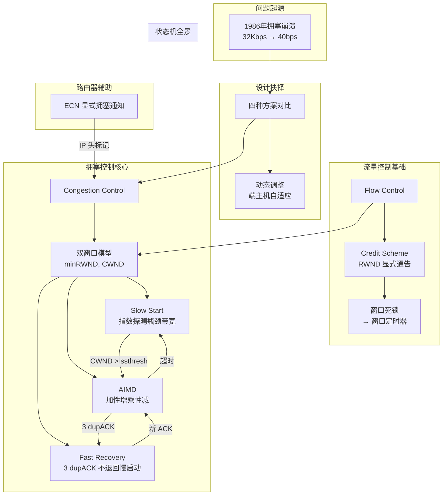

## 一句话总结

流量控制（Flow Control）解决"发送方别撑爆接收方"——接收方通过 TCP 头部 **Advertised Window (RWND)** 显式通告剩余缓冲区；拥塞控制（Congestion Control）解决"发送方别撑爆网络"——发送方自维护 **Congestion Window (CWND)**，用**慢启动**指数探测瓶颈带宽、**AIMD** 在公平与效率间动态平衡、**快速恢复**避免单个丢包回退重来。两者共同决定实际发送窗口 = min(RWND, CWND)。

---

## 知识地图



---

## 一、为什么需要拥塞控制：1986 年的互联网崩溃

### 1.1 背景

1981 年 TCP 标准化并大规模部署。当时的设计**完全没有拥塞控制**——发送方只管发，不管网络撑不撑得住。

### 1.2 崩溃事件

1986 年 10 月，互联网发生了第一次"拥塞崩溃"（Congestion Collapse）。Lawrence Berkeley Lab 到 UC Berkeley 之间：

| 指标 | 数值 |
|------|------|
| 物理距离 | 400 码（约 365 米） |
| 路由跳数 | 2 跳（IMP hops） |
| 正常吞吐 | 32 Kbps |
| 崩溃后吞吐 | **40 bps**（下降了 99.875%） |

> Van Jacobson 在经典论文《Congestion Avoidance and Control》中记录了这次事件，由此开启了拥塞控制研究领域。

**为什么崩溃？** 每个发送方都在重传丢掉的包，而丢包恰恰是因为大家都在狂发——重传越多，拥塞越严重，丢包越多，形成正反馈恶性循环。

### 1.3 Jacobson 的修复

Jacobson 方案的精妙之处在于**极简**：

> 扩展现有的基于窗口的协议，让窗口大小响应拥塞而自适应。

- ❌ 不需要改路由器
- ❌ 不需要改应用层
- ✅ 只改端主机 TCP 实现的几行代码
- ✅ 所有复杂逻辑都在发送方内部

这就是本章要讲的**端到端拥塞控制**——网络不提供任何帮助，发送方自己从 ACK 信号中推断拥塞状态。

---

## 二、设计框架：四个方案与三个问题

### 2.1 四种可能的方案

面对拥塞，理论上只有四种出路：

| 方案 | 做法 | 缺陷 |
|------|------|------|
| (0) 不管不顾 | 照样发 | 大量丢包，大家一起死 |
| (1) 预留带宽 | 发包前先协商、预占资源 | 利用率低，不够灵活 |
| (2) 定价机制 | 谁出价高就不丢谁的包 | 需要支付模型，不现实 |
| **(3) 动态调整** | **端主机推断拥塞程度，自适应调速** | 实现简单但动态复杂 |

**方案 (3) 胜出**，原因是它不预设商业模式、不限制流量类型、不依赖应用配合——只假定每个端主机都是"良好公民"（Good Citizenship），愿意在感知到拥塞时主动降速。

### 2.2 三个必须解决的核心问题

拥塞控制本质是一个**资源分配问题**——涉及多条流、多条链路、复杂的全局动态：

```
现实网络拓扑：
    A1 ────┐                    ┌──── B1
    A2 ────┤  1Gbps   600Mbps  ├──── B2
    A3 ────┘                    └──── B3
    多条流竞争不同链路的带宽，每条链路的瓶颈都不同
```

三个问题：

| # | 问题 | 含义 | 对应机制 |
|---|------|------|----------|
| ① | 如何发现可用瓶颈带宽？ | 连接刚建立时，发送方不知道网络是 1Mbps 还是 1Gbps | **Slow Start** |
| ② | 如何适应带宽变化？ | 网络条件随时间波动，需要持续探测 | **AIMD** |
| ③ | 如何在多条流之间公平共享？ | 不能一条流占满带宽，另一条流饿死 | **AIMD 收敛性** |

### 2.3 拥塞检测：你怎么知道网络堵了？

两种信号，严重程度不同：

| 信号 | 含义 | 严重程度 | 处理 |
|------|------|----------|------|
| **3 个重复 ACK** | 单个分组丢了，但后续分组还在到达 | 🔶 轻度 | CWND 减半 + 快速恢复 |
| **超时 (Timeout)** | 连 dupACK 都不够，大量分组丢失 | 🔴 严重 | CWND = 1，重新慢启动 |

**为什么丢包是可靠的拥塞信号？** 因为丢包是 TCP 必须处理的故障模式——无论是否有拥塞控制，TCP 都要检测丢包并重传。把拥塞信号嫁接在丢包检测上，零额外开销。

延迟（RTT 变化）也被考虑过，但它噪声太大（延迟本身波动剧烈），不如丢包可靠。

---

## 三、流量控制：拥塞控制的前置基础

在进入拥塞控制之前，必须先理解流量控制——因为两者共享同一个窗口管理框架。

### 3.1 固定滑动窗口的问题

固定大小的滑动窗口在可靠直连链路上没问题，但在互联网上有致命缺陷：

> **接收方通过"不发 ACK"来限流 → 但发送方无法区分是 ACK 丢了还是接收方故意的。**

这导致流控信号和丢包信号混在一起，发送方只能猜。

### 3.2 信用方案 (Credit Scheme)

**核心思想**：把"我还有多少空间"从隐式变成显式。

接收方在每个 ACK 的 TCP 头部 **Advertised Window (RWND)** 字段中通告自己的剩余缓冲区大小。发送方承诺：**在途字节数 ≤ RWND**。

```
TCP 头部关键字段：
┌──────────────┬──────────────┐
│  Seq Number  │  我在发第几个字节     │
├──────────────┼──────────────┤
│  ACK Number  │  我期待你的第几个字节  │
├──────────────┼──────────────┤
│  Win Size    │  我还能收多少 (RWND)  │
└──────────────┴──────────────┘
```

**关键特性**：将流量控制与 ACK 解耦（Decouples flow control from ACK）：

- 可以**只发 ACK 不给信用**（RWND = 0）→ "收到了但没空间，暂停"
- 可以**只发信用不发 ACK** → "有空间了但没新数据要确认"

### 3.3 信用分配的精确规则

假设 B 最后收到的字节是 `i-1`，B 上次发的段是 `(AN=i, W=j)`：

| 场景 | B 发送 | 含义 |
|------|--------|------|
| 想增加信用到 k（k > j），无新数据到达 | `(AN=i, W=k)` | 期待字节不变，空间扩大 |
| 收到 m 字节（m < j），不给额外信用 | `(AN=i+m, W=j-m)` | 确认了 m 字节，剩余空间减少 m |

**丢包自愈**：如果 ACK/CREDIT 段丢了，"几乎没有危害"——下一个 ACK 会自然重新同步窗口状态。

### 3.4 窗口死锁与解决

唯一的坑：

```
① B → A：(AN=i, W=0)    "窗口关了"
② B → A：(AN=i, W=j)    "窗口开了"  ← 这条丢了
③ A 认为窗口关着 → 不敢发
   B 认为窗口开着 → 等数据
   双方僵死 ← 这就是死锁
```

**解法**：窗口定时器（Window Timer）——发送方定时发探测段，触发接收方回复当前 RWND。

### 3.5 双窗口模型

这是连接流量控制和拥塞控制的**最关键概念**：

```
实际发送窗口 = min(RWND, CWND)

RWND ← 接收方在 ACK 中通告（保护接收方缓冲区）
CWND ← 发送方自行维护（保护网络）
```

| | RWND (接收方窗口) | CWND (拥塞窗口) |
|------|------|------|
| **控制者** | 接收方 | 发送方 |
| **保护对象** | 接收方缓冲区 | 网络（链路 + 路由器） |
| **信息来源** | TCP Header Win Size | 发送方根据 ACK/丢包推断 |
| **UDP 有吗？** | ❌ 无流控 | ❌ 无拥塞控制 |

> 类比：RWND 是水杯容量（接收方能接多少），CWND 是水管水压（网络能承受多少），水流速度受两者中更小者限制。

---

## 四、慢启动：发现瓶颈带宽

### 4.1 问题

连接刚建立时，发送方对网络容量一无所知。假设 RTT = 100ms，MSS = 1000 bytes：

| 瓶颈带宽 | 填满所需的窗口大小 |
|----------|-------------------|
| 1 Mbps | 12.5 个分组 |
| 1 Gbps | 12,500 个分组 |

**两者都可能！** 如果一上来就灌 12,500 个分组到 1Mbps 链路，网络直接崩溃。

### 4.2 机制

> 起点极低（CWND = 1 MSS），但增长极快（每 RTT 翻倍），快速逼近瓶颈。

```
初始：CWND = 1 MSS → 初始速率 = MSS / RTT

每收到一个 ACK：CWND += 1
    ↓ 等价于
每经过一个 RTT：CWND = 2 × CWND（指数增长）
```

**为什么叫"慢"启动？** 名字有误导性——增长速率是指数级的，非常快。叫"慢"只是因为**起点低**（CWND = 1），相比于连接建立后直接满窗口发送显得"起步慢"。

### 4.3 何时停止

慢启动不会无限指数增长。停止条件：

1. **CWND > ssthresh**（Slow Start Threshold，慢启动阈值）→ 进入拥塞避免
2. **发生丢包** → 减半后进入拥塞避免或重回慢启动

ssthresh 初始设为一个很大的值，首次丢包后会被设为 `CWND/2`，作为"上次翻车的位置"记录下来。

### 4.4 示意图

```
CWND
  ↑
  │        ·  (丢包！)
  │       /
  │      /   ← 指数增长（慢启动）
  │     /
  │    /
  │   /
  │  /
  │ /
  │/
  └──────────────────────────→ 时间
```

---

## 五、AIMD：适应带宽变化 + 公平共享

当 CWND > ssthresh 后，TCP 进入**拥塞避免**阶段。此时任务变了：不再是发现带宽，而是在已知带宽附近持续微调。

### 5.1 基本操作

| 事件 | 操作 | 逻辑 |
|------|------|------|
| 每个 RTT 无丢包 | CWND += 1（加性增） | 慢慢试探更多带宽 |
| 3 dupACK（轻度拥塞） | ssthresh = CWND/2, CWND = ssthresh（乘性减） | 减半避让，进入快速恢复 |
| 超时（严重拥塞） | ssthresh = CWND/2, CWND = 1（乘性减到地板） | 网络可能崩溃了，从头慢启动 |

**加性增的精确实现**：每收到一个 ACK，`CWND += 1/CWND`。这样要经过一个完整 CWND 的 ACK（即一个 RTT），CWND 才增加 1——等价于"每个 RTT 加 1"。

### 5.2 锯齿图

AIMD 产生经典的 TCP 锯齿波：

```
CWND
  ↑  /\      /\      /\
  │ /  \    /  \    /  \
  │/    \  /    \  /    \
  │      \/      \/      \
  │      丢      丢      丢
  └──────────────────────────→ 时间

  锯齿行为 = 持续探测带宽
  上升 = 加性增（慢慢试探上限）
  骤降 = 乘性减（发现上限后退避）
```

### 5.3 为什么是 AIMD？公平-效率分析

这是考试重点。四条流 x₁ 和 x₂ 共享一个容量为 1 的链路。四种策略组合：

| 策略 | 增加 | 减少 | 能否同时收敛到公平+效率？ |
|------|------|------|--------------------------|
| AIAD | 加性 | 加性 | ❌ 在公平线上随机游走 |
| **AIMD** | **加性** | **乘性** | **✅ 唯一收敛到 (x₁=x₂, x₁+x₂=1)** |
| MIAD | 乘性 | 加性 | ❌ 偏离效率 |
| MIMD | 乘性 | 乘性 | ❌ 加剧不公平 |

**收敛的几何直觉**：

```
        效率线 (x₁+x₂=1)
           \
            \  (0.5, 0.5) ← 公平点
             \
              \
    ──────────── 公平线 (x₁=x₂)

    乘性减少：沿原点方向收缩，保持比例 → (bx₁, bx₂)
    加性增加：沿 45° 方向平移，缩小比例差 → (bx₁+a, bx₂+a)
    
    组合效果：比例差异在每轮中被压缩
```

从任意起点 (x₁, x₂) 出发，AIMD 的轨迹会螺旋收敛到效率线与公平线的交点。**这是四种组合中唯一能做到的。**

### 5.4 实际收敛演示

PPT 的仿真图展示了两条流如何从不同的速率出发，经过几轮 AIMD 后速率趋同——这是 TCP 在真实网络中保障公平性的数学基础。

---

## 六、快速恢复：不要因为一个包丢了就重来

### 6.1 动机

3 个 dupACK 意味着什么？

```
发送 [101, 102, 103, 104, 105, 106, 107, 108, 109, 110]
       ✗    ✓    ✓    ✓    ...
      丢了  后面 3+ 个都到了！

→ 3 dupACK = 4 个 ACK 都在要 101 = 至少 102/103/104 已经到达
→ 网络还能传数据！只是 101 这一个包丢了
```

在这种情况下把 CWND 直接置为 1（重新慢启动）是**过度反应**——网络只是打了个喷嚏，不是心脏病。

### 6.2 快速恢复机制

收到第 3 个 dupACK 时：

```
ssthresh = CWND / 2          ← 记录"翻车位置"
CWND = ssthresh + 3          ← 不是清空！保持管道半满 + 3 个已到达的 bonus
```

快速恢复期间：
- 每多一个 dupACK → CWND += 1（临时信用膨胀，维持管道中分组数）
- 收到新的 ACK（确认重传成功）→ **退出快速恢复**，CWND = ssthresh，进入拥塞避免

### 6.3 时间线示例

假设 CWND = 10，分组 [101...110] 在途，101 丢了：

```
事件                         CWND    动作
──────────────────────────────────────────
ACK 101 (由102触发) dup#1    10      
ACK 101 (由103触发) dup#2    10      
ACK 101 (由104触发) dup#3    10      ← 触发快速恢复
重传 101                   8 (5+3)  ssthresh=5
ACK 101 (由105触发) dup#4    9      
ACK 101 (由106触发) dup#5    10      ← 恢复正常，可以发 111
ACK 101 (由107触发) dup#6    11      发 112
ACK 101 (由108触发) dup#7    12      发 113
ACK 101 (由109触发) dup#8    13      发 114
ACK 101 (由110触发) dup#9    14      发 115
──────────────────────────────────────────
ACK 111 (确认了101!)         5       ← 退出快速恢复！
                                     CWND = ssthresh = 5
                                     进入拥塞避免
```

注意最后一步：当 ACK 111 到达时，它确认了重传的 101，CWND 瞬间从 14 跌到 5——因为快速恢复的临时信用被收回了，回归正常的拥塞避免节奏。

---

## 七、TCP 状态机：这张图统一一切

所有前面讲的东西，汇总为一张状态机：

```
                    新 ACK
        ┌──────────────────────────────┐
        │                              │
        ▼                              │
    ┌────────┐  CWND > ssthresh   ┌────┴─────┐
    │  Slow  │ ─────────────────→ │ Congestion│
    │ Start  │                    │ Avoidance │
    └───┬────┘                    └────┬──────┘
        │                              │
        │ 超时                    3 dupACK
        │                              │
        ▼                              ▼
    ┌────────┐                   ┌──────────┐
    │ CWND=1 │                   │   Fast   │
    │ 重回   │                   │ Recovery │
    │SlowStart│                   └────┬─────┘
    └────────┘                        │
                               新 ACK  │
                                       ▼
                                回到 Congestion
                                Avoidance
```

**关键转换规则**（考试重点）：

| 当前状态 | 事件 | 下一状态 | CWND 动作 |
|----------|------|----------|-----------|
| Slow Start | CWND > ssthresh | Congestion Avoidance | 转为线性增长 |
| Slow Start | 超时 | Slow Start | CWND = 1, ssthresh = CWND/2 |
| Congestion Avoidance | 3 dupACK | Fast Recovery | CWND = ssthresh + 3 |
| Congestion Avoidance | 超时 | Slow Start | CWND = 1 |
| Fast Recovery | 新 ACK | Congestion Avoidance | CWND = ssthresh |
| Fast Recovery | 超时 | Slow Start | CWND = 1 |
| Fast Recovery | dupACK | Fast Recovery（停留） | CWND += 1 |

唯一一条**从 Fast Recovery 离开的路径**是新 ACK——这意味着重传成功。注意：在 Fast Recovery 中收到的新 ACK 不会触发任何其他状态变化。

### TCP 变种：Tahoe 与 Reno 详细对比

课件第 83 页只有四行简介，但 P40 这类折线图题的核心就在区分这两个变种。

#### 为什么会有不同变种？

TCP 拥塞控制不是"一个协议"，而是一系列不断改进的版本。核心问题始终是：**检测到丢包后，CWND 应该降到多少？** 不同版本给出了不同答案——从最保守（全丢重来）到最精细（只重传丢的那个）。

#### 课件原文

```
TCP-Tahoe:    CWND = 1 on 3 dupACKs
TCP-Reno:     CWND = 1 on timeout
              CWND = CWND/2 on 3 dupACKs  ← 课件默认
TCP-newReno:  TCP-Reno + improved fast recovery
TCP-SACK:     Incorporates selective acknowledgements
```

#### Tahoe vs Reno 的核心区别：对 3 dupACK 的态度

**TCP Tahoe**（1988，以 Lake Tahoe 命名）不区分丢包原因。不管你是超时还是 3 dupACK——一律 CWND = 1，从头慢启动。逻辑很简单："丢包就是丢包，老老实实重来"。

**TCP Reno**（1990）引入了一个关键洞察：**3 dupACK ≠ 超时**。3 dupACK 说明后续包还在到达，网络没死，只是个别包丢了。因此 CWND 只减半（而不是归 1），然后通过快速恢复继续传输——不停下来重新慢启动。

| 维度 | TCP Tahoe | TCP Reno |
|------|-----------|----------|
| 3 dupACK 时 CWND | **→ 1**（重新慢启动） | **→ CWND/2**（减半，快速恢复） |
| 超时时 CWND | → 1 | → 1 |
| 快速恢复 | 无 | 有（ssthresh + 3 临时膨胀） |
| 设计哲学 | 丢包 = 严重事件，必须重置 | 3 dupACK = 轻度事件，减速即可 |
| 折线图特征 | 丢包后 CWND=1，然后 1→2→4→8... 指数爬升 | 丢包后 CWND ≈ 一半，然后线性 +1 继续 |
| 名字来源 | Lake Tahoe（加州高山湖） | Reno（内华达城市，Tahoe 附近） |

#### 在 P40 折线图上怎么区分

```
CWND                    CWND
  ↑                       ↑
  │   /\                  │   /  │  /  \                 │  /    │ /    \_____           │ /    \_____
  │/            ↓ dupACK        \___
  │            CWND=1               ↓ dupACK
  │            1→2→4→8...          CWND≈一半
  │                                继续线性增长
  └────────────────→ 轮回    └────────────────→ 轮回
       TCP Tahoe                    TCP Reno
```

**P40 的图是 TCP Reno**——你看第 16 轮丢包后 CWND 约降到一半（不是 1），并且继续线性增长（没有重新指数爬升）。

#### Tahoe 场景推演（P40 常考）

假设 CWND = 42 时发生 3 dupACK，使用 Tahoe：

```
丢包点: ssthresh = 42/2 = 21
第17轮: CWND = 1   (归1，重新慢启动)
第18轮: CWND = 2   (翻倍)
第19轮: CWND = 4   (翻倍)
第20轮: CWND = 8   (翻倍)
第21轮: CWND = 16  (翻倍)
第22轮: CWND = 21  (32>21，撞 ssthresh，转拥塞避免)

6轮总计: 1 + 2 + 4 + 8 + 16 + 21 = 52 个分组
```

同样是 CWND=42 丢包，Reno 的做法是降到 21 继续线性增长（快速恢复 6 轮约发 21+22+...+26 ≈ 141 个分组）。Tahoe 因为归 1 重来，**同样 6 轮只发出 52 个**——吞吐量显著低于 Reno。

这就是为什么 Reno 取代了 Tahoe：**不要因为一个包丢了就让整条连接停摆。**

#### 其他变种（了解即可）

| 变种 | 改进点 |
|------|--------|
| **TCP NewReno** | Reno 在一个窗口内丢多个包时快速恢复会卡住；NewReno 改进快速恢复退出条件，处理多丢包 |
| **TCP SACK** | 接收方用 TCP 选项精确告知"哪些段收到了"，发送方不用猜，一次重传所有丢失段 |

**它们为什么能共存？** 所有变种都遵循同一个原则：收到好消息（新 ACK）→ 增加 CWND，收到坏消息（丢包/超时）→ 减少 CWND。差异只在于增减的幅度和时机——但这一差异在性能和公平性上有巨大影响。

---

## 八、路由器辅助：ECN 显式拥塞通知

### 8.1 TCP 的问题

纯端到端的拥塞控制有几个固有缺陷：

| 缺陷 | 解释 |
|------|------|
| 被非拥塞丢包误导 | 校验和错误导致的丢包 ≠ 拥塞，但 TCP 会降速 |
| 队列堆积才反应 | 丢包是"事后信号"——队列已经溢出了 |
| 短流吃亏 | 短连接还没完成慢启动就结束了 |
| RTT 不公平 | RTT 小的流 CWND 增长更快 |

### 8.2 ECN 的工作原理

**思路**：路由器在**快要拥塞但还没丢包**的时候，在 IP 头中设一个标记位。

```
传统：路由器队列溢出 → 丢包 → 发送方看到 dupACK → 降速（已晚）
ECN：路由器队列快满 → 标记位 → 接收方在 ACK 中回传标记 → 发送方提前降速
```

### 8.3 ECN 的优势

1. **不混淆损坏与拥塞**：校验和错误不会触发拥塞响应
2. **早期预警**：队列刚开始堆积就能降速，降低排队延迟
3. **不浪费带宽**：被标记的分组仍能到达，不需要重传
4. **易于增量部署**：使用 IP 头的 ToS/DSCP 位（RFC 3168），已在数据中心广泛使用

---

## 术语对照

| English | 中文 | 说明 |
|---------|------|------|
| Flow Control | 流量控制 | 防止发送方撑爆接收方缓冲区 |
| Congestion Control | 拥塞控制 | 防止发送方撑爆网络 |
| Advertised Window (RWND) | 接收方通告窗口 | TCP 头 Window Size 字段，接收方剩余缓冲区 |
| Congestion Window (CWND) | 拥塞窗口 | 发送方自维护，反映网络容量 |
| Credit Scheme | 信用方案 | RWND 显式控制发送量的机制 |
| Slow Start (SS) | 慢启动 | CWND 指数增长阶段，快速探测瓶颈带宽 |
| ssthresh | 慢启动阈值 | 记录上次"翻车位置"，决定何时切换阶段 |
| AIMD | 加性增乘性减 | 拥塞避免阶段的窗口调整策略 |
| Congestion Avoidance | 拥塞避免 | CWND > ssthresh 后的线性增长阶段 |
| Additive Increase | 加性增加 | 每个 RTT 的 CWND += 1 |
| Multiplicative Decrease | 乘性减少 | 丢包时 CWND 减半 |
| Fast Recovery | 快速恢复 | 3 dupACK 后临时信用膨胀，避免退回慢启动 |
| dupACK | 重复确认 | 收到乱序数据时重复发送的 ACK |
| ECN | 显式拥塞通知 | 路由器在 IP 头标记拥塞，不依赖丢包 |
| Window Deadlock | 窗口死锁 | RWND=0 更新丢失导致僵局 |
| TCP Tahoe | — | 最保守的实现，3 dupACK 就 CWND=1 |
| TCP Reno | — | 引入快速恢复的主流实现 |
| TCP NewReno | — | 改进快速恢复，处理多丢包 |
| Congestion Collapse | 拥塞崩溃 | 1986 年吞吐量断崖式下跌事件 |

---

## 关键原句

> "In October of 1986, the Internet had the first of what became a series of 'congestion collapses'. During this period, the data throughput from LBL to UC Berkeley dropped from 32 Kbps to 40 bps."
> **翻译**：1986 年 10 月，互联网发生了后来被称为"拥塞崩溃"系列的第一次事件。期间 LBL 到 UC Berkeley 的数据吞吐量从 32 Kbps 骤降至 40 bps。

> "Extend TCP's existing window-based protocol but adapt the window size in response to congestion"
> **翻译**：扩展 TCP 已有的基于窗口的协议，使窗口大小能响应拥塞而自适应调整。

> "Decouples flow control from ACK – May ACK without granting credit"
> **翻译**：将流量控制与 ACK 解耦——可以发送 ACK 但不授予信用（RWND=0）。

> "If an ACK/CREDIT segment is lost, little harm is done. Future acknowledgments will resynchronize the protocol."
> **翻译**：如果 ACK/信用段丢失，几乎没有危害。未来的确认将重新同步协议。

> "Double the CWND for each RTT with no loss"
> **翻译**：每个无丢包的 RTT 将 CWND 翻倍。

> "On 3 duplicate ACKs (packet loss event): ssthresh = CWND/2, CWND = ssthresh. On timeout event: ssthresh = CWND/2, CWND = 1, Initiate Slow Start."
> **翻译**：3 个重复确认（丢包事件）：ssthresh = CWND/2，CWND = ssthresh。超时事件：ssthresh = CWND/2，CWND = 1，启动慢启动。

> "Idea: Grant the sender temporary 'credit' for each dupACK so as to keep packets in flight"
> **翻译**：思路：为每个重复确认临时授予发送方"信用"，以保持分组在途——这就是快速恢复的核心。

---

## 难点突破

### 难点 1：RWND 与 CWND 是两个独立的约束

- **RWND** 由接收方控制，在 ACK 中通告 → 属于**流量控制**（第 3 章）
- **CWND** 由发送方自行维护，根据丢包信号调整 → 属于**拥塞控制**（本章）
- 实际窗口 = min(RWND, CWND)：谁更小听谁的

如果 RWND < CWND（接收方处理慢），瓶颈在接收方；如果 CWND < RWND（网络拥堵），瓶颈在网络。

### 难点 2：AIMD 为什么能收敛到公平

在二维平面上，乘性减少沿原点方向收缩（保持比例），加性增加沿 45° 方向平移（缩小比例差）。组合效果使得任意两条从不同起点出发的流，经过多轮 AIMD 后速率会趋同。

```
初始状态：(x₁, x₂) 不公平
乘性减少：(bx₁, bx₂) 比例差异不变，但绝对值差距缩小
加性增加：(bx₁ + a, bx₂ + a) 比例差异被压缩
→ 每次循环都让 x₁/x₂ 更接近 1
```

### 难点 3：慢启动 vs 拥塞避免的切换逻辑

```
CWND < ssthresh  → Slow Start（指数增长，快速探测）
CWND > ssthresh  → Congestion Avoidance（线性增长，精细调整）
```

**ssthresh 是一个记忆变量**：它记录上次发生拥塞时的 CWND/2，相当于在说"上次是在这附近翻的车，这次到这里就慢下来"。

### 难点 4：快速恢复期间 CWND 的临时膨胀

快速恢复期间 CWND = ssthresh + 3 + (额外 dupACK 数)，高于正常的拥塞避免窗口。这是**有意为之**——每个 dupACK 意味着一个分组已经离开网络（被接收方缓存），管道中"空出了一个位置"，可以安全地再发一个。退出快速恢复后 CWND 瞬间回落到 ssthresh，临时信用全部收回。

---

## 与前章关联

- **03-可靠传输**：滑动窗口是 CWND 和 RWND 的共同基础；累积确认让每 RTT 调整一次 CWND 变得简单
- **04-UDP与TCP连接**：三次握手中的 ISN（初始序列号）保证新旧连接不混淆，dupACK 机制被拥塞控制直接利用
- **04-UDP与TCP连接**：TCP 头部的 Window Size 字段是 RWND 的物理载体；Seq# 和 ACK# 是窗口滑动的坐标
- TCP 连接建立时无法知道 RTT → RFC 规定 SYN 超时默认 3 秒 → 这说明连接建立和拥塞控制在"对网络一无所知"这一点上面临相同的困境

---

## 记忆卡片

> **Q: 固定滑动窗口有什么致命缺陷？信用方案怎么解决？**
> A: 固定窗口下，接收方通过不发 ACK 来限流，但发送方**无法区分** ACK 丢失和流量控制。信用方案通过 RWND 字段**显式**通告剩余缓冲区，将流控与 ACK 解耦。实际发送窗口 = min(RWND, CWND)。

> **Q: 慢启动"慢"在哪里？增长速率是多少？何时停止？**
> A: 名字误导——增长速率是**指数级**（每 RTT 翻倍）。叫"慢"只是因为起点低（CWND = 1 MSS）。停止条件：CWND > ssthresh（进入拥塞避免）或发生丢包。

> **Q: AIMD 三个字母分别指什么？3 dupACK 和超时分别如何处理？**
> A: Additive Increase（加性增）= 每 RTT CWND += 1；Multiplicative Decrease（乘性减）= 丢包时减半。3 dupACK → ssthresh = CWND/2，CWND = ssthresh（进入快速恢复）；超时 → ssthresh = CWND/2，CWND = 1（重新慢启动）。

> **Q: 为什么选择 AIMD 而不是 AIAD 或 MIMD？**
> A: 在公平-效率二维平面上分析四种组合（AIAD、AIMD、MIAD、MIMD），**只有 AIMD** 能同时收敛到效率线（x₁+x₂=1）和公平线（x₁=x₂）。AIAD 在公平线上随机游走，MIMD 加剧不公平。

> **Q: 快速恢复的核心思想是什么？退出条件是什么？**
> A: 3 dupACK = 后续分组仍在到达 → 网络没崩溃，只是丢了一个包。因此不把 CWND 置为 1，而是 CWND = ssthresh + 3，利用 dupACK 临时维持管道。退出条件：**收到新 ACK**（确认重传成功）→ CWND = ssthresh，回到拥塞避免。

> **Q: ECN 相比基于丢包的拥塞检测有什么优势？**
> A: (1) 不混淆拥塞丢包和校验错误；(2) 队列堆积早期就能预警（不必等溢出丢包），降低延迟；(3) 不浪费重传带宽；(4) 易于增量部署（IP 头 DSCP 位，RFC 3168）。

> **Q: 画出 TCP 拥塞控制状态机，标注所有转换条件。**
> A: Slow Start → (CWND > ssthresh) → Congestion Avoidance；Congestion Avoidance → (3 dupACK) → Fast Recovery → (新 ACK) → Congestion Avoidance；任意状态 → (超时) → Slow Start (CWND=1)。

---

## 考点整理

### 一、简答题（概念辨析）

#### 1. 流量控制 vs 拥塞控制

| 维度 | 流量控制 | 拥塞控制 |
|------|----------|----------|
| 目的 | 防止发送方撑爆**接收方** | 防止发送方撑爆**网络** |
| 机制 | RWND（接收方通告） | CWND（发送方自维护） |
| 谁控制 | 接收方 | 发送方 |
| 信号 | TCP Header Window Size | 丢包（dupACK/超时）或 ECN |
| UDP 有吗 | ❌ | ❌ |

**标准答法**：流量控制是端到端的接收方保护，拥塞控制是全局的网络资源分配。TCP 通过双窗口 min(RWND, CWND) 同时实现两者。

#### 2. 固定滑动窗口 vs 信用方案

- **固定窗口缺陷**：接收方通过不发 ACK 限流，发送方无法区分丢包和流控
- **信用方案**：RWND 显式通告剩余缓冲区，将流控与 ACK 解耦
- **关键一句话**："May ACK without granting credit"

#### 3. 慢启动为什么叫"慢"？

- 名称误导：增长率是**指数级**（每 RTT 翻倍）
- "慢"仅指**起点低**（CWND = 1 MSS）
- 目的：快速探测瓶颈带宽，是已知最快安全探测方式

#### 4. 为什么是 AIMD（不是 AIAD/MIMD/MIAD）？

在公平-效率二维平面上分析四种组合，**只有 AIMD** 能同时收敛到效率线（x₁+x₂=1）和公平线（x₁=x₂）的交点。AIAD 在公平线上随机游走不收敛到效率，MIMD 加剧不公平，MIAD 偏离效率。

#### 5. 3 dupACK vs Timeout 的区别

| | 3 dupACK | Timeout |
|------|-----------|------|
| 含义 | 单个丢包，后续数据仍到达 | 大量丢包，网络可能崩溃 |
| 严重程度 | 🔶 轻度 | 🔴 严重 |
| CWND 动作 | ssthresh = CWND/2, CWND = ssthresh | ssthresh = CWND/2, CWND = 1 |
| 下一状态 | Fast Recovery（Reno）或 Slow Start（Tahoe） | Slow Start |

#### 6. TCP Tahoe vs Reno vs NewReno

- **Tahoe**：3 dupACK → CWND = 1（最保守）
- **Reno**：3 dupACK → CWND/2 + 快速恢复（引入 Fast Recovery）
- **NewReno**：Reno + 改进快速恢复（处理同一窗口多丢包）

#### 7. ECN 的原理和优势

路由器在 IP 头标记拥塞（而非丢包），接收方在 ACK 中回传标记。优势：不混淆损坏与拥塞、早期预警降低延迟、不浪费重传带宽、易于增量部署（RFC 3168）。

#### 8. 窗口死锁

B 发 RWND=0 关闭窗口 → B 发 RWND>0 重开但丢失 → A 认为窗口关，B 认为窗口开 → 僵局。解决：**窗口定时器**，发送方定时发探测段。

#### 9. 1986 年拥塞崩溃

LBL → UC Berkeley，400 码 2 跳，吞吐量从 32Kbps 跌到 40bps。Jacobson 的修复：扩展窗口协议让窗口响应拥塞自适应——只需改端主机几行代码，不需动路由器和应用。

### 二、计算题

#### 题型 1：慢启动 CWND 序列

> **例题**：RTT = 100ms, MSS = 1000B, ssthresh = 64KB。求前 10 个 RTT 的 CWND 序列。

**解法**：
```
RTT 1: CWND = 1 MSS = 1 KB
RTT 2: CWND = 2 KB
RTT 3: CWND = 4 KB
RTT 4: CWND = 8 KB
RTT 5: CWND = 16 KB
RTT 6: CWND = 32 KB
RTT 7: CWND = 64 KB = ssthresh → 进入拥塞避免
RTT 8: CWND = 65 KB
RTT 9: CWND = 66 KB
RTT 10: CWND = 67 KB
```

**关键**：CWND ≥ ssthresh 时，慢启动停止，转入 AIMD 线性增长（每 RTT +1 MSS）。

#### 题型 2：填满链路所需时间

> **例题**：瓶颈带宽 100Mbps, RTT = 50ms, MSS = 1460B。求慢启动填满链路需要几个 RTT。

**解法**：
```
填满所需 CWND = 100Mbps × 50ms / 1460B / 8bits
              = 100×10⁶ × 0.05 / (1460 × 8)
              = 5×10⁶ / 11680
              ≈ 428 MSS

慢启动：CWND = 2^(n-1) MSS（第 n 个 RTT 后）
2^(n-1) ≥ 428 → n-1 ≥ log₂(428) ≈ 8.74 → n ≈ 10

答案：约 10 个 RTT（≈ 0.5 秒）
```

#### 题型 3：快速恢复时间线

> **例题**：CWND = 12，分组 [201...212] 在途，201 丢失。写出每个事件后 CWND 的变化。

**解法**：
```
ACK 201(由202) dup#1  CWND=12
ACK 201(由203) dup#2  CWND=12
ACK 201(由204) dup#3  CWND=12 → 触发快速恢复
重传 201              ssthresh=6, CWND=9 (6+3)
ACK 201(由205) dup#4  CWND=10
ACK 201(由206) dup#5  CWND=11
ACK 201(由207) dup#6  CWND=12 → 可发新分组
...
ACK 201(由212) dup#11 CWND=17
ACK 213(确认201)      CWND=6 (ssthresh) → 退出快速恢复
```

**关键**：退出时 CWND 从膨胀值跌回 ssthresh。

#### 题型 4：AIMD 锯齿计算

> **例题**：CWND 当前 = 20 MSS。经过 5 个无丢包 RTT 后发生 3 dupACK，再经过 3 个无丢包 RTT，CWND = ？

**解法**：
```
初始 CWND = 20
RTT 1-5 无丢包：CWND = 20+5 = 25
3 dupACK：ssthresh = 25/2 = 12.5 → 12（取整），CWND = 12
（Reno 进入快速恢复，新 ACK 后 CWND = 12）
RTT 6-8 无丢包：CWND = 12+3 = 15

答案：15 MSS
```

#### 题型 5：初始发送速率

> **例题**：RTT = 20ms，MSS = 536B。求慢启动初始速率。

**解法**：初始速率 = MSS / RTT = 536×8 bits / 0.02s = 42880 / 0.02 ≈ 214.4 Kbps

#### 题型 6：实际发送窗口

> **例题**：RWND = 32KB，CWND = 16KB。发送方一次最多能发多少数据？

**解法**：min(RWND, CWND) = min(32KB, 16KB) = **16KB**。瓶颈是 CWND（网络限制）。

### 三、画图题

#### 1. TCP 拥塞控制状态机

必须包含三个状态 + 所有转换条件 + CWND 动作。参见第七章完整图。

#### 2. AIMD 锯齿图

横轴时间，纵轴 CWND。标注：指数增长段（慢启动）、锯齿段（AIMD）、丢包点、ssthresh 变化。

#### 3. 公平-效率平面分析图

画出效率线（x₁+x₂=1）和公平线（x₁=x₂），标注四条不同策略的收敛轨迹。

### 四、必背数据

| 数据 | 值 |
|------|-----|
| 拥塞崩溃年份 | **1986** |
| 崩溃前后速率 | **32 Kbps → 40 bps** |
| Jacobson 方案性质 | 端主机修改，不动路由器 |
| SYN 超时默认 | **3 秒**（RFC 1122/2988） |
| 慢启动初始 CWND | **1 MSS** |
| CWND 翻倍节奏 | **每 RTT**（每 ACK += 1） |
| ssthresh 初始值 | **很大**（首次丢包时才设） |
| 触发快速恢复的 dupACK 数 | **3** |
| Fast Recovery CWND | ssthresh + 3 |
| ECN 使用哪个字段 | IP 头 **ToS/DSCP** 位（RFC 3168） |
| 收敛到公平+效率的唯一策略 | **AIMD** |


---

## 题型专练：TCP 拥塞控制折线图（图 3-58 类型）

这是考试高频题型——给一张 CWND 随时间/轮回变化的折线图，回答一系列判断和计算问题。

### 读图核心规则

| 规则 | 判断方法 |
|------|----------|
| **慢启动** | CWND 指数增长——曲线陡峭上翘，斜率越来越大 |
| **拥塞避免** | CWND 线性增长——曲线平缓上升，每轮回 +1 |
| **3 dupACK 丢包** | CWND 骤降到**约一半**（不是降到 1） |
| **超时丢包** | CWND **断崖式跌到 1** |
| **ssthresh 初始值** | 慢启动转拥塞避免的拐点 CWND 值 |
| **丢包后 ssthresh** | 丢包时 CWND 的**一半**（向下取整） |
| **Reno 快速恢复** | 3 dupACK 后 CWND = ssthresh + 3（临时膨胀），收到新 ACK 后回落到 ssthresh |
| **Tahoe 丢包** | 无论超时还是 dupACK，一律 CWND = 1，重新慢启动 |

### 阶段识别

看图时先找**拐点**：
- 从陡峭变平缓 → 慢启动结束，进入拥塞避免（此处 CWND = ssthresh 初始值）
- 从平缓骤降 ≈ 一半 → 3 dupACK 触发
- 从任何高度断崖到 1 → 超时触发
- 从 1 开始重新陡峭 → 重新慢启动

### 计算报文段序号

需要累加各轮次发送的报文段数。慢启动阶段：1, 2, 4, 8, 16, 32...（第 k 轮 2^(k-1) 个）；拥塞避免阶段：每轮 CWND 个（线性 +1）。累加直到覆盖目标序号。

### Reno vs Tahoe 对比

| 事件 | TCP Reno | TCP Tahoe |
|------|----------|-----------|
| 3 dupACK | CWND 减半 + 快速恢复（ssthresh + 3） | CWND = 1，重新慢启动 |
| 超时 | CWND = 1，重新慢启动 | CWND = 1，重新慢启动 |
| 丢包后窗口走势 | 快速恢复到 ssthresh 附近 | 从 1 开始指数增长，到 ssthresh 转线性 |

**Tahoe 推论**：若在 CWND = 42 时发生 3 dupACK：
- ssthresh = 21
- 下一轮 CWND = 1 → 随后 2 → 4 → 8 → 16 → 21（到阈值转线性）
- 总发送量 = 1 + 2 + 4 + 8 + 16 + 21 = 52 个分组（6 轮）

### P40 类题型速查表

见题后依次判断：

| 小问 | 考察点 | 关键操作 |
|------|--------|---------|
| 慢启动区间 | 识别指数增长段 | 找陡峭段 → 看拐点 CWND 是否翻倍 |
| 拥塞避免区间 | 识别线性增长段 | 找平缓上升段，每轮 +1 |
| 丢包原因 | dupACK vs 超时 | 看 CWND 降到 1（超时）还是 ~一半（dupACK） |
| ssthresh 值 | 阈值 = 丢包时 CWND/2 | 定位丢包轮回的 CWND，除以 2，向下取整 |
| 发送第 N 个报文段 | 累加各轮窗口 | 慢启动 2^(k-1) + 拥塞避免逐轮 +1 |
| 假设场景推演 | 综合运用规则 | 按 Reno/Tahoe 规则逐步模拟 |