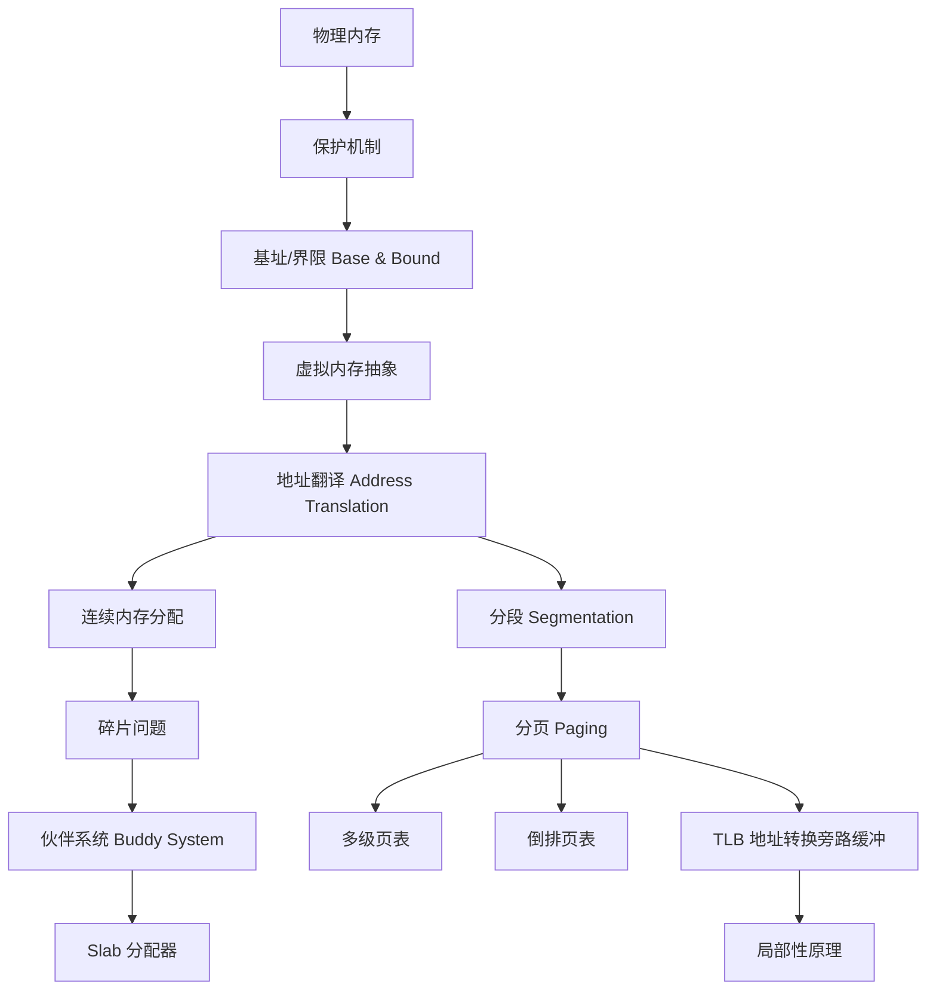

## 一句话总结

以虚拟内存抽象为核心的内存管理：CPU 通过 MMU 将虚拟地址翻译为物理地址，实现保护、重定位、数据共享和连续空间假象；分页是现代 OS 的主流实现方式，TLB 利用局部性原理加速地址翻译。

## 知识地图

## 核心概念

### 1. 物理内存

物理内存没有其他意义，只是存储（易失）运行信息的一个物理介质。它是连续字节（Byte）字的数组，每行都有自己的地址（n 位地址总共有 2ⁿ 个字节），通过地址可以写/读相应的字节。地址和数据分别通过地址总线和数据总线进行传播。

### 2. 保护（Protection）

有了进程抽象，内存就有了"语义"——其代表了当前进程的"状态"，而这个状态应该遵循状态机（即进程）的规约而改变。违背规约就会出现 undefined state，从而导致 undefined behavior。因此，作为状态机的管理者——操作系统，必须提供出现违背规约之后的保护。

需要保护的"状态"改变操作包括：
- **修改别的状态机的状态**：需要界定状态机的边界（哪些内存是自己的，哪些是别的状态机的）
- **增加状态机的大小时，占用的额外空间还处于"有用"状态**：只能申请"空闲"的内存来增加状态机的大小，而不能使用尚被占用的空间（无论是被别的进程还是自己占用），因此得维护什么是"空闲"内存
- **不遵守状态机的内部状态的读、写权限**：需要标记内存块的权限，并且能 assert 相应的读写是否符合权限

### 3. 虚拟内存抽象

以虚拟内存抽象为核心的内存管理：
- CPU 支持虚拟内存功能，新增了虚拟地址空间（通过 Memory Management Unit, MMU 单元），MMU 一般集成到 CPU 核上
- 操作系统配置并使能虚拟内存机制
- 所有软件均使用虚拟地址，无法直接访问物理地址

虚拟地址（Virtual/Logical Address）的关键特性：
- 虚拟地址会被硬件"自动地"翻译成物理地址
- 每个应用程序拥有独立的虚拟地址空间，应用程序认为自己独占整个内存（透明性）
- 应用程序不再看到物理地址
- 应用加载时不用再为地址增加一个偏移量

### 4. 地址翻译（Address Translation）

翻译就是一个函数 f: ⟨pid, virtual address⟩，其将映射到 physical address。

地址翻译可以很自然地提供四个优点：
- **保护**：让不同的进程映射到不同的区域即可（即两个进程的映射函数的值域不相交）
- **重定位**：进程被映射到的物理地址可以在运行时不断变化（运行时，不是编译时，因此是动态重定位）
- **数据共享**：将不同进程的不同虚拟地址映射到同一个物理地址
- **构建连续空间假象**：虚拟地址中的连续地址空间（编程友好），映射到物理内存可以不必连续

> "All problems in computer science can be solved by another level of indirection" — David Wheeler（被称为"软件工程基本定理"）

### 5. 连续内存分配

最简单的内存分配方式：进程（包括操作系统内核）被分配一个连续的物理内存地址。利用基址和界限机制隔离用户进程之间的地址空间，以及防止用户进程修改操作系统的代码和数据。

两种分割方式：
- **固定分区（Fixed-Partition）**：物理内存一开始就被分为"固定"大小的区域，各个区域的大小可以相同，也可以不同，一个进程选择一个空闲区域进行分配。问题是如果进程所需空间非常大则不适用；此外进程大小各异，分区大于进程的部分就是内部碎片（internal fragmentation），其无法被其他进程占用，自己也不用；固定的分区数也限制了可以同时放入内存的进程数。
- **可变分区（Variable-Partition）**：物理内存区域大小和数量是可变的，根据进程的具体需要分配相应的空间。需要维护一个空闲的内存集合，开始是整个巨大的空间，但随着进程的分配和回收，内存会存在很多大小不一的空闲的"孔"。当进程加载时，从足够大的空闲块分配（多了的部分进行分割 splitting）；当进程终止时释放其分区，并与相邻的空闲分区合并（coalescing）。

### 6. 碎片（Fragmentation）

碎片是指无法被分配的未使用内存（过于小，以至于无法分配给新的进程）。

- **外部碎片（空洞）**：由于分散的小的不连续的空闲空间导致的内存浪费，发生在分区之间，通常是由于进程的不断加载和释放造成
- **内部碎片**：由于分区大小和加载的进程大小之间的差异（即进程小于分配的分区）导致的内存浪费，发生在分区内，进程不用，也无法分配给其他进程

外部碎片的处理方法：进程终止或暂时交换出磁盘可释放内存，可能会合并一些碎片；通过紧缩（compaction）减少外部碎片化——重排内存内容以将所有空闲内存放在一起，时间复杂度较高（一般在系统实在没有内存的情况下才会做，是内存分配 slow path 的一部分）。

### 7. 伙伴系统（Buddy System）

从包含物理上连续页面的固定大小段中分配内存：
- 使用 2 的幂分配器（power-of-2 allocator）：按 2 的幂大小单位满足请求，请求向上舍入到下一个最高的 2 的幂
- 当需要比可用空间更小的分配时，当前块被分割为两个下一个较低 2 的幂的伙伴，持续进行直到有适当大小的块可用

伙伴系统的核心优势在于合并效率高：归还块时，分配程序会检查"伙伴"是否空闲，如果是就合二为一，这个递归合并过程继续上溯，直到合并整个内存区域，或者某一个块的伙伴还没有被释放。

伙伴的位置非常容易得到：大小为 2ᵏ 的块的地址是 2ᵏ 的倍数，其地址和伙伴只有一位不同，正是这一位决定了它们在整个伙伴树中的层次。

Buddy System 已经是 Linux 内部分配"大"粒度的连续的物理页面的方法了。问题：只允许分配 2 的整数次幂大小的空闲块，因此如果不是 2 的整数次幂的大小，会有内部碎片。

### 8. Slab 分配器

目标：快速分配小内存对象。

操作系统里面的结构体大小常为几十、几百字节，用 Buddy System 来分配会产生大量的碎片。一个经验观察：系统频繁分配的对象大小相对比较小且固定，小对象分配/回收的 scalability 是系统内存分配的主要瓶颈。

解决方案（90 年代 Jeff Bonwick 在 Solaris 2.4 中首创 SLAB，Christoph Lameter 在 07 年左右在 Linux 中给出了优化版本 SLUB，并在 Linux-2.6.23 及之后成为默认分配器）：
- 从伙伴系统获得大块内存
- 进一步细分成固定大小的小块内存进行管理
- 块大小通常是 2ⁿ 个字节（一般 3 ≤ n ≤ 12）

Slab 分配器只分配固定大小块，对于每个固定块大小使用独立的内存资源池进行分配（best fit 定位资源池）。三个指针：current slab（仅指向一个）、partial slab（指向未满链表）、full slab（指向全满链表）。多线程下：fast path 从 Per CPU slab 中取块（快速，没有和其他 CPU 的竞争），slow path 需要从全局 partial slab 中找或从 buddy system 重新分配。

### 9. 分段（Segmentation）

从用户视角管理内存：将程序视为一组段（segments），段是虚拟内存空间的连续区域，是一个逻辑单元（例如代码段、栈、堆等），按照这样的段分配内存。

底层机制：虚拟地址空间分成若干个不同大小的段，段表（每个进程对应一个）存储着每个分段的信息（由段号索引），包含段基址（Segment Base）和段界限（Segment Bound）。虚拟地址分为：段号（segment number）+ 段内地址（Offset）。物理内存也是以段为单位进行分配，虚拟地址空间中相邻的段，对应的物理内存可以不相邻。

分段支持共享：多个虚拟地址空间可以映射到内存中的同一物理段（例如只读代码的一个副本在进程间共享），段表需要增加保护位（指示程序是否具有相应段的读/写/执行权限）。

存在问题：分配的粒度太粗，随着时间的推移会产生外部碎片；如果是一个大但使用稀疏的堆，或者地址空间的使用模型与段设计不匹配，则难以处理。

### 10. 分页（Paging）

更细粒度的内存管理：
- 物理内存被划分成连续的、等长的物理页（也叫帧 frame），大小一般为 2 的幂，默认是 4KB（2¹²）
- 虚拟内存也被划分为相同大小虚拟块——虚拟页（Page）
- 任意虚拟页可以映射到任意物理页——非常灵活，不需要是连续的空间
- 由于都是按照页为单位分配内存——没有外部碎片

虚拟地址分为：虚拟页号（Virtual Page Number, VPN）+ 页内偏移。每个进程都有一个页表（Page Table），每个页表项（Page Table Entry, PTE）包含一个物理页号（Physical Page Number, PPN / Physical Frame Number, PFN），指示每个页在物理内存中的基地址。

页表使能：CPU 启动流程中，上电后默认进入物理寻址模式，系统软件配置控制寄存器使能页表，进入虚拟寻址模式（如 x86_64 中 CR0 第 31 位 PG 位置 1）。

页表项常见控制位：
- **有效位（Valid bit）**：转换是否有效（支持稀疏空间）
- **存在位（Present bit）**：页面是否实际存储在内存中
- **保护位（Protection bits）**：页面是否可以被读取、写入或执行
- **引用位（Reference bit）**：页面是否已被访问
- **脏/修改位（Dirty/modified bit）**：页面自被载入内存以来是否已被修改

### 11. 多级页表

单级页表的问题：32 位地址空间（4K 页，4B 页表项）→ 页表大小 4MB（仅一个进程）；64 位地址空间（4K 页，8B 页表项）→ 页表大小 33,554,432 GB。

解决方案：使用多级页表减少空间占用。若某级页表中的某条目为空，那么对应的下一级页表无需存在——实际应用的虚拟地址空间大部分都未被使用，因此无需分配页表。

多级页表的设计是典型的**用时间换空间**：能够减小页表所占空间，但增加了访存次数（逐级查询，级数越多越慢）。即使是单级页表，也需要访存两次才能真正得到物理内存上的数据。

### 12. 倒排页表（Inverted Page Tables）

不再为每个进程分别维护多个页表，而是保留一个单一的页表，每个物理页对应一个条目。每个页表条目包括使用该物理页的进程（Pid）和该进程的哪个虚拟页映射到该物理页。减少了存储页表所需的内存，但增加了在发生页引用时查找表所需的时间（使用哈希表来加速查找）。此外一个问题是无法共享。

### 13. TLB（Translation Look-aside Buffer，地址转换旁路缓冲）

如何加速分页的地址转换？观察：大多数程序倾向于对少量页面进行大量引用。使用一种特殊的快速查找硬件缓存，称为翻译后备缓冲器（TLB）或联想存储器（在 MMU 中），缓存最近地址转换：
- 如果 TLB 命中，直接应用转换（fast path）
- 否则，如果 TLB 未命中，则在页表中查找映射（页表遍历），并更新 TLB（slow path）

TLB 背后的理念是利用局部性原理（Principle of Locality）：
- **时间局部性**：如果某个数据被访问过，那么在不久的将来它可能会再次被访问
- **空间局部性**：如果某个数据被访问过，那么它附近的数据在不久的将来也可能会被访问

TLB 通常很小，包含 64 到 1024 个条目，存储最可能被多次选中的地址翻译才能高效发挥作用，支持某些条目可以固定下来以便永久快速访问。

有效访问时间（Effective Access Time, EAT）= (ε + t)α + (ε + 2t)(1 − α)，其中 α 为 TLB 命中率，t 为内存访问时间，ε 为 TLB 查找时间。

TLB Miss 处理：
- **硬件处理**（如 x86 CISC）：硬件进行页面遍历，获取页表项并插入 TLB，硬件必须确切知道页表在内存中的位置（通过 PTBR 寄存器）及确切格式。更加迅速，对系统软件透明地完成。
- **软件处理**（如 MIPS RISC）：硬件引发异常（TLB 故障），操作系统内部的代码处理 TLB 缺失（返回指令与系统调用返回不同）。更加灵活（如可以定制替换策略等）。

TLB 一致性：上下文切换时，旧进程的虚拟到物理地址的转换应该不再有效。两种解决方案：清空 TLB（简单地将所有有效位设置为 0），或带标记的 TLB（在每个 TLB 条目中添加一个地址空间标识符 ASID 字段，唯一标识每个进程）。

## 难点突破

### 难点 1：多级页表为什么"用时间换空间"

**理解关键**：单级页表是一个完整的数组，所有条目都得存在。但现实中虚拟地址空间极为稀疏——一个 64 位进程实际使用的虚拟地址区域可能只有代码段、堆、栈、mmap 等几块，占比远小于 1%。多级页表把平坦数组变成树：只在实际用到的树枝上才分配叶子节点（页表页），没用到的树枝直接标记为空。代价是每次翻译要多级访问——每一级都是一次内存引用。

类比：电话簿如果给全国每个号码一个坑位（单级），浪费书页；按省→市→区（多级）只印实际存在的号码，但查找时要翻三次目录。

### 难点 2：TLB 在上下文切换时的一致性

一个进程的虚拟地址映射到物理页 A，另一个进程的相同虚拟地址可能映射到物理页 B。如果不处理，TLB 里残留的旧进程翻译会导致新进程访问错误的物理地址。硬件做法（x86）：flush TLB，简单但每次切换全清（开销大）。现代做法：ASID（Address Space ID），每个 TLB 条目标注所属进程 ID，匹配才命中——不需要频繁 flush。

## 与前章关联

- **依赖第 9 章（进程）**：进程抽象是虚拟内存的前提——"有了进程抽象，内存就有了语义"。fork() 的 COW 机制依赖页表和 page fault，本章的页表机制即为 COW 的底层实现基础
- **依赖第 10 章（调度）**：上下文切换时需保存/恢复页表基址寄存器或处理 TLB 一致性，本章给出了具体机制（清空 TLB vs ASID 标记）
- **为后续章节铺垫**：本章建立的内存管理框架（分页 + TLB）是后续页面置换算法、文件系统缓存等章节的基础

## 记忆卡片

## 📝 期末笔试备考

### 笔试考点标注

| 考点 | 频度 | 考察形式 | 对应章节 |
|------|------|---------|---------|
| 虚拟内存抽象的核心作用（保护/重定位/共享/连续假象） | 🔴 | 简答/论述 | §3-4 |
| 地址翻译的四个优点 | 🔴 | 简答 | §4 |
| 固定分区 vs 可变分区（优缺点+碎片类型） | 🔴 | 简答/辨析 | §5-6 |
| 外部碎片 vs 内部碎片 | 🔴 | 填空/简答 | §6 |
| Buddy System 原理（2的幂、伙伴地址只有一位不同） | 🟡 | 简答 | §7 |
| Slab 分配器设计动机（小对象，从Buddy拿大块切小块） | 🟡 | 简答 | §8 |
| 分段 vs 分页（粒度、碎片、共享支持） | 🔴 | 辨析/简答 | §9-10 |
| 多级页表：为什么需要、用时间换空间 | 🔴 | 简答 | §11 |
| TLB 原理 + 局部性原理 + EAT 公式 | 🔴 | 简答/计算 | §13 |
| TLB Miss 硬件处理 vs 软件处理 | 🟡 | 简答 | §13 |
| 上下文切换 TLB 一致性（flush vs ASID） | 🟡 | 简答 | §13 |

### 简答题（期末笔试模拟）

**Q1: 地址翻译提供了哪四个优点？各举一个具体场景。**

> 参考答案：① 保护——不同进程映射到不相交的物理区域，进程 A 无法访问进程 B 的内存；② 重定位——进程的物理地址可在运行时动态改变（如 swap 后换入不同物理帧），虚拟地址不变，进程无感知；③ 数据共享——不同进程的不同虚拟地址映射到同一物理地址（如共享库 .so 只需一份物理拷贝）；④ 构建连续空间假象——虚拟地址连续（编程友好），物理页可分散在任意位置。本质：加一层 indirection。

**Q2: 固定分区和可变分区的区别？各产生什么碎片？**

> 参考答案：固定分区预先将物理内存划分为固定大小区域（可同可不同），进程选空闲区域装入，产生内部碎片（分区 > 进程大小的部分被浪费）。可变分区按需分配大小可变的分区，需维护空闲集合、分割（splitting）和合并（coalescing），产生外部碎片（散落的小空洞无法分配）。固定分区简单但受限进程数，可变分区灵活但管理复杂。

**Q3: 为什么分页没有外部碎片？分页的代价是什么？**

> 参考答案：分页将物理内存和虚拟内存都划分为固定大小的页（如 4KB），任意虚拟页可以映射到任意物理帧——不需要连续，因此不存在"最大连续空洞放不下进程"的问题。代价：① 页表本身占用内存（每个进程一张）；② 每次内存访问需先查页表翻译地址，多一次访存（TLB 可缓解）；③ 有内部碎片（最后一页平均浪费半页）。用多级页表 + TLB 换取空间和时间效率的平衡。

**Q4: 多级页表为什么能节省空间？代价是什么？**

> 参考答案：单级页表是一个完整数组，所有条目都得存在。但进程的实际虚拟地址空间极为稀疏（只用代码段、堆、栈等少数区域），多级页表把平坦数组变成树——只在实际使用的树枝上分配叶子页表页，未使用的中间条目直接标记为空，无需为空洞区域分配页表。代价是每次地址翻译需要逐级访问（如四级页表需 4 次内存访问），是典型的"用时间换空间"，TLB 命中可绕过这 4 次访存。

**Q5: TLB 为什么有效？EAT 公式中各符号的含义？**

> 参考答案：TLB 有效是因为局部性原理——时间局部性（刚访问的数据近期可能再访问）、空间局部性（访问某地址后附近地址也可能被访问）。大多数程序倾向于对少量页面进行大量引用，TLB 缓存最近地址翻译即可获得高命中率。EAT = (ε + t)·α + (ε + 2t)·(1−α)，α = TLB 命中率，t = 一次内存访问时间，ε = TLB 查找时间。命中时一次访存 (t)，未命中时需查页表再访存 (2t)。

**Q6: 上下文切换时为什么要处理 TLB？两种方案各有什么 trade-off？**

> 参考答案：不同进程的相同虚拟地址可能映射到不同物理地址，旧进程的 TLB 条目残留会导致新进程访问错误物理内存。方案一：flush TLB（清空所有条目），简单但每次切换全清，切换后所有访问都是 cold miss。方案二：ASID（Address Space ID），每个 TLB 条目标注所属进程 ID，匹配才命中，避免频繁 flush，但硬件复杂度更高。

---

## 记忆卡片

1. **Q: 地址翻译的四个优点是什么？** A: 保护（不同进程值域不相交）、重定位（运行时动态改变映射）、数据共享（不同虚拟地址映射同一物理地址）、构建连续空间假象（虚拟连续→物理可分散）

2. **Q: 固定分区和可变分区的主要区别？** A: 固定分区预先将物理内存划分为固定大小区域，简单高效但存在内部碎片且受限进程数；可变分区按需分配，需要维护空闲集合、分割和合并，可能产生外部碎片（空洞）

3. **Q: 伙伴系统为什么合并效率高？** A: 大小为 2ᵏ 的块的地址是 2ᵏ 的倍数，伙伴地址只有一位不同（在伙伴树中层次由该位决定），因此检查与合并伙伴是 O(1) 操作

4. **Q: 分段和分页的核心区别？** A: 分段按逻辑单元（代码/堆/栈）分配，段大小可变，会产生外部碎片；分页按固定大小（如 4KB）分配，任意虚拟页可映射任意物理页，无外部碎片但可能有内部碎片

5. **Q: 多级页表解决什么问题？代价是什么？** A: 解决单级页表占用空间过大的问题——未使用的虚拟地址区域无需分配页表页。代价是每次地址翻译需要多次内存访问（用时间换空间），TLB 可缓解这一代价
