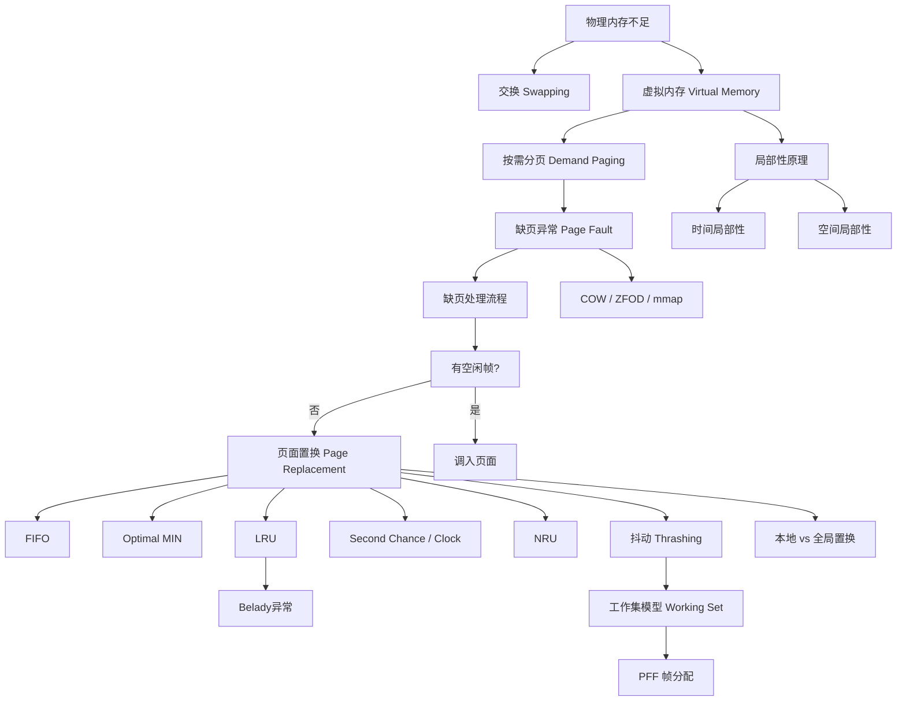

## 一句话总结

虚拟内存通过按需分页 + 缺页异常 + 页面置换，让进程以为拥有近乎无限的内存空间，实际上只有"工作集"驻留在物理内存中；局部性原理是这一切可行的根基。

## 知识地图

## 核心概念

### 1. 交换（Swapping）

如果没有足够空间容纳所有进程，一个进程可以被暂时换出内存到后备存储（backing store），然后在需要继续执行时再换回内存。进程的总物理内存空间可以超过物理内存。

交换时间的主要部分是磁盘传输时间，与交换的内存量直接成正比。系统维护一个就绪队列，里面是内存镜像在磁盘上的准备运行的进程。如果 CPU 要放上的下一个进程不在内存中，需要换出一个进程并换入目标进程，此时上下文切换时间会非常高（例如 100MB 进程交换到 50MB/s 硬盘 = 2 秒）。

如果进程正在等待 I/O 操作（I/O 缓冲区在进程的地址空间中），交换会产生负面影响（I/O 失败或数据丢失）。一般涉及 I/O 操作的页需要被锁定在内存中，防止在操作完成前被换出。

标准交换在现代操作系统中不再使用，但变异版本很常见（例如 Linux 和 Windows）：交换通常是禁用的，当分配的内存超过阈值（可用内存极低时）才会启动交换，一旦内存需求减少到低于阈值时再次被禁用。

移动操作系统通常不支持交换：基于闪存（空间较小，只能写入有限次数）。取而代之的是其他方法：iOS 要求应用程序自愿释放已分配的内存（只读数据可丢弃并重新加载，如果应用未能释放内存则终止）；Android 在内存不足时终止应用程序，但首先会将应用程序状态写入闪存以便快速重启。

### 2. 虚拟内存

交换无法解决"单个进程本身超过物理内存"的问题。虚拟内存的核心思想：不是所有内容都需要同时加载进内存——程序中的错误处理代码不会在每次运行时都被使用，数组可能分配得比所需要的大，程序无需在运行之前加载整个程序。

虚拟内存的机制：
- 每个进程都有一个"大地址空间"的幻觉
- 支持多个并发运行的进程使用大虚拟地址空间：只将常用的页面保留在内存中（此时内存可以看成是所有页面 pages 的一个 cache）
- 透明的间接层（页表）支持物理数据的灵活放置——数据可以在磁盘上甚至是网络中的某处，数据位置的变化对用户程序是透明的

具备"部分"加载程序的执行能力后：程序不再受物理内存限制（可以运行无法完全放入物理内存的程序），每个程序在运行时占用更少的内存（可以同时运行更多的程序），加载或交换程序到内存中所需的 I/O 更少（每个程序启动更快）。

### 3. 缺页异常（Page Fault）

使用存在/不存在位（在页表项中）来跟踪哪些页面存在于物理内存中。当程序引用其地址空间的一部分时：
- 如果页面在物理内存中，则直接进行地址转换
- 如果不在，则发生缺页异常（Page Fault），操作系统被调用来处理该异常：检测并将页面加载到内存中，然后重新执行引用该地址空间的指令

在 x86_64 上，缺页异常号为 #PF (13)，错误地址在 CR2 寄存器中。

**缺页异常处理的具体流程**：

1. 硬件陷入内核，进行上下文切换（将程序计数器保存在栈上，保存通用寄存器和其他易失性信息）
2. 系统发现这个事件是一个缺页异常，尝试确定所需的虚拟页面
3. 一旦知道引发缺页异常的虚拟地址，系统检查地址是否有效，并且保护是否与访问一致
4. 找到一个空闲（干净的）帧。如果没有空闲帧，则运行页面置换以选择一个受害者（victim）。如果所选帧是脏的，则将页面安排转移到磁盘，进行上下文切换，暂停引发异常的进程
5. 一旦帧变为干净状态，系统查找所需页面的磁盘地址，并安排磁盘操作将其调入（引发缺页异常的进程仍处于暂停状态）
6. 当磁盘中断指示页面已经到达时，更新页表，并将帧标记为正常状态
7. 将引发缺页异常的指令恢复到其原始状态，并重置程序计数器
8. 引发缺页异常的进程被调度，上下文切换回去

**性能**：处理缺页异常的主要活动——服务中断（一般只需要几百条指令）、读取页面（需要大量时间）、恢复进程（需要少量时间）。有效访问时间（EAT）= (1 − p) × 访存时间 + p × 缺页异常开销。例子：访存时间 200ns，缺页服务时间 8ms，若 1000 次访问中有一次引发缺页异常（p=0.001），EAT = 8200ns（减速了 40 倍）。若想性能降级 < 10%，每 400,000 次内存访问中不到一次缺页异常。

### 4. 缺页异常的其他用法

除了作为构建虚拟内存的机制外，缺页异常还有其他巧妙用法：

- **Copy-On-Write（写时复制）**：父子进程共享物理页面，标记为只读，写时才触发缺页异常进行复制
- **Zero-Filled-on-Demand（ZFOD，按需零填充）**：许多进程页是"空白"的（所有 bss、新的堆页面、新的栈页面）。有一个系统范围内的全零帧，所有全零页帧都指向它并标记为只读。读取零是自由的，但写入会导致缺页错误以及克隆操作
- **Memory-Mapped Files（内存映射文件）**：将文件内容映射到进程的地址空间。通过 `mmap(add, len, prot, flags, fd, offset)` 将文件视为一块内存区域，不需要显式使用 read() 和 write()。访问映射区域时若页面尚未在内存中则发生缺页异常，OS 将相应文件内容读取到内存。对映射区域的写操作会导致页面被标记为脏页，必要时通过 write() 写回文件。多个进程使用相同 mmap() 映射相同文件时共享同一份内存区域

### 5. 页面调入时机与页面置换

**何时调入页面**：
- **按需分页（Demand Paging）**：出现缺页异常后进行调入页面，最简单的方式。为提高效率，调入是异步进行的——中断处理程序快速响应，只需启动磁盘 I/O 并阻塞该进程，让其他进程运行
- **预取（Prefetching）**：猜测即将使用哪些页面，提前调入内存，往往基于历史的缺页记录来预测

**页面置换（Page Replacement）**：如果没有空闲的帧，找到内存中的一个页面（一般来说该页面近期最不可能再次被访问），将其换出。步骤：选择一个受害者帧（victim frame）进行驱逐 → 将所需页面调入（新）空闲帧。换出时需：更新页表（找到所有引用旧页面的页表项并设置为不可见）、移除任何 TLB 条目（多处理器系统中必须从所有处理器的 TLB 中消除）、将页面写回磁盘（如需要，检查页表项中的脏位）、重新启动引发陷阱的指令。

**锁定页面**：有时必须将页面锁定到内存中——总是将（部分）内核页面放入物理内存中；用于从设备复制文件的页面必须锁定，防止被选择用于驱逐（I/O）。

**页面缓冲（Page Buffering）**：操作系统保留一组空闲帧（缓冲）以确保在需要时总有可用的帧。有一个交换页面的守护进程（如 Linux 的 kswapd）定期运行：如果空闲物理帧数量 < 低水位标记，则换出一些页面直到数量达到高水位标记。系统一次性换出许多页面（批量传输更高效），需要维护一个修改页面的列表（Linux 中的 pdflush）。

### 6. 页面置换算法

目标：实现最低的缺页异常率（尽量从磁盘获取页面的次数最少）。如果选择一个不常被使用的页面，系统性能会更好；如果删除一个频繁使用的页面，它可能很快就需要被重新调入。

**FIFO（First-In-First-Out）**：替换最老的页面。使用一个 FIFO 队列来跟踪页面的老化（aging）程度。问题：最老放入的可能是需要被频繁使用的（cold-start miss）。

**Belady 异常（Belady's Anomaly）**：增加帧数反而可能会降低命中率（帧数越少，缺页异常越少）。Belady 异常会发生在任何不遵循"栈算法属性（stack algorithm property）"的页面替换算法中。栈算法属性确保当页面帧数量增加时，先前存在的页面集合始终是当页面帧更多时存在的页面集合的子集——随着页面帧数的增加，先前存在的页面应始终保留在内存中。LRU 和 Optimal 算法始终遵循栈算法属性，永远不会受到 Belady 异常的影响。

**Optimal（MIN）**：替换那些在最长时间内不会被使用的页面。尽可能推迟不愉快的换页事件。但这个方法只存在理想中，无法预知未来，因此通常用于衡量算法的性能（和最优的差距有多大）。

**LRU（Least Recently Used）**：替换那些在最长时间内没有被使用的页面。使用历史而不是未来——很长时间没有被使用的页面可能会保持长时间未使用，基于局部性原理。精确 LRU 的实现开销太大（需要每次内存引用时记录时间戳/计数器），因此使用近似实现。

**近似 LRU — Second Chance（二次机会）/ Clock 算法**：通过引用位来近似 LRU。系统中每个页面有一个引用位（R），每当引用页面时 R 被硬件设为 1。如果要替换的页面：R=1 → 将引用位设为 0，将其放在 FIFO 队列末尾，检查下一个页面；R=0 → 替换它。如果所有页面都被引用，第二次机会等于 FIFO。具体实现可将所有页面帧以时钟形式放在循环列表中（避免在队列上移动页面），发生缺页异常时检查当前指向的页面：R=0 驱逐，R=1 清零并指针前移。

**NRU（Not Recently Used）**：通过两个状态位——引用位和修改位来近似 LRU。为那些被修改的页面赋予更高的优先级以减少 I/O 负担（增强的第二次机会）。四类优先级从高到低：(0,0) 既不是最近使用的也没有被修改过——最适合替换；(0,1) 不是最近使用的但被修改过——不太理想，需要在替换前写出；(1,0) 最近被使用但是干净的——可能会很快再次被使用；(1,1) 最近被使用且被修改过——可能会很快再次被使用且需要在替换前写出。从最低编号的非空类中随机移除一个页面。

### 7. 抖动（Thrashing）

如果一个进程没有足够的页面，缺页率可能会非常高——此时大部分 CPU 时间都被用来处理缺页异常（等待缓慢的磁盘 I/O 操作），仅剩小部分的时间用于执行真正有意义的工作。调度器甚至还会造成问题加剧：等待磁盘 I/O 导致 CPU 利用率下降 → 调度器载入更多的进程以期提高 CPU 利用率 → 本来物理页面就不足的局面雪上加霜 → 触发更多的缺页异常、进一步降低 CPU 利用率、导致连锁反应。抖动（也叫颠簸）即一个进程花费所有时间在页面间进行交换（大多数引用导致缺页异常）。

### 8. 局部性原理与工作集模型

**局部性原理（Principle of Locality）**：时间局部性 — 相同的内存位置在不久的将来会再次被访问；空间局部性 — 未来将会访问附近的内存位置。当一个进程执行时，它会从一个局部转移到另一个局部（phase transition）。

**工作集（Working Set）模型**：工作集 W(t, x) 是进程在时间段 (t-x, t) 内使用的内存页集合，也被视为其在未来（下一个 x 时间内）会访问的页集。如果整个工作集都在内存中，进程将运行而不会引起太多缺页异常，直到进入另一个执行阶段。如果可用内存太小无法容纳整个工作集，则会发生抖动。

**All-or-nothing 模型**：进程工作集要不都在内存中，否则全都换出。需要跟踪每个进程的工作集，并确保在运行之前将其加载到内存中。大大降低缺页异常率。

**跟踪工作集**：工作集时钟中断固定间隔发生，处理函数扫描内存页——访问位为 1 则说明在此次 tick 中被访问，记录上次使用时间为当前时间；访问位为 0 则此次 tick 中未访问，Age = 当前时间 − 上次使用时间，若 Age > x 则不在工作集。最后将所有访问位清零（需要硬件支持访问位 access bit）。

### 9. 本地和全局置换策略

- **本地页面置换**：每个进程从其分配的帧集中选择受害者。每个进程的帧数固定分配，每个进程的性能更加一致，但可能导致内存利用不足
- **全局页面置换**：从分配给任何进程的帧中选择受害者。每个进程的帧数可变，吞吐量更大，因此更为普遍

**帧分配**：采用全局页面置换时，操作系统必须不断决定为每个进程分配的页面帧数——平均分配、比例分配（根据进程大小）、按优先级分配。但这些静态的帧数分配无法解决不断变化的动态需求。

**PFF（Page Fault Frequency，缺页异常频率）算法**：缺页异常率 = 每秒平均缺页数。分配帧以使进程的 PFF 相等——如果实际速率太低，则进程丢失帧；如果实际速率太高，则进程获得帧。这是一种动态的帧分配策略。

### 10. 操作系统对分页的支持

- **进程创建**：确定程序和数据的初始大小并创建页表 → 为页表分配空间并初始化 → 为磁盘上的交换区域分配空间并初始化 → 在进程表中记录有关页表和交换空间的信息
- **进程执行**：为新进程重置内存管理单元（页表基址寄存器） → 上下文切换时清除 TLB（除非是带有标记的 TLB） → 可选地将进程的一些或所有页面调入
- **缺页异常处理**：找到所需的页并在磁盘上定位 → 找到一个可用的物理页帧来放置新页帧（必要时替换旧页帧） → 将所需的页面读入该物理页帧 → 备份程序计数器以再次执行指令
- **进程终止**：释放页表、页帧和交换空间。共享页帧只能在最后一个使用它们的进程终止时释放
- **页面守护进程（Page Daemon）**：大部分时间处于休眠状态，但定期唤醒以检查内存状态，并主动准备待驱逐的页面

### 11. 程序优化与分页

分页不仅是一个"操作系统问题"——程序员也能减少工作集的大小。局部性取决于数据结构：数组鼓励顺序访问（多次引用同一页，可预测地访问下一页）。编译器和链接器也能帮忙：不要把函数分散到两页上。这些优化方式的效果可能非常显著。

## 难点突破

### 难点 1：Belady 异常——为什么帧数多了缺页反而多？

**直觉**：通常认为给更多物理帧应该减少缺页，因为内存更大了。但 FIFO 等算法不满足"栈算法属性"——当帧数增加时，旧帧集合不一定是新帧集合的子集。一个原本在 3 帧配置中常驻的"热点页"，在 4 帧配置中可能反而被 FIFO 踢出（因为队列变长了，它在新配置中被更早轮转出去）。这完全取决于访问序列和帧数的交互方式。

**记法**：只有 LRU 和 Optimal 永远不发生 Belady 异常——它们满足栈算法属性。

### 难点 2：工作集与抖动的边界在哪里？

工作集的大小是动态的，取决于程序的执行阶段（phase）。抖动发生时，系统处于一个恶性循环：缺页率高 → CPU 等 I/O → 利用率降 → 调度器加进程 → 更少的帧给每个进程 → 更高缺页率。打破此循环的方法是**减少多道程序度**（swap out 一些进程），这正是工作集模型的 all-or-nothing 策略：如果无法装进内存就整个换出，不勉强运行。

## 与前章关联

- **依赖第 11 章（地址空间）**：分页机制（页表、PTE、TLB）是本章虚拟内存的底层基础。缺页异常的触发依赖 PTE 中的"存在位"，地址翻译完成了才知道页面不在内存中。页面置换时涉及清除 TLB 条目和更新 PTE 中的脏位、引用位
- **依赖第 9 章（进程）**：COW（fork 写时复制）本质上就是利用缺页异常——父子进程共享页标为只读，写时触发 page fault 进行复制。ZFOD 也是同理，为 bss/堆/栈的惰性分配提供支持
- **为后续章节铺垫**（持久化/文件系统）：内存映射文件（mmap）连接了内存管理和文件系统两大模块

## 📝 期末笔试备考

### 笔试考点标注

| 考点 | 频度 | 考察形式 | 对应章节 |
|------|------|---------|---------|
| 交换 vs 虚拟内存（粒度、效率、能否运行超大程序） | 🔴 | 辨析/简答 | §1-2 |
| 缺页异常处理流程（8 步） | 🔴 | 简答 | §3 |
| 缺页异常的巧妙用法（COW / ZFOD / mmap） | 🔴 | 简答 | §4 |
| 页面置换算法对比（FIFO / Optimal / LRU / Clock / NRU） | 🔴 | 辨析/简答 | §6 |
| Belady 异常：为什么帧数多反而缺页多 | 🔴 | 简答 | §6 |
| 栈算法属性：哪些算法不发生 Belady 异常 | 🟡 | 简答 | §6 |
| Second Chance (Clock) 算法流程 | 🔴 | 简答 | §6 |
| NRU 四类优先级（引用位+修改位） | 🟡 | 填空/简答 | §6 |
| 抖动（Thrashing）的原因与应对 | 🔴 | 简答/论述 | §7 |
| 工作集模型 W(t,x) 与 all-or-nothing 策略 | 🟡 | 简答 | §8 |
| 局部性原理（时间+空间）作为虚拟内存可行性的根基 | 🔴 | 简答 | §8 |
| 本地 vs 全局置换策略 | 🟡 | 简答 | §9 |
| PFF 动态帧分配 | 🟡 | 简答 | §9 |

### 简答题（期末笔试模拟）

**Q1: 交换（Swapping）和虚拟内存的核心区别？为什么现代 OS 不用标准交换？**

> 参考答案：交换以整个进程为单位在内存和磁盘间移动——粒度粗、开销大（如 100MB 进程，50MB/s 磁盘需 2 秒上下文切换）。虚拟内存以页（4KB）为单位按需调入，只加载活跃页面。交换无法解决"单个进程超过物理内存"的问题；虚拟内存可以。现代 OS 只在内存极低时才启用交换变体（Linux/Windows），移动 OS（iOS/Android）通常不支持交换——闪存写入次数有限。

**Q2: 缺页异常处理的完整流程是什么？**

> 参考答案：①硬件陷入内核，保存 PC 和寄存器 → ②识别缺页异常，从 CR2 寄存器获取引发异常的虚拟地址 → ③检查地址有效性（不是非法访问）和保护位 → ④找空闲物理帧，若无则运行页面置换选 victim，脏帧安排写回磁盘 → ⑤从磁盘读入所需页面（进程挂起，调度其他进程）→ ⑥磁盘中断到达，更新页表 P 位=1，帧标记为正常 → ⑦恢复引发异常的指令到原始状态，重置 PC → ⑧调度引发缺页的进程继续执行。

**Q3: 缺页异常除了处理页面不在内存，还有哪些巧妙用法？各简述原理。**

> 参考答案：① COW（写时复制）——fork() 后父子共享物理页标只读，写入时触发 page fault，OS 克隆新页。避免了 fork 时立即复制全部内存的浪费。② ZFOD（按需零填充）——所有进程的空白页（bss、新堆、新栈）的页表全指向同一页全局零页（只读），写入时触发 page fault 克隆新页。不用的零页永远不占物理内存。③ mmap（内存映射文件）——将文件映射到进程地址空间，访问时缺页从文件读入，修改脏页写回。省去 read/write 的拷贝开销（零拷贝），多进程映射同一文件物理只有一份。

**Q4: 为什么 FIFO 会发生 Belady 异常？LRU 和 Optimal 为什么不会？**

> 参考答案：Belady 异常原因：FIFO 淘汰决策依赖"进入队列的时间"而不是"使用频率"。帧数增加改变了队列的轮转速度——在 3 帧配置中较晚进队列的热页（受保护），在 4 帧配置中反而更早进队列（因为队列更长，周转变慢），反而更早被踢出。LRU 和 Optimal 满足栈算法属性——帧数 N 时的页面集合总是帧数 N+1 时的子集。因为它们的淘汰决策依赖"最近使用时间"或"未来使用时间"，帧数增多只会让原有页面更安全，不会伤害已在内存中的页。

**Q5: Second Chance（Clock）算法如何用引用位近似 LRU？**

> 参考答案：所有物理帧排成循环链表，指针指向当前位置。缺页时检查：R=0 → 替换当前帧；R=1 → 将 R 清零，指针前移一位，相当于"给你第二次机会"。如果所有帧 R 全=1（全被引用过），最终退化为 FIFO（全清零后第一圈就替换）。这是 LRU 的近似实现——R=0 等效于"最近没有被用过"，避免了精确 LRU 每次访存记录时间戳的巨大开销。

**Q6: NRU 的四类优先级是什么？为什么为脏页赋予更高优先级？**

> 参考答案：NRU 用两个位分类：(0,0) 既未最近使用也没修改——最适合替换；(0,1) 未最近使用但脏了——替换前需写回磁盘；(1,0) 最近使用但干净——可能马上再用；(1,1) 最近使用且脏——最不该替换。脏页优先级更高是为了减少 I/O：替换干净页不需要写磁盘（内容可从文件或零页重现），替换脏页必须写回磁盘，一次 8ms 的 I/O 代价令缺页处理更慢。

**Q7: 什么叫抖动（Thrashing）？为什么会发生？如何应对？**

> 参考答案：抖动指进程几乎全部 CPU 时间都在处理缺页异常、实际执行有用工作的时间极少。原因：分配给进程的物理帧数小于其工作集大小，导致频繁缺页。恶性循环：缺页率高 → CPU 利用率下降 → 调度器误判"不够忙"而加更多进程 → 每进程分到更少帧 → 更高缺页率。应对：减少多道程序度（swap out 一些进程），使用工作集模型（all-or-nothing——工作集装不进就整进程换出），或用 PFF 动态调整每进程帧数。

**Q8: 局部性原理是什么？为什么它是虚拟内存可行性的根基？**

> 参考答案：时间局部性——刚访问的地址近期可能再访问（如循环中的变量）；空间局部性——访问某地址后附近地址也易被访问（如顺序执行代码、遍历数组）。虚拟内存赌的就是：进程在任何时刻真正活跃的页面只有一小撮（工作集）。只要这部分能装进物理内存，缺页率就极低。没有局部性原理，进程会在所有页面间随机跳跃访问，缺页率接近 100%，虚拟内存将毫无意义——这正是"缓存能 work 的根本原因"。

---

## 记忆卡片

1. **Q: 交换（Swapping）和虚拟内存的核心区别是什么？** A: 交换以整个进程为单位在内存和磁盘间移动，粒度粗、开销大（如 100MB 进程移动需 2 秒）；虚拟内存以页面为单位，只调入需要的页面，粒度细，支持运行超过物理内存大小的程序

2. **Q: 缺页异常处理的 8 个步骤是什么？** A: ①硬件陷入内核（上下文切换）→ ②识别缺页异常，确定所需虚拟页 → ③检查地址有效性和保护 → ④找空闲帧（无则页面置换选 victim）→ ⑤安排磁盘读入 → ⑥磁盘中断到达，更新页表 → ⑦恢复指令原状态 → ⑧调度进程

3. **Q: Belady 异常是什么？什么算法不会发生？** A: 增加帧数反而导致更多缺页（如 4 帧 10 次缺页 vs 3 帧 9 次）。任何不满足"栈算法属性"的算法都可能发生（如 FIFO、随机）。LRU 和 Optimal 总是满足栈算法属性，永远不发生 Belady 异常

4. **Q: Second Chance（Clock）算法如何工作？** A: 页面帧组成循环链表，缺页时检查当前指针指向的帧：R=0 → 替换；R=1 → 清零 R 并将指针前移（给它"第二次机会"）。如果所有页都被引用过（全 R=1），退化为 FIFO

5. **Q: 抖动的症状和应对方法是什么？** A: 症状：进程几乎全部时间在处理缺页异常，CPU 利用率极低。调度器加更多进程反而加剧（恶性循环）。应对：减少多道程序度，使用工作集模型（all-or-nothing——装不进就整个换出）
