## 一句话总结

操作系统通过设备驱动程序将千差万别的硬件抽象为统一接口；磁盘调度算法和 SSD 的 FTL（闪存转换层，Flash Translation Layer）都是"用间接层解决硬件限制"的经典范式。

## 知识地图

```mermaid
flowchart TD
    HW[硬件架构] --> BUS[总线层次结构]
    HW --> DEV[设备分类]
    DEV --> BLOCK[块设备 Block Device]
    DEV --> CHAR[字符设备 Character Device]
    
    DEV --> IFACE[设备接口]
    IFACE --> REG[寄存器: Status/Command/Data]
    
    COMM[CPU与设备通信] --> PMIO[端口映射 I/O]
    COMM --> MMIO[内存映射 I/O]
    
    STATUS[获知设备状态] --> POLL[轮询 Polling]
    STATUS --> INTR[中断 Interrupt]
    
    TRANS[数据传输控制] --> PIO[程序控制 I/O]
    TRANS --> DMA[直接内存访问 DMA]
    
    DISK[磁盘] --> GEO[物理结构]
    DISK --> LBA[逻辑块寻址 LBA]
    DISK --> PERF[性能模型: T = seek + rotation + transfer]
    DISK --> CACHE[磁道缓冲区]
    
    SCHED[磁盘调度] --> FCFS
    SCHED --> SSTF
    SCHED --> SCAN[SCAN / C-SCAN / F-SCAN]
    SCHED --> SPTF
    
    SSD[固态硬盘] --> NAND[NAND 闪存]
    SSD --> FTL[FTL 闪存转换层]
    FTL --> COW[写时复制 Copy-on-Write]
    FTL --> WL[磨损均衡 Wear Leveling]
    FTL --> GC[垃圾回收 Garbage Collection]
    
    ABSTRACT[硬件抽象] --> DRIVER[设备驱动程序]
    DRIVER --> UPPER[上半部分: 系统调用路径]
    DRIVER --> LOWER[下半部分: 中断例程]
    DRIVER --> LAYER[分层设计: FS → Generic Block → Driver]
```



## 核心概念

### 1. 设备分类

设备大体可以分类为两类：

- **块设备（Block Device）**：以固定大小的块存储信息，传输单位为整个块。典型代表：磁盘。
- **字符设备（Character Device）**：传递或接受字符流，不可寻址，没有任何寻址操作。典型代表：键盘、串口。

### 2. 设备接口：寄存器

一个设备有两个重要组成部分：它向系统其余部分呈现的硬件接口（允许操作系统控制其运行）和它的内部结构（具体实现）。

设备接口由几个寄存器组成：
- **状态寄存器（Status Register）**：读取以查看设备的当前状态
- **命令寄存器（Command Register）**：指示设备执行特定任务
- **数据寄存器（Data Register）**：将数据传递给设备或从设备获取数据

### 3. CPU 与设备的通信方式

处理器以两种方式访问设备寄存器：

- **端口映射 I/O（Port-Mapped I/O）**：提供额外的 I/O 指令（x86 上为 `in` 和 `out`），每个控制寄存器被分配一个 I/O 端口号。这些指令通常是特权指令。
- **内存映射 I/O（Memory-Mapped I/O）**：将所有控制寄存器映射到内存空间中，每个控制寄存器被分配一个唯一的内存地址。操作系统发出 `load/store` 指令访问，硬件将指令指向设备而不是主存储器。

> ⚠️ 内存映射时小心缓存！如果设备寄存器地址被 CPU 缓存，后续轮询会直接从 cache 取值，无法反映设备的真正状态。因此一般要禁掉相应内存地址的缓存。

### 4. 获知设备状态：轮询 vs 中断

在发出与设备通信的指令后，操作系统需要知道操作是否完成或遇到错误。有两种获知状态的方法：

| 方式 | 机制 | 优点 | 缺点 |
|------|------|------|------|
| **轮询（Polling）** | OS 定期检查设备状态寄存器 | 开销低（没有上下文切换） | 低速设备上浪费 CPU 周期 |
| **中断（Interrupt）** | 设备在需要服务时生成中断 | 不会浪费 CPU 周期 | 开销高（伴随上下文切换） |

一般两种方式混合使用：快速设备用中断，频繁事件用轮询。

### 5. DMA（直接内存访问）

程序控制 I/O（Programmed I/O）由 CPU 直接通过 `in/out` 或 `load/store` 传输每个字节，优点硬件简单、易于编程，但消耗与数据大小成比例的处理器周期。

**DMA（Direct Memory Access）** 给控制器访问内存和总线的权限，直接在内存和控制器之间传输数据块：

1. 确定任务（如磁盘 → 内存缓冲区）
2. CPU 将任务发送到磁盘控制器
3. 磁盘控制器初始化 DMA 控制器
4. 磁盘控制器向 DMA 控制器传输数据
5. DMA 开始不断在磁盘和内存之间传输
6. 所有数据传输完毕，DMA 中断通知 CPU

DMA 将 CPU 从逐字节搬运中解放出来，让 CPU 可以并行做其他事。

### 6. "通用"与"专用"处理器

计算机系统内部不只是有通用 CPU。很多设备都有自己的逻辑处理芯片——这是"专用"处理器的概念：
- 专门负责 `memcpy()` 的 DMA
- 专门负责解析和显示图形的 GPU
- 磁盘控制器也有自己的处理器

为什么不是人手一个通用 CPU？因为代价——通用性增加了很多设计以及与之而来的功耗。特定领域的任务不需要这么多通用性。I/O 管理可以看成是中央芯片（通用 CPU）和外部专用芯片的交流。

> 这个"通用 vs 专用"的权衡同样适用于编程语言（领域特定语言 DSL）和算法设计。

### 7. 磁盘结构与性能模型

**物理结构**：盘片（Platter）表面涂有磁性材料，磁头（Head）通过感知/创建磁场来读/写。磁头漂浮在旋转盘片上。多个盘片、多个盘面，相同磁道索引的一组磁道称为柱面（Cylinder）。

**寻址**：
- 旧：直接地址 =（驱动器，表面，磁道，扇区）
- 新：**逻辑块地址（Logical Block Address, LBA）**——0 到 N-1 的线性地址，不暴露物理几何结构

**磁盘访问时间**：
$$T_{I/O} = T_{seek} + T_{rotation} + T_{transfer}$$

- **寻道时间（Seek）**：磁头移动到适当磁道
- **旋转延迟（Rotational Latency）**：等待目标扇区转到磁头下
- **传输时间（Transfer）**：实际读写扇区数据

磁盘传输速率：$R_{I/O} = \frac{Size}{T_{I/O}}$

**设计技巧**：
- **磁道偏移（Track Skew）**：确保跨越磁道边界时能正确处理顺序读取——如果没有偏移，切换磁道后目标数据块已经转过去了，得等一整圈
- **多区域（Multi-Zoned）**：外部磁道比内部磁道有更多扇区，磁盘被组织成多个区域，每个区域每条磁道的扇区数相同
- **磁道缓冲区**：8-16 MB 缓存，读扇区时同时读该磁道上所有扇区；写策略分写回（write back）和直写（write through）

### 8. 磁盘调度算法

由于 I/O 成本高，操作系统通过磁头调度最小化磁头移动，从而最大化磁盘 I/O 吞吐量。

| 算法 | 策略 | 优点 | 缺点 |
|------|------|------|------|
| **FCFS（先到先服务）** | 按请求到达顺序处理 | 公平，按应用预期顺序 | 随机寻道导致总移动距离大 |
| **SSTF（最短寻道时间优先）** | 优先处理最接近当前磁道的请求 | 最小化寻道时间 | **饥饿**：持续不断的中间请求会使两端请求永远得不到服务 |
| **SCAN（电梯/扫描算法）** | 在磁盘上来回移动，按顺序跨磁道处理请求 | 避免饥饿，较公平 | 两端等待时间较长 |
| **C-SCAN** | 只从外轨到内轨扫描，然后重置到外轨重新开始 | 对内轨和外轨更公平，等待时间更均匀 | — |
| **F-SCAN** | 扫描时冻结队列，避免新请求干扰当前扫描 | 避免远距离请求饥饿 | — |
| **SPTF（最短定位时间优先）** | 同时考虑寻道时间和旋转时间 | 理论最优 | OS 通常不清楚磁头当前具体位置，实现困难 |

现代做法：将许多请求发送到磁盘，让磁盘自行调度——如今的磁盘更智能且拥有较大缓存。但 OS 至少可以假设相邻扇区号在磁盘上也相邻，顺序访问更快。

### 9. SSD 与 FTL

**SSD（Solid State Disk，固态硬盘）**使用 NAND 多级单元闪存存储器。无运动部件，消除了寻道和旋转延迟（< 0.1-0.2 毫秒访问时间），功耗低、轻量。

**闪存的问题与解决方案**：

| 问题 | 解决方案 |
|------|----------|
| 放电做不到 100% 放干净；多次充放电后单元"磨损"（wear out） | **FTL（闪存转换层，Flash Translation Layer）**：将虚拟块编号映射到物理页面编号 |
| 更新数据时直接覆盖很慢（需先擦除整个块） | **写时复制（Copy-on-Write）**：将新版本写入空闲页面，更新 FTL 映射指向新位置 |
| 某些页面被频繁写入而其他页面很少使用 | **均衡磨损（Wear Leveling）**：控制器均衡各页面的写入负载 |
| 旧版本页面占用空间 | **垃圾回收（Garbage Collection）**：后台擦除带有旧页面的块，加入空闲列表 |

> ⚠️ Copy-on-write 意味着旧数据还留在闪存中。有研究发现智能手机关机后，被"删除"的数据仍然存在超过六个月。轻度格式化同样存在此问题——数据并未真正清除，只是 FTL 映射被更新了。

### 10. 设备驱动程序的抽象分层

操作系统创建了一个分层的存储视图：

```
Application
   ↓  Posix API [open, read, write, close, etc.]
File System
   ↓  Generic Block Interface [block read/write]
Generic Block Layer
   ↓  Specific Block Interface [protocol-specific]
Device Driver [SCSI, ATA, etc.]
```

分层方法允许更低层部分容易更改——文件系统的实现独立于磁盘类型。Linux 中 70% 的代码是设备驱动程序（1530 万行），因为设备千差万别。设备驱动程序是内核错误的最常见来源。

**设备驱动程序的两部分**：
- **上半部分（Top Half）**：在系统调用路径中访问，实现 `open()`、`close()`、`read()`、`write()`、`ioctl()` 等标准跨设备接口。启动 I/O 操作，可能让线程休眠直到完成。
- **下半部分（Bottom Half）**：作为中断例程运行，获取输入或传输下一块输出，I/O 完成时唤醒休眠线程。

## 难点突破

### 难点 1：DMA 的多步骤协作流程

DMA 涉及 CPU、磁盘控制器、DMA 控制器、内存总线四方的协作。关键理解：

**类比**：就像项目经理（CPU）交代任务给搬运工（DMA 控制器）——项目经理不用亲自搬每个箱子（逐字节 I/O），只需要告诉搬运工"从仓库 A（磁盘）搬到仓库 B（内存缓冲区）"，然后就可以处理别的事。搬运工完成后打个电话（中断）通知。

**核心洞察**：DMA 本质是把 CPU 从"数据搬运工"的角色解放出来，让 CPU 可以去做更需要"通用性"的计算任务。"搬运"是高度可预测的机械操作，交给专用 DMA 芯片更高效。

### 难点 2：SPTF 为什么实现困难

SPTF 同时考虑寻道和旋转时间，理论最优但 OS 难以实现。原因：

磁盘控制器知道磁头当前在哪条磁道上、盘片旋转到哪个角度，而操作系统通常只知道 LBA。OS 发请求时看不到物理位置，就像你只知道目的地的门牌号（LBA），但不知道从当前位置走过去有多远。所以 SPTF 更适合由磁盘控制器内部实现，这也正是"现代磁盘自行调度"的原因。

## 与前章关联

- **依赖第 9 章（进程）**：I/O 操作会使进程阻塞（sleep），I/O 完成后唤醒（wakeup）——这正是设备驱动下半部分要做的事
- **依赖第 10 章（调度）**：I/O 密集型进程频繁阻塞等待设备，CPU 密集型进程长时间占用 CPU——调度器需要区分两类进程
- **关联第 11-12 章（地址空间 & 虚拟内存）**：内存映射 I/O 把设备寄存器映射到内存空间，与分页机制直接关联——需禁用对应地址的缓存；mmap 的文件映射也依赖设备驱动的块接口
- **为后续章节打基础**：本章是"持久化"模块的硬件基础，后续将讨论文件系统（在块设备抽象之上构建）

## 记忆卡片

**Q1: 磁盘访问时间由哪三部分组成？**
A: T_I/O = T_seek（寻道时间）+ T_rotation（旋转延迟）+ T_transfer（传输时间）。寻道是磁头移动到目标磁道，旋转是等待目标扇区转到磁头下，传输是实际读写数据。

**Q2: SSTF 和 SCAN 各有什么致命缺陷？**
A: SSTF 的致命缺陷是饥饿——持续不断的中间磁道请求会让两端请求永远得不到服务。SCAN（电梯算法）通过来回扫描解决了饥饿，但两端请求的等待时间较长。C-SCAN 只单方向扫描然后快速复位，对内轨和外轨更公平。

**Q3: SSD 的 FTL 解决什么问题？用什么手段？**
A: FTL 解决 SSD 闪存的三个固有问题：(1) 写前必须擦除整个块，覆盖很慢 → 写时复制（新版本写空闲页，更新映射）；(2) 某些页被频繁写入导致提前磨损 → 均衡磨损（控制器均衡写入负载）；(3) 旧版本页面占用空间 → 后台垃圾回收。核心思想是"加一层间接映射"。

**Q4: 设备驱动程序的上半部分和下半部分分别做什么？**
A: 上半部分在系统调用路径中执行，实现 open/read/write/ioctl 等标准接口，启动 I/O 操作后可让线程休眠；下半部分作为中断例程异步运行，获取输入或传输下一块输出，I/O 完成时唤醒休眠线程。

**Q5: 内存映射 I/O 为什么需要禁用缓存？**
A: 设备寄存器映射到内存地址后，如果该地址被 CPU cache 缓存，轮询时 `test` 指令会直接从 cache 取值而不会真正读取设备寄存器，无法反映设备真实状态。必须将该内存区域标记为不可缓存（uncacheable）。

---

## 考点梳理

### 必考简答题

**1. CPU 与设备通信的两种方式是什么？各自的优缺点？**（★★★）

**答**：**端口映射 I/O（PMIO）**：用专用 `in/out` 指令访问设备寄存器，每个寄存器有独立的 I/O 端口号。优点是地址空间隔离、不占用内存地址；缺点是需要额外指令集。**内存映射 I/O（MMIO）**：将设备寄存器映射到内存地址空间，用 `load/store` 指令访问。优点是无需专用指令、编程简单；缺点是必须禁用对应地址的缓存——否则 CPU 从 cache 取值而非真实寄存器，轮询得到过期状态。

**2. 轮询和中断的优缺点？实际系统中如何选择？**（★★）

**答**：轮询开销低（无上下文切换），但低速设备上浪费 CPU 周期。中断不浪费 CPU 周期，但伴随上下文切换开销高。实际系统混合使用：快速设备（如 SSD）用中断，频繁事件用轮询；或者在中断和轮询之间动态切换（先中断，数据密集时切轮询）。

**3. DMA 的工作流程是什么？**（★★★）

**答**：(1) CPU 确定传输任务（源→目标）；(2) CPU 将任务发给磁盘控制器；(3) 磁盘控制器初始化 DMA 控制器；(4) 磁盘控制器向 DMA 传数据；(5) DMA 不断在磁盘和内存间搬运；(6) 传输完毕，DMA 中断通知 CPU。核心价值：将 CPU 从逐字节搬运中解放，CPU 可以并行做计算。

**4. 磁盘访问时间的三个组成部分是什么？哪个最贵？**（★★★）

**答**：T_I/O = T_seek（寻道时间）+ T_rotation（旋转延迟）+ T_transfer（传输时间）。**寻道时间最贵**——磁头机械臂移动几毫秒，比旋转和传输慢几个数量级。这就是磁盘调度算法存在的根本原因——通过重排请求顺序减少磁头移动距离。

**5. SSTF 和 SCAN 算法的核心区别？SSTF 的致命缺陷是什么？**（★★★）

**答**：SSTF（最短寻道时间优先）总是服务离当前磁道最近的请求，最小化寻道时间。致命缺陷：**饥饿**——持续的中间磁道请求会让两端极端位置的请求永远得不到服务。SCAN（电梯算法）在磁盘上来回扫描，按顺序跨磁道处理请求，解决饥饿但两端等待时间较长。C-SCAN 只单方向扫描然后快速复位到起点，对内轨外轨更公平。

**6. FTL 解决 SSD 闪存的哪三个问题？核心思想是什么？**（★★★）

**答**：(1) 写前必须擦除整个块 → **写时复制**（新版本写空闲页，更新 FTL 映射）；(2) 某些页被频繁写入提前磨损 → **均衡磨损**（控制器均衡写入负载）；(3) 旧版本页面占用空间 → **后台垃圾回收**。核心思想：**加一层间接映射（虚拟页号→物理页号）**，正是"计算机科学任何问题都可以用间接层解决"的又一例证。

### 易错点

- **MMIO 必须禁用缓存**：设备寄存器变化不由 CPU 控制，缓存无法感知 → 读到过期值
- **SSTF ≠ 最优**：SPTF 同时考虑寻道和旋转才理论最优，但 OS 不知磁头物理位置，由磁盘控制器内部实现
- **SCAN 不是只单方向扫**：SCAN 来回扫，C-SCAN 才只扫一个方向然后快速复位
- **FTL 的写时复制意味着旧数据并未真正删除**：只是 FTL 映射被更新了，"被删除"数据可能物理残留数月。安全删除需特殊处理
- **设备驱动是内核崩溃第一来源**：Linux 70% 代码是驱动，代码量大 + 设备多样性 = bug 多
