## 一句话总结

文件系统是操作系统中实现持久化存储的抽象层——它在磁盘块之上构建了**文件**和**目录**两个关键抽象，通过 inode 维护元数据、通过索引结构将文件偏移映射到磁盘块、通过日志（Journaling）保证崩溃一致性。文件系统与虚拟内存共享同一个核心设计范式：**用间接层（页表 / inode 索引）实现映射和保护**。

## 知识地图

```mermaid
flowchart TD
    WHY[为什么需要文件系统] --> ABS[限制应用程序对磁盘的访问]
    WHY --> API_INTRO[提供共享和安全的数据访问 API]

    FS[文件系统在 OS 内核中的位置] --> SYS[系统调用接口: open/read/write/lseek/fsync]
    SYS --> VFS[VFS / 具体文件系统 ext4fs…]
    VFS --> BLOCK[块层 Block Layer]
    BLOCK --> DRV[设备驱动 Device Driver]

    FS_SOLVE[文件系统解决的四个问题] --> NAME[命名数据: 文件和目录]
    FS_SOLVE --> PROT[访问与保护]
    FS_SOLVE --> SPACE[磁盘空间管理]
    FS_SOLVE --> REL[可靠性]

    FILE[文件] --> FILE_NAME[文件命名]
    FILE --> FILE_TYPE[文件类型: 普通/目录/符号链接/管道/块/字符/套接字]
    FILE --> META[元数据 → inode]
    META --> INODE_FIELDS[mode, uid, size, timestamps, block pointers…]
    FILE --> ACCESS[访问方式: 顺序 vs 随机]
    FILE --> API[API: open/read/write/close/lseek/fsync]

    FD[文件描述符] --> PER_PROC[每进程 FD 表]
    FD --> SYS_OPEN[系统级打开文件表]
    FD --> INODE_TABLE[系统级 inode 表]
    FD --> FORK_DUP[fork 共享 / dup 多 FD]

    DIR[目录] --> PATH[路径: 绝对/相对]
    DIR --> ENTRY[目录项: 文件名→inode 号映射]
    DIR --> OPS[目录操作: create/delete/opendir/readdir/link/unlink/rename]

    SHARE[文件共享] --> HARD[硬链接: 同一 inode 的不同名称]
    SHARE --> SOFT[软链接: 存储目标路径的独立文件]
    SHARE --> COMPARE[对比: 跨文件系统/目录支持/引用计数]

    PROTECTION[文件保护] --> ACM[访问控制矩阵]
    PROTECTION --> UNIX_PERM[Unix 权限: owner-group-other × rwx]

    MOUNT[文件系统挂载] --> MOUNT_POINT[挂载点映射到根目录]

    IMPL[文件系统实现] --> LAYOUT[磁盘布局]
    LAYOUT --> SUPER[超级块 Superblock]
    LAYOUT --> BITMAPS[空闲空间位图: inode bitmap + data bitmap]
    LAYOUT --> INODE_TBL[inode 表]
    LAYOUT --> DATA_REG[数据区域]

    FILE_ORG[文件组织] --> CONTIG[连续分配]
    FILE_ORG --> LL[链表分配]
    FILE_ORG --> FAT[FAT 文件分配表]
    FILE_ORG --> INDEXED[索引式分配]
    INDEXED --> MULTI[多级索引: 直接/单间接/双间接/三间接指针]

    DIR_ORG[目录组织] --> FIXED[定长项]
    DIR_ORG --> VAR[变长项]
    DIR_ORG --> SEP[定长项 + 独立文件名区]
    DIR_ORG --> TREE_OPT[B+ 树 / 哈希优化]

    FREE[空闲空间管理] --> BITMAP[位图 Bitmap]
    FREE --> FREE_LIST[空闲列表]

    PERF[性能] --> CACHE[缓存与缓冲]
    PERF --> PREFETCH[预取]
    PERF --> WRITE_BUF[写缓冲: 延迟写/批处理/调度]
    PERF --> FFS[FFS 快速文件系统]

    FFS_DETAIL[FFS 设计] --> BLK_GROUP[块组 Block Group: 柱面内相邻磁道]
    FFS_DETAIL --> DATA_LOC[数据局部性: 同组放相关数据]
    FFS_DETAIL --> SSD_NOTE[SSD: 随机=顺序, 不应碎片整理]

    RELIABILITY[可靠性] --> CRASH[崩溃一致性问题]
    RELIABILITY --> FSCK[fsck: 事后修复]
    RELIABILITY --> JOURNAL[日志/预写日志]
    JOURNAL --> TX[事务: TxB→更新→TxE]
    JOURNAL --> CHECKPOINT[检查点: 写入最终位置]
    JOURNAL --> RECOVERY[恢复: 重放已提交事务]
    JOURNAL --> META_J[元数据日志: 不记录用户数据]

    LFS[日志结构文件系统] --> SEQ[永远顺序写]
    LFS --> SEGMENT[段: 批量缓冲后写入]
    LFS --> IMAP[inode 映射: CR→imap→inode]
    LFS --> GC[垃圾回收: 段摘要块反向引用]
    LFS --> VERSION[天然支持版本化/快照]
```



## 核心概念

### 1. 文件系统的定位

文件系统是在操作系统内核中实现的持久化存储抽象。应用程序不应该直接通过磁盘驱动访问存储设备——因为程序 bug 可能弄坏整块磁盘。文件系统提供了两个关键能力：
- **API**：使多个应用程序能合理共享数据（open/read/write/lseek/fsync 等系统调用）
- **隔离**：使恶意/出错程序的伤害不能任意扩大（权限检查、访问控制）

文件系统位于系统调用接口之下、块层之上：VFS/具体文件系统（ext4fs 等）负责路径→inode 的解析、文件偏移→磁盘块的映射、权限检查和缓存一致性；块层和设备驱动负责将块读写请求转换为具体设备操作。

### 2. 文件（File）

文件是操作系统创建的逻辑存储单元，用于存储信息。它是一组数据集合（类型由用户定义），提供了一种在磁盘上存储信息并随后读取的抽象机制。

**文件命名**：提供人类可读的名称来引用任意大小的数据，屏蔽了磁盘低级结构和实际工作方式。命名规则因系统而异（长度、特殊字符、大小写敏感性），扩展名（如 .txt, .c）为应用程序提供文件类型的提示。

**文件类型**（Unix 中）：
- 普通文件（`-`）：存储实际的用户信息
- 目录（`d`）：系统文件，维护文件系统结构
- 符号链接（`l`）
- 命名管道（`p`）
- 块文件（`b`）、字符设备文件（`c`）、套接字文件（`s`）

**文件元数据**：除了名称和数据外，操作系统还保留文件的额外信息，存储在文件控制块中。在 Unix 中这个结构就是 **inode（索引节点，index node）**，包含：mode（权限）、uid/gid（所有者）、size（大小）、时间戳（access/creation/modification/deletion time）、links_count（硬链接数）、blocks（已分配块数）、block pointers（数据块指针，15个）等。

**文件访问方式**：
- **顺序访问**：按顺序读取/写入，最常见（复制文件、编译器），速度可达磁盘峰值传输速率
- **随机（直接）访问**：随机寻址任意块，文件操作包含块号作为参数，慢（寻道时间+旋转延迟）

**常用 API**（对应系统调用）：
| 操作 | 功能 |
|------|------|
| open / create | 打开（创建）文件，文件指针置开头 |
| read | 读取最多 n 字节，隐式移动文件指针 |
| write | 写入字节数组，移动指针 |
| close | 关闭文件 |
| lseek | 显式移动文件指针到指定位置 |
| fsync | 立即将脏数据推送到磁盘 |

### 3. 文件描述符与打开文件表

**文件描述符**（File Descriptor，FD）：操作系统分配给进程打开文件的唯一数字（每进程私有），用于引用该文件。持有 FD 就可以对文件执行操作，避免每次访问时重新解析文件名和检查权限。一个文件可以以不同方式多次打开。

在 Unix 中，一切皆是文件（字节流）——常规文件、目录、管道、设备、套接字都是文件的一种形式。Shell 为每个程序默认提供三个标准 FD：0=stdin、1=stdout、2=stderr。

**文件偏移**（File Offset）：操作系统为每个打开文件跟踪一个偏移量，决定下一次读/写从哪里开始。隐式更新（N 字节读/写后 +N）或显式更新（lseek）。

**打开文件表**（Open File Table）：

Unix 中三种内核数据结构描述 FD 和打开文件的关系：
1. **文件描述符表**（每进程）：为进程打开的每个 FD 创建条目，指向打开文件表
2. **打开文件表**（系统范围）：为每个打开的文件创建条目，存储文件偏移量、访问模式、标志、指向 inode 的指针
3. **inode 表**（系统范围）：为每个 inode 创建条目，存储文件属性

打开文件过程：搜索系统级打开文件表 → 如果文件未被打开，搜索目录找到文件名并添加条目 → 在进程打开文件表中创建条目 → 增加系统级打开计数 → 返回文件描述符。

**共享场景**：
- **fork**：两个进程可以指向同一个全局打开项（父子进程共享文件偏移）
- **dup**：一个进程可以有多个 FD 指向同一个打开项

### 4. 目录（Directory）

**目录**：跟踪文件的组织结构。通过将目录放在其他目录内，可构建任意的目录树（层次结构）。

**路径**：标识文件或目录的字符串。绝对路径从根目录开始，相对路径基于当前工作目录。Unix 中每个目录有两个特殊条目：`.`（当前目录）和 `..`（上层目录）。

**目录的本质**：目录存储了文件名与 inode 号之间的映射。每个目录条目就是一个 ⟨文件名, inode 号⟩ 对。目录本身也被存储为一个文件。根目录是特殊的——它有一个固定的 inode 号。

**解析示例**：查找 `/usr/ast/mbox` 的过程——从根目录 inode 找到根目录数据块 → 在根目录中找到 `usr` 的 inode 号 → 读取 `usr` 的 inode 和数据 → 在 `/usr` 中找到 `ast` 的 inode → 在 `/usr/ast` 中找到 `mbox` 的 inode。

**目录操作**：create（创建空目录，只含 `.` 和 `..`）、delete（仅空目录）、opendir/readdir/closedir、rename、link（创建硬链接）、unlink（删除目录条目）。

### 5. 硬链接与软链接

**硬链接（Hard Link）**：在目录中创建另一个名称，指向原始文件的**同一个 inode 号**。文件没有被复制，只是两个名称指向同一个文件。硬链接本质上是 inode 号的别名。

硬链接的创建过程：先创建 inode 结构跟踪文件所有相关信息，再将一个人类可读的名称链接到该文件并放入目录。删除文件时调用 `unlink()`，每个 inode 有引用计数（链接计数器），删除链接时减一，计数为 0 时目标文件被删除。

**硬链接的限制**：不能链接到另一个文件系统上的文件（inode 号只在一个文件系统内唯一），不允许链接到目录（防止目录层次结构中的循环，避免 `..` 的不明确性）。

**软链接（符号链接，Symbolic/Soft Link）**：创建一种不同类型的文件（链接类型），其数据内容是**被链接文件的路径名**。软链接是路径名的别名。

软链接的特点：可以链接到目录、可以跨文件系统、解析时需要找到目标文件名并用新名称打开（可递归解析）、比硬链接效率低。删除软链接不影响目标文件；删除目标文件则产生**悬空引用**（dangling reference）。

### 6. 文件保护

**访问控制矩阵**（Access Control Matrix）：系统访问控制的实现可以视为基于一个巨大表格，编码系统中每个用户或用户组对所有文件/目录的访问权限（读/写/执行等）。矩阵是稀疏的，实际按行（能力表）或按列（访问控制列表 ACL）存储。

**Unix 访问控制**：为每个用户分配 UID 和 GID，三个用户类别（所有者 owner、组 group、其他人 other），三种访问模式（读 r、写 w、执行 x），编码为 3 位二进制（如 rwx = 111 = 7, rw- = 110 = 6）。

### 7. 文件系统挂载（Mount）

一个文件系统在被访问之前必须先进行挂载。挂载在现有文件系统的某个路径（挂载点）创建到新文件系统根目录的映射，将多个文件系统统一到一棵树中。在 Linux 上，`mkfs` 在块设备上创建文件系统，`mount` 挂载文件系统。

### 8. 文件系统实现：磁盘布局

文件系统在磁盘上维护数据结构，磁盘被分割为等大小的数据块（0 到 N-1 编号）。典型 Unix 文件系统布局：

```
| Boot Block | Superblock | Free space management | inodes | root dir | files and directories |
```

- **引导块**（Boot Block）：启动 OS 所需信息，一般是分区的第一个数据块。主引导记录（MBR）包含启动计算机所需信息和分区表（每个分区的起始/结束地址，其中之一标记为活跃）。
- **超级块**（Superblock）：文件系统本身的信息——类型、inode 数量、数据块数量、inode 表起始地址等。挂载时读取。
- **分配数据结构**：记录已分配和空闲空间的信息。通常有两个位图：inode 位图和数据块位图，每个 bit 代表一个 inode/数据块是否空闲。
- **inode 表**：每个文件的元信息——对应哪些数据块、大小、拥有者、时间戳、权限。一个 4KB 的数据块可以包含 16 个 256 字节的 inode。
- **数据区域**：存储文件数据和目录数据的块。

内存中也维护对应数据结构：挂载表、打开文件表、最近访问的目录结构、I/O 缓冲区。

### 9. 文件组织（File Organization）

文件需要磁盘块来存储数据，还需要数据结构反映用了哪些块。四种组织方式：

**① 连续分配（Contiguous Allocation）**：每个文件占据一组连续的数据块。只需记录起始块地址和块数。线性访问高效，随机访问容易计算地址。缺点：创建时需知文件大小，增减困难，有外部碎片需 compaction。适合 CD-ROM/DVD 等只读介质。变体：基于 extent 的连续分配（extent = 连续块集合，extent 之间用链表连接）。

**② 链表分配（Linked List Allocation）**：每个文件是一个数据块链表，每块包含指向下一块的指针。无外部碎片，只需存首块地址。缺点：随机访问产生大量磁盘 I/O，每块需为指针留空间，某个指针损坏则文件后续全部丢失。

**③ 文件分配表（FAT）**：链表分配的变种，将所有指针集中到一个表中。每个磁盘块在 FAT 中有一项，包含指向下一项的指针或终止符。随机访问只需查 FAT 表（可载入主存），减少 I/O。FAT 还可用于空闲空间追踪。缺点：大磁盘的 FAT 占用内存巨大（1TB 磁盘 + 4KB 块 + 4B/FAT 项 = 1GB 内存）。

**④ 索引式分配（Indexed Allocation）**：每个文件有一个索引数据块（指针数组块），其中第 i 个指针指向文件的第 i 个数据块。只在文件打开时加载索引块到内存，内存开销只和打开文件数相关。问题：不同文件的指针数需求不同，索引块大小难以确定。

**多级索引（Multi-level Index）**：索引式分配的解决方案。使用间接指针——索引块中的指针可以指向另一个指针块，形成树形结构。inode 中包含固定数量的直接指针（指向数据块）和间接指针（单级、双级、三级间接）。

**inode 中的 15 个指针（4KB 块、4B 表项示例）**：
- 12 个直接指针：12 × 4KB = 48KB
- 第 13 个（单级间接）：2^10 × 4KB = 4MB
- 第 14 个（双级间接）：2^10 × 2^10 × 4KB = 4GB
- 第 15 个（三级间接）：2^10 × 2^10 × 2^10 × 4KB = 4TB

**现实文件系统特性**（FAST 2007 研究）：大部分文件很小（~2KB 最常见），但大部分数据字节存储在大文件中。好的文件组织需考虑：顺序/随机访问速度、碎片、实现难度、文件增长支持、存储开销。

### 10. 目录组织

目录提供文件名到磁盘数据块的映射。目录项可存储：
- 整个文件所在的磁盘地址
- 第一个数据块的编号
- 文件的 inode 号（Unix 方式）

**定长 vs 变长**：
- **定长文件名**：简单但浪费（短文件名占满分配空间）
- **变长目录项**：节省空间但删除后产生不定大小的空洞
- **定长项 + 独立文件名区**：目录项大小固定，文件名统一放在堆区管理，删除后的空洞可重新分配给新项

**大目录优化**：
- 线性扫描：目录项少时没问题，大量项时低效
- 哈希表：以文件名为 key，链表处理碰撞，更快但管理更复杂
- B+ 树：以文件名哈希值为索引，高效查找
- 缓存：无论哪种方案，都可以利用缓存加速搜索

### 11. 空闲空间管理

**位图（Bitmap）**：每个数据块用一个 bit 表示空闲/占用。易找到连续空闲空间，但需要额外空间（1TB 磁盘 + 4KB 块 → 32MB 位图）。

**空闲列表（Free List）**：用链表维护空闲块，利用空闲块本身存储指针。无空间浪费，内存只需存一个 head 指针。但分配需要搜索链表，难以得到连续空间。

### 12. 块大小

块太大 → 内部碎片多（因为大部分是小文件）；块太小 → 读文件时大量寻道和延迟。历史上常用 1-4KB，现代磁盘超过 1TB 时 64KB 更合适。

### 13. 读文件与写文件的完整流程

**读文件 `/foo/bar` 开头 3 个数据块**（假设超级块在内存，其他在磁盘）：
1. 读根 inode（位置已知）→ 定位根目录数据
2. 读根目录数据 → 找到 `foo` 的 inode
3. 读 `foo` 的 inode → 定位 `foo` 目录数据
4. 读 `foo` 目录数据 → 找到 `bar` 的 inode
5. 将 `bar` 的 inode 读入内存
6. 读 `bar` 的 inode → 定位数据块
7. 逐个读 `bar` 的 3 个数据块
8. 更新 inode 的访问时间戳
9. 更新内存中打开文件表的文件偏移

**写文件**：首先打开文件（类似读），但不同于读的是写可能需要分配新数据块：
- 读/写空闲位图 → 找到空闲块并标记为占用
- 读/写 inode → 更新 inode 中新数据块的位置
- 写新的数据块

**创建新文件**需要更多操作：分配并初始化新 inode、在目录中写入文件名-inode 映射、更新目录 inode、可能需要为目录扩容。

### 14. 文件系统性能

**缓存和缓冲**（Caching and Buffering）：无法将磁盘所有块放入内存，应放入频繁访问的块（类似缓存机制）。用哈希表记录块是否在主存，缓存满时用 LRU 等策略替换。现代系统将虚拟内存页和文件系统缓存页集成到统一的页缓存中，使内存可以在虚拟内存和文件系统之间灵活分配。

**预取**（Prefetching）：将需要的数据块提前存入缓存提高命中率。线性读取时预取效率很高，随机访问时预取无效甚至有害（加载无用块、替换有用块）。

**写缓冲**（Write Buffering）：延迟写操作以批处理 I/O（如合并多次 bitmap 更新）、合理调度 I/O（相近数据块一并写入）、有些写操作甚至可以完全避免（创建后立即删除的文件）。代价：崩溃时未提交的写操作会丢失——这是一个 trade-off，一般每隔一段时间 flush 一次缓冲。

### 15. 快速文件系统（FFS）

原始 Unix 文件系统只利用了约 2% 的磁盘带宽——将所有时间浪费在寻道上，因为数据在磁盘上随意分布。FFS 的设计原则：**好的文件系统是有磁盘意识的**。

**核心机制——块组**（Block Group）：
- 将文件系统划分为一系列块组，每组由一组相邻的磁道（柱面）构成
- 将可能顺序访问的块放在同一组，减少磁臂移动

**数据局部性**（Data Locality）：
- 对文件：将数据块分配到与其 inode 相同的组中；将同一目录中的所有文件放在该目录所在的组中
- 对目录：找到已分配目录较少且空闲 inode 较多的组，将目录数据和 inode 放在该组

**SSD 的特殊性**：SSD 的随机访问和顺序访问一样快，每个块只能写入有限次数，因此反而不应该进行碎片整理，需要均匀分散磨损。

### 16. 崩溃一致性问题（Crash Consistency）

**问题**：文件系统的更新操作需要多次 I/O（写数据块、写 inode、写 bitmap），崩溃可能发生在任何时刻，导致某些操作完成而某些操作丢失，文件系统处于不一致状态。

**可能的不一致场景**（以追加一个数据块为例）：
- 只有数据块写成功 → 写被丢失，但元数据一致
- 只有 inode 更新成功 → bitmap 认为块空闲，inode 认为已使用 → **数据不一致**，会读到垃圾数据
- 只有 bitmap 更新成功 → bitmap 标记已用但没有 inode 指向它 → **磁盘空间泄露**
- inode + data bitmap 和 data block 成功 → 元数据一致但读取的是垃圾
- data bitmap + data block 成功 → 无法获知该块属于哪个文件

**理想**：文件系统原子地从一致状态进入另一状态。但磁盘只能保证单个写操作是原子的。

**实际方案一：fsck（文件一致性检查）**：让不一致发生，事后在重启期间修复。fsck 在挂载文件系统之前运行，确保元数据在内部一致。检查步骤：超级块完整性 → 空闲块和位图有效性（信任 inode 覆盖位图）→ inode 是否损坏 → inode 链接计数扫描 → 重复指针和损坏块 → 目录完整性（`.` 和 `..` 是否是前两项）。

**fsck 的缺点**：只能发现"不一致"，但不知道"正确"状态是什么（"正确"必"一致"，但"一致"未必"正确"）；太慢（需要扫描整个磁盘）。

**实际方案二：预写日志 / 日志（Write-ahead Logging / Journaling）**：借鉴数据库系统。在覆盖结构之前，先写一个小日志（在磁盘上）描述将要做的事情。崩溃后读取日志并重试。

**日志写协议**（三步）：
1. **日志写入**（Journal Write）：将 TxB（事务开始）、更新内容（inode、bitmap、data）、TxE（事务结束）写入日志，但 TxE 必须在其余块写入完成后才发出（512 字节以内保证原子性）
2. **日志提交**（Journal Commit）：TxE 成功写入后，事务处于安全状态
3. **检查点**（Checkpoint）：将更新内容写入最终磁盘位置

**恢复**：扫描日志查找已提交事务 → 忽略提交前崩溃的 → 重放（redo）已提交但未做检查点的事务。

**元数据日志**（Metadata Journaling）：数据日志代价高（数据写两次），更常见的做法是只记录元数据日志，先写入数据块再记录元数据日志——确保指针不会指向垃圾数据。

**有限日志**（Circular Log）：日志在提交后不需要保留，将日志视为循环缓冲区，事务被检查点后释放日志空间，用日志超级块记录未检查点的事务。

### 17. 日志结构文件系统（LFS）

**动机**：尽管有 FFS 的块组减少寻道、延迟和批量请求允许磁盘固件重排序，但我们仍然做了很多寻道。一个激进的想法：**尝试将每次写入都顺序执行**。

**核心思想**：将文件系统视为日志（log）。当数据变化时，不必回去编辑原始数据，只需将新副本存储在末尾。LFS 仍然有 inode 和数据块，只是总是写到末尾（append-only）。

**inode 查找问题**：在传统文件系统中，inode 号可以用来在固定位置找到 inode。LFS 中 inode 被放在磁盘上的任意位置。解决方案——再加一个间接层：
1. 每个段维护一个 **inode 映射**（imap），记录该段内每个 inode 的地址
2. 在磁盘开头存储**检查点区域**（Checkpoint Region, CR），指向所有有效的 imap
3. 整个 imap 可以缓存在内存中

**段**（Segment）：为减少旋转延迟，LFS 将写入先缓冲在内存中，积累到足够多时（几 MB）再作为**段**批量顺序写入磁盘。

**垃圾回收**：磁盘容量有限，不能无限保留旧版本。LFS 定期扫描磁盘（空闲时），回收完全是垃圾的段；对部分填充的段，先将活跃数据重新写到日志末尾（压缩），再释放整段。

**如何判断数据块是否活跃**：加入**段摘要块**（Segment Summary Block, SSB），指示段中每个数据块的 inode 编号和块偏移量。检查 SSB 中列出的 inode 是否仍然引用该数据块。

**额外好处**：如果保存旧版本的检查点区域，LFS 天然支持版本化文件系统（versioning file system）——可以查看文件系统的旧快照！

## 与虚拟内存的类比

课件在末尾点出文件系统与虚拟内存共享同一个范式：

| 层面 | 虚拟内存 | 文件系统 |
|------|----------|----------|
| 映射 | 地址空间 → 物理内存（页表） | 文件 → 数据块（inode 索引） |
| 保护 | 访问权限 & 非法地址检测 | 访问权限 & 非法地址检测 |
| 硬件支持 | 需要 MMU/TLB | 完全软件实现 |

二者本质上都是"**间接映射 + 权限检查**"的设计模板，区别在于虚拟内存需要硬件加速（每一条 load/store 指令都走 MMU），而文件系统是纯软件实现（访问频率低得多）。

## 难点突破

### 难点 1：多级索引的容量计算

这是期末考试常见的计算题，关键是理解"4KB 块 + 4B 指针 → 每个块可存 1024 个指针"：

**记忆框架**：
- 直接指针：N 个 × 块大小 = 小文件范围
- 单级间接：块内指针数 × 块大小
- 双级间接：块内指针数² × 块大小
- 三级间接：块内指针数³ × 块大小

**推导方法**：不背公式，按"一个间接块能装多少个指针 × 每个指针指向什么"的思路逐级推导。

**类比理解**：直接指针 = 口袋里的钥匙（直接开对应房间）；单级间接 = 一个钥匙箱，里面有 1024 把钥匙；双级间接 = 一个钥匙箱，里面有 1024 个指向其他钥匙箱的钥匙，每个次级钥匙箱又有 1024 把钥匙，以此类推。

### 难点 2：崩溃一致性与日志协议

最容易混淆的是日志写入顺序和恢复逻辑。

**关键理解**：
- TxE 必须在其他日志块全部写完**之后**才发出 → 保证看到 TxE 就意味着整个事务的日志内容完整
- 崩溃恢复时：有 TxE 的事务 → 重放（redo）；没有 TxE → 忽略（事务不完整，被丢弃）
- 这就是"预写日志"的含义：**日志写完确认（TxE）要在实际数据覆盖之前完成**

**元数据日志避免"先写日志后写数据"的陷阱**：如果先写元数据日志再写数据块，崩溃时可能指针指向垃圾数据。正确做法是先写数据块，再写元数据日志，确保指针永远指向有效数据（或旧数据，但不是垃圾）。

## 与前章关联

本章是持久化模块的第二篇，直接建立在第 13 章（设备管理）之上：
- 第 13 章讲了磁盘的物理结构、LBA 寻址、性能模型（T = seek + rotation + transfer）→ 本章 FFS 利用块组减少寻道正是基于这些硬件特性
- 第 13 章讲了设备驱动 → 本章文件系统位于设备驱动之上，通过块层接口与驱动交互
- 第 13 章讲了 SSD 的 FTL → 本章指出 SSD 的随机访问 = 顺序访问，反而不应碎片整理

与虚拟化模块的联系：
- 多级索引与多级页表：同一个"间接层形成树"的设计模式
- 文件系统缓存与虚拟内存页缓存：现代系统将两者统一在页缓存中
- 文件偏移 → 磁盘块映射与虚拟地址 → 物理地址映射：本质都是"查表翻译"

## 记忆卡片

**Q1：文件系统解决了哪四个核心问题？**\
A：命名数据（文件和目录）、访问与保护、磁盘空间管理、可靠性。

**Q2：inode 是什么？包含哪些关键信息？**\
A：inode（索引节点）是 Unix 中存储文件元信息的文件控制块。包含：mode（权限）、uid/gid、size、时间戳、links_count（硬链接数）、blocks（已分配块数）、一个 15 指针的数组（12 直接 + 3 间接指针）指向数据块。

**Q3：硬链接和软链接有什么区别？**\
A：**硬链接**是同一 inode 的另一个别名（目录中添加新名称→同一 inode 号），只能在同一文件系统内、不能链接目录，删除时引用计数减一；**软链接**是存储目标路径名的独立文件（有自己的 inode），可以跨文件系统和链接目录，删除目标后产生悬空引用。

**Q4：文件系统磁盘布局包括哪些区域？**\
A：引导块（MBR + 分区表）→ 超级块（文件系统信息）→ 空闲空间管理（inode bitmap + data bitmap）→ inode 表 → 数据区域。

**Q5：崩溃一致性问题如何用日志（Journaling）解决？**\
A：在覆盖数据结构之前，先将事务（TxB→更新内容→TxE）写入日志。崩溃恢复时扫描日志：有 TxE 的事务重放（redo），没有 TxE 的事务忽略。TxE 必须等所有日志内容写入后才发出（512 字节以内原子性保证）。检查点后将更新写入最终位置，释放日志空间。

**Q6：FFS 如何提升性能？LFS 又如何在 FFS 基础上更进一步？**\
A：**FFS** 用块组（柱面组）将相关数据放在一起减少寻道；**LFS** 更进一步，永远顺序写入——将文件系统视为日志，所有更新 append 到末尾。LFS 通过 inode 映射（imap）和检查点区域（CR）追踪 inode 位置，通过段摘要块（SSB）实现垃圾回收。
