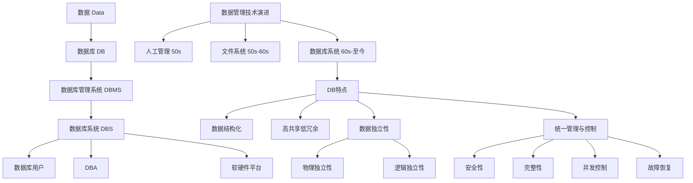

## 一句话总结

数据库系统通过**数据结构化、统一管理控制、高数据独立性**三大核心能力，解决了文件系统时代数据冗余、不一致、缺乏并发控制等根本问题——本质是用一层专门的软件（DBMS）将"数据如何存"和"程序如何用"解耦。

## 知识地图

## 核心概念

### 四大基本概念概览

| 概念 | 英文 | 定义 | 定位 | 类比 |
|------|------|------|------|------|
| 数据 | Data | 具有一定语义含义、可以被记录下来的已知信息 | 信息的载体 | 原材料 |
| 数据库 | Database（DB） | 长期存储在计算机内、有组织的、可共享的大量数据的集合 | 按数据模型组织的数据仓库 | 仓库 |
| 数据库管理系统 | Database Management System（DBMS） | 位于用户（应用程序）与数据库（操作系统）之间的一层数据管理软件，用于科学地组织和存储数据、高效地获取和维护数据 | 数据库系统的核心 | 仓库管理系统 |
| 数据库系统 | Database System（DBS） | 由数据库、DBMS、DBA、系统软硬件平台、应用系统及用户构成的整体 | 完整的运行体系 | 整个仓储公司 |

四者关系：**数据 ⊂ 数据库 ⊂ (数据库 + DBMS) ⊂ 数据库系统**。DBS 是最大的概念，包含了人（DBA、用户）、软件（DBMS、OS、应用）、硬件、数据四大部分。

### 1. 数据（Data）

数据是具有一定语义含义、可以被记录下来的已知信息。数据是信息的载体，信息是数据的内涵。关键洞察：**单纯的符号串不是数据，只有赋予语义解释后才成为可用的信息**。例如 `(李明, 男, 199505, 南京, 计算机系, 2013)`——没有语义定义，这只是一串无意义的符号。

数据的特性正在发生深刻变化：从少量到海量（大数据）、从结构化到无结构、从私有到共享、从程序的附属品变为独立的生产要素。

**数据管理**：对数据进行分类、组织、编码、存储、检索和维护，是数据处理的中心问题。

**数据处理**：对各种数据进行收集、存储、加工和传播的一系列活动的总和。

### 2. 数据库（Database, DB）

数据库是**长期存储在计算机内、有组织的、可共享的大量数据的集合**。关键特征：按数据模型组织（不是随意堆放）、较小的数据冗余、较高的数据独立性、可为各种用户共享。

可以理解为：数据库不只是"存数据的地方"，而是"按一定规则精心理货的仓库"——每种数据有固定位置和格式，不同数据之间建立了联系，任何人拿着"标准操作手册"都能高效存取。

### 3. 数据库管理系统（Database Management System, DBMS）

DBMS 是位于用户（应用程序）与数据库（操作系统）之间的一层**数据管理软件**。它是整个数据库系统的核心，提供六大功能：

| 功能 | 对应语言/机制 |
|------|-------------|
| 数据定义 | 提供数据定义语言(DDL)，定义数据库中的数据对象，定义数据模式 |
| 数据组织、存储和管理 | 分类组织、存储和管理各种数据；确定数据在磁盘上的存放方式；提供多种存取方法（顺序扫描、索引扫描、HASH扫描等） |
| 数据操纵 | 提供数据操纵语言(DML)，实现对数据库中数据的基本操作（查询、插入、删除、修改） |
| 事务管理和运行管理 | 数据库在建立、运行和维护时由DBMS统一管理和控制，保证数据的安全性、完整性、多用户对数据的并发使用（事务管理），发生故障后的系统恢复 |
| 数据库建立和维护 | 数据库的建立、初始数据的加载与转换、转储与恢复、重组、性能监视与分析等 |
| 其他 | 与网络中其他软件系统的通信、DBMS之间的数据转换、异构数据库系统之间的互访与互操作 |

### 3.5 数据子语言（Data Sublanguage）

DBMS 通过数据子语言支持对数据库的各类操作。数据子语言是数据库语言（如 SQL）中承担不同职责的部分：

| 子语言 | 全称 | 功能 | 典型语句 |
|--------|------|------|----------|
| DDL | Data Definition Language（数据定义语言） | 定义数据库中的数据对象，定义数据模式 | CREATE, ALTER, DROP |
| DML | Data Manipulation Language（数据操纵语言） | 对数据库中数据进行基本操作 | SELECT, INSERT, UPDATE, DELETE |
| DCL | Data Control Language（数据控制语言） | 控制用户对数据的访问权限 | GRANT, REVOKE |
| TCL | Transaction Control Language（事务控制语言） | 控制事务的执行过程 | COMMIT, ROLLBACK, SAVEPOINT |

其中：
- **DDL** 和 **DCL** 面向 DBA/数据库设计人员——定义"库里有什么"和"谁能看"。
- **DML** 面向最终用户——日常的"查增删改"。
- **TCL** 保证操作的原子性与一致性——让一连串操作要么全做、要么全不做。

#### DML 的两种使用方式

DML 可以以两种方式使用，这两种方式构成了数据库操作的两类基本模式：

| 方式 | 别称 | 工作模式 | 特点 | 典型场景 |
|------|------|---------|------|---------|
| 交互式命令语言 | 自含型语言、自主型语言 | 用户在终端直接输入 SQL 命令，DBMS 逐条执行并立即返回结果 | 独立于任何高级语言；语法简洁；适合临时查询和交互式操作 | MySQL CLI、Navicat 查询窗口 |
| 宿主型语言 | 嵌入式语言 | SQL 语句嵌入在宿主语言（C/C++、Java、Python 等）代码中，通过预编译或接口调用执行 | 将 SQL 的数据操作能力与高级语言的过程化处理能力结合；适合开发数据库应用系统 | Java 的 PreparedStatement、Python 的 cursor.execute() |

**核心区别**：交互式 SQL 是独立的、完整的——用户输入一条 SQL，DBMS 执行一条。宿主型 SQL 是嵌入式使用的——SQL 只是宿主语言程序中的一部分代码片段，需要通过编译器/解释器和接口（如 ODBC、JDBC）与 DBMS 通信。

**补充：DML 的过程化分类**（另一种正交的分类维度）

| 类型 | 含义 | 要求 | 代表 |
|------|------|------|------|
| 非过程化 DML | 用户只需说明"干什么"，不必说明"怎么干" | 存取路径由 DBMS 自动选择 | SQL（关系数据库） |
| 过程化 DML | 用户既要说明"干什么"，又要说明"怎么干" | 需指定存取路径和操作序列 | 层次/网状模型的 DML |

注意：过程化 vs 非过程化描述的是**语言本身的抽象层级**，交互式 vs 宿主型描述的是**语言的使用方式**——两个正交的维度，不要混为一谈。

> DDL、DML、DCL 等术语常见于各类数据库教材和考试（如 NCRE），要求能识别语句归属。

### 4. 数据库系统（Database System, DBS）

DBS 的完整构成：**数据库 + DBMS + DBA + 系统硬件平台 + 系统软件平台 + 应用系统/开发工具 + 数据库用户**。

> 注：来源为幻灯片，内容偏提纲式。DBS 的体系结构（三级模式等）在 1.3 节详细展开。

### 5. 数据管理技术的演进

三个阶段，围绕一个核心矛盾展开：**数据共享的需求 vs 数据管理的复杂度**。

| 阶段 | 人工管理阶段 | 文件系统阶段 | 数据库系统阶段 |
|------|------------|------------|--------------|
| 时间 | 20世纪50年代中之前 | 20世纪50年代末—60年代中 | 20世纪60年代末—现在 |
| 应用背景 | 科学计算 | 科学计算、数据管理 | 大规模数据管理 |
| 硬件背景 | 无直接存取存储设备 | 磁盘、磁鼓 | 大容量磁盘、磁盘阵列 |
| 软件背景 | 没有操作系统 | 有文件系统 | 有数据库管理系统 |
| 处理方式 | 批处理 | 联机实时处理、批处理 | 联机实时处理、分布处理、批处理 |
| 数据管理者 | 用户（程序员） | 文件系统 | 数据库管理系统 |
| 数据面向对象 | 某一应用程序 | 某一应用程序 | 整个应用系统（现实世界） |
| 数据共享程度 | 无共享，冗余度极大 | 共享性差，冗余度大 | 共享性高，冗余度小 |
| 数据独立性 | 不独立，完全依赖程序 | 独立性差 | 具有高度的物理独立性和逻辑独立性 |
| 数据结构化 | 无结构 | 记录内有结构，整体无结构 | 整体结构化，用数据模型描述 |
| 数据控制能力 | 应用程序自己控制 | 应用程序自己控制 | 由DBMS统一控制（安全性、完整性、并发控制、故障恢复） |

数据库系统的发展又细分为四代：层次/网状 → 关系数据库 → 关系扩展（数据仓库、OLAP） → 新型系统（NoSQL、NewSQL、云原生、AI+DB）。

### 6. 数据库系统的四大特点

#### 特点一：数据结构化

**含义**：数据的整体结构化是数据库的主要特征之一，也是数据库系统与文件系统的**本质区别**。

在文件系统中，记录内部有结构（如 struct），但记录之间没有联系——整体是无结构的。数据库系统实现了**整体数据结构化**，不仅考虑某一应用的数据结构，还要考虑整个组织的数据结构——数据之间具有联系，用数据模型描述。

**具体表现**：
- 数据用数据模型描述，无需应用程序定义——数据结构从应用程序中分离出来
- 不仅描述数据本身，还要描述数据之间的联系
- 数据的结构是**面向整个组织的**，不再面向单个应用程序

**优点**：
- 数据之间建立了关联，可以方便地进行跨业务数据查询（如同时查学生信息和选课信息）
- 减少数据的不一致性——同一个数据只存一处，所有应用共用一份

#### 特点二：数据的共享性高、冗余度低且易扩充

**含义**：数据面向整个系统，可以被多个用户、多个应用共享使用，从而减少数据冗余，避免数据之间的不一致性，并使系统易于扩充。

**具体表现**：
- 数据不再面向某个特定应用，而是面向整体系统
- 多个用户可以同时存取数据库中的数据
- 用户可以通过不同方式（应用程序或直接查询）访问数据库

**优点**：
- **减少冗余**：同一数据只存储一次，节省存储空间
- **避免不一致**：数据只存一处，更新时不会出现"改了A忘了改B"的情况
- **易于扩充**：增加新应用时，可以直接利用数据库中已有的数据，不必重新建立数据文件

#### 特点三：数据独立性高

**含义**：应用程序与数据的物理存储和逻辑结构相互独立，互不依赖。

**分类**：
- **物理独立性**：数据的物理存储（如换硬盘、改存储格式、改索引结构）改变了，应用程序不必修改
- **逻辑独立性**：数据的逻辑结构（如表增加列、修改列类型、拆分表）改变了，应用程序不必修改

**实现机制**：由数据库系统的三级模式及二级映像功能保证（详见 1.3 节）：
- 外模式/模式映像 → 保证逻辑独立性
- 模式/内模式映像 → 保证物理独立性

**优点**：
- 降低了应用程序的开发和维护成本——底层修改不影响上层应用
- 简化了应用程序的编制——程序员只需面对外模式，不用关心底层实现
- 数据的定义和描述从应用程序中分离出去，存取由 DBMS 管理

#### 特点四：数据由 DBMS 统一管理和控制

**含义**：DBMS 对数据库中的数据提供统一的管理和控制，涵盖从数据访问到数据恢复的全过程。

**四个方面**：
- **安全性保护**（Security）：防止不合法用户对数据的访问和破坏——身份认证、权限控制（GRANT/REVOKE）、审计、加密
- **完整性检查**（Integrity）：防止不合法数据进入数据库——实体完整性、参照完整性、用户定义完整性
- **并发控制**（Concurrency Control）：多用户同时操作同一数据时保证操作正确——封锁、事务隔离级别
- **故障恢复**（Recovery）：系统崩溃后将数据恢复到一致状态——事务日志、检查点、数据备份

**优点**：
- 应用程序不用自己实现安全、完整、并发、恢复——由 DBMS 统一保证
- 数据更加安全可靠——专业的管理软件比各应用程序各自控制更可靠
- 简化了应用程序的编写——程序员专注于业务逻辑，不用操心数据管理细节

> 这四大特点是一个整体：数据结构化是**基础**，高共享低冗余是**目标**，数据独立性是**手段**，统一管理与控制是**保障**。

## 难点突破

### 难点 1：数据 vs 信息

**易混淆点：** 很多人把"数据"和"信息"当成同义词。

**突破方法：** 记住香农的定义——"信息是用来消除随机不确定性的东西"。数据是符号串（载体），信息是符号串承载的语义（内涵）。同一个数据 `38`，在"体温"语境下是发烧，在"考试成绩"语境下是不及格——数据没变，信息完全不同。

### 难点 2：数据独立性

**易混淆点：** 物理独立性和逻辑独立性的区别。

**突破方法：**
- 物理独立性 = 数据"搬家"了（换硬盘、换存储格式），程序不用改——这是 DBMS 的存储引擎帮你处理的
- 逻辑独立性 = 表结构"整形"了（加一列、拆一张表），程序不用改——这是 DBMS 的三级模式映像帮你处理的

> 真正理解数据独立性需要学完 1.3 节"三级模式结构"后再回头看，届时豁然开朗。

## 与前章关联

这是课程第一章第一节，无前置依赖。但它为后续所有章节建立了全局坐标：

- 文件系统的问题（冗余、不一致、缺乏并发控制）→ 动机 → 第 2-6 章逐一解决
- DBMS 的统一管控功能 → 框架 → 第 3 章（SQL/事务）、第 4 章（安全性）、第 5 章（完整性）
- 数据独立性的实现机制（三级模式）→ 预告 → 第 1.3 节

## 记忆卡片

**Q1: 数据库系统的四个核心概念是什么？**
A1: 数据（Data）、数据库（DB）、数据库管理系统（DBMS）、数据库系统（DBS）。四者范围依次扩大：数据是原材料，DB 是有组织的数据集合，DBMS 是管理软件，DBS 是整个系统（含人、硬件、软件）。

**Q2: 数据库系统相比文件系统最大的进步是什么？**
A2: 数据的整体结构化——不再为单一应用设计数据结构，而是面向整个组织建立统一的数据模式。加上 DBMS 的统一管控（安全、完整、并发、恢复），实现了高共享低冗余和高数据独立性。

**Q3: 物理独立性和逻辑独立性有什么区别？**
A3: 物理独立性 = 存储方式变了应用程序不变（换硬盘、改索引）；逻辑独立性 = 逻辑结构变了应用程序不变（加列、拆表）。两者靠三级模式二级映像实现。

**Q4: DBMS 的六大功能是什么？**
A4: ①数据定义（DDL）②数据组织/存储/管理 ③数据操纵（DML）④事务管理和运行管理 ⑤数据库建立和维护 ⑥其他（通信、异构互访）。

---

## 📝 考试简答题备战

> 以下问题按考试简答题标准编制，回答尽量使用课件原文表述，标注来源。

## 💬 学习对话补充

### 2026-05-21：DBMS 是"物业管理系统"，DBA 是"物业经理"——软件 vs 人的本质区分

**类型：** 澄清

**背景：** 用户在学习 1.1 节的四大核心概念时，对 DBMS 和 DBA 这两个缩写产生了混淆。两个术语只差一个字母（M vs A），且中文翻译中"数据库管理系统"和"数据库管理员"听起来相似——都是"管数据库的"。用户问"DBMS、DBA是什么意思，解释其区别"，背后的问题是：这两个概念到底是什么关系？能不能互换使用？

**讨论过程：** 核心思路是切一刀——DBMS 是**软件**，DBA 是**人**。类比：DBMS 是"物业管理系统"（一套软件），DBA 是"物业经理"（一个角色）。物业经理用物业管理系统来管理大楼。

展开来说：DBMS（MySQL、PostgreSQL、Oracle 等）位于用户和操作系统之间，提供六大功能——DDL 定义数据、DML 操纵数据、安全控制、完整性检查、并发处理、故障恢复。DBA 是用 DBMS 的人，职责包括决定存什么、怎么存、谁有权访问、性能调优、备份恢复。

关键判断标准：一个数据库系统可以没有专职 DBA（小项目中开发人员兼任），但**不能没有 DBMS**——没有 DBMS 就退回了文件系统时代。

**核心收获：** 从"听起来差不多"到能瞬间区分——DBMS 是工具，DBA 是使用工具的人。这个区分打通了 DBS 的七个组成部分（1.3 节展开）的理解：DBMS 属于软件平台，DBA 属于人员，各就各位。

---

### Q1：简述数据与信息的区别和联系。
**来源**：1.1.1 第7-11页幻灯片

**标准回答**：
- **数据**：是指具有一定的语义含义，并且可以被记录下来的已知信息。数据是信息的载体。（第7页）
- **信息**：是用来消除随机不确定性的东西（Shannon）。信息是数据的内涵。（第8、11页）
- **关系**：数据是信息的载体，信息是数据的内涵。单纯的符号串没有意义，只有被赋予确定含义后，数据才能变成人们可用的信息。（第7、11页）

### Q2：简述数据库管理系统（DBMS）的定义和主要功能。
**来源**：1.1.1 第18-20页幻灯片

**标准回答**：
- **定义**：DBMS 是位于用户（应用程序）与数据库（操作系统）之间的一层数据管理软件，是一种用于管理数据库的大型系统软件。其作用是科学地组织和存储数据、高效地获取和维护数据。（第18页）
- **主要功能**（六大功能）：
  1. **数据定义功能**：提供 DDL，定义数据库中的数据对象（数据模式）。（第19页）
  2. **数据组织、存储和管理**：分类组织、存储和管理各种数据；确定存储方式；提供多种存取方法（顺序扫描、索引扫描、HASH 扫描等）。（第19页）
  3. **数据操纵功能**：提供 DML，实现对数据库中数据的基本操作（查询、插入、删除、修改）。（第19页）
  4. **数据库的事务管理和运行管理**：保证数据的安全性、完整性、多用户对数据的并发使用（事务管理），发生故障后的系统恢复。（第20页）
  5. **数据库的建立和维护功能**：数据库建立、初始数据加载与转换、转储与恢复、重组、性能监视与分析。（第20页）
  6. **其他功能**：与网络中其他软件系统的通信、DBMS 之间的数据转换、异构数据库系统之间的互访/互操作。（第20页）

### Q3：简述数据管理技术发展的三个阶段及各阶段特点。
**来源**：1.1.2 第30-39页幻灯片

**标准回答**：
数据管理技术的发展经历了三个阶段（第30页）：

| 阶段 | 时间 | 数据管理者 | 共享程度 | 数据独立性 | 结构化 |
|------|------|-----------|---------|-----------|--------|
| 人工管理 | 20世纪50年代中之前 | 用户（程序员），数据不保存 | 无共享，冗余度极大 | 不独立，完全依赖于程序 | 无结构 |
| 文件系统 | 20世纪50年代末—60年代中 | 文件系统，数据可长期保存 | 共享性差，冗余度大 | 独立性差 | 记录内有结构，整体无结构 |
| 数据库系统 | 20世纪60年代末—现在 | DBMS | 高共享，低冗余 | 高（物理+逻辑独立） | 整体结构化 |

（参考第33、35、39页）

### Q4：简述数据库系统的四大特点。
**来源**：1.1.3 第51-55页幻灯片

**标准回答**（第51页）：
1. **数据结构化**：数据的整体结构化是数据库的主要特征之一，也是数据库系统与文件系统的本质区别。不仅数据内部结构化，整体是结构化的，数据之间具有联系。数据用数据模型描述，无需应用程序定义。（第52页）
2. **数据的共享性高，冗余度低，且易扩充**：数据面向整个系统，可以被多个用户、多个应用共享使用。减少数据冗余，避免数据之间的不一致性，使系统易于扩充。（第53页）
3. **数据独立性高**：包括物理独立性（数据的物理存储改变，应用程序不变）和逻辑独立性（数据的逻辑结构改变，应用程序不变）。由三级模式及二级映像功能保证。（第54页）
4. **数据由 DBMS 统一管理和控制**：提供安全性保护、完整性检查、并发控制、数据库恢复四方面数据控制功能。（第55页）

---

## 💬 学习对话补充

### 2026-05-21：DML 的两种分类维度——"过程化 vs 非过程化"与"交互式 vs 宿主型"是正交关系

**类型：** 澄清

**背景：** 此前笔记对 DML 的分类只有一句"操作对象和结果都是集合、非过程化"的简单描述。用户在学习 DBMS 的数据操纵功能时，接触到"交互式命令语言"和"宿主型语言"两个术语，同时也在数据模型部分见过"过程化 DML"和"非过程化 DML"的分类。如果不在一个框架中同时解释这两组概念，就会产生困惑——交互式 SQL 就是非过程化的吗？宿主型 SQL 就是过程化的吗？这两组分类是不是一回事？

**讨论过程：** 关键在于识别这两组分类是**两个正交的维度**，回答的是两个不同的问题。

第一个维度——"过程化 vs 非过程化"，描述的是**语言本身的抽象层级**：用户在使用时必须自己指定存取路径和操作序列（过程化），还是只需说明"干什么"让 DBMS 自动选择执行路径（非过程化）。关系模型的 DML（如 SQL）是非过程化的，层次/网状模型的 DML 是过程化的。这与语言怎么被使用无关。

第二个维度——"交互式 vs 宿主型"，描述的是**语言的使用方式**：用户是直接在终端逐条输入命令（交互式/自含型），还是把 SQL 语句嵌入宿主语言（C、Java、Python 等）的代码中，通过 ODBC/JDBC 等接口调用（宿主型/嵌入式）。这与语言本身的抽象层级无关——同一条 SQL 语句，可以在 CLI 中交互式执行，也可以嵌入 Java 代码中作为宿主型执行。

消除混淆的方法很简单：画一个 2×2 的矩阵——SQL 作为非过程化语言，既可以交互式使用（MySQL CLI），也可以宿主型使用（Java 的 PreparedStatement）。四个象限都可能存在，两者互不决定。

**核心收获：** 从"分不清两组术语的关系"到能立刻画出正交矩阵——"过程化 vs 非过程化"问的是"语言要多细节"，"交互式 vs 宿主型"问的是"语言怎么调用"。判断标准：前者看语法本身是否需要指定存取路径，后者看 SQL 是独立运行还是嵌入其他代码中。

**延伸思考：** 正交分类思维在数据库课程中反复出现（又如 1.2 节的"概念模型→逻辑模型→物理模型"和 1.3 节的"外模式→模式→内模式"也是两组不同视角的层次划分），能自觉识别"这不是同一维度"是建立清晰概念框架的关键能力。
