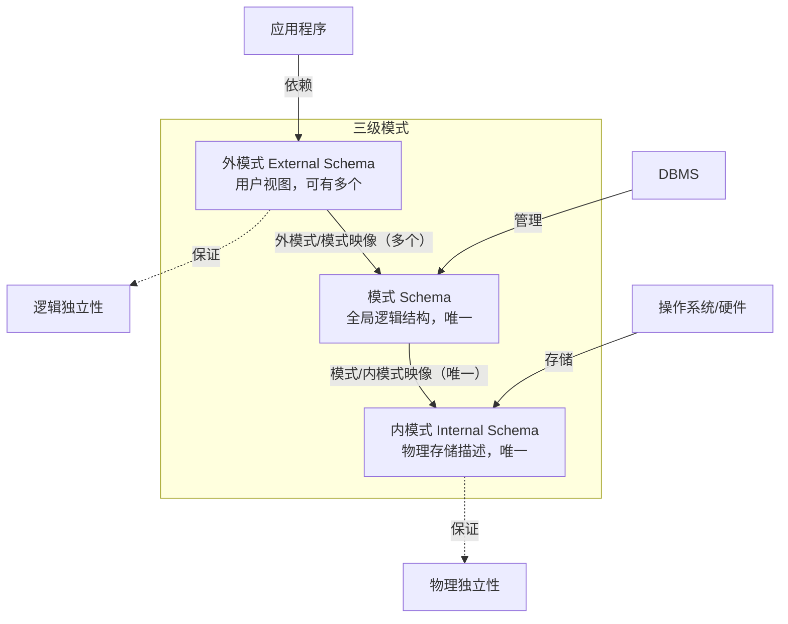

## 一句话总结

数据库系统的**三级模式（外模式→模式→内模式）+ 二级映像**是实现**数据独立性**的核心机制——应用程序只依赖外模式，底层变化通过修改映像而非修改程序来吸收，从而将数据与程序解耦。

## 知识地图

## 核心概念

### 1. 模式（Schema）vs 实例（Instance）

这是理解三级模式的前提：

- **模式（Schema）**：数据库逻辑结构和特征的**描述**，是"型"的层面，相对稳定。例如：学生记录的型 =（学号, 姓名, 性别, 系别, 年龄, 籍贯）
- **实例（Instance）**：模式在**某一时刻**的具体值，随数据更新而变动。例如：`(201315130, 李明, 男, 计算机系, 19, 南京)` 是学生记录型的一个具体值

类比：模式 = 表格的表头设计（不变），实例 = 表格中填入的所有数据行（不断变化）。

### 2. 三级模式结构

数据库系统内部采用三级模式结构，是数据库系统的核心架构：

**模式（逻辑模式）**——中间层

- 数据库中**全体数据**的逻辑结构和特征的描述
- 所有用户的公共数据视图
- **一个数据库只有一个模式**
- 不涉及物理存储细节，也不涉及具体应用程序
- 定义内容：数据项的名字/类型/范围、数据之间的联系、安全性/完整性要求

**外模式（子模式/用户模式）**——最外层

- 对**特定用户**可见的局部数据的描述
- 模式与外模式的关系：**一对多**（一个模式可有多个外模式）
- 外模式通常是模式的子集，但同一数据在不同外模式中的结构、类型、保密级别可以不同
- 外模式与应用的关系：**一对多**（一个外模式供多个应用使用），但一个应用程序**只能使用一个外模式**
- 核心作用：**数据库安全性的有力措施**——每个用户只能看到对应外模式中的数据

**内模式（存储模式/物理模式）**——最内层

- 数据**物理结构和存储方式**的描述
- 描述内容：记录存储方式（顺序/堆/hash）、索引组织、是否压缩/加密、存储记录结构
- **一个数据库只有一个内模式**

### 3. 二级映像——数据独立性的实现机制

三级模式是三个抽象级别，二级映像在 DBMS 内部实现这三个层次之间的**联系和转换**：

**外模式/模式映像（可有多个）→ 保证逻辑独立性**
- 定义每个外模式与模式之间的对应关系
- 当**模式改变**（如加一列、改表结构）时，DBA 修改该映像，使**外模式保持不变**
- 应用程序依据外模式编写 → 应用程序不必修改 → **逻辑独立性**

**模式/内模式映像（唯一）→ 保证物理独立性**
- 定义全局逻辑结构与物理存储结构之间的对应关系
- 当**存储结构改变**（如换索引结构、换存储方式）时，DBA 修改该映像，使**模式保持不变**
- 模式不变 → 外模式不变 → 应用程序不受影响 → **物理独立性**

**二级映像的根本价值**：从底层保证了应用程序的稳定性。数据的定义和描述从应用程序中分离出去，存取由 DBMS 管理——这就是"数据独立性"的具体实现。

### 4. 数据库系统的外部架构（从用户角度）

| 架构类型 | 特点 |
|----------|------|
| 单用户结构 | 数据库运行在单台计算机上 |
| 主从式结构 | 一主机多终端 |
| 分布式结构 | 数据分布在多台计算机上 |
| 两层 C/S | 数据库服务器 + 客户机（应用程序），局域网连接 |
| 三层 B/S | 数据库服务器 + 应用服务器 + 浏览器，互联网连接 |

**两层 C/S vs 三层 B/S**：三层架构将应用逻辑从客户端剥离到应用服务器（Web 服务器），客户端只需浏览器，解决了跨互联网访问和客户端维护的问题。

### 5. 数据库系统的组成

**硬件**：足够大的内存、磁盘或磁盘阵列、高通道能力

**软件**：DBMS + 操作系统 + 高级语言编译系统 + 应用开发工具 + 数据库应用系统

**人员**（PPT 划分为三类）：

| 用户类别 | 包含角色 | 职责 |
|----------|---------|------|
| **数据库管理员**（DBA） | DBA、系统分析员、数据库设计人员 | ①决定数据库中的信息内容和结构 ②决定数据库的存储结构和存取策略 ③定义数据的安全性要求和完整性约束条件 ④监控数据库的使用和运行（周期性转储数据文件 & 日志文件；系统故障恢复；介质故障恢复；监视审计文件） ⑤数据库的改进和重组重构（性能监控和调优；定期重组以提高性能；需求改变时进行重构造） |
| **应用开发人员** | 应用程序员 | 使用宿主语言（C/C++、Java、Python 等）和 DML 编写应用系统程序模块，供最终用户使用 |
| **最终用户** | 偶然用户（管理者） 简单用户（职员） 复杂用户（工程师/科学家） | 通过应用系统或直接使用数据库语言访问数据库。偶然用户不常访问但每次需求不同；简单用户通过固化程序操作；复杂用户直接使用 SQL 并可能自建应用 |

## 难点突破

### 难点 1：三级模式二级映像——为什么这么设计？

**易混淆点**：学生觉得多此一举——直接把数据存进去、应用程序读出来不就行了吗？

**突破方法**：核心矛盾是**底层存储经常变 ↔ 应用程序应该稳定**。

没有三级模式时：换了硬盘 → 所有应用程序改代码，这是灾难。

有了三级模式：换硬盘（内模式变）→ 只改"模式/内模式映像"→ 模式和所有外模式不变 → 所有应用程序不变。这就是物理独立性的本质。

逻辑独立性同理：加一列（模式变）→ 只改受影响的"外模式/模式映像"→ 外模式不变 → 使用该外模式的应用程序不变。

**三级模式本质上是两层"缓冲垫"**——底层变化通过修改映像来吸收，不传递到上层。

### 难点 2：外模式 vs 模式——"子集"但不是"裁剪"

**易混淆点**：外模式就是模式的一个子集（某些列某些行），如 SQL 中的视图？

**突破方法**：外模式不只是"列的子集"，同一数据在外模式中可以有**不同的结构、类型、长度、保密级别**。例如：

- 模式中"身份证号"是 18 位字符串
- 外模式 A 中只显示后 4 位（脱敏）
- 外模式 B 中该字段被隐藏（不可见）

这不是简单的"裁剪"——外模式可以**变换**模式中数据的呈现方式。

## 与前章关联

本节是第 1 章的收尾，将 1.1 的概念和 1.2 的方法论"装配"成一个完整的系统结构：

- 1.1 提到的"数据独立性"→ 本节揭示实现机制（三级模式+二级映像）
- 1.2 的数据模型三层抽象（概念→逻辑→物理）→ 与三级模式（外→模式→内）互为补充，内外视角
- 本节为后续所有章节提供了架构坐标：第 3 章 SQL 操作的是"模式"中的数据，第 4/5 章安全性/完整性在"外模式"和"模式"层面施加

## 记忆卡片

**Q1: 三级模式分别是什么？各有多少个？**
A1: 外模式（External Schema）——用户视图，可有多个；模式（Schema）——全局逻辑结构，唯一；内模式（Internal Schema）——物理存储描述，唯一。

**Q2: 二级映像分别保证什么独立性？**
A2: 外模式/模式映像（可有多个）→ 模式改变时修改映像，外模式不变 → 保证**逻辑独立性**。模式/内模式映像（唯一）→ 存储结构改变时修改映像，模式不变 → 保证**物理独立性**。

**Q3: 两层 C/S 和三层 B/S 架构的核心区别？**
A3: 两层 C/S：应用逻辑在客户机，数据库在服务器，通过局域网连接；三层 B/S：应用逻辑在应用服务器（Web 服务器），数据库在数据库服务器，客户端只需浏览器，通过互联网连接。

**Q4: 模式与实例的区别？**
A4: 模式是"型"（表头设计，相对稳定），实例是"值"（某一时刻的具体数据行，随更新变动）。同一个模式可以有无数个实例。

---

## 📝 考试简答题备战

## 💬 学习对话补充

### 2026-05-21：二级映像不是"接口"而是"缓冲垫"——从"翻译官"到"减震器"的认知跃迁

**类型：** 深化

**背景：** 用户在学习 1.3 节三级模式结构后，试图用自己的话概括二级映像的本质。用户给出的理解是："DBMS 作为应用和操作系统层之间的系统，为上下层提供接口，对上提供外模式以便于调用，对下配合操作系统。"这个理解的**方向**是对的（DBMS 确实坐在中间），但有一个关键偏差——把二级映像当成"接口"来理解。

**讨论过程：** 接口思维的核心动作是"连接"——上层调用我，我翻译给下层。但二级映像的核心价值不是连接，而是**隔离**。

关键在于"缓冲垫"这个类比。在 1.3 的难点突破中已经提到了三级模式本质上是两层"缓冲垫"，但这里需要更精确地区分两种思维模型：

- **接口 = 翻译官**：中国人说中文，翻译官翻译成英语给美国人。翻译官每次都要工作，两侧的语言都可以不同。
- **二级映像 = 缓冲垫**：你在 10 楼办公，楼下电梯换了新品牌。物业只换了电梯（内模式变），你的办公室门牌号不变（外模式不变），你甚至不知道电梯换了。这就是物理独立性的本质。

映射回数据库：换硬盘/改索引（内模式变）→ 只改模式/内模式映像 → 模式不变 → 外模式不变 → 所有应用程序不变。表加了一列（模式变）→ 只改受影响的外模式/模式映像 → 外模式不变 → 应用程序不变。

**核心收获：** 从"接口思维"跃迁到"缓冲垫思维"。接口描述的是 DBMS 的**位置**（在应用和 OS 之间），缓冲垫描述的是二级映像的**设计意图**（下层变动不传导到上层）。前者关注"怎么通"，后者关注"怎么隔"——这才是三级模式+二级映像架构的真正精髓。数据独立性不是靠"好的接口设计"实现的，而是靠"有缓冲层吸收变化"实现的。

**延伸思考：** 这个"缓冲垫"思维在计算机系统中广泛存在——操作系统的虚拟内存（物理页变了，虚拟地址不变）、网络的 TCP/IP 分层（底层换了 WiFi 换 4G，上层 socket 不变）。数据库的三级模式二级映像本质上是同一种分层隔离思想的应用。

---

### Q1：简述数据库系统的三级模式结构。
**来源**：1.3 第7-10页幻灯片

**标准回答**：
数据库系统通常采用三级模式结构（第3页），从内到外为：

1. **内模式**（存储模式/物理模式）：是数据物理结构和存储方式的描述，是数据在数据库内部的表示方式。描述记录的存储方式（顺序存储、堆存储、hash 存储等）、索引组织方式、数据是否压缩/加密等。**一个数据库只有一个内模式**。（第10页）

2. **模式**（逻辑模式）：数据库中全体数据的逻辑结构和特征的描述，是所有用户的公共数据视图。与数据的物理存储细节和硬件环境无关，与具体的应用程序及开发工具无关。定义数据的逻辑结构、数据之间的联系、安全性/完整性要求。**一个数据库只有一个模式**。（第7页）

3. **外模式**（子模式/用户模式）：对数据库用户使用的局部数据的逻辑结构和特征的描述，是与某一应用有关的数据的逻辑表示。模式与外模式的关系为**一对多**（一个模式可有多个外模式）；外模式与应用的关系为**一对多**（同一外模式可为多个应用系统使用）。外模式是保证数据库安全性的有力措施——每个用户只能看见和访问所对应的外模式中的数据。（第8-9页）

### Q2：简述二级映像及其与数据独立性的关系。
**来源**：1.3 第11-13页幻灯片

**标准回答**（第11页）：
三级模式是对数据的三个抽象级别，二级映像在 DBMS 内部实现这三个抽象层次的联系和转换。

1. **外模式/模式映像**（可有多个）→ 保证**逻辑独立性**：
   - 定义外模式与模式之间的对应关系，映像定义包含在各自外模式的描述中。（第12页）
   - 当模式改变时，DBA 对外模式/模式映像作相应改变，使外模式保持不变。
   - 应用程序是依据数据的外模式编写的，应用程序不必修改 → 保证了数据与程序的逻辑独立性。（第12页）

2. **模式/内模式映像**（唯一）→ 保证**物理独立性**：
   - 定义数据全局逻辑结构与存储结构之间的对应关系，映像定义包含在模式描述中。（第13页）
   - 当数据库的存储结构改变时，DBA 修改模式/内模式映像，使模式保持不变。
   - 应用程序不受影响 → 保证了数据与程序的物理独立性。（第13页）

**二级映像的根本价值**：从底层保证了应用程序的稳定性，使得数据的定义和描述可以从应用程序中分离出去，简化了应用程序的编制，大大减少了应用程序的维护和修改。（第16页）

### Q3：简述模式（Schema）与实例（Instance）的区别。
**来源**：1.3 第4页幻灯片

**标准回答**：
- **模式（Schema）**：数据库逻辑结构和特征的描述，是"型"的描述，不涉及具体"值"，反映的是数据的结构及其联系。模式是相对稳定的。（第4页）
- **实例（Instance）**：反映数据库某一时刻的状态，是模式的一个具体值。同一个模式可以有很多实例。实例随数据库中的数据的更新而变动。（第4页）

### Q4：简述两层 C/S 架构与三层 B/S 架构的区别。
**来源**：1.3 第20-22页幻灯片

**标准回答**：
- **两层 C/S 架构**：数据库和 DBMS 运行在数据库服务器中，数据库应用程序运行在客户机中，两者之间通过**局域网**实现数据访问。（第20页）
- **三层 B/S 架构**：数据库和 DBMS 运行在数据库服务器中，数据库应用程序运行在应用服务器（也称"Web 服务器"）中，用户客户端只需安装常用的浏览器，负责接收用户输入和结果展示。三者通过**互联网**相连。（第22页）
- **核心区别**：三层架构将应用逻辑从客户端剥离到应用服务器，解决了跨互联网访问和客户端维护的问题。

### Q5：简述数据库管理员（DBA）的主要职责。
**来源**：1.4 第26页幻灯片

**标准回答**（第26页）：
1. 决定数据库中的信息内容和结构
2. 决定数据库的存储结构和存取策略
3. 定义数据的安全性要求和完整性约束条件
4. 监控数据库的使用和运行（周期性转储数据文件 & 日志文件；系统故障恢复；介质故障恢复；监视审计文件）
5. 数据库的改进和重组（性能监控和调优；定期重组以提高性能；需求改变时进行重构造）
