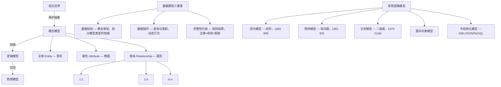

## 一句话总结

数据模型是数据库的核心——用**数据结构 + 数据操作 + 完整性约束**三要素，经**概念→逻辑→物理**三层抽象，将现实世界逐步映射到机器世界。

## 知识地图

## 核心概念

### 1. 数据模型的定义与要求

**数据模型**是对现实世界数据特征的抽象，用以抽象、表示和处理现实世界中的数据和信息——描述数据、组织数据、操作/访问数据。数据模型是数据库系统的**核心和基础**。

一个好的数据模型应满足三方面要求：
1. **能比较真实地模拟现实世界**
2. **容易为人所理解**
3. **便于在计算机上实现**

### 2. 数据模型的三层抽象

将现实世界的数据映射到计算机存储，需要**两步抽象**：

| 层次 | 别称 | 视角 | 用途 | 与DBMS关系 |
|------|------|------|------|-----------|
| 概念模型 | 信息模型 | 用户视角 | 数据库设计 | 无关 |
| 逻辑模型 | 数据模型 | 计算机视角 | DBMS实现 | 直接相关 |
| 物理模型 | — | 底层视角 | 存储实现 | 直接相关 |

**概念模型**是现实世界到机器世界的中间层次，是数据库设计人员和用户之间交流的语言。其核心特点：**与 DBMS 及计算机实现无关**。

> 类比：概念模型 = 建筑效果图（客户和建筑师交流），逻辑模型 = 施工图（施工队照着盖），物理模型 = 钢筋水泥怎么排。

### 3. 概念模型的核心概念

- **实体（Entity）**：客观存在并可相互区别的事物。矩形表示。
- **属性（Attribute）**：实体的某一特性。椭圆表示。
- **实体型 vs 实体值**：实体型 = 实体名 + 属性名集合（模板）；实体值 = 所有属性值的集合（实例）。类比：类 vs 对象。
- **实体集**：同一类型实体的集合。
- **码（Key）**：唯一标识实体的属性集。
- **联系（Relationship）**：实体内部或实体之间的关联。菱形表示。

### 4. 联系的函数关系

| 类型 | 定义 | 例子 |
|------|------|------|
| 1:1 | 实体 a 最多对应唯一的 b，反之亦然 | 居民 ↔ 身份证 |
| 1:n | 一个 a 对应多个 b，每个 b 最多对应一个 a | 宿舍 → 学生 |
| m:n | 一个 a 对应多个 b，一个 b 对应多个 a | 学生 ↔ 课程（选修） |

**关键细节**：函数关系描述的是上限，不是强制参与。此外，在 m:n 联系中也允许部分实体之间实际是 1:n 或 1:1——m:n 是最大范围约束。

**实体内部的联系**：除了不同实体集之间的联系，同一个实体集中不同实体之间也可以有联系（如"职工"实体集中，经理管理普通员工——1:n 的联系）。实体内部联系同样有 1:1、1:n、m:n 三种类型。

### 5. 数据模型的三大组成要素

**数据结构（静态骨架）**：描述数据库的组成对象及对象之间的联系。数据结构被称为**数据模式（Data Schema）**，是划分不同数据模型类型的依据。

**数据操作（动态行为）**：对数据库中各类对象实例允许执行的操作集合——查询和更新（插入、删除、修改）。关系模型中，操作对象和结果都是**集合**。

**完整性约束（规则保障）**：保证数据正确、有效、相容的一组规则。包括通用约束（实体完整性、参照完整性）和应用特定约束。

### 6. 逻辑模型的基本问题与常用类型

**逻辑模型的核心问题**：如何在机器世界中表达"低层"数据结构和"高层"数据结构？有三种策略：

1. **方案一（中立表达）**：尽量独立于应用层，采用通用数据结构表达概念模型——关系模型走这条路。
2. **方案二（特定优化）**：在应用层使用特定数据结构，逻辑模型高效支持这一结构——层次/网状模型走这条路。
3. **方案\*（混合路线）**：通用数据结构全面覆盖，关键性数据结构特殊优化——现代数据库的实际选择。

| 模型 | 数据结构 | 时代 | 地位 |
|------|---------|------|------|
| 层次模型 | 树形结构 | 1965（IMS） | 第一代 |
| 网状模型 | 有向图 | 1961（IDS, Bachman） | 第一代 |
| 关系模型 | 二维表 | 1970（Codd） | 第二代，当前主流 |
| 面向对象模型 | 对象 | 1980s+ | 扩展关系模型 |
| 半结构化模型 | XML/JSON/图 | 2000s+ | NoSQL 基础 |

### 7. 关系模型的特点

**数据结构**：单一的二维表。实体和实体间的联系都用关系（表）表示。

**基本概念对应**：

| 关系术语 | 通俗说法 | 说明 |
|---------|---------|------|
| 关系 (Relation) | 表 | 符合特定约束的二维表 |
| 元组 (Tuple) | 行 | 表中的一行 |
| 属性 (Attribute) | 列 | 表中的一列 |
| 码 (Key) | 键 | 唯一标识一个元组的属性组 |
| 域 (Domain) | 取值范围 | 属性取值的集合 |
| 分量 | 格子值 | 元组中的一个属性值 |
| 关系模式 | 表头定义 | 关系名(属性1, 属性2, ..., 属性n) |

例：学生(*学号*, 姓名, 年龄, 性别, 系名, 年级) —— 下划线标注的学号是码。

**规范化要求**：每个分量必须是不可再分的数据项——不允许"表中套表"，即第一范式（1NF）。

**操作特点**：集合操作、非过程化——只需说"干什么"，不必说"怎么干"。存取路径对用户透明。

**优缺点**：数学基础严格（关系代数）、概念单一、数据独立性高；但查询优化难度大，效率可能不如格式化模型。

## 难点突破

### 补充：E-R 图画法指南

**三大基本符号：**

| 概念 | 符号 | 含义 |
|------|------|------|
| 实体 (Entity) | 矩形 `┌──┐` | 客观存在、可相互区别的事物 |
| 属性 (Attribute) | 椭圆 `┌──┐` | 实体的某一特性 |
| 联系 (Relationship) | 菱形 `◇` | 实体内部或实体之间的关联 |

三者用无向边连接。联系本身也可以有属性（如"选修"联系上的"成绩"）。

**画图原则：**

1. **实体 vs 属性的判断**：有唯一标识（码）→ 实体；没有独立存在意义 → 属性。"手机号码"可以独立存在 → 实体；"姓名"离开学生就无意义 → 属性。
2. **属性不可再分（1NF）**："地址"包含省市区 → 拆成省、市、区三个属性，不能一个椭圆包三个值。
3. **连线标注函数关系**：先确定两个实体之间"最大"是几对几（1/n/m），再细化。
4. **联系也可以有属性**：成绩不属于学生也不属于课程，属于"某学生选某课程"这件事。
5. **E-R 图是交流工具，不是实现文档**：画给用户和设计人员看，不要过早纠结建表细节——那是逻辑模型的事。

6. **同一组实体型之间可以建立多个不同的联系**：比如"班级"和"学生"之间，既有"班长管理"（1:1 联系），也有"班级包含学生"（1:n 联系）。两个联系各画各的菱形，各自标注函数关系。

---

### 难点 1：概念模型 vs 逻辑模型 — 分界线在哪？

记忆口诀：**概念模型给人看，逻辑模型给 DBMS 看。**

- 概念模型用 E-R 图（实体方框、属性椭圆、联系菱形），不关心具体 DBMS
- 逻辑模型用表结构（CREATE TABLE），必须符合具体 DBMS 的语法规则

### 难点 2：联系的函数关系 — 为什么"允许不参与"

函数关系是**上限约束**，不是**强制参与**。1:1 联系意味着"如果有对应，最多一个"，不是"一定有对应"。

## 与前章关联

- 1.1 节的"数据按数据模型组织" → 本节具体解释数据模型是什么
- 概念模型中的 E-R 方法 → 第 7 章数据库设计的核心工具
- 关系模型 → 第 2 章整章深入展开（关系代数、关系演算）
- 完整性约束 → 第 5 章主题
- 三层抽象思维 → 为 1.3 节三级模式结构提供方法论铺垫

## 记忆卡片

**Q1: 数据模型的三层抽象是什么？两步抽象指什么？**
A: 概念模型（用户视角，设计用）→ 逻辑模型（计算机视角，DBMS 实现）→ 物理模型（存储底层）。两步抽象：现实世界 → 概念模型 → 逻辑模型+物理模型。

**Q2: 数据模型的三大组成要素？**
A: 数据结构（静态特性，描述对象及联系，划分模型类型的依据）、数据操作（动态特性，查询+更新）、完整性约束（保证数据正确有效相容）。

**Q3: E-R 模型三个基本概念及图示符号？**
A: 实体（矩形）、属性（椭圆）、联系（菱形）。三者构成 E-R 图。

**Q4: 关系模型相比层次/网状模型的核心优势？**
A: ①严格的数学基础（集合代数）②概念单一（实体和联系都用表表示）③非过程化操作（只需说干什么）④存取路径对用户透明，数据独立性更高。代价：查询优化难度大。

---

## 期末简答题 Q&A

**Q1: 简述数据模型的三层抽象及两步抽象的含义。**

A:
- **概念模型（信息模型）**：按用户观点建模，用于数据库设计。是现实世界到机器世界的中间层次，与 DBMS 无关。是设计人员和用户交流的语言。
- **逻辑模型**：按计算机观点建模，用于 DBMS 实现。包括层次、网状、关系、面向对象、半结构化等。
- **物理模型**：最底层抽象，描述数据在系统内部的表示和存取方式。

**两步抽象**：现实世界 → 概念模型（第一步）→ 逻辑模型（第二步）。概念模型是对现实世界的第一层抽象，逻辑模型是对概念模型的第二层抽象（转换为具体 DBMS 支持的形式）。

---

**Q2: 简述数据模型的三大组成要素及其含义。**

A:
1. **数据结构**：描述数据库的组成对象以及对象之间的联系。是对系统**静态特性**的描述。数据结构是划分不同数据模型类型的依据。
2. **数据操作**：对数据库中各类对象实例允许执行的操作集合，包括查询和更新（插入、删除、修改）。是对系统**动态特性**的描述。关系模型中操作对象和结果都是集合。
3. **完整性约束**：一组完整性规则，限定数据库状态及状态变化，保证数据**正确、有效、相容**。包括实体完整性、参照完整性、用户定义完整性。

---

**Q3: 解释概念模型中的实体、属性、码、实体型、实体值。**

A:
- **实体**：客观存在并可相互区别的事物（具体的人事物或抽象概念）。
- **属性**：实体具有的某一特性。同类实体有相同属性组成，取值可不同。
- **码（Key）**：唯一标识实体的属性集，通过码的取值区分不同实体。
- **实体型**：实体名 + 属性名集合（抽象模板），如"学生（学号，姓名，年龄）"。
- **实体值**：一个实体所有属性值的集合（具体实例），如"(2024001, 张三, 20)"。

> 实体型 : 实体值 = 类 : 对象。同一实体集中所有实体具有相同实体型，但实体值互不相同。

---

**Q4: 实体之间的联系有哪三种类型？"允许不参与"是什么意思？**

A:
| 类型 | 定义 | 例子 |
|------|------|------|
| 1:1 | 双方最多对应唯一的对方 | 居民 ↔ 身份证 |
| 1:n | A 可对应多个 B，B 最多对应一个 A | 宿舍 → 学生 |
| m:n | 双方可对应多个对方 | 学生 ↔ 课程 |

**"允许不参与"**：不管是哪种函数关系，允许某些实体不参与该联系。函数关系描述的是"如果有联系，最多什么类型"，不是"每个实体都必须有联系"。例如"居民 ↔ 驾驶证"是 1:1，但有些居民没有驾驶证。

---

**Q5: 简述关系模型的主要特点（数据结构、操作、完整性、优缺点）。**

A:
**数据结构**：单一的二维表结构。实体和联系都用关系（表）表示。关系必须是规范化的——每个分量不可再分，不允许表中套表（1NF）。

**数据操作**：集合操作，操作对象和结果都是关系。**非过程化**：用户只需说"干什么"，存取路径对用户透明。

**完整性约束**：实体完整性、参照完整性、用户定义完整性。

**优点**：严格数学基础（关系代数）；概念单一；数据独立性高，安全保密性好。

**缺点**：查询效率不如格式化模型；需查询优化，增加 DBMS 开发难度。
