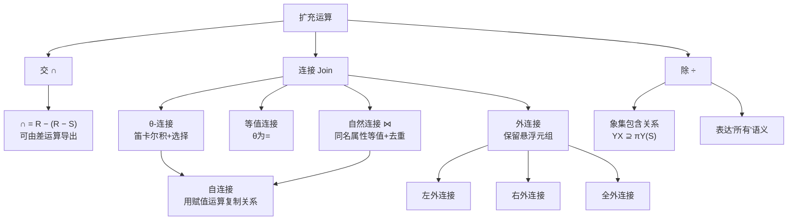

## 一句话总结

在五种基本运算之上，关系代数引入**交、连接（θ-连接/等值连接/自然连接/外连接）、除**等扩充运算——其中最核心的是自然连接（自动匹配同名属性的等值连接并去重）和除运算（用象集包含关系表达"所有"语义）。

## 知识地图

## 核心概念

### 1. 交运算（Intersection）R ∩ S

- 前提：同类关系
- 结果：由既属于 R 又属于 S 的元组组成
- 满足交换律和结合律
- **可由差运算导出**：R ∩ S = R − (R − S) = S − (S − R)

### 2. θ-连接（Theta-Join）

**功能**：从 R × S 的笛卡尔积中选取满足连接条件 F 的元组。

核心公式： )

连接条件 F 的基本形式：A θ B，其中 A 和 B 是属性或常量（不能都是常量），θ ∈ {>, ≥, <, ≤, =, ≠}。可由多个基本条件经 ∧, ∨ 组合。

结果关系模式：R 和 S 的所有属性（同名属性需重命名）。

### 3. 等值连接（Equijoin）

θ-连接的特例：θ 全部使用"="。从 R × S 中选取 A = B 的元组。

### 4. 自然连接（Natural Join）R ⋈ S——最核心

**特殊性**：自动在所有同名属性上做等值连接，且同名属性只保留一份。

结果关系模式：(R的属性) ∪ (S的属性)，同名属性去重。

推导公式：
R ⋈ S = π(...)(σ(R.B₁=S.B₁ ∧ R.B₂=S.B₂ ∧ ... ∧ R.Bₖ=S.Bₖ)(R × S))

**自然连接是实际查询中最常用的连接方式**——SQL 中的 `NATURAL JOIN` 和常见的 `JOIN ... ON` 很多场景等价于自然连接。

### 5. 自连接（Self-Join）

自连接不是独立运算符，而是**同一关系与自身做连接的技术**。核心步骤：
1. 用赋值运算 S := R 创建中间关系（关系名不同，模式可能相同）
2. 在 R 和 S 之间做 θ-连接或自然连接
3. 常用场景：比较同一关系内不同元组的属性值（如"查询年龄不是最大的学生"）

### 6. 外连接（Outer Join）

自然连接会丢失**悬浮元组**（Dangling tuple）——在对方关系中找不到公共属性匹配的元组。外连接保留这些悬浮元组，缺失属性填 NULL：

| 类型 | 保留的悬浮元组 |
|------|-------------|
| 左外连接 (LEFT JOIN) | 保留 R 中的悬浮元组 |
| 右外连接 (RIGHT JOIN) | 保留 S 中的悬浮元组 |
| 全外连接 (OUTER JOIN) | 保留两边的悬浮元组 |

### 7. 除运算（Division）R ÷ S——最抽象但最强大

给定 R(X, Y) 和 S(Y, Z)，除运算 R ÷ S = { t[X] | t ∈ R ∧ πY(S) ⊆ Yₓ }（Yₓ 是 x 在 R 中的象集）。

**通俗理解**：R ÷ S 找出 R 中那些"与 S 中所有 Y 值都有关联"的 X 值。

**除运算表达的是"所有/全部"语义**。例如：
- 查询"选修了所有课程的学生的学号"→ 用 SC ÷ πCno(Course)
- 查询"至少使用了所有在 Dallas 生产的商品的顾客"→ 类似结构

除运算可用基本运算推导（用到差、投影、笛卡尔积），但直接使用 ÷ 语义更清晰。

## 难点突破

### 难点 1：自然连接 vs 等值连接——去重是唯一区别吗？

**易混淆点**：自然连接就是"所有同名属性上的等值连接"吗？

**突破方法**：不完全是。自然连接有两个特征：①自动在所有**同名属性**上做等值连接（不用手工指定条件）②结果中去掉重复的同名属性列。

等值连接需要手工指定条件（可以是不同名属性），且保留双方的属性。例如 R(A,B,C) 和 S(B,C,D)，自然连接结果模式为 (A,B,C,D)，等值连接 R.B=S.B ∧ R.C=S.C 结果为 (A,R.B,R.C,S.B,S.C,D)。

### 难点 2：除运算——什么时候用？

**易混淆点**：什么时候该用除运算，什么时候能用自然连接替代？

**突破方法**：关键词是**"所有"**。当查询要求找出"对某集合中**全部**元素都有某种关联"的对象时，用除运算。

例如"查询选修了**所有**课程的学生的学号"：
- SC ÷ πCno(Course) ✓（正确）
- 用自然连接无法直接表达"所有"的语义

除运算 = 对所有关系的"反方向校验"：X 的象集必须**包含**S 的投影。如果只是"选过某些课"，用选择和连接就够了。

## 与前章关联

- 五种基本运算（∪, −, ×, σ, π）→ 本节所有扩充运算都可还原为基本运算
- 象集概念（2.2节）→ 除运算的核心机制
- 相容表/同类关系 → 交运算的前提条件
- "同名同义"命名约定 → 自然连接自动匹配同名属性的基础
- 赋值运算（2.2节）→ 自连接的重要辅助工具

## 记忆卡片

**Q1: 自然连接与等值连接的核心区别？**
A1: 自然连接自动在所有同名属性上做等值连接，且结果中去掉重复的同名属性列；等值连接需手工指定条件，保留双方所有属性。

**Q2: 四种连接的关系？（从窄到宽）**
A2: 等值连接 ⊆ θ-连接（θ固定为=）→ 自然连接 ⊆ 等值连接（限定同名属性且去重）→ 外连接 = 自然连接 + 悬浮元组补偿。

**Q3: 什么场景必须用除运算？**
A3: 查询语义包含"所有/全部"时。如"选修了所有课程的学生"——判断依据是学生的象集是否包含课程的投影集。

**Q4: 做自连接时为什么需要赋值运算？**
A4: 关系与自身做连接时，两个操作对象同名同模式，无法区分列。赋值 S := R 创建别名，然后 R ⋈ S 就清晰了。

---

## 期末简答题库

**Q1: 列出关系代数的六种扩充运算，并说明各自与基本运算的关系。**
①交 ∩ = R − (R − S)，可由差导出；②θ-连接 = σ_F(R × S)，笛卡尔积+选择；③等值连接：θ全为"="的θ-连接；④自然连接 ⋈：同名属性等值连接+去重，实际中最常用；⑤外连接：自然连接+保留悬浮元组；⑥除 ÷：用象集包含表达"所有"语义，可由基本运算推导。

**Q2: 自然连接与等值连接有哪些区别？举例说明。**
①自然连接自动在所有同名属性上做等值连接，等值连接需手工指定条件（可以是不同名属性）；②自然连接结果去重同名属性列，等值连接保留双方所有属性。例：R(A,B,C) ⋈ S(B,C,D) 结果为 (A,B,C,D)，而 R ⨝_{R.B=S.B ∧ R.C=S.C} S 结果为 (A,R.B,R.C,S.B,S.C,D)。

**Q3: 什么是悬浮元组？外连接如何解决悬浮元组问题？**
悬浮元组是在对方关系中找不到公共属性匹配值的元组，在自然连接中会被丢弃。外连接保留它们：左外连接保留左表悬浮元组，右外连接保留右表悬浮元组，全外连接保留两边。缺失属性填 NULL。

**Q4: 除运算的核心判定条件是什么？什么样的查询语义需要用除运算？**
核心条件：象集 Y_X ⊇ π_Y(S)，即 X 的象集必须完全包含 S 的投影。当查询语义包含"所有/全部/每一个"时用除运算。判断口诀：缺一个就是假，全部满足才保留。

**Q5: 自连接如何实现？典型应用场景是什么？**
用赋值运算创建别名（S := R），然后在 R 和 S 之间做连接。典型场景：比较同一关系内不同元组的属性值，如"查询年龄不是最大的学生"（自己的年龄与其他人的年龄比较）。
