## 一句话总结

关系代数的五种基本运算（**选择 σ、投影 π、并 ∪、差 −、笛卡尔积 ×**）构成了关系数据库查询语言的理论基础——运算对象和结果都是关系，一切复杂查询都可由这五种基本运算组合表达。

## 知识地图

```mermaid
flowchart TD
    A[关系代数] --> B[传统集合运算]
    A --> C[专门的关系运算]

    B --> B1[并 ∪<br/>同类关系，交换律+结合律]
    B --> B2[差 −<br/>同类关系，不满足交换律]
    B --> B3[笛卡尔积 ×<br/>任意两关系，n+m目]

    C --> C1[选择 σ<br/>行角度，满足条件的元组]
    C --> C2[投影 π<br/>列角度，去重，指定属性]

    D[查询求解思路] --> D1[确定结果关系模式]
    D --> D2[明确结果元组语义]
    D --> D3[选择操作对象和路径]
    D --> D4[构造关系代数表达式]
```



## 核心概念

### 1. 关系代数概述

关系代数是一种**抽象的查询语言**，用关系运算表达对关系的操作。核心特征：**运算对象是关系，运算结果也是关系**。

运算符分两类：
- **传统集合运算符**：∪, −, ×（从行的角度）
- **专门的关系运算符**：σ, π（涉及行和列）

**关系代数的关键思维模式**：对于每个运算，必须掌握①运算前提（执行条件）②结果关系模式（哪些列）③结果元组集合（哪些行）。

> 来源为 PDF 教材，内容详尽。以下逐一剖析五种基本运算。

### 2. 预备知识：命名规则与相容表

**命名规则**：数据库遵循"同名同义、异名异义"——相同属性名意味着相同域和语义，不同属性名意味着不同域或语义。

**相容表（同类关系）**：两个关系 R 和 S 要能做并/差运算，必须满足：①相同的目 n（属性个数相同）②对应属性来自同一个域且有相同语义。

### 3. 重要的记号：象集（Images Set）

给定关系 R(X, Z)，X 和 Z 是属性组。x 是 X 定义域上的一个值。则 x 在 R 中的**象集**：

**Zₓ = { t[Z] | t ∈ R ∧ t[X] = x }**

通俗理解：在 R 中找出 X 上值为 x 的所有元组，取这些元组在 Z 上的分量集合。象集是理解后续"除运算"和复杂连接的关键。

### 4. 五种基本运算

**并（Union）R ∪ S**

- 前提：R 和 S 必须是同类关系
- 结果：仍为 n 目关系，由属于 R 或属于 S 的元组组成（自动去重）
- 满足交换律和结合律

**差（Difference）R − S**

- 前提：R 和 S 必须是同类关系
- 结果：仍为 n 目关系，由属于 R 而不属于 S 的元组组成
- **不满足**交换律：R − S ≠ S − R

**笛卡尔积（Cartesian Product）R × S**

- 前提：任意两个关系都可以
- 结果：(n+m) 目关系，kᵣ × kₛ 个元组
- 每个结果元组的前 n 列来自 R，后 m 列来自 S
- 满足交换律和结合律
- 注意：同名属性需重命名以避免冲突

**选择（Selection）σF(R)**

- 从**行**的角度：在 R 中选择满足逻辑表达式 F 的元组
- 结果关系模式与 R 相同
- F 由属性名、常量、比较符（>, ≥, <, ≤, =, ≠）、逻辑符（∧, ∨, ¬）组成
- 示例：σ˅=ˋISˊ(Student) → 查询 IS 系所有学生

**投影（Projection）πA(R)**

- 从**列**的角度：从 R 中选出指定属性列
- 结果关系模式仅含 A 中的属性
- **自动消除重复元组**
- 示例：π˅, ˅(Student) → 查询学生姓名和所在系

### 5. 运算符优先级

从高到低：**一元运算（σ, π）→ 笛卡尔积（×）→ 集合运算（∪, −）**

单个关系上的先选择后投影可简写为 πA(σF(R)) 或 πAσF(R)，从右向左执行。

### 6. 关键查询技巧

**何时用"差"而非"不等于"？**

这是最容易出错的地方。核心原则：
- **≠ 比较**：在单个元组内部比较属性值 → 用于选择运算中
- **差运算**：在两个集合之间做减法 → 用于"不存在于某集合"的查询

经典例子：查询"没有销售过 p02 商品的供应商编号"：
```
正确：πaid(A) − πaid(σpid='p02'(O))
错误：πaid(σpid≠'p02'(O))  ← 会返回销售过其他商品（也可能同时销售过p02）的供应商
```

**自连接技巧**：当需要比较同一关系内的不同元组时（如"查询折扣最高的顾客"），使用赋值运算复制一份关系：S := C，然后 R × S 做笛卡尔积。

## 难点突破

### 难点 1：≠ 与差运算的区别——最常见的错误

**易混淆点**：查询"没有买过 X 的人"——为什么不能直接用 `σpid≠'X'(Orders)` 然后投影？

**突破方法**：`σpid≠'X'` 选出的是"包含非 X 商品的**订单**"，但如果一个人同时买了 X 和其他商品，他的订单中既有 pid='X' 的记录也有 pid≠'X' 的记录——选择运算会把他选进来。正确做法是用差：所有人 − 买过 X 的人。

**一句话记忆**：≠ 是行内条件（某行不满足），差是集合减法（某集合中不存在）。"没有"、"只"等语义通常需要差运算。

### 难点 2：象集的概念——抽象但关键

**易混淆点**：象集的形式化定义很绕。

**突破方法**：直观理解——把关系看作一张表，固定 X 列的某个值，看该值对应的 Z 列有哪些取值。例如 SC(学号, 课程号, 成绩) 中：
- X = 课程号，Z = (学号, 成绩)
- 课程号 '1' 的象集 = {(201215121, 92)}（选了1号课的学生及其成绩）

象集是连接和除运算的核心机制，不急于此刻完全掌握，学到连接运算时会豁然开朗。

## 与前章关联

- 2.1-2.3 定义了关系的形式化结构 → 本节在此基础上定义"在关系上能做什么操作"
- 关系模型的"集合操作"特征 → 本节的五种基本运算全部是集合操作
- 相容表的概念直接决定了并/差运算的合法性
- 本节的基本运算是 2.4 下半部分（扩充运算：连接、除）的基础

## 记忆卡片

**Q1: 五种基本关系代数运算是什么？**
A1: 并（∪）、差（−）、笛卡尔积（×）、选择（σ）、投影（π）。前三个是集合运算，后两个是专门的关系运算。交、连接、除等可由基本运算导出。

**Q2: 选择（σ）和投影（π）的根本区别是什么？**
A2: 选择是行操作（挑满足条件的行，结果模式不变），投影是列操作（挑指定列，自动去重，结果模式改变）。

**Q3: 什么时候必须用差运算而不能用 ≠ 比较？**
A3: 当查询语义是"排除某集合中的元素"时。如"没有买过 X 的人"= 所有人 − 买过 X 的人。≠ 只能排除单条记录，不能排除"既买过 X 又买过其他"的多面手。

**Q4: 关系代数的运算符优先级顺序是什么？**
A4: 一元运算（σ, π）最高 → 笛卡尔积（×）→ 集合运算（∪, −）最低。同优先级从右向左执行。

---

## 📝 期末笔试备考

### 笔试考点标注

| 考点 | 频度 | 考察形式 | 对应章节 |
|------|------|---------|---------|
| 五种基本运算的名称与符号 | 🔴 | 填空 | 概述 |
| 选择 σ vs 投影 π 的区别 | 🔴 | 简答/辨析 | §4 |
| 相容表（并/差前提） | 🟡 | 填空/判断 | §2 |
| ≠ vs 差运算：何时必须用差 | 🔴 | 表达式书写 | §6 |
| 运算符优先级 | 🟡 | 阅读表达式 | §5 |
| 象集的定义 | 🟡 | 填空/简答 | §3 |
| 给定场景写关系代数表达式 | 🔴 | **大题必考** | §6 |

### 简答题（期末笔试模拟）

**Q1: 关系代数五种基本运算分别是什么？各有什么前提条件？**

> 参考答案：
> - 并 ∪：R 和 S 必须同类关系（同目 + 对应属性同域），结果去重
> - 差 −：同上，不满足交换律
> - 笛卡尔积 ×：任意两关系均可，结果 n+m 目
> - 选择 σ：行操作，结果模式不变
> - 投影 π：列操作，结果自动去重

**Q2: σ 和 π 的根本区别是什么？**

> 参考答案：σ 是行操作——在关系中选出满足条件的元组（行），结果关系模式不变。π 是列操作——选出指定属性列组成新关系，自动消除重复元组，结果关系模式改变。

**Q3: 查询"没有买过商品 p02 的供应商编号"，以下两个写法哪个正确？为什么？**

> 写法 A：`π_sid(A) - π_sid(σ_pid='p02'(O))`
> 写法 B：`π_sid(σ_pid≠'p02'(O))`
>
> 参考答案：A 正确。B 的错误在于：如果一个供应商既卖过 p02 又卖过其他商品，`σ_pid≠'p02'` 会选出他卖其他商品的记录，投影后他仍在结果中——而实际上他"买过 p02"，应该被排除。核心原则：**≠ 是行内条件（排除单行），差是集合减法（排除整个集合）。**

### 关系代数书写练习

> 设关系模式：S(sid, sname, city) 供应商，P(pid, pname, color, weight) 零件，O(sid, pid, qty) 供应关系。

**练1：查询供应了零件 "p01" 的供应商名称。**

> `π_sname(S ⋈ σ_pid='p01'(O))` 或 `π_sname(σ_pid='p01'(S ⋈ O))`

**练2：查询没有供应任何零件的供应商编号。**

> `π_sid(S) - π_sid(O)`

**练3：查询同时供应了 p01 和 p02 的供应商编号。**

> `π_sid(σ_pid='p01'(O)) ∩ π_sid(σ_pid='p02'(O))`

---

## 🛠 应试技巧

1. **"没有"、"不" → 差运算。** 这是数据库考试的送命题。任何"不包含""没有""从未"语义的查询，思路都是：全集 − 满足条件的集合。

2. **写表达式前先写中文思路。** 比如"查询没有供应过 p02 的供应商"→ 思路：所有供应商 − 供应过 p02 的供应商。思路对了表达式不会错。

3. **注意去重。** 投影自动去重，但并也自动去重。如果题目要求保留重复，需要特别说明。

4. **笛卡尔积后紧跟选择 = 连接的前身。** 经常看到 `σ_条件(R × S)` 的形式，这就是 θ 连接的本质。
