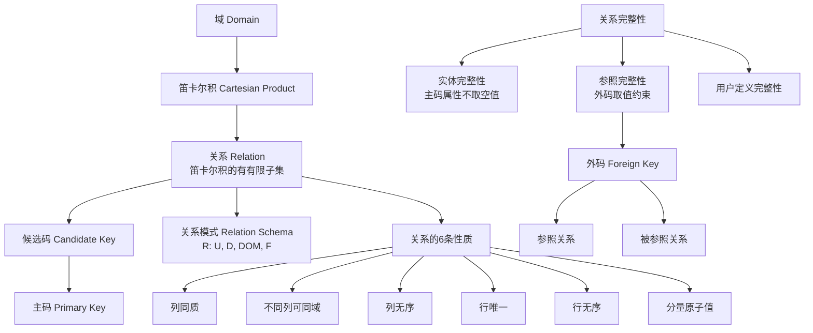

## 一句话总结

关系模型是**只有"关系"这一种数据结构**的逻辑数据模型——从域和笛卡尔积的形式化定义出发，通过候选码保证实体完整性、外码保证参照完整性，构成整个关系数据库理论的基石。

## 知识地图

## 核心概念

### 1. 域（Domain）与笛卡尔积（Cartesian Product）

**域**：一组具有相同数据类型的值的集合，且同一域中的元素互不相同。例如：`D₁ = {张清玫, 刘逸}`，`D₂ = {计算机专业, 信息专业}`。

**笛卡尔积**：给定一组域 D₁, D₂, ..., Dₙ，其笛卡尔积 D₁ × D₂ × ... × Dₙ 是所有可能的 n 元组 (d₁, d₂, ..., dₙ) 的集合（dᵢ ∈ Dᵢ）。

关键概念：
- **元组（Tuple）**：笛卡尔积中的每个元素，含 n 个分量
- **分量（Component）**：元组中的每个值
- **基数（Cardinal number）**：各域基数的乘积 = 结果集中的元组总数

笛卡尔积的结果可以用**集合表示法**（枚举所有元组）或**二维表表示法**（每一行对应一个元组，每一列对应一个域，第一行为表头显示域名）。

### 2. 关系（Relation）——形式化定义

**关系是笛卡尔积的一个有限子集**：R ⊆ D₁ × D₂ × ... × Dₙ

- n = 1：单元关系（Unary relation）
- n = 2：二元关系（Binary relation）
- n > 2：多元关系

在关系的二维表表示中：列 → **属性（Attribute）**，行 → **元组**，表头 → 属性名集合。n 目关系必有 n 个属性。

### 3. 候选码、主码与主属性

**候选码（Candidate Key）**：能唯一标识一个元组的属性组，且其任何真子集都不具备此能力。候选码是**语义范畴**的概念，不能仅根据当前数据来确定。

**主码（Primary Key）**：从候选码中选出的一个，是 DBMS/SQL 层面的概念。一个基表最多定义一个主码。

**主属性（Prime attribute）**：包含在任何候选码中的属性。不包含在任何候选码中的属性称为**非主属性**。

**全码（All-key）**：所有属性构成的属性组成为候选码。

### 4. 关系的六条性质

只有同时满足这六条的二维表才能被称为"关系"：

| 性质 | 含义 |
|------|------|
| ① 列同质 | 每列分量来自同一域 |
| ② 不同列可出同域 | 不同属性可对应同一域，但属性名必须不同 |
| ③ 列无序 | 列顺序任意，通过属性名访问 |
| ④ 行唯一 | 任意两元组的候选码取值不同 |
| ⑤ 行无序 | 行顺序任意 |
| ⑥ 分量原子值 | 每个分量不可再分（不允许表中套表） |

> 实际数据库产品可能不完全遵循这六条（如区分列顺序、支持非规范化关系）。

### 5. 关系模式（Relation Schema）

关系模式是关系的"型"（静态、稳定），关系是"值"（动态、随时间变化）。

形式化表示：**R(U, D, DOM, F)**
- R：关系名
- U：属性名集合
- D：属性所来自的域
- DOM：属性到域的映射
- F：属性间数据依赖关系（完整性约束）

通常简记为 **R(U)** 或 **R(A₁, A₂, ..., Aₙ)**。

### 6. 关系的三类完整性约束

**实体完整性（Entity Integrity）**：主码中的属性不能取空值。在 DBMS 中，若为基表定义了主码，则自动保证主码唯一性和非空。

**参照完整性（Referential Integrity）**：若 F 是关系 R 的外码，对应关系 S 的主码 K，则 R 中每个元组在 F 上的取值必须：①全为空值，或②等于 S 中某元组的主码值。

**用户定义的完整性**：具体应用的语义约束（如性别 ∈ {男, 女}，学分 ∈ {1, 2, 3, 4}）。

### 7. 外码（Foreign Key）

设 F 是关系 R 的一个/组属性（不是 R 的码），与关系 S 的主码 K 相对应且定义在同一域上，则 F 是 R 的**外码**。R 为**参照关系**，S 为**被参照关系**。R 和 S 可以是同一关系（自身引用）。

外码不一定要与对应主码同名（但常取同名以便识别）。

## 难点突破

### 难点 1：关系 = 笛卡尔积的子集——为什么强调"子集"？

**易混淆点**：笛卡尔积是全组合，为什么关系只是它的子集？

**突破方法**：笛卡尔积是"所有可能的组合"，但现实世界的数据只有其中一部分有意义。例如：

- D₁ = {张清玫, 刘逸}（导师），D₂ = {计算机, 信息}（专业），D₃ = {李勇, 刘晨, 王敏}（研究生）
- 笛卡尔积 = 2 × 2 × 3 = 12 种全部组合
- 但实际上张清玫只带计算机专业的学生，刘逸只带信息专业的——所以实际关系只有少数几个元组

**"子集"表达了真实世界的语义约束**——不是所有组合都存在。

### 难点 2：候选码 vs 主码——为什么区分？

**易混淆点**：候选码和主码不都是唯一标识吗？

**突破方法**：关键区别在层次——
- **候选码**是关系模型理论层面的概念（可能有多个），由语义决定，不依赖 DBMS
- **主码**是 DBMS/SQL 实现层面的概念（只能选一个），建表时人为指定

关系模型理论中只需候选码，不需要"选出主码"这一步。但在实际建表时，DBMS 要求你指定一个主码来落实实体完整性。

## 与前章关联

- 1.2 节初步介绍关系模型 → 本节给出完整的形式化定义（域→笛卡尔积→关系）
- 1.2 提到完整性约束 → 本节展开三类完整性的具体规则
- 1.3 的"模式 vs 实例"框架 → 这里用在"关系模式 vs 关系"
- 六条性质既是关系的规范，也是第 6 章范式理论的起点

## 记忆卡片

**Q1: 关系的严格数学定义是什么？**
A1: 关系是给定一组域 D₁, D₂, ..., Dₙ 的笛卡尔积的一个**有限子集**：R ⊆ D₁ × D₂ × ... × Dₙ。

**Q2: 关系的六条性质是什么？**
A2: ①列同质 ②不同列可出同域 ③列无序 ④行唯一（候选码保证）⑤行无序 ⑥分量原子值。只有同时满足这六条才叫"关系"。

**Q3: 实体完整性和参照完整性的核心规则分别是什么？**
A3: 实体完整性：主码属性不能取空值。参照完整性：外码要么全为空，要么等于被参照关系中某个元组的主码值。

**Q4: 关系模式与关系的区别？**
A4: 关系模式是"型"（静态、稳定），是对关系结构的描述 R(U, D, DOM, F)；关系是"值"（动态、随时间变化），是某一时刻的元组集合。类比：表头设计 vs 表中数据。

---

## 📝 笔试要点速记

> 本章为概念地基，考不深，但以下三点是后续章节的前置。

| 考点 | 为什么重要 | 后续关联 |
|------|-----------|---------|
| 关系六条性质 | ⑥分量原子值 = 1NF 的定义 | 第 6 章范式理论 |
| 三类完整性 | 实体完整性（主码非空）+ 参照完整性（外码取值规则） | SQL 章建表约束 |
| 候选码 vs 主码 | 候选码由语义决定、主码是 DBMS 实现选择 | 第 6 章求码、判范式 |

**简答速查：**

**Q: 关系的六条性质？**
A: 列同质、不同列可出同域、列无序、行唯一（候选码保证）、行无序、分量原子值（不可再分）。

**Q: 实体完整性 vs 参照完整性的核心规则？**
A: 实体完整性 → 主码属性不取空值。参照完整性 → 外码要么全空，要么等于被参照关系某元组的主码值。
