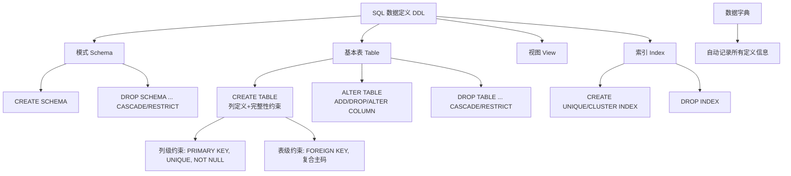

## 一句话总结

SQL 的 DDL（数据定义语言）通过 **CREATE/DROP/ALTER** 三大动词，在三级模式结构中定义模式、基本表、视图和索引——其中基本表对应关系模型中的"关系"，而索引是提升查询性能的关键物理机制。

## 知识地图



## 核心概念

### 1. SQL 概述

SQL（Structured Query Language）是关系数据库的标准语言，核心特点：

- **综合统一**：集 DDL、DML、DCL 于一体，覆盖数据库全生命周期
- **高度非过程化**：只需说"做什么"，不必指定存取路径
- **面向集合**：操作对象和结果都是元组集合
- **双模式使用**：既可交互式执行（命令行/批处理），也可嵌入高级语言
- **简洁**：核心功能只用 9 个动词——CREATE/DROP/ALTER（DDL）、SELECT（查询）、INSERT/UPDATE/DELETE（DML）、GRANT/REVOKE（DCL）

### 2. SQL 与三级模式的对应

| 三级模式 | SQL 对应 | 说明 |
|----------|---------|------|
| 外模式 | 视图（View） | 从一个或多个基本表导出，只存定义不存数据（虚表） |
| 模式 | 基本表（Base Table） | 独立存在的表，一个关系对应一个基本表 |
| 内模式 | 存储文件 | 物理存储，对用户透明 |

**术语对应关系**：关系 = 基本表，关系模式 ≈ 表结构，元组 = 行，属性 = 列。

### 3. CREATE TABLE——定义基本表

```sql
CREATE TABLE <表名> (
  <列名> <数据类型> [列级约束],
  ...,
  [表级约束]
);
```

**约束定义规则**：涉及多列的约束必须定义在表级（如复合主码、外码）。涉及单列的既可列级也可表级。

典型示例（学生-课程数据库）：
- **Student(Sno, Sname, Ssex, Sage, Sdept)**：Sno 主码，Sname 唯一约束
- **Course(Cno, Cname, Cpno, Ccredit)**：Cno 主码，Cpno 外码参照 Course(Cno)
- **SC(Sno, Cno, Grade)**：复合主码 (Sno,Cno)，Sno 和 Cno 分别参照 Student 和 Course

### 4. ALTER TABLE——修改基本表

```sql
ALTER TABLE <表名>
  [ADD [COLUMN] <新列名> <数据类型> [约束]]
  [ADD <表级完整性约束>]
  [DROP [COLUMN] <列名> [CASCADE | RESTRICT]]
  [DROP CONSTRAINT <约束名> [RESTRICT | CASCADE]]
  [ALTER COLUMN <列名> <数据类型>];
```

关键点：新增的列一律为空值；CASCADE 级联删除引用，RESTRICT 拒绝被引用时的删除。

### 5. 索引（Index）

索引的目的：**加快查询速度**。DBMS 自动选择合适索引，用户不能显式指定。

```sql
CREATE [UNIQUE] [CLUSTER] INDEX <索引名>
  ON <表名>(<列名>[ASC|DESC], ...);

ALTER INDEX <旧索引名> RENAME TO <新索引名>;
DROP INDEX <索引名>;
```

- UNIQUE：索引值唯一
- CLUSTER：聚簇索引（物理顺序与索引顺序一致，一表最多一个）
- 常见索引类型：顺序文件索引、B+树索引、Hash 索引、位图索引

### 6. 数据字典

数据字典是 DBMS 内部的一组**系统表**，自动记录数据库中所有定义信息：关系模式、视图、索引、完整约束、权限、统计信息等。执行 DDL 实际上就是在更新数据字典。

## 常用数据类型

| 类型 | 含义 |
|------|------|
| CHAR(n) / VARCHAR(n) | 定长/变长字符串 |
| INT / SMALLINT / BIGINT | 整数（4/2/8字节） |
| NUMERIC(p,d) / DECIMAL(p,d) | 定点数 |
| REAL / DOUBLE PRECISION | 浮点数 |
| DATE / TIME / TIMESTAMP | 日期/时间/时间戳 |
| BOOLEAN | 布尔值 |
| CLOB / BLOB | 大文本/二进制大对象 |

## 难点突破

### 难点 1：列级约束 vs 表级约束——什么时候必须用表级？

**易混淆点**：PRIMARY KEY 写在列旁边好像也行？

**突破方法**：判断标准是"约束涉及几列"——
- 单列约束（如 Sno 是主码）：列级或表级均可
- 多列约束（如复合主码、外码）：**必须表级**
- SC(Sno, Cno) 的主码是 (Sno, Cno)——只能写成 `PRIMARY KEY(Sno, Cno)`，不能拆成两个列级约束

### 难点 2：CASCADE vs RESTRICT——什么时候用哪个？

**突破方法**：
- CASCADE = "杀全家"——删除对象时，所有依赖它的对象一起删
- RESTRICT = "先安检"——如果有任何依赖，拒绝删除，防止误删

实际场景：DROP TABLE Student RESTRICT 如果 Student 表上有视图会报错，而 CASCADE 会连视图一起删。

## 与前章关联

- 第 1 章三级模式结构 → SQL 中基本表（模式层）+ 视图（外模式层）+ 存储文件（内模式层）的对应
- 第 2 章关系形式化定义 → SQL 中 CREATE TABLE 是关系模式的具体实现
- 第 2 章完整性约束（实体/参照/用户定义）→ SQL 中 PRIMARY KEY / FOREIGN KEY / CHECK / UNIQUE / NOT NULL 的对应实现
- SQL 的"面向集合"特征 → 关系代数中"操作对象和结果都是关系"的直接体现

## 记忆卡片

**Q1: SQL 的 9 个核心动词是什么？**
A1: DDL：CREATE/DROP/ALTER；DML：INSERT/UPDATE/DELETE；查询：SELECT；DCL：GRANT/REVOKE。

**Q2: 什么时候约束必须定义在表级？**
A2: 当约束涉及表的多个属性列时（如复合主码、外码），必须定义为表级完整性约束。

**Q3: SQL 视图与基本表的本质区别？**
A3: 基本表是独立存储的实际数据表；视图是派生出的"虚表"，数据库中只存定义不存数据。视图对应外模式，基本表对应模式。

**Q4: 索引的作用和限制？**
A4: 加快查询速度，由 DBMS 自动维护和选择使用。用户不能显式选择索引。一个表可建多个索引，但聚簇索引最多一个。

---

## 期末简答题库

**Q1: SQL 的九大核心动词及其分类？**
DDL：CREATE、DROP、ALTER（定义和修改结构）；DML：INSERT、UPDATE、DELETE（操作数据）；查询：SELECT；DCL：GRANT、REVOKE（权限控制）。九个动词覆盖数据库全生命周期。

**Q2: SQL 的三级模式对应关系是什么？**
外模式 ↔ 视图（View）——虚表，只存定义不存数据；模式 ↔ 基本表（Base Table）——独立存在的实际数据表；内模式 ↔ 存储文件——物理存储结构，对用户透明。

**Q3: 列级约束与表级约束的区别？什么时候必须用表级约束？**
列级约束写在列定义旁，只涉及单个列；表级约束独立定义，可涉及多列。涉及多个列的约束（复合主码、外码）必须定义为表级约束。如 SC 表的 PRIMARY KEY(Sno, Cno) 只能表级定义。

**Q4: DROP TABLE 的 CASCADE 和 RESTRICT 有什么区别？什么场景用哪个？**
CASCADE 级联删除——表及其所有依赖对象（视图、外键引用）一并删除；RESTRICT 安全删除——如果存在依赖则拒绝执行。生产环境先 RESTRICT 探测依赖，确认安全后决定是否 CASCADE。误用 CASCADE 会造成级联灾难。

**Q5: 索引一定能加快查询吗？建立索引的代价是什么？**
不一定。索引通过减少扫描数据量加速查询，但代价是：①占用额外存储空间；②每次 INSERT/UPDATE/DELETE 都要维护索引，降低写性能。聚簇索引决定物理顺序，一个表最多一个，选错列（如频繁更新的列）反而恶化性能。建索引应针对 WHERE/JOIN/ORDER BY 中频繁出现的列。
