## 一句话总结

SQL 数据更新通过 INSERT/UPDATE/DELETE 三大 DML 动词操作元组集合；事务保证这些操作的 ACID 特性（要么全做要么全不做）；空值引入三值逻辑需特殊处理；视图是建立在查询之上的虚表，简化操作并提供逻辑独立性。

---

## 知识地图

```mermaid
flowchart TD
    Update[SQL 数据更新] --> DML[DML: INSERT / UPDATE / DELETE]
    Update --> TXN[事务处理]
    Update --> NULL[空值处理]
    Update --> View[视图]

    DML --> INS[INSERT: VALUES 单行 / 子查询批量]
    DML --> UPD[UPDATE: SET + WHERE / 带子查询]
    DML --> DEL[DELETE: FROM + WHERE / 带子查询]
    DML --> IC[完整性检查: 实体/参照/用户定义]

    TXN --> ACID[ACID 特性]
    TXN --> Lifecycle[事务生命周期: 启动→执行→COMMIT/ROLLBACK]
    TXN --> Savepoint[保存点 Savepoint]
    TXN --> Isolation[隔离级别: RU/RC/RR/SRL]

    NULL --> N1[产生: INSERT省略列 / 显式NULL / UPDATE SET NULL]
    NULL --> N2[判断: IS NULL / IS NOT NULL]
    NULL --> N3[约束: NOT NULL / 主码 / UNIQUE]
    NULL --> N4[运算: 空值±任何=空值, 比较→UNKNOWN→FALSE]

    View --> V1[创建: CREATE VIEW ... AS SELECT]
    View --> V2[WITH CHECK OPTION: 透过视图的更新需满足视图条件]
    View --> V3[行列子集视图: 单表+保留主码→可更新]
    View --> V4[视图消解: 查询视图→改写为基表查询]
    View --> V5[删除: DROP VIEW ... CASCADE]
    View --> V6[作用: 简化/多角度/逻辑独立性/安全/清晰表达]
```



---

## 核心概念

### 第一部分：DML 数据操作

### 1. INSERT — 插入数据

```sql
INSERT INTO <表名> [(<列名>, ...)]
VALUES (<常量>, ...) | <子查询>;
```

**两种方式：**

| 方式 | 语法 | 场景 |
|------|------|------|
| 单行插入 | `INSERT INTO ... VALUES(...)` | 插入一条已知常量元组 |
| 批量插入 | `INSERT INTO ... SELECT ...` | 将查询结果批量导入 |

**列名规则：**
- 省略列名列表 → 按表定义列顺序赋值，省略的列自动取 NULL 或默认值
- 指定部分列 → 其余列取 NULL（需允许空值）
- VALUES 与列名列表需**个数匹配、类型匹配**

**示例：**
```sql
-- 单行：指定部分列，Grade 自动赋 NULL
INSERT INTO SC(Sno, Cno)
VALUES ('201215128', '1');

-- 批量：每个系的平均年龄存入新表
INSERT INTO Dept_age(Sdept, Avg_age)
SELECT Sdept, AVG(Sage) FROM Student GROUP BY Sdept;
```

### 2. UPDATE — 修改数据

```sql
UPDATE <表名>
SET <列名> = <表达式>, ...
[WHERE <条件>];
```

**关键点：**
- SET 子句用表达式值替换对应列值
- **省略 WHERE → 修改表中所有元组**（极易出错！）
- 可嵌套子查询：`WHERE Sno IN (SELECT Sno FROM Student WHERE Sdept = 'CS')`

**三种修改模式：**
```sql
-- ① 修改单个元组
UPDATE Student SET Sage = 22 WHERE Sno = '201215121';

-- ② 修改多个元组（全表）
UPDATE Student SET Sage = Sage + 1;

-- ③ 带子查询的修改
UPDATE SC SET Grade = 0
WHERE Sno IN (SELECT Sno FROM Student WHERE Sdept = 'CS');
```

### 3. DELETE — 删除数据

```sql
DELETE FROM <表名>
[WHERE <条件>];
```

**关键点：**
- 删除满足条件的元组
- **省略 WHERE → 删除表中所有元组**（表结构保留）
- 可嵌套子查询
- 受完整性约束限制（参照关系中有关联元组时，可能拒绝或级联删除）

**DELETE vs DROP TABLE：**

| | DELETE FROM | DROP TABLE |
|---|---|---|
| 删除对象 | 数据行（元组） | 整个表 |
| 表结构 | 保留 | 删除 |
| WHERE | 支持 | 不支持 |
| 类型 | DML | DDL |

### 4. 完整性检查

DBMS 在 INSERT / UPDATE / DELETE 执行时自动检查：
- **实体完整性**：主码唯一、非空
- **参照完整性**：外码值是否存在、级联策略（RESTRICT / CASCADE / SET NULL）
- **用户定义完整性**：NOT NULL、UNIQUE、CHECK 值域约束

---

### 第二部分：事务处理

### 5. 事务的定义

> **事务（Transaction）是用户定义的一个数据库操作序列，这些操作要么全做，要么全不做，是一个不可分割的工作单位。**

- 在关系数据库中，一个事务 = 一条 SQL 语句 / 一组 SQL 语句 / 整个程序
- 事务是**恢复**和**并发控制**的基本单位
- 事务 ≠ 程序：一个程序通常包含多个事务

**为什么需要事务？** 确保数据完整性。三个破坏因素：多用户并发访问、事务放弃（abort）、系统故障（crash）。

**经典例子 — 银行转账：**
```
A1 扣 200 → A2 加 200
```
一致性要求：A1 和 A2 的金额之和不变。两步要么全做（COMMIT），要么全不做（ROLLBACK）。

### 6. ACID 特性

| 特性 | 含义 | 关键点 |
|------|------|--------|
| **原子性 Atomicity** | 事务中所有操作要么全做，要么全不做 | 逻辑工作单位 |
| **一致性 Consistency** | 事务执行结果使 DB 从一个一致性状态变到另一个一致性状态 | 一致性状态 = 只含已提交事务的结果 |
| **隔离性 Isolation** | 一个事务的执行不能被其他事务干扰 | 并发事务互相隔离 |
| **持久性 Durability** | 事务一旦提交，对 DB 的改变永久生效 | 后续故障不影响 |

### 7. 事务生命周期

**启动方式（隐式启动，三种触发方式）：**

| 方式 | 说明 |
|------|------|
| ① DDL 命令 | 每条 DDL 作为一个单独事务；之前若有 active 事务先自动提交 |
| ② 自动提交模式 | 每条数据库访问命令作为一个单独事务，DBMS 自动 COMMIT/ROLLBACK |
| ③ DML 命令 | DBMS 检查是否有 active 事务：有→加入当前事务；无→自动启动新事务 |

**结束方式：**

| 命令 | 含义 |
|------|------|
| `COMMIT` | 正常结束 → 所有更新写回磁盘，持久化，不可取消 |
| `ROLLBACK` | 异常终止 → 撤销所有操作，回退到事务开始前状态 |

**COMMIT 可能失败的原因：** 系统故障 / 完整性检查不满足。失败后可 ROLLBACK 取消。

### 8. 保存点（Savepoint）

- 在事务执行过程中设置若干个保存点
- `ROLLBACK TO savepoint` → 只回退到保存点之后的操作，**事务继续执行**
- 不带保存点的 ROLLBACK → 结束并放弃整个事务

### 9. 事务控制 SQL 命令

```sql
-- 事务结束
COMMIT;    -- 提交
ROLLBACK;  -- 回滚

-- 事务设置（DCL 命令）
SET AUTOCOMMIT = 0;  -- 关闭自动提交（MySQL）
SET AUTOCOMMIT = 1;  -- 打开自动提交

SET TRANSACTION READONLY;   -- 只读事务（只能 SELECT）
SET TRANSACTION READWRITE;  -- 读写事务（默认）

-- 设置隔离级别
SET TRANSACTION ISOLATION LEVEL
  READUNCOMMITTED |    -- 未提交读（最低）
  READCOMMITTED |      -- 提交读
  READREPEATABLE |     -- 可重复读
  SERIALIZABLE;        -- 可串行化（最高）
```

### 10. 四种隔离级别

> 隔离级别与并发控制的封锁策略紧密相关。

**基于封锁的并发控制基本思想：** 事务 T 持有数据对象 O 上的读锁 → 允许读；持有写锁 → 允许读写。一个事务在一个数据对象上最多持有一把锁。

| 隔离级别 | 读锁策略 | 写锁策略 | 问题 |
|----------|---------|---------|------|
| **READUNCOMMITTED**（未提交读） | 不申请任何锁 | 禁止写操作 | 读到未提交数据（脏读） |
| **READCOMMITTED**（提交读） | 读前申请共享锁，**读后立即释放** | 写前申请排它锁，维持到事务结束 | 不可重复读 |
| **READREPEATABLE**（可重复读） | 读前申请共享锁，**维持到事务结束** | 同上 | 可能幻读 |
| **SERIALIZABLE**（可串行化） | 可串行化调度策略 | 排它锁维持到事务结束 | 最高隔离，性能最低 |

> ⚠️ 不管采用何种隔离级别，**写操作前都必须申请排它锁，且维持到事务结束**。

---

### 第三部分：空值处理

### 11. 空值的含义

> 空值（NULL）表示"不知道"、"不存在"或"无意义"的值。

三种情况产生空值：
- 该属性应该有一个值，但目前不知道
- 该属性不应该有值
- 由于某种原因不便于填写

### 12. 空值的产生

```sql
-- ① 显式写入 NULL
INSERT INTO SC(Sno, Cno, Grade) VALUES('201215126', '1', NULL);

-- ② 插入时省略列（DBMS 自动赋 NULL）
INSERT INTO SC(Sno, Cno) VALUES('201215126', '1');

-- ③ UPDATE 设为 NULL
UPDATE Student SET Sdept = NULL WHERE Sno = '201215200';
```

### 13. 空值的判断

```sql
-- 不能用 = NULL，必须用 IS NULL / IS NOT NULL
SELECT * FROM Student
WHERE Sname IS NULL OR Ssex IS NULL OR Sage IS NULL OR Sdept IS NULL;
```

### 14. 空值相关的完整性约束

| 约束 | 规则 |
|------|------|
| NOT NULL | 该属性不能取空值 |
| PRIMARY KEY | 主码属性不能取空值 |
| UNIQUE | 非空值时具有唯一性；NULL 不参与唯一性比较 |
| UNIQUE + NOT NULL | 可确保表中元组的唯一性 |

### 15. 空值的运算规则（三值逻辑）

**核心规则：**
- 空值与任何值（包括另一个空值）的**算术运算**结果为**空值**
- 空值与任何值（包括另一个空值）的**比较运算**结果为 **UNKNOWN**
- 引入了 UNKNOWN 后，传统二值逻辑（TRUE/FALSE）扩展为**三值逻辑**（TRUE/FALSE/UNKNOWN）

**实际执行规则：** 在 WHERE 和 HAVING 子句中，只有条件表达式判断为 **TRUE** 时，当前元组才被输出。DBMS 统一规定：**空值参与比较运算的结果为逻辑假 FALSE**。

```sql
-- 例：找出不及格学生（缺考者 Grade=NULL 不会被选出）
SELECT Sno FROM SC WHERE Grade < 60 AND Cno = '1';

-- 要同时选出缺考者：
SELECT Sno FROM SC WHERE Cno = '1' AND (Grade < 60 OR Grade IS NULL);

-- 陷阱：NOT (Grade >= 60) 也选不出 NULL！
-- 因为 NULL >= 60 → UNKNOWN → FALSE，NOT FALSE = TRUE？
-- 不对：NULL >= 60 结果为 UNKNOWN(SQL视为FALSE)，NOT FALSE = TRUE，会选出NULL！
-- 实际上需要具体看DBMS实现。标准做法是显式用 IS NULL。
```

---

### 第四部分：视图

### 16. 视图的定义与特点

> **视图（View）是虚表**——从一个或几个基本表（或视图）导出的表。只存放定义，不存放数据。基表数据变化，视图查询结果随之变化。

```sql
CREATE VIEW <视图名> [(<列名>, ...)]
AS <子查询>
[WITH CHECK OPTION];
```

**列名规则：**
- 全部省略 → 沿用子查询 SELECT 目标列名
- 全部指定 → 可重命名。**必须指定列名的情况：**
  - 目标列是聚集函数或列表达式
  - 多表连接出现同名列
  - 需要更合适的列名

> DBMS 执行 CREATE VIEW 时只是把视图定义存入数据字典，**不执行**其中的 SELECT 语句。

### 17. WITH CHECK OPTION

> 对视图进行 UPDATE / INSERT / DELETE 时，要保证操作后的元组满足视图定义中的谓词条件。

```sql
CREATE VIEW IS_Student
AS
SELECT Sno, Sname, Sage
FROM Student
WHERE Sdept = 'IS'
WITH CHECK OPTION;

-- 以下操作会被拒绝（新元组不满足 Sdept='IS'）：
INSERT INTO IS_Student VALUES('231215101', '王海', 'CS');  -- ❌
UPDATE IS_Student SET Sdept = 'CS' WHERE Sno = '201215121'; -- ❌

-- 但在基表上可以直接操作：
INSERT INTO Student(Sno, Sname, Sdept) VALUES('231215101', '王海', 'CS'); -- ✅
```

> WITH CHECK OPTION 只限制**透过视图**的更新，不影响直接在基表上的操作。

### 18. 行列子集视图

> 从单个基本表导出，只去掉了某些行和某些列，但**保留了主码** → 可更新视图。

```sql
-- IS_Student 就是行列子集视图（单表 Student，保留主码 Sno）
CREATE VIEW IS_Student AS
SELECT Sno, Sname, Sage FROM Student WHERE Sdept = 'IS';
```

### 19. 视图的类型

| 类型 | 示例 | 可更新 |
|------|------|--------|
| 行列子集视图 | 单表 + 去行列 + 保留主码 | ✅ |
| 多表视图 | `FROM Student, SC WHERE ...` | ❌ 一般不可 |
| 嵌套视图 | 基于另一视图 | 取决于底层 |
| 带表达式视图 | `2014 - Sage AS Sbirth` | ❌ |
| 分组视图 | `GROUP BY` + 聚集函数 | ❌ |
| 基于不可更新视图的视图 | 继承不可更新性 | ❌ |

### 20. 视图消解（View Resolution）

> 对视图的查询操作 → DBMS 将其**改写为对基表的等价查询**，然后执行。

```sql
-- 用户查询视图
SELECT Sno, Sage FROM IS_Student WHERE Sage < 20;

-- 视图消解后实际执行：
SELECT Sno, Sage FROM Student WHERE Sdept = 'IS' AND Sage < 20;
```

### 21. 可更新视图

**视图可更新的两个条件：**
1. 视图的每一行必须对应基表的唯一一行
2. 视图的每一列必须对应基表的唯一一列

只有同时满足 → 可更新视图（Updatable View）→ 才允许 INSERT / UPDATE / DELETE。

**不可更新视图示例：**
```sql
-- 分组视图 S_G 不可更新——无法把 Gavg=90 唯一转换成对 SC 表的修改
UPDATE S_G SET Gavg = 90 WHERE Sno = '201215121';  -- ❌ 无意义
```

### 22. 删除视图

```sql
DROP VIEW <视图名> [CASCADE];
```

- 不带 CASCADE → 如果该视图上还导出了其他视图，**拒绝删除**
- 带 CASCADE → 该视图和由它导出的所有视图一起**级联删除**
- 删除基本表 + CASCADE → 该表导出的所有视图定义连带删除

### 23. 视图的作用

| 作用 | 说明 |
|------|------|
| **简化用户操作** | 将复杂查询封装为视图，用户直接 SELECT FROM 视图 |
| **多角度看待同一数据** | 不同用户通过不同视图看同一基表 |
| **逻辑独立性** | 基表重构（如垂直拆分）→ 创建视图保持外模式不变 |
| **安全保护** | 对不同用户定义不同视图，隐藏机密列/行 |
| **更清晰表达查询** | 分步定义中间视图，复杂查询变简单 |

**逻辑独立性案例：**
```sql
-- 原表被"垂直"拆分为 SX 和 SY
-- 通过创建视图保持用户程序不变：
CREATE VIEW Student(Sno, Sname, Ssex, Sage, Sdept)
AS SELECT SX.Sno, SX.Sname, SY.Ssex, SX.Sage, SY.Sdept
   FROM SX, SY WHERE SX.Sno = SY.Sno;
-- 限制：对视图的更新操作有条件的，可能因基表结构改变而需修改
```

---

## 难点突破

### 难点 1：三值逻辑中的陷阱

**问题**：`WHERE NOT (Grade >= 60)` 能选出 NULL 吗？

答案取决于 DBMS 实现：
- `Grade >= 60` 当 Grade=NULL 时 → UNKNOWN（SQL 视为 FALSE）
- `NOT FALSE = TRUE` → 理论上会选出 NULL
- 但这是不推荐的写法——应显式使用 `Grade IS NULL`
- **考试要点**：空值参与比较 → UNKNOWN → SQL 视为 FALSE，只有显式 IS NULL 才能匹配

### 难点 2：隔离级别的封锁策略差异

| 隔离级别 | 读锁持有时间 | 防止脏读 | 防止不可重复读 | 防止幻读 |
|----------|------------|---------|-------------|---------|
| READUNCOMMITTED | 无锁 | ❌ | ❌ | ❌ |
| READCOMMITTED | 读后立即释放 | ✅ | ❌ | ❌ |
| READREPEATABLE | 维持到事务结束 | ✅ | ✅ | ❌ |
| SERIALIZABLE | 串行化调度 | ✅ | ✅ | ✅ |

### 难点 3：WITH CHECK OPTION 只约束视图操作

经常被误解为"定义了 WITH CHECK OPTION 后基表也被约束"——不对。它只影响**透过该视图**的 INSERT/UPDATE/DELETE。直接在基表上的操作不受此限制。

---

## 记忆卡片

**Q1: INSERT 的两种用法？**
A1: ① `INSERT INTO ... VALUES(...)` 插入单行常量元组；② `INSERT INTO ... SELECT ...` 批量插入子查询结果。列数和类型必须匹配。

**Q2: UPDATE/DELETE 不加 WHERE 的后果？**
A2: 修改/删除表中**所有**元组（全表操作）。严重警告——几乎总是错误操作！务必加 WHERE。

**Q3: DELETE FROM vs DROP TABLE？**
A3: DELETE 是 DML（删数据，表结构保留，可加 WHERE，可回滚）；DROP 是 DDL（删整个表：数据+结构+索引+约束，不可回滚）。

**Q4: 事务的 ACID 四特性？**
A4: ①原子性 Atomicity—全做或全不做；②一致性 Consistency—DB 从一个一致状态到另一个；③隔离性 Isolation—并发事务互不干扰；④持久性 Durability—提交后永久生效。

**Q5: 事务的三种启动方式？**
A5: ①DDL 命令—每条 DDL 单独一个事务，先自动提交 active 事务；②自动提交模式—每条命令一个事务；③DML 命令—检查是否有 active 事务，无则自动启动新事务。

**Q6: COMMIT 和 ROLLBACK 的区别？**
A6: COMMIT 正常结束 → 更新写回磁盘，永久生效，不可取消。ROLLBACK 异常终止 → 撤销所有操作，回退到事务开始前状态。保存点 ROLLBACK 只回退部分。

**Q7: 四种隔离级别从低到高？**
A7: READUNCOMMITTED（未提交读，无锁）→ READCOMMITTED（提交读，读后释放锁）→ READREPEATABLE（可重复读，锁维持到事务结束）→ SERIALIZABLE（可串行化，最高隔离）。写操作始终需排它锁维持到事务结束。

**Q8: 空值的三个运算规则？**
A8: ①空值与任何值的算术运算结果为空值；②空值与任何值的比较运算结果为 UNKNOWN；③在 WHERE/HAVING 中只有 TRUE 才输出，UNKNOWN 视为 FALSE——所以判断空值必须用 IS NULL。

**Q9: 视图是什么？数据存在哪里？**
A9: 视图是虚表，从基本表（或视图）导出。只存放**视图定义**在数据字典中，不存放实际数据。基表数据变化，视图查询结果随之变化。

**Q10: WITH CHECK OPTION 的作用？**
A10: 限制**透过视图**的 INSERT/UPDATE/DELETE——操作后的元组必须仍满足视图定义的谓词条件。不影响直接在基表上的操作。

**Q11: 什么视图可更新？**
A11: 行列子集视图（单表+去行列+保留主码）。两个必要条件：①视图每一行对应基表唯一一行；②视图每一列对应基表唯一一列。含聚集函数、GROUP BY、表达式的视图不可更新。

**Q12: 视图消解是什么？**
A12: 对视图的查询操作 → DBMS 自动改写为对基表的等价查询 → 执行改写后的查询。对用户透明。

**Q13: 视图的五大作用？**
A13: ①简化用户操作（封装复杂查询）；②多角度看待同一数据；③提供逻辑独立性（基表重构不改外模式）；④安全保护（隐藏机密行列）；⑤更清晰表达复杂查询。

---

## 考点整理与简答题预测

> 生成于 2026-06-01 Phase 1 复习

### 必考考点（按概率排序）

| 优先级 | 考点 | 常见题型 |
|--------|------|---------|
| ⭐⭐⭐ | ACID 四特性（名称 + 含义 + 能举例） | 简答/论述 |
| ⭐⭐⭐ | 四种隔离级别（名称 + 封锁策略差异 + 能排序） | 简答/对比 |
| ⭐⭐⭐ | COMMIT vs ROLLBACK + 事务三种启动方式 | 简答/填空 |
| ⭐⭐⭐ | 视图的定义、特点、WITH CHECK OPTION | 简答 |
| ⭐⭐ | 空值三规则（运算/比较/WHERE行为） | 简答/判断 |
| ⭐⭐ | 可更新视图的条件（行列子集视图） | 简答/判断 |
| ⭐⭐ | 视图消解原理 + 视图五大作用 | 简答 |
| ⭐⭐ | INSERT/UPDATE/DELETE 基本语法 + 不加WHERE的后果 | 简答/填空 |
| ⭐ | DELETE vs DROP TABLE | 选择/填空 |
| ⭐ | DROP VIEW CASCADE 级联删除 | 选择/填空 |
| ⭐ | 完整性检查三类约束 | 简答 |

### 简答题预测 + 答案

**Q1: 解释事务的 ACID 四特性，并各举一个违反的典型场景。**（10-15 分）

**答：**
- **原子性 Atomicity**：事务中所有操作要么全做要么全不做。违反：转账中 A1 扣款成功但 A2 加款失败 → 钱凭空消失
- **一致性 Consistency**：事务执行结果使 DB 从一致状态到另一个一致状态。违反：转账后 A1+A2 的金额之和变了
- **隔离性 Isolation**：并发事务互不干扰。违反：T1 读到 T2 未提交的修改（脏读），T2 后来回滚了
- **持久性 Durability**：事务一旦提交，改变永久生效。违反：系统在 COMMIT 后立即崩溃，重启后数据丢失

**Q2: 列出四种隔离级别（从低到高），说明各级别的封锁策略差异。**（8-10 分）

**答：**

| 级别 | 读锁 | 写锁 | 防脏读 | 防不可重复读 |
|------|------|------|--------|------------|
| READUNCOMMITTED | 无锁 | 禁止写 | ❌ | ❌ |
| READCOMMITTED | 读前申请，读后释放 | 排它锁，维持到结束 | ✅ | ❌ |
| READREPEATABLE | 读前申请，维持到结束 | 同上 | ✅ | ✅ |
| SERIALIZABLE | 串行化调度 | 同上 | ✅ | ✅ |

不管何种级别，写操作前必须申请排它锁且维持到事务结束。

**Q3: 空值参与运算的三条核心规则？为什么 `WHERE Grade < 60` 查不出缺考学生？**（5-8 分）

**答：** ①算术运算：空值与任何值运算结果为空值；②比较运算：空值与任何值比较结果为 UNKNOWN；③WHERE/HAVING 中只有 TRUE 才输出，UNKNOWN 视为 FALSE。缺考学生 Grade=NULL，`NULL < 60` → UNKNOWN → FALSE → 不被选出。必须显式加 `OR Grade IS NULL`。

**Q4: 什么是视图？WITH CHECK OPTION 的作用？视图消解的过程？**（8-10 分）

**答：** 视图是虚表——从基本表或视图导出，只存放定义不存放数据。WITH CHECK OPTION 限制透过视图的 UPDATE/INSERT/DELETE 必须满足视图定义谓词。视图消解：DBMS 将视图查询改写为对基表的等价查询后执行。例如查询 `IS_Student WHERE Sage<20` → 改写为查询 `Student WHERE Sdept='IS' AND Sage<20`。

**Q5: 什么条件视图才可更新？举例说明不可更新视图。**（5-8 分）

**答：** ①视图每一行对应基表唯一一行；②视图每一列对应基表唯一一列。同时满足 → 行列子集视图 → 可更新。反例：`S_G(Sno, Gavg)` 按学号分组的平均成绩视图，无法把 `UPDATE S_G SET Gavg=90` 唯一转换回 SC 表上的修改，因此不可更新。

**Q6: 事务结束的两种方式？保存点的作用？**（5 分）

**答：** COMMIT 正常结束（更新持久化）、ROLLBACK 异常终止（撤销全部操作）。保存点允许在事务内设置回退标记，`ROLLBACK TO savepoint` 只放弃保存点之后的操作，事务仍可继续执行。不带保存点的 ROLLBACK 则结束整个事务。

### 工程注意点

- **UPDATE/DELETE 务必加 WHERE**——不加的后果是全表修改/删除，生产环境灾难
- **判断 NULL 必须用 IS NULL**，不能用 = NULL——后者永远返回 UNKNOWN
- **视图提升安全性**：给不同角色建不同视图，只暴露必要列（如隐藏工资列）
- **WITH CHECK OPTION 防止视图写入脏数据**：通过视图插入的元组必须能被该视图查出来
- **隔离级别选型**：高并发读场景用 READCOMMITTED 足够；金融场景用 SERIALIZABLE

### 跨章关联

| 概念 | 来源 | 关联 |
|------|------|------|
| 完整性约束三类型 | 01-数据模型概述 | DML 操作时 DBMS 自动检查 |
| 参照完整性级联策略 | 02-关系数据模型 | DELETE/UPDATE 时触发 RESTRICT/CASCADE/SET NULL |
| SELECT 查询 | 03-SQL数据查询 | 视图定义 = 子查询；INSERT SELECT = 批量导入 |
| 并发控制（封锁） | 后续课程 | 隔离级别的实现基础 |
