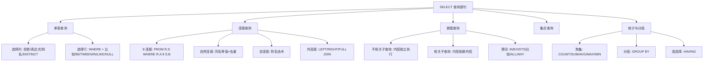

## 一句话总结

SQL 查询 = **SELECT（投影）+ FROM（笛卡尔积/连接）+ WHERE（选择）+ GROUP BY（分组统计）+ HAVING（组选择）+ ORDER BY（排序）**——底层是关系代数，但通过聚集函数、嵌套子查询、集合操作等机制超越了纯关系代数的表达能力。

## 知识地图



## 核心概念

### 1. SELECT 语句完整结构

```sql
SELECT [DISTINCT] <目标列表达式> [AS 别名], ...
FROM <表名/视图名/子查询> [AS 别名], ...
[WHERE <条件表达式>]
[GROUP BY <列名> [HAVING <组条件>]]
[ORDER BY <列名> [ASC|DESC]];
```

**执行顺序**：FROM（获取数据源）→ WHERE（行过滤）→ GROUP BY（分组）→ HAVING（组过滤）→ SELECT（投影+计算）→ ORDER BY（排序）。

### 2. 单表查询

**投影（选列）**：
- 指定列名列表：`SELECT Sno, Sname FROM Student`
- `*` 表示所有列
- 表达式计算：`SELECT Sname, 2024 - Sage FROM Student`（广义投影）
- 别名：`SELECT Sname AS '姓名' FROM Student`
- 去重：`SELECT DISTINCT Sno FROM SC`

**选择（选行）**——WHERE 子句：
- 比较：`=, >, <, >=, <=, <>`
- 范围：`BETWEEN ... AND ...`
- 集合：`IN ('CS', 'MA', 'IS')`
- 模糊匹配：`LIKE`（`%` 任意长度，`_` 单字符）
- 空值：`IS NULL` / `IS NOT NULL`
- 多重条件：`AND, OR, NOT`

### 3. 聚集函数（Aggregate Functions）

| 函数 | 作用 | 空值处理 |
|------|------|---------|
| COUNT(*) | 统计元组总数 | 不计空值行 |
| COUNT(col) | 统计非空值个数 | 忽略 NULL |
| COUNT(DISTINCT col) | 统计非空去重个数 | 忽略 NULL |
| SUM(col) | 数值列总和 | 忽略 NULL |
| AVG(col) | 数值列平均值 | 忽略 NULL |
| MAX/MIN(col) | 最大/最小值 | 忽略 NULL |

**关键规则**：
- 聚集函数只能用 `SELECT` 子句和 `HAVING` 子句中，**不能用于 WHERE 子句**
- 对空集执行聚集：COUNT 返回 0，其余返回 NULL
- `WHERE AVG(Grade) >= 90` — 非法！正确写法是用 HAVING

### 4. GROUP BY 与 HAVING

**GROUP BY**：按指定列分组，值相等的为一组，聚集函数作用于每个组。

**HAVING**：对分组结果的选择——HAVING 作用于"组"，WHERE 作用于"行"。

```sql
-- 查询选修了3门以上课程的学生学号
SELECT Sno FROM SC
GROUP BY Sno
HAVING COUNT(*) > 3;
```

**SELECT 子句中能出现什么？** 当有 GROUP BY 时，SELECT 中只能是：①分组属性 ②聚集函数。不能有其他非分组属性！

### 5. 连接查询

SQL 中通过 FROM + WHERE 实现连接（而非显式的 JOIN 关键字，那是 SQL99 写法）：

```sql
-- θ-连接：查询同城市的顾客和代理商
SELECT C.cname, A.aname, C.city
FROM Customers C, Agents A
WHERE C.city = A.city;

-- 自连接（用别名区分同一关系）
SELECT R1.Sno, R1.Sname
FROM Student R1, Student R2
WHERE R1.Sage < R2.Sage AND R2.Sno = '201215121';
```

### 6. 嵌套查询（Nested Queries）

将一个查询块嵌套在另一个查询的 WHERE 或 HAVING 条件中：

- **不相关子查询**：内层独立执行，一次得出结果
- **相关子查询**：内层依赖外层元组值，每处理一个外层元组都要执行一次内层
- 常用谓词：IN、EXISTS、比较运算符 + ALL/ANY

### 7. 集合查询

- `UNION`：并（自动去重）
- `INTERSECT`：交
- `EXCEPT`：差（有的数据库用 MINUS）

## 难点突破

### 难点 1：WHERE vs HAVING——什么时候用哪个？

**核心原则**：WHERE 过滤的是**原始行**，HAVING 过滤的是**分组后的组**。

判断流程：
1. 条件是否涉及聚集函数（如 AVG > 90）？→ 是 → **HAVING**
2. 条件是否只涉及原始列值（如 Sdept = 'CS'）？→ 是 → **WHERE**

```sql
-- 正确 ✅
SELECT Sno, AVG(Grade) FROM SC
WHERE Grade >= 60          -- 先过滤行：只看及格成绩
GROUP BY Sno
HAVING AVG(Grade) >= 85;   -- 再过滤组：均分≥85的学生

-- 错误 ❌
WHERE AVG(Grade) >= 90     -- 聚集函数不能用于WHERE！
```

### 难点 2：GROUP BY 下 SELECT 能写什么？

最容易出错的场景：分组后 SELECT 了一个既不是分组属性也不是聚集属性的列。

**规则**：GROUP BY 时，SELECT 中只能出现：①GROUP BY 的列 ②聚集函数。其他列虽然有些 DBMS 不报错，但结果是未定义的。

```sql
-- 错误 ❌：Sname 既不是分组属性也不是聚集属性
SELECT Sno, Sname, AVG(Grade)
FROM SC JOIN Student ON SC.Sno = Student.Sno
GROUP BY Sno;
```

## 与前章关联

- 关系代数的 σ（选择）→ WHERE 子句
- 关系代数的 π（投影）→ SELECT 子句
- 关系代数的 ×（笛卡尔积）→ FROM ... , ... 无连接条件
- 关系代数的 ⋈（自然连接）→ FROM R,S WHERE 同名属性等值连接
- 关系代数的 ÷（除）→ 嵌套 NOT EXISTS 实现
- SQL 超越了纯关系代数：增加了聚集函数、GROUP BY、ORDER BY、LIKE 模糊查询等

## 记忆卡片

**Q1: SELECT 语句中各子句的执行顺序？**
A1: FROM → WHERE → GROUP BY → HAVING → SELECT → ORDER BY。理解这个顺序才能正确写查询。

**Q2: WHERE 和 HAVING 的核心区别？**
A2: WHERE 过滤行（在分组前），HAVING 过滤组（在分组后）。WHERE 不能用聚集函数，HAVING 常用聚集函数做条件。

**Q3: GROUP BY 时 SELECT 子句的限制？**
A3: SELECT 中只能出现分组属性（GROUP BY 的列）和聚集函数。其他列的投影结果是未定义的。

**Q4: DISTINCT 和 GROUP BY 都能去重，有什么区别？**
A4: DISTINCT 单纯去重；GROUP BY 在去重的同时可以进行分组统计。如果只想去重用 DISTINCT，需要统计用 GROUP BY。

---

## 期末简答题库

**Q1: SELECT 语句的执行顺序是什么？为什么理解它很重要？**
FROM → WHERE → GROUP BY → HAVING → SELECT → ORDER BY。理解顺序是避免常见错误的关键：①WHERE 在 GROUP BY 之前执行，所以 WHERE 不能使用聚集函数；②SELECT 定义的别名在 WHERE 中不可用（因为 SELECT 在 WHERE 之后执行）；③HAVING 在分组后执行，可以用聚集函数。

**Q2: WHERE 和 HAVING 的本质区别？各举一个适用场景。**
WHERE 过滤原始行（分组前），HAVING 过滤分组后的组（分组后）。聚集函数只能用于 HAVING。例：查询 CS 系均分 > 85 的学生——WHERE Sdept='CS' 先过滤系别，GROUP BY Sno 再分组，HAVING AVG(Grade)>85 最后过滤组。

**Q3: 相关子查询与不相关子查询的区别？**
不相关子查询：内层独立执行一次，结果传给外层；相关子查询：内层引用外层列值（如 `WHERE EXISTS (SELECT * FROM SC WHERE SC.Sno=Student.Sno)`），外层每处理一行，内层都要重新执行一次。EXISTS 通常是相关子查询。

**Q4: 连接查询有哪几种实现方式？SQL 中如何写自连接？**
①FROM 多表 + WHERE 连接条件（传统写法）；②JOIN ... ON（SQL99）。自连接：给同一表起两个别名，如 `FROM Student S1, Student S2 WHERE S1.Sage < S2.Sage`——用别名区分"同一关系的两个副本"。

---

## SQL 查询速查表（考试重点）

> 以下基于学生-课程数据库：Student(Sno, Sname, Ssex, Sage, Sdept)、Course(Cno, Cname, Cpno, Ccredit)、SC(Sno, Cno, Grade)

### 一、单表查询

| 需求 | 写法 | 关键点 |
|------|------|--------|
| 查所有列 | `SELECT * FROM Student` | `*` = 全部列 |
| 查指定列 + 去重 | `SELECT DISTINCT Sno FROM SC` | DISTINCT 紧接 SELECT |
| 别名 | `SELECT Sname AS '姓名' FROM Student` | AS 可省略 |
| 计算表达式 | `SELECT Sname, 2024-Sage FROM Student` | 广义投影 |
| 比较条件 | `WHERE Sage >= 20` | `= > < >= <= <>` |
| 范围查询 | `WHERE Sage BETWEEN 18 AND 22` | 闭区间，等价 `>= AND <=` |
| 集合查询 | `WHERE Sdept IN ('CS','MA')` | 等价多个 OR |
| 模糊匹配 | `WHERE Sname LIKE '张%'` | `%` = 任意串，`_` = 单字符 |
| 空值判断 | `WHERE Grade IS NULL` | 不能用 `= NULL` |
| 排序 | `ORDER BY Sage DESC, Sno ASC` | DESC 降序，ASC 升序（默认） |

### 二、聚集函数

| 需求 | 写法 |
|------|------|
| 统计人数 | `SELECT COUNT(*) FROM Student` |
| 去重计数 | `SELECT COUNT(DISTINCT Sno) FROM SC` |
| 求平均分 | `SELECT AVG(Grade) FROM SC WHERE Cno='C1'` |
| 最高/最低 | `SELECT MAX(Grade), MIN(Grade) FROM SC` |
| 总和 | `SELECT SUM(Ccredit) FROM Course` |

### 三、分组 + 组过滤（考试必考）

```sql
-- ⭐ 查平均分≥90的学生学号和均分
SELECT Sno, AVG(Grade) AS AvgGrade
FROM SC
GROUP BY Sno
HAVING AVG(Grade) >= 90;

-- ⭐ 查选修≥3门课的学生学号
SELECT Sno FROM SC
GROUP BY Sno
HAVING COUNT(*) >= 3;
```

> **铁律**：GROUP BY 时 SELECT 只能写分组列和聚集函数！

### 四、连接查询

```sql
-- 等值连接：查每个学生及其选课信息
SELECT Student.Sno, Sname, Cno, Grade
FROM Student, SC
WHERE Student.Sno = SC.Sno;

-- ⭐ 自然连接（同名属性等值 + 去重）
-- SQL 中用等值连接 + 手动列名实现

-- 自连接：查年龄不是最大的学生
SELECT DISTINCT S1.Sno, S1.Sname
FROM Student S1, Student S2
WHERE S1.Sage < S2.Sage;

-- 外连接（保留悬浮元组）
SELECT * FROM Student LEFT JOIN SC
ON Student.Sno = SC.Sno;
```

### 五、嵌套查询

```sql
-- 不相关子查询：IN —— 查选了C2的学生姓名
SELECT Sname FROM Student
WHERE Sno IN (SELECT Sno FROM SC WHERE Cno='C2');

-- ⭐ 相关子查询：EXISTS —— 查选了C2的学生（另一种写法）
SELECT Sname FROM Student
WHERE EXISTS (
  SELECT * FROM SC
  WHERE SC.Sno = Student.Sno AND Cno='C2'
);

-- 比较 + ALL/ANY：查年龄最大的学生
SELECT * FROM Student
WHERE Sage >= ALL (SELECT Sage FROM Student);

-- 查比CS系至少一人年龄小的非CS学生
SELECT * FROM Student
WHERE Sdept <> 'CS' AND Sage < ANY (
  SELECT Sage FROM Student WHERE Sdept='CS'
);
```

### 六、集合操作

```sql
-- 并：CS系或年龄>19的学生
SELECT * FROM Student WHERE Sdept='CS'
UNION
SELECT * FROM Student WHERE Sage > 19;
-- INTERSECT（交）、EXCEPT（差）语法类似
```

### 七、常考查询题型

| 题型 | 关键思路 | 用到的工具 |
|------|---------|-----------|
| "选了某课的学生信息" | 连接 Student 和 SC | JOIN 或 IN 子查询 |
| "均分>90的学生" | GROUP BY + HAVING | 分组 + 聚集条件 |
| "选了所有课的学生" | 除运算语义 | NOT EXISTS 嵌套（双重否定） |
| "比某个学生年龄大的" | 自连接 | 同一表两个别名 |
| "最高/最低" | ALL 子查询 或 MAX | `>= ALL` 等价于 MAX |

---

## 快速语法速记

```
SELECT [DISTINCT] 列, 聚集(列)
FROM 表1 [别名], 表2 [别名]
[WHERE 行条件]          -- 不能含聚集函数
[GROUP BY 列
  [HAVING 组条件]]      -- 可用聚集函数
[ORDER BY 列 [ASC|DESC]];
```

**执行序**：FROM → WHERE → GROUP BY → HAVING → SELECT → ORDER BY
**写 SQL 时的思考序**：①从哪张表取数据 → ②筛选哪些行 → ③要不要分组统计 → ④选哪些列输出 → ⑤要不要排序
