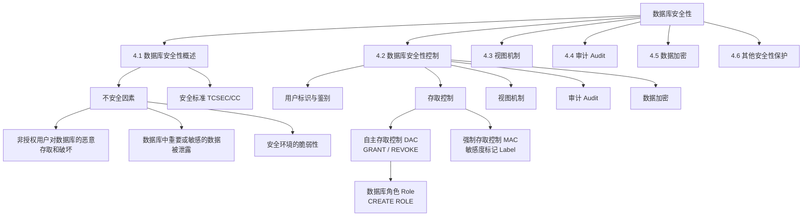

## 一句话总结

数据库安全性是指保护数据库以防止不合法使用所造成的数据泄露、更改或破坏。核心是存取控制——通过 GRANT/REVOKE 实现自主存取控制（DAC），辅以强制存取控制（MAC）、视图机制、审计和数据加密，构建多层防护。

---

## 知识地图



---

## 核心概念

### 4.1 数据库安全性概述

#### 4.1.1 数据库的不安全因素（课件原文表述）

数据库的一大特点是数据可以共享，但数据共享必然带来数据库的安全性问题，数据库系统中的数据共享不能是无条件的共享。

对数据库的破坏来自以下四个方面：
1. 非法用户
2. 非法数据
3. 各种故障或误操作
4. 多用户的并发访问

针对以上四种可能情况，DBMS 分别采取以下措施对数据库实施保护：
- 安全性保护（权限管理）
- 完整性保护
- 故障恢复
- 并发控制

**数据库安全性**：保护数据库以防止不合法使用所造成的数据泄露、更改或破坏。

**数据库的不安全因素（三个）：**

| 不安全因素 | 课件原文 | 对应安全措施 |
|-----------|---------|-------------|
| **非授权用户对数据库的恶意存取和破坏** | "一些黑客和犯罪分子在用户存取数据库时猎取用户名和用户口令，然后假冒合法用户偷取、修改甚至破坏用户数据" | 用户身份鉴别、存取控制、视图 |
| **数据库中重要或敏感的数据被泄露** | "黑客和敌对分子千方百计盗窃数据库中的重要数据，一些机密信息被暴露" | 强制存取控制、数据加密存储和加密传输、审计日志分析 |
| **安全环境的脆弱性** | "数据库的安全性与计算机系统的安全性紧密联系，包括计算机硬件、操作系统、网络系统等的安全性" | 建立一套可信（Trusted）计算机系统的概念和标准 |

#### 4.1.2 安全标准简介

**TCSEC/TDI（可信计算机系统评估准则）：** 1985 年美国国防部（DoD）正式颁布，简称 TCSEC 或 DoD85。

**TCSEC/TDI 安全级别划分（按系统可靠或可信程度逐渐增高，各安全级别之间具有偏序向下兼容的关系）：**

| 级别 | 名称 | 课件关键描述 |
|------|------|------------|
| **D** | 最小保护 | 将一切不符合更高标准的系统均归于 D 组 |
| **C1** | 自主安全保护 | 非常初级的自主安全保护；能够实现对用户和数据的分离，进行自主存取控制（DAC），保护或限制用户权限的传播；现有的商业系统稍作改进即可满足 |
| **C2** | 受控的存取保护 | 将 C1 级的 DAC 进一步细化，以个人身份注册负责，并实施审计和资源隔离；**安全产品的最低档次** |
| **B1** | 标记安全保护 | 对系统的数据加以标记，对标记的主体和客体实施强制存取控制（MAC）、审计等安全机制 |
| **B2** | 结构化保护 | 建立形式化的安全策略模型并对系统内的所有主体和客体实施 DAC 和 MAC |
| **B3** | 安全域 | 该级的 TCB 必须满足访问监控器的要求，审计跟踪能力更强，并提供系统恢复过程 |
| **A1** | 验证设计 | 提供 B3 级保护的同时给出系统的形式化设计说明和验证以确信各安全保护真正实现 |

> **关键记忆**：TCSEC 从 C1 级开始要求提供自主存取控制（DAC），从 B1 级开始要求提供强制存取控制（MAC）。C2 是安全产品最低档次。

**CC 标准（Common Criteria）：**
- 1993 年，CTCPEC、FC、TCSEC 和 ITSEC 联合行动，解决原标准中概念和技术上的差异，称为 CC 项目
- 1999 年 CC V2.1 版被 ISO 采用为国际标准，2001 年被我国采用为国家标准
- 目前 CC 已基本取代了 TCSEC，成为评估信息产品安全性的主要标准
- CC 标准提出国际公认的表述信息技术安全性的结构，把信息产品的安全要求分为：**安全功能要求**和**安全保证要求**
- 评估保证级 EAL 从 EAL1 至 EAL7 共分为七级

**中国安全标准：**
- GB 17859-1999：计算机信息系统安全保护等级划分准则（参照美国 TCSEC）
- 中国 2002 年（公安部）：计算机信息系统安全等级保护系列标准，涉及技术要求、管理要求、工程实施要求、实施管理办法、评测标准
- 数据库管理系统技术要求：GA/T 389-2002

---

### 4.2 数据库安全性控制

#### 计算机系统的安全模型

计算机系统中，安全措施是一级一级层层设置的：
- 系统根据用户标识鉴定用户身份，合法用户才准许进入计算机系统
- 数据库管理系统还要进行存取控制，只允许用户执行合法操作
- 操作系统有自己的保护措施
- 数据以密码形式存储到数据库中

**数据库管理系统安全性控制模型（存取控制流程）：**
1. DBMS 对提出 SQL 访问请求的数据库用户进行**身份鉴别**，防止不可信用户使用系统
2. 在 SQL 处理层进行**自主存取控制和强制存取控制**，进一步可以进行推理控制
3. 对用户访问行为和系统关键操作进行**审计**，对异常用户行为进行简单入侵检测

**数据库安全性控制的常用方法：**
- 用户标识和鉴定
- 存取控制
- 视图
- 审计
- 数据加密

#### 4.2.1 用户身份鉴别

用户身份鉴别（Identification & Authentication）是系统提供的最外层安全保护措施。用户标识由用户名和用户标识号组成（用户标识号在系统整个生命周期内唯一）。

**用户身份鉴别的四种方法：**

| 方法 | 课件原文 |
|------|---------|
| **静态口令鉴别** | "静态口令一般由用户自己设定，这些口令是静态不变的" |
| **动态口令鉴别** | "口令是动态变化的，每次鉴别时均需使用动态产生的新口令登录数据库管理系统，即采用一次一密的方法" |
| **生物特征鉴别** | "通过生物特征进行认证的技术，生物特征如指纹、虹膜和掌纹等" |
| **智能卡鉴别** | "智能卡是一种不可复制的硬件，内置集成电路的芯片，具有硬件加密功能" |

#### 4.2.2 存取控制

**存取控制机制的组成：**

1. **定义用户权限**，并将用户权限登记到数据字典中
   - 用户对某一数据对象的操作权力称为**权限**
   - DBMS 提供适当的语言来定义用户权限，这些定义经编译后存放在数据字典中，被称做**安全规则**或**授权规则**

2. **合法权限检查**
   - 用户发出存取数据库的操作请求（一般应包括操作类型、操作对象、请求操作的用户等信息）后，DBMS 查找数据字典，根据安全规则进行合法权限检查

> 定义用户权限和合法权限检查机制一起组成了数据库管理系统的**存取控制子系统**。

**常用存取控制方法：**

| | 自主存取控制（DAC） | 强制存取控制（MAC） |
|---|---|---|
| TCSEC 要求 | 自 C1 级开始 | 自 B1 级开始 |
| 核心机制 | 用户对不同的数据对象有不同的存取权限，不同的用户对同一对象也有不同的权限，用户还可将其拥有的存取权限**转授**给其他用户 | 每一个数据对象被标以一定的**密级**，每一个用户也被授予某一个级别的**许可证**，对于任意一个对象，只有具有合法许可证的用户才可以存取 |
| 灵活性 | 灵活，用户可自主授权 | 严格，用户不能直接感知或进行控制 |
| 适用 | 商业系统 | 对数据有严格而固定密级分类的部门（军事部门、政府部门） |

#### 4.2.3 自主存取控制方法

通过 SQL 语言的 **GRANT 语句**和 **REVOKE 语句**提供支持。

**用户权限的组成要素：** 数据库对象、操作类型。

**定义用户的存取权限**就是定义一个用户可以在哪些数据库对象上进行哪些类型的操作。定义用户的存取权限称为**授权管理**，包括向用户**授予**或**收回**对数据的存取权限。

**关系数据库系统中的存取控制对象与权限：**

| 对象类型 | 对象 | 操作类型 |
|----------|------|---------|
| 数据库模式 | 模式 | CREATE SCHEMA |
| 数据库模式 | 基本表 | CREATE TABLE, ALTER TABLE |
| 数据库模式 | 视图 | CREATE VIEW |
| 数据库模式 | 索引 | CREATE INDEX |
| 数据 | 基本表和视图 | SELECT, INSERT, UPDATE, DELETE, REFERENCES, ALL PRIVILEGES |
| 数据 | 属性列 | SELECT, INSERT, UPDATE, REFERENCES, ALL PRIVILEGES |

**用户存取权限的定义（三条规则）：**
1. 一个客体的**属主**（Owner）自动拥有该客体上的所有存取权限。客体是指数据库中可以被访问的数据库对象，客体的创建者即客体的属主。系统应该控制客体所有权的转移。
2. 拥有权限的用户可以自主地将他所拥有的权限传授给在数据库系统中注册的其他用户。
3. 用户只能通过上述两种方式（或之一）来获得在一个客体上的存取权限。

**访问控制流程：**
1. 在用户登录时进行用户的身份鉴别
2. 在用户访问数据库时执行访问控制检查——对于用户提交的每一条数据访问命令，系统按照权限检查流程进行

#### 4.2.4 授权：授予与回收

**授权机制概述：**
- **DBA**：拥有所有对象的所有权限，根据实际情况将不同的权限授予不同的用户
- **用户**：拥有自己建立的对象的全部的存取权限，可以使用 GRANT 把自己拥有的对象上的存取权限授予其他用户
- **被授权的用户**：如果具有"继续授权"的许可，可以把获得的权限再授予其他用户
- 所有授予出去的权限在必要时又都可用 REVOKE 语句收回

**GRANT 语句的一般格式：**
```sql
GRANT <权限> [, <权限>] ...
ON <对象类型> <对象名> [, <对象类型> <对象名>] ...
TO <用户> [, <用户>] ...
[WITH GRANT OPTION];
```

语义：将对指定操作对象的指定存取权限授予指定的用户。

**三种授权主体（发出 GRANT 语句的用户）：**
1. 数据库管理员（DBA）
2. 数据库对象的创建者（即数据库对象的属主 Owner）
3. 拥有该存取权限及"继续授权"许可的用户

**被授权用户（接受权限的用户）：**
- 一个或多个具体用户
- 一个或多个用户组（角色 ROLE）
- PUBLIC（即全体用户）

**WITH GRANT OPTION 子句：**
- 如果使用了 WITH GRANT OPTION 选项，那么被授权用户同时获得所授予的存取权限的**"继续授权"许可**，有权将接受到的权限再通过 GRANT 命令授予其他用户
- 否则，被授权用户只能获得所授予的存取权限，但不能把该存取权限再转授给其他用户
- **不允许循环授权**

**经典例题链：**
```sql
-- [例4.1] 把查询 Student 表权限授给用户 U1
GRANT SELECT ON TABLE Student TO U1;

-- [例4.2] 把对 Student 表和 Course 表的全部权限授予用户 U2 和 U3
GRANT ALL PRIVILEGES ON TABLE Student, Course TO U2, U3;

-- [例4.3] 把对表 SC 的查询权限授予所有用户
GRANT SELECT ON TABLE SC TO PUBLIC;

-- [例4.4] 把查询 Student 表和修改学生学号的权限授给用户 U4
-- 对属性列的授权必须明确指出相应属性列名
GRANT UPDATE(Sno), SELECT ON TABLE Student TO U4;

-- [例4.5] 把对表 SC 的 INSERT 权限授予 U5 用户，并允许他再将此权限授予其他用户
GRANT INSERT ON TABLE SC TO U5 WITH GRANT OPTION;

-- [例4.6] U5 将之前获得的表 SC 的 INSERT 权限及传播权限授予用户 U6
GRANT INSERT ON TABLE SC TO U6 WITH GRANT OPTION;

-- [例4.7] U6 将此权限授予 U7，但 U7 不能再传播此权限
GRANT INSERT ON TABLE SC TO U7;
```

执行后的权限传播链：`DBA → U5 → U6 → U7`

**REVOKE 语句的一般格式：**
```sql
REVOKE <权限> [, <权限>] ...
ON <对象名> [, <对象名>] ...
FROM <用户> [, <用户>] ...
[CASCADE | RESTRICT];
```

- "回收"表示要撤销用户 A 在某个操作对象上的某个操作权限，该权限一般是之前其他用户通过执行 GRANT 授权操作授予用户 A 的，因此 REVOKE 语句又被称为**（权限）回收语句**
- **CASCADE**：表示要进行权限的**"连锁回收"**——如果之前用户 A 已经通过执行 GRANT 操作将该权限又授权给了其他用户 B，那么该语句将同时从用户 A 和 B 那里回收该权限
- **RESTRICT**：表示只有当不存在连锁回收问题时，才能执行该语句从指定用户那里回收权限，否则**拒绝执行**权限回收操作

**REVOKE 的执行者：** 一般是 DBA、数据库属主、或之前的授权用户。

**关键规则**：如果 U6 或 U7 还从其他用户处获得对 SC 表的 INSERT 权限，则他们仍具有此权限——系统只收回直接或间接从 U5 处获得的权限。

#### CREATE USER 与三种权限级别

```sql
CREATE USER <username> [WITH] [DBA | RESOURCE | CONNECT];
```

> CREATE USER 不是 SQL 标准，各个系统的实现相差甚远。只有系统的超级用户才有权创建一个新的数据库用户。

新创建的数据库用户可以被授予以下三种权限之一：

| 权限级别 | 课件原文 |
|----------|---------|
| **CONNECT** | 如没有指定创建的新用户的权限，默认该用户拥有 CONNECT 权限。拥有 CONNECT 权限的用户不能创建新用户，不能创建模式，也不能创建基本表，只能登录数据库。可以执行数据查询和操纵，但必须拥有相应权限 |
| **RESOURCE** | 拥有 RESOURCE 权限的用户能创建基本表和视图，成为所创建对象的属主。但不能创建模式，不能创建新的用户 |
| **DBA** | 拥有 DBA 权限的用户是系统中的超级用户，可以创建新的用户、创建模式、创建基本表和视图等；拥有对所有数据库对象的存取权限，还可以把这些权限授予一般用户 |

#### 4.2.5 数据库角色

**数据库角色**：被命名的一组与数据库操作相关的权限。角色是权限的集合。可以为一组具有相同权限的用户创建一个角色，简化授权的过程。

```sql
-- 创建角色
CREATE ROLE <角色名>;

-- 给角色授权
GRANT <权限> [, <权限>] ... ON <对象类型> <对象名> TO <角色> [, <角色>] ...;

-- 将角色授予其他角色或用户
GRANT <角色1> [, <角色2>] ... TO <角色3> [, <用户1>] ... [WITH ADMIN OPTION];

-- 角色权限的回收
REVOKE <权限> [, <权限>] ... ON <对象类型> <对象名> FROM <角色> [, <角色>] ...;
```

**角色的权限**：被直接授予这个角色的全部权限，加上通过其他角色授予这个角色的全部权限。

**WITH ADMIN OPTION vs WITH GRANT OPTION：**
- ADMIN OPTION 是关于**系统权限**的授予权（系统权限：特定的数据库访问操作，通常是数据定义或数据控制命令，如数据库对象的创建等）
- GRANT OPTION 是关于**对象权限**的授予权（对象权限：指数据库对象的访问权限，如表中的数据访问、存储过程的调用等）
- 使用 CASCADE 执行权限回收时，系统权限**不会**被级联回收，而对象权限则需要级联回收

**例4.11 完整流程：**
```sql
-- ① 创建一个角色 R1
CREATE ROLE R1;

-- ② 使用 GRANT 语句，使角色 R1 拥有 Student 表的 SELECT、UPDATE、INSERT 权限
GRANT SELECT, UPDATE, INSERT ON TABLE Student TO R1;

-- ③ 将这个角色授予王平，张明，赵玲
GRANT R1 TO 王平, 张明, 赵玲;

-- ④ 一次性通过 R1 来回收王平的这 3 个权限
REVOKE R1 FROM 王平;
```

**角色权限的修改：**
```sql
-- [例4.12] 使角色 R1 在原来的基础上增加 Student 表的 DELETE 权限
GRANT DELETE ON TABLE Student TO R1;
-- 具有角色 R1 的用户张明和赵玲也自然增加了 Student 表的 DELETE 权限

-- [例4.13] 使角色 R1 减少 Student 表的 SELECT 权限
REVOKE SELECT ON TABLE Student FROM R1;
```

**自主存取控制的缺点：** 可能存在数据的"无意泄露"——原因：这种机制仅仅通过对数据的存取权限来进行安全控制，而数据本身并无安全性标记。解决：对系统控制下的所有主客体实施强制存取控制策略。

#### 4.2.6 强制存取控制方法

**强制存取控制（Mandatory Access Control，MAC）：**
- B1 级，保证更高程度的安全性
- 每一个数据对象被标以一定的密级
- 每一个用户也被授予某一个级别的许可证
- 对于任意一个对象，只有具有合法许可证的用户才可以存取
- 用户不能直接感知或进行控制
- 适用于对数据有严格而固定密级分类的部门（军事部门、政府部门）

**主体与客体：**
- **主体**是系统中的**活动实体**：DBMS 所管理的实际用户、代表用户的各进程
- **客体**是系统中的**被动实体**，受主体操纵：文件、基本表、索引、视图、存储过程……

**敏感度标记（Label）：**
- 对于主体和客体，DBMS 为它们每个实例（值）指派一个敏感度标记
- 敏感度标记分成若干级别：

| 级别 | 原文 | 缩写 |
|------|------|------|
| 绝密 | Top Secret | TS |
| 机密 | Secret | S |
| 可信 | Confidential | C |
| 公开 | Public | P |

- 敏感度标记的支配次序为：**TS ≥ S ≥ C ≥ P**
- 主体的敏感度标记称为**许可证级别**（Clearance Level）
- 客体的敏感度标记称为**密级**（Classification Level）

**强制存取控制规则（两条铁律）：**

> ① **仅当主体的许可证级别大于或等于客体的密级时，该主体才能读取相应的客体。**
>
> ② **仅当主体的许可证级别小于或等于客体的密级时，该主体才能写相应的客体。**

强制存取控制（MAC）是对数据本身进行密级标记，无论数据如何复制，标记与数据是一个不可分的整体，只有符合密级标记要求的用户才可以操纵数据。

**DAC + MAC 共同构成安全机制：**
- 实现强制存取控制时要首先实现自主存取控制
- 原因：较高安全性级别提供的安全保护要包含较低级别的所有保护
- 先进行自主存取控制检查，通过自主存取控制检查的数据对象再由系统进行强制存取控制检查，只有通过强制存取控制检查的数据对象方可存取

---

### 4.3 视图机制

把要保密的数据对无权存取这些数据的用户隐藏起来，对数据提供一定程度的安全保护。间接地实现支持存取谓词的用户权限定义。

```sql
-- [例4.14] 建立计算机系学生的视图，把对该视图的 SELECT 权限授于王平，把该视图上的所有操作权限授于张明
CREATE VIEW CS_Student
AS SELECT * FROM Student WHERE Sdept = 'CS';

GRANT SELECT ON CS_Student TO 王平;
GRANT ALL PRIVILEGES ON CS_Student TO 张明;
```

---

### 4.4 审计（Audit）

**审计：**
- 启用一个专用的**审计日志**（Audit Log）将用户对数据库的所有操作记录在上面
- 审计员利用审计日志监控数据库中的各种行为，找出非法存取数据的人、时间和内容
- **C2 以上安全级别的 DBMS 必须具有审计功能**

**审计功能的可选性：**
- 审计很费时间和空间
- DBA 可以根据应用对安全性的要求，灵活地打开或关闭审计功能
- 审计功能主要用于安全性要求较高的部门

**审计事件分类：**

| 事件类型 | 原文 |
|----------|------|
| **服务器事件** | 审计数据库服务器发生的事件，包括数据库服务器的启停、配置文件的重新加载等 |
| **系统权限** | 对系统拥有的结构或模式对象进行操作的审计，执行相关操作需要的权限是通过系统权限获得的 |
| **语句事件** | 对 DDL、DML、DQL 及 DCL 语句的审计 |
| **模式对象事件** | 对特定模式对象上进行的 SELECT 或 DML 操作的审计。模式对象主要包括表、视图、存储过程/函数，但不包括表上的索引、约束、触发器等 |

**审计功能：**
- 基本功能：提供多种审计查阅方式
- 多套审计规则：一般在数据库初始化时设定
- 提供审计分析和报表功能
- 审计日志管理功能：防止审计员误删审计记录，审计日志必须先转储后删除；对转储的审计记录文件提供完整性和保密性保护；只允许审计员查阅和转储审计记录，不允许任何用户新增和修改审计记录
- 提供查询审计设置及审计记录信息的专门视图

**审计级别：**
- **用户级审计**：任何用户可设置的审计，主要是用户针对自己创建的数据库表和视图进行审计
- **系统级审计**：只能由数据库管理员设置，监测成功或失败的登录要求、监测授权和收回操作以及其他数据库级权限下的操作

**AUDIT 和 NOAUDIT 语句：**
```sql
-- [例4.15] 对修改 SC 表结构或修改 SC 表数据的操作进行审计
AUDIT ALTER, UPDATE ON SC;

-- [例4.16] 取消对 SC 表上的 ALTER 和 UPDATE 操作的审计
NOAUDIT ALTER, UPDATE ON SC;
```

---

### 4.5 数据加密

数据加密是防止数据库中数据在存储和传输中失密的有效手段。加密的基本思想：根据一定的算法将原始数据——**明文**（Plain text）变换为不可直接识别的格式——**密文**（Cipher text）。

**存储加密：**

| 类型 | 课件原文 |
|------|---------|
| **透明存储加密** | 内核级加密保护方式，对用户完全透明。将数据在写到磁盘时对数据进行加密，授权用户读取数据时再对其进行解密。数据库的应用程序不需要做任何修改，只需在创建表语句中说明需加密的字段即可。内核级加密方法：性能较好，安全完备性较高 |
| **非透明存储加密** | 通过多个加密函数实现 |

**传输加密：**

| 类型 | 课件原文 |
|------|---------|
| **链路加密** | 在链路层进行加密。传输信息由报头和报文两部分组成，报文和报头均加密 |
| **端到端加密** | 在发送端加密，接收端解密。只加密报文不加密报头。所需密码设备数量相对较少，容易被非法监听者发现并从中获取敏感信息 |

---

### 4.6 其他安全性保护

| 机制 | 课件原文 |
|------|---------|
| **推理控制** | 避免用户利用能够访问的数据推知更高密级的数据 |
| **隐蔽信道** | 间接数据传递 |
| **数据隐私保护** | 描述个人控制其不愿他人知道或他人不便知道的个人数据的能力。范围很广：数据收集、数据存储、数据处理和数据发布等各个阶段 |

---

## 难点突破

### 🧠 需要理解（非背诵）

> 本章 80% 是背诵内容，只有以下三处需要真正理解。理解后无需死记。

#### 理解点 1：MAC "上写"规则——为什么这样设计？

**规则原文**：仅当主体的许可证级别小于或等于客体的密级时，该主体才能写相应的客体。

**反直觉处**：为什么允许低级用户"往上写"？

**理解方式**：如果允许高密级用户写入低密级客体——

> 某上校（TS 级）写完报告，随手存到一个 C 级共享文件夹。一个只有 C 级许可的二等兵，按"下读"规则完全可以读 C 级文件 → 于是二等兵读到了 TS 级报告。

**结论**：上写规则堵的是"高密级数据意外流入低密级通道"。数据只能从低安全级流向高安全级，不能反向流动。强制存取控制是对数据本身进行密级标记，无论数据如何复制，标记与数据是一个不可分的整体。

#### 理解点 2：DAC + MAC 的关系——不是二选一，是先过两关

实现强制存取控制时要首先实现自主存取控制。原因是较高安全性级别提供的安全保护要包含较低级别的所有保护。

```
用户请求读取机密文件：
  
  第一关 DAC：你有 SELECT 权限吗？（管"你是谁，谁给你授权了"）
    → 有，通过。
  
  第二关 MAC：你的许可证级别 ≥ 文件密级吗？（管"你够不够级别"）
    → S级 ≥ S级，通过。
  
  两关都过 → 允许读取。任一关不过 → 拒绝。
```

DAC 和 MAC 是两个独立维度——你可能权限够但级别不够，也可能级别够但没被授权。**先进行自主存取控制检查，通过后再由系统进行强制存取控制检查，只有通过强制存取控制检查的数据对象方可存取。**

#### 理解点 3：CASCADE 连锁回收——只断一条链

`REVOKE ... FROM U5 CASCADE` 的回收范围不是"U6 拥有的所有同类型权限"，而是"从 U5 这个传播链上获得的权限"。

```
DBA ──→ U5 ──→ U6 ──→ U7
         │
U3 ──────┘（U6 还从 U3 处获得了同样的权限）
```

REVOKE 切断 U5→U6→U7 链，但 U3→U6 链还在 → U6 仍保留该权限。**系统只收回直接或间接从被回收者处获得的权限。**

---

### 📝 纯背诵内容速览

| 背诵内容 | 记忆技巧 |
|----------|---------|
| TCSEC 七级 D→C1→C2→B1→B2→B3→A1 | 记住两个分界：**C2 = 安全产品最低档，B1 = MAC 出现** |
| 敏感度标记 TS≥S≥C≥P | TS→国家机密，S→军事，C→商业，P→公开 |
| 四种身份鉴别 | 静态口令 → 动态口令 → 生物特征 → 智能卡（从便宜到贵） |
| DBA / RESOURCE / CONNECT | DBA=上帝，RESOURCE=能建表不能建人，CONNECT=只能登进去 |
| 审计四类事件 | 服务器事件 → 系统权限 → 语句事件 → 模式对象事件（从大到小） |
| 透明加密 vs 非透明加密 | 透明=自动挡（内核帮你做），非透明=手动挡（自己调函数） |
| 链路加密 vs 端到端加密 | 链路=报文+报头全加密，端到端=只加报文 |

```
用户 SQL 请求 → 身份鉴别 → DAC 检查（有无权限？）→ MAC 检查（级别够吗？）→ 数据访问
                              ↓ 不通过                   ↓ 不通过
                              拒绝                       拒绝
```

实现强制存取控制时要首先实现自主存取控制——因为较高安全性级别提供的安全保护要包含较低级别的所有保护。不是二选一，是都要通过。

### 难点 2：MAC "上写"规则的反直觉理解

课件原文的表述为："仅当主体的许可证级别**小于或等于**客体的密级时，该主体才能写相应的客体。"

这意味着低密级用户只能写到高密级客体。为什么要这样设计？——如果允许高密级用户写入低密级客体，则高密级数据会流入低密级存储，低密级用户通过"下读"即可读取，造成泄密。写规则确保了**信息流只能从低安全级流向高安全级，不能反向流动**。

### 难点 3：CASCADE 连锁回收的范围

REVOKE 使用 CASCADE 时，系统只收回**直接或间接从被回收者处获得**的权限。如果用户从其他用户处也获得了同样的权限，则该权限仍然保留。

---

## 记忆卡片

**Q1: TCSEC/TDI 七个安全级别从低到高？C2 和 B1 分别是什么关键分界？**
A1: D（最小保护）→ C1（自主安全保护）→ C2（受控的存取保护）→ B1（标记安全保护）→ B2（结构化保护）→ B3（安全域）→ A1（验证设计）。C2 是安全产品的最低档次，B1 开始引入 MAC。

**Q2: 数据库的不安全因素有哪些？**
A2: ①非授权用户对数据库的恶意存取和破坏；②数据库中重要或敏感的数据被泄露；③安全环境的脆弱性（与计算机系统整体安全紧密联系）。

**Q3: 自主存取控制（DAC）和强制存取控制（MAC）的核心区别？**
A3: DAC 通过 GRANT/REVOKE 实现，用户对不同的数据对象有不同的存取权限且可自主转授（自 C1 级开始）。MAC 通过敏感度标记实现，每一个数据对象被标以密级，每一个用户被授予许可证级别，用户不能直接感知或进行控制（自 B1 级开始）。两者共同构成安全机制，先 DAC 后 MAC。

**Q4: GRANT 语句的一般格式？WITH GRANT OPTION 的作用？**
A4: `GRANT <权限> ON <对象类型> <对象名> TO <用户> [WITH GRANT OPTION];`。WITH GRANT OPTION 使被授权用户同时获得"继续授权"的许可，有权将权限通过 GRANT 再授予其他用户。不允许循环授权。

**Q5: REVOKE 中 CASCADE 和 RESTRICT 的区别？**
A5: CASCADE 表示要进行权限的"连锁回收"，同时从被回收者及被其转授的用户处回收权限。RESTRICT 表示只有当不存在连锁回收问题时才执行，否则拒绝执行。

**Q6: MAC 的两条强制存取控制规则（用课件原文回答）？**
A6: ①仅当主体的许可证级别大于或等于客体的密级时，该主体才能读取相应的客体。（下读）②仅当主体的许可证级别小于或等于客体的密级时，该主体才能写相应的客体。（上写）标记与数据是一个不可分的整体，无论数据如何复制，标记跟随。

**Q7: 敏感度标记的四个级别及其支配次序？**
A7: 绝密（TS）≥ 机密（S）≥ 可信（C）≥ 公开（P）。主体的敏感度标记称为许可证级别（Clearance Level），客体的敏感度标记称为密级（Classification Level）。

**Q8: 用户身份鉴别的四种方法？**
A8: ①静态口令鉴别（口令静态不变）；②动态口令鉴别（一次一密）；③生物特征鉴别（指纹、虹膜、掌纹）；④智能卡鉴别（不可复制的硬件，内置集成电路芯片，具有硬件加密功能）。

**Q9: CREATE USER 的三种权限级别？**
A9: DBA（超级用户，可创建用户/模式/表/视图，拥有所有对象存取权限）；RESOURCE（能创建基本表和视图，不能创建模式和新用户）；CONNECT（默认级别，只能登录数据库，不能创建新用户/模式/基本表）。

**Q10: 数据库角色的定义？角色的权限包括什么？**
A10: 数据库角色是被命名的一组与数据库操作相关的权限，角色是权限的集合。角色的权限 = 直接授予该角色的全部权限 + 通过其他角色授予该角色的全部权限。

**Q11: 审计功能的可选性是指什么？审计事件分为哪几类？**
A11: 审计很费时间和空间，DBA 可根据应用对安全性的要求灵活打开或关闭。审计事件分四类：服务器事件、系统权限、语句事件、模式对象事件。C2 以上安全级别的 DBMS 必须具有审计功能。

**Q12: 透明存储加密和非透明存储加密的区别？链路加密和端到端加密的区别？**
A12: 透明存储加密是内核级加密保护方式，对用户完全透明，性能较好安全完备性较高；非透明存储加密通过多个加密函数实现。链路加密在链路层加密，报文和报头均加密；端到端加密在发送端加密接收端解密，只加密报文不加密报头。

---

## 考点整理与简答题预测

> 生成于 2026-06-01 Phase 1 复习

### 必考考点

| 优先级 | 考点 | 常见题型 |
|--------|------|---------|
| ⭐⭐⭐ | DAC vs MAC 核心区别 + 双重检查流程（"实现 MAC 时要首先实现 DAC"） | 简答/论述 |
| ⭐⭐⭐ | GRANT/REVOKE 语法 + WITH GRANT OPTION + CASCADE 连锁回收 | 简答/SQL |
| ⭐⭐⭐ | MAC 两条强制存取控制规则（课件原文表述） | 简答 |
| ⭐⭐ | TCSEC 七级体系（C2 = 安全产品最低档次，B1 = 引入 MAC） | 填空/选择 |
| ⭐⭐ | 数据库角色完整流程（CREATE ROLE → GRANT 权限 TO 角色 → GRANT 角色 TO 用户） | 简答/SQL |
| ⭐⭐ | CREATE USER 三种权限级别（DBA / RESOURCE / CONNECT） | 简答/填空 |
| ⭐⭐ | 用户身份鉴别四种方法 | 简答 |
| ⭐ | 审计（AUDIT/NOAUDIT + 四类审计事件 + 用户级/系统级审计） | 简答 |
| ⭐ | 存储加密（透明/非透明）+ 传输加密（链路/端到端） | 填空/选择 |
| ⭐ | 推理控制、隐蔽信道、数据隐私（名词） | 填空/选择 |

### 简答题预测 + 答案（使用课件原文表述）

**Q1: 比较自主存取控制（DAC）和强制存取控制（MAC）。为什么实现 MAC 时要首先实现 DAC？**（10-12 分）

**答：** 自主存取控制（DAC）：用户对不同的数据对象有不同的存取权限，不同的用户对同一对象也有不同的权限，用户还可将其拥有的存取权限转授给其他用户，自 C1 级开始要求。强制存取控制（MAC）：每一个数据对象被标以一定的密级，每一个用户也被授予某一个级别的许可证，对于任意一个对象，只有具有合法许可证的用户才可以存取，用户不能直接感知或进行控制，自 B1 级开始要求。实现 MAC 时要首先实现 DAC 的原因：较高安全性级别提供的安全保护要包含较低级别的所有保护。两者共同构成数据库管理系统的安全机制：先进行自主存取控制检查，通过后再由系统进行强制存取控制检查，只有两次都通过的数据对象方可存取。

**Q2: 写出 MAC 的两条强制存取控制规则，并结合敏感度标记的概念解释"上写"规则为什么能防止数据泄露。**（8-10 分）

**答：** 规则①：仅当主体的许可证级别大于或等于客体的密级时，该主体才能读取相应的客体。规则②：仅当主体的许可证级别小于或等于客体的密级时，该主体才能写相应的客体。敏感度标记分为绝密（TS）≥ 机密（S）≥ 可信（C）≥ 公开（P），主体的标为许可证级别，客体的标为密级。"上写"规则确保低许可证级别用户只能写入高密级客体，阻止高密级数据流入低密级客体后被低许可证用户通过"下读"获取。核心：强制存取控制是对数据本身进行密级标记，标记与数据是一个不可分的整体，无论数据如何复制，只有符合密级标记要求的用户才可以操纵数据。

**Q3: 写出 GRANT 语句的一般格式。CASCADE 连锁回收的含义？如果 U6 同时从 U5 和 U3 处获得了 SC 的 INSERT 权限，从 U5 处回收时 U6 的权限是否还存在？**（8-10 分）

**答：** `GRANT <权限> ON <对象类型> <对象名> TO <用户> [WITH GRANT OPTION];`。CASCADE 连锁回收：如果之前用户 A 已经通过执行 GRANT 操作将该权限又授权给了其他用户 B，则 REVOKE ... CASCADE 将同时从用户 A 和 B 那里回收该权限。如果 U6 还从 U3 处获得对 SC 表的 INSERT 权限，则 U6 仍具有此权限——系统只收回直接或间接从 U5 处获得的权限。

**Q4: 数据库角色的完整创建→授权→回收流程？WITH ADMIN OPTION 和 WITH GRANT OPTION 的区别？**（8 分）

**答：** ①CREATE ROLE R1; ②GRANT SELECT, UPDATE, INSERT ON TABLE Student TO R1; ③GRANT R1 TO 王平, 张明, 赵玲; ④REVOKE R1 FROM 王平;。区别：ADMIN OPTION 是关于系统权限的授予权（DDL/DCL 操作），使用 CASCADE 回收时系统权限不会被级联回收；GRANT OPTION 是关于对象权限的授予权（表数据访问），需要级联回收。

**Q5: TCSEC/TDI 七个安全级别？CC 标准与 TCSEC 的关系？**（5-8 分）

**答：** D（最小保护）→ C1（自主安全保护，DAC）→ C2（受控的存取保护，安全产品最低档次）→ B1（标记安全保护，引入 MAC）→ B2（结构化保护）→ B3（安全域）→ A1（验证设计）。CC 标准已基本取代 TCSEC，1999 年 CC V2.1 被 ISO 采用为国际标准，2001 年被我国采用为国家标准，评估保证级 EAL1~EAL7。

**Q6: 审计的作用？审计事件分为哪几类？用户级审计和系统级审计的区别？**（5-8 分）

**答：** 审计通过审计日志将用户对数据库的所有操作记录下来，审计员利用其监控数据库中的各种行为，找出非法存取数据的人、时间和内容。C2 以上安全级别的 DBMS 必须具有审计功能。审计事件：服务器事件、系统权限、语句事件、模式对象事件。用户级审计：任何用户可设置，针对自己创建的表和视图；系统级审计：仅 DBA 设置，监测登录、授权回收等。

### 工程注意点

- GRANT 时慎重加 WITH GRANT OPTION——传播链失控是安全风险
- 回收权限默认用 CASCADE，避免孤儿权限残留
- 角色是权限管理的最佳实践——始终通过角色授权，不逐个用户授权
- 审计很费时间和空间，按需开启
- 视图 + GRANT = 最小权限原则

### 跨章关联

| 概念 | 来源 | 关联 |
|------|------|------|
| 视图 WITH CHECK OPTION | 03-SQL数据更新 | 视图既简化查询又保护安全 |
| GRANT/REVOKE | 本章 | 与 SET TRANSACTION 等同属 DCL |
| 完整性约束 | 05-数据库完整性 | 安全性（防非法访问）≠ 完整性（防不正确数据） |
