## 一句话总结

数据库完整性防止**不正确数据**进入数据库——通过定义约束条件（PRIMARY KEY、FOREIGN KEY、CHECK、ASSERTION、TRIGGER），在 INSERT/UPDATE/DELETE 时自动检查并违约处理（拒绝/级联/置空）。完整性 ≠ 安全性：完整性防错误数据，安全性防非法访问。

---

## 知识地图

```mermaid
flowchart TD
    A[数据库完整性] --> B[完整性机制三步骤]
    B --> B1[① 定义约束条件 DDL]
    B --> B2[② 完整性检查 INSERT/UPDATE/DELETE时或事务提交时]
    B --> B3[③ 违约处理: NO ACTION / CASCADE / SET NULL]

    A --> C[约束按定义对象分类]
    C --> C1[与表有关的约束: PK/FK/UNIQUE/NOT NULL/CHECK/DEFAULT]
    C --> C2[域约束: CREATE DOMAIN]
    C --> C3[断言: CREATE ASSERTION — 多表全局约束]

    A --> D[约束按状态分类]
    D --> D1[静态约束: 任何时候满足 — 表约束/域约束/断言]
    D --> D2[动态约束: 状态改变时满足 — 触发器 TRIGGER]

    A --> E[五大完整性类型]
    E --> E1[5.1 实体完整性: PRIMARY KEY / UNIQUE+NOT NULL]
    E --> E2[5.2 参照完整性: FOREIGN KEY + ON DELETE/UPDATE]
    E --> E3[5.3 用户定义完整性: CHECK 列级/元组级]
    E --> E4[5.4 CONSTRAINT命名 + ALTER TABLE修改]
    E --> E5[5.5 域完整性: CREATE DOMAIN]

    A --> F[高级机制]
    F --> F1[5.6 断言 ASSERTION — 跨表谓词, 任何使断言为假的操作被拒绝]
    F --> F2[5.7 触发器 TRIGGER — 事件驱动, BEFORE/AFTER, 行级/语句级]
```



---

## 核心概念

### 完整性 vs 安全性

| | 完整性（Integrity） | 安全性（Security） |
|---|---|---|
| 目标 | 防止**不正确**的数据进入数据库 | 防止**非法**用户访问数据 |
| 防范对象 | 不合语义、不正确的数据 | 非法用户和非法操作 |
| 手段 | 约束条件 + 自动检查 + 违约处理 | 权限控制 + 加密 + 审计 |
| 关键词 | 正确性、相容性 | 保密性、授权 |

> **正确性**：数据符合现实世界语义。**相容性**：同一对象在不同关系表中的数据符合逻辑。

---

### 5.1 实体完整性

#### 定义

```sql
-- 列级定义（单列主码）
CREATE TABLE Student (
    Sno CHAR(9) PRIMARY KEY,
    Sname CHAR(20) NOT NULL, ...
);

-- 表级定义（单列或多列主码）
CREATE TABLE SC (
    Sno CHAR(9) NOT NULL,
    Cno CHAR(4) NOT NULL,
    Grade SMALLINT,
    PRIMARY KEY (Sno, Cno)  -- 多列主码只能表级定义
);
```

> **单列主码**：可列级或表级。**多列主码**：只能表级。**候选码**：`UNIQUE + NOT NULL`。

#### 检查机制

插入或修改主码列时，DBMS 自动检查：
1. 主码各列是否为空 → 有空则拒绝
2. 主码值是否唯一 → 不唯一则拒绝

**全表扫描 vs B+ 树索引：**
- 全表扫描：逐条比对，十分耗时
- **B+ 树索引**：RDBMS 在主码上自动建立索引，从根结点开始查找，只需读取 3 个结点即可判断重复

---

### 5.2 参照完整性

参照完整性定义的是表与表之间的引用关系。它的核心语义是：**外码的取值必须是被参照关系中某个元组的主码值，或者取空值。** 也就是说，SC 表中每个学生的 Sno 必须在 Student 表中真实存在——不能出现一个不存在的学生选了课。

#### 定义方式

定义参照完整性使用 `FOREIGN KEY ... REFERENCES ...`，在 CREATE TABLE 时指定。除了指定外码参照哪个表的主码，还需要定义**当被参照表发生删除或修改时，参照表中的关联数据如何处理**——这就是 `ON DELETE` 和 `ON UPDATE` 子句的作用。

```sql
CREATE TABLE SC (
    Sno CHAR(9) NOT NULL,
    Cno CHAR(4) NOT NULL,
    Grade SMALLINT,
    PRIMARY KEY (Sno, Cno),
    -- 第一个外码：Sno 参照 Student 表的主码 Sno
    -- ON DELETE CASCADE：删除 Student 中某学生时，自动删除 SC 中该学生的所有选课记录
    -- ON UPDATE CASCADE：修改 Student 中某学生的学号时，自动更新 SC 中对应的学号
    FOREIGN KEY (Sno) REFERENCES Student(Sno)
        ON DELETE CASCADE
        ON UPDATE CASCADE,
    -- 第二个外码：Cno 参照 Course 表的主码 Cno
    -- ON DELETE NO ACTION：如果某课程在 SC 中有选课记录，则拒绝删除该课程
    -- ON UPDATE CASCADE：修改课程号时自动同步更新 SC 中的课程号
    FOREIGN KEY (Cno) REFERENCES Course(Cno)
        ON DELETE NO ACTION
        ON UPDATE CASCADE
);
```

> 定义方式：**单列外码**可在列级（写在列定义内）或表级（单独一行）定义；**多列外码**只能在表级定义。

#### 这段定义在说什么？

以上面的 SC 表为例，两个外码各自表达了不同的业务规则：

- **Sno → Student**：学生是选课记录的"组成部分"——学生被删了，他的选课记录也没意义了，所以用 CASCADE 连带删除。学号如果改了，选课记录中的学号也要同步更新。
- **Cno → Course**：课程是"独立实体"——一门课哪怕有人选了，也不应该因为删课而把学生记录也删掉，所以用 NO ACTION 拒绝删除、保护数据。

这就是参照完整性违约处理策略选择的核心考量：**被参照对象是主表的组成部分，还是独立实体？**

#### 四种可能破坏参照完整性的情况

| 情况 | 操作 | 被破坏的表 | 违约处理 |
|------|------|----------|---------|
| ① | 在 SC 中插入元组（Sno 不存在于 Student） | 参照表 | 拒绝 |
| ② | 修改 SC 中外码值（新值不存在于 Student） | 参照表 | 拒绝 |
| ③ | 删除 Student 中元组（SC 中有关联） | 被参照表 | **拒绝/级联删除/置空** |
| ④ | 修改 Student 中主码值（SC 中有关联） | 被参照表 | **拒绝/级联修改/置空** |

#### 三种违约处理策略

| 策略 | 含义 | 场景 |
|------|------|------|
| **NO ACTION** (RESTRICT) | 拒绝执行 | 默认策略，最保守 |
| **CASCADE** | 连带删除/修改参照表中关联元组 | 方便但危险（连锁反应） |
| **SET NULL** | 将参照表中关联元组的外码置空 | 保留记录但断开关联 |

> 各 DBMS 默认处理不同：MySQL/Full SQL-99 默认 NO ACTION（=RESTRICT）。

---

### 5.3 用户定义完整性

#### 列级约束 vs 元组级约束

| | 列级约束 | 元组级（表级）约束 |
|---|---|---|
| 作用范围 | 单个列 | 单个或多个列 |
| CHECK 表达式 | 只能引用当前列 | 可引用多个列 |
| 定义位置 | 列定义内 | 表定义末尾单独一行 |

#### CHECK 约束示例

```sql
-- 列级 CHECK：性别只能是男或女
Ssex CHAR(2) CHECK (Ssex IN ('男', '女'))

-- 列级 CHECK：成绩在 0-100
Grade SMALLINT CHECK (Grade >= 0 AND Grade <= 100)

-- 元组级 CHECK：男生名字不能以 Ms. 打头（涉及 Ssex 和 Sname 两列）
CHECK (Ssex = '女' OR Sname NOT LIKE 'Ms.%')
```

**关键区分**：当性别为男时 → 必须满足 `Sname NOT LIKE 'Ms.%'`；性别为女时 → 表达式 `Ssex='女'` 直接为 TRUE → 无条件通过。

#### 列约束总结

```
NOT NULL / DEFAULT
UNIQUE vs UNIQUE + NOT NULL（候选码）
PRIMARY KEY（自动隐含 NOT NULL）
FOREIGN KEY ... REFERENCES ... ON DELETE/UPDATE ...
CHECK（列级：单列；表级：多列）
```

---

### 5.4 完整性约束命名子句

当我们用 CREATE TABLE 定义约束时，DBMS 会自动给每个约束分配一个内部名称。但自动生成的名称通常是类似 `SYS_C0012345` 这样的字符串，不便于后续管理。**CONSTRAINT 命名子句**让我们可以给约束取一个有意义的名字，之后通过 `ALTER TABLE` 精确地删除或修改它。

基本语法：
```sql
CONSTRAINT <约束名> <约束条件>
```

#### 示例：在创建表时命名约束

下面创建 Student 表，给每个约束都取了有意义的名字（C1、C2、C3、C4、StudentKey）：

```sql
CREATE TABLE Student (
    Sno NUMERIC(6)
        CONSTRAINT C1 CHECK (Sno BETWEEN 90000 AND 99999),
        -- C1：学号必须在 90000~99999 之间
    Sname CHAR(20)
        CONSTRAINT C2 NOT NULL,
        -- C2：姓名不允许为空
    Sage NUMERIC(3)
        CONSTRAINT C3 CHECK (Sage < 30),
        -- C3：年龄必须小于 30
    Ssex CHAR(2)
        CONSTRAINT C4 CHECK (Ssex IN ('男', '女')),
        -- C4：性别只能是"男"或"女"
    CONSTRAINT StudentKey PRIMARY KEY(Sno)
        -- 表级约束命名：主码命名为 StudentKey
);
```

> 这个表上建立了 5 个约束条件：主码约束（StudentKey）以及 C1、C2、C3、C4 四个列级约束。

#### 修改和删除约束

约束命名之后，就可以用 ALTER TABLE 来删除或修改。修改约束的基本步骤是**先删除旧约束，再添加新约束**（因为 ALTER TABLE 没有直接"修改约束"的语法）：

```sql
-- 删除 C4（去掉对性别的限制）
ALTER TABLE Student DROP CONSTRAINT C4;

-- 修改 C1：把学号范围从 90000~99999 改为 900000~999999
ALTER TABLE Student DROP CONSTRAINT C1;
ALTER TABLE Student ADD CONSTRAINT C1 CHECK (Sno BETWEEN 900000 AND 999999);

-- 修改 C3：把年龄上限从 30 改为 40
ALTER TABLE Student DROP CONSTRAINT C3;
ALTER TABLE Student ADD CONSTRAINT C3 CHECK (Sage < 40);
```

> 💡 **工程提示**：如果你建表时不给约束命名，后期想单独修改某个 CHECK 条件时，就得先去系统表里查自动生成的约束名——麻烦且容易出错。养成为约束命名的习惯。

---

### 5.5 域中的完整性限制

> **域（Domain）** = 一组具有相同数据类型的值的集合。通过 `CREATE DOMAIN` 创建用户自定义数据类型，统一定义该域上所有列的约束。

```sql
-- 创建性别域
CREATE DOMAIN GenderDomain CHAR(2)
    CONSTRAINT GD CHECK (VALUE IN ('男', '女'));

-- 修改域约束
ALTER DOMAIN GenderDomain DROP CONSTRAINT GD;
ALTER DOMAIN GenderDomain
    ADD CONSTRAINT GDD CHECK (VALUE IN ('1', '0'));
```

**好处**：如果多个表使用相同的性别域，只需修改域定义一次即可统一更新所有列的约束。

---

### 5.6 断言（ASSERTION）

在 SQL 中，可以使用 `CREATE ASSERTION` 语句通过声明性断言来指定更具一般性的约束。断言可以定义**涉及多个表的或聚集操作的**比较复杂的完整性约束——这是 CHECK 约束做不到的（CHECK 不能包含子查询）。

断言创建以后，**任何对断言中所涉及的关系的操作都会触发 DBMS 对断言的检查，任何使断言不为真值的操作都会被拒绝执行。**

基本语法：
```sql
CREATE ASSERTION <断言名> CHECK (<子句>);
DROP ASSERTION <断言名>;
```

#### 例 5.18：限制某门特定课程的人数

"限制数据库课程最多 60 名学生选修"——这个约束涉及 Course 和 SC 两张表，且使用了聚集函数 COUNT：

```sql
CREATE ASSERTION ASSE_SC_DB_NUM
CHECK (60 >= (SELECT COUNT(*)
              FROM Course, SC
              WHERE SC.Cno = Course.Cno
                AND Course.Cname = '数据库'));
```

这段断言的意思是：每次有人选修数据库课程、或者有学生退课时，DBMS 都会重新统计选了"数据库"这门课的学生总数。如果超过 60，新插入或修改的操作就会被拒绝。

#### 例 5.19：限制每门课程的人数

如果要把限制从"数据库这一门课"扩展到"全部课程"，需要用到 `GROUP BY`：

```sql
CREATE ASSERTION ASSE_SC_CNUM1
CHECK (NOT EXISTS (
    SELECT Cno FROM SC
    GROUP BY Cno
    HAVING COUNT(*) > 60
));
```

这里的关键逻辑是：**"不存在"任何课程，其选课人数超过 60。** 子查询按 Cno 分组统计每门课的选课人数，HAVING 筛选出超过 60 的组。如果筛选结果非空（说明有课超了 60 人），NOT EXISTS 就返回 FALSE，断言被违反，操作被拒绝。反过来，如果所有课的选课人数都不超过 60，子查询返回空集，NOT EXISTS 返回 TRUE，断言成立。

> 注意：课件中最初的写法 `CHECK (60 >= ALL (SELECT COUNT(*) FROM SC GROUP BY Cno))` 存在语法问题，因为 ALL 的子查询中不能直接使用聚集函数。NOT EXISTS + HAVING 是标准且正确的写法。

#### 例 5.20：加入时间维度

"限制每个学期每一门课程最多 60 名学生"——需要先修改 SC 表结构增加学期列，再定义断言：

```sql
-- 先修改表结构，增加学期列
ALTER TABLE SC ADD TERM DATE;

-- 然后按 (课程, 学期) 分组检查
CREATE ASSERTION ASSE_SC_CNUM2
CHECK (NOT EXISTS (
    SELECT Cno, TERM FROM SC
    GROUP BY Cno, TERM
    HAVING COUNT(*) > 60
));
```

与 5.19 同理，只是分组依据从单独的 Cno 变成了 (Cno, TERM) 的组合——每个学期的每门课分别计数。上学期和下学期同一门课算作两个不同的组。

> ⚠️ **断言慎用**：如果断言很复杂，则系统在检测和维护断言的开销较高，这是在使用断言时应该注意的。现代数据库系统一般不使用断言，MySQL 甚至不提供 ASSERTION 支持。

---

### 5.7 触发器（TRIGGER）⭐ 重点

触发器是用户定义在关系表上的一类由**事件驱动**的特殊过程。触发器保存在数据库服务器中，任何用户对表的增、删、改操作均由服务器**自动激活**相应的触发器。触发器可以实施更为复杂的检查和操作，具有更精细和更强大的数据控制能力。

> 注意：不同的 RDBMS 产品实现的触发器语法各不相同、互不兼容。

#### 触发器的三个组成部分

一个触发器由三部分组成，合称为**事件-条件-动作（Event-Condition-Action）规则**：

| 组成 | 说明 |
|------|------|
| **触发事件** | 导致触发器被激活的数据库操作——INSERT、DELETE 或 UPDATE（可指定具体列） |
| **触发条件** | WHEN 子句指定的条件表达式。触发器被激活后，只有当条件为真时才执行触发动作体；如果省略 WHEN，则激活后立即执行 |
| **触发动作体** | 触发条件成立后要执行的操作——可以是一条 SQL 语句，也可以是一个 PL/SQL 过程块 |

> 当 DBMS 检测到触发事件的发生时，自动调用并执行结果事件的过程。

#### 完整语法

```sql
CREATE TRIGGER <触发器名>
{ BEFORE | AFTER } { INSERT | DELETE | UPDATE [OF colname, ...] }
ON <表名>
[ REFERENCING { OLD ROW AS <> | NEW ROW AS <> | OLD TABLE AS <> | NEW TABLE AS <> } ]
[ FOR EACH { ROW | STATEMENT } ]
[ WHEN (<触发条件>) ]
{ <SQL语句>
  | BEGIN ATOMIC <SQL语句>; ... END
}
```

逐句说明：

- **BEFORE | AFTER**：触发的时机。AFTER 表示在触发事件的操作执行**之后**激活触发器；BEFORE 表示在操作执行**之前**激活。BEFORE 触发器可以在数据真正写入前修改它（如例 5.23 自动调整工资）。
- **INSERT | DELETE | UPDATE [OF 列名]**：触发事件。`UPDATE OF Grade` 表示仅当 Grade 列被修改时才触发，其他列的修改不触发。
- **ON 表名**：触发器只能定义在基本表上，不能定义在视图上。只有表的拥有者才可以在表上创建触发器。
- **REFERENCING**：给新旧数据定义引用别名。`OLD ROW` 指向修改前的行，`NEW ROW` 指向修改后的行（行级触发器用）；`OLD TABLE` / `NEW TABLE` 指向修改前后的行集合（语句级触发器用）。
- **FOR EACH ROW | FOR EACH STATEMENT**：行级还是语句级，下面详述。
- **WHEN (条件)**：可选的触发条件。省略则触发动作体在触发器激活后立即执行。
- **触发动作体**：可以是一个匿名的 PL/SQL 过程块，也可以是对已创建存储过程的调用。如果触发动作体执行失败，激活触发器的事件就会终止执行，触发器的目标表或触发器可能影响的其他对象不发生任何变化。

#### 行级触发器 vs 语句级触发器

| | FOR EACH ROW | FOR EACH STATEMENT |
|---|---|---|
| 执行次数 | 每影响一行执行一次 | 每条 SQL 语句执行一次 |
| 可用 NEW/OLD | ✅ 可用（引用事件前后的新值和旧值） | ❌ 不可用 |
| 典型场景 | 需要逐行检查或修改每行的内容 | 统计类操作（如一次插入了多少行） |

举个例子：执行 `UPDATE TEACHER SET Deptno = 5`，假设 TEACHER 表有 1000 行——
- 如果是**语句级**触发器，触发动作只被执行 **1 次**
- 如果是**行级**触发器，触发动作将被执行 **1000 次**

#### 三个经典示例

**例 5.21：监控成绩异常涨幅（行级 AFTER 触发器）**

当对 SC 表的 Grade 列进行修改时，若分数增加了 10%，则将此操作记录到表 SC_U 中去：

```sql
CREATE TRIGGER SC_T                           -- 触发器名称
AFTER UPDATE OF Grade ON SC                   -- 在 SC 表的 Grade 列被 UPDATE 之后触发
REFERENCING OLD ROW AS OldTuple,              -- 用 OldTuple 引用被修改前的行
            NEW ROW AS NewTuple               -- 用 NewTuple 引用被修改后的行
FOR EACH ROW                                  -- 行级触发器，每修改一行就检查一次
WHEN (NewTuple.Grade >= 1.1 * OldTuple.Grade)  -- 触发条件：新成绩 ≥ 旧成绩 × 1.1
INSERT INTO SC_U(Sno, Cno, OldGrade, NewGrade) -- 触发动作：将变更记录写入日志表
VALUES(OldTuple.Sno, OldTuple.Cno, OldTuple.Grade, NewTuple.Grade);
```

逐行解读这个触发器在做什么：
1. 有人执行 `UPDATE SC SET Grade = 95 WHERE ...`——Grade 从 80 变成了 95
2. AFTER 意味着等 UPDATE 执行完才触发
3. FOR EACH ROW 意味着被修改的每一行都会触发一次
4. WHEN 检查：95 ≥ 80 × 1.1 = 88？成立 → 执行触发动作体
5. 触发动作体：把学号、课程号、旧成绩 80、新成绩 95 插入 SC_U 日志表

**例 5.22：统计插入行数（语句级 AFTER 触发器）**

将每次对 Student 表的 INSERT 操作所增加的学生人数记录到表 StudentInsertLog 中：

```sql
CREATE TRIGGER Student_Count
AFTER INSERT ON Student                       -- 在向 Student 表 INSERT 之后触发
REFERENCING NEW TABLE AS DELTA                -- DELTA 指向本次 INSERT 新增的所有行
FOR EACH STATEMENT                            -- 语句级：整条 INSERT 只触发一次
INSERT INTO StudentInsertLog (Numbers)
SELECT COUNT(*) FROM DELTA;                  -- 统计本次新增了多少行
```

与例 5.21 不同，这里用的是 `FOR EACH STATEMENT`，因为只需要统计"这次 INSERT 总共加了多少行"，不需要逐行检查每一行的内容。`NEW TABLE AS DELTA` 引用的是本次 INSERT 操作所影响的全部新行构成的临时表。

**例 5.23：自动修正数据（行级 BEFORE 触发器）**

为教师表 Teacher 定义完整性规则："教授的工资不得低于 4000 元，如果低于 4000 元，自动改为 4000 元"：

```sql
CREATE TRIGGER Insert_Or_Update_Sal
BEFORE INSERT OR UPDATE ON Teacher            -- 在 INSERT 或 UPDATE 执行之前触发
REFERENCING NEW ROW AS newTuple               -- newTuple 引用即将写入的新行
FOR EACH ROW                                  -- 逐行检查
BEGIN                                         -- 触发动作体是 PL/SQL 过程块
    IF (newTuple.Job = '教授') AND (newTuple.Sal < 4000)
    THEN newTuple.Sal := 4000;                -- 在写入前把工资修正为 4000
    END IF;
END;
```

关键点：这是 **BEFORE 触发器**，在数据写入磁盘前拦截并修改。如果某教授的工资被设为 3500，这个触发器会在 INSERT/UPDATE 实际执行前把它改成 4000——于是最终存入数据库的就是 4000，而不是先存 3500 再被某个约束拒绝。

#### 触发器执行顺序

当一条 SQL 语句激活了同一表上的多个触发器时：

```
① 执行 BEFORE 触发器（按 FOLLOWS/PRECEDES 指定的先后顺序）
② 执行激活触发器的 SQL 语句本身
③ 执行 AFTER 触发器（按 FOLLOWS/PRECEDES 指定的先后顺序）
```

#### 删除触发器

```sql
DROP TRIGGER <触发器名> ON <表名>;
```

触发器必须是一个已经创建的触发器，并且只能由具有相应权限的用户删除。

---

### 断言 vs 触发器（对比总结）⭐ 考点

| 维度 | 断言（ASSERTION） | 触发器（TRIGGER） |
|------|-----------------|------------------|
| 触发条件 | 永远为真 | 可能成立也可能不成立（WHEN 子句） |
| 检查时机 | 数据变化时，全数据库范围检查 | 仅当触发事件发生且条件成立 |
| 用途 | **仅用于**完整性约束检查 | 完整性 + **安全性 + 业务逻辑** |
| 跟踪能力 | 无法跟踪更改 | 可记录所有更改 |
| 违约处理 | 拒绝操作 | 可执行复杂 SQL 块/存储过程 |
| 实际使用 | 开销高，**一般不使用**（慎用） | **广泛应用** |

---

### 多重触发器执行顺序

同一表上多个触发器的执行顺序：
```
① BEFORE 触发器（按 FOLLOWS/PRECEDES 顺序）
② 激活触发器的 SQL 语句
③ AFTER 触发器（按 FOLLOWS/PRECEDES 顺序）
```

---

## 难点突破

### 难点 1：列级 CHECK vs 元组级 CHECK

**关键区别**：列级 CHECK 只能引用当前列；元组级 CHECK 可以引用多个列。

```sql
-- ❌ 列级 CHECK 不能引用其他列
Ssex CHAR(2) CHECK (Ssex IN ('男','女') AND Sname NOT LIKE 'Ms.%')
-- Sname 不在当前列范围内！

-- ✅ 正确写为表级/元组级 CHECK
CHECK (Ssex = '女' OR Sname NOT LIKE 'Ms.%')
```

### 难点 2：参照完整性违约处理的选择

删除一个专业时：
- NO ACTION：有学生属于该专业 → 拒绝删除（最安全）
- CASCADE：连学生一起删（危险！用在外码 = 组合关系时）
- SET NULL：学生专业号置空，等待重新分配（最灵活）

**选型原则**：被参照对象是独立实体 → NO ACTION 或 SET NULL；是组合成分 → CASCADE。

### 难点 3：为什么断言慎用而触发器广泛应用？

断言要求**全数据库任何时候都满足条件**，每次数据变化都要检查，涉及多表的断言开销极大。触发器是**事件驱动**的，只在特定事件发生时才执行，范围可控，且能做断言做不到的事（记录日志、执行业务逻辑）。现代 DBMS 普遍支持触发器，断言支持不完整。

---

## 记忆卡片

**Q1: 数据库完整性三步骤？**
A1: ①定义完整性约束条件（DDL）；②检查（INSERT/UPDATE/DELETE 时或事务提交时）；③违约处理（NO ACTION / CASCADE / SET NULL）。

**Q2: 完整性 vs 安全性的区别？**
A2: 完整性防止**不正确数据**（约束+检查），防范不合语义的数据；安全性防止**非法访问**（权限+加密），防范非法用户和操作。

**Q3: 实体完整性的两种定义方式？多列主码如何定义？**
A3: PRIMARY KEY（主码）或 UNIQUE + NOT NULL（候选码）。多列主码只能表级定义：`PRIMARY KEY (col1, col2)`。DBMS 自动在主码上建 B+ 树索引以加速唯一性检查。

**Q4: 参照完整性的四种破坏情况和三种违约处理？**
A4: 四种情况：①参照表插入/②修改外码 → 拒绝；③被参照表删除/④修改主码 → 拒绝/级联/置空。三种策略：NO ACTION（拒绝，默认）、CASCADE（连带）、SET NULL（外码置空）。

**Q5: COLUMN 级 CHECK 和 TABLE 级 CHECK 的区别？**
A5: 列级只引用当前列，元组级可引用多列。例：`CHECK (Ssex='女' OR Sname NOT LIKE 'Ms.%')` 是元组级——性别为男时检查名字。

**Q6: CONSTRAINT 命名子句的作用？**
A6: 对约束命名后，可通过 `ALTER TABLE ... DROP CONSTRAINT <名>` 删除，或 `ADD CONSTRAINT <名>` 新增。修改约束 = 先删旧 + 再加新。

**Q7: 断言和触发器的核心区别？**
A7: 断言是声明式全局约束（永远为真，任何违反而拒绝），慎用（开销高）。触发器是事件驱动过程（BEFORE/AFTER + 行级/语句级），可做完整性+业务逻辑，广泛应用。

**Q8: 行级触发器 vs 语句级触发器？**
A8: FOR EACH ROW：每影响一行触发一次，可用 NEW/OLD 引用新值和旧值；FOR EACH STATEMENT：每条 SQL 触发一次，不能用 NEW/OLD。UPDATE 1000 行 → 行级执行 1000 次，语句级执行 1 次。

**Q9: BEFORE 和 AFTER 触发器的执行顺序？**
A9: BEFORE 触发器 → 激活触发器的 SQL → AFTER 触发器。同一表上多个触发器按 FOLLOWS/PRECEDES 排。

---

## 考点整理与简答题预测

> 生成于 2026-06-01 Phase 1 复习

### 必考考点（按概率排序）

| 优先级 | 考点 | 常见题型 |
|--------|------|---------|
| ⭐⭐⭐ | 参照完整性：四种破坏情况 + 三种违约处理策略 | 简答/填表 |
| ⭐⭐⭐ | CHECK 约束：列级 vs 元组级区别 + 能写出正确 SQL | 写 SQL/判断 |
| ⭐⭐⭐ | 断言 vs 触发器：核心区别 + 适用场景 | 简答/对比 |
| ⭐⭐ | 实体完整性：PRIMARY KEY vs UNIQUE+NOT NULL + B+树检查 | 简答/选择 |
| ⭐⭐ | 触发器完整语法：BEFORE/AFTER + 行级/语句级 + NEW/OLD | 简答/写触发器 |
| ⭐⭐ | CONSTRAINT 命名 + ALTER TABLE 修改约束 | 填空/SQL |
| ⭐ | 完整性 vs 安全性 区别 | 简答 |
| ⭐ | 域约束 CREATE DOMAIN | 填空/选择 |

### 简答题预测 + 答案

**Q1: 参照完整性可能被破坏的四种情况？各情况的违约处理方式？（附教材表 5.1）**（10-12 分）

**答：**

| 被参照表操作 | 参照表影响 | 违约处理 |
|------------|----------|---------|
| — | 在参照表中**插入**元组 | 拒绝（外码值在参照表中不存在） |
| — | **修改**参照表中外码值 | 拒绝（新值在参照表中不存在） |
| **删除**被参照表中元组 | 参照表中关联元组孤立 | 拒绝 / CASCADE 级联删除 / SET NULL |
| **修改**被参照表中主码值 | 参照表中关联元组的引用断裂 | 拒绝 / CASCADE 级联修改 / SET NULL |

NO ACTION（RESTRICT）= 拒绝，默认策略，最保守。CASCADE = 连带操作。SET NULL = 外码置空（要求外码列允许空值）。

**Q2: 比较断言（ASSERTION）和触发器（TRIGGER）的异同。**（8-10 分）

**答：** 断言是声明式全局约束，要求数据库永远满足条件，任何违反则拒绝操作，仅用于完整性检查，开销高，现代 DBMS 一般不使用。触发器是事件驱动的过程，仅在触发事件发生时执行（可有 WHEN 条件），可做完整性+安全性+业务逻辑，可跟踪更改，广泛应用。触发器更灵活但需手动编写过程逻辑，断言更简洁但受限。

**Q3: 写出 CREATE TRIGGER 的完整语法，并解释行级触发器和语句级触发器的区别。**（8-10 分）

**答：** `CREATE TRIGGER name {BEFORE|AFTER} {INSERT|DELETE|UPDATE} ON table [REFERENCING ...] [FOR EACH {ROW|STATEMENT}] [WHEN(condition)] {SQL | BEGIN ... END}`。行级（FOR EACH ROW）：每影响一行触发一次，可用 NEW/OLD 引用新值和旧值；语句级（FOR EACH STATEMENT）：每条 SQL 触发一次，不能用 NEW/OLD。UPDATE 1000 行 → 行级 1000 次，语句级 1 次。

**Q4: 列级 CHECK 约束和元组级（表级）CHECK 约束有什么区别？举一个只能用表级 CHECK 的例子。**（5-8 分）

**答：** 列级 CHECK 表达式只能引用当前列；表级 CHECK 表达式可引用多个列。例：`CHECK (Ssex='女' OR Sname NOT LIKE 'Ms.%')` 涉及 Ssex 和 Sname 两列，只能用表级约束——当性别为男时检查名字不以 Ms. 开头。

**Q5: CONSTRAINT 命名子句的作用？如何修改约束？**（5 分）

**答：** 作用：给约束命名，之后可通过 `ALTER TABLE DROP CONSTRAINT` 删除，或 `ADD CONSTRAINT` 新增。修改约束 = 先 `DROP CONSTRAINT` 删除旧约束 + `ADD CONSTRAINT` 添加新约束。

### 工程注意点

- **参照完整性 ON DELETE CASCADE 需谨慎**——级联删除可能连锁删除大量数据
- **约束命名**是好习惯——否则后期 ALTER TABLE 时不知道约束叫什么
- **触发器 debug 困难**——BEFORE 触发器修改数据不会被日志记录，排查问题要记得有触发器
- **断言在现代 DBMS 中基本不用**（MySQL 不支持），用触发器或应用层校验替代
- **CHECK 约束中不能有子查询**——只有断言才能包含子查询

### 跨章关联

| 概念 | 来源 | 关联 |
|------|------|------|
| 完整性检查在 DML 时触发 | 03-SQL数据更新 | INSERT/UPDATE/DELETE 执行后自动检查 |
| 安全性 vs 完整性 | 04-数据库安全性 | 安全性防非法访问，完整性防错误数据——互补 |
| GRANT/REVOKE | 04-数据库安全性 | 触发器可用于安全审计（记录谁做了什么） |
| 事务 ACID 中的一致性 C | 03-SQL数据更新 | 完整性约束是实现一致性的具体手段 |
