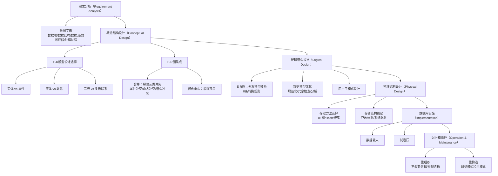

## 一句话总结
数据库设计是对于一个给定的应用环境，构造优化的数据库逻辑模式和物理结构，并据此建立数据库及其应用系统的过程；其核心流程按新奥尔良方法分为六个阶段：需求分析 → 概念结构设计 → 逻辑结构设计 → 物理结构设计 → 数据库实施 → 数据库运行和维护。

> 🔴 **期末必考**：六阶段名称 + 顺序 + 各阶段产出物 + 哪些独立于 DBMS

## 知识地图

## 核心概念

### 1. 数据库设计的定义与特点

**数据库设计**：对于一个给定的应用环境，构造（设计）优化的数据库逻辑模式和物理结构，并据此建立数据库及其应用系统，使之能够有效地存储和管理数据，满足各种用户的应用需求，包括信息管理要求（数据需求——在数据库中应该存储和管理哪些数据对象）和数据操作要求（处理需求——对数据对象需要进行的查询、增删改、统计等操作）。

**数据库设计的特点**：
- **"三分技术，七分管理，十二分基础数据"**：技术只是成功的一部分，项目管理和基础数据（数据的收集、整理、组织和不断更新）是更关键的要素。
- **结构（数据）设计和行为（处理）设计相结合**：传统软件工程重行为设计、忽视数据结构设计决策；早期数据库设计重结构设计、忽视行为设计——现代方法要求两者紧密结合。

### 2. 数据库设计的六个阶段（新奥尔良方法）

新奥尔良方法按照结构化系统设计方法，将数据库设计划分为六个阶段：

| 阶段 | 核心工作 | 独立性 | 🔴 考点 |
|------|---------|--------|---------|
| **需求分析** | 调查用户需求，产生产品需求规格说明书和数据字典 | 独立于任何数据库管理系统（DBMS） | 数据字典在此阶段建立 |
| **概念结构设计** | 形成独立于具体 DBMS 的概念模型（E-R 图） | 独立于任何 DBMS | E-R 模型四个设计选择 |
| **逻辑结构设计** | 将概念模型转换为 DBMS 支持的数据模型，进行优化 | 与选用的 DBMS 密切相关 | E-R→关系 8 条规则、规范化优化 |
| **物理结构设计** | 为逻辑数据模型选取最适合应用环境的物理结构（存储结构和存取方法） | 与选用的 DBMS 密切相关 | B+树/Hash/聚簇的选择条件 |
| **数据库实施** | 构建数据库，编写调试应用程序，组织数据入库并试运行 | — | 试运行阶段须做好转储和恢复 |
| **数据库运行和维护** | 正式运行，持续评估、调整与修改 | — | ⭐ 重组织 vs 重构造 |

> 设计一个完善的数据库应用系统往往是上述六个阶段的不断反复。

### 3. 需求分析与数据字典

**需求分析的任务**：详细调查现实世界要处理的对象，充分了解原系统工作概况，明确用户的三种需求：
- **信息要求**：用户需要从数据库中获得信息的内容与性质，由此导出数据要求
- **处理要求**：用户要完成的处理功能及对处理性能的要求
- **安全性与完整性要求**

> 🔴 **期末高频考点**：数据字典 = 元数据（不是数据本身），五类条目常以填空/简答出现。

**数据字典**：关于数据库中数据的描述，即**元数据**（不是数据本身），在需求分析阶段建立，在后续设计过程中不断修改、充实、完善。包含五类内容：

| 条目 | 说明 | 关键描述项 |
|------|------|-----------|
| **数据项** | 不可再分的数据单位 | 数据项名、含义说明、别名、数据类型、长度、取值范围、取值含义、与其他数据项的逻辑关系 |
| **数据结构** | 反映数据之间的组合关系 | 数据结构名、含义说明、组成（数据项或数据结构列表） |
| **数据流** | 数据结构在系统内传输的路径 | 数据流名、说明、来源、去向、组成、平均流量、高峰期流量 |
| **数据存储** | 数据结构停留或保存的地方 | 数据存储名、说明、输入/输出数据流、组成、数据量、存取频度、存取方式 |
| **处理过程** | 处理逻辑的描述性信息 | 处理过程名、说明、输入/输出数据流、简要处理说明 |

### 4. 概念结构设计：E-R 模型设计选择

概念结构设计是将需求分析得到的用户需求抽象为信息结构（概念模型）的过程。描述概念模型的主要工具是 **E-R 模型（实体-联系模型）**。

**概念模型的特点**：(1) 能真实、充分地反映现实世界；(2) 易于理解，便于与用户交流；(3) 易于更改；(4) 易于向各种数据模型转换。

**概念结构设计方法**：常用**混合策略**——自顶向下地进行需求分析，自底向上地设计概念结构。

**E-R 模型设计中的四个选择**：

| 设计选择 | 原则 |
|---------|------|
| **实体 vs 属性** | ① 属性必须是不可分的数据项，不能再具有需要描述的性质；② 属性不能与其他实体具有联系（E-R 图中联系是实体之间的联系） |
| **实体 vs 联系** | 实体是可以独立存在的持久对象；联系是因为某种需要或某件事情的发生而产生的信息。某些事件（如订单）也可抽象为实体 |
| **二元 vs 多元联系** | 取决于联系的语义描述需要。在只需使用两两联系且不会出现二义性时，可以考虑用若干个二元联系替代多元联系 |
| **属性的依附对象** | 实体上的属性是该实体的内在特征，不会因某些联系的出现而产生改变或消亡；联系上的属性用于描述因联系的发生而需要记录的信息，其值随联系产生而出现、随联系消亡而消亡 |

### 5. E-R 图集成

E-R 图集成一般分两步：

> 🔴 **期末必考**：三类冲突的名称 + 含义 + 解决方式（选择题/简答高频）

**第一步：合并**——解决各分 E-R 图之间的**三类冲突**：

| 冲突类型 | 说明 | 解决 |
|---------|------|------|
| **属性冲突** | 属性域冲突（类型/取值范围不同）、取值单位冲突 | 各部门讨论协商 |
| **命名冲突** | 同名异义（不同对象同名字）、异名同义（同对象不同名） | 通过协商等行政手段（换名） |
| **结构冲突** | 同一对象不同抽象（实体 vs 属性）、属性个数/次序不同、联系类型不同 | 统一抽象/取属性并集/综合联系类型 |

**第二步：修改和重构**——消除不必要的冗余。冗余数据是指可由基本数据导出的数据，冗余联系是指可由其他联系导出的联系。消除冗余主要采用分析方法（以数据字典和数据流图为依据）或规范化理论方法。

### 6. 逻辑结构设计：E-R 图向关系模型的转换

> 🔴 **期末必考**：8 条转换规则，特别是 m:n 必须独立成关系（简答/设计题核心）

将 E-R 图转换为关系模型的核心转换规则：

| 规则 | 转换对象 | 方法 |
|------|---------|------|
| 规则1 | 实体集 | 一个实体集 → 一个关系模式，实体的属性 → 关系的属性，实体的码 → 关系的码 |
| 规则2 | 多值属性 | 多值属性单独构成关系模式，属性 = 实体主码 + 多值属性，码 = 两者联合 |
| 规则3 | 1:1 联系 | 可独立成关系（各实体码均为候选码），也可与任一端关系合并 |
| 规则4 | 1:n 联系 | 可独立成关系（n 端实体码为关系的码），也可与 n 端关系合并（在 n 端加入 1 端码和联系属性） |
| 规则5 | m:n 联系 | 必须独立成关系模式，属性 = 各实体码 + 联系属性，码 = 各实体码的组合 |
| 规则6 | 多元联系 | 独立成关系模式，属性 = 各实体码 + 联系属性，码 = 各实体码的组合 |
| 规则7 | 单实体内部联系 | 参照二元联系转换规则 |
| 规则8 | ISA 联系 | 参照 ISA 联系的转换规则 |

**数据模型优化**：得到初步数据模型后，以规范化理论为指导进行优化：
- 确定每个关系模式内部各属性之间的数据依赖，按范式要求进行规范化设计
- 检查不同关系模式之间的冗余函数依赖，进行极小化处理
- 权衡规范化程度与查询效率——非 BCNF 的关系在只查询不更新的场景中可能更合适
- 必要时进行**水平分解**（按 80/20 原则将常用数据分离）或**垂直分解**（将常一起使用的属性分离，但必须保持无损连接性和保持函数依赖）

### 7. 物理结构设计

为逻辑数据模型选取最适合应用要求的物理结构，主要内容包括：

**存取方法选择**：
- **B+ 树索引**：属性经常出现在查询条件中、作为聚集函数参数、或出现在连接条件中时建立
- **Hash 索引**：属性主要出现在等值连接/等值比较中，且关系大小可预知或 DBMS 支持动态 Hash
- **聚簇**（Cluster）：将聚簇码上具有相同值的元组集中存放在连续的物理块中，可以大大提高按聚簇属性查询的效率。特别适用于 `ORDER BY`、`GROUP BY`、`UNION`、`DISTINCT` 等操作

**存储结构确定**：根据应用情况将易变部分与稳定部分分开存放、经常存取部分与存取频率较低部分分开存放（如将日志文件与数据库对象放在不同磁盘）。

**评价物理结构**：从存储空间、存取时间、维护代价三个维度定量估算各种方案，选择较优方案。

### 8. 数据库的实施和维护

**实施阶段**：数据载入（人工方法或计算机辅助）+ 应用程序联合调试 + 试运行（功能测试+性能测试）。试运行阶段必须做好数据库的转储和恢复工作。

**运行和维护**：数据库管理员（DBA）负责：
- 数据库的转储和恢复
- 安全性、完整性控制
- 数据库性能的监督、分析和改进
- **数据库的重组织**：记录增删改导致物理存储变坏时，按原设计要求重新安排存储位置、回收垃圾、减少指针链。**不改变原设计的数据逻辑结构和物理结构**。
- **数据库的重构造**：应用环境变化导致实体及联系发生变化时，调整数据库的模式和内模式（如增加/删除数据项、改变数据项类型、增加/删除表或索引）。重构造的程度有限——若变化太大，则表明现有数据库应用系统的生命周期已经结束，应重新设计。

## 难点突破

**1. 概念结构设计中"实体 vs 属性"的划分原则为什么重要？**

这个划分直接影响后续的 E-R 图结构和关系模式数量。核心判断标准有两步：

第一步问：**这个东西还有没有需要描述的属性？** 比如"职称"——如果只是"讲师"二字，它是属性；但如果不同职称有不同的工资、福利、住房标准，那"职称"就上升为实体。记住：属性是原子的、不可再分的。

第二步问：**这个东西会不会和其他实体发生联系？** 比如"病房"——如果只是病人住哪个病房，病房号是属性；但如果还要表达"哪个医生负责哪些病房"，病房就上升为实体。记住：属性不能与其他实体有联系。

类比：像是设计表格——如果某列的值会引出一个子表（不同职称对应不同待遇），那这列不该是列，该是另一张表的外键。

**2. E-R 图向关系模型转换时，为什么 1:1 和 1:n 联系可以合并，而 m:n 必须独立成关系？**

核心原因：m:n 联系的属性按关系的码组织时，**无法归属于参与联系的任何一端的实体**。比如"选修"联系中，成绩（grade）既不属于学生也不属于课程——它离开（学号, 课程号）这个组合就没有意义。而 1:n 的"属于"联系中，"入职日期"完全可以挂在多端职工的属性中。本质上，m:n → 必须独立成关系 = 不能用单实体的码唯一标识联系信息。

## 与前章关联

**依赖的前置知识**：
- **第6章规范化理论**：逻辑结构设计中的数据模型优化直接依赖函数依赖、范式、Armstrong 公理和模式分解理论——设计出关系模式后需要判断范式等级并进行规范化
- **第1章数据库系统概述**：数据库系统的三级模式两级映像——本章的"数据库设计过程中的各级模式"（需求→概念模式→逻辑模式→物理模式）与之对应
- **第3章SQL**：物理结构设计中的索引（B+ 树/Hash）需要用 SQL 的 `CREATE INDEX` 实现

**为后续章节打基础**：
- 第7章后续文件将深入 E-R 模型设计（第07章_2）和逻辑结构设计的具体技术（第07章_3）
- 第8章数据库编程中的存储过程、嵌入式 SQL 等是数据库实施阶段的编程工具

## 期末简答题

> 以下按题型组织，覆盖本章核心考点。答案要点已精简，考试时需适当展开。

### 简答题

**1. 简述数据库设计的六个阶段及各阶段主要任务。（★★★★★ 必考）**

| 阶段 | 任务 | 产出物 |
|------|------|--------|
| 需求分析 | 调查用户需求，明确信息要求、处理要求、安全完整性要求 | 需求规格说明书 + 数据字典 |
| 概念结构设计 | 将用户需求抽象为概念模型（E-R 图） | E-R 图（独立于 DBMS） |
| 逻辑结构设计 | E-R 图 → 关系模型，规范化优化 | 关系模式集合（依赖 DBMS） |
| 物理结构设计 | 选择存取方法和存储结构 | 物理存储方案（依赖 DBMS） |
| 数据库实施 | 建库、编程序、数据入库、试运行 | 可运行的数据库系统 |
| 运行和维护 | 正式运行，持续评估调整 | — |

记忆口诀：**需 → 概 → 逻 → 物 → 施 → 维**（需求概逻物施维）

---

**2. 什么是数据字典？包含哪些内容？它在哪个阶段建立？（★★★★）**

**答**：数据字典是**元数据**（关于数据库中数据的描述，不是数据本身），在**需求分析阶段**建立，后续不断完善。

五类条目：
- **数据项**：不可再分的数据单位（名、类型、长度、取值范围）
- **数据结构**：数据之间的组合关系（名、组成）
- **数据流**：数据结构在系统内的传输路径（来源、去向、组成、流量）
- **数据存储**：数据结构停留/保存处（输入/输出流、数据量、存取频度）
- **处理过程**：处理逻辑描述（输入/输出流、处理说明）

---

**3. E-R 图集成时会产生哪三类冲突？如何解决？（★★★★）**

| 冲突 | 含义 | 举例 | 解决 |
|------|------|------|------|
| **属性冲突** | 属性域/类型/单位不一致 | A 部门用"厘米"，B 部门用"米" | 协商统一 |
| **命名冲突** | 同名异义 / 异名同义 | A 叫"职工号"，B 叫"员工编号" | 换名统一 |
| **结构冲突** | 同一对象不同抽象层次 | A 把"部门"当实体，B 当属性 | 统一抽象 |

---

**4. E-R 图向关系模型转换时，1:1、1:n、m:n 联系分别如何处理？（★★★★★ 必考）**

| 联系类型 | 转换方式 | 关键点 |
|---------|---------|--------|
| **1:1** | 可独立成关系，也可与**任一端**合并 | 独立时两端实体码均为候选码 |
| **1:n** | 可独立成关系，也可与 **n 端**合并 | 合并时在 n 端加入 1 端码 + 联系属性 |
| **m:n** | **必须独立成关系模式** | 码 = 各实体码的组合，属性 = 各实体码 ∪ 联系属性 |

**为什么 m:n 必须独立？** 因为联系属性（如"成绩"）依赖于两实体的码组合，不能归入任何单端——离开（学号, 课程号）就没有意义。

---

**5. 数据库重组织和重构造的区别是什么？（★★★★）**

| | 重组织 | 重构造 |
|------|--------|--------|
| **是否改变逻辑/物理结构** | ❌ 不改变 | ✅ 调整模式/内模式 |
| **做什么** | 重新安排存储位置、回收垃圾、减少指针链 | 增删数据项、改变类型、增删表/索引 |
| **触发条件** | 增删改导致物理存储变坏、性能下降 | 应用环境变化，实体及联系发生变化 |
| **程度限制** | 无 | 有限——变化太大 → 重设计 |

记忆：**组织不动结构（整理房间），构造动结构（重新装修）**。

---

**6. E-R 模型设计中"实体 vs 属性"的划分原则是什么？（★★★）**

两个判断标准：
1. **属性不可再分**：属性不能有需要描述的子属性——如果某"属性"还有自己的属性，它应该是实体
2. **属性不与其他实体有联系**：E-R 图中联系只能发生在实体之间——如果某"属性"要和其他实体发生联系，它应该是实体

---

### 设计题专项

**7. 给定一个应用场景（如"学生选课系统"），完成：（★★★★★）**
1. 设计 E-R 图（含实体、属性、联系及基数约束）
2. 将 E-R 图转换为关系模式，标注主码和外码
3. 用规范化理论检查关系模式，至少达到 3NF

> 此类题目需结合 07-2（E-R 模型细节）和 07-3（逻辑结构设计）练习。本章掌握转换规则框架即可。

---

## 记忆卡片

**Q: 数据库设计的六个阶段（新奥尔良方法）是什么？哪些独立于 DBMS？**
**A:** 需求分析 → 概念结构设计 → 逻辑结构设计 → 物理结构设计 → 数据库实施 → 数据库运行和维护。其中需求分析和概念结构设计独立于任何 DBMS；逻辑结构设计和物理结构设计与选用的 DBMS 密切相关。

**Q: 数据字典包含哪五类内容？它是不是数据本身？**
**A:** 数据字典包含数据项、数据结构、数据流、数据存储、处理过程。数据字典是**元数据**（关于数据库中数据的描述），不是数据本身。它是在需求分析阶段建立的，在后续设计过程中不断修改和完善。

**Q: E-R 图集成时三类冲突是什么？各自的解决策略？**
**A:** (1) **属性冲突**（属性域冲突、取值单位冲突）→ 各部门讨论协商；(2) **命名冲突**（同名异义、异名同义）→ 通过协商等行政手段（换名）；(3) **结构冲突**（同一对象不同抽象、属性个数/次序不同、联系类型不同）→ 统一抽象/取属性并集/综合联系类型。

**Q: E-R 图向关系模型的转换中，1:1、1:n 和 m:n 联系分别如何处理？**
**A:** 1:1 联系可独立成关系或与任一端合并；1:n 联系可独立成关系（n 端实体码为码）或与 n 端合并（n 端加入 1 端码和联系属性）；**m:n 联系必须独立成关系模式**，属性 = 各实体码 + 联系属性，码 = 各实体码的组合。

**Q: 数据库的重组织和重构造有什么区别？**
**A:** 重组织不改变原设计的逻辑结构和物理结构——仅重新安排存储位置、回收垃圾、减少指针链，以提高性能。重构造则调整数据库的模式和内模式——增加/删除数据项、改变数据项类型、增加/删除表或索引，以适应应用环境的变化。重构造的程度有限——变化太大时表明系统生命周期结束，需重新设计。
