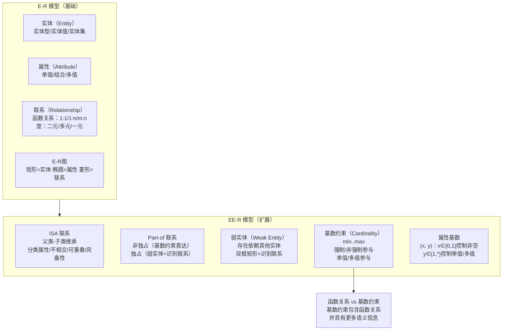

## 一句话总结
E-R 模型（实体-联系模型）用实体、属性和联系三个核心概念将现实世界需求转化为概念模型；EE-R 模型（扩展 E-R 模型）在此基础上引入 ISA 联系（继承关系）、Part-of 联系（部分-整体关系）、弱实体、基数约束和属性基数等扩展成分，以更精确地表达复杂的语义约束。

> 🔴 **期末必考**：E-R 图绘制 + EE-R 五种扩展成分的含义与表示法 + 基数约束的读写（设计题核心）

## 知识地图



## 核心概念

### 1. E-R 模型基本概念回顾

E-R 模型（Entity-Relationship model）的三个核心概念：

**实体（Entity）**：客观存在并可相互区别的事物。关键术语链：
- 实体名 → 实体型（Entity Type）= 实体名 + 所有属性名的集合
- 属性值 → 实体值（Entity Value / Entity Instance）= 一个实体的所有属性值的集合
- 实体集（Entity Set）= 同一类型实体的集合，同一实体集中的所有实体具有相同的实体型但实体值互不相同
- 码（Key）= 唯一标识实体的属性集，也被称为关键字、键、标识符（Identifier）

**属性（Attribute）**：实体具有的某一特性。每个属性有一个属性名，可取的值的集合称为该属性的域（Domain）。

**联系（Relationship）**：现实世界中事物内部以及事物之间的联系，在信息世界中反映为实体（型）内部/之间的关联。描述内容包括：联系名、联系的属性、联系的度（参与联系的实体型数目）、联系的函数关系。

### 2. E-R 图表示法

| 元素 | 图形 | 说明 |
|------|------|------|
| 实体型 | 矩形 | 框内写实体名 |
| 属性 | 椭圆 | 用无向边连接到对应的实体型 |
| 联系 | 菱形 | 框内写联系名，用无向边连接参与实体型，边旁标注联系类型（1:1/1:n/m:n），联系可以具有属性 |

### 3. 联系的分类

**按参与实体型的个数（度/Degree）**：
- 二元联系（度=2）：两个实体型之间的联系
- 多元联系（度=N，N≥3）：三个或多个实体型之间的联系
- 一元联系（Ring/Recursive）：单个实体集内部的联系（如职工之间的领导关系）

注意：参与联系的实体型数目，与参与到一个联系中的实体的个数不一定等价。更准确地说，参与到一个联系中的实体的个数才是联系的度。例如"领导"联系是一元联系（只有一个实体型"职工"），但联系的度是 2（领导和被领导两个角色）。

**按函数关系（二元联系）**：

| 类型 | 定义 | 例子 |
|------|------|------|
| 1:1 | A 中每个实体至多与 B 中一个实体联系，反之亦然 | 居民 ↔ 身份证 |
| 1:n | A 中每个实体与 B 中 n 个实体联系，B 中每个实体至多与 A 中一个实体联系 | 宿舍 → 学生 |
| m:n | A 中每个实体与 B 中 n 个实体联系，B 中每个实体与 A 中 m 个实体联系 | 学生 ↔ 课程（选修） |

> 🔴 **考点**：给定两个实体型及其业务规则，判断联系类型（1:1/1:n/m:n）。关键技巧——分别从两端出发问"至多几个"。

### 4. EE-R 扩展之一：ISA 联系

> 🔴 **期末高频**：ISA 联系的约束组合（不相交+完全特化 / 可重叠+部分特化）常出选择题

ISA 联系（Generalization Hierarchies）描述"is a"语义——有的实体型是另一个实体型的子类型（父类-子类联系）。用 △ 符号表示。

**ISA 联系的性质**：
- 子类型**继承**父类型的所有属性
- 子类型也可以有**自己的属性**
- 子类型也可以有**自己的子类型**

**三种约束**：

| 约束 | 含义 | 表示法 |
|------|------|--------|
| **分类属性** | 父实体型中的一个属性，根据其值将实体分派到子实体型中 | 属性名标注在 △ 旁边 |
| **不相交约束**（Disjoint） | 父类中一个实体不能同时属于多个子类 | △ 中有叉号 "×" |
| **可重叠约束**（Overlapping） | 父类中一个实体可同时属于多个子类 | △ 中无叉号 |
| **完全特化**（Total Specialization） | 父类中每一个实体必须是某个子类中的实体 | 父类到子类用**双线**连接 |
| **部分特化**（Partial Specialization） | 允许父类中某些实体不属于任何子类 | 父类到子类用**单线**连接 |

### 5. EE-R 扩展之二：Part-of 联系与弱实体

**Part-of 联系**描述某个实体型是另一个实体型的一部分，分两种情况：

| 类型 | 含义 | 表示法 |
|------|------|--------|
| **非独占 Part-of** | 整体被破坏，部分仍可独立存在 | 用基数约束表示（如 0..1） |
| **独占 Part-of** | 整体被破坏，部分不能存在 | 用弱实体 + 识别联系表示 |

**弱实体（Weak Entity）**：如果一个实体型的存在依赖于其他实体型的存在，则这个实体型叫做弱实体型，否则叫做强实体型。表示方法：
- 双矩形表示弱实体型
- 双菱形表示识别联系（独占联系）
- 从弱实体到识别联系的有向箭头表示依附关系

例如：订单行项目（Line_items）依赖于订单（Orders）存在——没有订单就没有行项目。

### 6. EE-R 扩展之三：基数约束（Cardinality Constraint）

基数约束是对实体间联系中数量关系的精确描述，用 `min..max` 表示（0 ≤ min ≤ max，* 代表无穷大）：

```
card(E, R) = min..max
```

| 维度 | 取值 | 约束名称 | 含义 |
|------|------|---------|------|
| min | 0 | 非强制参与（Optional） | 允许 E 中某些实体不参与联系 R |
| min | 1 | 强制参与（Mandatory） | 要求 E 中每个实体至少参与一次联系 R |
| max | 1 | 单值参与 | E 中每个实体在 R 中至多出现一次 |
| max | * | 多值参与 | E 中每个实体在 R 中可以出现多次 |

> 🔴 **期末高频**：基数约束的读写——给定 `min..max` 说出含义，或给定业务规则写出 `min..max`（填空/简答）

**基数约束与函数关系的关系**（以二元联系为例）：

| 联系类型 | E 的参与方式 | F 的参与方式 |
|---------|------------|------------|
| 一对一（1:1） | 单值参与（max=1） | 单值参与（max=1） |
| 多对多（m:n） | 多值参与（max=*） | 多值参与（max=*） |
| 多对一（m:1） | 多值参与（max=*） | 单值参与（max=1） |

**基数约束包含函数关系约束，并具有比函数关系更多的语义信息**。例如"汽车销售"中，一辆车在订单联系中最多只能出现一次（max=1，因为作为新车只能销售一次），单纯用"一对一"无法表达这种语义（可能产生歧义——汽车到底是"一"端还是"多"端？），但 `1..1` 或 `0..1` 的基数约束可以精确表达。

### 7. EE-R 扩展之四：属性基数

用二元组 `(x, y)` 描述一个实体在该属性上取值的数量特征：

| 参数 | 取值 | 含义 |
|------|------|------|
| x（最小） | 0 | 允许取空值（optional） |
| x（最小） | 1 | 不能取空值（required） |
| y（最大） | 1 | 单值属性（single-valued）或组合属性（composite） |
| y（最大） | * | 多值属性（multi-valued），取值是一个集合 |

当引入了属性基数约束后，不再需要用传统的"双线段"来表示多值属性——属性基数 `(x, *)` 本身就表达了"多值"的含义。

### 8. 属性的划分

**按区分实体的作用**：
- **标识符（Identifier）**：唯一标识一个实体实例的属性或属性集。一个实体集中可能存在多个 Identifier，DBA 从中选择一个作为主标识符（Primary Identifier），用下划线标识。对应关系数据库中的候选码/主码。
- **描述符（Descriptor）**：非键属性，仅起描述作用。

**按属性域的定义**：
- 单值属性（single-valued attribute）
- 组合属性（composite attribute）：一组简单属性共同描述一个特性（如 `student_name = lname + fname + midinitial`）
- 多值属性（multi-valued attribute）：一个实体实例可以有多个值（如 hobbies）

## 难点突破

**1. "函数关系"和"基数约束"到底有什么区别？为什么需要基数约束？**

函数关系（1:1, 1:n, m:n）只告诉你两端的"至多"关系，且描述是**双向对称**的——"A 对 B 是 1:n"等价于"B 对 A 是 n:1"。但现实设计中有些约束是**不对称且需要区分方向**的。

例如"贷款-还贷"联系中，一笔贷款（Loan）可以有多笔还款（Payment），每笔还款必须且只能对应一笔贷款。用函数关系说"贷款与还款是 1:n"没问题。但"新车销售"就不同——一辆车作为新车**最多只能被销售一次**（max=1），顾客可以买多辆车（max=*）。用函数关系说"车与顾客是 1:n"容易让人困惑：车到底是"一"端还是"多"端？其实语义是"汽车单值参与、顾客多值参与"——这叫多对一（m:1）。基数约束 `card(汽车)=0..1, card(顾客)=0..*` 则无歧义地表达了这种数量约束。

总之：**基数约束 = 函数关系 + min 信息 + 方向性标注**。对于复杂业务场景（尤其是需要区分"强制/非强制"和"单值/多值"参与时），基数约束比函数关系更精确。

**2. 弱实体和普通实体有什么本质区别？什么时候用弱实体而不是普通实体？**

本质区别：弱实体**不能独立存在**——它的存在依赖于（identifying owner）另一个实体。判断标准：删掉所有者实体后，这个实体还有意义吗？

- 普通实体：删掉学生，课程依然有意义 → 课程是强实体
- 弱实体：删掉订单（Orders），订单行项目（Line_items）没有存在的意义 → Line_items 是弱实体
- 非独占 Part-of：删掉汽车，轮子可以拆下来装到别的车上 → 轮子不用设计为弱实体

弱实体在关系模式转换时，其主码必须包含所依附实体的主码（即识别联系形成外键 + 部分键的复合主码）。

## 与前章关联

**依赖的前置知识**：
- **07-1 数据库设计概述**：E-R 模型设计选择和 E-R 图集成是概念结构设计阶段的核心——本笔记是对该阶段的详细展开
- **第2章关系数据模型**：实体/属性/码的概念与关系模型中元组/属性/候选码有直接对应——E-R 模型的 Identifier 对应关系模型的候选码
- **第6章规范化理论**：E-R 模型中的属性划分（标识符 vs 描述符）影响后续关系模式的函数依赖和范式判断

**为后续打基础**：三个案例中设计的 E-R/EER 图将直接用于 07-3（逻辑结构设计）中向关系模式的转换。

## 期末简答题

> 本章考点以**概念理解和 E-R 图绘制**为主，以下按题型组织。

### 简答题

**1. E-R 模型的三个核心概念是什么？各自的图形表示？（★★★★★ 必考）**

| 概念 | 图形 | 说明 |
|------|------|------|
| **实体** | 矩形 | 客观存在且可相互区别的事物 |
| **属性** | 椭圆 | 实体的某一特性，用无向边连接到实体 |
| **联系** | 菱形 | 实体间关联，用无向边连接参与实体，边旁标注 1:1/1:n/m:n |

---

**2. 二元联系按函数关系分为哪三类？各举一例。（★★★★）**

| 类型 | A→B | B→A | 例子 |
|------|-----|-----|------|
| **1:1** | 至多 1 | 至多 1 | 居民—身份证 |
| **1:n** | 至多 n | 至多 1 | 宿舍—学生 |
| **m:n** | 至多 n | 至多 m | 学生—课程（选修） |

判断技巧：分别站在 A 端和 B 端，问"一个 A 至多对应几个 B？"和"一个 B 至多对应几个 A？"

---

**3. 请解释 ISA 联系的三种约束：分类属性、不相交/可重叠、完全/部分特化。（★★★★★）**

| 约束 | 含义 | EE-R 表示 |
|------|------|----------|
| **分类属性** | 父实体中一个属性，根据其值将实体分派到子类型 | 属性名标注在 △ 旁 |
| **不相交** (Disjoint) | 父类一个实体不能同时属于多个子类 | △ 中有叉号 "×" |
| **可重叠** (Overlapping) | 父类一个实体可同时属于多个子类 | △ 中无叉号 |
| **完全特化** (Total) | 父类中每个实体必须属于某个子类 | 父类→子类双线 |
| **部分特化** (Partial) | 允许某些父类实体不属于任何子类 | 父类→子类单线 |

常见组合：不相交+完全特化（如"员工→全职/兼职"，每人必须选一个且只能选一个）

---

**4. 什么是弱实体？在 EE-R 图中如何表示？与强实体有何区别？（★★★★）**

**答**：
- **定义**：存在依赖于其他实体型（标识所有者）的实体型。若标识所有者被删除，弱实体也不应存在。
- **EE-R 表示**：双矩形（弱实体型）+ 双菱形（识别联系）+ 有向箭头（依附方向）
- **与强实体区别**：弱实体不能独立存在；其主码 = 标识所有者主码 + 部分键
- **例子**：订单行项目（Line_items）依赖订单（Orders）——没有订单就没有行项目

---

**5. 基数约束 `min..max` 中，min 和 max 各控制什么？写出四种典型组合的含义。（★★★★）**

| 基数约束 | min 含义 | max 含义 | 名称 |
|---------|---------|---------|------|
| `0..1` | 非强制参与 | 单值参与 | 可选单值 |
| `1..1` | 强制参与 | 单值参与 | 强制单值 |
| `0..*` | 非强制参与 | 多值参与 | 可选多值 |
| `1..*` | 强制参与 | 多值参与 | 强制多值 |

min∈{0,1} 控制强制/非强制；max∈{1,*} 控制单值/多值。

---

**6. 函数关系（1:1/1:n/m:n）和基数约束（min..max）有什么区别？为什么需要基数约束？（★★★★）**

**答**：函数关系只描述"至多"关系且双向对称——"A 对 B 是 1:n"等价于"B 对 A 是 n:1"。但无法表达：
- min 信息（强制/非强制参与）
- 方向性细节（如"新车销售"中汽车最多被卖一次 max=1）

**基数约束 = 函数关系 + min 信息 + 方向性标注**，能精确表达每个实体型独立参与联系的数量限制。

---

**7. 属性基数 `(x, y)` 中各参数的含义是什么？`(0, 1)` 和 `(1, *)` 分别代表什么？（★★★）**

| 参数 | 取值 | 含义 |
|------|------|------|
| x | 0 | 允许空值 |
| x | 1 | 不能为空 |
| y | 1 | 单值属性 |
| y | * | 多值属性 |

- `(0, 1)`：可空单值属性（如可选填的中间名）
- `(1, *)`：非空多值属性（如必须填且可有多个的爱好）

---

### 设计题专项

**8. 给定业务场景，画出 EE-R 图（含实体、属性、联系、基数约束、弱实体、ISA）。（★★★★★ 必考）**

> 常见考题场景：公司-部门-员工（ISA 全职/兼职）、订单-商品-客户、学生-课程-教师、医院-病房-病人-医生

答题步骤：
1. 识别所有实体（名词）→ 用矩形
2. 识别属性 → 用椭圆，标注属性基数 (x,y)
3. 识别联系（动词）→ 用菱形，标注基数约束 min..max
4. 识别 ISA 层次 → 用 △，标注不相交/可重叠 + 完全/部分特化
5. 识别弱实体 → 双矩形 + 双菱形

---

## 记忆卡片

**Q: E-R 模型的三个核心概念是什么？E-R 图中如何表示它们？**
**A:** 实体（矩形）、属性（椭圆，用无向边连到实体）、联系（菱形，用无向边连到参与实体，边旁标注联系类型）。联系也可以有属性。

**Q: EE-R 模型相比 E-R 模型增加了哪些扩展成分？**
**A:** (1) ISA 联系（父类-子类继承，含分类属性/不相交/可重叠/完备性约束）；(2) Part-of 联系（非独占→基数约束表示，独占→弱实体+识别联系表示）；(3) 弱实体（存在依赖，双矩形+双菱形识别联系）；(4) 基数约束（min..max，强制/非强制参与 + 单值/多值参与）；(5) 属性基数（(x,y)约束属性是否可空和是否多值）。

**Q: 什么是弱实体？在 EER 图中如何表示？**
**A:** 弱实体是存在依赖于其他实体型的实体型——如果所依赖的实体被删除，弱实体也不能存在。用**双矩形**表示弱实体型，用**双菱形**表示识别联系，用从弱实体到识别联系的**有向箭头**表示依附关系。在关系模式转换时，弱实体的主码必须包含所依附实体的主码。

**Q: 基数约束 `0..*` 和 `1..1` 分别表示什么参与方式？**
**A:** `0..*` = 非强制多值参与（实体可以不参与联系，也可以多次参与）。`1..1` = 强制单值参与（每个实体必须参与且只参与一次联系）。基数约束的通用形式为 `min..max`，其中 min∈{0,1} 控制强制/非强制，max∈{1,*} 控制单值/多值。

**Q: 属性基数 `(0, 1)` 和 `(1, *)` 分别表示什么？**
**A:** `(0, 1)` = 可以取空值、最多一个值的单值属性（如可选的中间名）。`(1, *)` = 不能取空值、可以是多个值的多值属性（如必须填写且可能有多个爱好）。属性基数 `(x, y)` 中 x 控制可空性，y 控制单值/多值。
