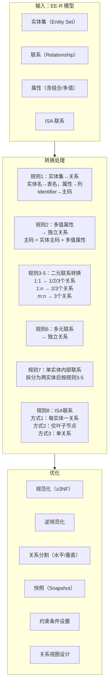

## 一句话总结
逻辑结构设计的核心任务是将 EE-R 概念模型转换为关系数据库模式：实体集转换为关系、联系（根据函数关系和参与基数）可转换为独立关系或合并到实体关系、非原子属性需特殊处理、ISA 联系有三种可选转换方式，最终通过规范化和性能调整得到优化的关系模式。

## 知识地图



## 核心概念

### 1. 基本转换方法

每个实体集被转换成一个关系，每个联系通常也被转换成一个关系：
- 关系及属性的命名采用原实体集及其属性的名称
- 实体的标识属性 → 关系的主码
- 联系转换得到的关系模式的属性由两部分组成：联系自身属性 + 参与联系的各实体集的标识属性（后者同时也是外码）

### 2. 非原子属性的处理

**组合属性（Composite Attribute）**：横向展开成多个简单列。如"学时"展开为理论学时、实验学时、实践学时。如果组合属性上定义了基数约束（如 `emp_address` 全空或全有值），需用表级 CHECK 约束而非列级约束来保证。

**多值属性（Multi-valued Attribute）**：两种处理方法：
- **方法一（不推荐）**：关系模式不变，原有关系的一个元组纵向展开成多个元组（满足 1NF 但引入冗余），主码变为（原主码 + 多值属性），关系最高只能满足 1NF
- **方法二（标准方法/规则2）**：将多值属性分解出去，与原实体的主标识符联合单独组成一个新关系。新关系的码由原实体主标识符和多值属性联合构成。

**多值+组合属性（如"课程班时间地点"含星期/节次/教室）**：先将组合属性展开，再将多值部分独立为新关系。

### 3. 二元联系转换规则（规则3-5）

综合考虑**函数关系**和**参与基数**（全参与 min=1 vs 非全参与 min=0）来决定转换方式：

#### 一对一（1:1）联系

| 参与情况 | 关系数 | 做法 |
|---------|--------|------|
| 双方都非全参与 | **3** | 两实体各一个关系 + 联系独立成一个关系（两实体码均为候选码和外码） |
| 一方全参与，一方非全参与 | **2** | 联系合并到全参与端的实体关系中（非全参与端的码作为外码加入） |
| 双方都全参与 | **1** | 全部合并为一个关系（两实体码均为候选码） |

**示例**：
- 电单车↔电池（都是非全参与）→ 3 个关系
- 人↔驾驶证（驾驶证全参与，人非全参与）→ 2 个关系（驾驶证合并联系人）
- 学生↔校园卡（都全参与）→ 1 个关系

#### 一对多（1:n）联系

| 多端参与情况 | 关系数 | 做法 |
|------------|--------|------|
| 多端全参与 | **2** | 联系合并到多端实体关系中（一端码作为外码加入多端） |
| 多端非全参与 | **3** | 不能合并到多端（因为多端某些实体没参与联系，外码会为 NULL），需联系独立成关系（但可合并相同码的关系） |

#### 多对多（m:n）联系

**始终转换为 3 个关系**：两实体各一个关系 + 联系独立成关系。联系关系的码由两实体的码联合构成，两实体的码同时也是联系关系的外码。

**综合示例**（教师-课程班-学生）：
```
教师(工号, 姓名)                   — 实体关系
课程班(课程班号, 学年, 学期, 课程号) — 实体关系（授课联系已合并）
课程(课程号, 课程名)               — 实体关系
学生(学号, 姓名)                   — 实体关系
主讲(工号, 课程班号)               — 联系关系（1:n 也可合并到课程班）
修读(学号, 课程班号, 成绩)         — 联系关系（m:n 必须独立）
```

### 4. 多元联系与单实体内部联系（规则6-7）

**规则6（多元联系）**：每个实体集转换成一个关系，联系单独转换成一个关系。联系关系的属性 = 联系自身属性 + 各参与实体主码。码一般由所有参与实体主码联合组成，但需要通过后续规范化设计确认。

**规则7（单实体内部联系）**：先将联系拆分为两个实体集之间的二元联系（根据所担当的角色划分 E₁ 和 E₂），再按二元联系规则转换，最后将两个实体集合并为一个（因为它们本质是同一个实体集）。

三种情况：
- **内部一对一**：最终保留 2 个关系（实体关系 + 联系关系），需区分清楚哪个外码对应哪个角色
- **内部一对多**：联系合并到单值参与端，最终只需 1 个关系。如职工管理：`职工(工号, 姓名, ..., 上级职工工号)`，其中上级职工工号是外码参照自身
- **内部多对多**：最终保留 2 个关系（实体关系 + 联系关系），如 Bill of Materials

### 5. ISA 联系的转换（规则8）

三种转换方式（假设超实体 S 有两个子实体 E₁ 和 E₂）：

| 方式 | 关系数 | 做法 | 适用场景 |
|------|--------|------|---------|
| **方式1** | 1 + N（每实体一关系） | 每个实体集单独转换为一个关系，均含超实体主码 k 作为主码 | 一般 ISA 联系的默认方案 |
| **方式2** | N（仅叶子节点） | 只有最底层的叶子节点被转换为关系，继承从叶子到根的所有超实体属性 | 不相交、完全特化的 ISA 联系（如师生员工→学生/教师/职工） |
| **方式3** | 1（单关系） | 所有实体集合并为一个关系，包含所有属性 | 子实体差别不大的情况 |

**实际应用**：通常方式2用于"不相交+完全特化"（如学生/教师/职工不可重叠），其他 ISA 联系用方式1。同一继承层次的不同层级也可混合使用不同方式（如第一层 ISA 用方式2，第二层用方式1）。

### 6. 转换后处理：规范化与性能调整

**规范化**：对转换得到的关系模式进行关系规范化设计，确保所有关系模式至少满足第三范式（3NF）——转换规则得到的初步模式中主码定义不一定正确，需通过规范化验证、纠错和补充。

**性能调整**：
- **逆规范化**：减少连接运算次数，提高查询性能（如将常被一起查询的表合并）
- **关系分割**：水平分割（按行分，如按年份分区）和垂直分割（按列分，不同于规范化分解，是将不常一起使用的列分离）
- **快照（Snapshot）**：用 `CREATE SNAPSHOT <name> AS <select>` 将查询结果持久化为不可修改的数据副本，适合业绩统计、库存盘点等场景。可由 DBMS 周期性自动刷新或用户手动刷新。

### 7. 约束条件设置与视图设计

**约束条件**：完整性约束、安全性约束、数据类型约束、数据量约束、重新定义每个表的候选键/主码/外码。

**关系视图**：在关系模式基础上设计用户外模式，通过 VIEW 提供。作用：(1) 提供数据逻辑独立性；(2) 满足不同用户的不同数据需求；(3) 提供数据安全/保密功能。

## 难点突破

**1. 为什么 1:n 联系中多端"非全参与"时必须用 3 个关系而不能合并？**

核心问题在于**外码不能为 NULL 时仍保持语义**。如果多端是非全参与（`min=0`），意味着多端有些实体不参与联系。如果把联系合并到多端关系中，这些不参与联系的实体对应的外码列就是 NULL。虽然 SQL 允许 NULL 外码，但这在语义上不干净——NULL 既不违反参照完整性，又无法区分"没有参与联系"和"参与了但值未知"。

而且，当多端非全参与时，如果把联系合并到一端关系中，一端关系就要存储多条记录（每个参与联系的多端实体一条），这违反了一端的主码唯一性。所以只能 3 个关系——两个实体各自独立，联系也独立。

相比之下，多端全参与（`min=1`）时，每个多端实体都必然参与联系，外码一定非 NULL，合并到多端就没有语义问题。这就是为什么参与基数直接影响转换出的关系数量。

**2. ISA 联系的三种转换方式如何选择？为什么"不相交+完全特化"适合方式2？**

方式1（每实体一个关系）最通用，但查询"全部学生信息"需要 JOIN 子表。
方式2（仅叶子节点）避免了 JOIN——超实体属性已复制到每个子表中。但如果父类实体可以不属于任何子类（部分特化），就没有表去存放这些"无归属"实体了——所以方式2要求完全特化。如果重叠约束允许，同一实体出现在多个子表中，属性就冗余了——所以方式2要求不相交。
方式3（单关系）最简单但浪费空间——所有子类特有属性都需要允许 NULL。

选择原则：
- 子类差异大、很少跨子类查询 → 方式1
- 子类划分明确且互斥（不相交+完全特化）→ 方式2（减少 JOIN）
- 子类属性少、常跨子类统一查询 → 方式3

## 与前章关联

**依赖的前置知识**：
- **07-2 E-R模型与EE-R模型**：实体/属性/联系、基数约束（min..max）、ISA 联系——本笔记的转换规则直接建立在这些概念上，基数值决定了转换出的关系数量
- **第6章规范化理论**：转换后的关系模式需经规范化验证——函数依赖和范式判断帮助验证主码定义是否正确
- **第2章关系数据模型**：关系、候选码、外码的概念是所有转换规则的基础

**为后续打基础**：本笔记的转换规则直接用于数据库设计案例和考试中的综合设计题——给定 ER 图/需求描述，写出关系模式。

## 记忆卡片

**Q: EE-R 模型向关系模型转换的基本方法是什么？多值属性如何处理？**
**A:** 基本方法：每个实体集转换为一个关系（实体名→表名，属性→列，标识符→主码），每个联系通常也转换为一个关系（联系属性 + 各实体标识符作为外码）。多值属性的标准处理方法（规则2）：将多值属性与实体主码联合组成一个新关系，新关系的主码 = 实体主码 + 多值属性。

**Q: 1:1 联系根据参与基数不同，分别转换为几个关系？**
**A:** 双方都非全参与 → **3 个**关系（实体各一 + 联系独立，两实体码均为候选码）；一方全参与一方非全参与 → **2 个**关系（联系合并到全参与端）；双方都全参与 → **1 个**关系（全部合并，两实体码均为候选码）。

**Q: 1:n 和 m:n 联系各转换为几个关系？为什么 m:n 不能合并？**
**A:** 1:n 联系：多端全参与时 **2 个**关系（联系合并到多端），多端非全参与时 **3 个**关系。m:n 联系始终 **3 个**关系——因为联系属性无法归属于任何一端实体（如"选修"的"成绩"既不属于学生也不属于课程），必须独立成关系。联系关系的码 = 两实体码的联合。

**Q: ISA 联系有哪三种转换方式？各适用于什么场景？**
**A:** 方式1（每实体一个关系）→ 默认通用方案；方式2（仅叶子节点，继承所有超实体属性）→ 适用于不相交+完全特化的 ISA 联系；方式3（所有实体合并为单关系）→ 适用于子实体差别不大的场景。不同层级可混合使用不同方式。

---

## 考点标注

- ⭐⭐⭐ **二元联系转换（规则3-5）——必考综合设计题**：给定 ER 图或需求描述，写出关系模式，需同时考虑函数关系（1:1/1:n/m:n）和参与基数（全参与 vs 非全参与）决定拆几张表
- ⭐⭐⭐ **多值属性处理（规则2）**：标准方法——拆为独立关系，主码 = 原实体主码 + 多值属性
- ⭐⭐ **ISA 联系三种转换方式**：方式1（每实体一表，通用）、方式2（仅叶子节点，要求不相交+完全特化）、方式3（单关系，子类差异小）
- ⭐⭐ **内部联系（规则7）**：单实体内部 1:n 最终只需 1 个关系（外码自引用）；内部 m:n 需 2 个关系
- ⭐ **转换后处理四步**：规范化 ≥3NF → 性能调整（逆规范化/分割/快照）→ 约束设置 → 视图设计
- ⭐ **非原子属性**：组合属性横向展开；多值属性拆独立关系；多值+组合属性先展后拆

## 考前 Q&A

**Q: 逻辑结构设计转换完成后还需要做哪些处理？**
**A:** (1) 规范化（确保 ≥ 3NF）；(2) 性能调整（逆规范化减少连接、水平/垂直分割、快照）；(3) 约束条件设置（完整性、安全性、数据类型、重定义候选键/主码/外码）；(4) 关系视图设计（提供外模式，满足不同用户需求）。

---

## 期末可能题型

### 一、简答题

**简答1：为什么 m:n 联系必须独立成关系，不能合并到实体中？**
答：m:n 联系的属性（如"修读"的"成绩"）既不能归属于任一端实体的主码——因为两端都是多，合并到任一端都会造成该端主码重复。只能独立成关系，以两端实体主码的联合作为主码。

**简答2：1:n 联系中，多端"非全参与"时为什么不能合并到多端？**
答：非全参与（min=0）意味着多端某些实体不参与联系。如果合并到多端，不参与联系的行外码为 NULL——语义不干净，无法区分"未参与"和"参与了但值未知"。所以只能 3 个关系（两实体独立 + 联系独立）。

**简答3：ISA 联系的三种转换方式各适用于什么场景？**
答：方式1（每实体一关系）→ 通用默认；方式2（仅叶子节点）→ 不相交 + 完全特化的 ISA；方式3（单关系）→ 子实体属性差异不大。不同层级可混合使用。

### 二、设计题（给定需求/ER图，写出关系模式）

**设计题1**：某系统中有实体"学生"（学号, 姓名）和"社团"（社团号, 社团名），一个学生可加入多个社团，一个社团有多名学生，需记录加入时间。写出关系模式，标出主码和外码。
答：
- 学生（**学号**, 姓名）
- 社团（**社团号**, 社团名）
- 加入（**学号**, **社团号**, 加入时间），外码：学号→学生，社团号→社团
→ m:n 联系，始终 3 个关系，联系独立。

**设计题2**：实体"职工"（工号, 姓名），职工之间存在管理关系（一个职工管理多个职工，每个职工最多被一个职工管理）。写出关系模式。
答：职工（**工号**, 姓名, 上级工号），外码：上级工号→职工（工号）
→ 内部 1:n，合并到多端（下级），只需 1 个关系，外码自引用。

**设计题3**：实体"电单车"（车号, 颜色）和"电池"（电池号, 容量），一辆电单车可配 0 或多块电池，一块电池可属于 0 或一辆电单车。写出关系模式。
答：
- 电单车（**车号**, 颜色）
- 电池（**电池号**, 容量）
- 配备（**车号**, **电池号**），外码：车号→电单车，电池号→电池
→ 1:1 + 双方非全参与 → 3 个关系。

### 三、画图/转换题

**转换题**：给定一个 E-R 图含 ISA 联系（人员→学生/教师，不相交、完全特化，学生有学号/专业，教师有工号/职称，人员有身份证号/姓名/性别），用方式2写出关系模式。
答：
- 学生（**身份证号**, 姓名, 性别, 学号, 专业），主码=身份证号
- 教师（**身份证号**, 姓名, 性别, 工号, 职称），主码=身份证号
→ 方式2 仅叶子节点，超实体属性复制到每个子表。
