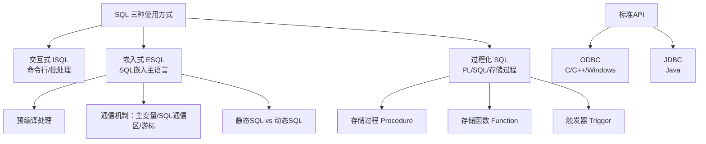

## 一句话总结

数据库编程解决"应用程序如何访问数据库"的问题——通过**嵌入式SQL（ESQL）、过程化SQL（PL/SQL、存储过程）、标准API（ODBC/JDBC）**三种方式，将 SQL 的数据操作能力集成到应用程序中。

## 知识地图



## 核心概念

### 1. SQL 的三种使用方式

> 🔴 **考点**：三种方式的适用场景和核心区别（选择题高频）

| 方式 | 执行位置 | 适用场景 | 典型形态 |
|------|---------|---------|---------|
| **交互式 SQL (ISQL)** | 客户端直接发送 | 临时查询、DBA 维护、批处理脚本 | 终端命令行、SQL 文件批量执行 |
| **嵌入式 SQL (ESQL)** | 嵌入主语言代码中 | 数据库应用程序开发 | `EXEC SQL ...` 嵌在 C/Java 中 |
| **过程化 SQL (PL/SQL)** | **服务器端**执行 | 复杂业务逻辑封装、触发器的自动响应 | 存储过程、存储函数、触发器 |

核心区别：ISQL 是人直接操作数据库；ESQL 是应用程序中的 SQL；PL/SQL 是跑在服务器上的程序。

---

### 2. 嵌入式 SQL：预编译处理流程

> 🔴 **考点**：预编译的作用——将 ESQL 语句转换为函数调用

```
源程序（含 EXEC SQL）
      │
      ▼
┌──────────────┐
│  RDBMS 预编译器 │  ← 将 EXEC SQL 语句转换为 DBMS 提供的函数调用
└──────────────┘
      │
      ▼
   纯主语言源程序
      │
      ▼
┌──────────────┐
│  主语言编译器   │  ← 正常编译
└──────────────┘
      │
      ▼
   目标文件 (.obj)
      │
      ▼
┌──────────────┐
│    链接器      │  ← 链接 DBMS 库函数
└──────────────┘
      │
      ▼
   可执行程序
```

**为什么需要预编译？** 主语言的编译器不认识 `EXEC SQL` 语法。预编译器负责把 ESQL 语句翻译成对 DBMS 运行时库的函数调用，之后主语言编译器才能正常编译。

---

### 3. 嵌入式 SQL 的通信机制

ESQL 需要解决"主语言 ↔ 数据库"之间的数据传递，靠三种机制：

#### 3.1 主变量（Host Variable）

> 🔴 **考点**：主变量的声明位置、SQL 引用加 `:` 前缀、指示变量作用

| 概念 | 说明 |
|------|------|
| **声明** | 在主语言中按主语言语法声明（如 C 中 `int salary;`），放在 `EXEC SQL BEGIN DECLARE SECTION;` 和 `EXEC SQL END DECLARE SECTION;` 之间 |
| **SQL 中引用** | 前面加冒号 `:salary` 与 SQL 本身的变量/列名区分 |
| **输入主变量** | 应用程序 → 数据库（如 WHERE 条件中的值） |
| **输出主变量** | 数据库 → 应用程序（如 SELECT 结果 INTO 主变量） |
| **指示变量（Indicator Variable）** | 跟在主变量后面，值为 0 表示正常，负值表示 NULL |

实例（C 语言）：
```c
EXEC SQL BEGIN DECLARE SECTION;
    char name[20];
    int salary;
    short salary_ind;   // 指示变量
EXEC SQL END DECLARE SECTION;

// 输入：主变量传值给 SQL
EXEC SQL SELECT salary INTO :salary INDICATOR :salary_ind
         FROM employee WHERE ename = :name;
// 如果 salary_ind < 0，说明 salary 是 NULL
```

**为什么需要指示变量？** 主语言（如 C）没有 NULL 的概念——整数 0 是有意义的数值，不能用来表示"空"。指示变量专门标记数据库的 NULL 值。

#### 3.2 SQL 通信区（SQLCA）

> 🔴 **考点**：SQLCA 的作用、SQLCODE vs SQLSTATE

SQLCA 是一块数据结构，应用程序从中读取每条 SQL 语句执行后的状态。

| 字段 | 含义 | 典型判断 |
|------|------|---------|
| **SQLCODE** | 整型返回码 | 0 = 成功；100 = 无数据（NOT FOUND）；< 0 = 错误 |
| **SQLSTATE** | 5 字符标准状态码（SQL-92 标准） | '00000' = 成功；'02000' = 无数据 |

**SQLCODE vs SQLSTATE**：SQLCODE 是旧式整型码，各 DBMS 实现不同；SQLSTATE 是 ISO/ANSI 标准，跨 DBMS 一致。考试更可能考 SQLSTATE（标准）。

#### 3.3 游标（Cursor）

> 🔴 **期末必考**：游标的作用 + 生命周期四步骤 + 为什么 SELECT 单行和多行处理方式不同

**为什么需要游标？** 这是 ESQL 最核心的设计问题：

- SQL 是**集合操作**语言：`SELECT * FROM emp` 返回一个集合（多条记录）
- 主语言（C/Java）是**逐行处理**：一次只能处理一条记录
- **游标 = 集合到逐行的桥梁**：把查询结果集当作一个文件，游标是指向当前行的指针

**游标生命周期**：

```
DECLARE（定义，声明游标名+对应SELECT）
   │
   ▼
OPEN（打开，执行SELECT，游标指向结果集第一条之前）
   │
   ▼  ┌──────────────────┐
   └──│ FETCH（推进一行）  │ ← 循环执行，逐行取数据 INTO 主变量
      │ 检查 SQLSTATE     │
      └──────┬───────────┘
             │ SQLSTATE = '02000'（无更多数据）
             ▼
          CLOSE（关闭，释放资源）
```

```sql
EXEC SQL DECLARE emp_cursor CURSOR FOR
         SELECT ename, salary FROM employee WHERE deptno = :dept_no;
EXEC SQL OPEN emp_cursor;
while (1) {
    EXEC SQL FETCH emp_cursor INTO :name, :salary;
    if (SQLSTATE != '00000') break;  // 无更多数据
    // 处理当前行...
}
EXEC SQL CLOSE emp_cursor;
```

**为什么单行查询不用游标？** `SELECT ... INTO` 保证只返回一行（如按主键查询），直接 INTO 主变量即可。但多行结果必须用游标逐行 FETCH。

**游标的类型**（高级）：

| 分类维度 | 类型 | 说明 |
|---------|------|------|
| 按滚动能力 | 非滚动（FORWARD ONLY） | 只能 FETCH 下一行，不能回退 |
| 按滚动能力 | 滚动（SCROLL） | 可 `FETCH NEXT/PRIOR/FIRST/LAST/ABSOLUTE n/RELATIVE n` |
| 按敏感性 | 敏感（SENSITIVE） | 游标打开期间反映其他事务对数据的修改 |
| 按敏感性 | 不敏感（INSENSITIVE） | 游标打开后结果集固定，不受后续修改影响 |

---

### 4. 动态 SQL

> 🔴 **考点**：静态 SQL vs 动态 SQL 的区别和适用场景

| | 静态 SQL | 动态 SQL |
|------|---------|---------|
| **SQL 语句** | 编译时确定 | 运行时构造 |
| **适用场景** | 查询模式固定（如"按部门查员工"） | 查询条件灵活（如用户自定义筛选） |
| **性能** | 预编译优化，效率高 | 运行时编译，有额外开销 |
| **灵活性** | 低 | 高 |

**动态 SQL 三种执行方式**：

| 方式 | SQL 语句特点 | 示例场景 |
|------|------------|---------|
| **直接执行（EXECUTE IMMEDIATE）** | 非 SELECT、不包含主变量 | `EXEC SQL EXECUTE IMMEDIATE :sql_str;` |
| **准备后执行（PREPARE + EXECUTE）** | 非 SELECT、包含主变量（用 `?` 占位） | 带参数的 INSERT/DELETE/UPDATE |
| **动态游标（PREPARE + DECLARE CURSOR）** | SELECT 语句、查询条件在运行时确定 | 用户自定义查询 |

```sql
// 方式一：直接执行
EXEC SQL EXECUTE IMMEDIATE 'DELETE FROM emp WHERE deptno = 10';

// 方式二：准备后执行（带参数占位符 ?）
EXEC SQL PREPARE stmt FROM 'INSERT INTO emp VALUES (?, ?, ?)';
EXEC SQL EXECUTE stmt USING :id, :name, :salary;

// 方式三：动态游标
EXEC SQL PREPARE query FROM :user_entered_sql;
EXEC SQL DECLARE dyn_cursor CURSOR FOR query;
EXEC SQL OPEN dyn_cursor;
```

---

### 5. 过程化 SQL（PL/SQL）

> 🔴 **考点**：PL/SQL 块结构、存储过程 vs 存储函数、触发器的事件-条件-动作模型

#### 5.1 PL/SQL 块结构

```sql
DECLARE
    -- 声明部分（变量、常量、游标、异常等）
    v_salary NUMBER;
    v_name   VARCHAR2(20);
BEGIN
    -- 执行部分（SQL 语句 + 过程化语句）
    SELECT ename, salary INTO v_name, v_salary
    FROM employee WHERE empno = 1001;
    IF v_salary < 5000 THEN
        UPDATE employee SET salary = salary * 1.1 WHERE empno = 1001;
    END IF;
EXCEPTION
    -- 异常处理部分
    WHEN NO_DATA_FOUND THEN
        DBMS_OUTPUT.PUT_LINE('未找到员工');
    WHEN OTHERS THEN
        DBMS_OUTPUT.PUT_LINE('其他错误');
END;
```

三个部分：**DECLARE（声明）→ BEGIN（执行）→ EXCEPTION（异常）**。只有 BEGIN 是必须的。

#### 5.2 存储过程 vs 存储函数

| | 存储过程（Procedure） | 存储函数（Function） |
|------|-------------------|-------------------|
| **返回值** | 无强制要求，通过 OUT 参数传出 | **必须有返回值** |
| **调用方式** | `CALL proc_name(...)` 或 `EXEC proc_name(...)` | 可在 SQL 语句中调用 `SELECT func_name(...)` |
| **参数模式** | IN / OUT / INOUT 均可 | 通常只有 IN |
| **使用场景** | 批量更新、业务操作 | 计算、转换、作为 SQL 表达式一部分 |

```sql
-- 存储过程示例：给指定部门员工涨薪
CREATE PROCEDURE raise_salary(
    IN  dept_id   INT,
    IN  pct       DECIMAL(5,2),
    OUT total     INT
)
BEGIN
    UPDATE employee SET salary = salary * (1 + pct/100)
    WHERE deptno = dept_id;
    SELECT COUNT(*) INTO total FROM employee
    WHERE deptno = dept_id;
END;

CALL raise_salary(10, 5.0, @count);  -- 调用

-- 存储函数示例：计算税后工资
CREATE FUNCTION after_tax(salary DECIMAL(10,2))
RETURNS DECIMAL(10,2)
RETURN salary * 0.8;

SELECT ename, after_tax(salary) FROM employee;  -- 可在 SQL 中使用
```

**存储过程的优势（期末高频）**：
1. **减少网络通信**：整个逻辑在服务器端执行，只返回最终结果
2. **预编译优化**：第一次调用后编译好的执行计划被缓存
3. **安全封装**：用户只被授予 EXECUTE 权限，不需要底层表的直接访问权限
4. **业务逻辑复用**：多个应用程序共享同一份服务器端代码

#### 5.3 触发器（Trigger）

> 🔴 **期末高频考点**：触发器的 ECA 模型 + 行级 vs 语句级 + BEFORE vs AFTER vs INSTEAD OF

**定义**：触发器是特殊的存储过程，不由用户显式调用，而是由**特定事件自动触发**。

**ECA 模型（事件-条件-动作）**：

| 组件 | 含义 | 示例 |
|------|------|------|
| **Event（事件）** | 触发时机 | INSERT / DELETE / UPDATE ON 表名 |
| **Condition（条件）** | 触发条件（可选） | `WHEN (NEW.salary < 0)` 等条件检查 |
| **Action（动作）** | 触发后执行的操作 | PL/SQL 块：检查、级联修改、审计日志等 |

**触发时机和粒度**：

| 维度 | 选项 | 说明 |
|------|------|------|
| **时机** | BEFORE | 操作执行**前**触发（适合做检查、约束验证） |
| | AFTER | 操作执行**后**触发（适合做日志、审计、级联更新） |
| | INSTEAD OF | 替换原操作，通常用于视图上的插入/更新 |
| **粒度** | FOR EACH ROW（行级） | 每影响一行触发一次，可访问 `OLD`/`NEW` 行值 |
| | FOR EACH STATEMENT（语句级） | 每条 SQL 语句触发一次，不管影响多少行 |

```sql
-- 审计触发器示例：记录工资修改日志
CREATE TRIGGER audit_salary
AFTER UPDATE OF salary ON employee
FOR EACH ROW                        -- 行级触发器
WHEN (NEW.salary <> OLD.salary)     -- 条件：工资确实变了
BEGIN
    INSERT INTO audit_log(empno, old_sal, new_sal, change_time)
    VALUES (:OLD.empno, :OLD.salary, :NEW.salary, CURRENT_TIMESTAMP);
END;
```

**行级触发器中 OLD 和 NEW**：

| | OLD（修改前的行） | NEW（修改后的行） |
|------|------------------|-----------------|
| INSERT | 全是 NULL | 插入的新值 |
| DELETE | 被删除的旧值 | 全是 NULL |
| UPDATE | 修改前的旧值 | 修改后的新值 |

---

### 6. ODBC 与 JDBC

> 🔴 **考点**：ODBC/JDBC 的分层架构 + ODBC 句柄层次 + JDBC 核心接口

#### 6.1 ODBC 架构

```
┌─────────────────────────────────┐
│         应用程序（C/C++）         │
│         调用 ODBC API            │
└───────────────┬─────────────────┘
                │
┌───────────────▼─────────────────┐
│        ODBC 驱动程序管理器       │  ← 动态链接库，加载/卸载驱动
│      (Driver Manager)           │
└───────────────┬─────────────────┘
                │
      ┌─────────┼─────────┐
      ▼         ▼         ▼
┌──────────┐ ┌──────────┐ ┌──────────┐
│ Oracle   │ │ MySQL    │ │ SQL Srv  │  ← 各厂商提供的 ODBC 驱动
│ Driver   │ │ Driver   │ │ Driver   │
└────┬─────┘ └────┬─────┘ └────┬─────┘
     ▼            ▼            ▼
┌──────────┐ ┌──────────┐ ┌──────────┐
│ Oracle   │ │ MySQL    │ │ SQL Srv  │  ← 数据源
│ DB       │ │ DB       │ │ DB       │
└──────────┘ └──────────┘ └──────────┘
```

**ODBC 屏蔽了底层 DBMS 的差异**——应用程序只要调用 ODBC API，通过切换驱动即可连接不同数据库。

**ODBC 句柄层次**（重要，自顶向下逐层分配）：

```
环境句柄 (Environment Handle, HENV)
   │  分配：SQLAllocHandle(SQL_HANDLE_ENV, ...)
   ▼
连接句柄 (Connection Handle, HDBC)
   │  分配：SQLAllocHandle(SQL_HANDLE_DBC, ...)
   ▼
语句句柄 (Statement Handle, HSTMT)
     分配：SQLAllocHandle(SQL_HANDLE_STMT, ...)
```

分配顺序必须从上到下；释放时必须从下到上（语句→连接→环境）。

#### 6.2 JDBC 架构

JDBC 是 Java 版的标准数据库接口，在 `java.sql` 和 `javax.sql` 包中。

**核心接口**：

| 接口 | 作用 | 关键方法 |
|------|------|---------|
| **DriverManager** | 管理 JDBC 驱动，建立连接 | `getConnection(url, user, pwd)` |
| **Connection** | 代表一个数据库连接 | `createStatement()`, `prepareStatement()`, `setAutoCommit()`, `commit()`, `rollback()` |
| **Statement** | 执行静态 SQL | `executeQuery(sql)`, `executeUpdate(sql)` |
| **PreparedStatement** | 预编译 SQL（防注入、效率高） | `setInt(idx, val)`, `executeQuery()` |
| **CallableStatement** | 调用存储过程 | `setInt()`, `registerOutParameter()`, `execute()` |
| **ResultSet** | 查询结果集（类似游标） | `next()` 推进一行，`getString(col)`, `getInt(col)` |

```java
// JDBC 典型流程
Connection conn = DriverManager.getConnection(url, user, password);
PreparedStatement pstmt = conn.prepareStatement(
    "SELECT ename, salary FROM employee WHERE deptno = ?");
pstmt.setInt(1, 10);                        // 参数绑定
ResultSet rs = pstmt.executeQuery();
while (rs.next()) {                          // 逐行迭代（相当于 FETCH）
    String name = rs.getString("ename");
    int sal = rs.getInt("salary");
}
rs.close();
pstmt.close();
conn.close();
```

**Statement vs PreparedStatement vs CallableStatement**：

| | Statement | PreparedStatement | CallableStatement |
|------|-----------|-------------------|-------------------|
| **用途** | 静态 SQL | 带参数的 SQL（预编译） | 调用存储过程 |
| **SQL 注入防护** | ❌ | ✅（参数绑定） | ✅ |
| **性能** | 每次编译 | 一次编译，多次执行 | 调用现有过程 |

**ResultSet 类型**：

| 类型 | 说明 |
|------|------|
| TYPE_FORWARD_ONLY | 只能向前滚动（默认，类似非滚动游标） |
| TYPE_SCROLL_INSENSITIVE | 可前后滚动，不反映修改 |
| TYPE_SCROLL_SENSITIVE | 可前后滚动，反映修改 |

#### 6.3 ODBC vs JDBC 对比

| | ODBC | JDBC |
|------|------|------|
| **语言** | C/C++ | Java |
| **跨平台** | Windows 为主（也有 Unix ODBC） | 真正的跨平台（JVM） |
| **核心抽象** | 句柄（HENV → HDBC → HSTMT） | 接口（Connection → Statement → ResultSet） |
| **数据库连接** | `SQLConnect()` 或连接字符串 | `DriverManager.getConnection()` |
| **执行 SQL** | `SQLExecDirect()` | `Statement.executeQuery()` |
| **结果处理** | `SQLFetch()` + `SQLGetData()` | `ResultSet.next()` + `getString()` |

---

### 7. 三种编程方式全景对比

> 🔴 **期末综合题高频**：横向对比三种方式的执行位置、典型场景和优缺点

| | 嵌入式 SQL (ESQL) | 过程化 SQL (PL/SQL) | ODBC/JDBC |
|------|-------------------|---------------------|-----------|
| **执行位置** | 客户端（应用程序内） | **服务器端** | 客户端（通过驱动） |
| **SQL 与主语言** | 混合在同一源文件 | SQL 为主，加入过程化语法 | 主语言调用 API |
| **编译方式** | 预编译 → 编译 → 链接 | 在 DBMS 中编译存储 | 主语言常规编译 |
| **网络通信** | 每条 SQL 一次往返（多） | 整个代码块一次往返（少） | 同 ESQL（多） |
| **核心机制** | 主变量 + SQLCA + 游标 | 块结构 + 存储过程/函数/触发器 | 句柄层次 + 接口调用 |
| **适用场景** | 复杂 UI + 数据库操作混合 | 数据密集型批量逻辑、审计 | 三层架构的数据访问层 |

---

## 难点突破

**1. 为什么单行 SELECT 用 INTO，多行必须用游标？**

本质是"集合 vs 标量"的阻抗不匹配：
- `SELECT * FROM emp WHERE empno = 1001`（主键查）→ 最多一行 → 一个标量值可以直接赋值给主变量
- `SELECT * FROM emp WHERE deptno = 10` → 可能 50 行 → 50 行不能同时塞进一个主变量里
- 游标做了什么事？它不去"一次性装下"所有行，而是**维护了一个指针**——每次 FETCH 只移动一行，那一行的列值才 INTO 主变量

**2. 触发器为什么不能包含事务控制语句（COMMIT/ROLLBACK）？**

因为触发器是由触发它的 DML 语句所在的事务自动执行的——触发器的动作和触发语句属于**同一个事务**。如果触发器自己能 COMMIT，就会破坏事务的原子性。触发器出错 → 整个事务回滚。

**3. 什么时候用存储过程而不是在应用代码中写 SQL？**

决策标准：**数据密集型逻辑放服务器端**。如果一段逻辑需要执行多条 SQL 且中间结果不需要返回给用户（如"查出低库存商品→生成采购单→更新库存预警"），用存储过程只返回最终结果，避免多次网络往返。如果逻辑是 UI 交互驱动的（如用户填表单→点击→提交一条记录），直接在主语言中用 ESQL/JDBC 即可。

## 期末简答题

### 简答题

**1. SQL 有哪三种使用方式？各自的特点和适用场景？（★★★★★ 必考）**

| 方式 | 执行位置 | 特点 | 典型场景 |
|------|---------|------|---------|
| **交互式 SQL (ISQL)** | 客户端→服务器 | 即时输入、即时执行、即时返回 | DBA 维护、临时查询 |
| **嵌入式 SQL (ESQL)** | 嵌入主语言（C/Java） | 预编译、主变量通信、游标处理多行 | 应用程序开发 |
| **过程化 SQL (PL/SQL)** | **服务器端** | 块结构、预编译缓存、支持变量/循环/条件 | 存储过程、函数、触发器 |

---

**2. 嵌入式 SQL 中主变量、SQLCA、游标分别解决什么问题？（★★★★★ 必考）**

| 机制 | 解决的核心问题 | 一句话 |
|------|-------------|--------|
| **主变量** | 主语言 ↔ SQL 之间的数据传递 | SQL 引用时加 `:` 前缀，分输入/输出 |
| **SQLCA** | 应用程序如何知道 SQL 执行状态 | SQLCODE=0 成功，SQLSTATE='00000' 成功 |
| **游标** | 主语言逐行处理 vs SQL 集合返回 | DECLARE→OPEN→FETCH→CLOSE 桥接集合与逐行 |

补充：**指示变量**解决 NULL 传递——主语言（如 C）没有 NULL 概念，整数 0 不能表示空值，指示变量 < 0 标记 NULL。

---

**3. 游标的生命周期是什么？为什么单行查询不需要游标而多行查询需要？（★★★★）**

生命周期：**DECLARE → OPEN → FETCH（循环）→ CLOSE**

- **单行不需要**：`SELECT ... INTO :变量` 最多返回一行，可以直接赋值给主变量
- **多行必须用**：SQL 返回集合，主语言一次处理一条，游标相当于指向当前行的指针，每次 FETCH 推进一行

---

**4. 静态 SQL 和动态 SQL 的区别？动态 SQL 有哪三种执行方式？（★★★★）**

| | 静态 SQL | 动态 SQL |
|------|---------|---------|
| SQL 语句 | 编译时确定 | 运行时构造 |
| 性能 | 预编译，高 | 运行时编译，有开销 |
| 灵活性 | 低 | 高 |

三种执行方式：
- **EXECUTE IMMEDIATE**：非 SELECT、无主变量
- **PREPARE + EXECUTE**：非 SELECT、有主变量（`?` 占位符）
- **PREPARE + DECLARE CURSOR**：动态 SELECT 查询

---

**5. 存储过程和存储函数有什么区别？（★★★★）**

| | 存储过程 (Procedure) | 存储函数 (Function) |
|------|-------------------|-------------------|
| **返回值** | 无强制，通过 OUT 参数传出 | **必须有 RETURN 返回值** |
| **调用** | `CALL proc(...)` | 可在 SQL 中使用 `SELECT func(...)` |
| **参数** | IN / OUT / INOUT | 通常只有 IN |

---

**6. 存储过程相比直接发送 SQL 有什么优势？（★★★★）**

1. **减少网络通信**：整个代码块在服务器端执行，只返回最终结果
2. **预编译优化**：首次调用后执行计划缓存，后续调用更快
3. **安全封装**：用户只需 EXECUTE 权限，不需底层表权限
4. **业务逻辑复用**：多个应用共享同一份代码

---

**7. 什么是触发器？解释 ECA 模型。BEFORE/AFTER/INSTEAD OF 的区别？行级和语句级触发器的区别？（★★★★★ 必考）**

**ECA 模型**：Event（事件：INSERT/DELETE/UPDATE）→ Condition（条件：WHEN）→ Action（动作：PL/SQL 块）

| 触发时机 | 说明 | 典型用途 |
|---------|------|---------|
| **BEFORE** | 操作前触发 | 数据验证、约束检查 |
| **AFTER** | 操作后触发 | 审计日志、级联更新 |
| **INSTEAD OF** | 替换原操作 | 视图上的插入/更新 |

| 粒度 | 说明 |
|------|------|
| **FOR EACH ROW（行级）** | 每影响一行触发一次，可用 `:OLD` / `:NEW` |
| **FOR EACH STATEMENT（语句级）** | 每条 SQL 触发一次，不管影响多少行 |

---

**8. 行级触发器中 `:OLD` 和 `:NEW` 分别代表什么？（★★★）**

| | OLD | NEW |
|------|-----|-----|
| INSERT | 全 NULL | 插入的新值 |
| DELETE | 被删除的旧值 | 全 NULL |
| UPDATE | 修改前的旧值 | 修改后的新值 |

---

**9. ODBC 的句柄层次是什么？分配和释放顺序？（★★★）**

```
分配（自上而下）：环境句柄(HENV) → 连接句柄(HDBC) → 语句句柄(HSTMT)
释放（自下而上）：语句句柄 → 连接句柄 → 环境句柄
```

---

**10. JDBC 中 Statement、PreparedStatement、CallableStatement 的区别？（★★★★）**

| | Statement | PreparedStatement | CallableStatement |
|------|-----------|-------------------|-------------------|
| **用途** | 静态 SQL | 带参预编译 SQL | 调用存储过程 |
| **SQL 注入防护** | ❌ | ✅ | ✅ |
| **性能** | 每次编译 | 一次编译多次执行 | 调用已有过程 |

---
