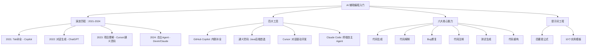

## 一句话总结

AI 是你的 Pair Programmer，不是你的替代品——基础越扎实，提示词越精准，AI 输出越高质量。

## 知识地图

## 核心概念

### 1. AI 辅助编程的演进历程 `[背景]`

AI 编程工具经历了四个阶段的演进，当前处于"AI 辅助人"向"人辅助 AI"的过渡阶段：

| 阶段 | 年份 | 代表工具 | 核心交互方式 | 能力边界 |
|------|------|---------|-------------|---------|
| Tab 补全 | 2021 | GitHub Copilot | 按 Tab 接受建议 | 单函数级 |
| 对话生成 | 2022 | ChatGPT | 聊天输入自然语言 | 文件级 |
| 项目理解 | 2023 | Cursor / 通义灵码 | 扫描整个项目上下文 | 项目级 |
| 自主 Agent | 2024 | Devin / Claude Code | 自主执行多步任务 | 任务级 |

范式转变的本质：开发者的信息获取方式从"搜索 + 社区问答"切换为"对话 + 即时生成"。

### 2. 四大主流工具 `[工具介绍]`

| 工具 | 定位 | 集成方式 | 核心优势 |
|------|------|---------|---------|
| GitHub Copilot | 微软/OpenAI 官方 | VS Code / IDEA 插件 | 代码补全、Inline Chat |
| Cursor | AI-First IDE | 独立 IDE（基于 VS Code） | 对话驱动、多文件理解 |
| 通义灵码（Lingma） | 阿里巴巴 | VS Code / IDEA 插件 | 国内网络友好、企业级场景 |
| ChatGPT / Claude | 通用 AI | Web / API | 架构设计、解释、代码审查 |

本课程主要使用 Cursor 和通义灵码。推荐：Java 后端开发用通义灵码，前端开发用 Cursor。

### 3. AI 编程的六大核心能力 ⭐ `考点` `[待强化]`

| 能力 | 描述 | 示例提示词 |
|------|------|-----------|
| 代码生成 | 从自然语言描述生成代码 | "实现一个二分查找函数" |
| 代码解释 | 理解并解释代码逻辑 | "解释这段代码做了什么" |
| Bug 修复 | 定位并修复错误 | "找出并修复这段代码的 bug" |
| 代码注释 | 自动生成文档注释 | "为这个函数生成 JavaDoc" |
| 测试生成 | 自动生成单元测试 | "为这个方法生成测试用例" |
| 代码重构 | 优化代码结构与质量 | "重构这段代码，提高可读性" |

### 4. Claude Code vs Copilot/Cursor 的本质区别 ⭐ `考点` `[待强化]`

| | Copilot / Cursor | Claude Code |
|------|---------|------------|
| 工作方式 | 编辑器内嵌，逐行补全 | 终端 Agent，自主完成多步任务 |
| 操作粒度 | 函数/文件级 | 整个项目级（读写文件、执行命令、管理 Git） |
| 交互模式 | 你写、AI 补 | 委托任务，AI 规划并执行全流程 |
| 最强场景 | 边写边补全 | 重构、添加功能、Debug、生成测试、代码审查 |

Claude Code 能读懂整个代码库的上下文，像懂项目的高级工程师，不只是补全代码，而是理解架构后再动手。

### 5. 提示词工程：四要素公式 ⭐ `考点` `[待强化：约束]`

**公式：`[角色] + [任务] + [约束] + [格式]`**

差的提示词："帮我修 bug"

好的提示词："作为一名熟悉 Java Spring Boot 的后端工程师，[角色] 分析以下代码中导致空指针异常的根本原因，[任务] 仅修改出错的方法，不要改动其他代码，[约束] 给出修复后的完整方法代码，并用一句话解释原因。[格式]"

**核心原则：约束越精确，AI 的输出越可控。** AI 不会自动猜测意图——它会忠实地执行指令，哪怕指令有歧义。

### 6. 10 个实用提示词模板 `[实操参考]`

**精准控制类（前 5 个）：**
1. "仅修复此问题，不要修改其他代码" — 防止改动范围过大
2. "请使用最小修改来解决此问题" — 保持现有代码风格一致
3. "换个思路来解决此问题" — 当前方案不满意时
4. "仔细阅读全文，检查是否还有其他同类问题" — 全局自我审查
5. "请为我梳理当前代码的整体逻辑" — 理解遗留代码

**代码质量类（后 5 个）：**
6. "请提供详细的解释和行内代码注释" — 可维护文档
7. "生成测试用例来验证此更改，包含正常路径和异常路径" — 测试覆盖
8. "增加详细的日志输出，方便追溯错误" — 调试辅助
9. "请简化代码逻辑，去除冗余部分" — 代码瘦身
10. "优化代码结构，使其更加模块化，方便单元测试" — 重构升级

### 7. 人与 AI 的正确分工 ⭐ `考点`

| 你的职责 | AI 的职责 |
|---------|---------|
| 理解业务需求 | 快速生成代码草稿 |
| 设计系统架构 | 自动补全重复模式代码 |
| 审查 AI 的输出 | 解释不熟悉的代码逻辑 |
| 评估代码质量与安全性 | 生成测试用例初稿 |
| 处理边界条件与异常场景 | 提供多种实现思路供选择 |
| 做最终的技术决策 | 执行重构和格式化任务 |

**基础越扎实 → 提示词越精准 → AI 输出越高质量 → 生产效率越高。** 那些最高效地使用 AI 工具的工程师，往往是技术基础最扎实的人。

## 难点突破

**难点：提示词工程的核心思维转变**

许多学生认为"提示词就是描述我想要什么"——这是错误理解。正确的思维模型是：

**提示词 = 给 AI 设定精确的约束边界。** AI 不会自动判断什么不该改、什么需要注意，它只会忠实执行指令。所以：
- "帮我修 bug" → AI 可能改任何东西，引入新问题
- "仅修复此问题，不要修改其他代码" → AI 被精确约束，改动可控

类比：AI 就像一个执行力极强但缺乏判断力的初级工程师——你说"把房间整理一下"，他可能把所有东西都扔掉；你说"把桌上的书按大小排列，其他东西不要动"，他就能做好。

**在你的提示词质量与你的基础能力之间的关系：** 提示词质量 ∝ 对问题的理解深度。如果你不理解什么是空指针异常，你就无法写出"分析导致空指针异常的根本原因，仅修改出错的方法"这样的提示词。

## 与前章关联

- 前置依赖：无（本讲是单元0的第一讲）
- 本讲建立的是"AI 工具认知框架"，回答"AI 在软件开发中能做什么、不能做什么"——这是后续所有章节使用 AI 的基础
- 四要素公式中的"约束"思维，与课程 Overview 中的四步范式"审查→优化"直接对应：好的提示词本身就应该包含约束，减少后续审查成本

## 记忆卡片

**Q: AI 编程的六大核心能力是什么？各举一例。**
> ①代码生成（"实现一个二分查找"）②代码解释（"解释这段代码"）③Bug 修复（"找出空指针原因"）④代码注释（"生成 JavaDoc"）⑤测试生成（"生成正常+异常路径用例"）⑥代码重构（"提高可读性"）

**Q: 好提示词的四要素公式是什么？核心原则是什么？**
> `[角色] + [任务] + [约束] + [格式]`。核心原则：约束越精确，AI 输出越可控。

**Q: 给出一个用四要素公式改写差提示词的例子。**
> 差："帮我修 bug" → 好："作为一名 Java 后端工程师，[角色] 分析以下代码中导致空指针异常的根本原因，[任务] 仅修改出错的方法，不要改动其他代码，[约束] 给出修复后的完整方法代码并用一句话解释原因。[格式]"

**Q: Copilot/Cursor 和 Claude Code 的本质区别？**
> Copilot/Cursor：编辑器内嵌，逐行补全，函数/文件级，"你写 AI 补"
> Claude Code：终端 Agent，自主多步任务，项目级，"委托任务 AI 全流程执行"

**Q: 人与 AI 的正确分工？（各列 3 项以上）**
> 你的职责：理解业务需求、设计系统架构、审查 AI 输出、评估质量与安全性、处理边界与异常、做最终技术决策
> AI 的职责：快速生成代码草稿、补全重复模式、解释不熟悉的代码、生成测试初稿、提供多种实现思路、执行重构与格式化
