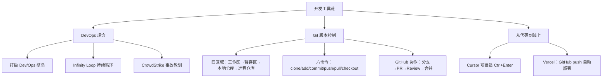

## 一句话总结

Git 让软件历史成为可查询、可回溯、可协作的数据库——版本控制是工程师最重要的职业习惯之一。

## 知识地图



## 核心概念

### 1. DevOps 核心理念

DevOps = 开发（Dev）+ 运维（Ops）+ 文化/工具/实践。

**核心价值：打破开发团队与运维团队之间的壁垒，让软件交付更快、更稳定。**

传统模式 vs DevOps 模式：
- 传统：开发写完代码 → 扔给运维 → 运维手动部署 → 出问题互相推责
- DevOps：代码提交 → 自动测试 → 自动构建 → 自动部署 → 监控反馈 → 持续改进（Infinity Loop）

**CrowdStrike 2024 全球宕机事件**是反面教材：一次配置更新同时推送给全球所有设备，850 万台 Windows 蓝屏，损失约 54 亿美元。如果有分阶段发布、自动化测试和自动回滚机制，这场灾难本可避免。

### 2. 实验工具链

```
Cursor/通义灵码 → Git（本地追踪）→ GitHub（远程仓库）→ Vercel（自动部署）
AI 辅助写代码 ← 每次提交都有记录 → 推送即部署，自动获得 HTTPS 域名
```

这是当前最主流的前端/全栈小团队开发工作流。

### 3. Git 的四个区域

| 区域 | 说明 | 类比 |
|------|------|------|
| 工作区（Working Directory） | 你正在编辑的文件 | 桌面草稿纸 |
| 暂存区（Index/Staging Area） | `git add` 后，"准备提交"的快照 | 决定装进信封的内容 |
| 本地仓库（Local Repository） | `git commit` 后，完整的版本历史（.git 目录） | 自己的档案柜 |
| 远程仓库（Remote Repository） | `git push` 后，GitHub/GitLab 上的副本 | 办公室公用云端文件柜 |

数据流：工作区 `→add→` 暂存区 `→commit→` 本地仓库 `→push→` 远程仓库 ← `pull/fetch` 反向同步。

### 4. 六个最常用的 Git 命令

| 命令 | 作用 |
|------|------|
| `git clone <url>` | 克隆远程仓库到本地 |
| `git add <file>` / `git add .` | 将文件添加到暂存区 |
| `git commit -m "msg"` | 提交到本地仓库（附上有意义的提交信息） |
| `git push origin main` | 推送到远程仓库 |
| `git pull origin main` | 从远程仓库拉取最新代码（= fetch + merge） |
| `git checkout -b <branch>` | 创建并切换到新分支 |

**关键习惯：每次 commit 只做一件事，写清楚 commit message。**

### 5. 查看与撤销

- `git status` — 查看工作区和暂存区的变动
- `git log --oneline` — 查看简洁的提交历史
- `git diff` — 查看未暂存的修改内容
- `git checkout -- filename` — 撤销工作区修改（不可恢复）
- `git reset HEAD filename` — 将文件从暂存区移出（不删除修改）
- `git reset --soft HEAD~1` — 撤销上一次 commit（保留修改在暂存区）

⚠️ `git reset --hard` 会永久丢弃修改，操作前需确认。

### 6. GitHub 团队协作工作流

```
git clone → git checkout -b feature/xxx → 写代码 → git add → git commit
→ git push origin feature/xxx → 创建 Pull Request → Code Review → 合并到 main
→ git pull origin main（同步最新代码）
```

### 7. Cursor 项目级 AI + Vercel 部署

**Cursor 项目级（`Ctrl+Enter`）** vs 普通 AI（`Ctrl+L`）：
- 普通 AI 只看当前文件上下文
- `Ctrl+Enter` 扫描所有文件，给出跨文件分析——适合理解陌生开源项目

**Vercel 三步部署：**
1. 连接 GitHub 授权
2. 导入仓库，Vercel 自动检测框架
3. 每次 `git push` 自动触发重新部署，获得 HTTPS 域名

**完整工作流：** 本地用 Cursor 开发 → `git add . && git commit && git push` → Vercel 自动检测新提交 → 新版本自动上线（约 1-2 分钟）

### 8. 工具链如何防止 Knight Capital 式灾难

| 传统问题 | 现代工具链解决方案 |
|---------|-----------------|
| 旧代码无人知晓存在哪里 | `git log` 完整追踪每次变更 |
| 手动逐台部署，容易漏掉 | Vercel 自动化部署，一次 push 全部更新 |
| 找不到上一个稳定版本 | `git tag v1.0` 标记稳定版，随时 `git checkout` 回退 |
| 无监控，异常持续 45 分钟 | Vercel 部署日志 + 错误告警（实时） |

## 难点突破

**难点：Git 四个区域的心理模型**

初学者最常见的困惑："我刚改了代码，为什么 commit 之前还要 add？"

将四个区域想象成拍照流程：
- **工作区** = 你在摆姿势（修改文件）
- **暂存区** = 你选好了要拍进这张照片的内容（`git add` —— 选择性快照）
- **本地仓库** = 按下快门，照片存进相册（`git commit` —— 永久记录）
- **远程仓库** = 把照片上传到云端相册分享（`git push`）

为什么不直接 commit？因为在实际开发中，你可能改了 5 个文件，但只想提交其中 3 个——`git add` 让你**选择性提交**。这就是 Git 区别于 SVN 等老式版本控制的核心设计。

---

## 📝 期末笔试视角 — 会考什么

### 大概率考点

**1. Git 四个区域 + 数据流向**（最核心）

必考。要求画出或描述四区域模型，标注 add / commit / push / pull 的方向。

答题框架：工作区 `→add→` 暂存区 `→commit→` 本地仓库 `→push→` 远程仓库；反向 `pull/fetch` 同步。四个区域各自的作用一句话说清。

**2. git add 和 git commit 为什么要分开？**

这是区分"用过 Git"和"理解 Git"的分水岭问题。标准答案：Git 允许**选择性提交**——改 5 个文件但只提交其中 3 个，add 用来精确控制哪些变更进入这次 commit。SVN 等老工具没有这个机制。

**3. DevOps 的核心理念 + Infinity Loop**

定义（Dev + Ops + 文化/工具/实践）+ 打破壁垒 + 持续循环（Plan → Code → Build → Test → Release → Deploy → Operate → Monitor → Plan）。用 CrowdStrike 事故作为反面案例：缺少分阶段发布和自动回滚。

**4. 事故案例分析**

CrowdStrike（DevOps 反面：一次配置全球推送，无分阶段，无自动回滚）和 Knight Capital（版本控制反面：旧代码遗留服务器，无版本追踪，无自动部署）。两题可能合并考"现代工具链如何防止这类事故"。

**5. GitHub 协作工作流的关键步骤**

分支 → PR → Code Review → 合并 → 同步。说清每个环节的作用：分支隔离开发、PR 请求合并并触发审查、Review 保障质量、合并后 pull 同步最新。

### 可能出小题的点

- `git status` / `git log --oneline` / `git diff` 各自的作用
- `git reset --soft` vs `git reset --hard` 的区别（--hard 不可恢复）
- `git pull` = `git fetch` + `git merge` 的等价关系
- Cursor `Ctrl+Enter`（项目级）vs `Ctrl+L`（文件级）的区别
- Squash merge 是什么？普通 merge / Squash merge / Rebase merge 三种策略的区别

---

## 🛠 实际工作视角 — 真正值钱的东西

### 1. "每次 commit 只做一件事"——比你想象的重要得多

这不是一句好听的教条。实际后果：
- `git bisect` 二分定位 bug 时，混杂了 5 个不相关改动的 commit 会让你无法判断是哪个改动引入的
- Code Review 时 reviewer 面对 500 行改了 3 个功能点的 commit 会直接放弃细看
- 需要回滚某个功能时，混杂的 commit 让你扔掉不该扔的代码

**实操**：写 commit message 用英文祈使句，格式 `类型: 简述`。如 `fix: handle null pointer in login flow`、`feat: add email verification`。

### 2. 暂存区（git add）是日常工作流里最灵活的环节

`git add -p`（交互式选择每个 hunk）是高级用法，允许你精确控制同一文件里改动的哪几行进这次 commit。这在你同时修了两个不同 bug 但改了同一文件时是救命的。

### 3. 分支 = 零成本的实验环境

实际工作中从不直接在 main 上提交。每条分支就是一个独立的实验沙盒——你可以随意 commit、破坏、重来，不影响 main。`git checkout -b` 是每天敲几十次的命令。

### 4. PR + Code Review = 工程界的同行评议

#### 4.1 完整流程（从写代码到合入 main）

```
1. git checkout -b feature/avatar-upload    ← 从 main 开出你自己的分支
2. 写代码，git add，git commit（可能很多次）
3. git push origin feature/avatar-upload    ← 推到 GitHub
4. 在 GitHub 上点 "New Pull Request"       ← 发起审查请求
5. 队友（或 Leader）逐行审查你的代码        ← Code Review
6. 审查通过 → 点 Merge → 你的代码合入 main
7. git checkout main && git pull             ← 同步最新 main
```

#### 4.2 PR（Pull Request）是什么？

字面翻译是"拉取请求"——你向团队说：**"我的代码写好了，放在我的分支上，请你们拉过去用。"**

创建 PR 时，作者需要在描述里写清楚三件事：
- **做了什么**（What）：新增头像上传功能，支持裁剪和压缩
- **为什么这样做**（Why）：用 Sharp 库而不是 Canvas API，因为服务端处理更可靠
- **如何测试**（How）：已测过 20MB 大图、非图片后缀、无登录状态等边缘情况

PR 是团队沟通的载体——不只是代码，还包括设计决策、权衡、已知限制。哪怕你一个人写项目，一个月的自己回看自己的 PR 描述也会感谢当初留下的上下文。

#### 4.3 Code Review 是什么？

Reviewer 逐行看 diff（改了什么），追问：
- "这个 3MB 的文件大小硬编码应该放配置里吧？"
- "如果用户上传的不是图片会报什么错？"
- "这里为什么用 `let` 而不是 `const`？"

**Code Review 的目的不是找茬**——是在代码合入 main **之前**发现问题。此时的修复成本极低（改一行即可），合入后再发现就是线上事故。

#### 4.4 Squash Merge — 把零碎 commit 压成一个干净的

你的分支上可能有 30 个很零碎的 commit：

```
feature/avatar-upload 分支：
  - "fix typo"
  - "测试一下"
  - "继续改"
  - "又改了一版"
  - "这次应该对了"
  ...共 30 个
```

这 30 个直接合并到 main，main 的 `git log` 变成垃圾堆——以后翻历史全是废话。

**Squash merge**：GitHub Merge 按钮的下拉菜单选 "Squash and merge"，30 个 commit 打包成一个干净的：

```
main 分支：
  feat: add avatar upload with crop and compression
```

你分支上 30 个零碎 commit 的历史仍保留在该分支上（不会被删），但 main 上只看到一条整洁的摘要。

| 合并策略 | 效果 | 适用场景 |
|---------|------|---------|
| 普通 merge | 所有 commit 原样保留 + 一条 merge commit | 需保留完整历史的大型项目 |
| Squash merge | 所有 commit 压成一个 | **大部分团队的标准做法** |
| Rebase merge | commit 逐个"挪"到 main 最新位置 | 追求线性历史 |

**为什么这很重要？** 一个干净的 `git log` 是团队的共享记忆——每一行都是一段有意义的变更，而不是 30 条"继续改"。

### 5. 工具链的集成效应 > 单个工具

Cursor（AI 写代码）→ Git（追踪变更）→ GitHub（协作 + 备份）→ Vercel（自动上线）这条链的价值远大于逐个使用。核心是：**push 即上线**——每次 `git push` 触发自动测试 + 自动部署，你不需要手动操作服务器。

### 6. 那些 git 命令是每天敲的，优先级排序

| 频率 | 命令 | 场景 |
|------|------|------|
| 几十次/天 | `git status`、`git diff` | 随时确认状态 |
| 十几次/天 | `git add`、`git commit` | 封装变更 |
| 几次/天 | `git push`、`git pull` | 同步远程 |
| 几次/周 | `git checkout -b`、`git log` | 开新分支、查历史 |
| 出问题时 | `git reset`、`git revert`、`git stash` | 回退、暂存临时变更 |

### 7. 两个"永远不要"的铁律

- **永远不要 `git push --force` 到 main**：会覆盖别人推送的 commit，造成永久丢失
- **永远不要在 `git reset --hard` 之前不备份**：先用 `git stash` 或切个临时分支保底

## 与前章关联

- 前置依赖：00-01（AI 辅助编程入门）—— Cursor 是本讲工具链的第一个环节
- 本讲建立的是"开发基础设施"认知：在进入软件工程核心模块之前，先掌握版本控制和部署的基本能力
- CrowdStrike 和 Knight Capital 的事故案例，贯穿后续课程中对"过程""质量""测试"的讨论

## 记忆卡片

**Q: Git 的四个区域是什么？**
A: 工作区（Working Directory）→ 暂存区（Index/Staging Area）→ 本地仓库（Local Repository）→ 远程仓库（Remote Repository）。数据通过 add/commit/push 依次流转。

**Q: 六个最常用的 Git 命令？**
A: `git clone`（克隆）、`git add`（暂存）、`git commit`（提交）、`git push`（推送）、`git pull`（拉取）、`git checkout -b`（创建切换分支）。

**Q: DevOps 的核心理念是什么？**
A: 打破开发（Dev）与运维（Ops）之间的壁垒，通过自动化测试、构建、部署的持续循环（Infinity Loop），让软件交付更快、更稳定。

**Q: Knight Capital 事故的根本原因？现代工具链如何防止？**
A: 1 台服务器未更新旧代码，无版本控制无法发现。现代方案：Git 追踪每个版本的每次变更 + 自动部署 + 快速回滚（`git revert`）+ 分支保护。

**Q: 每次 commit 最重要的习惯？**
A: 每次只做一件事，写清楚 commit message。这是 Knight Capital 事故的反面教训。
