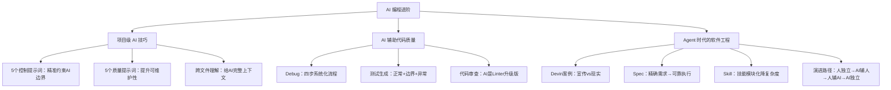

## 一句话总结

工具终将进化，工程思维永远有价值——AI 时代变得更重要的恰恰是需求表达、代码审查、架构设计这些软件工程基本功。

## 知识地图

## 核心概念

> 🎯 **期末考点分布说明**：本讲是 Unit 0 的收尾与拔高，概念辨析和趋势论述是笔试重点。标 🎯 的是可能出题的概念/流程/对比，标 🔧 的是日常工程高频使用但不太会直接考的实操内容。

### 1. 人与 AI 的四种关系 🎯

| 阶段 | 关系模式 | 特征 |
|------|---------|------|
| ① | 人独立 | 工程师独自解决所有问题 |
| ② | AI 辅助人 | AI 工具提高工程师生产效率 ← **当前所处** |
| ③ | 人辅助 AI | 工程师为 AI Agent 提供方向和审查 ← **正在进入** |
| ④ | AI 独立 | AI 自主完成端到端软件工程任务 ← 未来（距今还很远） |

Devin 案例的教训：AI 的宣传往往超前于现实（宣传 SWE-bench 13.86%，实测 1-3%），但趋势方向是真实的。**最高效的工程师 = 能精确指导 AI、能审查 AI 输出、能处理 AI 无法处理的边界。**

> 📝 **出题角度**：简答题——列出四种关系并说明当前所处阶段；论述题——结合 Devin 案例，谈"为什么宣传和数据有差距"，考察对 AI 能力边界的理解。

### 2. 10 个高效提示词（进阶版）🔧

> 🔧 **工程实战**：这 10 个提示词是日常编码的"肌肉记忆"，考试不太可能考你背提示词，但每一句都是实际工作中每天用的。建议收藏，用到熟练为止。

**精准控制类（5 个）：**
1. "仅修复此问题，不要修改其他代码" — 防止顺手"优化"
2. "请使用最小修改来解决此问题" — 减少 git diff 噪音
3. "换个思路来解决此问题" — 当前方案不满意时
4. "仔细阅读全文，检查是否还有其他同类问题" — 强制全局审查
5. "请为我梳理当前代码的整体逻辑" — 接手陌生项目的"项目导览"

**代码质量类（5 个）：**
6. "请提供详细的解释和行内代码注释" — 可维护代码
7. "生成测试用例来验证此更改，包含正常路径、边界条件和异常路径" — 精确测试
8. "增加详细的日志输出，方便追溯错误" — Debug 事半功倍
9. "请简化代码逻辑，去除冗余部分，但保持功能完全一致" — 关键约束防跑偏
10. "优化代码结构，使其更加模块化，每个函数只做一件事" — 明确重构目标

### 3. 跨文件理解：给 AI 完整上下文

错误做法：只打开当前文件就问 AI。
正确做法（Cursor `Ctrl+Enter` 扫描整个项目）：告诉 AI 已有架构，让它给出跨文件修改方案。

**原则：给 AI 的上下文越完整，它的输出越准确——Garbage in, garbage out。**

### 4. AI 辅助 Debug 四步流程 🎯 🔧

> 📝 **出题角度**：流程简答题——"描述 AI 辅助 Debug 的系统化流程，并解释为什么不能直接让 AI 修复 Bug"。关键词：完整上下文、先分析后修改、最小修改、测试验证。

不要直接让 AI "修复 Bug"，而要分步走：

| 步骤 | 操作 | 目的 |
|------|------|------|
| 第一步 | 提供完整上下文（代码 + stack trace） | 让 AI 有足够信息 |
| 第二步 | 让 AI 分析根因（不要直接改） | 强制你先理解 |
| 第三步 | 确认理解后，最小修改修复 | 改动可控 |
| 第四步 | 生成测试验证修复 | 防止引入新问题 |

### 5. AI 代码审查：能力与局限 🎯

> 📝 **出题角度**：分析题——"AI Code Review 擅长什么？不擅长什么？为什么业务逻辑审查必须由人完成？" 核心论点：AI = Linter 升级版，能发现语法/模式问题，但缺乏业务上下文——这恰好是需求工程和领域知识的重要性所在。

| 能力维度 | AI 表现 |
|---------|--------|
| 语法和拼写错误 | 非常擅长 |
| 常见安全漏洞（SQLi、XSS） | 较好 |
| 性能问题识别 | 局部可以，但需理解整体架构 |
| 业务逻辑正确性 | 不了解业务，必须由人判断 |
| 隐式约束（安全合规） | 不了解公司规范，必须由人判断 |

**结论：AI Code Review = 自动化 Linter 的升级版——捕获语法/常见漏洞非常高效，但业务正确性和架构决策必须人工审查。**

### 6. Agent 时代的核心概念 🎯

> 📝 **出题角度**：概念辨析——"Agent 与传统 AI 工具有什么本质区别？"（被动 vs 主动、单步 vs 多步自主规划）。Spec 和 Skill 分别解决什么问题？为什么需求工程能力在 Agent 时代更重要？

**Agent = 能自主执行多步任务的 AI 系统。**
- 传统 AI 工具（被动）：你输入 → AI 输出 → 你执行（每一步都需要人来触发）
- AI Agent（主动）：你描述目标 → Agent 自主规划 → 调用工具执行 → 检查结果 → 调整计划 → 直到完成

**两个关键手段：**

**(1) Spec（规格说明）：** Agent 执行的是你描述的需求，不是你脑子里的需求。Spec 越精确，Agent 越可靠。这与需求工程的原则完全一致。

> 📎 **Spec 的具体写法见 [02-05-需求文档化验证与冲突检测](02-05-需求文档化验证与冲突检测.md)**：好 Spec 的 6 大要素（Commands/Testing/Structure/Style/Git/Boundaries）、三层边界系统（Always Do/Ask First/Never Do）、Micro-Spec 迭代流程。00-03 讲 Why，02-05 讲 How。

**(2) Skill（技能模块化）：** 将可复用的任务封装成 Skill，一次定义反复使用，防止 Agent 在多任务切换时"忘记上下文"。

### 7. 软件工程的未来演进 🎯

> 📝 **出题角度**：论述题——"描述软件工程演进的五个阶段，分析当前所处阶段及工程师角色的变化"。阶段④（AI + 人辅助）是论述核心：工程师从执行者变为 Spec 提供者 + 审查者。联系需求工程、代码审查、测试等课程核心概念展开。

| 阶段 | 特征 | 工程师角色 |
|------|------|-----------|
| ① 个人开发时代 | 一人完成所有工作 | 全栈工匠 |
| ② 团队协作时代 | 分工、版本控制、代码审查 | 专业分工 |
| ③ 团队 + AI 辅助 | AI 加速个人，人做最终决策 | 高效协作者 |
| ④ AI + 人辅助 | Agent 主导，人提供 Spec 和审查 | **← 正在发生** |
| ⑤ AI 自主时代 | AI 完成端到端工程任务 | 架构师/决策者 |

阶段④的核心技能：写清晰的 Spec、审查 Agent 输出、处理边界案例——正是**需求工程 + 代码审查 + 测试**的综合能力。**软件工程的基本功，在 AI 时代变得更加重要，而不是更不重要。**

### 8. AI 时代能力价值重估 🎯

> 📝 **出题角度**：论述/对比题——"AI 时代哪些软件工程能力变得更重要了？哪些变得不重要了？为什么？" 核心论点：**软件工程基本功（需求、架构、审查、测试）反而更重要**——因为 AI 可以替代低层次的代码生产，但替代不了高层次的工程判断。这是全讲的主题句，也是整个 Unit 0 三条 AI 编程线的收束。

| 变得更重要的能力 | 变得不那么重要的能力 |
|-----------------|-------------------|
| 清晰表达需求（Spec 能力） | 记忆 API 细节（AI 能查） |
| 审查和评估代码质量 | 手写样板代码（AI 能生成） |
| 系统架构设计能力 | 重复性的格式化工作 |
| 测试与边界条件思维 | 单纯的代码输入速度 |
| 理解业务与用户需求 | |
| 处理 AI 无法处理的模糊性 | |

## 难点突破

**难点：为什么 Spec 和 Skill 是 Agent 时代的核心能力？**

很多人认为 Agent 时代的核心是"学会用新工具"——但真正关键的能力是**需求表达和约束设计**。

类比：Agent 就像一个技术很强但不了解你项目的外包工程师：
- 你说"做个注册功能" → 他做出来，但字段不对、没校验、没错误处理
- 你说"POST /api/auth/register，请求体含 username/password/email，密码 BCrypt 加密存 users 表，username 和 email 唯一约束返回 409" → 他准确完成

Spec 就是你给 Agent 的"需求规格说明书"。写不好 Spec，Agent 就做不好工作。这正是为什么需求工程的能力在 AI 时代反而更重要。

Skill 则是"可复用的工作指令模板"——本质上是将工程最佳实践编码化为 Agent 可执行的流程。这需要你对工程的深刻理解。

## 与前章关联

- 前置依赖：00-01（六大能力 + 提示词四要素）、00-02（开发工具链）
- 本讲是 Unit 0 三讲 AI 编程的收尾与深化——从"会用工具"到"用得专业"，再到思考"人与 AI 的关系走向何方"
- 三讲总结：AI 工具改变的是效率和交互方式，不变的是清晰的思维、严格的工程纪律、对业务的深刻理解

## 记忆卡片

**Q: 人与 AI 的四种关系演进是什么？当前处于哪个阶段？**
A: ①人独立 → ②AI 辅助人（当前）→ ③人辅助 AI（正在进入）→ ④AI 独立（还很远）。最关键的技能是能精确指导 AI、能审查 AI 输出。

**Q: AI 辅助 Debug 应该分哪四步？**
A: ①提供完整上下文（代码+stack trace）→ ②让 AI 分析根因（不要直接改）→ ③确认后最小修改修复 → ④生成测试验证。不要直接"帮我修 Bug"。

**Q: AI Code Review 的最大局限是什么？**
A: 不了解业务逻辑和公司规范。AI 擅长语法错误和常见安全漏洞，但业务正确性和架构决策必须人工判断。AI Code Review = Linter 升级版。

**Q: Spec 和 Skill 分别解决什么问题？**
A: Spec（规格说明）解决"Agent 理解偏差"——把脑中的需求写成精确的文字约束。Skill（技能模块化）解决"Agent 上下文遗忘"——将可复用任务封装为一次定义反复使用的指令模板。

**Q: AI 时代哪些能力变得更重要了？**
A: 需求表达（Spec）、代码审查、系统架构设计、测试与边界思维、理解业务需求、处理模糊性。这些恰恰是软件工程基本功。

---

## 🔧 工程实战精华

以下是本讲中**真正在日常工程中每天用到**的内容，考试可能不直接考，但面试和工作必备：

### 每天都会用的 5 条提示词

| 场景 | 提示词 | 频率 |
|------|--------|------|
| 修 Bug | "仅修复此问题，不要修改其他代码" | 每天 |
| Code Review | "仔细阅读全文，检查是否还有其他同类问题" | 每次 CR |
| 接手新代码 | "请为我梳理当前代码的整体逻辑" | 每周 |
| 重构 | "简化代码逻辑，去除冗余部分，但保持功能完全一致" | 经常 |
| 写测试 | "生成测试用例，包含正常路径、边界条件和异常路径" | 每次改代码 |

### 三条工程铁律

1. **Debug 分步走，别一步到位**：先让 AI 分析根因，确认后再改。直接"帮我修"= 你放弃了对代码的理解，这是技术债务的最大来源。
2. **跨文件给完整上下文**：AI 输出质量 = f(你给的信息量)。只给一个文件提问 = 主动制造偏差。
3. **AI CR 是 Linter 升级版，不是 Code Reviewer**：用 AI 检查语法/安全/模式问题——然后你必须亲自审业务逻辑。把 AI CR 当真人 CR 用 = 线上事故的伏笔。

### 面试/工作中最有价值的三个能力

1. **写 Spec 的能力**：给 AI/同事/外包写清楚"要做什么、约束是什么、Done 的标准是什么"——这是工程师从 Junior 到 Senior 的关键分水岭。
2. **审查输出的能力**：AI 生成 100 行代码，你能否 30 秒内判断哪些可信、哪些需要验证？这需要你比 AI 更懂代码。
3. **分解复杂度的能力**：把大问题拆成小模块（Skill 的思维本质），不管执行者是 AI 还是人——这是架构能力的核心。

### 考完试就忘掉的东西 vs 十年后还有用的东西

| 考完就忘 | 十年后还有用 |
|---------|------------|
| 四种关系的阶段序号 | 判断"什么该让 AI 做、什么该自己做"的判断力 |
| Devin SWE-bench 具体数字 | 对 AI 宣传保持合理怀疑的批判思维 |
| 10 条提示词的逐字文本 | 给 AI 精确约束的习惯（而不是模糊描述） |
| 五阶段演进的具体年份 | 理解技术趋势并能适应变化的元能力 |
