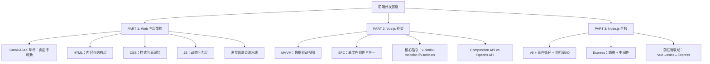

## 一句话总结

Web 前端 = HTML（骨架）+ CSS（皮肤）+ JavaScript（肌肉），Vue.js 以数据驱动视图解放手动 DOM 操作，Node.js 用同一语言打通前后端。

## 知识地图

## 核心概念

### 1. AJAX 与前端工程化革命

**Gmail (2004) 的技术秘密：XMLHttpRequest（XHR）**，让页面在不刷新的情况下从服务器获取数据并更新局部 DOM。

影响链：Gmail → jQuery (2006) → Backbone/Angular → React (2013) → Vue.js (2014) → 现代前端工程化体系。

AJAX 证明了 Web 页面可以像桌面应用一样流畅响应，"前端开发"作为独立工程学科正式诞生。

### 2. Web 前端三层架构

| 层 | 技术 | 职责 | 类比 |
|---|------|------|------|
| 结构层 | HTML | 内容与语义结构 | 楼房的钢筋混凝土结构 |
| 表现层 | CSS | 外观、布局、动画 | 室内装修 |
| 行为层 | JavaScript | 交互、数据、动态更新 | 电梯和自动门 |

**三层分离的好处：** 各司其职便于协作；CSS 换肤不影响内容；浏览器可独立缓存各层资源。更深层的原因：分离让每层可以独立测试和替换——你可以不改 HTML 只换 CSS 做 A/B 测试，也可以不改 UI 只换后端 API。这是软件工程"关注点分离（Separation of Concerns）"原则在前端的具体体现，也是笔试高频考点。

从语言本质上看，HTML 是标记语言（Markup Language），CSS 是样式表语言（Stylesheet Language），二者都是描述性的——你声明"有什么"和"长什么样"，没有"如果…那么…"的判断逻辑。JavaScript 是编程语言（Programming Language），有变量、条件、循环，可以真正执行逻辑计算。这是为什么前两者不具备计算能力，只有 JS 能让页面"动起来"。

### 3. 浏览器渲染流水线

HTML 是文本文件，浏览器解析后构建出的内存模型称为 **DOM 树（Document Object Model）**。DOM 不是 HTML 文件本身，而是浏览器在内存里按 HTML 文本建出的一棵节点树——每个标签是一个节点，文字内容是叶子节点。CSS 则解析为 CSS 规则树 → 二者合并为渲染树 → 布局（位置/大小）→ 绘制 → 显示。JavaScript 可在任意阶段修改 DOM 或样式，触发 Reflow（重新布局）或 Repaint（重绘）。

物理层面：DOM 节点在浏览器进程的堆内存里，每个节点是 Blink 渲染引擎（C++）中的一个对象。为了让 JS 能操作这些 C++ 对象，浏览器通过 Web IDL 绑定层为每个 C++ DOM 节点创建对应的 JS 包装对象——你在 DevTools 里 `console.dir(document.body)` 看到的就是这个 JS 包装对象，它背后关联着一个真实的内存中的 C++ 节点。JS 改包装对象 → 绑定层传回 C++ → 渲染引擎标记"脏了"→ 重绘像素。HTML 文件始终在服务器硬盘上没变——变的只是内存里的 DOM 树。这就是为什么 F5 刷新等于扔掉整棵旧 DOM、重新解析 HTML 重建新树：之前 JS 改过的东西全没了一一这也是 SPA（单页应用）不刷新页面、只改 DOM 和数据的根本动机。

类比：HTML 文件是建筑图纸（一张纸，画好了就不变），DOM 是照图纸在内存里建出的建筑模型（立体的，可以拆改），浏览器渲染是你眼前看到的实际画面。JS 改 DOM 就是用手去摆弄模型——图纸没变，但模型变了，画面就变了。

### 4. JavaScript 四大核心能力

| 能力 | 说明 | 典型用法 |
|------|------|---------|
| DOM 操作 | 动态增删改查 HTML 元素 | `getElementById`, `querySelector` |
| 事件处理 | 响应点击、输入、滚动等 | `addEventListener('click', fn)` |
| 异步通信 | 与服务器交互（fetch/AJAX） | `fetch('/api').then(...)` |
| 逻辑计算 | 变量、函数、条件、循环 | ES6+：箭头函数、解构、模块 |

### 5. Vue.js：数据驱动视图

**为什么需要框架？** 原生 JS 需要手动同步数据与 DOM，随页面复杂度增加会演变为噩梦——数据与视图严重耦合，状态分散难以追踪。

**MVVM 模式（Model-View-ViewModel）：**
- Model（数据/API）← 数据绑定 → ViewModel（Vue 实例，响应式数据）← DOM 渲染 → View（HTML 模板）
- **核心价值：改数据 → 框架自动更新 DOM，无需手动操作。**

从工程角度看，MVVM 解决的不仅是"少写代码"——它建立了**单一事实来源（Single Source of Truth）**：数据在 ViewModel 中只有一份，View 是它的投影。当 5 个组件都展示用户名时，不需要 5 处同步——改了 ViewModel 中的 `username`，所有视图自动更新。这消灭了一整类"状态不同步"的 bug，是笔试常考的架构理解题。

从物理层面看，Vue 的实体就是一个 JS 文件（如 `vue.global.js`），里面包含着预先写好的三个子系统：响应式系统（监听数据变化）、模板编译器（把 `{{ count }}` 语法转成 DOM 更新逻辑）、虚拟 DOM（批量计算最小化 DOM 改动）。你在自己项目里 `import` 或 `<script src>` 引入这个文件，就可以调用它的 API——不用再手写 `document.querySelector(...)` 去同步视图。框架本质上是把"每个前端项目都要重复写的脏活"抽象成通用方案，你遵守它的约定来声明数据和视图的对应关系，它替你执行繁琐的 DOM 操作。

**单文件组件（SFC `.vue`）：** 模板（template）+ 逻辑（script setup）+ 样式（style scoped）三合一。按组件聚合而非按技术分层，每个组件自包含，样式隔离不泄漏。

`.vue` 文件本身不是浏览器能理解的东西——它既不是合法 HTML，也不是合法 JS 或 CSS，而是 Vue 的自定义源格式。构建工具（Vite，底层用 `@vue/compiler-sfc`）在部署前把它拆解编译：`<template>` 编译为渲染函数（一堆 `createVNode()` 调用，生成虚拟 DOM）、`<script setup>` 转为标准 JS、`<style scoped>` 改写为带唯一属性选择器的 CSS（如 `button[data-v-abc123]`）单独抽成 `.css` 文件。浏览器最终拿到的只有一个 `.js` 文件和一个 `.css` 文件，`.vue` 在它眼里根本不存在——它只是一个源码级的组织单位。

### 6. Vue 核心指令速查

| 指令 | 用途 | 示例 |
|------|------|------|
| `v-bind` / `:` | 动态绑定属性 | `:href="url"` |
| `v-model` | 双向数据绑定（表单） | `<input v-model="name">` |
| `v-if` / `v-else` | 条件渲染（增删 DOM） | `
` |
| `v-show` | 条件显示（切换 display） | `
` |
| `v-for` | 列表渲染 | `<li v-for="item in list" :key="item.id">` |
| `v-on` / `@` | 事件监听 | `@click="fn"` |

`v-if` vs `v-show`：前者真正增删 DOM 元素（适合条件分支），后者只切换 CSS display（适合频繁切换如 tab/折叠面板）。

记忆口诀：bind 绑属性，model 双向，if 条件，for 列表，on 事件。

### 7. Composition API vs Options API

| 维度 | Options API | Composition API |
|------|-----------|----------------|
| 逻辑组织 | 按选项类型分散（data/methods/mounted） | 按功能逻辑聚合 |
| 复用方式 | Mixins（有命名冲突风险） | Composables（清晰隔离） |
| TypeScript | 支持有限 | 完整支持 |
| 推荐场景 | 简单组件/迁移项目 | 新项目/复杂逻辑 |

Vue 3 官方推荐 Composition API + `<script setup>`。

实际工程中，选择依据不是"哪个新"，而是：如果组件逻辑超过 200 行、或有多处逻辑需要跨组件复用，Composition API 的组合函数（Composables）能避免 Mixins 的命名冲突和来源不透明问题；如果只是简单的表单或展示组件，Options API 反而更直观。笔试题可能让你对比两者并说明适用场景。

### 8. Node.js：JavaScript 走向服务端

**Node.js = V8 引擎 + 事件循环 + 非阻塞 I/O。**

V8 本质上是一个"JS 文本 → 机器码"的翻译器：解析（Parser 建 AST）→ 编译（Ignition 解释器 + TurboFan 优化编译器，JIT 机制）→ 执行。它不知道什么是网页、什么是 DOM——`document.getElementById(...)` 不是 V8 提供的，而是 Chrome 在 V8 外面包了一层 Web API（C++ 实现，通过绑定暴露给 JS）。同样的道理，`fs.readFile(...)`、`http.createServer(...)` 也不是 V8 自带的——是 Node.js 在 V8 外面包了另一套 API。

2009 年，有人把 Chrome 的 V8 引擎从浏览器里拆出来，扔掉 DOM 解析和渲染引擎，换上文件系统和网络模块，包装成独立程序。从此 JS 不再只能活在浏览器里操作网页——它能读写文件、收发网络请求、操作数据库，成为了服务端语言。**不是"修改了 V8"，而是"给 V8 换了宿主环境"。** 类比：V8 是纯发动机（只烧油转动力），Chrome 把它装到轿车上（加方向盘=DOM、空调=渲染引擎），Node.js 把它装到发电机上（加电网接口=文件系统、网络模块）。同一台发动机，车身完全不同。

从协议层面看，HTTP 的本质就是在 socket 上收发格式化纯文本。浏览器发送一段文本（`GET /api/users HTTP/1.1` + 请求头 + body），服务器回复一段文本（`HTTP/1.1 200 OK` + 响应头 + body）。URL 解析就是拆开这个文本的 method 和 path 字段，读 body 就是从 TCP stream 循环收包拼接，设响应头就是在回复正文前写入 `Content-Type: application/json` 告诉浏览器"下面的正文是什么格式"。

传统多线程模型：每个请求占用一个线程等待 I/O，线程池耗尽则排队。
Node.js 事件驱动：单线程处理大量并发连接，I/O 操作不阻塞，完成后通过回调处理结果。

**核心优势：** 高并发、前后同语言（全栈 JS 降低切换成本）、npm 生态丰富（200 万+ 包）。

### 9. Express 框架与前后端联动

**Express 核心 = 路由 + 中间件。** 路由决定"谁来处理"，中间件决定"怎么处理"（日志、鉴权、body 解析）。

**前后端联动架构：** Vue (localhost:5173) ← `axios` → Node.js/Express (localhost:8081)
- 需要 `cors()` 中间件解决跨域问题（浏览器安全策略禁止不同端口请求）

跨域（CORS）是笔试和面试都极高频的考点。理解跨域先要理解"域"的定义：**协议 + 域名 + 端口三者完全一致才算同源**——子域名不同也算跨域，`example.com` 和 `api.example.com` 是两个不同的域。

关键事实：**跨域限制是浏览器施加的，不是服务器。** 服务器正常处理请求、正常返回数据，数据已经到了浏览器内存里——但浏览器检查到发起页面的域和响应来源的域不同源，就把响应拦截，不给 JS 读。类比：你去别的小区取快递，快递员把包裹给你了，但你家小区门卫不让带进门。

这是浏览器的安全策略：防止恶意网站（`evil.com`）偷偷发请求读取你在银行网站（`bank.com`）的数据——如果没有同源策略，登录网银后访问的任何网站都能用你的 Cookie 发 AJAX 读你的账户信息。

工程中三种方案：① CORS 中间件——服务器在响应头声明"我允许"，浏览器看到后放行；② Vite Dev Proxy——开发环境把 `/api` 请求转发，浏览器只和同源的 dev server 通信，跨域不发生；③ Nginx 反向代理——生产环境统一入口，浏览器只与 Nginx 同源通信。三者的本质区别：①是"解决"跨域（让浏览器放行），②③是"绕过"跨域（让跨域根本不出现）。

### 10. 前端路由 vs 后端路由

| 维度 | 前端路由（SPA） | 后端路由（传统） |
|------|--------------|---------------|
| 路由位置 | 浏览器端，JS 拦截 URL 变化 | 服务器端，每次请求返回完整页面 |
| 用户体验 | 流畅，无白屏 | 每次刷新 |
| SEO | 爬虫难抓取（需 SSR 补救） | 直接返回 HTML，天然友好 |
| 首屏加载 | JS 包较大，首屏慢 | 直接返回 HTML，首屏快 |
| 服务器压力 | 低（只传数据） | 高（每次渲染完整页面） |

工程决策：内容型网站（博客、电商）用 SSR/SSG 保证 SEO；后台管理系统用 SPA 追求交互体验；Next.js/Nuxt 等现代框架已模糊了这条界线——首屏服务端渲染，后续导航客户端路由，取两者之长。笔试常问"SPA 的优缺点"或"什么场景选哪种路由"。

SPA 的 SEO 困境根源在于爬虫看到的是空壳 HTML（`

` + `<script>`），真正内容全在 JS 执行后才出现。解决方案形成了从"浏览器渲染"到"服务器渲染"到"构建时渲染"的完整光谱：SPA（全客户端，无 SEO）→ SSR（每次请求服务端组装 HTML，爬虫友好但吃算力）→ SSG（构建时预渲染为静态 HTML，秒开 + SEO 友好，但不适合实时数据）。现代框架允许按页面粒度混用——首页 SSG、文章页 SSR、仪表盘 SPA。

## 难点突破

**难点 1：理解"响应式数据"的本质**

很多人以为 Vue 的响应式就是"自动刷新页面"——这不准确。真正的原理是：

Vue 通过 Proxy（Vue 3）或 Object.defineProperty（Vue 2）拦截对数据的读写操作。当你执行 `count.value++` 时，Vue 不只是改了数字，它还触发了所有依赖这个数据的视图更新。

类比：就像 Excel 中的公式单元格。你改了 A1，所有引用了 A1 的公式（B1、C1、图表）自动重算——不需要你手动去每个地方更新。Vue 的响应式系统就是 Web 版的 Excel 公式引擎。

**难点 2：Node.js 事件循环的非阻塞模型**

传统思维："一个请求 = 一个线程，线程等着数据库返回"——这是阻塞模型。
Node.js 思维："发起数据库查询 → 注册回调函数 → 立刻去处理下一个请求 → 数据库返回时执行回调"——这是非阻塞模型。

类比：传统模式像快餐店——一个服务员只能服务一个顾客直到出餐。Node.js 像海底捞——服务员帮你下单后立刻去服务其他桌，菜好了按铃叫你（回调）。一个服务员（单线程）可以同时服务很多桌（高并发）。

但注意：Node.js 不适合 CPU 密集型计算（如图像处理），因为计算本身会阻塞唯一的主线程。工程中遇到 CPU 密集任务的标准做法是：拆给 Worker Threads 子线程处理，或卸载到独立的微服务（Python/C++）。**事件循环不是万能的一一是理解它"能做什么"和"不能做什么"的边界。** 笔试大概率会考这个适用场景判断题。

**难点 3：理解 Express 中间件的本质——函数调用链**

中间件听起来神秘，本质上就是用函数指针数组实现的处理流水线。每个中间件是一个 `(req, res, next) => void` 函数，三个出口：调用 `next()` 放行给下一个处理函数；调用 `res.json()` 短路返回（如鉴权失败直接返回 401）；调用 `next(error)` 跳转到错误处理器。Express 的 `app.use()` 就是往这个函数数组里注册，请求到来时依次调用。

类比 C 语言：就是一个 Handler 函数指针数组，for 循环依次调用，任何 handler 不调 next 则链结束。中间件链把"日志→鉴权→业务"这些关注点分离为独立函数，每个只做一件事，而不是把所有逻辑堆在一个巨大的 handle_request() 里。Express 本身也是 Node.js 的一个框架（npm 安装的一个包），它和 Vue 的性质完全相同——提前写好处理 URL 解析、body 拼接、响应头设置的通用代码，你只调用它的 API 写业务逻辑。

## 与前章关联

- 前置依赖：00-01（Cursor 等 AI 工具可用于前端开发）、00-02（Vercel 部署前端项目）
- 本讲为后续 00-05（Java Web 后端）和 00-06（VibeCoding）提供前端技术基础
- 中间件模式是跨框架的通用工程模式——Django Middleware、Go Gin middleware、Java Spring Interceptor 本质相同：函数链，每站可放行/短路/跳错。理解 Express 中间件后，后端框架的拦截器机制是同一回事
- 技术演进线索：静态 HTML → 动态 JS → AJAX 异步 → 前端框架 → 组件化 → 全栈 JS。每一步都是为了解决上一步遗留的工程复杂性问题。

## 记忆卡片

**Q: Web 前端三层架构是什么？各负责什么？**
A: HTML（结构层，内容与语义）、CSS（表现层，外观与布局）、JavaScript（行为层，交互与数据）。三层分离，各司其职。

**Q: Vue.js 的 MVVM 模式解决了什么问题？**
A: 将开发者从手动 DOM 操作中解放出来。改数据 → 框架自动更新 DOM，不需要手动 `document.getElementById(...)` 去同步视图。

**Q: Vue 的五个核心指令及其用途？**
A: `v-bind`（动态绑定属性）、`v-model`（双向数据绑定）、`v-if`（条件渲染）、`v-for`（列表渲染）、`v-on`（事件监听）。记忆口诀：bind 绑属性，model 双向，if 条件，for 列表，on 事件。

**Q: Node.js 的非阻塞 I/O 模型是什么意思？**
A: 单线程 + 事件循环：发起 I/O 操作后不等待，注册回调函数后立刻处理下一个请求。I/O 完成后通过回调处理结果。适合高并发的 API 服务和实时场景，不适合 CPU 密集型计算。

**Q: SFC（单文件组件）的三个部分是什么？为什么要这样设计？**
A: `<template>`（视图模板）、`<script setup>`（逻辑）、`<style scoped>`（隔离样式）。按组件聚合而非按技术分层，每个组件自包含，样式隔离不泄漏，便于复用和维护。

**Q: DOM 是什么？和 HTML 文件有什么区别？**
A: DOM（Document Object Model）是浏览器解析 HTML 文本后在内存里构建的节点树模型。HTML 文件是死的文本（建筑图纸），DOM 是活的模型（按图纸建的立体模型，可以拆改）。JS 不能改 HTML 文件（在服务器上），但可以改内存里的 DOM 树——浏览器立刻把变化画到屏幕上。

**Q: 前端框架的实体是什么？**
A: 就是一个 JS 文件（如 Vue 的 `vue.global.js`），里面装着预先写好的三个子系统：响应式系统（监听数据变化）、模板编译器（把声明式语法转为 DOM 更新逻辑）、虚拟 DOM（批量计算最小化 DOM 改动）。引入这个文件后调用 API，你只声明数据和视图的关系，框架替你执行 DOM 操作。

**Q: Express 中间件的本质是什么？**
A: 函数调用链。每个中间件是 `(req, res, next) => void` 函数，三个出口——`next()` 放行、`res.json()` 短路返回、`next(error)` 跳转错误处理器。`app.use()` 往链上注册函数，请求到来时依次调用。本质是把日志、鉴权、业务这些关注点分离为独立函数，而不是堆在一个巨大的处理函数里。

**Q: AJAX 为什么是前端工程化的起点？（笔试高频）**
A: AJAX（XHR）首次让页面在不刷新的情况下从服务器获取数据并局部更新 DOM，证明了 Web 页面可以像桌面应用一样流畅。它催生了 jQuery → MVC 框架 → SPA → 组件化 → 全栈 JS 的完整技术演进链，使"前端开发"成为独立工程学科。

**Q: `v-if` 和 `v-show` 的区别？各自适用场景？（笔试高频）**
A: `v-if` 真正增删 DOM 元素（切换成本高），适合条件分支、权限控制；`v-show` 只切换 CSS `display` 属性（初始渲染成本高，切换成本低），适合频繁切换如 tab、折叠面板。核心判断依据：切换频率。

**Q: SPA 的优缺点是什么？**
A: 优点——用户体验流畅无白屏、服务器压力低（只传数据）、前后端解耦独立部署。缺点——首屏加载慢（JS 包大）、SEO 爬虫难抓取（需 SSR 补救）、浏览器后退/前进需手动处理。实际工程中 SSR/SSG 框架（Next.js/Nuxt）已模糊了 SPA 与传统路由的界限。

**Q: 浏览器同源策略中"源"由哪三部分组成？跨域限制是谁在执行的？**
A: 协议 + 域名 + 端口，三者完全一致才算同源。限制是**浏览器**执行的——请求已成功到达服务器并返回数据，但浏览器发现不同源后拦截响应，不让 JS 读取。这是安全策略，防止恶意网站利用用户 Cookie 读取其他网站的数据。

**Q: CORS、Dev Proxy、Nginx 反向代理三种跨域方案的本质区别是什么？**
A: CORS 是"解决"跨域——服务器在响应头声明 `Access-Control-Allow-Origin`，浏览器看到后放行。Dev Proxy 和 Nginx 是"绕过"跨域——让浏览器始终与同源通信（dev server 或 Nginx 代为转发），跨域根本不发生。开发用 Dev Proxy，生产用 Nginx。

**Q: SPA、SSR、SSG 三者的本质区别？（笔试高频）**
A: 区别在于"HTML 在哪组装"——SPA 在浏览器端（空壳 HTML + JS 渲染，SEO 差但服务器轻松）；SSR 在服务器端（每次请求实时组装，首屏快 + SEO 友好但吃算力）；SSG 在构建时（预先渲染为静态 HTML 扔 CDN，最快但内容不能实时变）。Next.js/Nuxt 支持按页面混用三种策略。

**Q: 前后端分离后如何解决跨域问题？有哪些方案？（工程实践）**
A: 三种方案：① CORS 中间件（开发环境最常用，服务端设响应头 `Access-Control-Allow-Origin`）；② Vite/Webpack dev proxy（开发环境更优雅，前端 dev server 转发 `/api` 请求，根本不存在跨域）；③ Nginx 反向代理（生产环境标准做法，同一域名下路由分发）。面试/笔试可能要求对比方案，核心区分是"谁在解决跨域"——方案①是服务端允许，方案②③是绕过跨域。
