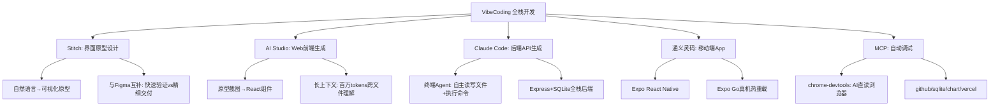

## 一句话总结

VibeCoding 改变了开发的速度，不变的是工程思维的价值——编程的门槛从"语法精通"降低为"需求表达能力"，工程师的价值从"写代码"转向"定义问题 + 审查 AI 输出"。

## 阅读说明

> 本文标注体系：
> - 📝 **考点** — 期末笔试可能考察的概念、辨析、流程。复习时优先掌握。
> - 🔧 **实践** — 工具操作、开发技巧，笔试不直接考但项目/作业必备。

## 知识地图



## 核心概念

### 1. VibeCoding 的核心理念

VibeCoding（由 Andrej Karpathy 2025 年提出）：不再逐行手写代码，而是用自然语言描述意图，让 AI 完成实现。

| 传统开发 | VibeCoding |
|---------|-----------|
| 需要精通语言语法 | 只需清晰描述需求 |
| 手动搭建项目结构 | AI 自动生成脚手架 |
| 前后端分别学习 | 统一用对话驱动 |
| 耗时数天搭原型 | 数小时跑通全栈 |

**VibeCoding 没有改变什么：** 需求分析、系统设计、架构决策仍是人的责任；安全性、性能、可维护性需人工审查。

> 📝 **必考**：VibeCoding "改变了什么 vs 没改变什么"——这是本篇最核心的考点。能完整说出：改变的是开发速度和门槛，不变的是需求分析、架构决策、安全审查仍是人的责任。这题本质在考你对"AI 时代工程师价值"的理解。与课程 Overview 中"AI 时代最稀缺的工程师，是知道什么时候不能信 AI 的人"直接呼应。

### 2. 工具链总览：三步走完成 Web 应用

| 步骤 | 工具 | 职责 |
|------|------|------|
| Step 1 | Google Stitch | 用 AI 快速设计界面原型（视觉稿 + 可交互） |
| Step 2 | Google AI Studio | 将原型描述转化为真实前端代码（React/Vue） |
| Step 3 | Claude Code | 生成后端 API，对接前端，完成全栈集成 |

三个工具各司其职——设计、前端、后端——串联成完整的 AI 辅助开发流水线。

> 📝 **考点**：三步工具链及其职责——Stitch（原型设计）→ AI Studio（前端代码生成）→ Claude Code（后端 API 生成）。选择题/简答题可能考察工具与职责的对应关系。🔧 具体使用技巧属实践。

### 3. Google Stitch：界面原型设计

输入自然语言描述，自动生成 App/Web 界面原型。提示词中明确说明页面数量、核心功能、用户场景，生成质量更高。

**与 Figma 的关系：** Stitch 用于快速原型验证（低学习成本、秒级生成），Figma 用于最终精细交付——两者互补。

> 📝 **考点**：Stitch vs Figma 的定位区分——前者快速验证（AI生成），后者精细交付（人工设计），互补而非替代。体现了"AI 提效但不取代专业工具"的原则。🔧 实际使用技巧属实践。

### 4. Google AI Studio：前端代码生成

基于 Gemini 模型，支持百万+ tokens 长上下文。可上传原型截图 + 需求文档，一次性粘贴多个文件让 AI 理解整体结构后再修改。

关键提示词技巧：
- "基于已有的 Layout.jsx 结构，生成 [页面名] 页面组件"
- "将 mock 数据替换为调用 API 的真实请求，处理 loading 和 error 状态"
- "检查此组件是否有内存泄漏或 React key 警告问题"

### 5. Claude Code：后端 API 生成

Claude Code 与 AI Studio/Copilot 的本质区别在于它是**终端 Agent**——能自主读写文件、执行命令（npm install、git）、理解整个代码库上下文。

> 📝 **考点**：Claude Code 与 AI Studio/Copilot 的本质区别——终端 Agent vs 代码补全/对话。Agent 能自主读写文件、执行命令、理解全代码库上下文。这个区分是"AI 编程工具分类"类题目的核心。🔧 各工具具体用法属实践。

典型交互："实现任务管理的 CRUD API：GET/POST/PATCH/DELETE /api/tasks，每个任务含 id、title、status、priority、assignee、dueDate。"Claude Code 会自动创建数据库表、编写路由、添加输入校验、生成 seed 数据。

### 6. 通义灵码 + Expo：移动端开发

移动端推荐技术栈：Expo (React Native) + 通义灵码——上手最快，与 Web 前端知识复用度最高。

**Expo Go 调试：** 手机扫码 → 实时预览 → 热重载（代码保存即刷新）。红屏报错直接截图给灵码修复。

⚠ **手机调试时后端地址不能用 localhost，需改为电脑局域网 IP（如 192.168.1.x:3000）。**

### 7. MCP（Model Context Protocol）

MCP 是 AI 与工具之间的标准通信协议，由 Anthropic 提出。每个 MCP Server 赋予 AI 一种新能力：

> 📝 **考点**：MCP 的定义——AI 与外部工具之间的标准通信协议，让 AI 从"只能对话"扩展为"能操作外部系统"。chrome-devtools MCP Server 的核心价值——让 AI 能直接读取浏览器 Console/Network/DOM，从"盲人摸象"变为"亲眼观察"。名词解释和简答题高频。

| MCP Server | 用途 |
|-----------|------|
| chrome-devtools | 读取浏览器 Console/Network/DOM，AI 直接"看到"页面状态 |
| github | 读写 Issue、PR、仓库文件 |
| mcp-server-sqlite | 直接查询 SQLite 数据库 |
| mcp-server-chart | 生成 ECharts/Chart.js 图表 |
| vercel | 一键部署到 Vercel |

**MCP chrome-devtools 的核心价值：** AI 从"盲人摸象"变为"亲眼观察"，调试效率提升 5-10 倍。例如登录后页面空白 → AI 自动读 Console 发现 `Cannot read properties of undefined` → 定位到 API 返回 null 但前端直接 `.map()` → 自动添加空值保护。

### 8. 完整 VibeCoding 工作流

```
需求（自然语言描述）
  → Stitch 原型（可视化界面原型）
  → AI Studio（Web 前端 React 组件） / 通义灵码（移动端 Expo App）
  → Claude Code / 灵码（后端 Express + SQLite + AI API 接入）
  → 调试（Web: MCP chrome-devtools / 移动: Expo Go）
  → 集成联调（前后端通信、CORS、数据格式对齐）
  → 上线（Vercel + Railway/Render）
```

## 难点突破

**难点：理解 MCP 为什么是游戏规则改变者**

传统 AI 编程的致命缺陷：AI 看不到浏览器里发生了什么。你告诉 AI "页面空白"，AI 只能根据你的文字描述猜测——而你作为新手可能描述不准确。

MCP chrome-devtools 让 AI 可以直接：
- 读 Console 面板 → 看到隐藏的 JS 错误
- 读 Network 面板 → 看到 API 请求是否成功、返回了什么
- 检查 DOM 结构 → 看到组件是否正确渲染
- 注入调试代码 → 监听事件触发

类比：传统 AI 编程像通过电话指导一个盲人修车（"你看看引擎是不是冒烟了？"），MCP 让 AI 睁开了眼睛，可以直接看到车的问题。

**但警惕：** VibeCoding 时代，最危险的工程师是"AI 生成 → 看起来能跑 → 直接上线"的人。AI 生成的代码可能包含安全漏洞（SQL 注入、未校验输入），上线前必须做安全审查。

> 📝 **必考**：VibeCoding 时代最危险的工程师行为——"AI 生成 → 能跑 → 直接上线"。能解释为什么：AI 可能生成含 SQL 注入、未校验输入等安全漏洞的代码；工程判断和安全审查仍是人的责任。可与 00-05 笔记的三道防线、`#{}` 防注入形成跨章关联论述。

## 与前章关联

- **前置依赖：** 00-01（AI 工具使用）、00-02（Git 与部署）、00-04（前端基础）、00-05（后端基础）
- 本讲是 Unit 0 六讲的收尾，将所有技术栈串成完整的 AI 驱动开发流水线
- VibeCoding 的"需求表达 → AI 生成 → 人工审查"模式，直接对应课程 Overview 的四步工程协作范式
- MCP 协议概念后续在体系结构和详细设计模块中会再次出现

> 📝 **考点**：VibeCoding 与课程 Overview 的关联——"需求表达 → AI 生成 → 人工审查"对应着四步工程协作范式：需求 → 设计 → 编码 → 测试，AI 参与的是编码环节，需求、设计、测试仍离不开人的判断。论述题可做跨章关联。

## 考试速查

> 这篇笔记考点偏概念辨析，技术细节不多。重点理解"AI 改变了什么 vs 没改变什么"这条主线。

| 优先级 | 考点 | 题型 | 所在节 |
|--------|------|------|--------|
| ⭐⭐⭐ | VibeCoding 改变了什么 vs 没改变什么 | 简答/论述 | §1 |
| ⭐⭐⭐ | "AI生成→能跑→上线"为什么危险 | 简答 | 难点突破 |
| ⭐⭐ | 三步工具链及各自职责 | 选择/填空 | §2 |
| ⭐⭐ | MCP 定义 + chrome-devtools 价值 | 名词解释/简答 | §7 |
| ⭐⭐ | Claude Code 与 AI Studio/Copilot 的本质区别（终端 Agent） | 选择/简答 | §5 |
| ⭐ | Stitch vs Figma 的定位区分（互补非替代） | 选择 | §3 |
| ⭐ | VibeCoding 与四步范式的对应关系 | 简答 | 关联 |
| — | 完整流水线六环节 | 填空 | §8 |

**论述题押题**：围绕"AI 时代工程师的核心价值"展开——结合 VibeCoding 的"改变了什么 vs 没改变什么"（本篇）+ 三道防线安全审查（00-05）+ 四步范式（00-Overview），论证为什么"知道什么时候不能信 AI"是 AI 时代最稀缺的能力。

**与 00-05 的跨章关联**：VibeCoding 生成的后端代码可能存在的 SQL 注入漏洞 → 对应 00-05 的 MyBatis `#{}` vs `${}` + 三道防线模型。这两篇可以组合出综合论述题。

## 记忆卡片

**Q: VibeCoding 改变了什么？没有改变什么？**
A: 改变了：编程门槛降低为需求表达能力，原型速度提升 10 倍。没改变：需求分析、架构决策、安全审查仍是人的责任；AI 生成的代码需要人工审查后才能上线。

**Q: VibeCoding 完整工具链的六个环节？**
A: Stitch（原型）→ AI Studio（Web 前端） / 通义灵码（移动端）→ Claude Code（后端）→ MCP chrome-devtools（调试）→ 前后端集成联调 → Vercel/Railway（上线）。

**Q: MCP 是什么？chrome-devtools MCP Server 能做什么？**
A: MCP（Model Context Protocol）是 AI 与工具之间的标准通信协议。chrome-devtools 让 AI 直接读取浏览器 Console 错误、Network 请求、DOM 结构，从"盲人摸象"变为"亲眼观察"。

**Q: 移动端 VibeCoding 推荐什么技术栈？调试时要注意什么？**
A: Expo (React Native) + 通义灵码。Expo Go 扫码真机热重载。手机调试时后端地址不能用 localhost，需改为电脑局域网 IP。

**Q: VibeCoding 时代最危险的工程师行为是什么？**
A: "AI 生成 → 看起来能跑 → 直接上线"。AI 生成的代码可能包含安全漏洞，上线前必须做安全审查——安全性和质量最终取决于人的判断。

---

## 期末简答题备考

> 以下为笔试可能出现的简答题及标准答案要点。按出题概率排序。

**Q1: VibeCoding 改变了什么？没有改变什么？**

A: 改变了：① 编程门槛——从"精通语法"降低为"清晰表达需求的能力"；② 开发速度——原型搭建从数天缩短为数小时。没有改变：① 需求分析、系统设计、架构决策仍是人的责任；② 安全性、性能、可维护性仍需人工审查；③ "知道什么时候不能信 AI"是工程师的核心价值。

---

**Q2: 简述 VibeCoding 三步工具链及各工具的职责。**

A: Step 1——Google Stitch：AI 快速生成界面原型（视觉稿 + 可交互）；Step 2——Google AI Studio：将原型截图/描述转化为真实前端代码（React/Vue 组件）；Step 3——Claude Code：终端 Agent，自主生成后端 API、数据库表、自动对接前端，完成全栈集成。

---

**Q3: 什么是 MCP？chrome-devtools MCP Server 解决了什么问题？**

A: MCP（Model Context Protocol）是 AI 与外部工具之间的标准通信协议，由 Anthropic 提出。chrome-devtools MCP Server 让 AI 能直接读取浏览器的 Console 日志、Network 请求、DOM 结构，使 AI 从"盲人摸象"（只能靠用户文字描述猜测问题）变为"亲眼观察"（直接看到 JS 报错、API 返回内容），调试效率提升 5-10 倍。

---

**Q4: Claude Code 与 AI Studio / GitHub Copilot 的本质区别是什么？**

A: Claude Code 是**终端 Agent**——能自主读写文件、执行命令（npm install、git 等）、理解整个代码库上下文，不依赖用户在 IDE 中手动触发。AI Studio 和 Copilot 是代码补全/对话式工具，需要用户在编辑器中逐段交互。Agent 的关键在于"自主决策 + 执行"，而非被动响应。

---

**Q5: VibeCoding 时代，最危险的工程师行为是什么？为什么？**

A: 行为："AI 生成代码 → 看起来能跑 → 未经审查直接上线"。原因：AI 生成的代码可能包含安全漏洞（SQL 注入、未校验输入、依赖版本过旧有 CVE）或性能问题（N+1 查询、内存泄漏）。AI 只负责"生成"，安全性和正确性的最终判断必须由人来完成。这呼应了课程核心判断——"AI 时代最稀缺的工程师，是知道什么时候不能信 AI 的人"。

---

**Q6: Stitch 与 Figma 是什么关系？为什么说二者互补而非替代？**

A: Stitch 用于快速原型验证——AI 秒级生成，低学习成本，适合早期探索和需求沟通。Figma 用于最终精细交付——人工精细控制，专业设计输出，适合设计定稿和开发交接。二者定位不同：Stitch 覆盖"想法→可见原型"的快速反馈阶段，Figma 覆盖"原型→可交付设计稿"的专业生产阶段，互补而非替代。
