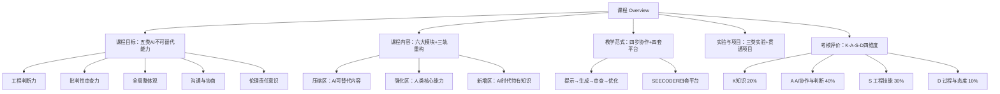

## 一句话总结

教 AI 时代的软件工程，不是教工具，而是教判断——培养"知道什么时候不能信 AI"的独立工程判断力。

## 知识地图

## 核心概念

### 1. 课程重构的核心理由 `[课程设计]`

课程基于对四类系统性误区的诊断进行重构：

| 误区 | 根本缺失 | 典型表现 |
|------|---------|---------|
| "生成即完成" | 过程意识缺失 | AI 输出直接交付，跳过审查验证 |
| "局部正确即整体正确" | 系统整体观缺失 | 忽视需求—架构—代码的跨模块一致性 |
| "AI 的权威性" | 批判意识缺失 | 面对低质代码，自我审查率极低 |
| "会使用 = 会工程" | 工具与能力混淆 | AI 不可用时，底层工程判断力严重不足 |

核心判断：**AI 时代学生最大的短板，不是"用不好 AI"，而是"不知道什么时候不能信 AI"。**

### 2. 五类 AI 无法替代的高阶工程能力 `[课程设计]`

课程目标围绕 AI 不能替代的能力展开——这是人才培养的核心价值所在：

| 能力 | 内涵 | AI 的局限 |
|------|------|----------|
| 工程判断力 | 复杂情境中的独立决策 | AI 缺乏业务上下文与领域常识 |
| 批判性审查力 | 识别 AI 输出中的错误与歧义 | AI 不能可靠审查自身输出 |
| 全局整体观 | 跨模块一致性审视 | AI 上下文有限，易产生局部幻觉 |
| 沟通与协商 | 理解并协调利益相关者意图 | AI 无法替代人际信任与责任承担 |
| 伦理责任意识 | 安全合规与社会影响把关 | AI 无主观责任感 |

### 3. 三轨差异化重构 `[课程设计]`

以 AI 为参照系，对所有知识点划分三类处理方式：

| 区间 | 定义 | 教学策略 |
|------|------|---------|
| 压缩区 | 初步需求抽取、代码骨架生成、文档格式化等操作性任务 | 压缩讲授深度与考核比重 |
| 强化区 | 需求冲突判断、可测试性设计、系统边界划定、伦理审查 | 强化高阶判断力，加大考核权重 |
| 新增区 | 提示词工程、AI 输出审查、人机协作工作流设计 | 新增，贯穿各模块教学 |

核心逻辑：**让学生花更多时间做 AI 做不好的事。**

### 4. 四步工程协作范式 ⭐ `考点`

贯穿全课程的核心教学方法——让 AI 使用的每一步变为可教学、可评价的工程行为：

| 步骤 | 学生行为 | 教学重点 |
|------|---------|---------|
| 提示（Prompt） | 结构化、约束化、角色化表达需求 | 训练提示词工程规范意识 |
| 生成（Generate） | AI 完成知识密集型初稿 | 理解 AI 能力边界与局限 |
| 审查（Review） | 识别错误、歧义与遗漏 | 培养批判性工程判断力 |
| 优化（Refine） | 迭代改进提示词，修订至规范 | 建立螺旋上升的工程习惯 |

每完成一轮，提示词质量与审查能力共同提升，推动下一轮生成质量进一步改善。

### 5. K-A-S-D 四维度评价框架 `[课程设计]`

| 维度 | 主要能力域 | 占比 |
|------|-----------|------|
| K 知识掌握 | K1 核心概念 · K2 规范与原理 · K3 前沿技术 | 20% |
| A AI 协作与判断 | A1 提示词写作 · A2 AI 输出驾驭 · A3 人机协同工作流 · A4 批判审查 · A5 冲突识别 · A6 权衡决策 · A7 伦理把关 | 40% |
| S 工程技能 | S1 文档编写 · S2 需求分析 · S3 代码产出 · S4 工具使用 · S5 代码质量 · S6 项目调试 · S7 版本管理 | 30% |
| D 过程与态度 | D1 作业态度 · D2 时间管理 · D3 自主学习 · D4 团队协作 | 10% |

**A 维度（AI 协作与判断）占比 40%**，是 AI 时代软件工程师核心竞争力的直接体现。

评价机制革新：
- 四主体协同：教师 45% + 同伴互评 15% + 企业导师 20% + AI 平台数据 20%
- 增值评价：全学期 16 个里程碑节点，以能力提升幅度（Δ 值）替代单次绝对分数
- 每名学生建立跨 16 单元的 K-A-S-D 学期能力数字档案

### 6. 四套平台支撑 `[课程设计]`

| 平台 | 定位 | 主要功能 |
|------|------|---------|
| SEECODER-SE | RAG 知识学习系统 | 知识问答 · 文档生成 · Prompt 日志采集 |
| SEECODER-EDU | 知识图谱 + 学情分析 | SE 本体论图谱 · 图 RAG 精准问答 · 知识热图 |
| SEECODER-Developer | 开发运维一体化 | 需求→设计→编码→测试→部署九大模块；工件留痕 |
| SEECODER-Review | AI 智能复习 | 知识框架生成 · 互动阅读 · 检查点测验 |

### 7. 三类递进实验 `[课程设计]`

| 类型 | 锚定步骤 | 核心训练目标 | 评分依据 |
|------|---------|-------------|---------|
| AI 辅助生成精度实验 | 生成 | 量化 AI 生成质量上下限 | Precision / Recall / F1 |
| AI 输出审查能力实验 | 审查 | 纵向追踪缺陷识别率成长曲线 | 缺陷识别率 |
| 提示词迭代优化实验 | 提示→优化 | ≥3 轮迭代，量化每轮输出质量提升 | 提示词结构化评分量表 |

## 难点突破

**难点 1：理解 K-A-S-D 框架中 A 维度的设计逻辑** `[课程设计]`

传统考试无法测量"会用 AI"的能力。A 维度的核心创新在于——**用 AI 交互日志替代主观评价，实现客观量化**：
- 不是考"会不会用 AI"，而是考"能不能识别 AI 的错误"
- 以"含错版 AI 输出"替代传统笔试题，量化缺陷识别率
- 提交完整 Prompt-Response 记录，从结构性、工程语义准确性、迭代意识、边界设定四项评分

类比：就像驾考不只考交规（K），还要考实际驾驶（S）和危险预判（A）。A 维度考的就是"预判 AI 什么时候会翻车"的能力。

**难点 2：三轨重构中"压缩"与"强化"的边界判断** `[课程设计]`

压缩不是删除，强化不是加量：
- 压缩：AI 能做的操作性任务（如手工 UML 绘制），减少讲授和考核，但不意味着不学——需要理解基本概念才能审查 AI 输出
- 强化：AI 做不好的判断性任务（如需求冲突判断），增加教学和考核权重
- 判断标准：**AI 能不能可靠地独立完成？能→压缩，不能→强化，没教过→新增**

## 与前章关联

本讲是课程的总纲，没有前序章节。它为后续所有模块建立了概念框架：
- 三轨重构原则将贯穿六大模块的每一节课
- 四步协作范式是所有实验和项目的基本工作方式
- K-A-S-D 框架是整个学期的评价语言

## 记忆卡片

**Q: 四步工程协作范式是什么？**
> 提示（Prompt）→ 生成（Generate）→ 审查（Review）→ 优化（Refine）

**Q: 四步中核心是哪一步？为什么？**
> 审查（Review）。AI 输出不能直接交付，必须经人的批判性审查。审查能力是 AI 时代工程师的核心竞争力。

**Q: 每一步分别做什么？**
> 提示：结构化、约束化、角色化地表达需求
> 生成：AI 完成知识密集型初稿
> 审查：识别错误、歧义与遗漏
> 优化：迭代改进提示词，修订至规范

**Q: 四步范式和传统软件工程流程是什么关系？**
> 不是替代，是嵌入。四步范式嵌入需求分析、设计、编码、测试等各传统阶段，作为每一阶段的微观工作方式。审查留下的交互日志即评价依据。
