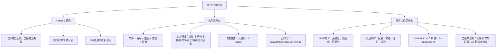

## 一句话总结

软件 ≠ 程序——软件 = 程序 + 数据 + 文档 + 知识；软件工程的每一条规范，都是某次灾难换来的教训。

## 知识地图



## 核心概念

### 1. Ariane 5 案例：代码正确 ≠ 工程成功

1996年6月4日，阿丽亚娜5型火箭首飞37秒后解体自毁，损失5亿美元。

**直接原因：** 64位浮点数转换为16位整数时发生溢出，惯性参考系统（SRI）崩溃。

**根本原因：** 直接复用了Ariane 4的SRI软件模块，未重新验证在新环境中的适用性。SRI模块通过了所有测试——但没有人验证它是否适合Ariane 5的新飞行轨迹。

**传导链：** 进度与成本压力 → 隐性假设未更新 → 集成测试不含新飞行场景 → 单点故障无容错设计 → SRI溢出宕机 → 触发自毁。

**关键洞察：** 根因不是"程序员写错了代码"，而是整个软件工程过程在关键环节系统性失效——验证、集成、变更管理全部缺失。隐式约束（Implicit Constraint）未被显式记录。

### 2. 软件 ≠ 程序

**IEEE 定义（610.12-1990）：** 软件是计算机程序、规程及相关文档和运行计算机系统所需数据的完整集合。

**现代扩展定义：软件 = 程序 + 数据 + 文档 + 知识**

| 要素 | 内容 | Ariane 5 中缺失了什么 |
|------|------|---------------------|
| 程序（Program） | 可执行的指令序列 | SRI 代码本身是正确的 ✓ |
| 数据（Data） | 程序处理与存储的信息 | 飞行参数范围未更新 ✗ |
| 文档（Document） | 开发、使用、维护的说明 | 数值范围约束未记入文档 ✗ |
| 知识（Knowledge） | 隐性经验、最佳实践、领域理解 | 领域知识未被显式化和传承 ✗ |

**规模效应：** 大型系统（100万LOC）中，编码仅占18%工作量，缺陷清除（审查、测试、修复Bug）排第一，文档编写排第二，沟通排第三。编码排第四！

### 3. 软件的七大本质特征

| 特征 | 说明 | 工程含义 |
|------|------|---------|
| 无形性 | 看不见、摸不着 | 进度与质量难以直接观测 |
| 复杂性 | 逻辑交织，难以全面理解 | 需要抽象、分层、模块化 |
| 可复制性 | 复制成本趋近于零 | 分发成本低，但侵权风险高 |
| 易修改性 | 改动方便，但影响难预测 | 变更管理至关重要 |
| 退化性 | 不磨损，但随环境变化"腐化" | 技术债、维护成本持续增长 |
| 依赖性 | 依赖运行环境（OS、库、网络） | 环境一致性是工程问题 |
| 智力密集 | 本质是人的智力产品 | 人才是最核心的生产要素 |

### 4. 软件形态的六十年演变

```
1960s → 1980s → 2000s → 2010s → 2020s → 2025+
大型机    桌面应用   Web B/S   移动互联   云原生    AI Agent
批处理    C/S架构   J2EE/SOA  App Store  微服务    自然语言即接口
```

**云时代：** IaaS（基础设施即服务）、PaaS（平台即服务）、SaaS（软件即服务）、Serverless（FaaS + BaaS）。

**LLM 时代的三种新范式：**
- **Agent as Service** — 服务单元从 API 接口变为"会思考的自主代理"
- **Context as Service** — 记忆与上下文跨会话持久化，成为产品核心资产
- **抛弃式交互** — 生成即用、用完即弃，随需生成、随时重生成

### 5. 软件工程的定义

**IEEE 标准定义（610.12-1990）：**
> 软件工程是将系统化的（systematic）、规范化的（disciplined）、可量化的（quantifiable）方法应用于软件的开发、运行和维护的过程；即将工程化的方法应用于软件。

**工程四要素（问题-工具-目标-条件模型）：**
- Problem（问题）→ 动机：现实世界的混乱状态驱动工程
- Scientific Knowledge（科学知识）→ 工具：计算科学作为科学基础
- Solution/Machine（解决方案）→ 目标：虚拟计算机 = 通用机器 + 特定解决方案
- Cost-Benefit Effective（成本效益有效）→ 条件：追求足够好，不是最好

**核心理解：Engineering = Science + Principle + Art**

### 6. 工程学科的发展规律（M. Shaw, 1990）

```
经验积累 → 技术实践 → 理论指导 → 成熟工程学科
铁匠铺式   作坊式     工业化     职业化
代码黑客   方法论     模型/理论   规范/认证
```

**软件工程目前处于理论指导 → 成熟工程的过渡阶段。**

### 7. SWEBOK V4（2024）重大更新

| 知识域 | 状态 | 意义 |
|--------|------|------|
| 软件需求/设计/构造/测试/维护 | 核心保留 | 基础不变 |
| 软件配置管理/工程管理/过程/质量 | 核心保留 | 基础不变 |
| **软件架构** | V4 新增 | 架构从设计中独立，地位提升 |
| **软件工程运维** | V4 新增 | DevOps 时代运维纳入 SE 范畴 |
| **软件安全** | V4 新增 | 安全从附录升级为独立知识域 |
| **AI for SE** | V4 新增 | AI 辅助软件工程全过程 |
| **SE for AI** | V4 新增 | AI 系统的工程化方法 |

### 8. LLM 时代软件工程的演变

| 活动/角色 | 关键变化 | 新增技能要求 |
|----------|---------|------------|
| 需求工程 | AI 辅助用户访谈、自动生成用户故事 | 辨别 AI 提炼是否失真 |
| 系统设计 | AI 生成多套方案供选择，人负责决策 | RAG/Agent/MCP 等 AI 系统架构能力 |
| 编码实现 | Copilot 补全为主，重心转向代码审查 | Prompt 工程、识别代码幻觉与安全漏洞 |
| 测试验证 | AI 批量生成测试用例，覆盖率大幅提升 | 专项测试 AI 输出：幻觉/边界/偏见 |
| 运维部署 | 新增 LLM 可观测性 | LLMOps：模型版本管理、输出漂移监控 |

**不变的内核：** 理解用户真实需求、管理系统复杂度、保障质量与可靠性、工程伦理——AI 改变的是效率与手段，对正确性与用户价值的责任只增不减。

## 难点突破

**难点 1：理解"隐式约束"为何如此危险**

Ariane 5 的 SRI 代码本身是正确的——它在 Ariane 4 的环境下完美运行。问题在于：代码对"飞行参数范围"有隐含假设（数值不会超过16位整数范围），但这个假设从未被写进文档。

类比：你写了一个函数 `calculate(int x)`，假设 x 永远不会大于 100。这个假设在你脑子里，但不在代码里、不在文档里。三年后别人复用了你的代码，传入了 x=9999——程序崩溃了。

这就是"软件 ≠ 程序"的核心：程序可以跑，但缺少了文档和知识（数据范围约束），程序就不再是可靠的软件。

**难点 2：软件工程的"工程"二字到底指什么**

不是指"会写代码就是工程师"，而是指**系统化、规范化、可量化的方法**：
- 系统化：不是想到哪写到哪，而是有步骤、有流程
- 规范化：不是每个人随意发挥，而是有标准、有纪律
- 可量化：不是"感觉差不多了"，而是有度量、有证据

Ariane 5 反例：复用了 Ariane 4 的 SRI 模块，但没有系统化验证、没有规范化文档记录约束、没有可量化的测试覆盖新飞行场景——三个工程要素全部缺失。

## 与前章关联

- 前置依赖：00-Overview（课程框架）
- 本讲是模块一的第一讲，建立"什么是软件""什么是软件工程"的基础认知
- Ariane 5 案例中的隐式约束问题，直接引出模块二（需求工程）的核心议题
- SWEBOK V4 的知识体系框架是后续所有章节的知识地图
- "软件 = 程序 + 数据 + 文档 + 知识"的认知，贯穿后续所有开发活动

## 记忆卡片

**Q: 软件的四要素是什么？（IEEE 定义 + 现代扩展）**
A: IEEE 定义：软件 = 程序 + 数据 + 文档。现代扩展：软件 = 程序 + 数据 + 文档 + 知识。

**Q: Ariane 5 事故的根本原因是什么？**
A: 直接复用了 Ariane 4 的 SRI 软件模块，未重新验证在新环境中的适用性。代码完全正确，但隐式约束（数值范围）未被显式记录，验证和变更管理全部缺失。本质是工程过程失效，不是代码Bug。

**Q: 软件的七大本质特征？**
A: 无形性、复杂性、可复制性、易修改性、退化性（不磨损但会"腐化"）、依赖性（依赖运行环境）、智力密集（人才是核心生产要素）。

**Q: 软件工程的定义（IEEE 610.12-1990）？**
A: 将系统化的（systematic）、规范化的（disciplined）、可量化的（quantifiable）方法应用于软件的开发、运行和维护的过程。

**Q: SWEBOK V4 新增了哪些知识域？**
A: 软件架构（独立）、软件工程运维（DevOps纳入SE）、软件安全（独立升级）、AI for SE（AI辅助SE全过程）、SE for AI（AI系统工程化方法）。

---

## 期末简答题 Q&A

> 以下按期末考试常见题型整理，答案可直接背诵。

**Q1: 什么是软件？简述软件的四个组成部分及其意义。**

A:
- **程序（Program）**：可执行的指令序列，是软件的运行载体。
- **数据（Data）**：程序处理与存储的信息，决定了程序的行为边界。
- **文档（Document）**：开发、使用、维护的说明文件，是团队协作和长期维护的基础。
- **知识（Knowledge）**：领域经验、隐性约束、最佳实践等智力资产，是最容易被忽视却最关键的部分。

> 意义：Ariane 5 事故中，程序和数据结构正确，但文档未记录数值范围约束，领域知识未显式化——缺少文档和知识导致火箭解体。软件 ≠ 程序。

---

**Q2: 分析 Ariane 5 事故的原因及软件工程教训。**

A:
- **直接原因**：64 位浮点数转 16 位整数时溢出，惯性参考系统（SRI）崩溃，触发自毁。
- **根本原因**：直接复用 Ariane 4 的 SRI 模块，**未重新验证**在新飞行环境中的适用性。隐式约束（飞行参数范围）未被显式记录。
- **传导链**：进度成本压力 → 隐性假设未更新 → 集成测试未覆盖新场景 → 单点故障无容错 → SRI 溢出 → 自毁。

**教训（三个关键词）：**
1. **隐式约束必须显式化**——代码能跑不代表工程正确。
2. **复用必须重新验证**——旧模块在新环境中可能有不同的边界条件。
3. **工程是系统化方法**——验证、变更管理、文档、测试，任一环节缺失都可能导致灾难。

---

**Q3: 软件的七大本质特征是什么？各举一例说明其工程含义。**

A:
| 特征 | 工程含义 |
|------|---------|
| 无形性 | 进度和质量难以直接观测，需要度量手段（如燃尽图、代码审查） |
| 复杂性 | 需要抽象、分层、模块化来管理，无法靠直觉全面理解 |
| 可复制性 | 分发成本低，但需关注版权和许可证管理 |
| 易修改性 | 改动方便但影响难预测，变更管理（SCM）至关重要 |
| 退化性 | 不磨损但随环境变化"腐化"，技术债持续累积 |
| 依赖性 | 依赖 OS/库/网络，环境一致性是工程问题（Docker 解决此痛点） |
| 智力密集 | 人才是最核心生产要素，沟通和知识传承比编码本身更耗时 |

---

**Q4: 写出软件工程的 IEEE 定义，并解释"系统化、规范化、可量化"的含义。**

A:
**定义（IEEE 610.12-1990）：** 将系统化的（systematic）、规范化的（disciplined）、可量化的（quantifiable）方法应用于软件的开发、运行和维护的过程。

- **系统化（systematic）**：有步骤、有流程，不是"想到哪写到哪"。如需求→设计→实现→测试的规范流程。
- **规范化（disciplined）**：有标准、有纪律，不是个人随意发挥。如代码规范、评审流程、文档模板。
- **可量化（quantifiable）**：有度量、有证据，不是"感觉差不多了"。如测试覆盖率、缺陷密度、圈复杂度。

> Ariane 5 反例：复用 SRI 模块时三个要素全部缺失——没有系统化验证、没有规范化文档记录约束、没有可量化测试覆盖新飞行场景。

---

**Q5: SWEBOK V4（2024）新增了哪些知识域？分别说明其意义。**

A:
| 新增知识域 | 意义 |
|-----------|------|
| 软件架构 | 从"软件设计"中独立，架构决策的地位和复杂度被正式承认 |
| 软件工程运维 | DevOps 时代，运维不再是"部署完了就完"，纳入 SE 核心范畴 |
| 软件安全 | 从附录升级为独立知识域，安全是设计出来的，不是补丁打上去的 |
| AI for SE | AI 辅助软件工程全过程（需求、设计、编码、测试、运维） |
| SE for AI | AI 系统本身也需要工程化方法（模型版本管理、输出质量保障、可观测性） |

---

**Q6: 简述工程的四个要素（问题-知识-方案-成本模型）。**

A:
- **Problem（问题）** → 动机：现实世界中的混乱状态驱动工程活动。
- **Scientific Knowledge（科学知识）** → 工具：以计算科学为理论基础。
- **Solution/Machine（解决方案）** → 目标：虚拟计算机 = 通用机器 + 特定解决方案。
- **Cost-Benefit Effective（成本效益）** → 条件：工程追求的是"足够好"而非"最好"，在约束下求最优。

> 核心公式：Engineering = Science + Principle + Art

---

**Q7: 简述 M. Shaw 的工程学科发展四阶段模型，并判断软件工程当前处于哪个阶段。**

A:
```
经验积累 → 技术实践 → 理论指导 → 成熟工程学科
（铁匠铺）  （作坊）   （工业化）  （职业化）
```

- **经验积累**：靠个人经验，不可复制（早期代码黑客）
- **技术实践**：形成可传授的方法论（结构化方法、面向对象方法）
- **理论指导**：模型和理论支撑实践（形式化方法、软件体系结构理论）
- **成熟工程**：规范化认证、职业资格（如土木工程）

> 软件工程当前处于**理论指导 → 成熟工程的过渡阶段**。

---

**Q8: LLM 时代软件工程各角色发生了什么变化？哪些内核不变？**

A:
**变化：**
| 角色 | 变化 |
|------|------|
| 需求工程 | AI 辅助访谈、自动生成用户故事，人负责辨别提炼是否失真 |
| 系统设计 | AI 生成多套方案，人做决策；需掌握 RAG/Agent/MCP 架构能力 |
| 编码实现 | Copilot 补全为主，重心从"写"转向"审查" |
| 测试验证 | AI 批量生成测试用例，需专项检测幻觉/边界/偏见 |
| 运维部署 | 新增 LLM 可观测性（LLMOps：模型版本、输出漂移监控） |

**不变的内核：** 理解用户真实需求、管理系统复杂度、保障质量与可靠性、工程伦理。AI 改变的是效率与手段，对正确性与用户价值的责任只增不减。
