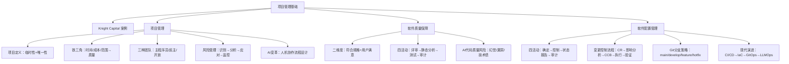

## 一句话总结

配置管理是工程纪律的底线，不是可选项——Knight Capital 用 4.4 亿美元证明了这一点：1 台服务器的配置不一致 = 一家公司的消失。

## 知识地图



## 核心概念

### 1. Knight Capital 案例：配置管理的彻底失效

2012年8月1日，Knight Capital 新交易系统上线。8台服务器中1台未被更新，仍运行旧版"Power Peg"代码。45分钟内亏损4.4亿美元，公司被迫出售。

**根本原因：** 不是算法错误、不是网络故障——是配置管理的彻底失效。

| 问题 | SCM 活动缺失 |
|------|------------|
| 部署清单不存在或未执行 | 配置控制缺失 |
| 第8台服务器状态未验证 | 状态报告缺失 |
| 旧功能标志未统一清理 | 配置项管理不完整 |
| 上线前无回滚预案 | 变更影响分析缺失 |

### 2. 项目与项目管理基础

**项目定义（PMBOK）：** 为创建唯一产品、服务或成果而进行的临时性工作。

三大特征：**临时性**（有明确起止时间）、**唯一性**（产出独特）、**渐进明细**（随进展逐步明确）。

**铁三角约束：** 范围（Scope）、时间（Time）、成本（Cost）三者互相制约，中心是质量。

**五大过程组：** 启动 → 计划 → 执行 → 跟踪与控制 → 收尾。

### 3. 三种团队结构

| 结构 | 决策方式 | 优点 | 缺点 | 适用场景 |
|------|---------|------|------|---------|
| 主程序员团队 | 集中，主程序员决定一切 | 效率高、协调开销少 | 主程序员瓶颈、成员积极性低 | 小型精英团队 |
| 民主团队 | 分散，成员共同决策 | 士气高、创意多 | 决策慢、职责边界模糊 | 研究性/探索性项目 |
| 开放团队 | 混合，正式与非正式并存 | 灵活、平衡 | 管理复杂、需强沟通 | 中大型工程项目 |

**现代软件团队的普遍选择：开放团队（Scrum 框架）。** Product Owner（决策需求）+ Scrum Master（保障流程）+ Dev Team（自组织开发）。

### 4. 激励机制与团队杀手

**软件工程师激励因素排名（Boehm, 1981）：**
1. 个人发展空间 2. 技术挑战性 3. 工作自主性 4. 薪酬待遇 ... 9. 工资

开发人员最在意的是成就感和发展机遇，工资仅排第9位。

**团队杀手（DeMarco, 1999）：** 防范式管理、官僚主义、地理分散、时间分割、产品质量降低、虚假的截止日期、小圈子控制。

### 5. 风险管理

**风险 = 不确定事件 × 影响程度。** 风险管理循环：识别 → 分析 → 优先级排序 → 应对 → 监控（持续循环）。

| 风险类型 | 示例 | 应对策略 |
|---------|------|---------|
| 技术风险 | 新框架不成熟、性能瓶颈 | 原型验证（Spike）、技术预研 |
| 人员风险 | 核心成员离职、技能不足 | 知识共享、交叉培训（Bus Factor ≥ 2） |
| 需求风险 | 需求频繁变更、范围蔓延 | 迭代交付、变更控制流程 |
| 外部风险 | 政策法规变化、供应商断供、第三方 API 下线 | 合同保护条款、备选供应商、技术栈去耦合 |
| 进度风险 | 低估工作量、依赖延迟 | 缓冲时间、关键路径分析 |

### 6. 软件质量保障（SQA）

**质量的两个维度：** 符合规格 + 用户满意。Knight Capital 的代码逻辑是正确的——失效的是发布过程的质量。

**SQA 四类活动（层次递进）：**
1. **代码评审（Code Review）** — 人工审查逻辑缺陷、安全隐患
2. **静态分析（Static Analysis）** — 工具自动检测潜在缺陷、代码规范
3. **动态测试（Testing）** — 运行代码验证实际行为
4. **过程审计（Audit）** — 检查开发和发布过程是否符合规范 ← Knight Capital 最需要这一步

评审 vs 测试的分工：评审发现"代码写了什么"；测试发现"代码做了什么"。二者各有盲区，缺一不可。

### 7. 软件配置管理（SCM）四大活动

| 活动 | 核心问题 | Knight Capital 中缺失 |
|------|---------|---------------------|
| 配置项确定（Identify） | 哪些制品需要版本控制？ | 服务器配置状态未纳入管控 |
| 配置控制（Control） | 变更如何审批与执行？ | 部署无标准流程，无逐台确认 |
| 状态报告（Status） | 各节点版本处于什么状态？ | 第8台服务器状态不可见 |
| 配置审计（Audit） | 实际配置是否符合规定？ | 上线前未做配置一致性审计 |

**变更控制流程（Change Control Process）：**
变更请求 → 影响分析 → 风险评估 → CCB（变更控制委员会）评审 → 执行变更（逐节点逐步验证）→ 更新基线 → 上线验证（所有节点一致性检查）→ 更新状态报告。

### 8. Git 分支策略

```
feature/xxx ──┐
              ├── develop ── 集成测试通过 ── main（生产稳定版）
feature/yyy ──┘
                                    ↑
hotfix/zzz ─────────────────────────┘（紧急修复）
```

| 分支 | 用途 | 保护规则 |
|------|------|---------|
| main | 生产环境稳定版本 | 禁止直接 push，只接受合并请求 |
| develop | 持续集成 | 合并前必须通过 CI 测试 |
| feature/xxx | 功能开发隔离 | 完成后合并到 develop |
| hotfix/xxx | 生产紧急修复 | 合并到 main 后同步到 develop |

### 9. 现代配置管理演进

| 传统 SCM（2000s） | DevOps（2010s） | Platform Engineering（2020s） |
|-----------------|----------------|---------------------------|
| 版本控制 | CI/CD 自动化管线 | 内部开发者平台（IDP） |
| 手动构建发布 | 基础设施即代码（IaC） | 自助式环境创建 |
| 运维与开发分离 | Dev + Ops 融合 | Golden Path 标准化模板 |
| 变更走审批流程 | 自动化测试+自动部署 | AI 辅助故障诊断 |

**部署策略：** 蓝绿部署（秒级回滚）、金丝雀发布（控制爆炸半径）、滚动更新（零停机）、特性开关（解耦部署与发布）。

**GitOps 四大原则：** Git 是唯一事实源、声明式而非命令式、自动同步、`git log` 即完整审计日志。

### 10. AI 时代的项目管理变革

- **团队变小：** 3-5人 + AI 助手替代传统 5-9人团队，个体生产力提升 10 倍
- **角色模糊化：** "AI-native"全栈工程师，重心转向设计、审查、决策
- **质量新挑战：** AI 代码的幻觉、安全漏洞、版权风险、技术债务
- **核心原则：** AI 是质量保障的"加速器"而非"替代者"——最终的质量判断权必须在人手中
- **LLMOps：** DevOps + ML 模型管理 + Prompt 工程，配置管理在 AI 时代的全新战场

## 难点突破

**难点 1：区分 SQA 的四个活动和各自的盲区**

很多人认为"测试通过了 = 质量没问题"。但 Knight Capital 的教训是：代码测试通过了（逻辑正确），但部署过程出错了。

- 代码评审：看代码写得对不对（静态，不运行）
- 静态分析：工具自动扫常见问题（规则固定，无法检测业务逻辑错误）
- 动态测试：运行代码验证行为（只能测试写了的场景）
- 过程审计：检查流程是否被遵守（不看代码，看流程）

四个活动像四道滤网，每道只能拦住特定类型的缺陷。跳过任何一道，就有漏网之鱼。

**难点 2：SCM 配置审计 vs SQA 过程审计的区别**

- SCM 配置审计："实际配置是否符合规定的配置？"（8台服务器的版本号是否一致？）
- SQA 过程审计："开发和发布过程是否符合既定规范？"（部署流程是否包含逐台验证？）

两者密切相关但关注点不同。Knight Capital 两个审计都缺失了。

## 与前章关联

- 前置依赖：01-01（软件工程基础、Ariane 5）、00-02（Git 工作流基础）
- Knight Capital 案例与 Ariane 5 案例形成对比：一个失效在需求/验证（隐式约束），一个失效在配置管理（部署一致性）
- CI/CD、IaC、GitOps 的概念在模块五（构造测试）和模块六（开发过程）中会进一步深入
- Git 分支策略是本课程团队项目的基础协作规范

## 记忆卡片

**Q: Knight Capital 事故的根本原因是什么？**
A: 8台服务器中1台未被更新，仍运行旧代码。配置管理彻底失效：部署无检查清单、状态未验证、旧功能未清理、无回滚预案。不是技术问题，是管理问题。

**Q: 三种团队结构及其适用场景？**
A: 主程序员团队（小型精英，效率高）、民主团队（研究探索，创意多）、开放团队（中大型工程，平衡灵活）。Scrum 是开放团队的典型实例。

**Q: SQA 的四类活动及其递进关系？**
A: 代码评审（人工看代码）→ 静态分析（工具自动扫）→ 动态测试（运行验证）→ 过程审计（检查流程合规）。各有盲区，缺一不可。

**Q: SCM 的四大活动是什么？**
A: 配置项确定（哪些东西要管）、配置控制（变更怎么审批执行）、状态报告（各节点什么状态）、配置审计（实际与规定一致吗）。

**Q: 现代部署策略有哪些？Knight Capital 最缺哪个？**
A: 蓝绿部署、金丝雀发布、滚动更新、特性开关。Knight Capital 的旧 Power Peg 代码本质上是失控的特性开关——现代特性开关系统（LaunchDarkly等）提供统一管理和自动清理。

---

## 期末简答题 Q&A

**Q1: Knight Capital 事故的根因是什么？它与 Ariane 5 有何本质区别？**

A:
**根因**：8 台服务器中 1 台未更新，部署一致性彻底失控。不是算法错误，是配置管理（SCM）全部四个活动都缺失了。

**与 Ariane 5 对比：**
| | Ariane 5 | Knight Capital |
|------|---------|----------------|
| 失效环节 | 需求/验证（隐式约束未记录） | 配置管理（部署一致性失控） |
| 代码是否正确 | ✓ 正确 | ✓ 正确 |
| 问题本质 | 复用了旧模块未重新验证 | 复用了旧配置未统一清理 |
| 共性教训 | 软件 ≠ 程序，工程纪律缺失 = 灾难 |

> 两个案例合在一起说明：写出正确代码只是第一步，需求验证 + 配置管理 + 过程审计缺一不可。

---

**Q2: 什么是项目？它有哪些本质特征？**

A:
**PMBOK 定义**：为创建唯一产品、服务或成果而进行的临时性工作。

**三大特征**：
- **临时性**：有明确的开始和结束时间，不是持续运营。
- **唯一性**：每次产出都是独特的，区别于重复性工作。
- **渐进明细**：随项目进展，需求和方案逐步清晰（不是一开始就能完全定义）。

---

**Q3: 简述项目管理的"铁三角"约束，并解释为什么质量在中心。**

A:
铁三角 = **范围 × 时间 × 成本**，三者互相制约：
- 加范围 → 需要更多时间或更高成本
- 压时间 → 要么砍范围，要么加人加成本
- 砍成本 → 要么缩范围，要么延时间

**质量在中心**：质量不是独立可调的变量——砍范围、压时间、砍成本中的任意一项，最终都会反噬到质量上。高质量是在三重约束下找到平衡的结果，不是靠加预算"买"来的。

---

**Q4: 比较三种团队结构的优缺点和适用场景。**

A:
| 结构 | 决策 | 优点 | 缺点 | 适用 |
|------|------|------|------|------|
| 主程序员团队 | 集中 | 效率高、协调成本低 | 主程瓶颈、成员积极性低 | 小型精英团队 |
| 民主团队 | 分散 | 士气高、创意多 | 决策慢、职责模糊 | 研究/探索性项目 |
| 开放团队 | 混合 | 灵活、兼顾效率与参与 | 管理复杂、需强沟通 | 中大型工程（主流） |

> Scrum 是开放团队的典型实例：PO 决策需求 + SM 保障流程 + Dev Team 自组织。

---

**Q5: 软件工程师最在意什么？Boehm 激励研究的结果对管理的启示是什么？**

A:
**Boehm（1981）排名**：1. 个人发展空间 > 2. 技术挑战性 > 3. 工作自主性 > 4. 薪酬 > ... > 9. 工资。

**启示**：
- 薪酬只是基础条件，不是激励杠杆——涨薪只能消除不满，不能创造动力。
- 真正驱动工程师的是**成长空间、技术挑战、自主权**。
- 反面："团队杀手"（DeMarco）——防范式管理、官僚主义、虚假 deadline、质量妥协——恰好摧毁了上述激励因素。

---

**Q6: SQA 的四类活动是什么？为什么说"各有盲区，缺一不可"？**

A:
| 活动 | 做什么 | 盲区 |
|------|--------|------|
| 代码评审（人工） | 人工审查逻辑、设计、安全隐患 | 速度慢、依赖评审人水平 |
| 静态分析（工具） | 自动检测常见缺陷模式 | 规则固定，无法识别业务逻辑错误 |
| 动态测试（运行） | 执行代码验证实际行为 | 只能测写了的场景 |
| 过程审计（流程） | 检查流程是否被遵守 | 不直接看代码质量 |

**缺一不可**：每道滤网只能拦住特定类型的缺陷。Knight Capital 代码测试通过了，但部署过程出了问题——没有过程审计，前面的测试全白做了。

---

**Q7: SCM 的四大活动是什么？用 Knight Capital 说明每项缺失的后果。**

A:
| 活动 | 核心问题 | Knight Capital 缺失后果 |
|------|---------|----------------------|
| 配置项确定 | 哪些制品需要版本管控？ | 服务器配置状态未纳入管理范围 |
| 配置控制 | 变更如何审批、执行？ | 部署无标准流程，无逐台确认机制 |
| 状态报告 | 各节点处于什么版本？ | 第 8 台服务器状态完全不可见 |
| 配置审计 | 实际配置是否符合规定？ | 上线前未做配置一致性检查 |

> 记忆口诀：**定 → 控 → 报 → 审**（先确定管什么，再控制怎么改，然后随时报告状态，最后审计是否一致）。

---

**Q8: 简述 Git 主流分支策略，并说明各分支的保护规则。**

A:
```
feature/* → develop → main
                ↑
hotfix/* ────────┘（紧急直达 main，同步回 develop）
```
| 分支 | 用途 | 保护规则 |
|------|------|---------|
| main | 生产稳定版 | 禁止直接 push，只接受 MR/PR |
| develop | 持续集成 | 合并前必须通过 CI |
| feature/* | 功能开发隔离 | 完成后合并至 develop 并删除 |
| hotfix/* | 生产紧急修复 | 合并至 main 后同步至 develop |

---

**Q9: 从传统 SCM → DevOps → Platform Engineering，配置管理演进了什么？**

A:
| 阶段 | 核心变化 |
|------|---------|
| 传统 SCM | 版本控制 + 手动构建发布，开发与运维分离，变更靠审批 |
| DevOps | CI/CD 自动化管线 + IaC，Dev 与 Ops 融合，自动化测试替代人工审批 |
| Platform Engineering | 内部开发者平台（IDP）+ Golden Path + 自助环境 |

**不变的核心**：Git 是唯一事实源，`git log` 是完整审计日志。工具在变，配置管理"可追溯、可复现、可审计"的原则不变。

---

**Q10: AI 时代项目管理发生了哪些变化？LLMOps 是什么？**

A:
**四大变化：**
1. **团队变小**：3-5 人 + AI 替代传统 5-9 人团队。
2. **角色模糊化**："AI-native"全栈工程师，重心从写代码转向审代码、做决策。
3. **质量新挑战**：AI 代码引入幻觉、安全漏洞、版权风险、技术债务。
4. **核心原则不变**：AI 是加速器而非替代者，最终质量判断权在人手中。

**LLMOps** = DevOps + ML 模型管理 + Prompt 工程。包括模型版本追踪、输出漂移监控、Prompt 迭代与回滚——是配置管理在 AI 时代的全新战场。
