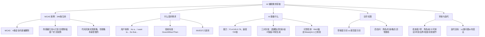

## 一句话总结

AI 生成需求初稿的 F1 ≈ 0.65，经人工审查迭代后可达 F1 ≈ 0.83——那被遗漏的 0.18，就是工程师存在的意义。

## 知识地图



## 核心概念

### 1. Boeing 737 MAX MCAS 案例

两次空难（狮航 JT610 + 埃航 ET302），346人遇难，共同根因：**MCAS（机动特性增强系统）的需求规格说明书遗漏了关键安全约束。**

被删除/遗漏的 4 条关键约束：

| 约束编号 | 应有需求 | 删除原因 |
|---------|---------|---------|
| C-1 | 左右 AOA 传感器均值，差值 > 0.5° 时禁止触发 | 减少硬件成本约 50 万美元 |
| C-2 | 触发需同时满足 AOA 超限 AND G 力 > 1.3G | "简化逻辑，降低误报率" |
| C-3 | 单次安定面调整上限 0.6°，总累计上限 2.5° | 新引擎位置变化需更大补偿量 |
| C-4 | MCAS 激活信息显示于驾驶舱警告系统 | 避免触发飞行员培训要求 |

**关键洞察：** 代码完美实现了规格说明书。问题在于规格说明书本身是错的。这不是代码 Bug，是需求规格缺陷（Specification Defect）。

### 2. 好需求的标准：INVEST 准则

| 字母 | 含义 | 说明 |
|------|------|------|
| **I** | Independent 独立的 | 需求之间不相互依赖 |
| **N** | Negotiable 可协商的 | 可以讨论实现方式，不是固定合同 |
| **V** | Valuable 有价值的 | 对用户或业务有明确价值 |
| **E** | Estimable 可估算的 | 可以估算工作量和复杂度 |
| **S** | Small 小粒度 | 足够小，可以在一个迭代中完成 |
| **T** | Testable 可测试的 | 有明确的验收标准可以验证 ← **最关键** |

### 3. 用户故事标准格式

```
作为 <角色>，
我希望 <功能>，
以便 <价值/目标>。

验收标准：
Given <前置条件>
When <触发动作>
Then <预期结果>
```

**MCAS 应有的安全需求写法 vs 实际被简化的版本：**
- 实际（导致事故）："当 AOA 传感器读数超过阈值时，自动向下推动水平安定面"——无传感器冗余、无复合条件、无限制上限
- 应有："在 [攻角过大 AND G 力超过阈值] 且 [左右两侧 AOA 传感器读数差 < 0.5°] 时触发，单次调整幅度不超过 0.6°，保留飞行员完全覆盖能力"

### 4. AI 在需求获取中的能力与局限

**已验证能力：**
- 从访谈文本/用户评论中自动识别功能性需求，F1 ≈ 0.65–0.75
- 自动将非结构化文本转换为结构化用户故事格式
- 生成速度为人工的 720 倍，成本仅为 0.06%

**AI 需求生成的三大典型失效：**

| 失效类型 | 典型表现 | MCAS 对应 |
|---------|---------|----------|
| ① 遗漏隐式约束 | 不写边界条件、安全约束、复合触发条件 | 传感器冗余、G 力条件被删 |
| ② 歧义保留 | 直接转录模糊表述，未规范化 | "正常情况下触发"←何为正常？ |
| ③ 冲突生成 | 同一文档出现矛盾验收标准 | 多激活条件间逻辑关系未定义 |

**AI 初稿 F1 ≈ 0.65 → 经人工审查迭代后可达 F1 ≈ 0.83。这 0.18 的差距，就是工程师的核心价值所在。**

### 5. 为什么"遗漏隐式约束"是 AI 最难克服的弱点？

**根本原因：AI 只能描述"文本里写了的"。** 用户访谈/文档只含显式信息，而隐式约束不会出现在用户访谈里。

隐式约束的四类来源 [SWEBOK 2.1]：
1. 行业安全标准（如 DO-178C 航空软件认证）
2. 物理世界约束（传感器可能故障）
3. 利益相关者心照不宣的假设（"飞行员应该知道这个系统"）
4. 极端场景下的系统行为（双传感器同时异常时怎么办？）

### 6. 结构化审查检查表（7 项）

| 编号 | 检查项 | 检查方法 |
|------|--------|---------|
| ① | 每条故事是否明确角色？ | 逐条核对 |
| ② | 功能描述是否含歧义词（"方便""快速"）？ | 高亮标记 |
| ③ | 验收标准是否可测试（Given/When/Then 完整）？ | 缺则标红 |
| ④ | 多条故事之间是否存在冲突或重叠？ | 两两对比 |
| ⑤ | 是否遗漏重要边界条件（网络异常、库存为零）？ | 场景推演 |
| ⑥ | 每条故事粒度是否过大（可拆分）？ | INVEST-S 检查 |
| ⑦ | 是否包含实现细节（应属设计范畴）？ | 标注删除 |

第⑤项对应 MCAS 失效根因——边界条件遗漏导致单传感器故障行为未定义。

### 7. 提示词迭代：从草稿到规范

**草稿提示词：** "帮我为校园二手交易平台写用户故事。"——无角色约束、无格式要求、无质量标准。

**规范提示词（四要素）：**
1. 角色设定："你是一名需求分析师"
2. 输出约束："符合 INVEST 准则，每条含 3 条 Given-When-Then 验收标准，至少 1 条覆盖异常路径"
3. 格式规范："Markdown 列表，不要解释"
4. 异常路径："包括网络中断、库存为零、输入为空"

**提示词质量提升的本质 ≠ 学会"咒语"，而是你对工程问题的理解在加深。**

## 难点突破

**难点：理解"审查不是找 AI 的茬，而是找自己对需求理解的盲区"**

学生常犯的思维：AI 生成需求 → 看起来不错 → 直接用。问题在于：
- AI 不会主动问你"这个系统在传感器故障时应该怎么做？"
- AI 不会质疑你的项目简报里"方便""快速""及时"这些模糊词
- AI 忠实复制了你给它的信息——包括你信息中的盲区

审查的真正价值：当你逐条检查 AI 输出时，实际上在**系统化地审视自己对问题的理解**。检查表第⑤项"是否遗漏边界条件"——这不是 AI 的缺陷，而是你（需求提出者）认知中本就缺失的部分。MCAS 的工程师也不是不懂技术，而是在组织压力下没有执行"主动挖掘隐式约束"这一工程责任。

## 与前章关联

- 前置依赖：02-01（需求工程基础、需求层次）、00-01（提示词四要素）
- MCAS 案例是 02-01 中"非功能约束 > 功能需求"的具象化——安全约束被删的代价是 346 条生命
- "四步范式（提示→生成→审查→优化）"在需求场景的具体应用
- 检查表方法引出 02-03（用例建模）、02-04（冲突检测）、02-05（需求文档化）

## 记忆卡片

**Q: INVEST 准则的六个字母分别代表什么？**
A: Independent（独立）、Negotiable（可协商）、Valuable（有价值）、Estimable（可估算）、Small（小粒度）、Testable（可测试）。Testable 最关键——没有验收标准的需求不是需求。

**Q: AI 需求生成的三大典型失效是什么？**
A: ①遗漏隐式约束（最危险，如边界条件、安全约束）②歧义保留（直接复制模糊表述）③冲突生成（同一文档出现矛盾验收标准）。AI 初稿 F1≈0.65，人工审查后可达 0.83。

**Q: 为什么"遗漏隐式约束"是 AI 最难克服的弱点？**
A: AI 只能描述"文本里写了的"。隐式约束（行业标准、物理约束、默认假设、极端场景）不会出现在用户访谈或项目简报中——必须由工程师主动挖掘。

**Q: 结构化审查检查表中第⑤项为什么最关键？**
A: 第⑤项"是否遗漏边界条件"对应 MCAS 失效根因——单传感器故障时系统行为未定义。MCAS 的四条被删约束本质上都是边界条件和异常路径。

**Q: 提示词质量提升的本质是什么？**
A: 不等于学会"咒语"，而是你对工程问题的理解在加深。你能写出"每条验收标准必须覆盖至少一个异常路径"——是因为你真正理解了 MCAS 为什么坠毁。

---

## 📝 期末笔试备考

### 笔试考点标注

| 考点 | 频度 | 考察形式 | 对应章节 |
|------|------|---------|---------|
| MCAS 案例：4 条被删约束 + 根因分析 | 🔴 | 简答/案例分析 | §1 |
| "代码完美，规格错了"的工程启示 | 🔴 | 简答/论述 | §1 |
| INVEST 六准则（名称+含义，尤其 T） | 🔴 | 填空/简答 | §2 |
| 用户故事格式 As a / I want to / So that | 🔴 | 写作用 | §3 |
| 验收标准 Given/When/Then | 🟡 | 写作用 | §3 |
| AI 三大典型失效 | 🔴 | 简答 | §4 |
| 为什么遗漏隐式约束是 AI 最难克服的 | 🟡 | 简答 | §5 |
| 隐式约束四类来源 [SWEBOK 2.1] | 🟡 | 简答 | §5 |
| 审查检查表 7 项（第⑤项为什么最关键） | 🟡 | 简答/填空 | §6 |
| 规范提示词四要素 | 🟡 | 简答 | §7 |
| F1 从 0.65 → 0.83 的含义 | 🟡 | 填空/简答 | §4 |

### 简答题（期末笔试模拟）

**Q1: Boeing 737 MAX MCAS 案例中，被删除的 4 条关键安全约束是什么？根本原因是什么？这个案例给了我们什么工程启示？**

> 参考答案：
>
> 四条被删约束：① 左右 AOA 传感器均值，差值 > 0.5° 时禁止触发（减少硬件成本）；② 触发需同时满足 AOA 超限 AND G 力 > 1.3G（"简化逻辑"）；③ 单次安定面调整上限 0.6°，总累计上限 2.5°（新引擎需更大补偿）；④ MCAS 激活信息显示于驾驶舱警告系统（避免触发飞行员培训要求）。
>
> 根因：**代码完美实现了规格说明书，但规格说明书本身是错的。** 这不是代码 Bug，是需求规格缺陷（Specification Defect）。
>
> 工程启示：① 需求阶段的错误是代价最高的错误；② 安全和边界约束不能被"简化"掉；③ 规格审查不能只看"写了什么"，要看"没写什么"。

**Q2: 写出 INVEST 准则的六个字母全称和含义。为什么 T（Testable）是最关键的？**

> 参考答案：
> - I — Independent（独立的）：需求之间不相互依赖
> - N — Negotiable（可协商的）：可以讨论实现方式
> - V — Valuable（有价值的）：对用户或业务有明确价值
> - E — Estimable（可估算的）：可以估算工作量
> - S — Small（小粒度）：足够小，可在一个迭代中完成
> - T — Testable（可测试的）：有明确的验收标准可以验证
>
> T 最关键的原因：**没有验收标准的需求不是需求。** 模糊的需求（如"系统要快"）无法验证是否实现，无法作为开发和验收的依据。INVEST 中其他五项可以松，T 不能松。

**Q3: AI 在需求获取中的三大典型失效是什么？各自对应 MCAS 中的什么表现？**

> 参考答案：
>
> | 失效类型 | 典型表现 | MCAS 对应 |
> |---------|---------|----------|
> | ① 遗漏隐式约束 | 不写边界条件、安全约束、复合触发条件 | 传感器冗余、G 力条件被删 |
> | ② 歧义保留 | 直接转录模糊表述，未规范化 | "正常情况下触发"←何为正常？ |
> | ③ 冲突生成 | 同一文档出现矛盾验收标准 | 多激活条件间逻辑关系未定义 |
>
> AI 初稿 F1 ≈ 0.65，经人工审查迭代后可达 F1 ≈ 0.83。最常见的失效是①，最危险的也是①。

**Q4: 为什么"遗漏隐式约束"是 AI 最难克服的弱点？隐式约束有哪四类来源？**

> 参考答案：AI 只能描述"文本里写了的"——隐式约束不会出现在用户访谈或项目简报中。四类来源 [SWEBOK 2.1]：① 行业安全标准（如 DO-178C 航空软件认证）；② 物理世界约束（传感器可能故障）；③ 利益相关者心照不宣的假设（"飞行员应该知道这个系统"）；④ 极端场景下的系统行为（双传感器同时异常时怎么办？）。这些必须由工程师主动挖掘，AI 无法凭空生成。

**Q5: 结构化审查检查表包含哪 7 项？为什么第⑤项最关键？**

> 参考答案：① 角色明确性 ② 歧义词检测 ③ 验收标准可测试性 ④ 需求间冲突/重叠 ⑤ **边界条件遗漏** ⑥ 粒度检查（INVEST-S）⑦ 实现细节检测。第⑤项最关键，因为 MCAS 失效的根因正是边界条件遗漏——系统在单传感器故障时的行为未被定义。边界条件遗漏占需求缺陷的很大比例，且往往是最致命的。

**Q6: 从"草稿提示词"到"规范提示词"，需要包含哪四个要素？**

> 参考答案：① 角色设定（"你是一名需求分析师"）；② 输出约束（"符合 INVEST，每条含 3 条 Given-When-Then，至少 1 条覆盖异常路径"）；③ 格式规范（"Markdown 列表，不要解释"）；④ 异常路径（"包括网络中断、库存为零、输入为空"）。提示词质量提升的本质不等于学会"咒语"，而是你对工程问题的理解在加深。

---

## 🛠 工程实践注意

1. **审查 AI 输出时，先看"没写什么"再看"写了什么"。** AI 输出看起来完整规范是最大的迷惑——MCAS 的规格说明书看起来也很"完整"。建立一个边界条件清单（网络异常、输入为空、并发冲突、权限不足），逐条核对 AI 输出是否覆盖。

2. **用户故事的验收标准必须包含至少一条异常路径。** "用户登录成功"的验收标准只覆盖了正常路径——那"密码错误 3 次后锁定账户 30 分钟"才是真正的工程价值。

3. **INVEST 不是教条，是沟通工具。** 尤其 N（可协商）——用户说"我要一键导出所有数据"时，真正的需求可能是"我要定期得到数据报告"，后者实现成本可能是前者的 1/10。不要拿需求直接开工。

4. **F1 0.65 → 0.83 不是一步到位的。** 审查至少 2 轮：第一轮找遗漏（边界条件、异常路径），第二轮找冲突（两条用户故事是否逻辑矛盾）。每轮审查目标不是"找出所有问题"，而是"比上一轮多发现一类问题"。

5. **MCAS 教训的日常版：任何一个"先这样吧，后面再说"的省略，都可能在系统上线后变成事故。** 346 条生命的代价是需求阶段的四行删除——你删掉的每个约束条件，都要问自己一句"删了以后系统在极端情况下会怎样？"
