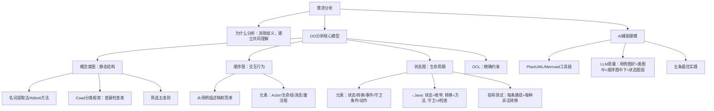

## 一句话总结

模型是思考的工具——AI 生成的是初稿，工程师的审查赋予它正确性。类图看静态结构，顺序图看交互行为，状态图看生命周期。

## 知识地图



## 核心概念

### 1. 需求分析的目标

需求分析是从获取结果到共同理解的桥梁。核心目标：**消除歧义、建立模型、为设计奠基。**

两个任务：
1. 建立分析模型 — 整理提炼获取的信息，达成开发者和用户对需求的共同理解
2. 创建解决方案 — 依据共同理解，创建软件系统的解决方案

### 2. OO 分析的三个关键步骤

```
① 细化系统的对外交互 → 用例图、用例描述
② 明确用例中的协作对象 → 概念类图（领域模型）
③ 明确用例中的协作行为 → 顺序图、状态图
```

### 3. 概念类图（领域模型）

**定义：** 描述应用领域中重要的概念以及概念之间的关系，捕获系统的静态结构。也称"领域模型"（Domain Model）。

**概念类图 vs 设计类图：**
| 维度 | 概念类图（分析阶段） | 设计类图（设计阶段） |
|------|------------------|------------------|
| 关注点 | 问题域中的概念和关系 | 软件内部的类和接口 |
| 方法 | 通常不包含方法实现细节 | 包含方法签名和实现逻辑 |
| 来源 | 从用例描述和领域知识中提取 | 从概念类图映射而来 |

**名词提取法（Abbott 方法）：** 用例描述中的名词往往是潜在的概念类。动词 → 关联关系。数量词 → 多重性。

**候选类筛选五准则：**
① 排除纯属性名词（"名称""价格"）② 排除实现概念（"系统""流程"）③ 排除外部系统 ④ 排除含糊/重复名词 ⑤ 状态与行为测试

**Coad 分类框架（查漏检查表）：** 有形物体、角色、事件/交易、场所、容器、抽象概念、描述/规格说明、明细行。每类至少检查一遍。

### 4. 顺序图

**定义：** 描述系统中一次交互的行为过程，展示参与者、系统对象之间的消息传递时间顺序。

**核心元素：** Actor（参与者）、生命线（Lifeline）、消息（Message）、激活框（Activation）。

**从用例描述映射：** 用例描述中的每一步交互 → 顺序图中的一条消息。正常流程先画，扩展流程用 `alt`/`opt` 片段补充。

**交互片段：** `opt`（可选0或1次）、`alt`（互斥分支）、`loop`（循环0到多次）。

### 5. 状态图

**定义：** 描述系统、用例或对象在整个生命周期内的状态变化。适合描述生命周期复杂的实体（订单、设备、会话等）。

**基本元素：**
| 元素 | 符号 | 说明 |
|------|------|------|
| 状态 | 圆角矩形 | 对象在某一时刻的条件或情况 |
| 转换 | 箭头 | 从一个状态到另一个状态的变迁 |
| 事件 | 标签 | 触发状态转换的外部刺激 |
| 守卫条件 | `[condition]` | 转换必须满足的条件 |
| 动作 | `/action` | 状态转换时执行的操作 |

**状态图 → Java 代码映射：** 状态 → 枚举值；转换 → 方法；守卫条件 → 方法开头的 if 检查；非法转换 → 抛出 IllegalStateException。

**状态图指导测试：** 每条转换路径 + 每种非法转换 = 完整的测试覆盖。

### 6. OCL（对象约束语言）

**为什么需要 OCL？** UML 图能表达结构，但无法精确表达约束规则。

| 约束类型 | OCL 示例 |
|---------|---------|
| 不变量（invariant） | `inv: self.totalAmount > 0` |
| 前置条件（pre） | `pre: self.status = #PENDING_PAYMENT` |
| 后置条件（post） | `post: self.status = #PAID` |
| 集合操作 | `items->forAll(i \| i.qty > 0)` |
| 引用旧值 | `quantity = quantity@pre - self.quantity` |

### 7. AI 辅助 UML 建模

**工具链：** 需求描述（自然语言）→ LLM 生成代码 → PlantUML/Mermaid 渲染 → 人工审查修正。

**LLM 生成各类 UML 图的质量评测：**

| 图类型 | LLM 表现 | 关键问题 |
|--------|---------|---------|
| 用例图 | 较好 | include/extend 关系容易误用 |
| 类图 | 中等 | 关联关系和多重性判断不准确 |
| 顺序图 | 中等偏下 | 消息顺序、激活框处理差 |
| 状态图 | 较弱 | 状态转换条件容易遗漏 |

**五条最佳实践：** ①拆解再生成 ②提供明确上下文 ③指定输出格式 ④必须人工审查 ⑤Few-shot 示范。

## 难点突破

**难点 1：概念类图中"状态与行为测试"的理解**

很多人把"名称""价格""数量"这些纯属性当成独立的类。判断方法：问自己这个候选类有没有"属于自己的行为"和"需要被系统记录的状态"。

- "商品" → 有状态（名称、价格、库存量）、有行为（上架、下架、打折）→ 概念类 ✓
- "价格" → 只是"商品"的一个属性值，自身没有独立行为 → 纯属性，排除 ✗

**难点 2：状态图的守卫条件 vs OCL 的前置条件**

两者都描述约束，但层面不同：
- 状态图守卫条件：描述"什么条件下可以发生这个状态转换"，写在转换箭头上
- OCL 前置条件：描述"调用这个方法之前系统必须满足什么"，写在方法契约里

实践中，状态图的守卫条件往往可以直接翻译为方法的 if 检查——它们是同一件事的不同表示形式。

## 与前章关联

- 前置依赖：02-03（用例图和用例描述是概念类图和顺序图的输入）
- 概念类图 → 03-01（体系结构设计中的组件划分）
- 顺序图 → 03-02（体系结构风格中的交互模式）
- 状态图 → 04-01（详细设计中的对象行为设计）
- OCL → 02-05（需求验证中的形式化检查）

## 记忆卡片

**Q: OO 分析的三个核心模型分别回答什么问题？**
A: 概念类图回答"系统中有哪些关键概念及其关系？"（静态结构），顺序图回答"一次交互中对象如何协作？"（行为过程），状态图回答"单个对象在整个生命周期中状态如何变化？"（生命周期）。

**Q: 概念类图筛选五准则是什么？**
A: ①排除纯属性名词 ②排除实现概念 ③排除外部系统 ④排除含糊/重复名词 ⑤状态与行为测试（有状态+有行为→概念类）。

**Q: 状态图到 Java 代码的映射规则？**
A: 状态 → 枚举值；转换 → 方法；守卫条件 → 方法开头的 if 检查；动作 → 方法内的逻辑；非法转换 → 抛出 IllegalStateException。

**Q: LLM 生成各类 UML 图的质量排序？**
A: 用例图（较好）> 类图（中等）> 顺序图（中等偏下）> 状态图（较弱）。图越大越复杂，质量越差，所有 LLM 生成的 UML 都需要人工审查。

**Q: AI 辅助建模的五条最佳实践？**
A: ①拆解再生成（大系统拆小）②提供明确上下文 ③指定输出格式（PlantUML/Mermaid）④必须人工审查 ⑤Few-shot 示范（给正确示例再让它生成）。
