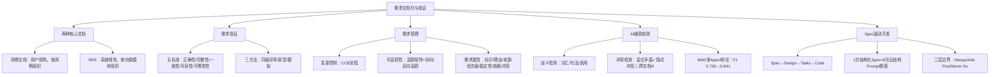

## 一句话总结

需求文档是团队的契约——AI 是高效的助手，但签字的永远是工程师。SDD 证明了：AI 越强大，需求规格说明越重要。

## 知识地图

## 核心概念

### 1. 两种核心需求文档

| 维度 | 用例文档 | SRS（软件需求规格说明书） |
|------|---------|----------------------|
| 视角 | 用户视角 | 系统视角 |
| 侧重点 | 交互流程 | 独立需求 |
| 组织方式 | 按用例组织 | 按功能模块/特性组织 |
| 适用场景 | 需求沟通、用户确认 | 设计、开发、测试 |

**SRS 关注的是"系统应该做什么"，每条需求独立可验证。** SRS 以刺激/响应精确定义系统行为（如 IEEE 830 格式）。

文档化三标准：正确性（准确反映用户意图）、完整性与一致性、可读性与可修改性。

### 2. 需求验证（Validation）

**验证五个标准：** 正确性、完整性、一致性、可读性、可修改性。

**验证 vs 确认（Validation vs Verification）：**
- Validation：确保**写对了**（反映用户真实意图）
- Verification：确保**写得规范**（符合文档标准）

**三种验证方法：**
- **同级评审（Peer Review）** — 最常用，多人交叉审查，走查/审查会议
- **原型（Prototyping）** — 让用户看到可交互的初步产品
- **模拟（Simulation）** — 用模型模拟系统行为，发现流程中的逻辑错误

### 3. 需求管理

**变更控制：** 纳入合理变更，拒绝不合理变更，控制成本和影响范围。瀑布用正式 CCB，敏捷用 Backlog 优先级调整。

**需求追踪矩阵：**
- **前向追踪：** 需求 → 设计 → 代码 → 测试（确保每条需求都被实现和验证）
- **后向追踪：** 代码 → 设计 → 需求（确保每段代码都有需求依据）
- **核心用途：** 一致性审计 + 变更影响分析

**需求的附加属性：** 标识（ID）、理由（Rationale）、来源（Source）、优先级（Priority）、稳定性（Stability）、依赖（Dependencies）、冲突（Conflicts）、验收标准、变更历史。

### 4. AI 辅助需求歧义检测

| 歧义类型 | 描述 | 示例 | AI表现 |
|---------|------|------|--------|
| 词汇歧义 | 模糊、不精确的词语 | "快速""方便""及时" | 较好 |
| 句法歧义 | 句子结构导致多种理解 | "用户和管理员可以删除" | 较好 |
| 语用歧义 | 需要领域知识才能判断 | "支持标准协议"→哪个标准？ | 较弱 |

**10-shot Prompt 比 0-shot 平均提升 20.2%。** 语用歧义（需要领域知识）是 AI 最弱的环节。

### 5. AI 辅助需求冲突检测

| 冲突类型 | 描述 | 示例 |
|---------|------|------|
| 矛盾冲突 | 两条需求直接矛盾 | "自动删除过期数据" vs "永久保留所有数据" |
| 资源冲突 | 需求竞争有限资源 | 高性能 vs 低成本 |
| 优先级冲突 | 利益相关者优先级不同 | 安全性 vs 易用性 |
| 时序冲突 | 操作顺序上的矛盾 | 先审核后发布 vs 即时发布 |

**AI 检测能力谱：** 显式矛盾 ✓ 较好 → 隐式冲突 △ 有限 → 跨文档冲突 ✗ 困难。

**多 Agent 辩论（MAD）：** 倡导者 Agent + 批评者 Agent + 裁判 Agent，F1 从 0.726 提升到 0.841（+15.8%）——多个视角比单一视角更可靠。

### 6. Spec-Driven Development（SDD）

**核心流程：Spec → Design → Tasks → Code。** 每阶段的输出是下一阶段的输入，Spec 质量决定最终代码质量。

**关键发现：1 次有结构化 Spec 的迭代 ≈ 8 次无结构化 Prompt 的迭代精度。**

**好 Spec 的 6 大要素（Addy Osmani, Google Chrome）：**
Commands（可执行指令）、Testing（验收标准）、Project Structure（代码组织）、Code Style（编码规范）、Git Workflow（分支提交规范）、Boundaries（AI 行为边界约束）

**三层边界系统：**
| 层级 | 含义 | 示例 |
|------|------|------|
| Always Do | AI 不需要询问即可执行 | 遵循编码规范、运行测试 |
| Ask First | 需要人工确认后执行 | 删除文件、修改 API 接口 |
| Never Do | 绝对禁止 | 修改生产数据库、跳过安全检查 |

**SDD 不是瀑布模型的回归** ——使用 Micro-Spec（小规模 Spec + 快速迭代），Spec 是 Living Document（活文档），随项目演化。

### 7. SDD 与传统需求工程对照

| 传统 RE 概念 | SDD 对应 | 变化 |
|------------|---------|------|
| SRS | Feature Spec / PRD | 格式更轻量，面向 AI 可读 |
| 需求层次 | Problem → Solution → Tasks | 结构相同，命名不同 |
| 需求验证 | Spec Review + Conformance Suite | 自动化程度提高 |
| 变更管理 | Spec Drift Detection | 新挑战：Spec 与代码不同步 |

**核心洞察：SDD 证明了一个事实——AI 越强大，需求规格说明越重要。**

## 难点突破

**难点 1：Validation vs Verification**

- **Validation（确认）：** "我们建了正确的系统吗？"——需求是否反映用户真实意图？（面向用户）
- **Verification（验证）：** "我们把系统建对了吗？"——实现是否符合规格说明？（面向文档）

MCAS 的问题是 Validation 失败——SRS 写错了（删除了安全约束），不是代码没按 SRS 做。

**难点 2：SDD 不是"瀑布模型的回归"**

SDD 的关键区别：
- 瀑布：一次性写完所有需求 → 设计 → 代码（不可回溯）
- SDD：写小份 Spec → AI 生成 → 审查 → 修改 Spec → 重新生成（快速迭代循环）

Micro-Spec 的思想是把大需求拆成独立的小 Spec，每个小 Spec 可以在一次对话中完成"写 Spec → 生成代码 → 验证"的完整循环。这是敏捷的，不是瀑布的。

## 与前章关联

- 本讲是模块二的收尾，回顾了五节课的主线：基础 → 获取 → 建模 → 分析 → 文档化
- AI 时代需求工程师的转变：从"需求的编写者"转变为"需求的审判者"
- SDD 的 Spec 概念贯穿后续课程：体系结构设计（Architecture Spec）、详细设计（Design Spec）
- RE4AI 预告了 AI 系统本身的特殊需求（公平性、可解释性、漂移监控）

## 记忆卡片

**Q: 用例文档和 SRS 的核心区别？**
A: 用例文档是用户视角（按用例组织、描述交互流程），SRS 是系统视角（按功能模块组织、每条需求独立可验证）。

**Q: 需求验证的五个标准？**
A: 正确性（反映用户意图）、完整性（覆盖所有场景）、一致性（无矛盾）、可读性（易于理解）、可修改性（易于维护更新）。

**Q: AI 在需求冲突检测中的能力边界？**
A: 显式矛盾（文字直接矛盾）✓ 较好；隐式冲突（需要业务上下文）△ 有限；跨文档冲突（需要全局视图）✗ 困难。多 Agent 辩论可将 F1 提升 15.8%。

**Q: SDD 的核心流程和关键发现？**
A: Spec → Design → Tasks → Code。1 次有结构化 Spec 的迭代 ≈ 8 次无结构化 Prompt 的迭代精度。AI 越强大，需求规格说明越重要。

**Q: SDD 的三层边界系统？**
A: Always Do（AI 自主执行）、Ask First（需人工确认）、Never Do（绝对禁止）。边界系统让 AI 知道什么可以自主决定，什么必须请示人类。

---

## 📝 期末笔试备考

### 笔试考点标注

| 考点 | 频度 | 考察形式 | 对应章节 |
|------|------|---------|---------|
| 用例文档 vs SRS（视角+组织方式） | 🔴 | 简答/辨析 | §1 |
| 需求验证五标准 | 🔴 | 填空/简答 | §2 |
| Validation vs Verification 区别 | 🔴 | 辨析/简答 | §2 |
| 三种验证方法 | 🟡 | 填空 | §2 |
| 需求追踪矩阵（前向/后向追踪） | 🟡 | 简答 | §3 |
| AI 歧义检测三类（语用最弱） | 🟡 | 简答 | §4 |
| AI 冲突检测能力边界 + MAD | 🔴 | 简答 | §5 |
| SDD 核心流程 + 1次≈8次 | 🔴 | 简答/论述 | §6 |
| SDD 三层边界系统 | 🔴 | 简答 | §6 |
| SDD 不是瀑布回归的理由 | 🟡 | 论述 | §7 |

### 简答题（期末笔试模拟）

**Q1: 用例文档和 SRS 有什么区别？各适用于什么场景？**

> 参考答案：用例文档是**用户视角**，按用例组织，描述交互流程，适用于需求沟通和用户确认。SRS 是**系统视角**，按功能模块/特性组织，每条需求独立可验证，适用于设计、开发和测试。两者互补，不是替代关系。

**Q2: 需求验证的五个标准是什么？Validation 和 Verification 的区别？**

> 参考答案：五标准——正确性、完整性、一致性、可读性、可修改性。Validation（确认）回答"我们建了正确的系统吗？"，面向用户真实意图；Verification（验证）回答"我们把系统建对了吗？"，面向规格说明文档。MCAS 的问题是 Validation 失败——SRS 写错了（删除了安全约束），不是代码没按 SRS 做。

**Q3: 需求追踪矩阵中，前向追踪和后向追踪分别是什么？核心用途？**

> 参考答案：前向追踪——需求 → 设计 → 代码 → 测试，确保每条需求都被实现和验证。后向追踪——代码 → 设计 → 需求，确保每段代码都有需求依据（防止"镀金"——开发了没人要的功能）。核心用途：一致性审计 + 变更影响分析（改了某条需求，追踪矩阵告诉你影响了哪些代码和测试）。

**Q4: AI 在需求冲突检测中的三种能力层次是什么？MAD 多 Agent 辩论如何提升效果？**

> 参考答案：显式矛盾（文字直接矛盾）✓ 较好；隐式冲突（需要业务上下文）△ 有限；跨文档冲突（需要全局视图）✗ 困难。MAD（Multi-Agent Debate）用倡导者 + 批评者 + 裁判三个 Agent 互相辩论，F1 从 0.726 提升到 0.841（+15.8%）——多个视角比单一视角可靠。

**Q5: SDD 的核心流程是什么？"1 次结构化 Spec ≈ 8 次无结构 Prompt"意味着什么？**

> 参考答案：核心流程 Spec → Design → Tasks → Code，每阶段输出是下一阶段输入。1≈8 的含义：不是 Spec 有魔力，而是**结构化的 Spec 消除了歧义**——无结构 Prompt 每次都要重新理解上下文，8 次迭代中大量精力消耗在"澄清你到底想要什么"。Spec 减少了沟通成本。

**Q6: SDD 三层边界系统是什么？为什么说它回答"什么时候能信 AI，什么时候不能"？**

> 参考答案：Always Do（AI 自主执行，如遵循编码规范）、Ask First（需人工确认，如删除文件）、Never Do（绝对禁止，如修改生产数据库）。三层边界系统让 AI 的自主权被显式约束——这正是课程核心命题："最稀缺的工程师不是会用 AI 的人，而是知道什么时候不能信 AI 的人。"

---

## 🛠 工程实践注意

1. **SRS 不要写成论文。** 一条需求一句话，编号唯一，可独立验证。"系统应提供用户管理功能"不是需求——拆成"管理员可创建用户""管理员可禁用用户"才是。SRS 的读者是开发者和测试者，不是文学奖评委。

2. **追踪矩阵不必全手工维护。** 现代工具（Jira、线性、GitHub Issues）可以自动建立需求↔代码↔测试的链接。关键是**发生变更时主动查一次**："这条需求改了，受影响的有哪些？"

3. **AI 检测到的每个冲突，追问一句"为什么"。** "自动删除过期数据 vs 永久保留"——不要看到冲突就删掉其中一条。先问：哪个利益相关人提出来的？他的真实需求是什么？可能两条都有道理，需要的是细化条件而不是非此即彼。

4. **SDD 实操：从明天你能做的事情开始。** 不需要公司级的 Spec 系统。下一个项目，在问 AI 写代码之前，花 5 分钟写一段 Spec（输入/输出/边界条件/异常处理），然后让 AI 在这个 Spec 约束下工作。你会发现 1 次 Spec-driven 比 3 次无结构追问更省时间。
