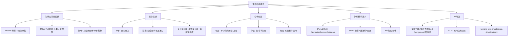

## 一句话总结

软件体系结构 = 部件 + 连接件 + 配置——这是最难修改的设计决策，初期投入不足后期代价巨大。

## 知识地图

## 核心概念

### 1. 软件的本质复杂性 [Brooks 1987]

软件的复杂性是本质属性（essential property），不是偶然属性（accidental one）：
- 问题域的复杂性 — 现实世界的规则、约束和例外
- 开发过程的管理难度 — 多人协作、需求变更
- 软件的灵活性 — 修改容易导致"什么都能改"的幻觉
- 离散系统的行为刻画 — 无法像连续系统那样用微分方程建模

### 2. 应对复杂性的两大武器

**人类认知局限：** Miller 7±2 规则——短期记忆一次只能处理 5~9 个信息块。软件系统动辄成百上千个类，远超脑容量。

| 策略 | 含义 | 设计中的体现 |
|------|------|------------|
| 关注点分离 | 每次只关注一个维度 | 分层、模块化 |
| 分解（Decomposition） | 大问题拆成小问题 | 子系统、包 |
| 抽象（Abstraction） | 隐藏细节，暴露接口 | 接口、抽象类 |

**设计复杂度 = 事物复杂度 + 载体与事物的适配复杂度。好的设计 = 最小化适配复杂度。**

### 3. 需求分析 vs 软件设计 vs 编程

| 维度 | 需求分析 | 软件设计 | 编程 |
|------|---------|---------|------|
| 回答的问题 | 做什么？ | 怎么组织？ | 怎么实现？ |
| 关注层面 | 问题域（现实世界） | 解决方案的结构 | 代码细节 |
| 产出物 | 用例图、概念类图 | 包图、组件图、接口 | Java/Python 代码 |
| 可修改性 | 高 | 中（架构决策难改） | 高（但受架构约束） |

从需求到代码：概念类 → 设计类 → 实现类，逐步精化。

### 4. 软件设计的三层

| 层次 | 关注点 | 产出物 | 案例 |
|------|--------|--------|------|
| 低层设计 | 单个类的属性、方法、算法 | 设计类图 | `Order.calculateTotal()` |
| 中层设计 | 包/模块的划分、类的协作 | 包图、交互图 | `com.bookstore.service.order` |
| 高层设计（体系结构） | 系统整体结构、层次、部署 | 组件图、部署图 | 三层架构：展示层/业务层/数据层 |

### 5. 软件体系结构的经典定义

**Perry & Wolf (1992)：** Software Architecture = { Elements, Forms, Rationale } + Constraints (Boehm补充)

**Shaw (1995)：软件体系结构 = { 部件(Component), 连接件(Connector), 配置(Configuration) }**

| 要素 | 定义 | Java 映射 |
|------|------|----------|
| 部件 | 承载系统主要功能的基本组成单位 | 包（Package）、类集合 |
| 连接件 | 定义部件间交互的抽象表示 | 接口（Interface）、事件 |
| 配置 | 部件和连接件的关联方式，组成系统总体结构 | 依赖注入、工厂模式 |

### 6. 体系结构为什么重要 [Clements 1996]

三个根本理由：
1. **相互沟通** — 架构图是利益相关人之间的"共同语言"
2. **早期设计决策** — 架构决定系统的质量属性（性能、安全、可维护性）
3. **可转移的抽象** — 好的架构可以在类似项目中复用

修改一个类的方法签名影响范围有限，但把单体系统改为分层系统——几乎等于重写。

### 7. Conway 定律

**"设计系统的组织，其设计结果必然是该组织沟通结构的副本。"**

5人团队 → 5个模块边界。组织结构决定了架构边界——这是理解为什么实际项目架构长成那样的关键。

### 8. 架构气味（Architecture Smell）

| 气味类型 | 描述 | 后果 |
|---------|------|------|
| 循环依赖 | A→B→C→A 形成环 | 无法独立编译/部署/测试 |
| God Component | 一个包/模块承担过多职责 | 修改波及面大，测试困难 |
| 层违规调用 | 展示层直接访问数据层 | 绕过业务规则，安全风险 |
| Feature Envy | 模块频繁访问另一模块内部数据 | 高耦合 |
| Scattered Functionality | 同一功能分散在多个模块 | 修改需同时改多处 |

### 9. ADR（架构决策记录）

不仅记录决策，还要记录**为什么拒绝其他方案**：

| 字段 | 内容 |
|------|------|
| 标题 | ADR-001: 采用三层分层架构 |
| 状态 | 已采纳 |
| 背景 | 需支持 Web 和移动端，业务逻辑需独立于展示 |
| 决策 | Presentation → BusinessLogic → Data 三层架构 |
| 理由 | 分层降低耦合，便于并行开发 |
| 被拒绝方案 | 微服务（5人团队无K8s经验）、单文件脚本（无法扩展测试） |
| 后果 | 层间通过接口通信；跨层调用需严格禁止 |

### 10. AI Agent 时代的架构决策

**架构决策核心原则：Humans own architecture, AI validates it.**

人负责架构决策，AI 负责验证和生成。Agent 在秒级做出架构决策，但缺乏深思熟虑和透明性——ADR 的记录变得更加重要。

## 难点突破

**难点：部件、连接件、配置的具象化理解**

很多人对这三个概念感到抽象。用在线书店系统举例：
- **部件** = 具体的功能包（`com.bookstore.service.book`、`com.bookstore.service.order`），像房子的房间
- **连接件** = 定义部件之间怎么通信的接口（`BookService` 接口），像房间之间的门
- **配置** = 接口的具体实现如何组装（依赖注入：`new BookServiceImpl(bookDao)`），像"这个房间的门通向那个房间"的蓝图

三者不是代码的不同写法，而是架构视角的三个维度——就像描述一栋建筑：有哪些房间（部件）、门和走廊怎么连（连接件）、整体楼层的平面图（配置）。

## 记忆卡片

**Q: 软件体系结构的三要素（Shaw 1995）？在 Java 中如何映射？**
A: 部件（Component）= 包/类集合，连接件（Connector）= 接口，配置（Configuration）= 依赖注入/工厂模式。体系结构 = 部件 + 连接件 + 配置。

**Q: 为什么架构是最难修改的设计决策？**
A: 修改类的签名影响范围有限，但把单体改为分层架构几乎等于重写。架构决定质量属性（性能、安全、可维护性），初期投入不足后期代价巨大。

**Q: 五种常见架构气味？**
A: 循环依赖（A→B→C→A）、God Component（职责过多）、层违规调用（跨层直接访问）、Feature Envy（频繁访问其他模块内部）、Scattered Functionality（功能分散多处）。

**Q: ADR 的七个标准字段？为什么"被拒绝方案"很重要？**
A: 标题、状态、背景、决策、理由、被拒绝方案、后果。"被拒绝方案"记录了为什么选了A而不是B——没有这部分就不是完整的架构决策记录。

**Q: AI 时代架构决策的核心原则？**
A: Humans own architecture, AI validates it. 人负责架构决策，AI 负责验证和生成。Agent 能做决策但缺乏深思熟虑，ADR 的记录和 Rationale 更加重要。

---

## 期末简答题（6 道）

**Q1: 简述 Brooks 提出的软件本质复杂性的四个方面。（4分）**
A: ① 问题域的复杂性 — 现实世界的规则、约束和例外；② 开发过程的管理难度 — 多人协作、需求变更；③ 软件的灵活性 — 修改容易导致"什么都能改"的幻觉；④ 离散系统的行为刻画 — 无法像连续系统那样用微分方程建模。

**Q2: 软件体系结构的 Shaw 三要素是什么？各举一个 Java 中的映射。（6分）**
A: ① 部件（Component）= Java 中的包（Package）/类集合，承载系统主要功能；② 连接件（Connector）= Java 中的接口（Interface）/事件，定义部件间交互的抽象表示；③ 配置（Configuration）= Java 中的依赖注入/工厂模式，部件和连接件的关联方式组成系统总体结构。

**Q3: 为什么说"体系结构是最难修改的设计决策"？至少给出两个理由。（4分）**
A: ① 修改类的签名影响范围有限，但把单体改为分层架构几乎等于重写整个系统；② 架构决定系统的质量属性（性能、安全、可维护性），一旦定型后续很难补救；③ 架构是利益相关人之间的"共同语言"和早期设计决策，牵一发而动全身。

**Q4: 列举三种架构气味，说明每种的表现和后果。（6分）**
A: ① 循环依赖 — 模块形成 A→B→C→A 的环，导致无法独立编译/部署/测试；② God Component — 一个包承担过多职责，修改波及面大、测试困难；③ 层违规调用 — 展示层直接访问数据层，绕过业务规则、安全风险；④ Feature Envy — 模块频繁访问另一模块内部数据，造成高耦合；⑤ Scattered Functionality — 同一功能分散在多个模块，修改需同时改多处。（任答三种即满分）

**Q5: 什么是 ADR？它包含哪些字段？为什么"被拒绝方案"不可省略？（6分）**
A: ADR（Architecture Decision Record，架构决策记录）是记录架构决策及其理由的文档。七个标准字段：标题、状态、背景、决策、理由、被拒绝方案、后果。"被拒绝方案"记录了为什么选A而不是B——没有这部分，后人不知道是深思熟虑的选择还是根本没考虑过其他方案，容易在相似场景下重复踩坑。

**Q6: Conway 定律是什么？用实际开发场景举例说明。（4分）**
A: "设计系统的组织，其设计结果必然是该组织沟通结构的副本。"例如：一个5人团队（前端2人、后端2人、DBA 1人），产出的系统架构自然分割为前端模块、后端服务、数据库层三个边界，因为团队内部沟通结构已经决定了模块的划分方式。想让系统架构不同，先改变团队结构。
