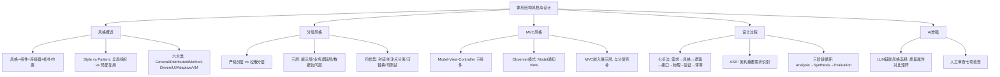

## 一句话总结

风格 = 组件词汇 + 连接器词汇 + 拓扑约束——选择架构风格要基于需求特征和项目约束，而非技术偏好。

## 知识地图

## 核心概念

### 1. 体系结构风格的定义

**风格 = 组件词汇 + 连接器词汇 + 拓扑约束。** 规定了：组件类型、连接方式、交互约束规则。

**风格 vs 模式：**

| 维度 | 体系结构风格 (Style) | 体系结构模式 (Pattern) |
|------|-------------------|---------------------|
| 作用范围 | 系统全局组织方式 | 局部重复问题的解决方案 |
| 共存 | 一个系统一种主风格 | 多个模式可同时存在 |
| 示例 | 分层、微服务、管道-过滤器 | 观察者、MVC、DAO |

### 2. 六大风格分类 [SWEBOK 2.2]

| 类别 | 包含风格 |
|------|---------|
| General Structures | 分层、管道-过滤器、黑板 |
| Distributed Systems | C/S、n-tier、发布-订阅、REST、微服务 |
| Method-Driven | 面向对象、事件驱动、数据流 |
| User-Computer Interaction | MVC、PAC |
| Adaptive Systems | 微内核、反射 |
| Virtual Machines | 解释器、规则引擎 |

### 3. 分层风格（Layered Architecture）

**严格分层：** 每层只能调用直接下层（如 OSI 七层）。**松散分层：** 允许跨层调用（大多数企业应用）。

**三层架构：**
| 层次 | 核心职责 | 典型技术 |
|------|---------|---------|
| 展示层 (Presentation) | 接收请求、渲染视图 | JSP, Thymeleaf, Vue, React |
| 业务逻辑层 (Business Logic) | 实现业务规则、协调工作流 | Spring Service, EJB |
| 数据访问层 (Data Access) | CRUD、数据映射、事务管理 | MyBatis, JPA |

**四优势：** 封装性、关注点分离、可替换性（切换数据库不影响业务层）、可测试性。**代价：** 性能开销、级联修改、过度分层。

### 4. MVC 风格

| 组件 | 职责 | 要点 |
|------|------|------|
| Model | 管理数据与业务逻辑 | 不依赖 View/Controller |
| View | 展示数据给用户 | 从 Model 获取数据，不含业务逻辑 |
| Controller | 处理用户输入 | 更新 Model，选择 View |

**MVC 与分层的关系：** MVC 嵌入展示层，分层关注纵向职责划分，MVC 关注交互逻辑分离，两者互补。

### 5. 其他重要风格

**管道-过滤器：** 数据逐步变换（Java Stream API、Unix 管道）。

**客户端-服务器 + REST：** 无状态 + 统一接口 + 分层系统。REST 核心理由约束。

**微服务：** 独立部署、独立数据库、通过 REST/消息队列通信。适合大团队/高流量，不适合小团队早期项目。

### 6. 体系结构设计七步过程

| 步骤 | 核心任务 |
|------|---------|
| 1. 分析关键需求 | 识别功能需求、质量属性、项目约束 |
| 2. 选择体系结构风格 | 根据需求特征选择合适风格 |
| 3. 逻辑设计 | 将需求分配到子系统和模块（最核心步骤） |
| 4. 接口设计 | 定义模块间的交互接口 |
| 5. 物理设计 | 决定部署方案 |
| 6. 验证设计方案 | 检查是否满足需求和约束 |
| 7. 评审与改进 | 团队评审，迭代优化 |

### 7. ASR（架构重要需求）

**Architecturally Significant Requirement：** 并非所有需求都影响架构，只有那些驱动架构决策的需求才是 ASR。

| 需求 | 是否 ASR | 理由 |
|------|---------|------|
| 支持 1000 并发用户 | ASR | 驱动缓存/负载均衡决策 |
| 按书名搜索图书 | 非 ASR | 功能需求，不影响整体架构 |
| 按钮颜色为蓝色 | 非 ASR | UI 细节，与架构无关 |
| 系统需用 Java 开发 | ASR | 技术约束，影响全部技术选型 |

**三阶段循环：** Analysis（收集 ASR）→ Synthesis（构建候选方案）→ Evaluation（验证方案）。迭代进行，评估发现问题 → 回到分析 → 再次综合。

### 8. AI 辅助风格选择

**实践：** 让 AI 对每种风格进行质量属性评分（1-5），生成对比矩阵。5人团队 + 3个月周期 + Java技术栈 → 分层架构最优，微服务引入的复杂度远超收益。

**人工审查 AI 建议七项检查：** 需求覆盖、约束一致、经验验证、风险评估、替代方案、演化能力、技术生态。

## 难点突破

**难点：逻辑设计中最容易犯的"包太粗"问题**

初学者常把所有数据访问放在一个 `Database` 包里——销售数据 + 库存数据 + 会员数据混在一起。问题：违反单一职责、无法独立修改、团队并行开发困难。

正确做法：**每个功能域在三层中各有对应包**（如 `SalesUI` + `Sales` + `SalesData`），形成纵向切片。跨模块的数据依赖通过业务逻辑层内部的横向接口调用解决。

## 记忆卡片

**Q: 体系结构风格的三要素定义？**
A: 风格 = 组件词汇 + 连接器词汇 + 拓扑约束。规定了组件类型、连接方式和交互约束规则。

**Q: Style 和 Pattern 的区别？**
A: Style 是系统全局组织方式（如分层、微服务），一个系统一种主风格。Pattern 是局部重复问题的解决方案（如 Observer、MVC），多个可共存。

**Q: 三层架构各层职责和关键约束？**
A: 展示层（接收请求渲染视图）、业务逻辑层（实现业务规则）、数据访问层（CRUD 数据映射）。展示层不直接访问数据库、业务层不含 UI 代码、数据层不含业务规则。

**Q: ASR 是什么？举两个例子。**
A: 架构重要需求——驱动架构决策的需求。如"支持1000并发"是 ASR（驱动缓存决策），"按钮颜色为蓝色"不是 ASR（UI细节）。

**Q: 架构设计七步过程的循环特性？**
A: 需求→风格→逻辑→接口→物理→验证→评审。在任何步骤发现问题都可以回退到前面步骤。逻辑设计是最核心步骤，需要反复迭代。

**Q: 小团队为何不选微服务？**
A: 微服务需要容器编排（K8s）、DevOps 技能、分布式事务处理。5人团队3个月周期选微服务，基础设施复杂度远超业务收益，分层架构够用且更高效。

---

## 期末简答题（6 道）

**Q1: 体系结构风格的三要素是什么？风格和模式有什么区别？（6分）**
A: 风格 = 组件词汇 + 连接器词汇 + 拓扑约束。区别：① Style 作用于系统全局组织方式，一个系统一种主风格（如分层、微服务）；Pattern 解决局部重复问题，多个可共存（如 Observer、MVC）；② Style 规定组件类型和连接方式，Pattern 是已有方案的结构化描述。两者不互斥——分层风格的系统内可以用多个设计模式。

**Q2: SWEBOK 将体系结构风格分为哪六大类？各举一例。（6分）**
A: ① General Structures — 分层、管道-过滤器、黑板；② Distributed Systems — C/S、n-tier、发布-订阅、REST、微服务；③ Method-Driven — 面向对象、事件驱动、数据流；④ User-Computer Interaction — MVC、PAC；⑤ Adaptive Systems — 微内核、反射；⑥ Virtual Machines — 解释器、规则引擎。

**Q3: 三层架构各层的职责和关键约束是什么？说明严格分层和松散分层的区别。（6分）**
A: 展示层（接收请求、渲染视图），业务逻辑层（实现业务规则、协调工作流），数据访问层（CRUD、数据映射、事务管理）。约束：展示层不直接访问数据库，业务层不含 UI 代码，数据层不含业务规则。严格分层：每层只能调用直接下层（如 OSI 七层）；松散分层：允许跨层调用（大多数企业应用采用此方式）。四优势：封装性、关注点分离、可替换性、可测试性。

**Q4: MVC 三个组件的职责分别是什么？MVC 与分层架构之间是什么关系？（5分）**
A: Model 管理数据与业务逻辑（不依赖 View/Controller），View 展示数据给用户（从 Model 获取，不含业务逻辑），Controller 处理用户输入（更新 Model，选择 View）。关系：MVC 嵌入展示层内部——分层架构做纵向职责划分（展示/业务/数据），MVC 在展示层内部做交互逻辑分离，两者互补不冲突。

**Q5: 什么是 ASR？举两个正例和两个反例说明。（4分）**
A: ASR（架构重要需求）是驱动架构决策的需求。正例：① "支持 1000 并发用户"→ 驱动缓存/负载均衡决策；② "系统需用 Java 开发"→ 技术约束影响全部技术选型。反例：① "按书名搜索图书"→ 普通功能需求，不影响整体架构；② "按钮颜色为蓝色"→ UI 细节，与架构无关。ASR 三阶段循环：Analysis（收集）→ Synthesis（构建方案）→ Evaluation（验证），迭代进行。

**Q6: 为什么小团队早期项目不建议选微服务？用具体场景对比说明。（5分）**
A: 5人团队 + 3个月周期 + Java 技术栈：微服务需要 K8s 容器编排、DevOps 运维技能、分布式事务处理、服务发现/配置中心等基础设施，引入的复杂度远超业务收益。分层架构（三层）足够应对此规模，开发效率高、维护成本低。微服务适合大团队（20+人）、高流量、需要独立部署和独立数据库的场景。选风格要基于需求特征和项目约束，而非技术偏好。
