## 一句话总结

好的界面应该是透明的——用户忘记自己在使用计算机。可用性不是单一属性，而是易学性、效率、易记性、容错性和满意度的多维综合。

## 知识地图

```mermaid
flowchart TD
    HCI[人机交互设计] --> Goal[目标: 可用性]
    HCI --> Human[人的因素]
    HCI --> Computer[计算机因素]
    HCI --> Interaction[交互设计]
    HCI --> Design[设计过程与原则]

    Goal --> G1[五维度: 易学/效率/易记/容错/满意度]
    Goal --> G2[学习曲线: 新手易学 vs 专家效率 权衡]

    Human --> H1[记忆: 识别>>回忆, 图像>>文字]
    Human --> H2[7±2规则: 短时记忆有限]
    Human --> H3[菲茨定律: T∝D/W, 目标越大越近点击越快]
    Human --> H4[三类用户: 新手/熟练/专家]
    Human --> H5[精神模型: 关注隐喻和目标]

    Computer --> C1[移动端: 拇指区域/最小44pt/手势冲突]
    Computer --> C2[界面类型: 批处理/命令行/全屏/GUI/多维]

    Interaction --> I1[交互风格: 直接操纵/菜单/表单/命令/自然语言]
    Interaction --> I2[导航: 全局结构+局部线索]
    Interaction --> I3[反馈: 50-150ms即时, >15s破坏性]

    Design --> D1[协作式设计: 低出错+易记+视觉风格]
    Design --> D2[出错信息四原则]
    Design --> D3[黄金原则]
```

## 核心概念

### 1. 可用性五维度

| 属性 | 含义 |
|------|------|
| 易学性（Learnability） | 用户能在短时间内掌握操作 |
| 效率（Efficiency） | 熟练用户能高效完成任务 |
| 易记性（Memorability） | 中断后无需从头学习 |
| 容错性（Errors） | 错误少，能快速从错误中恢复 |
| 满意度（Satisfaction） | 用户使用时感到愉悦 |

**核心权衡：** 易学性和效率存在冲突——专注新手易学性 vs 专注专家效率，两者不可兼得。

### 2. 菲茨定律（Fitts' Law, 1954）

**T ∝ D/W：目标越大（W）、越近（D）→ 点击越快。**

GUI 设计启示：
- 重要操作按钮要大
- 菜单栏/Dock 放屏幕边缘（等效于无限宽）
- 危险操作按钮要小且远离"保存"
- 右键菜单就在光标处（D=0，最快）
- 触屏最小点击区域 ≥ 44pt（iOS）/ 48dp（Android）

### 3. 三类用户

| 类型 | 特点 | 设计侧重 |
|------|------|---------|
| 新手用户 | 对业务不熟悉 | 易学性，业务导航，避免出错 |
| 熟练用户 | 介于新手与专家之间 | 易学与效率折中 |
| 专家用户 | 能熟练操作，长期使用 | 效率，快捷键，命令行 |

**好的 HCI 为不同用户提供差异化交互机制。**

### 4. 交互风格

| 风格 | 描述 | 适合场景 |
|------|------|---------|
| 直接操纵 | 窗口、图标，所见即所得 | 新手友好 |
| 菜单选择 | 下拉菜单、弹出菜单 | 功能发现 |
| 表单填写 | 输入框、复选框 | 结构化数据 |
| 命令语言 | 终端、Shell | 专家用户 |
| 自然语言 | 语音助手、聊天机器人 | LLM 时代新热点 |

### 5. 设计关键原则

**反馈响应时间（Shneiderman）：** 打字/光标 50-150ms，简单任务 1s，普通任务 2-4s，复杂任务 8-12s，>15s 具有破坏性。

**出错信息四原则（Shneiderman 1982）：** ①清晰语言（不用难懂错误代码）②精炼准确（不空泛不模糊）③建设性帮助（具体建议）④友好态度（不责备用户）。

**协作式设计三方向：** 低出错率（灰显不适用选项、禁止非法输入）、易记性（系统替用户记忆、有意义默认值）、视觉风格（色彩/字体/图标一致性）。

**移动端特殊考量：** 拇指区域决定布局（重要操作下移）、最小点击 ≥ 44pt、单手持机、环境光影响对比度需求。

### 6. 精神模型（Mental Model）

关注用户对任务的**隐喻（Metaphors）**——找出用户真正想做什么（目标），而非他们说的"想要什么功能"。只有在确认能帮助解决任务的情况下才添加功能。映射越直观，用户越不易出错。

## 难点突破

**难点：易学性 vs 效率的权衡——同一条设计规则为什么对两类用户是矛盾的**

新手需要引导、大按钮、文字说明和少量选项 —— 这些对专家来说就是"干扰"。专家需要快捷键、批量操作和密集信息 —— 这些对新手来说是"困惑"。

好的设计不是取平均，而是**分层**：默认展示新手友好的界面，同时为专家提供快捷键和高级选项入口。如 VS Code：默认有菜单和按钮（新手），但所有操作都有快捷键，且可以完全用命令面板操作（专家）。

## 记忆卡片

**Q: 可用性的五个维度？**
A: 易学性（Learnability）、效率（Efficiency）、易记性（Memorability）、容错性（Errors）、满意度（Satisfaction）。

**Q: 菲茨定律的内容及设计启示？**
A: T ∝ D/W。目标越大越近点击越快。启示：重要按钮要大、菜单放边缘（等效无限宽）、危险操作远离保存、触屏最小44pt。

**Q: 五类交互风格及其适用场景？**
A: 直接操纵（新手友好）、菜单选择（功能发现）、表单填写（结构化数据）、命令语言（专家效率）、自然语言（LLM时代新热点）。

**Q: Shneiderman 出错信息四原则？**
A: ①清晰语言（不用错误代码）②精炼准确（不空泛）③建设性帮助（给具体建议）④友好态度（不责备用户）。好的错误信息告诉用户"怎么解决"而不是"你做错了什么"。

---

## 期末简答题库

**Q1: 什么是可用性？它的五个维度分别是什么？**
可用性衡量用户使用系统的难易程度。五维度：①易学性——新手多快能上手；②效率——熟练用户多快完成任务；③易记性——中断后不用重学；④容错性——错误少且易恢复；⑤满意度——使用愉悦。核心权衡：易学性和效率难以兼得。

**Q2: 解释菲茨定律，并给出三个 GUI 设计启示。**
菲茨定律：T = a + b·log₂(D/W + 1)，即点击时间与目标距离 D 成正比、与目标宽度 W 成反比。启示：①重要按钮做大；②菜单栏/Dock 贴屏幕边缘（等效无限宽，鼠标无法越过）；③右键菜单出现在光标旁（D≈0，最快）。触屏最小点击区域 ≥ 44pt。

**Q3: 软件系统应为哪三类用户设计？各自的侧重点是什么？**
①新手用户：侧重易学性和业务导航，避免出错；②熟练用户：易学与效率折中；③专家用户：侧重效率，提供快捷键、命令行。好的 HCI 为不同用户提供差异化交互机制，如 VS Code 同时提供菜单（新手）和命令面板（专家）。

**Q4: 列举五种交互风格并说明各自适用场景。**
①直接操纵（WYSIWYG 窗口图标）→ 新手友好；②菜单选择 → 功能发现；③表单填写 → 结构化数据录入；④命令语言 → 专家高效操作；⑤自然语言 → LLM 时代新兴，语音助手/聊天机器人。

**Q5: Shneiderman 的反馈响应时间指南是什么？**
打字/光标响应 50-150ms；简单任务 < 1s；普通任务 2-4s；复杂任务 8-12s；超过 15s 具有破坏性（用户注意力转移、忘记操作目标）。

**Q6: 什么是精神模型？为什么它在 HCI 设计中重要？**
精神模型是用户对系统如何运作的心理认知。设计时应关注用户的隐喻和目标——用户真正想完成什么任务，而非他们口头说的"想要什么功能"。精神模型与系统实际模型越接近，用户操作越直观，错误越少。
