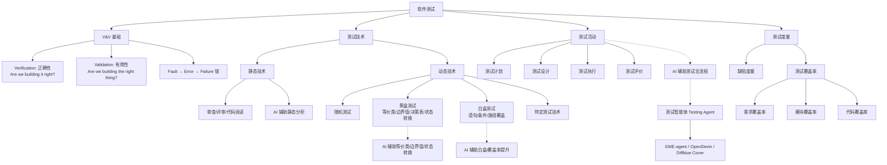

## 一句话总结

软件测试的目的是向开发者和用户展示软件满足需求（有效性测试）并找出软件中的缺陷和不足（缺陷测试）——通过静态分析（不执行代码）和动态测试（执行代码）两类技术，结合黑盒/白盒方法选择测试用例，以尽可能小的代价发现尽可能多的缺陷，而 AI 测试智能体的出现使"生成→执行→失败→修复→验证"闭环自动化成为现实。

## 知识地图

## 核心概念

### 1. V&V：验证与确认

- **Verification（验证）**：Are we building it right? 程序 P 相对于规格说明 S 是正确的，当且仅当对每个有效输入，P 的输出都符合 S。关注**技术正确性**
- **Validation（确认）**：Are we building the right thing? 将软件与终端用户或其他利益相关者的需求进行比较。关注**需求符合性**
- V&V 泛指任何试图确保软件将按要求运行的活动

### 2. Fault → Error → Failure 缺陷链

| 术语 | 定义 | 关系 |
|------|------|------|
| **Fault/Defect（缺陷）** | 失败的原因，如缺少或错误的代码片段 | 可能长期潜伏，直到某个事件激活它 |
| **Error（错误）** | 中间不稳定状态 | 当 Fault 被激活时产生 |
| **Failure（失效）** | 程序无法执行所需功能的显式表现（错误输出、异常终止、不满足时空约束） | Error 传播到输出端时导致 |

这个链条可以**递归迭代**：一个系统的 Fault 可能是由另一个交互系统的 Failure 引起的。

### 3. 静态技术 vs 动态技术

**静态分析技术**：
- 基于对项目文档、软件模型和代码的（人工或自动）检查
- 通常产生有效结果，但精确度可能较弱
- 传统方法：软件审查（对照检查列表逐步分析）、软件评审（向利益相关者展示）、代码阅读、算法分析
- 可应用于需求、设计和实现各阶段

**动态测试技术**：
- 通过执行软件来暴露可能的失效
- 观察程序的行为和性能属性
- 产生更精确的结果，但仅对检查过的执行为真

**AI 增强的静态分析**：大模型能理解代码意图，发现传统工具难以检测的逻辑缺陷和设计问题，包括代码审查、安全扫描（SQL 注入/XSS/缓冲区溢出）、规范一致性检查、文档一致性检查。

### 4. 测试用例选择原则

测试的目标是发现**尽可能多**的缺陷，并不绝对要求所有缺陷——因为测试是有代价的（耗费桩程序、驱动成本，且随测试用例数量增多直线上升）。**测试技术就是帮助软件人员设计和选择用例**，在代价尽可能小的情况下发现足够多的缺陷。

### 5. 黑盒测试方法（基于规格的技术）

**等价类划分**：
- **有效等价类**：符合规格说明的合理、有意义的输入数据集合——检验程序是否实现了规格说明中规定的功能和性能
- **无效等价类**：不符合规格的输入数据集合——检验程序的异常处理能力

**边界值分析**：对每个等价类，测试其边界值（最小值、最小值+1、最大值-1、最大值）。边界是缺陷最容易集中的地方。

**决策表**：适用于输入条件存在逻辑组合的场景，将条件组合转换为决策规则，每条规则设计一个测试用例。

**状态转换测试**：
- 先为对象建立状态图，描述状态集合、输入集合和输入导致的状态转换集合
- 以状态图为基础建立转换表，每一行设计为一个测试用例
- 覆盖策略：0-Switch（每个转换至少执行一次）、1-Switch（每对连续转换至少执行一次）

### 6. 白盒测试方法（基于代码的技术）

**语句覆盖**：确保被测试对象的每一行程序代码都至少执行一次（最基础的覆盖标准）。

**条件覆盖**：确保程序中每个判断的每个结果都至少满足一次。

**路径覆盖**：确保程序中每条独立执行路径都至少执行一次（最强的覆盖标准，但路径数可能爆炸）。

**AI 增强**：大模型输入代码后自动识别独立路径生成测试用例；将覆盖率报告（JaCoCo）输入大模型，自动识别未覆盖分支并生成补充用例；识别变量定义-使用链（def-use pairs），生成数据流测试用例。

### 7. 测试层次

| 层次 | 关注点 | 特征 |
|------|--------|------|
| **单元测试** | 单个模块/类的正确性 | 需要桩程序（模拟被调部件）和驱动程序（创建执行环境并驱动测试） |
| **集成测试** | 模块间协作 | 自顶向下或自底向上，发现接口缺陷 |
| **系统测试** | 整个系统的行为 | 不依赖桩程序和驱动程序；更关注不符合需求的缺陷和需求自身的内在缺陷 |

**系统测试 vs 单元/集成测试**：单元测试和集成测试更关注**技术上的正确性**，重在发现设计缺陷和代码缺陷；系统测试更关注**不符合需求的缺陷和需求自身的内在缺陷**。

系统测试的主要类型：功能测试（基于需求规格说明/用例文档，使用随机测试和基于规格的测试技术）、非功能性测试（性能、安全性、易用性等，使用特定测试技术）。

### 8. 桩程序与驱动程序

- **桩程序（Stub）**：被测试部件的交互环境，扮演被测试部件需要调用的其他系统部件。对其他部件的扮演仅限于规格相同，内部代码要简单得多——通常是直接返回固定数据或按固定规则返回数据
- **驱动程序（Driver）**：负责创建被测试部件的执行环境，并驱动和监控被测试部件执行测试用例的过程，判定测试用例的执行结果

### 9. 测试活动四阶段

1. **测试计划**：根据需求规格制定测试策略、测试范围、资源估算
2. **测试设计**：设计具体的测试用例（黑盒+白盒）
3. **测试执行**：执行测试用例，记录测试结果和缺陷
4. **测试评价**：分析测试结果，评估测试充分性，生成测试报告

### 10. AI 测试智能体（Testing Agent）

**定义**：在大模型基础上增加自主规划、工具调用、多步执行能力的自动化测试系统。不只是单轮问答——能持续感知环境、执行动作、观察反馈、迭代优化。

**核心循环**：**Observe**（观察代码/测试结果）→ **Plan**（制定测试策略）→ **Act**（生成/执行测试）→ **Reflect**（分析失败、改进）

**与普通大模型提示词的本质区别**：普通提示词是单轮输入输出、人工驱动每一步；测试智能体是多步自主、工具调用（代码执行/版本控制/CI）、闭环反馈，可跨多个文件端到端完成「发现问题 → 生成测试 → 修复 → 验证」。

**五大核心技能**：
1. **代码理解与调用图分析**：解析函数调用链、数据流，识别模块间依赖
2. **测试用例自动生成**：基于函数签名、文档注释、已有测试自动补充新用例，覆盖正常路径、边界值、异常场景
3. **测试执行与自修复（Self-Repair）**：调用 pytest/JUnit 执行测试，分析 Traceback，定位根因，自动修改并迭代直到通过
4. **缺陷定位与根因分析**：将失败测试映射到源码位置，生成最小复现用例
5. **覆盖率驱动补全**：读取覆盖率报告，识别未覆盖分支，自动生成测试直到达到预设阈值

**Human-in-the-Loop 架构**：
- 人工层：需求分析、测试策略定义、最终审核
- 智能体层：测试用例生成、执行、失败分析、修复循环、报告生成
- 工具层：测试框架、代码分析器、CI/CD、覆盖率工具

**主要局限**：幻觉风险（Test Oracle Problem）、上下文窗口限制（大型代码库跨文件推理能力下降）、环境依赖（需真实沙盒配置）、可维护性（生成测试风格不统一）

### 11. 测试度量

**缺陷数据**：按引入阶段（系统需求缺陷、设计缺陷、编码缺陷）和影响力（严重、一般、无影响）分类。

**测试覆盖率**：
- **需求覆盖率** = 被测试的需求数量 / 需求总数
- **模块覆盖率** = 被测试的模块数量 / 模块总数
- **代码覆盖率** = 被测试的代码行数 / 代码行总数

## 难点突破

### 难点一：Fault / Error / Failure 的区别

**最容易混淆**：三个词在日常语言中几乎同义，但课件中有严格的技术定义。

**突破方法**：按因果链条和时间顺序记忆。Fault 是源头（代码中隐藏的错误）、Error 是中间传播（Fault 被激活后的不正确状态）、Failure 是终点（用户可见的失效表现）。

**类比**：Fault 像一个定时炸弹埋在建筑里（存在但不可见）→ Error 是引信被点燃后的不稳定状态 → Failure 是炸弹爆炸后的可见破坏。炸弹（Fault）可能永远不被触发；一旦触发（Error），不一定立即导致可见后果；但 Error 传播到外部（Failure），用户就看到了。

### 难点二：黑盒测试四种方法的选择

**容易卡住**：什么场景用什么方法？

**突破方法**：按输入特征选择：
- 输入是**数值范围** → 等价类划分 + 边界值分析（最常用组合）
- 输入条件有**逻辑组合**（if A and B then...）→ 决策表
- 测试对象有明确的**状态变化**（如订单状态）→ 状态转换测试
- 实践中通常是组合使用：先等价类+边界值，如果逻辑复杂再加决策表，如果有状态再加状态转换

## 与前章关联

- **依赖前章**：测试用例基于需求规格说明（模块二）和软件设计文档（模块三/四）。详细设计（04-01）中的 GRASP 模式和面向对象设计（04-02）直接影响单元测试的难度和集成测试的策略
- **为后续打基础**：测试发现的缺陷反馈到软件维护与演化（06-03）；测试覆盖率等度量数据进入项目评价（06-02）作为产品质量的证据

## 记忆卡片

**Q1**：Verification 和 Validation 的区别是什么？
**A1**：**Verification（验证）**：程序相对于规格说明是否正确——Are we building it right? **Validation（确认）**：是否构建了正确的系统——Are we building the right thing? Verification 关注技术正确性，Validation 关注需求符合性。

**Q2**：Fault、Error、Failure 的定义和关系？
**A2**：**Fault（缺陷）**是失败的原因（如错误代码片段），**Error（错误）**是中间不稳定状态，**Failure（失效）**是程序无法执行功能的显式表现。因果链：Fault → Error → Failure，可递归迭代。

**Q3**：等价类划分中有效等价类和无效等价类的用途区别？
**A3**：**有效等价类**检验程序是否实现了规格说明中规定的功能和性能；**无效等价类**检验程序的异常处理能力。两者都必须测试。

**Q4**：语句覆盖、条件覆盖、路径覆盖的区别？
**A4**：**语句覆盖**——每行代码至少执行一次（最基础）；**条件覆盖**——每个判断的每个结果至少满足一次；**路径覆盖**——每条独立执行路径至少执行一次（最强）。覆盖标准依次增强，但测试用例数量也依次增加。

**Q5**：AI 测试智能体的核心循环（OPAR）是什么？
**A5**：**Observe**（观察代码/测试结果）→ **Plan**（制定测试策略）→ **Act**（生成/执行测试）→ **Reflect**（分析失败、改进）。与普通提示词的本质区别在于多步自主、工具调用、闭环反馈。

**Q6**：桩程序（Stub）和驱动程序（Driver）的区别？
**A6**：**桩程序**扮演被测试部件需要调用的其他系统部件（被调方），内部简化；**驱动程序**创建被测试部件的执行环境并驱动测试执行（调用方），判定测试结果。
