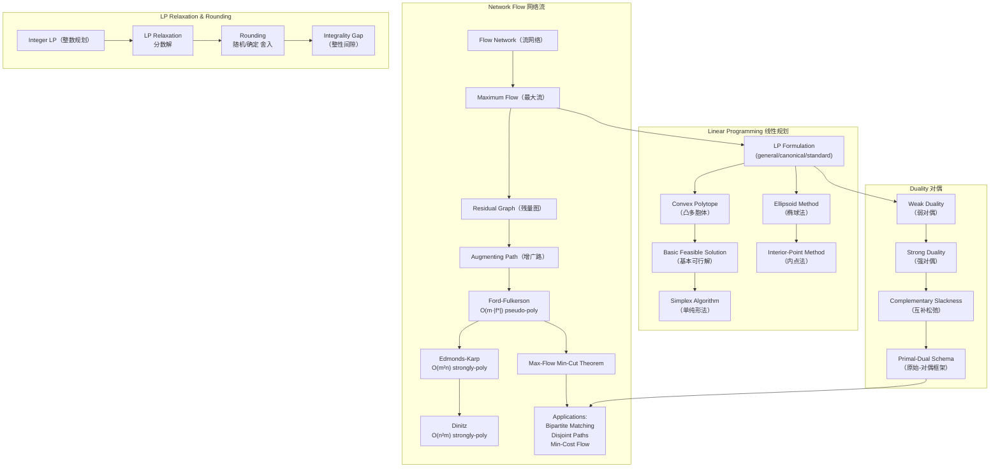

## 一句话总结

Network Flow 是离散优化问题——在有容量限制的有向图中最大化源到汇的流量，核心方法是 residual graph 上的 augmenting path；Linear Programming 将其推广为通用框架——在线性约束下优化线性目标，Duality 提供上下界，LP Relaxation & Rounding 将 NP-hard 问题转化为可近似的多项式时间问题。

## 知识地图



## 核心概念

### 1. Flow Network & Maximum Flow（流网络与最大流）

流网络是一个有向图 $G = (V, E)$，每条边 $e \in E$ 有容量 $c_e \in \mathbb{R}^+$。有一个源点 source $s \in V$ 和一个汇点 sink $t \in V$。

**Flow function** $f: E \to \mathbb{R}^+$ 必须满足：
- **容量约束**：$\forall e \in E, 0 \le f(e) \le c_e$
- **流守恒**（flow conservation）：$\forall v \in V \setminus \{s, t\}, \sum_{e \in \delta_{in}(v)} f(e) = \sum_{e \in \delta_{out}(v)} f(e)$

**Maximum flow problem**：找一个 valid flow $f$ 最大化 $|f| = \sum_{e \in \delta_{out}(s)} f(e)$，即从源点流出的总流量。

> 直观理解：把边想象成水管，容量是水管的粗细，流是实际通过的水量。每个中间节点不存储水——流进多少就流出多少。目标是从水源 $s$ 往水槽 $t$ 输送尽可能多的水。

### 2. Flow Decomposition & Residual Graph（流分解与残量图）

**Flow Decomposition Theorem**：任何一个 s-t flow 都可以分解为 s-t paths 和 cycles 的集合。构造性证明：当 $s$ 有 outflow 时，找一个 s-t path 并减去其 bottleneck flow；当没有 s-t path 但仍有 flow 时，剩余的 flow 一定形成 cycle。

贪心增广的问题：如果盲目增广一条路径，可能"挡住"更好的路径。

**Residual graph（残量图）** $G_f = (V, E')$ 是核心创新——它允许"撤销"流：
- **Forth edges**：对每条 $e = (u, v) \in E$ 且有剩余容量的（$c_e > f_e$），在 $G_f$ 中加入 $(u, v)$，容量为 $c_e - f_e$（还能增多少）
- **Back edges**：对每条 $e = (u, v) \in E$ 且有流的（$f_e > 0$），在 $G_f$ 中加入 $(v, u)$，容量为 $f_e$（能退多少）

> 反向边的直觉：如果在原图中往 $(u,v)$ 推了流，但在残量图中走 $(v,u)$ 方向，相当于"撤回部分流量"，让流走另一条路线。这就是 Ford-Fulkerson 能避开贪心陷阱的关键。

#### 残量图深入直觉：为什么这是最大流算法的核心创新？

**问题根源：贪心会堵路。** 在原图上直接增广，一旦把某条边推满，后续就再也不能用它了——即使"借用"这条边能造出更大的总流。

**一个具体例子**（笔记 §难点1 也有）：

```
    s
   / \
  1   1                   所有边容量 = 1
 /     \
a ———→ b
   1
   ↓
   t
```

贪心先选 $s \to a \to b \to t$：推 1 单位，边 $(a,b)$ 满了。此时在原图中 $s \to b \to t$ 走不了（$s \to b$ 有容量但 $b \to t$ 被 $a \to b$ 堵了），算法卡在 $|f|=1$。但最优解是 $|f|=2$（$s \to a \to t$ 和 $s \to b \to t$）。

**残量图的解法：允许"改道"。** 推了 $a \to b$ 后，残量图中出现反向边 $b \to a$（容量 1，代表"可以把 $a \to b$ 的流退回去"）。于是残量图中有一条增广路 $s \to b \to a \to t$——走到 $b \to a$ 这一步时，物理含义是：**把原本 $a \to b$ 的流撤销，让 $a$ 的入流改走 $a \to t$**。最终效果：$s \to a \to t$（1 单位）+ $s \to b \to t$（1 单位），$|f|=2$。

**残量图的两类边，物理含义完全不同：**

| 边类型 | 方向 | 容量含义 | 在残量图上走它的物理含义 |
|--------|------|----------|------------------------|
| **Forth edge** $(u,v)$ | 与原边同向 | $c_e - f_e$：还能推多少 | "在原边上继续增加流量" |
| **Back edge** $(v,u)$ | 与原边反向 | $f_e$：当前流了多少 | "撤销原边上的一部分流，改道走" |

**一句话总结**：残量图把"增广"和"撤销"统一为同一种操作——在残量图上找一条路径。forth edge 负责开拓新路线，back edge 负责修正之前的错误决策。两者配合，保证算法永远不会被早期的贪心选择困住。

### 3. Augmenting Path Algorithms（增广路算法族）

#### 残量图的构成：只有两种边

是的，残量图 $G_f = (V, E')$ **仅由 forth edges 和 back edges 构成**，没有第三种边。对原图中的每条边 $e = (u,v)$：

- 若 $f_e < c_e$ → $G_f$ 中加 $(u,v)$，残量容量 $c_e - f_e$
- 若 $f_e > 0$ → $G_f$ 中加 $(v,u)$，残量容量 $f_e$

两者可能同时存在（边上有流但未满），此时 $G_f$ 中 $(u,v)$ 和 $(v,u)$ 都出现——这是最常见的情况，代表"可以继续往前推，也可以撤回"。

#### 残量图运算全流程：Ford-Fulkerson 框架

初始：所有边 $f_e = 0$。构建 $G_f$（此时只有 forth edges，因为所有 $f_e = 0$，没有 back edges）。

然后进入循环 —— **每一步只有三件事**：

```
循环：
  1. 在 G_f 中找一条从 s 到 t 的路径 P
     ↓ 找不到 → 算法终止，当前 f 就是最大流 ✓
     ↓ 找到了 → 继续
  2. 计算 P 的瓶颈容量：δ = min{ 残量容量 of each edge in P }
  3. 沿 P 更新原图的流 f：
     对 P 中每条边 e：
       - 若是 forth edge (u,v)：原边 f(u,v) += δ  （增流）
       - 若是 back edge (v,u)：原边 f(u,v) -= δ  （退流）
  4. 用更新后的 f 重新构建 G_f → 回到步骤 1
```

**第三步是关键**：残量图中的一条路径可能是 forth edge 和 back edge 的交错序列。走 forth edge = 在原边上增流，走 back edge = 在原边上退流（撤销之前的部分决策）。

#### 具体推演：回到那个例子

```
原图：s→a(容量1), s→b(容量1), a→b(容量1), a→t(容量1), b→t(容量1)

初始 f=0，G_f = 原图（全是 forth edge，容量=原容量）

第1轮：在 G_f 中找到 P = s→a→b→t，瓶颈 δ=1
  - s→a forth → f(s,a)=1
  - a→b forth → f(a,b)=1
  - b→t forth → f(b,t)=1
  重建 G_f：
    s→a: 残量 0（满）→ 不出现在 G_f。a→s: 残量 1（back）
    a→b: 残量 0（满）→ 不出现在 G_f。b→a: 残量 1（back）
    b→t: 残量 0（满）→ 不出现在 G_f。t→b: 残量 1（back）
    s→b: 残量 1（forth，未用）
    a→t: 残量 1（forth，未用）

第2轮：在 G_f 中找到 P = s→b→a→t，瓶颈 δ=1
  - s→b forth → f(s,b)=1
  - b→a back  → f(a,b)=0  （把 a→b 的流退掉！）
  - a→t forth → f(a,t)=1
  重建 G_f：所有 s 出发的 forth edge 残量为 0，G_f 中无 s-t path
  → 终止！|f| = f(s,a)+f(s,b) = 1+1 = 2 ✓
```

**这个推演揭示了残量图的核心机制**：第 2 轮路径 $s \to b \to a \to t$ 在原图中根本不存在（原图没有 $b \to a$ 边），但在残量图中，$b \to a$ 作为 back edge 出现了——走它意味着"之前 $a \to b$ 的流，我现在后悔了，改道"。最终效果等价于 $s \to a \to t$ + $s \to b \to t$。

所有增广路算法共享同一个框架：在残量图 $G_f$ 中找一条 s-t path $P$，然后沿 $P$ 增广 bottleneck 流量。区别仅在于**选哪条增广路**——这个选择决定了算法的时间复杂度。

| 算法 | 选路策略 | 时间复杂度 | 类型 |
|------|----------|-----------|------|
| **Ford-Fulkerson** | 任意路径（如 DFS） | $O(m \cdot f^*)$ | pseudo-polynomial（依赖最大流值 $f^*$） |
| **Capacity Scaling** | 容量最大的路径（fattest path） | $O(m^2 \log C)$ | weakly-polynomial（依赖容量上限 $C$ 的 log） |
| **Edmonds-Karp** | 最短路径（BFS，边数最少） | $O(m^2 n)$ | strongly-polynomial（仅依赖 $m,n$） |
| **Dinitz (Dinic)** | 分层图 + 一次性阻塞所有最短路径 | $O(n^2 m)$ | strongly-polynomial（仅依赖 $m,n$） |

> **多项式类型说明**：pseudo-polynomial = 时间复杂度依赖输入**数值**（如最大流值 $f^*$ 或容量 $C$）；weakly-polynomial = 依赖数值的**对数**（即编码长度）；strongly-polynomial = 只依赖图的**规模**（$m$ 条边、$n$ 个顶点），完全不受容量大小影响。

#### Ford-Fulkerson（基础框架）

**做法**：每次用 DFS 在残量图中随便找一条 $s \to t$ 路径，沿路径增广瓶颈流量。重复直到没有增广路。

**为什么慢**：DFS 不关心路径长短。如果图中有一条容量为 $10^9$ 的"高速公路"和一条长度为 100 的"乡间小路"，DFS 可能每次都走乡间小路，每次只增 1 单位。于是需要 $10^9$ 轮增广——每轮 $O(m)$，总时间 $O(m \cdot f^*)$，其中 $f^*$ 是最大流值（可能巨大）。

**复杂度 $O(m \cdot f^*)$ 的含义**：假设 $f^* = 10^9$，每条边容量都是 $10^9$，而 DFS 偏偏每次只找到瓶颈为 1 的路径——算法要运行十亿轮。这就是"pseudo-polynomial"：复杂度中的 $f^*$ 是数值而非输入规模 $\log f^*$。

**关键贡献**：Ford-Fulkerson 奠定了整个框架——残量图 + 增广路 + 终止条件 = 最大流。后续所有算法只是优化了"选路"这一步。

#### 补充：Fattest Path 贪心策略及其收敛性分析

课件中还介绍了一种直接的贪心改进——**每次选瓶颈容量最大的增广路**（fattest augmenting path）。这个策略比 Capacity Scaling 的 Δ 缩放更直观，分析也很漂亮。

**核心恒等式**：设当前流为 $f$，残量图 $G_f$ 中的最大流为 $f'$。则：

$$|f^*| = |f| + |f'|$$

其中 $|f^*|$ 是原图的最大流值。意思是：**原图最大流 = 当前已推的流 + 残量图中还能推的最大流**。这很直观——残量图完整保留了"还能增多少"的信息。

**收敛性分析**（为什么 fattest path 是多项式轮的）：

1. 由**流分解定理**，残量图中的最大流 $f'$ 可以分解为若干 s-t path，路径数量 $\le m$（每条路径至少饱和一条边）。
2. 鸽巢原理：$m$ 条路径分摊 $|f'|$ 的流量 → **至少有一条路径的流量 $\ge |f'|/m$**。
3. 我们选的 fattest path 是最大的那个 → 它的流量 $\ge$ 平均流量 $\ge |f'|/m$。
4. 沿 fattest path 增广后，残量图中的剩余最大流变为：$|f'_{\text{new}}| \le |f'| - |f'|/m = |f'|(1 - 1/m)$。
5. 每轮残量最大流至少缩减到原来的 $(1 - 1/m)$ 倍 → 经过 $t$ 轮后：
   $$|f'| \le |f^*| \cdot \left(1 - \frac{1}{m}\right)^t$$
6. 利用 $(1 - 1/m)^m \approx 1/e$，设 $(1 - 1/m)^t \le 1/|f^*|$（残量流小于 1 即终止），解得：
   $$t = O(m \log |f^*|)$$

所以 fattest path 贪心策略的增广轮数是 $O(m \log |f^*|)$——每轮 $O(m)$ 找 fattest path → 总时间 $O(m^2 \log |f^*|)$。

**⚠️ 实数容量不收敛**：上述分析假设容量是整数，$|f'| < 1$ 即可终止。如果容量是实数，fattest path 策略可能永远不会收敛到精确最大流（存在人为构造的反例 [Zadeh 1973]）。这是因为 $(1-1/m)^t$ 永远趋近于零但不会精确到达零。实际应用中容量通常是整数或浮点数，这个问题影响不大。

**如何找 fattest path**：二分答案 + BFS。猜测一个瓶颈值 $x$，检查残量图中是否存在一条所有边容量 $\ge x$ 的 $s \to t$ 路径（BFS 过滤边即可）。二分查找最大的可行 $x$，复杂度 $O(m \log C)$。这是 Scaling 算法中找"fat path"的子程序。

#### Capacity Scaling（容量缩放）

**核心思想**：与其在整张残量图上找路，不如先跑"粗管子"——只走容量够大的边，确保每轮增广的量都足够大，减少增广轮数。

**做法**：
1. 设阈值 $\Delta = 2^{\lfloor \log C \rfloor}$（$C$ 是最大边容量）
2. 在残量图上只保留残量容量 $\ge \Delta$ 的边，在此子图上找增广路
3. 子图上找不到路时，$\Delta = \Delta / 2$（阈值折半），扩大搜索范围
4. 当 $\Delta < 1$ 时终止

**分析**：每个 $\Delta$ 值对应一个"缩放阶段"。在每个阶段中，最大流不超过 $m \cdot \Delta$（最多 $m$ 条边，每条增广 $\le \Delta$），所以每阶段最多增广 $m$ 轮。共 $\log C$ 个阶段 → 总增广轮数 $O(m \log C)$。每轮找路 $O(m)$ → 总时间 $O(m^2 \log C)$。

**直觉**：相当于从"只看最粗的水管"开始，逐步放宽到细管子。这保证了早期的每轮增广都很大（$\ge \Delta$），后期 $\Delta$ 小了但剩余容量也少了。

#### Edmonds-Karp（最短增广路）

**核心思想**：始终选**边数最少**的增广路（BFS 找路）。这个简单的改变把复杂度从伪多项式拉到了强多项式。

**做法**：每轮用 BFS 在残量图中找最短（最少边数）的 $s \to t$ 路径，沿其增广。

**为什么有效——单调性引理**：每次增广后，残量图中从 $s$ 到任意顶点的最短距离**不降**。关键直觉：增广会饱和至少一条 forth edge（它在残量图中消失），同时创建 back edge——back edge 的方向跟最短路径方向相反，不会缩短距离。

**分析**：设 $d(v)$ 为 $G_f$ 中 $s$ 到 $v$ 的最短距离。一条边 $(u,v)$ 被饱和后消失，要再次出现必须等到它的反向边 $(v,u)$ 被使用（即有人在残量图中走了 $v \to u$），此时 $d(v) = d(u) + 1$。而 $d(u)$ 不降 → 每次边"重生"时 $d(v)$ 至少增加了 2。$d(v) \le n$ → 每条边最多被饱和 $n/2$ 次 → 总增广轮数 $O(nm)$。每轮 BFS $O(m)$ → $O(nm^2)$，即 $O(m^2 n)$。

#### Dinitz (Dinic)（分层阻塞流）

**核心思想**：EK 每轮只增广一条最短路径，但同一长度可能有很多条最短路径。Dinitz 用**分层图**一次性找到所有最短路径并全部增广到"阻塞"，大幅减少 BFS 次数。

**做法**（两阶段循环）：
1. **BFS 建分层图**：从 $s$ 出发 BFS，记录每个顶点的层号 $\text{level}(v) = s$ 到 $v$ 的最短距离。分层图只保留从层 $i$ 到层 $i+1$ 的 forth edge。
2. **DFS 找阻塞流**：在分层图上做 DFS，只沿层级递增的方向走，找到 $s \to t$ 路径就增广。当一个顶点的所有出边都被耗尽时，回溯。这一步结束后，分层图中不存在 $s \to t$ 路径（"阻塞"）。
3. 重建分层图（此时 $s$ 到 $t$ 的最短距离必然增加了），回到步骤 1。

**为什么比 EK 快**：EK 每轮增广后都重新 BFS。Dinitz 把 BFS 和多次增广解耦——一次 BFS 后，DFS 阶段可能增广多条路径（都使用同一层的最短路径），直到分层图被阻塞。每轮"BFS + 阻塞"后，$s \to t$ 的最短距离至少 +1 → 最多 $n$ 轮外循环。

**时间复杂度 $O(n^2 m)$**：每轮外循环（BFS + DFS 阻塞流）$O(nm)$，最多 $n$ 轮 → $O(n^2 m)$。实践中远快于 EK。

#### 四种算法的演进逻辑

```
Ford-Fulkerson ──→ Capacity Scaling ──→ Edmonds-Karp ──→ Dinitz
  "随便走"         "先走粗管子"        "走最短的"       "一次走完所有最短的"
  依赖流值大小      依赖log容量          脱离数值依赖      进一步优化常数
```

**一句话**：从"有路就走"到"挑着路走"到"批量走"——每一步都在减少增广轮数，最终从伪多项式进化到强多项式。

### 4. Max-Flow Min-Cut Theorem（最大流最小割定理）

#### 割（Cut）的定义

一个 **s-t cut**（割）是把图的所有顶点分成两个集合 $(S, \bar{S})$，满足 $s \in S$、$t \in \bar{S}$。形象地说——用一把刀把图切成两半，源点在左半边，汇点在右半边。

**割的容量（Cut Capacity）**：所有**从 $S$ 跨越到 $\bar{S}$** 的边的容量之和：

$$\text{Cut}(S) = \sum_{(a,b) \in E,\ a \in S,\ b \notin S} c_{a,b}$$

注意两个关键点：
- **只算 $S \to \bar{S}$ 的方向**，$\bar{S} \to S$ 的反向边不计入割容量（那些边对限制 $s \to t$ 流量没有贡献）
- **算的是容量 $c$，不是流量 $f$**——割容量是这张图本身的属性，跟当前流的走法无关

#### 直觉：割 = 瓶颈

把流网络想象成公路网，$s$ 是出发点，$t$ 是目的地。一个割就是把地图一刀切成左右两半——**无论你怎么绕路，从 $s$ 到 $t$ 的所有车辆都必须穿过这一刀切出的断面**。断面上所有车道的总宽度就是割的容量。这个容量是整张图 $s \to t$ 运力的**理论上限**：任何流的量都不可能超过任何一个割的容量。

#### 最小割（Minimum Cut）

所有可能的 s-t cut 中，容量最小的那个。它是整张图的**真正瓶颈**——最窄的那个断面决定了最大能通过多少流量。

#### 最大流最小割定理

**定理**：以下三个命题等价：

1. $f$ 是最大流
2. 残量图 $G_f$ 中不存在从 $s$ 到 $t$ 的增广路
3. 存在一个 s-t cut $(S, \bar{S})$，其容量等于 $|f|$（即 $\text{Cut}(S) = |f|$）

$$
\max_{f \text{ valid}} |f| = \min_{S \subset V,\ s \in S,\ t \notin S} \text{Cut}(S)
$$

**直觉**：网络上能通过的最大流量 = 网络中最窄处的容量。就像水管系统——最细的那根管子决定了整个系统的最大出水速度。

#### 证明思路

- **(1) → (2)**：反证法。如果残量图还有增广路，那 $f$ 还能再大，$f$ 就不是最大的。这是 Ford-Fulkerson 终止条件的理论基础。

- **(2) → (3)**（核心构造）：令 $S = \{$ 残量图 $G_f$ 中从 $s$ 出发能到达的所有顶点 $\}$。因为 $G_f$ 中没有 $s \to t$ 路径，所以 $t \notin S$，$(S, \bar{S})$ 是一个合法 s-t cut。现在分析跨越这个割的每条原边：
  - $S \to \bar{S}$ 的原边 $(a,b)$：在 $G_f$ 中不能有 forth edge（否则 $b$ 也能从 $s$ 到达，$b$ 应该在 $S$ 内），所以 $f_e = c_e$（**饱和**）
  - $\bar{S} \to S$ 的原边 $(a,b)$：在 $G_f$ 中不能有 back edge（back edge 方向是 $S \to \bar{S}$，同样矛盾），所以 $f_e = 0$（**零流**）
  
  由流守恒可推：$|f| = \sum_{S \to \bar{S}} f_e - \sum_{\bar{S} \to S} f_e = \sum_{S \to \bar{S}} c_e - 0 = \text{Cut}(S)$。

- **(3) → (1)**：任何流 $\le$ 任何割容量（流必须穿过割）。既然 $|f| = \text{Cut}(S)$，$f$ 碰到了一个割的容量上限——它不可能是次优的。就像你的考试成绩 = 满分，你肯定是第一。

#### 为什么这个定理如此重要？

它提供了最大流的**最优性证书（Certificate of Optimality）**：你不需要检查所有可能的流来证明你的流是最大的——只需找到一个割，它的容量恰好等于你的流的值。一个割 + 一个等式 = 完成证明。这个"证书"思想贯穿整个优化理论（见后面 LP Duality——本质上就是同一个东西的连续版本）。

### 5. Applications of Max Flow（最大流的应用）

#### 二分图最大匹配（Maximum Bipartite Matching）

**二分图**：图 $G = (L \cup R, E)$，顶点分成左部 $L$ 和右部 $R$，所有边都是跨部的（$L \leftrightarrow R$），同部内部没有边。例如：$L = \{\text{工人}\}$，$R = \{\text{任务}\}$，边表示"该工人能做该任务"。

**匹配（Matching）**：选一个边子集 $M \subseteq E$，使得每个顶点最多被一条选中的边关联。即——每个工人最多做一个任务，每个任务最多分配给一个工人。

**最大匹配**：包含边数最多的匹配。目标是给尽可能多的工人分配任务。

**归约到最大流**——为二分图构造一个流网络：

```
在二分图的基础上加一个超级源点 s 和一个超级汇点 t：

  s ──→ L 的每个顶点（容量 1）
  L 的顶点 ──→ R 的顶点（按原边，容量 1）  
  R 的每个顶点 ──→ t（容量 1）
```

```
         ┌─→ l₁ ──→ r₁ ──┐
         │       ↙         │
    s ───┼─→ l₂ ──→ r₂ ───┼───→ t
         │           ↘     │
         └─→ l₃ ──→ r₃ ──┘
```

**为什么最大流 = 最大匹配**：

所有边的容量都是 1。考虑任意 integer flow（算法找到的恰好是整数流，因为容量全是整数）：
- $s \to l_i$ 的流是 0 或 1 → $l_i$ 要么被匹配要么不被匹配
- $r_j \to t$ 的流是 0 或 1 → $r_j$ 同理
- $l_i \to r_j$ 的流是 0 或 1
- 流守恒：$l_i$ 从 $s$ 收到 1 → 必须往某个 $r_j$ 送出 1。$r_j$ 从某个 $l_i$ 收到 1 → 必须往 $t$ 送出 1

所以流值为 1 的 $l_i \to r_j$ 边恰好构成一个匹配——每个左顶点匹配给至多一个右顶点，每个右顶点被至多一个左顶点匹配。**最大流的值 = 最大匹配的边数**。

**复杂度**：在 $n$ 个顶点、$m$ 条边的二分图上，用 Dinitz 求最大流只需 $O(m\sqrt{n})$——远优于通用最大流的 $O(n^2 m)$。这是因为二分图流网络的特殊结构（所有 $s \to L$ 和 $R \to t$ 容量为 1）使得 Dinitz 的每轮阻塞流可以在 $O(m)$ 时间内找到，且外循环只需 $O(\sqrt{n})$ 轮。

**应用场景**：任务分配、课程排课、婚配问题、广告匹配——任何"一对一配对"问题都可以归约为二分图最大匹配。

#### 边不相交路径（Edge-Disjoint Paths）

**问题**：给定有向图 $G = (V,E)$ 和两个特定顶点 $s,t$，找出从 $s$ 到 $t$ 的**尽可能多的路径**，使得任意两条路径**不共享任何边**（可以共享顶点，但每条边只能被一条路径使用）。

**现实情景**：网络路由中的**链路保护**——$s$ 和 $t$ 是两个数据中心，边是光纤。如果某条光纤断了，只影响走它的那条路径。边不相交路径的数量 = 在不共享任何链路的前提下，最多能建多少条独立路由。任意一条链路故障最多影响一条路由。

**归约到最大流**：把每条边的容量设为 1。求 $s \to t$ 的最大流。

**为什么对**：容量 1 意味着每条边最多被 1 单位流使用。Ford-Fulkerson 找到的整数流（所有边容量为整数，流值也必为整数）在每条边上要么 0 要么 1。由流分解定理，这个整数流可以分解为若干条 $s \to t$ 路径，每条路径上的边流值都是 1——正好对应边不相交的路径。最大流值 = 最多边不相交路径数。

**Menger 定理**：$s$ 和 $t$ 之间边不相交路径的最大数量 = 把 $s$ 和 $t$ 分开所需删除的最少边数。这本质上是 Max-Flow Min-Cut 在单位容量图上的特例。

**顶点不相交路径**：变体——要求路径不共享顶点（更严格）。归约：把每个顶点 $v$ 拆成 $v_{in} \to v_{out}$，中间连一条容量为 1 的边。原来的入边连 $v_{in}$，出边从 $v_{out}$ 出发。这样每个顶点只能承载 1 单位流通过 → 等价于顶点不相交。

#### 最小费用流（Minimum-Cost Flow Problem, MCFP）

**问题**：每条边现在有**两个属性**——容量 $c_e$（最多过多少）和**单位费用** $a_e$（每单位流通过这条边需要花多少钱）。给定一个目标流量 $F$，找总费用最小的合法流，或者要求达到最大流的前提下找费用最小的。

**现实情景**：物流配送。边是公路，容量是车道数，费用是每吨货物的运费。你有 $F$ 吨货要从仓库 $s$ 运到客户 $t$——选哪条路线组合使得总运费最低？

**形式化**：

$$\min \sum_{e \in E} a_e \cdot f(e) \quad \text{s.t.} \quad \text{流 } f \text{ 合法，且 } |f| = F$$

当 $F$ 取最大流值时，称为 **Min-Cost Max-Flow**。

**Cycle Canceling 算法**（解决 Min-Cost Max-Flow）：

核心洞察——在残量图上，forth edge 和 back edge 的成本如何定义？
- **Forth edge** $(u,v)$：沿原方向增流，费用增加 → 残量成本 = $+a_e$
- **Back edge** $(v,u)$：沿反方向减少原边上的流，费用减少 → 残量成本 = $-a_e$

1. 先用任意最大流算法找到一个最大流（不管费用），设为 $f$
2. 构建残量图 $G_f$，每条残量边带上符号费用
3. 在 $G_f$ 中找**负环**（总费用 < 0 的有向环）
4. 沿负环推流——往负环方向增广相当于"重定向流以降低总费用"而**不改变流量值**
5. 重复直到 $G_f$ 中无负环 → 此时 $f$ 是 Min-Cost Max-Flow

**负环的直觉**：当前流有一条路线费用很高，另一条费用很低。在残量图中走"退高费流 + 增低费流"形成一个负环——沿着它走一圈，总流量不变但总费用下降了。

**最优性条件**：残量图无负环 $\iff$ 当前流是 min-cost flow（对给定流量值）。这类似 Max-Flow Min-Cut：无增广路就是最大流；这里是无负环就是最小费用流。

**找负环**：Bellman-Ford 算法，$O(nm)$ 每轮。总复杂度取决于负环消除的轮数，最坏为伪多项式，但实践中用**Successive Shortest Path**（每次沿最短路增广）或**网络单纯形法**可以达到强多项式。

### 6. Linear Programming Formulation（线性规划形式化）

#### 从一道工厂应用题开始

你开了一家小工厂，生产两种产品：桌子（$x_1$ 张）和椅子（$x_2$ 把）。

**限制条件**：
- 每张桌子用 3 小时人工 + 2 块木板，每把椅子用 1 小时人工 + 3 块木板
- 你每天只有 15 小时人工、18 块木板
- 桌子数量不能是负数，椅子也不能

**利润**：桌子每张赚 5 元，椅子每把赚 3 元。

**问题**：每天生产多少桌子和椅子，利润最大？

翻译成数学就是：

$$\begin{aligned} \max \quad & 5x_1 + 3x_2 && \text{（目标：利润最大）} \\ \text{满足} \quad & 3x_1 + x_2 \le 15 && \text{（人工限制）} \\ & 2x_1 + 3x_2 \le 18 && \text{（木板限制）} \\ & x_1 \ge 0,\ x_2 \ge 0 && \text{（不能生产负数）} \end{aligned}$$

这就是一个**线性规划（Linear Programming, LP）**。三个要素：
1. **决策变量** $x_1, x_2$ — 你要决定的量
2. **目标函数** $5x_1 + 3x_2$ — 你要最大化或最小化的东西
3. **约束条件** — 不等式/等式，限制变量的取值范围

"线性"的含义：目标函数和所有约束都是变量的**一次函数**（没有 $x^2$、$\sqrt{x}$、$\sin x$ 之类的）。

#### 一般形式：把任何 LP 装进一个统一框架

学完工厂例子后，再看一般形式——它只是把上面的结构用向量/矩阵符号压缩写出来：

$$\min c^T x \quad \text{s.t.} \quad \begin{cases} a_i^T x = b_i & i \in M \\ a_i^T x \ge b_i & i \notin M \\ x_j \ge 0 & j \in N \\ x_j \text{ 无约束} & j \notin N \end{cases}$$

**逐行翻译成大白话**：

| 符号 | 大白话 |
|------|--------|
| $\min\ c^T x$ | 最小化目标函数。$c^T x = c_1 x_1 + c_2 x_2 + \cdots + c_n x_n$，就是所有变量的加权和 |
| $a_i^T x = b_i,\ i \in M$ | 下标在集合 $M$ 里的那些约束是**等式**（恰好等于） |
| $a_i^T x \ge b_i,\ i \notin M$ | $M$ 之外的约束是**不等式**（大于等于） |
| $x_j \ge 0,\ j \in N$ | 下标在 $N$ 里的变量必须**非负**（≥ 0） |
| $x_j$ 无约束, $j \notin N$ | $N$ 之外的变量可正可负，不管 |

$c^T x$ 中的 $c^T$ 就是 $c$ 的转置——原来 $c$ 是列向量 $(c_1, c_2, \dots, c_n)$，转置后 $c^T$ 是行向量，乘 $x$（列向量）得到一个标量 $c_1 x_1 + \dots + c_n x_n$。如果你只学过一点线代，把它理解为**向量的点积**就够了。

**为什么叫"一般形式"**：因为你遇到的任何 LP 都能写成这个形式——$\max$ 可以改写成 $-\min$，$\le$ 可以两边乘 $-1$ 变成 $\ge$，等式等价于 $\ge$ + $\le$ 两个不等式。

#### 三种标准形式的转化

为什么需要标准形式？因为我们只想写**一套**算法——把任意 LP 都化成同一种形状，然后一套代码通解。

**Canonical form（规范形）**：$\min c^T x,\ \text{s.t.}\ Ax \ge b,\ x \ge 0$

> 所有变量非负，所有约束是 $\ge$。怎么把一般形式塞进去？
> - 等式 $a_i^T x = b_i$ → 拆成 $a_i^T x \ge b_i$ 和 $-a_i^T x \ge -b_i$ 两个
> - 无约束变量 $x_j$ → 拆成 $x_j = x_j^+ - x_j^-$，其中 $x_j^+, x_j^- \ge 0$

**Standard form（标准形）**：$\min c^T x,\ \text{s.t.}\ Ax = b,\ x \ge 0$

> 所有变量非负，所有约束是等式。Simplex 算法用这个形式。
> - $\ge$ 约束 → 减一个 surplus variable：$a_i^T x \ge b_i$ 变成 $a_i^T x - s_i = b_i,\ s_i \ge 0$
> - $\le$ 约束 → 加一个 slack variable：$a_i^T x \le b_i$ 变成 $a_i^T x + s_i = b_i,\ s_i \ge 0$

**Max-Flow 作为 LP**（展示 LP 的表达力）：

每条边一个变量 $f_{uv}$。约束：$0 \le f_{uv} \le c_{uv}$（容量），$\sum_{in} f = \sum_{out} f$（流守恒）。目标：$\max \sum_v f_{sv}$（从源点流出的总量）。

最大流问题就是 LP 的一个特例！这意味着任何 LP 算法（Simplex、内点法）都可以用来解最大流——但专用的图算法（Dinitz）远快于通用 LP 求解器。

### 7. Geometry of LP（LP 的几何直觉）

LP 可以纯粹用代数来做（矩阵、向量），但**几何图像**才是理解 LP 为什么能高效求解的关键。以下所有概念都在回答一个问题：LP 的解空间长什么样？最优解在哪里？

#### 从工厂例子画图

回到桌子椅子例子：

$$\begin{cases} 3x_1 + x_2 \le 15 \\ 2x_1 + 3x_2 \le 18 \\ x_1 \ge 0,\ x_2 \ge 0 \end{cases}$$

在二维平面上画出来：每条不等式是一个**半平面**（直线的某一侧），四个半平面的交集是一个**凸多边形**——一个被围起来的区域（下图阴影部分）。目标函数 $5x_1 + 3x_2$ 是一族平行直线，沿着利润增加的方向推，最后碰到区域边界的**某个顶点**——那就是最优解。

这就是 LP 的几何本质，推广到 $n$ 维也同样成立。

#### 逐层搭建：从半空间到多胞体

**超平面（Hyperplane）**：$\sum a_j x_j = b$。在二维是直线，三维是平面，$n$ 维是 $n-1$ 维的"平的东西"。把空间切成两半。

**（闭）半空间（Halfspace）**：$\sum a_j x_j \ge b$。超平面的某一侧。想象一把刀切西瓜——半个西瓜就是半空间。

**凸集（Convex Set）**：集合 $S$ 满足：**里面任意两点连线段，整段都在 $S$ 内**。直观——凸集没有"坑"或"洞"。圆盘是凸的，月牙不是。

> $$\forall x,y \in S,\ \forall \lambda \in [0,1],\quad \lambda x + (1-\lambda)y \in S$$
> $\lambda x + (1-\lambda)y$ 就是 $x$ 和 $y$ 连线上的点（$\lambda=0$ 在 $y$，$\lambda=1$ 在 $x$，$\lambda=0.5$ 在中点）。

**凸多面体（Convex Polyhedron）**：有限个半空间的交集 $\{x \mid Ax \ge b\}$。半空间是凸的 → 任意多个凸集的交还是凸的 → 凸多面体是凸的。这就是 LP 的**可行域**——所有约束同时满足的点构成的集合。

**凸多胞体（Convex Polytope）**：**有界的**凸多面体——不会无限延伸。等价定义：有限个点的凸包（convex hull）。三角形、立方体都是 polytope。

| 术语 | 大白话 | 例子（二维） |
|------|--------|-------------|
| 超平面 | 一把无穷大的刀片 | 直线 |
| 半空间 | 刀片切出的半个空间 | 半平面 |
| 凸多面体 | 好多刀一起切，剩下的那块 | 凸多边形（可能无限） |
| 凸多胞体 | 被完全围起来的那块 | 凸多边形（有限区域） |

#### 顶点 = 最优解所在

**顶点（Vertex）**：多面体中**不能由其他两点取平均得到**的点。多边形的角就是顶点，边的中点不是顶点（可以由两端的角取平均得到）。

> 严格定义：存在一个方向 $c$，使得 $x$ 是整个多面体上沿 $c$ 方向的**唯一最优解**。

**极点（Extreme Point）**：不能表示为多面体内其他两点的凸组合。$\iff$ **就是顶点**（两者等价，定理保证）。

**为什么顶点如此重要？**

> **定理**：如果凸多面体有顶点，且 LP 有最优解，则一定存在一个最优解恰好是顶点。

**大白话**：你永远不需要在多面体内部找最优解——最优解一定在某个"角"上。原因：目标函数是线性的，把它想象成一个倾斜的平面，在凸多面体上滑动——它最先或最后碰到的点一定在边界上，而且一定是一个角。

这直接解释了 Simplex 算法的策略：**只在顶点之间跳，不用检查内部或边上的点**。就像在一个多边形的顶点之间跳着找最高点——你不需要检查多边形内部的任何点。

#### 顶点存在的条件

> **定理**：凸多面体有顶点 $\iff$ 它不包含一条完整的直线。

如果多面体里有一条无限的直线（比如一根无限长的圆柱），它就没有顶点——圆柱表面上到处都是"圆的"，没有角。但在实际 LP 问题中，$x \ge 0$ 约束通常保证可行域在第一象限，不会包含直线 → 有顶点。

### 8. Simplex Algorithm & LP Solvers（单纯形法与 LP 求解器）

### 8. Simplex Algorithm & LP Solvers（单纯形法与 LP 求解器）

#### Basic Feasible Solution（基本可行解）—— 用代数把"顶点"算出来

回忆上一节：LP 的最优解一定在多胞体的**顶点**上。但"顶点"是几何概念——多边形的角。怎么用代数精准算出一个顶点？这就是 BFS。

**前置：标准形 LP**。我们工作在标准形下：

$$Ax = b,\quad x \ge 0$$

其中 $A$ 是 $m \times n$ 矩阵（$m$ 个约束等式，$n$ 个变量，$n > m$）。

**核心直觉：$n$ 个变量，$m$ 个方程 → 有无穷多解。但如果我们强制大多数变量 = 0，只留恰好 $m$ 个变量来满足 $m$ 个方程 → 解唯一确定。**

这就是 BFS 的做法，分三步：

#### 第一步：挑 $m$ 个变量当"主角"

从 $A$ 的 $n$ 列中挑出 $m$ 列，要求它们**线性无关**（不能互相表示）。这 $m$ 列组成一个 $m \times m$ 方阵，记为 **basis $B$**。对应这 $m$ 列的 $m$ 个变量叫**基变量（basic variables）**，记为 $x_B$。

剩下的 $n-m$ 个变量叫**非基变量（non-basic variables）**。

#### 第二步：非基变量全部 = 0

强制所有非基变量 = 0。方程 $Ax = b$ 变成：

$$B \cdot x_B + (\text{非基列}) \cdot 0 = b \quad\Rightarrow\quad B \cdot x_B = b$$

#### 第三步：解出基变量

因为 $B$ 是 $m \times m$ 且列线性无关 → $B$ 可逆。于是：

$$x_B = B^{-1} \cdot b$$

检查：如果解出来的每个 $x_B$ 都 $\ge 0$（满足 $x \ge 0$ 约束），这就是一个**基本可行解（Basic Feasible Solution, bfs）**。如果某个基变量 < 0，说明这组列对应的"角"不在可行域内——它不是 bfs。

**bfs = vertex（代数 = 几何）**。一个 bfs 对应多胞体的一个顶点。选不同的 $m$ 列 → 不同的顶点。

#### 一个具体例子

还是工厂问题，先写成标准形（加 slack variables $s_1, s_2$）：

$$\begin{aligned} \max\ & 5x_1 + 3x_2 \\ \text{s.t.}\ & 3x_1 + x_2 + s_1 = 15 \\ & 2x_1 + 3x_2 + s_2 = 18 \\ & x_1, x_2, s_1, s_2 \ge 0 \end{aligned}$$

这里 $m=2$ 个约束，$n=4$ 个变量。矩阵形式：

$$A = \begin{bmatrix} 3 & 1 & 1 & 0 \\ 2 & 3 & 0 & 1 \end{bmatrix},\quad x = \begin{bmatrix} x_1 \\ x_2 \\ s_1 \\ s_2 \end{bmatrix},\quad b = \begin{bmatrix} 15 \\ 18 \end{bmatrix}$$

**找 bfs 的过程**：从 4 列中选 2 列作为 basis，其他变量设 0，解出来。

- 选 $\{s_1, s_2\}$ 列（第 3、4 列）→ $B = \begin{bmatrix}1&0\\0&1\end{bmatrix}$ → $x_B = B^{-1}b = (15, 18)$ → $(x_1,x_2,s_1,s_2) = (0,0,15,18)$ ✓ 全 ≥ 0。这是一个 bfs → 对应原点 (0,0)。

- 选 $\{x_1, s_2\}$ 列（第 1、4 列）→ $B = \begin{bmatrix}3&0\\2&1\end{bmatrix}$ → $B^{-1}b = (5, 8)$ → $(x_1,x_2,s_1,s_2) = (5,0,0,8)$ ✓ bfs → 对应顶点 (5,0)。

- 选 $\{x_1, x_2\}$ 列（第 1、2 列）→ $B = \begin{bmatrix}3&1\\2&3\end{bmatrix}$ → $B^{-1}b$ 解出 $x_1 = 27/7, x_2 = 24/7$ ✓ bfs → 这是最优顶点。

- 选 $\{x_1, s_1\}$ → 解出 $s_1 < 0$，不是 bfs（这个"角"在可行域外面）。

**一句话总结**：bfs 就是在 $n$ 个变量中挑 $m$ 个"代表"，把其他全部归零，解个小方程组——解出来全非负就是一个顶点。

**Simplex Algorithm (Dantzig 1947)**：
- 从任意 bfs 出发
- 检查邻居 bfs（共享 $m-1$ 个 basis 列）：若存在目标函数更小的邻居，移动过去
- 局部最优 = 全局最优（convexity 保证）
- **最坏情况指数时间**（Klee-Minty cube, 1972），但实践中很快
- **Smoothed complexity 为多项式** [Spielman-Teng '01]

**多项式时间求解器**：
| 方法 | 时间 | 思路 |
|------|------|------|
| Ellipsoid Method (Khachiyan '79) | $O(n^6)$ | 维护包含可行域的椭球，不断切半 |
| Interior-Point Method (Karmarkar '84) | $O(n^{2.5})$ [Vaidya '89] | 保持在多面体内部，用罚函数远离边界 |

### 9. LP Relaxation & Rounding（LP 松弛与舍入）

这是 LP 在算法设计中最强大的应用——用 LP 给 NP-hard 问题设计近似算法。

#### 问题起点：Vertex Cover（顶点覆盖）

**问题**：给一张无向图 $G = (V,E)$。找一个**最小的顶点集合** $C \subseteq V$，使得图中的**每条边**至少有一个端点在 $C$ 中。换言之——用最少的顶点"盖住"所有边。

**NP-hard**：不存在多项式时间的精确算法（除非 P=NP）。但近似是可以的。

**已知结果**：
- 贪心 Set Cover → $\ln n$-近似
- 找极大匹配 → 取匹配的所有端点 → **2-近似**（经典算法）
- [Khot, Regev 2008]：假设 Unique Games Conjecture，不存在 $(2-\epsilon)$-近似 → **2 就是最优近似比**

#### ILP 形式化：精确但不可解

把 Vertex Cover 写成整数线性规划（Integer Linear Program, ILP）：

$$\begin{aligned} \min \quad & \sum_{v \in V} x_v \\ \text{s.t.} \quad & \sum_{v \in e} x_v \ge 1, \quad e \in E \quad \text{（每条边至少一个端点被选）} \\ & x_v \in \{0,1\}, \quad v \in V \quad \text{（选 or 不选）} \end{aligned}$$

变量 $x_v = 1$ 表示选顶点 $v$，$x_v = 0$ 表示不选。每条边 $e = (u,v)$ 的约束是 $x_u + x_v \ge 1$——这条边的两个端点至少选一个。

**问题**：ILP 本身也是 NP-hard。整数约束 $x_v \in \{0,1\}$ 是关键——如果是连续变量，LP 多项式可解。

#### 核心洞察：放松 + 舍入

ILP 难在整数约束。但如果我们**假装**变量可以是分数呢？

**LP Relaxation**：把 $x_v \in \{0,1\}$ 放松为 $x_v \in [0,1]$（可以是 0.5、0.3、0.8）：

$$\begin{aligned} \min \quad & \sum_{v \in V} x_v \\ \text{s.t.} \quad & \sum_{v \in e} x_v \ge 1, \quad e \in E \\ & 0 \le x_v \le 1, \quad v \in V \end{aligned}$$

这是一个**线性规划**——多项式时间可解！解出来的 $x_v^*$ 是分数：比如 $x_1^* = 0.5, x_3^* = 0.7$，代表"这个顶点被选了一半"。

**但是分数解没意义**——你不能选半个顶点。所以需要**舍入（Rounding）**回整数。

#### Rounding 策略：阈值舍入

```python
if x_v* >= 0.5:
    x̂_v = 1  # 选这个顶点
else:
    x̂_v = 0  # 不选
```

**为什么这合法？** 每条边的约束是 $x_u^* + x_v^* \ge 1$。两个数加起来 ≥ 1 → 至少有一个 ≥ 0.5 → 至少一个被舍入为 1 → 每条边都被覆盖！

**为什么是 2-近似？** 每个被我们选中的顶点 $v$（即 $x_v^* \ge 0.5$），有 $\hat{x}_v = 1 \le 2 \cdot x_v^*$。因此：

$$\text{SOL} = \sum_v \hat{x}_v \le 2 \cdot \sum_v x_v^* = 2 \cdot \text{OPT}_{LP} \le 2 \cdot \text{OPT}_{ILP}$$

**关键不等式链**：$\text{SOL} \le 2 \cdot \text{OPT}_{LP} \le 2 \cdot \text{OPT}_{ILP}$。LP 最优值是 ILP 最优值的下界（放松了约束 → 解更好或相等），所以跟 LP 比 = 跟一个比真实最优更松的下界比 → 近似比至少是 2。

**Integrality Gap = 2**：存在图使得 $\text{OPT}_{ILP} / \text{OPT}_{LP} = 2$——LP 松弛的"质量"恰好是 2，所以阈值舍入已经是最优的基于 LP 的方法。

#### 通用四步套路

```
NP-hard 优化问题
    ↓ ① Modeling：写成 ILP
整数线性规划（难）
    ↓ ② Relaxation：x ∈ {0,1} → x ∈ [0,1]
线性规划（易，多项式可解）
    ↓ ③ Rounding：分数解 → 合法整数解
近似解
    ↓ ④ Analysis：SOL ≤ α · OPT_LP ≤ α · OPT
α-近似算法
```

#### 第二个案例：MAX-SAT（最大可满足性）

**什么是 CNF**：CNF（合取范式）是若干 clause 的 AND。每个 clause 是若干 literal 的 OR。例如：

$$\Phi = (x_1 \lor \neg x_2 \lor x_3) \land (x_1 \lor x_2 \lor x_4) \land (x_3 \lor \neg x_4 \lor \neg x_5)$$

- **布尔变量**：$x_1, \dots, x_n$，取值 $\mathtt{T}$（真）或 $\mathtt{F}$（假）。在 ILP 中编码为 $x_i \in \{0,1\}$，$1$ = $\mathtt{T}$，$0$ = $\mathtt{F}$
- **Literal（文字）**：$x_i$（正文字）或 $\neg x_i$（负文字）
- **Clause（子句）**：若干文字的 OR，如 $x_1 \lor \neg x_2 \lor x_3$
- **公式**：若干 clause 的 AND

**MAX-SAT 问题**：给一个 CNF 公式，找一组布尔赋值，使得**被满足的 clause 数量最多**。NP-hard。

#### 简单基线：随机赋值

每个变量独立随机设 $\mathtt{T}$ 或 $\mathtt{F}$（各 50%）。一个 clause $C_j$ 含 $k_j$ 个文字——每个文字有 1/2 概率为真 → 所有文字全假的概率 = $2^{-k_j}$ → clause 被满足的概率：

$$\Pr[C_j \text{ satisfied}] = 1 - 2^{-k_j} \ge \frac{1}{2}$$

因此期望满足的 clause 数 $\ge m/2 \ge \frac{1}{2}\text{OPT}$。**随机赋值已经是一个 1/2-近似！**

但这不够——我们能用 LP 做到 3/4。

#### ILP 形式化：把逻辑变成线性约束

**记号**：对于 clause $C_j$，定义两个集合：
- $S_j^+ = \{i \mid x_i \text{ 作为正文字出现在 } C_j\}$（如 $C_j = x_1 \lor \neg x_2$，则 $S_j^+ = \{1\}$）
- $S_j^- = \{i \mid \neg x_i \text{ 作为负文字出现在 } C_j\}$（同上，$S_j^- = \{2\}$）

**Clause 被满足的等价条件**：$C_j$ 中至少一个文字为真，即：

$$\sum_{i \in S_j^+} x_i + \sum_{i \in S_j^-} (1 - x_i) \ge 1$$

- 第一项：正文字 $x_i$ 中至少一个 = 1 → 至少一个正文字为真
- 第二项：负文字 $\neg x_i$ 为真 $\iff x_i = 0 \iff (1 - x_i) = 1$

引入变量 $y_j \in \{0,1\}$ 表示 clause $C_j$ 是否被满足。约束：$C_j$ 被满足（$y_j = 1$）要求上面的和 ≥ 1。写成 ILP：

$$\begin{aligned} \max \quad & \sum_{j=1}^m y_j \quad \text{（最多 clause 被满足）} \\ \text{s.t.} \quad & \sum_{i \in S_j^+} x_i + \sum_{i \in S_j^-} (1 - x_i) \ge y_j, \quad 1 \le j \le m \\ & x_i \in \{0,1\}, \quad 1 \le i \le n \\ & y_j \in \{0,1\}, \quad 1 \le j \le m \end{aligned}$$

**逐行翻译**：
- 目标：最大化 $\sum y_j$（被满足的 clause 数量）
- 约束：如果 clause $C_j$ 被标记为满足（$y_j=1$），则至少有一个文字为真（左边 ≥ 1）
- $y_j$ 取 0 时约束自动满足（$y_j=0$，左边 ≥ 0 永远成立——不要求 clause 被满足）

#### LP Relaxation → Randomized Rounding

ILP 的整数约束是 NP-hard 的根源。放松：$x_i \in [0,1]$，$y_j \in [0,1]$。LP 求解 → 分数解 $x_i^*, y_j^*$。

**Randomized Rounding**（不是固定阈值！）：独立地以概率 $x_i^*$ 设 $\hat{x}_i = 1$，以概率 $1-x_i^*$ 设 $\hat{x}_i = 0$。

这保证了 $\mathbb{E}[\hat{x}_i] = x_i^*$——分数解被解释为"取 1 的概率"。

**分析**（以单个含 $k$ 个文字的 clause 为例）：

$$\Pr[C_j \text{ 不被满足}] = \prod_{i \in S_j^+} (1 - x_i^*) \prod_{i \in S_j^-} x_i^*$$

原因是：clause 不被满足 ⇔ 所有正文字 $x_i = 0$ 且所有负文字 $\neg x_i$ 为假（即 $x_i = 1$）→ 所有正文字全 0、所有负文字全 1。由于舍入独立，这些概率直接相乘。

用 AM-GM（算术-几何平均不等式）求这个乘积的最大值：在约束 $\sum_{i \in S_j^+} (1-x_i^*) + \sum_{i \in S_j^-} x_i^* \le k_j - y_j^*$ 下，乘积 ≤ $(1 - y_j^*/k_j)^{k_j}$。于是：

$$\Pr[C_j \text{ satisfied}] \ge 1 - \left(1 - \frac{y_j^*}{k_j}\right)^{k_j} \ge \left(1 - \left(1 - 1/k_j\right)^{k_j}\right) \cdot y_j^* \ge (1 - 1/e) \cdot y_j^*$$

$(1 - 1/k)^k \to 1/e$（$e$ 是欧拉常数 ≈ 2.718）。因此随机舍入给出期望 $\ge (1-1/e) \cdot \text{OPT}$。

#### 3/4-近似的巧妙构造：Power of Two Choices

随机舍入 ≈ 0.632·OPT。随机赋值 ≈ 0.5·OPT。但两者**对不同类型的 clause 表现不同**：
- 短 clause（$k$ 小）：随机赋值已经很好了
- 长 clause（$k$ 大）：随机赋值很差，但 LP rounding 在长 clause 上表现好

**取两者中更好的 → 3/4-approximation**。进一步，用一个非线性舍入函数 $f(x) = \frac{1}{2} + \frac{x}{4}$ 可以直接一步达成 3/4。

**MAX-3SAT**：用 SDP（半正定规划，LP 的推广）可达 7/8 ≈ 0.875，且除非 P=NP 不能更好。

### 10. Duality（对偶理论）

LP 对偶是整门课最优雅的思想之一。一句话预告：**每个 LP 问题都有一个"镜像"问题——解了其中一个，自动得到另一个的解。**

#### 从工厂例子出发——写出它的对偶

回到桌子椅子问题（写成 canonical form）：

$$\begin{aligned} \max \quad & 5x_1 + 3x_2 \\ \text{s.t.} \quad & 3x_1 + x_2 \le 15 \quad \text{（人工）} \\ & 2x_1 + 3x_2 \le 18 \quad \text{（木板）} \\ & x_1, x_2 \ge 0 \end{aligned}$$

**经济情景**：你是工厂主，生产桌子椅子赚利润。现在来了一个商人，说："别生产了，把你的资源（人工、木板）卖给我吧。"

商人需要给你定价——设人工单价 $y_1$（元/小时），木板单价 $y_2$（元/块）。你的底线是：卖资源赚的钱不能少于自己生产赚的钱。

- 生产一张桌子用 3 人工 + 2 木板，赚 5 元 → 卖这些资源必须 ≥ 5：$3y_1 + 2y_2 \ge 5$
- 生产一把椅子用 1 人工 + 3 木板，赚 3 元 → $y_1 + 3y_2 \ge 3$

商人想要**花最少的钱**买走你的 15 人工 + 18 木板：

$$\begin{aligned} \min \quad & 15y_1 + 18y_2 \\ \text{s.t.} \quad & 3y_1 + 2y_2 \ge 5 \quad \text{（桌子约束）} \\ & y_1 + 3y_2 \ge 3 \quad \text{（椅子约束）} \\ & y_1, y_2 \ge 0 \end{aligned}$$

这就是原问题的**对偶（Dual）**。原问题叫**原始（Primal）**。

#### 对偶的机械构造法则

注意到规律了吗？从 Primal 到 Dual，一切都是对称翻转的：

| Primal（最大化利润） | Dual（最小化成本） |
|---------------------|-------------------|
| 目标系数：$(5, 3)$ | 约束右端：$(5, 3)$ |
| 约束右端：$(15, 18)$ | 目标系数：$(15, 18)$ |
| 约束矩阵 $A = \begin{bmatrix}3&1\\2&3\end{bmatrix}$ | 转置 $A^T = \begin{bmatrix}3&2\\1&3\end{bmatrix}$ |
| 约束方向：$\le$ | 约束方向：$\ge$ |
| 变量 $x \ge 0$ | 变量 $y \ge 0$ |
| $\max$ | $\min$ |

**一般规则**（canonical form）：

```
Primal (min):  min cᵀx     s.t. Ax ≥ b,  x ≥ 0
                 ↓                ↓          ↓
Dual (max):    max bᵀy     s.t. yᵀA ≤ cᵀ, y ≥ 0
```

用 Lagrangian 推导：$\min_x \max_{y \ge 0} [c^T x - y^T(Ax - b)]$ → 交换 min/max → dual。背后的含义是：**Dual 是 Primal 最优值的最紧下界**。

#### Weak Duality：商人永远不会多付钱

**定理**：对任意 feasible $x$（Primal）和 $y$（Dual），有 $y^T b \le c^T x$。

在工厂例子里：商人出价 ≤ 你自己生产赚的。证明只要一行：

$$y^T b \le y^T A x \le c^T x$$

- 第一个 $\le$：$y \ge 0$ 且 $Ax \ge b$（Primal 约束）
- 第二个 $\le$：$x \ge 0$ 且 $y^T A \le c^T$（Dual 约束）

**大白话**：任何 feasible 的对偶解值 ≤ 任何 feasible 的原始解值。对偶是最优原始值的下界，原始是最优对偶值的上界。

#### Strong Duality：在最优处，两者相等

**定理**：Primal 有有限最优解 $x^*$ $\iff$ Dual 有有限最优解 $y^*$，且：

$$y^{*T} b = c^T x^*$$

在工厂例子里：商人的最低出价 = 你生产的最高利润。Gap = 0。

**与 Max-Flow Min-Cut 的联系**：这其实就是我们之前看到的东西！网络流中：
- Primal = Max Flow（最大化 $s \to t$ 的流）
- Dual = Min Cut（最小化割的容量）
- Strong Duality = Max-Flow Min-Cut Theorem（最大流 = 最小割）

Duality 把这个模式推广到了**所有** LP。

#### Complementary Slackness（互补松弛）：最优时的"紧-零"互补

**定理**：$x$ 和 $y$ 都是最优的 $\iff$ 对**每一个**下标，以下两者至少一个成立：

| 条件 | 大白话 |
|------|--------|
| 要么 $A_i x = b_i$，要么 $y_i = 0$ | 某条 Primal 约束不紧（slack）→ 对应的 Dual 变量必为零 |
| 要么 $y^T A_j = c_j$，要么 $x_j = 0$ | 某条 Dual 约束不紧 → 对应的 Primal 变量必为零 |

**工厂例子中的含义**：
- 如果人工有剩余（$3x_1 + x_2 < 15$，约束不紧），则 $y_1 = 0$——人工不值钱，商人不会为它出价
- 如果商人给桌子的定价**严格大于**生产成本（$3y_1 + 2y_2 > 5$），则 $x_1 = 0$——桌子的"市场价"高于你的利润，你就不生产了

**一句话**：最优时，只有"绑住你"的约束才有非零价格；只有"刚刚好合算"的产品才会被生产。

这是 §11 Primal-Dual Schema 的理论基础——把精确的互补松弛放松成近似条件，就能设计近似算法。

### 11. Primal-Dual Schema（原始-对偶框架）

Primal-Dual 是用 LP 对偶设计近似算法的**通用框架**。它直接操作 Primal 和 Dual，同时构造原始整数解 + 对偶分数解，用对偶值来证明近似比。

#### 核心思想：放松互补松弛条件

回忆 §10——互补松弛是**精确**最优的充要条件。但如果我们把条件放松呢？

**精确条件**（§10，最优时）：
$$\forall i: \text{either } A_i x = b_i \text{ or } y_i = 0$$
$$\forall j: \text{either } y^T A_j = c_j \text{ or } x_j = 0$$

**放松条件**（允许 $\alpha, \beta$ 倍的 slack）：
$$\forall i: \text{either } A_i x \le \alpha \cdot b_i \text{ or } y_i = 0$$
$$\forall j: \text{either } y^T A_j \ge c_j / \beta \text{ or } x_j = 0$$

如果找到满足放松条件的 $(x, y)$，则：

$$c^T x \le \alpha\beta \cdot (y^T b) \le \alpha\beta \cdot \text{OPT}$$

**直觉**：我们不要求完美的互补松弛，允许约束"松弛 $\alpha$ 倍"和变量"放松 $\beta$ 倍"。代价是近似比变成 $\alpha\beta$——但换来了多项式时间的算法。

#### 案例：Vertex Cover 的 Primal-Dual 算法

把 Vertex Cover 写成 LP（Primal）和它的 Dual：

**Primal（LP relaxation）**：
$$\begin{aligned} \min \quad & \sum_{v \in V} x_v \\ \text{s.t.} \quad & x_u + x_v \ge 1, \quad \forall (u,v) \in E \\ & x_v \ge 0, \quad \forall v \in V \end{aligned}$$

**Dual**（每条边一个变量 $y_e$）：
$$\begin{aligned} \max \quad & \sum_{e \in E} y_e \\ \text{s.t.} \quad & \sum_{e \ni v} y_e \le 1, \quad \forall v \in V \\ & y_e \ge 0, \quad \forall e \in E \end{aligned}$$

Dual 的含义：每条边 $e$ 有一个"价格" $y_e$，每个顶点 $v$ 关联的所有边的价格之和不能超过 1。目标：最大化所有边的总价格。

**算法**（$\alpha = 2, \beta = 1$）：

```
1. 初始：所有 x_v = 0, 所有 y_e = 0
2. 当存在未被覆盖的边 e=(u,v)（即 x_u + x_v < 1）：
     提升 y_e，直到某个端点 w ∈ {u,v} 的约束变紧：
         即 ∑_{e∋w} y_e = 1（对偶约束碰到边界）
     对该紧顶点设 x_w = 1
     删除 w 关联的所有边（已被覆盖）
3. 输出所有 x_v = 1 的顶点
```

#### 为什么这个算法是 2-近似的？

**第 1 步：构造的 $x$ 是合法 Vertex Cover。** 每条边在被删除前，至少有一个端点变紧 → 被选入覆盖。所以所有边都被覆盖。

**第 2 步：证明 $\sum x_v \le 2 \cdot \sum y_e$。** 每个被选的顶点 $v$（$x_v=1$），它被选中是因为 $\sum_{e \ni v} y_e = 1$（约束紧了）。所有被选顶点的对偶和加起来：

$$\sum_{v \in C} 1 = \sum_{v \in C} \sum_{e \ni v} y_e$$

一条边 $(u,v)$ 的 $y_e$ 最多被两个端点各算一次 → 每条边的 $y_e$ 在上述求和中最多出现 2 次。因此：

$$\sum_{v \in C} \sum_{e \ni v} y_e \le 2 \cdot \sum_{e \in E} y_e$$

即：$\sum x_v \le 2 \cdot \sum y_e$。

**第 3 步：利用 Weak Duality。** $\sum y_e \le$ 任何 feasible Dual 值 $\le$ OPT（弱对偶：对偶解值是原始最优值的下界）。所以：

$$\text{SOL} = \sum x_v \le 2 \cdot \sum y_e \le 2 \cdot \text{OPT}$$

**2-近似**，且 $\alpha = 2, \beta = 1$，吻合放松条件。

#### Primal-Dual 的本质

这个算法实际上等价于**找极大匹配然后取端点**——但 Primal-Dual 框架给了我们一个**系统化的推导方式**。对于更复杂的问题（网络设计、设施选址），直接想近似算法很难，但写出 LP → 对偶 → 放松互补松弛 → 算法自然浮现。

**通用配方**：
```
① 写出 ILP → LP relaxation（Primal）
② 写出 Dual
③ 设计算法同时构造 Primal 整数解 x 和 Dual 分数解 y
④ 算法过程中保持 relaxed complementary slackness
⑤ 用 y 的值（≤ OPT，弱对偶）给 x 的近似比做证明
```

#### 与 LP Rounding 的对比

| | LP Relaxation + Rounding | Primal-Dual Schema |
|---|---|---|
| 流程 | 解 LP → 拿到分数 x* → 舍入 | 不显式解 LP，直接在组合算法中隐式维护对偶 |
| 优点 | 分析简洁，Rounding 策略灵活 | 纯组合算法，速度更快 |
| 缺点 | 需要调用 LP 求解器 | 设计更需技巧，分析更复杂 |
| 适用范围 | 适合舍入操作自然的场景 | 适合对偶有组合含义的场景 |

## 术语对照

| English | 中文 | 说明 |
|---------|------|------|
| Flow Network | 流网络 | 有容量限制的有向图，含 source 和 sink |
| Residual Graph | 残量图 | 包含 forth edges（剩余容量）和 back edges（可撤销流）的有向图 |
| Augmenting Path | 增广路 | 残量图中从 s 到 t 的一条路径 |
| Max-Flow Min-Cut Theorem | 最大流最小割定理 | 最大流的值等于最小割的容量 |
| Pseudo-polynomial | 伪多项式 | 时间复杂度依赖输入数值大小（如 $\vert f^*\vert$）而非仅输入规模 |
| Strongly-polynomial | 强多项式 | 时间复杂度仅依赖图的顶点数和边数（m, n） |
| Linear Programming (LP) | 线性规划 | 在线性约束下优化线性目标函数 |
| Convex Polyhedron | 凸多面体 | 有限个半空间的交集 |
| Basic Feasible Solution (bfs) | 基本可行解 | 对应标准形 LP 的顶点 |
| Simplex Algorithm | 单纯形法 | 在多胞体顶点间沿边移动的 LP 算法 |
| Ellipsoid Method | 椭球法 | 通过不断缩小包含可行域的椭球来求解 LP |
| Interior-Point Method | 内点法 | 保持在多面体内部，用罚函数逼近最优解 |
| LP Relaxation | LP 松弛 | 将整数约束放松为连续约束 |
| Integrality Gap | 整性间隙 | $\sup_I \text{OPT}(I)/\text{OPT}_{LP}(I)$，衡量 LP 松弛的质量 |
| Duality | 对偶 | Primal LP 和 Dual LP 的对称关系 |
| Complementary Slackness | 互补松弛 | 最优时 primal/dual 变量和约束的零-紧互补条件 |
| Primal-Dual Schema | 原始-对偶框架 | 同时构造 primal 整数解和 dual 分数解来获得近似比的通用方法 |

## 关键原句

> "Theorem: Any s-t flow can be decomposed into cycles and s-t paths."
> **翻译：** 任何 s-t 流都可以分解为若干环和 s-t 路径。

> "While exists s-t path P in G_f with δ(P) > 0: increase the flow f in P by δ(P)."
> **翻译：** 只要残量图 G_f 中存在 bottleneck 大于 0 的 s-t 路径 P，就沿 P 增加流 f，增量为 δ(P)。

> "The following statements are equivalent: (1) f is a maximum flow; (2) There is no s-t path P in G_f with δ(P) > 0; (3) There is S, ¬S ⊆ V such that Cut(S) = |f|."
> **翻译：** 以下命题等价：(1) f 是最大流；(2) 残量图中不存在 bottleneck > 0 的 s-t 路径；(3) 存在割 (S, ¬S) 使得割容量等于流值。

> "Naive Ford-Fulkerson algorithms takes time O(|f*| · m)."
> **翻译：** 朴素的 Ford-Fulkerson 算法时间复杂度为 O(|f*| · m)。

> "If the convex polyhedron {x ∈ ℝⁿ | Ax ≥ b} has a vertex and the LP min{cᵀx | Ax ≥ b} has an optimal solution, then there is an optimal solution that is a vertex."
> **翻译：** 如果凸多面体有顶点且 LP 有最优解，则存在一个最优解恰好在某个顶点上。

> "Weak Duality: ∀ feasible primal solution x and dual solution y: yᵀb ≤ cᵀx."
> **翻译：** 弱对偶：对任意可行的原始解 x 和对偶解 y，有 yᵀb ≤ cᵀx。

> "The integrality gap of the LP-relaxation for Max-SAT is 3/4."
> **翻译：** MAX-SAT 的 LP 松弛的整性间隙为 3/4。

> "Primal LP has finite optimal solution x* iff dual LP has finite optimal solution y*. y*ᵀb = cᵀx*."
> **翻译：** 原始 LP 有有限最优解 x* 当且仅当对偶 LP 有有限最优解 y*，且 y*ᵀb = cᵀx*。

## 难点突破

### 难点 1：残量图为什么同时需要 forth edge 和 back edge？

**卡住的点**：forth edge 很直观（还能推多少），但为什么要 back edge？流已经推过去了，为什么还能"撤销"？

**突破方法**——一个具体例子：
```
    s
   / \
  1   1
 /     \
a ----> b
   1
   t
```
所有边容量为 1。如果贪心先选 s→a→b→t，则 s→b→t 走不了（a→b 已满），总流 = 1。
但最优解是 2：s→a→t 和 s→b→t 各 1。

残量图的 back edge 解决了这个问题：推了 a→b 后，残量图中出现 b→a（容量 1）。于是在残量图中可以走 s→b→a→t！这意味着：把原来 a→b 的流改道——a 的来流走 a→t 而不是 a→b，b 的来流来自 s→b 而不是 a→b。

**一句话理解**：back edge 不是"撤销"，是"重定向"——允许之前的流改变目的地。

### 难点 2：LP Duality 的构造——如何从 Primal 写出 Dual？

**卡住的点**：为什么 min 变 max？为什么不等式方向反过来？为什么矩阵转置？

**机械转换法则**（canonical form: min cᵀx s.t. Ax ≥ b, x ≥ 0）：

| Primal (min) | Dual (max) |
|-------------|------------|
| 目标系数 $c$ | 约束右端 $b$ |
| 约束右端 $b$ | 目标系数 |
| 约束矩阵 $A$ | 转置矩阵 $A^T$ |
| 变量 $x_j \ge 0$ | 约束 $\sum_i a_{ij} y_i \le c_j$ |
| 约束 $\sum_j a_{ij} x_j \ge b_i$ | 变量 $y_i \ge 0$ |

**记忆技巧**：
1. **Lagrangian 推导**：$\min_x \max_{y \ge 0} [c^T x - y^T(Ax - b)]$ → swap min/max 得 dual
2. **经济直觉**：primal 是"最少花多少钱"，dual 是"最多定多少价"——定价不能超过直接买的成本
3. **物理直觉**：Weak duality $y^T b \le c^T x$ 意味着任何 dual feasible 的值都是 primal optimal 的下界。Dual 就是找最大的下界。

## 与前章关联

**依赖的前置知识**：
- **图论基础**（数据结构/离散数学）：有向图、路径、BFS/DFS → 用于 Ford-Fulkerson 和 Dinitz 的路径搜索
- **矩阵运算**（线性代数）：标准形 LP 中 $A_{[m] \times B}$ 求逆 → bfS 计算
- **概率不等式**（本课程第 2 章 Chernoff Bound、第 3 章 Concentration）：LP rounding 的分析用到 AM-GM、Jensen 不等式、Markov 不等式

**与前面章节的关系**：
- 第 1-4 章全部围绕**随机化**（randomization）——用随机性换取效率
- 本章引入**优化**（optimization）——在约束空间中寻找最优解
- LP Duality 和 Primal-Dual 的"同时构造上下界"思想与 Fingerprinting 的"证书"概念异曲同工：一个短的证明（certificate/dual solution）就能验证最优性

**为后续课程打基础**：
- 近似算法中的 SDP (Semidefinite Programming) 是 LP 的推广
- 组合优化中的 Matroid Intersection、Submodular Optimization 大量使用 LP 对偶
- 在线算法中的 Primal-Dual 方法

## 记忆卡片

**Q1**: Ford-Fulkerson 为什么是伪多项式？Edmonds-Karp 和 Dinitz 如何改进？  
**A1**: FF 每次增广可能只增大 1，O(m·|f*|) 依赖容量值。EK 始终走最短路径（BFS），每条增广后路径长度单调不减，每个长度最多 m 次增广 → O(m²n)；Dinitz 分层后一轮 DFS 同时增广所有最短路径 → O(n²m)。两者复杂度只依赖 m,n，不依赖容量 → strongly-polynomial。

**Q2**: Max-Flow Min-Cut Theorem 的核心等价是什么？  
**A2**: f 是最大流 ⇔ 残量图无增广路 ⇔ 存在 cut 容量 = |f|。证明关键：(2)→(3) 令 S = {残量图中从 s 可达的顶点}，则跨越 S→¬S 的原边必饱和，¬S→S 的原边必零流，由流守恒推出 |f| = Cut(S)。这同时提供了最优性证书。

**Q3**: LP Relaxation & Rounding 的四步套路是什么？  
**A3**: (1) Modeling — 将优化问题写为 ILP；(2) Relaxation — 放松整数约束为连续，得到 LP；(3) Rounding — 将 LP 的分数最优解舍入为合法的整数解（确定性：x≥0.5→1，随机：以 x* 为概率 →1）；(4) Analysis — 比较舍入解与 LP 最优解，得到近似比。对于 Vertex Cover 得到 2-approx，对于 MAX-SAT 得到 3/4-approx。

**Q4**: Weak Duality 和 Strong Duality 分别说什么？  
**A4**: Weak Duality（∀ feasible x,y）：$y^T b \le c^T x$，即任何 feasible dual 值是 primal 最优值的下界。Strong Duality：primal 有有限最优解 ⇔ dual 有有限最优解，且 $y^{*T} b = c^T x^*$，即最优时 primal 和 dual 的值相等（gap = 0）。

**Q5**: Complementary Slackness 的直觉是什么？  
**A5**: 最优时，如果某条 primal 约束不紧（slack），则对应的 dual 变量必为零；如果某 dual 约束不紧，则对应的 primal 变量必为零。直觉：只有"绑住"你的约束才有价值。翻译为 primal-dual 近似框架：放松 slackness → 放松近似比 → $\alpha\beta$-approximation。
