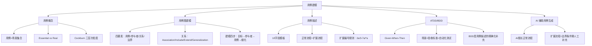

## 一句话总结

用例不是功能列表，而是用户与系统对话的剧本——每个用例是一组场景的集合，从用户视角描述系统行为。

## 知识地图



## 核心概念

### 1. 用例的定义

**Jacobson (1992)：** 在系统和外部对象的交互当中所执行的行为序列的描述，包括各种不同的序列和错误的序列，它们能够联合提供一种有价值的服务。

**Cockburn (2001)：** 用例描述了在不同条件下系统对某一用户的请求的响应。每一个行为序列被称为一个场景（Scenario）。一个用例是多个场景的集合。

**关键区分：场景 = 单条路径；用例 = 所有场景（正常 + 异常）的集合。**

### 2. Essential Use Case vs Real Use Case

| 类型 | 描述特点 | 使用阶段 |
|------|---------|---------|
| Essential（本质用例） | 抽象描述，不涉及具体技术实现 | 需求阶段 |
| Real（真实用例） | 具体描述，包含界面与操作细节 | 设计阶段 |

### 3. 用例图四要素

| 元素 | 符号 | 说明 |
|------|------|------|
| 用例（Use Case） | 椭圆 | 系统提供的一项有价值的服务 |
| 参与者（Actor） | 小人图标 | 与系统交互的外部角色（可以是人、外部系统、定时器） |
| 关系（Relationship） | 连线 | 参与者与用例之间的关系 |
| 系统边界（Boundary） | 矩形框 | 划定系统内外边界 |

**Actor 关键特征：**
- 一个 Actor 代表一个角色，不是具体个人
- Actor 不一定是人——外部系统、硬件设备、定时器都可以是 Actor
- 常见误区：将系统内部组件当参与者（"数据库"不是 Actor）

### 4. 四种关系类型

| 关系 | 符号 | 说明 | 记忆 |
|------|------|------|------|
| Association（关联） | 实线 | 参与者与用例之间的交互 | — |
| Include（包含） | 虚线 `<<include>>` | 一个用例必须包含另一个用例的行为 | **必须做** |
| Extend（扩展） | 虚线 `<<extend>>` | 一个用例在特定条件下扩展另一个用例 | **可能做** |
| Generalization（泛化） | 实线 + 空心三角 | 参与者之间的继承关系 | — |

**Include vs Extend 辨析：**
- Include：基础用例 → 被包含用例，**必须执行**。如"购买图书" include "处理支付"
- Extend：扩展用例 → 基础用例，**有条件执行**。如"撰写评价" extend "查看图书详情"

### 5. 用例图建模四步骤

```
① 目标分析 → ② 寻找参与者 → ③ 寻找用例 → ④ 细化用例
```

关键问题：
- 目标分析：业务痛点是什么？期望达到什么效果？
- 找参与者：谁和系统交互？（人？系统？设备？）
- 找用例：每个 Actor 的工作目标是什么？
- 细化：粒度是否合适？需合并还是拆分？

### 6. Cockburn 三层次粒度

| 层次 | 别名 | 说明 | 示例 |
|------|------|------|------|
| 概要层 | 云层 | 涉及多个用户目标的长期过程 | "管理书店运营"——太粗 |
| 用户目标层 | 海平面 | **参与者的一个完整业务目标** | "购买图书"——最佳粒度 |
| 子功能层 | 水下 | 实现目标的一个步骤 | "输入密码"——太细 |

判断经验法则：完成后用户是否有"任务达成"的满足感？能否在一次会话中完成？

### 7. 细化用例的常见错误

| 错误 | 说明 | 正确做法 |
|------|------|---------|
| 细化过度 | 将"会员管理"拆成"增/删/改/查"4个用例 | 这些是步骤，不是独立业务事件 |
| 合并不当 | 不同业务目标混在一起 | 服务于同一目标才合并 |
| 伪用例 | "登录"→非独立目标；"连接数据库"→技术细节 | 用例必须提供用户可感知的有价值结果 |

**判断标准：用例必须为参与者提供可感知的、有价值的结果。**

### 8. 用例描述 10 字段模板

**基本信息（6字段）：**
| 字段 | 内容 |
|------|------|
| ID | 用例唯一标识 |
| 名称 | 对用例内容的精确描述 |
| 参与者 | 参与角色及其目标 |
| 触发条件 | 启动用例的事件 |
| 前置条件 | 用例启动前系统必须满足的状态 |
| 后置条件 | 用例执行完成后系统的状态 |

**行为与补充（4字段）：**
| 字段 | 内容 |
|------|------|
| 正常流程 | 常见和符合预期条件下的行为交互序列 |
| 扩展流程 | 可能发生的其他场景（异常、分支） |
| 特殊需求 | 非功能性需求 |
| 补充说明 | 其他需记录的信息 |

**扩展流程编号规则：** 数字表示从正常流程第几步分支出去。`3-7a` 表示步骤3到7之间随时可能发生。`*a` 表示任意步骤都可能发生。

### 9. ATDD / BDD

**ATDD（验收测试驱动开发）：** 用"测试怎么写"来倒逼需求精确化。开发者 + 业务专家 + 测试共同编写验收测试用例。

**BDD 格式：Given-When-Then**

```
场景：正常退货
Given 顾客在30天内购买了商品
And 商品未拆封
When 顾客提交退货申请
Then 系统生成退货单
And 退款金额等于购买金额
```

BDD 不是替代用例描述，而是用例描述的精确化补充。在 SDD 中，Acceptance Criteria 通常采用 BDD 格式，可直接转为自动化验收测试。

### 10. AI 辅助用例生成

**AI 的能力与局限：**
- AI 擅长生成正常流程（Happy Path）
- **扩展流程和边界条件需要人工补充**——这是审查的核心
- 典型 AI 问题：用例过细/过粗、遗漏非人类参与者、仅覆盖 Happy Path、include/extend 关系混乱

**审查 AI 生成用例的检查清单：**

| 检查项 | 关键问题 |
|--------|---------|
| 用例粒度 | 是否对应单一业务事件？ |
| 参与者识别 | 是否遗漏外部系统/定时器？ |
| 扩展流程 | 是否覆盖边界情况？ |
| 前后置条件 | 是否精确且可验证？ |
| 业务价值 | 是否包含无价值的"伪用例"？ |
| 关系使用 | include/extend 是否满足"必须/可能"准则？ |

## 难点突破

**难点 1：Include vs Extend 的区分**

最容易混淆的一对概念。判断方法：
- Include：**没有这个环节，主用例无法完成**。"购买图书"必须"处理支付"——支付不完成，购买不成立。→ Include
- Extend：**这个环节是可选的附加行为**。"查看图书详情"时可以选择"撰写评价"——不评价也能查看。→ Extend

记忆口诀：Include = 必须做（不做完不成），Extend = 可能做（锦上添花）。

**难点 2：用例粒度判断——什么该是一个用例？**

核心判断标准是 Cockburn 的"海平面"测试：**完成后用户是否有"任务达成"的满足感？** 

"登录"不是一个用例——没有人打开系统只是为了登录，登录只是通往真正目标的步骤。"购买图书"是一个用例——付完款看到确认页面，用户的任务达成了。

## 与前章关联

- 前置依赖：02-01（需求层次）、02-02（用户故事 INVEST 准则）
- 用例建模是 02-02 中"用户故事"的结构化升级——从文本描述到图形化建模
- 用例图中的系统边界概念，直接引出模块三（体系结构设计）的系统划分
- BDD 的 Given-When-Then 与 02-05（需求验证）的验收测试直接对应
- 用例描述中的扩展流程，是 02-04（需求冲突检测）的输入

## 记忆卡片

**Q: 用例和场景的区别是什么？**
A: 场景（Scenario）是一条行为路径；用例（Use Case）是多个场景（正常+所有异常）的集合。如"销售处理"用例包含正常流程、商品无法识别、取消交易等多个场景。

**Q: 用例图的四个基本元素？**
A: 用例（椭圆）、参与者（小人图标）、关系（连线）、系统边界（矩形框）。Actor 在边界外，用例在边界内。

**Q: Include 和 Extend 的区别？记忆口诀？**
A: Include = 必须做（如"购买图书"必须"处理支付"），Extend = 可能做（如"查看详情"时可选"撰写评价"）。口诀：Include 必须，Extend 可能。

**Q: Cockburn 用例三层次粒度？最佳粒度是哪个？**
A: 概要层（云层，太粗）、用户目标层（海平面，最佳）、子功能层（水下，太细）。判断法：完成后用户是否有"任务达成"的满足感？

**Q: AI 生成用例的最大弱点是什么？**
A: AI 擅长生成正常流程（Happy Path），但扩展流程和边界条件需要人工补充。典型问题：仅覆盖 Happy Path、遗漏非人类 Actor、include/extend 混乱。审查的核心在扩展流程。

**🆕 Q: 顺序图中同步消息和异步消息的箭头怎么画？（6.20教师强调）**
A: **同步消息** = 实线 + 实心三角箭头（调用方等待返回）。**异步消息** = 虚线 + 鱼骨箭头（调用方不等待）。记住：实线三角 = 同步，虚线鱼骨 = 异步。

**🆕 Q: 画状态图最关键的第一步是什么？**
A: **确定状态的主体**（教师反复强调！）。主体可以是一个红绿灯，也可以是整个十字路口——主体不同，状态和转移完全不同。确定主体 → 确定状态 → 确定转移条件/动作 → 转化代码（if-else / 状态表 / State模式）。

---

## 📝 期末笔试备考

### 笔试考点标注

| 考点 | 频度 | 考察形式 | 对应章节 |
|------|------|---------|---------|
| 用例 vs 场景的定义与区别 | 🔴 | 简答/辨析 | §1 |
| Essential vs Real 用例区分 | 🟡 | 填空/辨析 | §2 |
| 用例图四要素（含 Actor 可非人） | 🔴 | 简答/作图 | §3 |
| 四种关系，尤其 Include vs Extend | 🔴 | 辨析/作图 | §4 |
| 建模四步骤 | 🟡 | 简答 | §5 |
| Cockburn 三层次粒度（海平面最优） | 🔴 | 简答/判断 | §6 |
| 常见细化错误（登录非用例） | 🟡 | 判断改错 | §7 |
| 用例描述 10 字段模板 | 🟡 | 填空/简答 | §8 |
| BDD Given-When-Then 格式 | 🟡 | 写作 | §9 |
| AI 用例生成弱点 + 审查清单 | 🟡 | 简答 | §10 |

### 简答题（期末笔试模拟）

**Q1: 什么是用例？用例和场景的区别是什么？**

> 参考答案：用例（Use Case）描述在不同条件下系统对用户请求的响应，是多个场景的集合。场景（Scenario）是单条行为路径——正常流程是一条场景，每个异常分支也是独立场景。简言之：**场景 = 单条路径，用例 = 所有场景的集合。**

**Q2: 用例图包含哪四个基本元素？Actor 除了人还可以是什么？**

> 参考答案：四元素——用例（椭圆）、参与者/Actor（小人图标）、关系/Relationship（连线）、系统边界/Boundary（矩形框）。Actor 不一定是人——外部系统、硬件设备、定时器都可以是 Actor。常见错误：将系统内部组件（如"数据库"）当 Actor。判断标准：Actor 必须在系统边界之外。

**Q3: Include 和 Extend 关系的区别是什么？请各举一例并给出判断口诀。**

> 参考答案：Include = 基础用例**必须**执行被包含用例，没有它主用例无法完成（如"购买图书" include "处理支付"——不支付，购买不成立）。Extend = 在特定条件下**可选**扩展（如"查看图书详情"时 extend "撰写评价"——不评价也能查看）。口诀：**Include 必须做，Extend 可能做。**

**Q4: Cockburn 用例粒度三层次是什么？最佳粒度是哪个？如何判断？**

> 参考答案：① 概要层/云层——涉及多个用户目标的长期过程（如"管理书店运营"，太粗）；② 用户目标层/海平面——参与者一个完整业务目标（如"购买图书"，最佳）；③ 子功能层/水下——实现目标的一个步骤（如"输入密码"，太细）。判断法：完成后用户是否有"任务达成"的满足感？"登录"不是用例——没有人打开系统只是为了登录。

**Q5: 用例描述模板包含哪些核心字段？扩展流程的编号规则是什么？**

> 参考答案：基本信息 6 字段（ID、名称、参与者、触发条件、前置条件、后置条件）+ 行为与补充 4 字段（正常流程、扩展流程、特殊需求、补充说明）= 10 字段。扩展流程编号规则：数字表示从正常流程第几步分支；`3-7a` 表示步骤 3 到 7 之间随时发生；`*a` 表示任意步骤都可能发生。

**Q6: BDD 的 Given-When-Then 格式与用例描述是什么关系？**

> 参考答案：BDD 不是替代用例描述，而是用例描述的**精确化补充**。用例描述给出交互全景（正常+所有扩展），BDD 将每条场景转化为可执行的验收标准。在 SDD 中，Acceptance Criteria 采用 BDD 格式，可以直接转为自动化验收测试。

---

## 🛠 工程实践注意

1. **用例图不过度设计。** 一张用例图 10-15 个用例是上限，超过就拆成多张。用例图的价值在于勾勒系统范围，不是穷举所有交互。

2. **Actor 永远在系统边界外。** 画出"数据库→保存订单"的图说明你把技术组件当成用户了。Actor = 谁发起交互？数据库不会主动发起任何东西。

3. **Include/Extend 区别实操判断：** 问自己"主用例没这个环节还能成立吗？"能 → Extend；不能 → Include。逻辑推理 > 死记硬背。

4. **10 字段不必每次都写满。** 简单用例可以只写名称、Actor、前置条件、正常流程、扩展流程。核心字段是**后置条件**（做完后系统状态是什么？）和**扩展流程**（出错时怎么办？）。

5. **AI 辅助用例：先让它生成 Happy Path，然后你手动列出"所有可能出错的地方"作为扩展流程。** 这是审查 AI 输出最高效的方式——不纠结 AI 写得好不好，而是补它不会写的。
