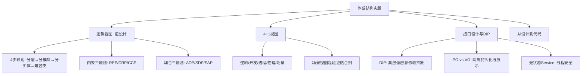

## 一句话总结

包是体系结构逻辑视图的基本构造单元——好的包划分直接决定系统的可维护性，接口是层间解耦的"楼板"。

## 知识地图

## 核心概念

### 1. 从用例到包的 4 步映射

① 确定顶层包结构（controller/service/dao/entity 四层）
② 分析用例，确定业务模块（book/cart/order/customer...）
③ 将概念类分配到 entity 包
④ 为每层建立与业务模块对应的类

**原则：先纵向分层，再横向分模块，确保每个包职责单一。**

### 2. 包设计六原则

**内聚性三原则（决定哪些类放一起）：**

| 原则 | 含义 | 判断 |
|------|------|------|
| REP（重用-发布等价） | 重用的粒度 = 发布的粒度 | 能被一起重用的类放在同一包 |
| CRP（共同重用） | 一起被使用的类放一起 | 用了A但不需要B → A和B不该同一包 |
| CCP（共同封闭） | 因同一原因变化的类放一起 | 一次需求变更只影响尽量少的包 |

CCP（倾向大包）和 CRP（倾向小包）是互斥的。项目早期优先 CCP（开发便利），成熟期转向 CRP（复用好）。

**耦合性三原则（决定包之间如何依赖）：**

| 原则 | 含义 |
|------|------|
| ADP（无环依赖） | 包依赖不能形成环 |
| SDP（稳定依赖） | 依赖方向朝着更稳定的包（I = Ce/(Ca+Ce)，I越小越稳定） |
| SAP（稳定抽象） | 越稳定的包越抽象（接口）；越不稳定的包越具体 |

**SDP+SAP = DIP 在包级别的体现。** 痛苦区（稳定但具体）→ 重构为接口；无用区（不稳定但抽象）→ 可删除。

### 3. 循环依赖修复（ADP）

**方案A：提取共同依赖包。** A→C←B，循环打破。
**方案B：反转依赖方向。** 在 order 包定义接口 `InventoryPort`，inventory 包反过来实现它。

核心都是面向接口编程——接口是打破循环依赖的武器。

### 4. 4+1 视图模型 [Kruchten 1995]

| 视图 | 核心问题 | UML图 |
|------|---------|-------|
| 逻辑视图 | 功能怎么划分？ | 包图、类图 |
| 开发视图 | 代码怎么组织和构建？ | 组件图 |
| 进程视图 | 运行时线程/并发如何？ | 活动图、序列图 |
| 物理视图 | 部署在哪里？ | 部署图 |
| 场景视图 | 用例能否穿透所有层？ | 用例图 |

**场景视图是验证粘合剂**——如果关键用例无法顺畅穿透四个视图，说明架构有问题。

### 5. 接口设计与 DIP

**DIP（依赖倒置原则）两条规则：**
1. 高层模块不应依赖低层模块，两者都应依赖抽象
2. 抽象不应依赖细节，细节应依赖抽象

**PO vs VO：** PO（Persistent Object）与数据库表对应，用于 dao 层。VO（Value Object）面向前端展示，用于 controller/service 层。隔离变化：数据库字段变更不影响前端接口。

**无状态 Service 设计：** Spring 默认单例模式，多个请求共享同一实例。Service 绝对不能持有请求级状态变量——多线程下会导致数据混乱。所有需要的数据通过方法参数传入。

### 6. 从设计到代码的落地

| 设计概念 | 代码实现 |
|---------|---------|
| 包 | Java package / 目录 |
| 接口 | Java interface |
| 依赖关系 | import 语句 / 构造器参数 |
| 层 | 顶层 package 划分 |

**落地原则：** 目录结构 = 包结构；import 只能指向允许的层；接口先行——先建接口文件，再写实现类。

## 难点突破

**难点：CCP vs CRP 的权衡——为什么不可能同时完美满足？**

CCP 主张把"一起变化的类"放一起 → 包变大了。CRP 主张把"一起被重用的类"放一起 → 包变小了（减少不必要依赖）。

实际策略：项目早期需求频繁变更，优先 CCP（大包好维护）；项目成熟对外发布时，重构为 CRP（小包好复用）。这两者没有"正确答案"，只有当前阶段最合适的权衡。

## 记忆卡片

**Q: 包设计的六个原则分哪两类？**
A: 内聚性三原则（决定哪些类放一起）：REP（重用粒度）、CRP（共同重用）、CCP（共同封闭）。耦合性三原则（决定包之间如何依赖）：ADP（无环依赖）、SDP（稳定依赖）、SAP（稳定抽象）。

**Q: 如何修复循环依赖（ADP 违规）？**
A: 方案A：提取共同依赖包（A→C←B，打破A↔B循环）。方案B：反转依赖方向（在调用方定义接口，被调用方实现它）。核心武器是面向接口编程。

**Q: 4+1 视图是哪五个？为什么场景视图是"粘合剂"？**
A: 逻辑视图（功能划分）、开发视图（代码组织）、进程视图（并发性能）、物理视图（部署拓扑）、场景视图（用例穿透验证）。如果关键用例无法顺畅穿透四个视图，说明架构有问题。

**Q: DIP 的两条规则？无状态 Service 为什么重要？**
A: ①高层和低层都依赖抽象 ②抽象不依赖细节，细节依赖抽象。Spring 默认单例，多个请求共享同一实例——有状态变量在多线程下会导致数据混乱。

---

## 期末简答题（6 道）

**Q1: 包设计六原则分哪两类？每类包含哪些原则？简述 REP 和 CRP 的含义。（6分）**
A: 内聚性三原则（决定哪些类放一起）：① REP（重用-发布等价）— 重用的粒度等于发布的粒度，能被一起重用的类放在同一包；② CRP（共同重用）— 一起被使用的类放一起，用了A不需要B则不该同包；③ CCP（共同封闭）— 因同一原因变化的类放一起。耦合性三原则（决定包之间如何依赖）：④ ADP（无环依赖）、⑤ SDP（稳定依赖）、⑥ SAP（稳定抽象）。

**Q2: 为什么 CCP 和 CRP 不能同时完美满足？项目不同阶段如何权衡？（5分）**
A: CCP 主张把"一起变化的类"放一起 → 包变大；CRP 主张把"一起被重用的类"放一起 → 包变小（减少不必要依赖）。两者互斥。策略：项目早期需求频繁变更，优先 CCP（大包好维护）；项目成熟对外发布时，重构为 CRP（小包好复用）。这不是对错问题，是当前阶段最合适的权衡。

**Q3: 什么是循环依赖？给出两种修复方案并说明核心思路。（6分）**
A: 循环依赖是指包间形成 A→B→C→A 的依赖环，违反 ADP 原则，导致无法独立编译/部署/测试。方案A：提取共同依赖包——A→C←B，将共用部分抽到新包C，打破A↔B循环。方案B：反转依赖方向——在调用方包（如 order）定义接口 `InventoryPort`，被调用方包（如 inventory）反过来实现它。两种方案的核心武器都是面向接口编程。

**Q4: 简述 4+1 视图模型的五个视图及其核心问题。为什么说场景视图是"验证粘合剂"？（6分）**
A: ① 逻辑视图（功能怎么划分？→ 包图/类图）；② 开发视图（代码怎么组织和构建？→ 组件图）；③ 进程视图（运行时线程/并发如何？→ 活动图/序列图）；④ 物理视图（部署在哪里？→ 部署图）；⑤ 场景视图（用例能否穿透所有层？→ 用例图）。场景视图是验证粘合剂——如果关键用例无法顺畅穿透四个视图，说明架构设计存在缺陷。

**Q5: DIP 的两条规则是什么？SDP 和 SAP 如何共同体现 DIP 在包级别的应用？（5分）**
A: DIP 两条规则：① 高层模块不应依赖低层模块，两者都应依赖抽象；② 抽象不应依赖细节，细节应依赖抽象。SDP（稳定依赖）要求依赖方向朝着更稳定的包（I = Ce/(Ca+Ce)，I 越小越稳定），SAP（稳定抽象）要求越稳定的包越抽象。SDP + SAP = DIP 在包级别的体现：稳定 → 抽象（接口），不稳定 → 具体（实现）。痛苦区（稳定但具体）→ 重构为接口；无用区（不稳定但抽象）→ 可删除。

**Q6: PO 和 VO 的区别是什么？为什么需要无状态 Service 设计？（5分）**
A: PO（Persistent Object）与数据库表对应，用于 dao 层；VO（Value Object）面向前端展示，用于 controller/service 层。分离的好处：数据库字段变更不影响前端接口，隔离变化。无状态 Service：Spring 默认单例，多个请求共享同一实例——Service 绝对不能持有请求级状态变量，所有数据通过方法参数传入，否则多线程下数据混乱。
