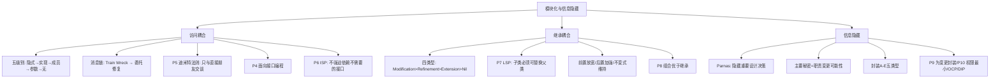

## 一句话总结

信息隐藏的本质：每个模块对其他模块隐藏一个重要的设计决策——把变化的可能性封装在模块内部，使修改只影响该模块。

## 知识地图



## 核心概念

### 1. 访问耦合五级别

| 级别 | 名称 | 示例 | 推荐 |
|------|------|------|------|
| 5（最高） | 隐式访问耦合 | 依赖全局变量/Singleton | ✗ 避免 |
| 4 | 实现中访问耦合 | 反射访问 private 字段 | ✗ 避免 |
| 3 | 成员变量访问耦合 | 直接读写 `public` 字段 | ✗ 避免 |
| 2 | 参数变量访问耦合 | 依赖具体类型 | △ 可接受 |
| 1（最低） | 无访问耦合 | 无直接依赖 | ✓ 最佳 |

级别 3-5 打破封装，应重构为通过方法（消息）访问。

### 2. Cascading Message（消息链/Train Wreck）

```java
// 问题：a.getB().getC().doSomething()
// 修复（委托）：a.delegateToB() —— 调用方只需知道 a
```

**P5 迪米特法则（Law of Demeter）：** 只与直接朋友交谈。合法调用对象：`this`、方法参数、方法内新创建的对象、类的成员变量。

### 3. 面向接口编程 + ISP

**P4 面向接口编程：** `List<String> list = new ArrayList<>()` — 依赖接口而非具体实现。

**P6 接口隔离原则（ISP）：** 不应强迫客户端依赖它不需要的接口。肥接口应拆分为多个小接口。

### 4. 继承耦合四类型

| 类型 | 说明 | 强度 | 推荐 |
|------|------|------|------|
| Modification | 覆盖方法并改变语义 | 最高 | ✗ 避免 |
| Refinement | `super` + 前后添加行为 | 中 | △ 谨慎 |
| Extension | 只新增方法，不覆盖 | 低 | ✓ 安全 |
| Nil | 纯抽象接口 | 最低 | ✓✓ 最佳 |

### 5. P7 里氏替换原则（LSP）

**子类型必须能够替换其父类型而不改变程序的正确性。**

经典反例：正方形继承长方形 —— `setWidth()` 同时改变高度，破坏不变式（w 与 h 独立）。"IS-A"关系应由行为定义，而非数学定义。

**契约要求（记忆口诀）：子类前置放宽，后置加强，不变式维持——这才叫替换。**

| 契约要素 | LSP 要求 |
|---------|---------|
| 前置条件 | 子类 ≤ 父类（不能更严格） |
| 后置条件 | 子类 ≥ 父类（保证更多） |
| 不变式 | 子类必须维护父类所有不变式 |

### 6. P8 组合优于继承

**Favor object composition over class inheritance.** (GoF, 1994)

| 继承 | 组合 |
|------|------|
| 白盒复用：依赖父类实现 | 黑盒复用：只依赖接口 |
| 父类修改破坏所有子类 | 运行时动态切换 |
| 难以扩展多维度变化 | 职责分离更清晰 |

`Stack extends Vector` 是历史经典错误——`Stack` 应该组合 `Vector` 而非继承。

### 7. 信息隐藏（Parnas, 1972）

**每个模块应该对其他模块隐藏一个重要的设计决策。**
- **主要秘密（Primary Secret）** = 职责变更的可能性（这个类应该做什么会变化吗？）
- **次要秘密（Secondary Secret）** = 实现细节的变更可能性（怎么做会变化吗？）

**P9 为变更而封装：** 找出预计会变化的部分，将其封装在稳定接口之后。

**封装五类型（A-E）：** 从完全暴露到完全隐藏，逐步收紧访问控制。

### 8. 🆕 控制耦合与特征耦合（教师 6.20 补充讲解）

课上内聚耦合讲得比较简略，但以下两种耦合在实际开发中非常常见，需要理解：

**控制耦合（Control Coupling）：** 方法通过传入一个参数（如 flag、布尔值、整数或字符串类型）来控制内部行为——方法内部根据这个参数做 switch-case。**问题**：调用方和被调用方都需要知道这个类型约定才能正确工作，耦合度高。**改进**：用多态替代 if-else，将控制逻辑从方法内部移到上部（创建对象 → 直接调方法）。

**特征耦合 / 印记耦合（Stamp Coupling）：** 向方法传入超出其所需范围的数据结构。例如 `sendEmail(employee)` 只需要 `employee.emailAddress`，却传入了整个 Employee 对象——方法获得了不必要的访问权限。**改进**：只传需要的数据（`sendEmail(emailAddress)`）。

> 教师原话："这两种耦合现在仍然会犯。控制耦合和印记耦合需要多关注。其他耦合（如直接改人家代码）现在语法层面不太允许了。"（考试不深考，理解即可）

## 难点突破

**难点：LSP 的前置/后置条件方向——为什么"子类前置更宽松，后置更严格"？**

如果子类前置条件更严格（`setAge(age)` 父类要求 age>0，子类额外要求 age<150），那么原本用父类的地方传入 age=200 会正常运行，但换成子类后却报错了——**调用者无法用子类替换父类。**

后置条件：子类必须保证至少和父类一样多的结果。如果父类保证"返回正整数"，子类返回可能包含 0 → 调用者依赖了"正"这个承诺就会出问题。

记忆法：子类对调用者的要求更宽松（前置放宽），给调用者的承诺更多（后置加强）。

## 记忆卡片

**Q: 访问耦合五级别从高到低？**
A: 隐式访问（全局变量）> 实现中访问（反射）> 成员变量访问（public字段）> 参数变量访问 > 无访问耦合。3-5 级应重构为方法访问。

**Q: 迪米特法则的内容？四种合法调用对象？**
A: "只与直接朋友交谈"。合法：this、方法参数、方法内新建对象、类的成员变量。禁止：`a.getB().getC().doSomething()`。

**Q: LSP 的契约三要求？**
A: ①子类前置条件 ≤ 父类（不能更严格）②子类后置条件 ≥ 父类（保证更多）③子类维护父类所有不变式。口诀：前置放宽，后置加强，不变式维持。

**Q: 为什么组合优于继承？**
A: 继承是白盒复用（依赖父类实现，父类修改破坏子类），组合是黑盒复用（只依赖接口，运行时动态切换）。`Stack extends Vector` → 应 `Stack` 内部组合 `Vector`。

---

## 考点整理与简答题预测

> 生成于 2026-06-01 Phase 1 复习 · 🆕 6.20 教师答疑更新

**🆕 类设计原则考试方式（教师 6.20）：** "类的原则都会考的，我们总结了那么多类的原则，十来个都会考的。可能考其中之一，可能组合在一起考多个——问你符合什么原则、违背什么原则。" 因此不需要死记每个原则的定义文字，但必须能**看到代码场景 → 判断符合/违背哪些原则 → 解释原因**。

### 必考考点（按概率排序）

| 优先级 | 考点 | 常见题型 |
|--------|------|---------|
| ⭐⭐⭐ | LSP 里氏替换原则（契约三要求 + 正方形/长方形反例） | 简答/论述 |
| ⭐⭐⭐ | 组合优于继承（白盒 vs 黑盒 + Stack/Vector 反例） | 简答/论述 |
| ⭐⭐⭐ | 迪米特法则 + Train Wreck 修复 | 简答/改错 |
| ⭐⭐ | 访问耦合五级别（隐式→实现→成员→参数→无） | 简答/填空 |
| ⭐⭐ | 继承耦合四类型（Modification>Refinement>Extension>Nil） | 选择/填空 |
| ⭐⭐ | ISP 接口隔离原则 | 简答 |
| ⭐ | 信息隐藏 Parnas（主要秘密 vs 次要秘密） | 名词解释 |
| ⭐ | 面向接口编程（P4）+ 为变更而封装（P9） | 简答 |

### 简答题预测 + 答案

**Q1: 什么是里氏替换原则（LSP）？结合正方形/长方形说明违反 LSP 的后果。**（10-12 分）

**答：** 子类型必须能够替换其父类型而不改变程序的正确性。契约三要求：①前置条件：子类 ≤ 父类（不能更严格，对调用者更宽松）；②后置条件：子类 ≥ 父类（保证更多）；③不变式：子类必须维护父类所有不变式。正方形/长方形反例：长方形有不依赖的不变式（setWidth 只改宽度，高度不变），正方形 extends 后 setWidth 同时改高度，破坏该不变式。调用方依赖"宽高独立"被破坏。**教训：IS-A 由行为定义，非数学定义。**口诀：前置放宽，后置加强，不变式维持。

**Q2: 为什么"组合优于继承"？举出 Stack/Vector 反例。**（8-10 分）

**答：** 继承 = 白盒复用（依赖父类实现细节，父类修改破坏所有子类），组合 = 黑盒复用（只依赖接口，运行时动态切换）。Stack extends Vector：Stack 语义要求只能 push/pop，但继承暴露了 add(index)、remove(index) 等破坏栈语义的错误操作。**正确做法：** Stack 内部组合 Vector，只暴露 push/pop/peek。GoF 原文：Favor object composition over class inheritance.

**Q3: 什么是迪米特法则？四种合法调用对象？如何修复 Train Wreck？**（8 分）

**答：** 只与直接朋友交谈。合法调用：①this ②方法参数 ③方法内新建对象 ④类的成员变量。Train Wreck：`a.getB().getC().doSomething()` — 调用方穿透 a 访问 b、c。修复：在 a 上添加委托方法，调用方只需知道 a。本质：减少调用方对间接对象的依赖。

**Q4: 列出访问耦合五级别（从高到低），哪些应避免？**（5-8 分）

**答：** 5 隐式访问（全局变量/Singleton）> 4 实现中访问（反射）> 3 成员变量访问（public 字段）> 2 参数变量访问 > 1 无访问耦合。3-5 级打破封装，应重构为方法访问。

**Q5: 继承耦合四类型？按强度排序并说明推荐程度。**（5-8 分）

**答：** Modification（覆盖改语义，✗避免）> Refinement（super+前后添加，△谨慎）> Extension（只新增不覆盖，✓安全）> Nil（纯抽象接口，✓✓最佳）。

**Q6: 什么是接口隔离原则（ISP）？为什么要拆分"肥接口"？**（5 分）

**答：** 不应强迫客户端依赖它不需要的接口。肥接口 → 客户端实现不相关方法 → 接口变更影响所有实现者。解决：拆分为多个职责单一的小接口。关联：与 High Cohesion 同源。

**Q7: Parnas 信息隐藏原则的核心思想？"主要秘密"和"次要秘密"的区别？**（5 分）

**答：** 每个模块对其他模块隐藏一个重要的设计决策（Parnas, 1972）。主要秘密 = 职责变更可能性（"应该做什么会变"），次要秘密 = 实现细节变更可能性（"怎么做会变"）。P9 为变更而封装：找出预计会变化的部分，封装在稳定接口之后。

### 跨章关联

| 前序概念 | 来源 | 关联 |
|---------|------|------|
| GRASP Low Coupling | 04-01 | 迪米特、ISP、组合优于继承 → 降低耦合的具体手段 |
| GRASP High Cohesion | 04-01 | ISP 是高内聚在接口层的体现 |
| 包设计六原则 | 03-03 | LSP、ISP 是包级原则下放到类/接口级 |
| 模块化定义 | 03-01 | 本章是模块化的深化——用信息隐藏和设计原则实现真正的模块化 |

> **一句话记忆：** LSP 管继承、迪米特管调用、ISP 管接口、组合优于继承管复用——四条原则都在保护"低耦合高内聚"。信息隐藏是总纲：把变化关进笼子里。
