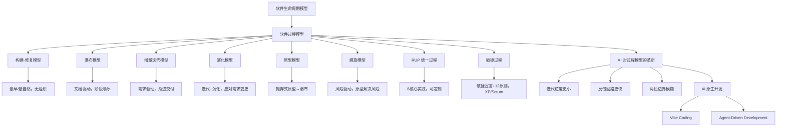

## 一句话总结

软件生命周期模型将软件从生产到报废分割为不同阶段，软件过程模型在此基础上进一步详细说明各阶段的任务、活动、对象及其组织控制过程——从构建-修复到敏捷，从人类独力到人+AI 智能体协同，过程模型的核心始终是"用合适的组织方式降低复杂度、控制风险、交付价值"。

## 知识地图

## 核心概念

### 1. 软件生命周期模型与过程模型的区别

- **软件生命周期模型**：将软件从生产到报废的生命周期分割为不同阶段，每个阶段有明确的典型输入/输出、主要活动和执行人，各阶段形成明确、连续的顺次过程
- **软件过程模型**：在生命周期模型的基础上进一步详细说明各个阶段的任务、活动、对象及其组织、控制过程。可以被看作是**网络化的活动组织**——比简略的生命周期模型更详细

同一个生命周期模型可以有多个不同的软件过程模型（阶段划分一样，但时间安排、先后衔接等执行过程不一样）。

### 2. 构建-修复模型（Build-Fix）

最早也是最自然产生的软件开发模型——**不能算是一个真正的软件过程模型**，因为它对软件开发活动没有任何规划和组织，完全依靠开发人员个人能力。

**缺点**：
- 没有对开发工作进行规范和组织，随着系统复杂度提升，开发活动会超出个人直接控制能力而失败
- 没有分析需求的真实性，给软件开发带来很大风险
- 没有考虑软件结构的质量，在不断修改中质量越来越糟，直至无法修改
- 没有考虑测试和程序的可维护性，也没有任何文档，维护十分困难

**适用性**：软件规模很小（几百行程序）、质量要求不高、不需要后期维护

### 3. 瀑布模型（Waterfall）

[Royce 1970] 通过分析早期软件开发活动发现：将软件开发活动划分为不同阶段，并保障每个阶段工作的正确性和有效性（尤其重视分析和设计阶段），会比构建-修复方式取得好得多的表现——更高的质量、更低的成本和更小的风险。

**核心特征**：
- 允许活动出现反复和迭代，但重点在于**要求每个活动的结果必须进行验证**
- **文档驱动**：按照文档的划分、产生和验证来规划、组织和控制开发活动
- 阶段顺序：需求开发 → 软件设计 → 软件实现 → 软件测试 → 软件交付 → 软件维护

**优点**：为开发活动定义了清晰的阶段划分（包括输入/输出、主要工作及关注点），让开发者能够以**关注点分离**的方式更好地进行复杂度超越个人能力的项目开发

**缺点**：
- 对文档的过高期望具有局限性（耗费大量工作量，且难为经常变化的需求建立完备可靠的文档）
- 对开发活动的线性顺序假设具有局限性（实际开发中常需要做一定后续工作才能验证当前工作是否正确）
- 客户、用户参与具有局限性（成功项目需要客户用户从始至终的参与）
- 里程碑粒度过粗，基本丧失了"早发现缺陷早修复"的思想

**适用性**：需求非常成熟稳定、技术成熟可靠、复杂度适中（不至于产生太大文档负担和过粗的里程碑）

### 4. 增量迭代模型（Incremental-Iterative）

应对软件规模日益增长带来的挑战：周期过长→**渐进交付**，时间压力→**并行开发**。这三个要素共同促使了增量迭代模型的产生和普及。

**核心特征**：
- 需要在项目早期就确定项目的目标和范围，项目需求要比较成熟和稳定
- 少量的不确定性和影响不大的需求变更通过迭代方式解决
- 每个迭代的增量需求相对独立，被开发为产品的独立部分交付给用户
- 第一个迭代完成的往往是产品的核心部分，满足基本需求
- **需求驱动**：增量需求是迭代规划、开发活动组织和控制的主要依据

**优点**：迭代式开发更符合软件开发实践；并行开发缩短开发时间；渐进交付加强用户反馈，降低开发风险

**缺点**：
- 各构件逐渐并入已有体系结构，加入构件必须不破坏已构造好的系统部分——需要**开放式的体系结构**
- 需要一个完备、清晰的项目前景和范围以进行并发开发规划，在不稳定领域很难在项目开始就确定前景和范围

**适用性**：实践中广泛用于大规模软件系统开发，尤其是比较成熟和稳定的领域

### 5. 演化模型（Evolutionary）

与增量迭代模型相比：都是迭代、并行开发和渐进交付，都适合大规模软件开发。但演化模型能够**更好地应对需求变更**，更适用于需求变更比较频繁或不确定性较多的领域。演化模糊了维护与新开发的界限（详见 Ch21）。

**优点**：演化式迭代安排能适用于需求变更频繁或不确定性较多的开发；并行开发缩短开发时间；渐进交付加强用户反馈

**缺点**：
- 无法在项目早期阶段建立项目范围，整体计划、进度调度、商务协商无法准确把握
- 后续迭代的开发活动是在前导迭代基础上修改和扩展的，容易让后续迭代**忽略分析与设计工作，蜕变为构建-修复方式**

**适用性**：不稳定领域的大规模软件系统开发

### 6. 原型模型（Prototyping）

**抛弃式原型**：通过模拟"未来"的产品，将"未来"的知识置于"现在"进行推敲，解决不确定性。在抛弃式原型的帮助下解决了不确定性后得到清晰需求，再按瀑布模型安排后续开发活动。

**演化式原型**：在迭代中构建，是系统的核心，并不断扩充，最终成为真正的软件产品。

**核心流程**：原型需求 → 设计原型 → 构建原型 → 评估原型 → 清晰需求 → 设计 → 实现 → 测试 → 交付 → 维护

**优点**：加强与客户、用户的交流，让最终产品取得更好的满意度；适用于非常新颖的领域（有大量不确定性）

**缺点**：
- 原型方法自身也带来新风险：原型开发成本较高，可能耗尽项目费用和时间
- 实践中，很多项目负责人**不舍得抛弃"抛弃式原型"**，使质量较差的代码进入最终产品，导致低质量

**适用性**：主要用于有大量不确定性的新颖领域

### 7. 螺旋模型（Spiral）

**风险**是指因为不确定性（对未来知识了解有限）而可能给项目带来损失的情况。螺旋模型的基本思想是**尽早解决比较高的风险**——如果有些问题实在无法解决，早发现比项目结束时再发现要好，至少损失要小得多。

**原型模型 vs 螺旋模型**：
- 原型模型：使用原型解决**需求**的不确定性
- 螺旋模型：使用原型解决项目开发中常见的**各种类型的技术风险**，包括系统需求开发、软件需求开发、软件体系结构设计、详细设计等各个阶段

**核心特征**：**风险驱动**，完全按照风险解决的方式组织软件开发活动。五个步骤循环：确定目标、解决方案和约束 → 评估方案，发现风险 → 寻找风险解决方法 → 落实风险解决方案 → 计划下一个迭代

**优点**：可以降低风险，减少项目因风险造成的损失
**缺点**：风险解决需要使用原型手段，存在原型自身带来的风险；模型过于复杂，不利于管理者依据其组织软件开发活动
**适用性**：高风险的大规模软件系统开发

### 8. RUP 统一过程（Rational Unified Process）

总结和借鉴传统上的各种有效经验，建立**最佳实践方法的集合**，并提供有效的过程定制手段。

**六大核心实践方法**：
1. **迭代式开发**——被反复证明的最佳实践方法
2. **管理需求**——重视需求工程中除了需求开发之外的需求管理活动
3. **使用基于组件的体系结构**——帮助建立可维护、易开发、易复用的软件体系结构
4. **可视化建模**——利用 UML 进行建模
5. **验证软件质量**——尽早和持续地开展验证，以尽早发现缺陷，降低风险和成本
6. **控制软件变更**——适应 1990s 以后需求变更越来越重要的事实

**RUP 裁剪**：RUP 是一个通用过程模板，使用时需要裁剪和配置——确定需要哪些工作流、每个工作流需要哪些制品、四个阶段之间如何演进、每个阶段内的迭代计划、工作流组织

**优点**：吸收传统最佳实践，6 个核心实践保证基本有效合理；通过定制可适用于小型到大型项目
**缺点**：没有考虑交付之后的软件维护问题；裁剪和配置工作不是简单任务
**适用性**：重量级过程，能胜任大型团队大型项目；经裁剪也可变为轻量级过程

### 9. 敏捷过程（Agile）

传统过程模型过度强调了"纪律"，忽视了个人的能力——尤其是过度强调了计划、文档和工具，导致项目开发失去了灵活性，不能快速应对需求变更和用户反馈。

**敏捷宣言（2001）四大价值观**：
| 左项（更重视） | 右项（虽有其价值） |
|---------------|-------------------|
| 个体和互动 | > 流程和工具 |
| 工作的软件 | > 详尽的文档 |
| 客户合作 | > 合同谈判 |
| 响应变化 | > 遵循计划 |

**敏捷 12 原则**的核心条目：
1. 最重要的目标是通过持续不断地及早交付有价值的软件使客户满意
2. 欣然面对需求变化，即使在开发后期也一样
3. 经常地交付可工作的软件，相隔几星期或一两个月，倾向于采取较短的周期
4. 业务人员和开发人员必须相互合作，项目中的每一天都不例外
5. 激发个体的斗志，以他们为核心搭建项目
6. 面对面交谈是传递信息效果最好效率也最高的方式
7. **可工作的软件是进度的首要度量标准**
8. 敏捷过程倡导可持续开发
9. 坚持不懈地追求技术卓越和良好设计
10. 以简洁为本——极力减少不必要工作量的艺术
11. 最好的架构、需求和设计出自自组织团队
12. 团队定期反思如何提高成效，并依此调整自身举止表现

**极限编程（XP）核心思想**：极限利用简单、有效的方法解决问题。如果某方法好用，就一直用——测试好用→测试驱动开发（TDD）；集成测试好用→持续集成（CI）；代码评审好用→结对编程；简洁性好用→简单设计；设计好用→重构；短迭代好用→小版本发布；用户参与好用→现场客户。

**XP 12 实践**：规划游戏、现场客户、系统隐喻、简单设计、重构、结对编程、编码规范、代码集体所有权、测试驱动、持续集成、小版本发布、每周 40 小时工作制

**适用性**：反映了 1990s 之后软件工程的发展趋势，得到广泛应用，尤其能适应快速变化或时间压力较大的项目

### 10. AI 对过程模型的革新

**传统假设被打破**：传统假设人类是唯一的「代码生产者」，各阶段由人驱动 → 新现实是大模型可承担代码生成、测试、文档、评审等大量工作，人转向监督与决策。

**AI 对各阶段的影响**：
- 需求分析：AI 辅助需求提取、歧义检测、自动生成用例
- 设计：AI 生成架构方案、API 设计、数据库 Schema，加速方案评估
- 编码：Copilot / Claude Code 将编码速度提升 30%-50%，开发者专注于逻辑设计
- 测试：AI 自动生成测试用例，测试智能体实现 CI 中的自主修复
- 交付/维护：AI 生成文档、部署脚本、变更影响分析

**新兴 AI 原生过程特征**：
- **迭代粒度更小**：AI 降低单次迭代成本，使更频繁的小批量交付成为可能
- **反馈回路更快**：AI 即时代码审查 + 自动测试，将反馈时间从"天"压缩到"分钟"
- **角色边界模糊**：开发者 = 需求表达者 + AI 输出审核者 + 集成者

### 11. Vibe Coding 与智能体驱动开发

**Vibe Coding（意图驱动开发）**：开发者用自然语言描述"想要什么"，AI 负责"如何实现"。适用于原型快速验证（一天内从想法到可运行的 Demo），但生产代码仍需严格的设计与审查。

**智能体驱动开发（Agent-Driven Development）**：将开发任务分解为 Issue，由测试智能体/编码智能体自主完成。人工角色变为：拆解需求 → 审核智能体提交的 PR → 决策架构方向。

**核心启示**：过程模型不会消失，但执行主体从「人」扩展为「人 + 智能体」。理解传统过程模型是驾驭 AI 开发工具的前提——**需要知道"为什么"**。

## 难点突破

### 难点一：八种过程模型的区别与选型

**容易混淆的点**：模型太多，考试时容易把特点张冠李戴。

**突破方法**：按驱动因素+核心机制分类记忆：

| 模型 | 驱动因素 | 核心机制 | 一句话标签 |
|------|---------|---------|-----------|
| 构建-修复 | 无 | 个人能力 | 不算是过程模型 |
| 瀑布 | 文档 | 阶段顺序+验证 | 最早的正规模型 |
| 增量迭代 | 需求 | 并行+渐进交付 | 瀑布的迭代版 |
| 演化 | 需求变更 | 迭代+演化模糊维护 | 增量迭代的不稳定版 |
| 原型 | 不确定性 | 抛弃式原型→瀑布 | 先探路再走路 |
| 螺旋 | 风险 | 原型解决各类风险 | 原型+风险驱动 |
| RUP | 最佳实践 | 6实践+可裁剪 | 重量级→可轻量化 |
| 敏捷 | 价值/变化 | 宣言+原则+轻量 | 拥抱变化 |

**选型线索**：需求稳定→瀑布/增量迭代；需求不稳定→演化/原型/敏捷；高风险→螺旋；大型团队→RUP；快速变化→敏捷。

### 难点二：演化模型 vs 增量迭代模型

**容易混淆的点**：两者都是迭代+并行+渐进交付，区别很微妙。

**突破方法**：关键区别在于**项目早期能否确定范围**。
- 增量迭代：项目早期就确定目标和范围，需求比较成熟稳定，各增量相对独立
- 演化：无法在早期建立项目范围，每次迭代的需求可能大幅变更，后续迭代是对前导迭代的修改和扩展

**类比**：增量迭代像装修一套已有完整设计图的房子——分区域逐步施工。演化像在探索中建一座新城——每轮建设都可能改变之前的规划。

## 与前章关联

- **依赖前章**：本章总结回顾了第 4-21 章的所有开发活动（需求→设计→构造→测试→交付→维护），是课程全部内容的整体视角收束。各过程模型的选择会影响项目管理（01-02）的具体执行方式
- **为后续打基础**：演化模型模糊了开发与维护的界限，直接导向 Ch21 软件演化生命周期和 06-03 软件维护与演化

## 记忆卡片

**Q1**：软件生命周期模型和软件过程模型的区别是什么？
**A1**：生命周期模型将软件从生产到报废分割为不同阶段（输入/输出、主要活动、执行人）；过程模型在此基础上进一步详细说明各阶段的任务、活动、对象及其组织、控制过程，是**网络化的活动组织**。

**Q2**：瀑布模型的四大缺点是什么？
**A2**：①文档过高期望的局限性（耗费大量工作量，难为变化的需求建立可靠文档）；②线性顺序假设的局限性（实际常需后续工作才能验证当前工作）；③客户、用户参与的局限性（仅在需求阶段参与不够）；④里程碑粒度过粗（丧失"早发现缺陷早修复"）。

**Q3**：原型模型和螺旋模型都使用原型，区别在哪里？
**A3**：原型模型使用原型解决**需求**的不确定性；螺旋模型使用原型解决**各种类型的技术风险**（包括需求开发、体系结构设计、详细设计等各阶段）。螺旋模型是**风险驱动**的。

**Q4**：RUP 的六大核心实践方法是什么？
**A4**：①迭代式开发；②管理需求；③使用基于组件的体系结构；④可视化建模（UML）；⑤验证软件质量（尽早持续验证）；⑥控制软件变更。

**Q5**：敏捷宣言的四大价值观是什么？
**A5**：①个体和互动 > 流程和工具；②工作的软件 > 详尽的文档；③客户合作 > 合同谈判；④响应变化 > 遵循计划。右项虽有价值，敏捷更重视左项。

**Q6**：AI 对软件过程模型的三个核心革新是什么？
**A6**：①**迭代粒度更小**——AI 降低单次迭代成本，使更频繁的小批量交付成为可能；②**反馈回路更快**——AI 即时代码审查+自动测试，反馈从"天"压缩到"分钟"；③**角色边界模糊**——开发者 = 需求表达者 + AI 输出审核者 + 集成者。
