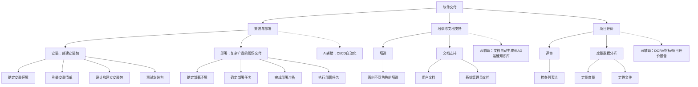

## 一句话总结

软件交付是软件项目的结束阶段，标志着软件开发任务的完成，是软件开发与软件维护两个既连续又不同的软件产品生存状态的分水岭——只有做好软件交付工作，才是真正地完成整个项目。

## 知识地图

## 核心概念

### 1. 安装

安装是软件交付的最常见形式，要求开发团队创建一个安装包，用户通过执行安装包将软件产品部署到工作环境。一个好软件产品应该简单、健壮、可靠、完全——要创建很容易使用的安装包，让用户无需创建安装包的人员的帮助就能使用。

**创建安装包的四个步骤**：
1. **确定安装环境**：操作系统、语言支撑环境（如 JDK）、软件支持（如数据库系统）、硬件要求（如扫描仪、通信设备等特殊硬件）
2. **列举安装清单**：需要安装的文件、初始化数据、注册表等，清楚标明安装后的位置，遵守一致性原则
3. **设计和建立安装包**：设计渐进的安装步骤和各步骤的人机交互方式，使用工具（如 Advanced Installer、Setup Factory）创建安装包
4. **测试安装包**：必须**以用户的工作环境为目标环境**进行测试——开发者的机器环境与用户的机器环境有很大不同（程序环境、操作系统版本、支撑软件版本等），在开发者机器上能正确执行的安装包未必能在用户机器上运行

### 2. 部署

在软件产品比较复杂时，仅通过一个安装包无法完成交付，需要使用部署方式。部署通常是由开发人员直接操纵软件产品的目标环境，使得软件产品能够在目标环境中正常运行。

部署过程中通常需要执行安装任务，但还有很多比安装复杂得多的任务：
- 安装、设置或调整操作系统，尤其是权限管理参数
- 安装、设置和调整数据库系统，包括新建数据库和设置访问权限
- 安装和设置库文件、应用服务器等应用环境

**部署的四个步骤**：
1. **确定部署环境**：比安装要求更高——需要对目标环境进行调查分析，了解服务器与网络拓扑、安全控制与权限管理、软硬件系统的配置信息
2. **确定部署任务**：将软件产品需要的目标环境与部署前的环境进行比较，分析差距，以渐进方式安排执行次序
3. **完成部署准备**：综合考虑可能出现的各种情况，制定完备的应对方案
4. **执行部署任务**：按照准备计划执行

### 3. 培训

培训主要是教会用户使用软件产品的功能来完成其工作和任务。依据任务的不同，要为**不同的用户进行不同类型的培训**。

培训的关键注意点：
- **尤其不能忽略对系统管理员的培训**：如何启动和运行新系统、如何配置系统、如何授权或拒绝访问、如何支持用户、如何处理异常
- **只介绍能帮助用户完成主要工作和任务的功能**，不要把培训当作软件产品所有功能的展示会——很少使用且不重要的功能，培训后也会很快被忘记，可以让用户通过文档支持来学会
- **关注用户的工作和任务**，不必涉及系统的内部操作（存储方式、访问方式和权限控制方式）

### 4. 文档支持

文档是软件交付的重要部分：培训时作为参考材料，交付完成后继续帮助用户使用系统。

文档分为两类：
- **用户文档**：为用户编写的参考指南或操作教程（如用户使用手册、联机帮助文档）。写作要考虑用户群体的特点，最好**图文结合**，使用逐层展开和系统化的方式描述复杂内容
- **系统管理员文档**：注重系统维护方面的内容——系统性能调整、访问权限控制、常见故障解决、软硬件配置方式、网络连接方式、安全验证与访问授权、备份与容灾、部件替换等

**用户文档的内容组织**应支持两种使用模式：
- **指导模式**：根据用户任务组织程序规程，先描述简单共性任务，再以此为基础组织更复杂任务的描述
- **参考模式**：按方便随机访问独立信息单元的方式组织内容（如按字母顺序排列命令或错误消息）

**用户文档的必须要素**：标识信息、目录（正文超过 8 页时）、引言、文档使用信息、操作模式、操作规程（指导模式）/ 软件命令信息（参考模式）、错误信息与问题解决、术语表（有陌生名词时）、导航特征、索引（正文超过 40 页时）、搜索能力（电子文档中）

### 5. 项目评价

设置"项目"是要保证项目中的各种事件与活动能够依照计划顺利进行，项目评价就是检查其事件与活动的实际执行情况。项目评价可以发生在项目进行的任何时机（尤其是达到各里程碑之后），但**最重要的项目评价是在项目结束时进行的**——因为项目已完成，总结和评价远比项目进行中更加准确。

**项目评价针对四个方面**：
- **项目管理**：建立对项目的更准确认知（常见管理问题与偏差、时间与成本耗费分布）
- **产品**：建立对产品的更准确认知，提高产品开发经验
- **团队**：更好地组织分工，建立更好的沟通与交流途径
- **个人**：更准确认知自己的生产力，了解长处和不足并持续提高

**项目评价的两种方法**：
- **评审**：通过评审重要项目制品（项目计划、管理文档、会议记录、历史数据等）来评价项目。**检查列表是最为常用的评审方法**
- **度量数据分析**：分析度量数据获取正确和深入的结论（如通过分析项目活动的任务量，了解每个人的生产力、项目的工作量分布、特殊任务的工作量耗费等）

**评价的注意事项**：
- 项目评价需要仔细计划：确定评价时间（项目结束后，不能太久导致细节遗忘）、确定关键主题、确定参与人员、确定需要收集的数据
- **评价要客观**：保持对项目和过程的关注，不要偏离目标指责和突出个人。评价不是向高级管理层夸夸其谈的文档，而是团队每个成员和组织通过一个又一个项目来不断获得提高的途径

### 6. AI 辅助软件交付

**CI/CD 与现代部署流水线**：
- 传统部署：手工执行脚本、逐步检查配置 → 易出错、难复现
- AI 增强部署：大模型生成 Dockerfile / Kubernetes YAML / Ansible Playbook，并自动校验
- CI/CD 流水线中的 AI 检查点：Pre-deploy（AI 扫描配置文件，识别安全风险）、Deploy（AI 监控滚动升级，检测异常指标自动触发回滚）、Post-deploy（AI 对比部署前后日志，生成变更影响报告）

**大模型辅助用户文档自动生成**：
- 核心挑战：软件更新快、文档滞后（"文档腐败"是最普遍的软件问题之一）
- 典型流程：输入 API 规格/源码注释/变更日志 → LLM 生成初稿 → 人工审核准确性，补充业务背景 → LLM 针对不同受众生成不同版本
- 文档质量保障：AI 自动检测文档与代码的不一致，生成文档可读性评分，支持中英文双语文档自动生成

**AI 运维知识库（RAG 架构）**：将运维手册、历史工单、故障复盘报告向量化存入知识库，运维人员自然语言提问，AI 检索相关文档并给出处理建议

**AI 驱动的项目度量分析**：
- 自动聚合 Jira/Git/CI 数据，实时生成项目健康度报告
- 分析核心指标：DORA 四大指标（Lead Time、Deployment Frequency、Change Failure Rate）、缺陷密度、技术债务趋势、PR 合并时长、Code Review 等待时间、Burndown 偏差

## 难点突破

### 难点一：安装 vs 部署的区分与选择

**容易混淆的点**：什么时候用安装，什么时候用部署？

**突破方法**：以产品复杂度为判断依据。
- **安装**：适用于标准化程度高的产品，用户自行执行安装包即可完成。开发团队交付的是一个**封装好的安装包**
- **部署**：适用于复杂产品（企业级系统、需要配置服务器/网络/数据库/权限的系统）。开发团队需要**直接操作目标环境**

**类比**：安装像买一台预装好系统的笔记本电脑——拆箱即用。部署像装修一个数据中心——需要现场勘测、布线、配置机架、调试网络，每个环节都可能需要根据现场情况调整。

### 难点二：项目评价的客观性

**容易踩的坑**：项目结束时大家倾向于"歌功颂德"，回避真正的问题。

**突破方法**：记住课件中的核心判断——"评价不是向高级管理层夸夸其谈的文档，而是团队每个成员和组织通过一个又一个项目来不断获得提高的途径。" 评价的核心价值在于"以史为鉴"，帮助更好地完成后续项目。如果评价不客观，列举没有经过分析的测量数据，仅仅为了表明整个项目是一个巨大成功——那就无法得到有益的经验，就是浪费时间。

## 与前章关联

- **依赖前章**：安装和部署的决策从需求阶段（考虑环境约束）和体系结构设计阶段（产品部署设计决策，包括网络拓扑、库文件、配置文件等）就已开始；开发阶段使用的支撑软件也影响交付
- **为后续打基础**：软件交付是软件开发和软件维护的分水岭——交付完成后，软件进入维护与演化阶段（06-03）。项目评价中积累的经验直接反馈到下一个项目的项目管理（01-02）

## 记忆卡片

**Q1**：软件交付的定义和意义是什么？
**A1**：软件交付是软件项目的结束阶段，标志着软件开发任务的完成，是软件开发与软件维护两个既连续又不同的软件产品生存状态的**分水岭**。只有做好软件交付工作，才是真正地完成整个项目。

**Q2**：安装包创建的四个步骤是什么？测试安装包时最关键的原则是什么？
**A2**：四个步骤：①确定安装环境 → ②列举安装清单 → ③设计和建立安装包 → ④测试安装包。测试时最关键的原则是：**必须以用户的工作环境为目标环境进行测试**，因为用户机器环境与开发者机器环境有很大不同。

**Q3**：用户文档的两种内容组织模式及其区别？
**A3**：**指导模式**根据用户任务组织程序规程，先简单后复杂；**参考模式**按方便随机访问独立信息单元的方式组织（如按字母顺序排列）。如果文档需要同时包含两种模式，应清楚地区分成不同章节或主题。

**Q4**：项目评价针对哪四个方面？最常用的评审方法是什么？
**A4**：四个方面：①**项目管理**（时间与成本耗费分布）、②**产品**（提高开发经验）、③**团队**（更好的分工和沟通）、④**个人**（认知生产力、长处和不足）。最常用的评审方法是**检查列表**。

**Q5**：项目评价最重要的注意事项是什么？
**A5**：**评价要客观**——保持对项目和过程的关注，不要偏离目标指责和突出个人。评价不是向高级管理层夸夸其谈的文档，而是团队和组织通过一个又一个项目不断获得提高的途径。
