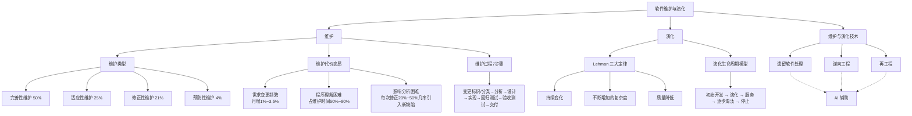

## 一句话总结

软件维护与一般工程领域的"保养维修"不同——软件不会磨损，其维护主要是"修改"（尤其是需求变更），维护成本高达开发成本的 3 倍以上；而软件演化则模糊了开发与维护的边界，通过持续修改让软件持续增值，延长产品的有效生命周期。

## 知识地图



## 核心概念

### 1. 软件维护的独特性

各个工程领域都会在产品交付后进行维护——但软件维护与一般工程领域的维护有本质不同：
- 软件**不会磨损**——不需要零件保养、维修与替换
- 软件维护主要是**"修改"**
- 软件特性上是**易于修改的**
- 软件只有**持续修改才能保持价值**

**IEEE 定义**（IEEE 610.12-1990）：软件维护是在交付之后修改软件系统或其部件的活动过程，以修正缺陷、提高性能或其他属性、适应变化的环境。

**软件变更的三个常见情景**：
- **问题发生了改变**：形势变化导致用户问题变化，产生新需求
- **环境发生了改变**：软件生存期内外界环境变化，需要修改以适应
- **软件产品中存在缺陷**：不可能建立完全无缺陷的软件，遗留缺陷在使用中暴露时必须及时解决

### 2. 四类维护（Lientz 1980）

| 类型 | 英文 | 目的 | 成本占比 |
|------|------|------|---------|
| **完善性维护** | Perfective | 满足用户新的需求、增加软件功能 | **50%** |
| **适应性维护** | Adaptive | 使软件能适应新的环境 | 25% |
| **修正性维护** | Corrective | 排除软件产品中遗留的缺陷 | 21% |
| **预防性维护** | Preventive | 提升软件可维护性，防止未来维护困难 | 4% |

**预防性维护的特殊性**：随着持续的修改，软件复杂度上升、质量下降。预防性维护是一种特殊类型的"修改"——不是为了增加功能或修正缺陷，而是为了解决"修改导致可维护性降低"的问题而进行的软件调整。

**Lehman 定律的启示**：在一个程序发生变更时，它的结构倾向于变得更复杂，因此需要投入一些额外的资源以在保持功能的同时简化程序结构。预防性维护就是这种"额外的资源"投入。

### 3. 软件维护的高昂代价

**维护成本是开发成本的 3 倍以上。**

**人员比例变化**（Jones 2006）：1975 年 17%（7.5 万人）→ 1990 年 47%（80 万人）→ 2005 年 76%（250 万人）。软件工程的成功绝不仅是开发的成功，**更要求维护工作的成功**。

**代价高的两大原因**：

**① 需求变更非常频繁**：
- 管理信息系统需求月增 ~1%，商业软件月增 ~3.5%
- 月增 2% ≈ 年增 1/4
- 需求可变性高达 48%（Stark 1999）

**② 维护工作困难**：

**程序理解**：维护人员通常不是代码编写者，需要全面理解整个软件系统的结构和行为。**维护时间的 50%~90% 被消耗在程序理解上**。困难在于：不同人的思维方式不同（不仅要读懂程序逻辑还要理解编写者思路），实践中很多软件项目文档不全或更新不及时，维护人员只能单纯依赖代码片段拼接来形成对系统的整体理解。

**影响分析**：程序代码与具体需求之间是**多对多的复杂关系**——每条需求被实现为相互联系的多个程序代码片段，每个程序代码片段同时承载多个具体需求的实现。修改一部分程序代码时可能影响到其他部分。**每修正一个缺陷，都有 20%~50% 的几率引入新的缺陷**。

### 4. 开发可维护的软件

很多软件维护中的困难和问题根源于软件开发阶段——虽然软件维护工作表现在软件交付之后，但需要在软件开发时就预备前期工作。

**考虑软件的可变更性**：
- 预测变更并将其独立封装，便于修改时的程序定义与理解，防止连锁反应
- 分析需求的易变性，尽可能发现和预测可能的变更
- 使用**关注点分离**和**信息隐藏**等设计思想为可能的变更进行设计

**为降低维护困难而开发**：
- 编写详细的技术文档并保持及时更新
- 保证代码的可读性
- 维护**需求跟踪链**（从正反两个方向记录需求、设计、编码、测试之间的跟踪与回溯关系）
- 维护**回归测试基线**（包含系统修改之前的有效测试用例集合）

### 5. 软件维护过程（7 步骤）

1. **问题/修改的标识、分类与划分优先级**（变更管理）：建立变更记录、赋予标识、分类、确定优先级、初步评估影响、决定是否接受、安排修改时间
2. **分析**：可行性分析（候选方案、影响范围、成本与效益）+ 详细分析（准确定义修改需求、标识需要修改的元素、确定测试策略、建立实现计划）
3. **设计**：依据变更分析结果和已有系统信息，完成对系统设计的变更。完善性/适应性维护需执行完整的详细设计过程；修正性维护要防止连锁负面效应；预防性维护要重点关注软件结构质量
4. **实现**：编码与单元测试、集成新修改代码、集成测试、风险分析和代码评审
5. **回归测试**：确保对变更的修改不会带来连锁负面效应，保证系统仍然能满足其他未被修改的需求
6. **验收测试**：由用户/客户/第三方验证系统是否满足变更请求
7. **交付**：配置审计、通知用户、开发阶段性版本、安装和培训

### 6. 维护 vs 演化

两者经常作为等价词使用，但软件演化有特殊含义——**一边"修改"已有软件，一边开发新的增量需求软件部分**，即演化有时是开发与维护的综合。

**Lehman 大型软件系统演化三大定律**：
1. **持续变化**：一个大型软件系统要么进行不断的变化，要么用处会越来越少
2. **不断增加的复杂度**：随着软件系统的发展，它的复杂性会不断增加，除非进行一定的工作来维持或降低复杂度
3. **质量降低**：系统的质量将出现下滑，除非进行一定的工作来适应环境变化

### 7. 软件演化生命周期模型

```
初始开发 → 演化 → 服务 → 逐步淘汰 → 停止
```

**初始开发**：按传统软件开发方式完成第一个版本。极其重要的工作是建立一个**好的软件体系结构**——具有很好的可扩展性（包容后续演化增量）、很好的可修改性（处理预期和未预期的变更）、比较坚实可靠（在后续演化中保持稳定）。详细设计也要关注可扩展性和可修改性，编程要关注可读性。

**演化**：保持软件产品的持续增值，让产品满足越来越多的需要。可能的演化增量包括：预先安排的需求增量、因问题/环境变化产生的变更请求、修正已有缺陷、因供需双方相互熟悉而新增的需求。演化阶段的软件产品需具备两个特征：①较好的可演化性（虽低于初始阶段但未到无法演化的地步）；②能帮助用户实现较好的业务价值。

**服务**：不再持续增加价值，只周期性修正已有缺陷。可能是因为软件结构已无法继续演化，或市场考虑不再重点关注。

**逐步淘汰**：开发者不再提供任何服务，但用户可能继续使用（容忍缺陷和不适应新环境）。开发者需考虑是否可作为遗留资源用于新软件开发。

**停止**：正式退出使用，开发者不再维护，用户也不再使用。

**团队规模**：初始阶段建立整体理解→演化阶段保留重要成员（体系结构师、需求工程师、重要设计人员）→服务阶段不需要保持这些角色，更多要求局部细节。

### 8. 遗留软件、逆向工程与再工程

**遗留软件的困难**：非常古老、规模很大、已经被严重修改过、基于过时技术、没有可用文档、找不到最初开发人员、但拥有大量有用数据、通常是业务核心元素——替换需要一大笔花费。

**四种处理策略**（按成本效益比和可维护性决定）：
| 条件 | 策略 |
|------|------|
| 无使用价值 | 直接丢弃 |
| 有使用价值但维护成本 > 新开发成本 | 冻结遗留软件，作为更大系统的组成部分 |
| 维护成本 < 新开发，且可维护性较好 | 逆向工程 + 继续维护 |
| 维护成本 > 新开发，且已不可维护 | **再工程**，然后继续维护再造后的系统 |

**逆向工程**：分析目标系统，标识系统的部件及其交互关系，使用其他形式或更高层的抽象创建系统表现的过程。基本原理是**抽取软件系统的需求与设计而隐藏实现细节**，在需求与设计的层次上描述软件系统以建立更准确和清晰的理解。成功应用场景：识别可复用资产、发现软件体系结构、推导概念数据结构、检测重复冗余、将二进制程序转换为源代码等。

**再工程**：检查和改造一个目标系统，用新的模式及其实现复原该目标系统。两类活动：①改进人们对软件的理解；②改进软件自身（提高可维护性、可复用性、可演化性）。常见活动：重新文档化、重组系统结构、转换为更新的编程语言、修改数据结构组织。**再工程之前通常都需要有前导的逆向工程**——先理解再修改。

## 难点突破

### 难点一：四类维护的区分

**容易混淆的点**：适应性维护和完善性维护都涉及"修改软件"——怎么区分？

**突破方法**：按触发原因区分：
- **修正性**：修复 bug（已有功能不对）
- **适应性**：环境变了（如操作系统升级、数据库迁移）——原有功能在新的环境中不能工作
- **完善性**：用户想要新功能（之前没有的功能）
- **预防性**：没有外部触发——开发者自己主动重构，为"未来"的维护做准备

**记忆口诀**：修 bug（修正）、换环境（适应）、加功能（完善）、主动优化（预防）。

### 难点二：演化生命周期模型各阶段的关键判断标准

**容易卡住**：什么时候从演化进入服务？什么时候从服务进入逐步淘汰？

**突破方法**：用两个维度的满足情况判断：

| 可演化性 | 业务价值 | → 所处阶段 |
|---------|---------|-----------|
| ✅ 较好 | ✅ 较好 | **演化** |
| ❌ 已不行 | ✅ 还行 | **服务** |
| ❌ 已不行 | ❌ 也不行了 | 直接**停止** |
| ✅/❌ | ✅/❌ | 市场考虑可提前进入服务 |

**核心逻辑**：业务价值决定"是否继续用"，可演化性决定"是否还能大改"。

## 与前章关联

- **依赖前章**：软件开发阶段（模块一~四）的设计质量直接决定后续维护的成本——信息隐藏（04-02）、开放式的体系结构（03-03）、需求跟踪链的建立（模块二）都是为维护所做的"前期预备工作"。演化模型（06-01）模糊了开发与维护的边界，与本章的演化生命周期模型直接呼应
- **为后续打基础**：本章是整门课程的收尾——从软件工程基础→需求→设计→构造→测试→交付→维护与演化，形成了完整的软件生命周期闭环

## 记忆卡片

**Q1**：软件维护与一般工程维护的本质区别是什么？
**A1**：软件不会磨损，不需要零件保养、维修与替换。软件维护主要是**"修改"**——特别是需求变更。软件只有持续修改才能保持价值。

**Q2**：四类软件维护及其成本占比？
**A2**：**完善性维护**（增加新功能）50% > **适应性维护**（适应新环境）25% > **修正性维护**（排除遗留缺陷）21% > **预防性维护**（提升可维护性）4%。

**Q3**：为什么软件维护代价如此高昂？请从两个维度说明。
**A3**：①**需求变更频繁**：管理信息系统月增~1%，商业软件月增~3.5%，需求可变性高达 48%；②**维护工作困难**：程序理解占维护时间 50%~90%（维护人员不是编写者+文档不全），影响分析困难（代码与需求多对多关系，每修正一个缺陷有 20%~50% 几率引入新缺陷）。

**Q4**：Lehman 的三大软件演化定律是什么？
**A4**：①**持续变化**——大型软件系统要么不断变化，要么用处越来越少；②**不断增加的复杂度**——除非进行一定工作来维持或降低复杂度；③**质量降低**——系统的质量将出现下滑，除非进行一定工作来适应环境变化。

**Q5**：软件演化生命周期模型的五个阶段？
**A5**：**初始开发**（建立好的体系结构）→ **演化**（持续增值，可演化性+业务价值均好）→ **服务**（不再增值，只修正缺陷）→ **逐步淘汰**（开发者不再服务，用户仍可继续使用）→ **停止**（正式退出使用）。

**Q6**：逆向工程和再工程的关系？
**A6**：**逆向工程**关注于**理解**软件（分析目标系统，抽取需求和设计），不修改软件；**再工程**关注于**修改**软件（用新的模式复原目标系统）。再工程之前通常都需要有前导的逆向工程——**先理解，再修改**。
