## 一句话总结

代码设计的核心目标不是"让代码跑起来"，而是**让代码易读、易维护、可靠**——通过格式规范、命名约定、注释文档、小任务分解、契约式设计、防御式编程和复杂度度量等工程化手段，将代码从"能工作"提升到"能长期维护"。

## 知识地图

```mermaid
flowchart TD
    CODE[代码设计] --> READ[设计易读的代码]
    CODE --> MAINTAIN[设计易维护的代码]
    CODE --> RELIABLE[设计可靠的代码]
    CODE --> COMPLEX[代码复杂度度量]
    CODE --> LLM[大模型辅助代码设计]
    CODE --> TEST[单元测试用例]
    CODE --> BEST[代码大全最佳实践]

    READ --> FORMAT[布局格式: 缩进/对齐/空行/分行]
    READ --> NAMING[命名规范: 有意义/符合惯例/避免混淆]
    READ --> COMMENT[注释: 语句/标准/文档注释 + Javadoc]

    MAINTAIN --> SMALL[小型任务: 高内聚低耦合]
    MAINTAIN --> DECISION[复杂决策简化: 布尔变量/方法封装/表驱动]
    MAINTAIN --> DATA[数据使用规范: 单一用途/无突兀数字]
    MAINTAIN --> DEP[明确依赖关系]

    RELIABLE --> CONTRACT[契约式设计: 前置条件/后置条件/不变式]
    RELIABLE --> EXCEPTION[异常方式]
    RELIABLE --> ASSERT[断言方式: assert Expression1 : Expression2]
    RELIABLE --> DEFENSE[防御式编程: 检查输入/外部依赖/返回值]

    COMPLEX --> MCCABE[圈复杂度 McCabe]
    MCCABE --> FORMULA[V = E - N + 2]
    MCCABE --> DECISION_COUNT[决策点计数法: if/while/for/case +1]
    MCCABE --> THRESHOLD[阈值: 0-5好 / 6-10需简化 / 10+必须拆分]

    LLM --> TABLE[决策表]
    LLM --> PSEUDO[伪代码]
    LLM --> FLOW[程序流程图]
    LLM --> PROMPT[Prompt四要素: Context/Goal/Format/Steps]

    TEST --> SPEC[基于规格: 等价类/边界值]
    TEST --> CODE_BASED[基于代码: 路径/分支/语句覆盖]
    TEST --> MOCK[Mock对象隔离依赖]
    TEST --> STATE[状态机测试]

    BEST --> VAR[变量: 定义/初始化/作用域/持续性/单一用途]
    BEST --> NUM[数值: 避免神秘数值/防除0/类型转换]
    BEST --> SUB[子程序: 降低复杂度/好命名/小体量]
    BEST --> CTRL[控制: 布尔表达式/复合语句/驯服深层嵌套]
```



## 核心概念

### 1. 设计易读的代码

代码可读性源于**维护的需要**和**团队协作的需要**。三个支柱：

**布局格式**：
- 使用缩进与对齐表达逻辑结构
- 将相关逻辑组织在一起（成员变量 → 构造方法 → public → protected → private 方法）
- 使用空行分割逻辑块和不同功能
- 语句分行：复杂表达式/长条件换行续写

**命名规范**：
- 使用有意义的名称（Sales 而非 ClassA）
- 类/属性/数据用名词，接口用名词或形容词，方法用动词或"动词+名词"
- 遵守语言惯例（Java：包小写、类首字母大写驼峰、变量首字母小写驼峰、常量全大写_连接）
- 临时变量用常规名（i/j 循环计数，c/s 字符）
- 避免：太长名称、易混字符（I/l/1、0/O）、不易区分的名称（Sales vs Sale）、无逻辑缩写

**注释**：
- 三种类型：语句注释 `//`、标准注释 `/* */`、文档注释 `/** */`
- 文档注释覆盖：包概述、类/接口描述、方法功能+接口定义、重要字段
- Javadoc 常用标签：`@author`、`@version`、`@param`、`@return`、`@throws`、`@see`、`@since`、`@deprecated`
- 内部注释要有意义，不简单重复代码；重视数据类型和复杂控制结构的注释

### 2. 设计易维护的代码

**小型任务**：每个方法应该内聚，恰好完成一个功能。如果完成一个功能需要多个步骤、代码较长，就分解为多个高内聚、低耦合的小型任务。

**复杂决策简化**：
- 引入布尔变量代替复杂条件表达式
- 将有意义的条件封装为方法（如 `if (isIdValid(id))` 代替 `if ((id>0) && (id<=MAX_ID))`）
- **表驱动编程**：用数组/Map 代替多层 if-else（如积分等级触发：用阈值数组 + 循环替代逐个判断）

**数据使用规范**：
- 不要将变量用于与命名不相符的目的
- 不要将单个变量用于多个目的
- 限制全局变量
- 不要使用突兀的数字与字符（定义为常量）

**明确依赖关系**：类之间模糊的依赖关系会导致修改时的连锁反应。

### 3. 设计可靠的代码

**契约式设计**（Design by Contract）：为方法定义前置条件（调用前必须满足）、后置条件（执行后必须保证）和不变式。

**异常方式**：用 `throw new PreException/PostException` 在条件不满足时抛出异常，适合正式的生产代码。

**断言方式**：用 `assert Expression1 : Expression2` 进行条件检查。`Expression1` 为 false 时抛出 `AssertionError`。适合开发和测试阶段的逻辑验证。

**防御式编程**：不能确保外界都是正确的，所以要保护方法内部不受损害。常见检查场景：
- 输入参数合法性
- 用户输入有效性
- 外部文件是否存在
- 对象引用是否为 NULL
- 数据库/网络连接是否正常

异常和断言都可以实现防御式编程，差异与契约式设计的实现选择一致。

### 4. 代码复杂度度量——圈复杂度（McCabe Cyclomatic Complexity）

程序复杂度是造成各种编程困难的主要原因。Dijkstra（1972）："有能力的程序员会充分认识到自己的大脑容量是多么地有限。"

**计算方法一**（图论法）：建立程序流程图 G，复杂度 V(G) = E（边数）- N（节点数）+ 2。

**计算方法二**（决策点计数法）：从 1 开始，每遇到 if / while / repeat / for / case 就加 1。

**阈值解读**（McConnell 2004）：
| 圈复杂度 | 评估 |
|----------|------|
| 0-5 | 子程序可能还不错 |
| 6-10 | 得想办法简化子程序 |
| 10+ | 必须把某个部分拆分成另一个子程序 |

**类的复杂度**（Chidamber 1994）：类的加权方法 WMC = Σ 每个方法的圈复杂度。

### 5. 大模型辅助代码设计

**传统方法**：决策表（条件-行动规则矩阵）、伪代码（结构化自然语言描述逻辑）、程序流程图。

**LLM 作为智能协作者**：
1. 从需求描述生成伪代码
2. 辅助决策逻辑设计（建议表驱动、消除深层 if-else 嵌套）
3. 复杂算法分步解释与实现
4. 代码重构建议（识别坏味道）

**有效 Prompt 四要素**：Context（背景与约束）、Goal（目标）、Format（语言/设计模式/风格）、Steps（要求逐步推理 Think step by step）。

**大模型辅助重构场景**：深层嵌套 → 卫语句/策略模式；高圈复杂度 → 提取方法；重复代码 → 抽取通用方法；魔法数字 → 具名常量。

**注意**：Human-in-the-Loop——大模型生成的代码必须经过 Code Review 和测试验证。

### 6. 单元测试用例开发

**两种线索**：
- **方法的规格** → 基于规格的测试（等价类划分、边界值分析）——黑盒方法
- **方法代码的逻辑结构** → 基于代码的测试（路径覆盖 → 关键复杂代码；分支覆盖 → 复杂代码；语句覆盖 → 简单情况）

**Mock 对象**：模拟依赖对象，用于隔离被测方法。例如测试 `Sales.total()` 时 Mock `SalesLineItem`，控制 `subTotal()` 返回值。

**状态机测试**：复杂类的多个方法间互相依赖，每次方法执行改变类状态后影响其他方法——需要用状态图覆盖状态转换序列。

**LLM 辅助测试**：自动生成等价类/边界值数据、路径覆盖用例、Mockito Mock 代码、状态转换序列测试用例。

### 7. 代码大全（Code Complete）最佳实践

**变量**：关闭隐式声明、声明时初始化、靠近第一次使用处声明、使用 final/const、减小作用域（空间+时间）、单一用途、避免隐含意义。

**数值**：避免"神秘数值"（硬编码常量）、预防除 0、使类型转换明显、避免混合类型比较。整数注意除法和溢出；浮点数避免大数量级差加减、避免等量判断（10×0.1 ≠ 1）。

**子程序**：创建理由——降低复杂度、引入易懂抽象、避免重复、支持子类化、隐藏细节。好命名——描述所做所有事、用强动词+宾语（printDocument）、对仗词配对（add/remove）。

**控制结构**：布尔表达式用 true/false 而非 0/1；简化复杂表达式（拆分+引入布尔变量/函数）；用 DeMorgan 定律简化否定判断；驯服深层嵌套（break 块、转 if-then-else/case、抽取子程序）。

## 难点突破

### 难点 1：表驱动编程 vs 传统 if-else

表驱动编程将"条件和行动"分离为数据（数组/Map），用循环替代多层判断。

**对比示例**（积分等级触发）：
```
传统方式：三个 if 逐个判断 1000/2000/5000 阈值
表驱动：threshold[] = {1000, 2000, 5000}，循环一次搞定
```

**何时用表驱动**：条件判断逻辑呈规律性、阈值可枚举、新增条件只需加数据不改变代码结构。

### 难点 2：圈复杂度的两种计算方法与区别

- **图论法**（V = E - N + 2）：需要画流程图，适合纸笔考试和理论分析
- **决策点计数法**（从 1 起，遇 if/while/for/case 加 1）：无需画图，直接看代码，适合日常开发

两种方法结果相同。关键是记住阈值：**10 是硬上限**——超过 10 必须拆分。

## 与前章关联

本章是软件工程"详细设计"模块的补充延伸：
- **04-01 详细设计** 讲了设计的基本概念和原则 → 本章深入到代码层面的具体实践
- **04-02 面向对象的模块化与信息隐藏** 讲了模块化原则 → 本章的"小任务分解"和"明确依赖关系"正是模块化在代码层的落地

## 记忆卡片

**Q1：代码可读性的三个支柱是什么？**\
A：布局格式（缩进对齐/逻辑分组/空行分割）、命名规范（有意义/符合惯例/避免混淆）、注释（文档注释 Javadoc + 内部注释有意义）。

**Q2：契约式设计中前置条件、后置条件和不变式分别是什么？Java 中如何实现？**\
A：前置条件 = 调用前必须满足的条件；后置条件 = 执行后必须保证的条件；不变式 = 始终为真的性质。Java 中可以用异常（throw）或断言（assert Expression1 : Expression2）实现。

**Q3：圈复杂度（McCabe）的两种计算方法和阈值分别是？**\
A：方法一 V(G) = E（边数）- N（节点数）+ 2；方法二 决策点计数（从 1 起，遇 if/while/for/case 加 1）。阈值：0-5 好，6-10 需简化，10+ 必须拆分子程序。

**Q4：大模型辅助代码设计的有效 Prompt 四要素？**\
A：Context（背景与约束）、Goal（目标）、Format（语言/设计模式/代码风格）、Steps（要求逐步推理 Think step by step）。

**Q5：表驱动编程解决什么问题？什么场景适用？**\
A：用数组/Map 存储条件-行动映射，替代多层 if-else，消除深层嵌套。适用场景：条件判断呈规律性、阈值可枚举、新增条件只需加数据不改变代码结构。
