## 一句话总结

设计模式是对反复出现的面向对象设计结构的抽象——它们不是代码，而是**可复用的设计经验**。本章通过策略、抽象工厂、单件和迭代器四个模式，展示了如何通过"接口与实现分离"实现可修改性（M/E/C），其中的核心设计原则是：**减少耦合、依赖倒置、职责抽象、接口重用**。

## 知识地图

```mermaid
flowchart TD
    MOD[可修改性] --> M[可修改性 M: 修改现有实现]
    MOD --> E[可扩展性 E: 增加新实现]
    MOD --> C[灵活性 C: 动态配置实现]
    MOD --> SEP[接口与实现分离]
    SEP --> INTERFACE[实现接口: interface定义规约, class实现规约]
    SEP --> INHERIT[继承: 父类接口→子类实现]
    SEP --> COMPOSE[组合: 前后端解耦, 动态配置]

    PATTERN[设计模式 Design Pattern] --> DEFINITION[抽象反复出现的设计结构]
    PATTERN --> ELEMENTS[要素: 典型问题→设计分析→解决方案→案例]

    PATTERN --> STRATEGY[策略模式 Strategy]
    PATTERN --> ABSTRACT_FACTORY[抽象工厂模式 Abstract Factory]
    PATTERN --> SINGLETON[单件模式 Singleton]
    PATTERN --> ITERATOR[迭代器模式 Iterator]

    STRATEGY --> STRAT_DEF[定义算法族, 分别封装, 可互相替换]
    STRATEGY --> STRAT_PARTS[Context + Strategy接口 + ConcreteStrategy]
    STRATEGY --> STRAT_USE[消除switch语句, 动态选择策略]

    ABSTRACT_FACTORY --> AF_DEF[创建对象接口, 子类决定实例化哪个类]
    ABSTRACT_FACTORY --> AF_PARTS[AbstractFactory + ConcreteFactory + AbstractProduct + ConcreteProduct]
    ABSTRACT_FACTORY --> AF_USE[隔离产品创建, 解决组合爆炸, 产品族一致性]

    SINGLETON --> SING_DEF[确保类只有一个实例, 提供全局访问点]
    SINGLETON --> SING_IMPL[私有构造+静态getInstance+静态引用变量]

    ITERATOR --> ITER_DEF[顺序访问聚合元素, 不暴露内部表示]
    ITERATOR --> ITER_PARTS[Iterator接口+ConcreteIterator+Aggregate+ConcreteAggregate]
    ITERATOR --> ITER_USE[统一遍历接口, 多遍历方式, 简化聚合接口]
```

## 核心概念

### 1. 可修改性（Modifiability）的三个维度

设计模式的目标是实现系统的可修改性，从三个维度衡量：

| 维度 | 含义 | 示例 |
|------|------|------|
| **M（可修改性）** | 对已有实现的修改不影响客户代码 | 修改促销策略的计算方式 |
| **E（可扩展性）** | 增加新实现不需修改客户代码 | 增加一种新的促销策略 |
| **C（灵活性）** | 运行时动态配置实现 | 动态切换某商品的促销策略 |

**实现手段——接口与实现的分离**：

Java 中的两种方式：
1. **接口（interface）+ 实现类**：`interface` 定义规约，`class` 实现规约
2. **继承**：父类定义接口和默认实现，子类覆盖实现

**继承 vs 组合**：
- **继承的优点**：子类继承父类的接口和实现，代码重用方便
- **继承的缺点**：父类与所有子类存在共有接口的耦合——父类接口改变时所有子类必须改；子类创建时实现即固定，无法动态修改
- **组合的优点**：前后端在接口上无耦合，后端实现可动态创建/配置/销毁，非常灵活

### 2. 设计模式概述

> "Expert designers know not to solve every problem from first principles. They reuse solutions."

设计模式是对反复出现的设计结构的抽象，包含类/对象的依赖、结构、交互和约定。它提炼了设计经验。

**模式的四个要素**：
- **典型问题**：模式要解决的场景
- **设计分析**：为什么这样设计
- **解决方案**：组成与协作（涉及的类、相互关系、职责）、应用场景（何时使用）、使用注意点
- **案例**：具体代码示例

设计模式不是具体的实现，而是解决方案的抽象模板——可应用于多种不同场合。

### 3. 策略模式（Strategy Pattern）

**典型问题**：雇员薪酬支付——钟点工（时薪×工时，每周三付）、月薪（固定月薪，每月21日付）、提成制（销售额×提成比率，隔周付）。潜在变化：支付方式可能修改（M）、支付频率可能新增（E）、雇员可能切换支付方式（C）。

**定义**：策略模式定义了算法族，分别封装起来，让它们之间可以互相替换。此模式让算法的变化独立于使用算法的客户。

**参与者**：
- **Context（上下文）**：被配置了具体策略，持有 Strategy 引用，可提供方法让 Strategy 访问其数据
- **Strategy（策略接口）**：声明所支持策略的接口
- **ConcreteStrategy（具体策略）**：实现 Strategy 接口的具体算法

**使用的设计原则**：
- **减少耦合**：策略使用类与策略实现类之间的耦合降低
- **依赖倒置**：Context 依赖的是 Strategy 接口，而非具体实现类

**应用场景**：多个相关类仅在行为实现上不同；需要同一行为的不同变体；需要隐藏复杂算法和数据接口；一个类有很多行为且表现为 switch 分支时。

**注意点**：客户必须提前知晓各种策略；Context 和 Strategy 之间的通讯有代价；策略模式会创建较多对象。

**关键洞察**：组合使 Context 可以维护策略队列实现 n 选多（动态配置），而继承只能在 n 种实现里 n 选一（创建时即固定）。

### 4. 抽象工厂模式（Abstract Factory Pattern）

**典型问题**：对象的创建往往比较复杂且特殊——构造方法无法多态。当 Client 代码中分布着创建对象的复杂判断，且需要创建"多种对象"并灵活组合时（如汽车由引擎/轮胎/车身组成，每种部件有多种型号），简单的工厂模式会遭遇"组合爆炸"。

**定义**：抽象工厂模式定义了一个创建对象的接口，由子类决定要实例化哪一个类。工厂方法让类的实例化延迟到子类。

**参与者**：
- **AbstractFactory**：声明创建抽象产品的接口
- **ConcreteFactory**：实现具体产品的创建（如 DellPcFactory 创建 DellMouse + DellKeybo）
- **AbstractProduct**：声明一种产品的接口
- **ConcreteProduct**：具体产品，实现 AbstractProduct 接口
- **Client**：使用 AbstractFactory 和 AbstractProduct

**核心理念**：提供两套接口——工厂接口（创建不同对象的行为稳定）和产品接口（产品行为稳定）——实现工厂多态和产品多态的双重灵活性。

**应用注意**：隔离了客户和具体实现；产品配置灵活；产品族内一致性容易保证。但**限制是**：对新产品类型的支持困难——抽象工厂的接口一旦定义好就不容易变更。即具体产品的种类必须是稳定的。

**工厂方法模式（Factory Method Pattern）**：抽象工厂模式的变体——通过父类的工厂方法让子类继承工厂接口。

### 5. 单件模式（Singleton Pattern）

**典型问题**：在某些场景中，某个类在内存中只希望有唯一一个对象存在。无论创建多少次，总共只创建了一个对象。

**定义**：单件模式确保一个类只有一个实例，并提供一个全局访问点。

**实现要点**：
1. 构造方法变为 **private**（防止外部 new）
2. 类中有一个**静态的私有引用变量** `uniqueInstance`
3. 提供 `public static getInstance()` 方法：
   - 如果 `uniqueInstance == null` → 首次创建：`new` 并赋值
   - 否则 → 返回已存在的引用

**使用的设计原则**：职责抽象——隐藏单件创建的实现。

### 6. 迭代器模式（Iterator Pattern）

**典型问题**：方法 `g()` 需要对集合进行遍历操作，但把具体集合类型（LinkedList/HashSet/Collection/Map）作为参数会导致灵活性不足；而且传递集合引用允许被调用方修改原集合，增强了耦合。

**定义**：迭代器模式提供一种顺序访问一个聚合对象的各个元素，而不暴露其内部表示。

**参与者**：
- **Iterator**：定义访问和遍历元素的接口（`hasNext()` + `next()`）
- **ConcreteIterator**：实现 Iterator 接口，跟踪遍历当前位置
- **Aggregate**：定义创建相应迭代器对象的接口
- **ConcreteAggregate**：实现创建迭代器的接口，返回 ConcreteIterator 实例

**应用场景**：访问聚合内容但不暴露内部实现；支持多种遍历方式；为不同聚合结构提供统一遍历接口。

**关键优势**：迭代器只提供访问方法（hasNext/next），屏蔽了修改方法，对集合做到了类似"值传递"的效果——调用方无法通过迭代器修改原集合。

**使用的设计原则**：Programming to interfaces（面向接口编程）。

## 四种模式对比

| 维度 | 策略模式 | 抽象工厂模式 | 单件模式 | 迭代器模式 |
|------|---------|-------------|---------|-----------|
| **解决问题** | 行为/算法的多变 | 对象创建的复杂组合 | 唯一实例的需求 | 遍历方式与集合类型解耦 |
| **核心手段** | Context + Strategy 接口 | Factory 接口 + Product 接口 | 私有构造 + getInstance | Iterator 接口屏蔽内部结构 |
| **关键设计原则** | 减少耦合 + 依赖倒置 | 职责抽象 + 接口重用 | 职责抽象 | 面向接口编程 |
| **灵活性来源** | 组合——策略可动态替换 | 工厂多态 + 产品多态双重灵活 | 全局唯一访问点 | 统一遍历接口 |
| **主要代价** | 对象数量增多 | 新产品类型难增加 | 全局状态引入耦合 | 遍历中不能修改聚合 |

## 难点突破

### 难点 1：继承 vs 组合的选择——策略模式的精髓

继承把"n 选一"固定在编译期，组合把"n 选多"推迟到运行时。这是理解策略模式最关键的跳跃：

- **继承方式**：`Context` 的子类各自实现不同行为 → 对象创建时行为就确定了
- **组合方式**：`Context` 持有 `Strategy` 接口引用 → 可以 `setStrategy()` 随时切换，甚至维护策略队列

**面试常考点**：为什么策略模式用组合而不是继承？答：① 组合使 Context 与 Strategy 接口耦合而非具体实现（依赖倒置）；② 组合支持运行时动态切换策略（继承只能在创建时选定）；③ 组合支持策略队列实现"n 选多"。

### 难点 2：抽象工厂的"组合爆炸"与解决思路

普通工厂模式：为每种产品组合创建一个工厂类 → 工厂数 = 产品种类数的乘积（组合爆炸）。

抽象工厂模式：工厂接口为**每种产品类型**定义一个创建方法，由具体工厂实现。一个具体工厂对应一个产品族（如 Dell 族 = Dell 鼠标 + Dell 键盘），产品族数 = 品牌数。新增一个品牌只需新增一个 ConcreteFactory——产品类型的稳定性是抽象工厂的前提。

## 与前章关联

本章是软件工程中面向对象设计的核心内容，直接承接：
- **04-01 详细设计**：模块化、耦合/内聚原则 → 设计模式是这些原则在常见场景下的具体应用
- **04-02 面向对象的模块化与信息隐藏**：接口与实现分离 → 所有四种模式都是这一原则的不同运用方式
- **补充-代码设计**：契约式设计/防御式编程 → 设计模式从结构层面保证了可修改性，代码设计从实践层面保证了可维护性

## 记忆卡片

**Q1：可修改性的三个维度（M/E/C）分别指什么？设计模式通过什么核心手段实现？**\
A：M（Modification）= 修改现有实现不影响客户代码；E（Extension）= 增加新实现不需修改客户代码；C（Configuration）= 运行时动态配置实现。核心手段：**接口与实现的分离**（Interface + 实现类、继承、组合）。

**Q2：策略模式的定义和三个参与者？**\
A：**定义**：策略模式定义算法族，分别封装，让它们可互相替换，使算法变化独立于使用算法的客户。**参与者**：Context（持有 Strategy 引用，可提供数据访问）、Strategy（声明策略接口）、ConcreteStrategy（实现具体算法）。关键设计原则：减少耦合 + 依赖倒置。

**Q3：抽象工厂模式解决了什么问题？与普通工厂模式的区别？**\
A：解决"多种对象的创建+灵活组合"导致的**组合爆炸**问题。普通工厂为每种组合建一个工厂 → 数量爆炸；抽象工厂提供工厂接口（每种产品类型一个创建方法）和产品接口两套抽象，具体工厂对应产品族。限制：新产品类型难以增加（接口稳定是前提）。

**Q4：单件模式（Singleton）的 Java 实现三要素？**\
A：① 构造方法设为 **private**；② 类内维护 **private static** 的自身类型引用变量 `uniqueInstance`；③ 提供 **public static getInstance()** 方法，首次调用时 new 并赋值，后续直接返回已存在实例。

**Q5：迭代器模式解决了哪两个核心问题？**\
A：① **遍历方式与集合类型解耦**——方法参数用 Iterator 接口而非具体集合类型，可灵活替换 LinkedList/HashSet 等；② **值传递效果**——Iterator 只暴露 hasNext()/next() 访问方法，屏蔽修改方法，防止被调用方意外修改原集合。
